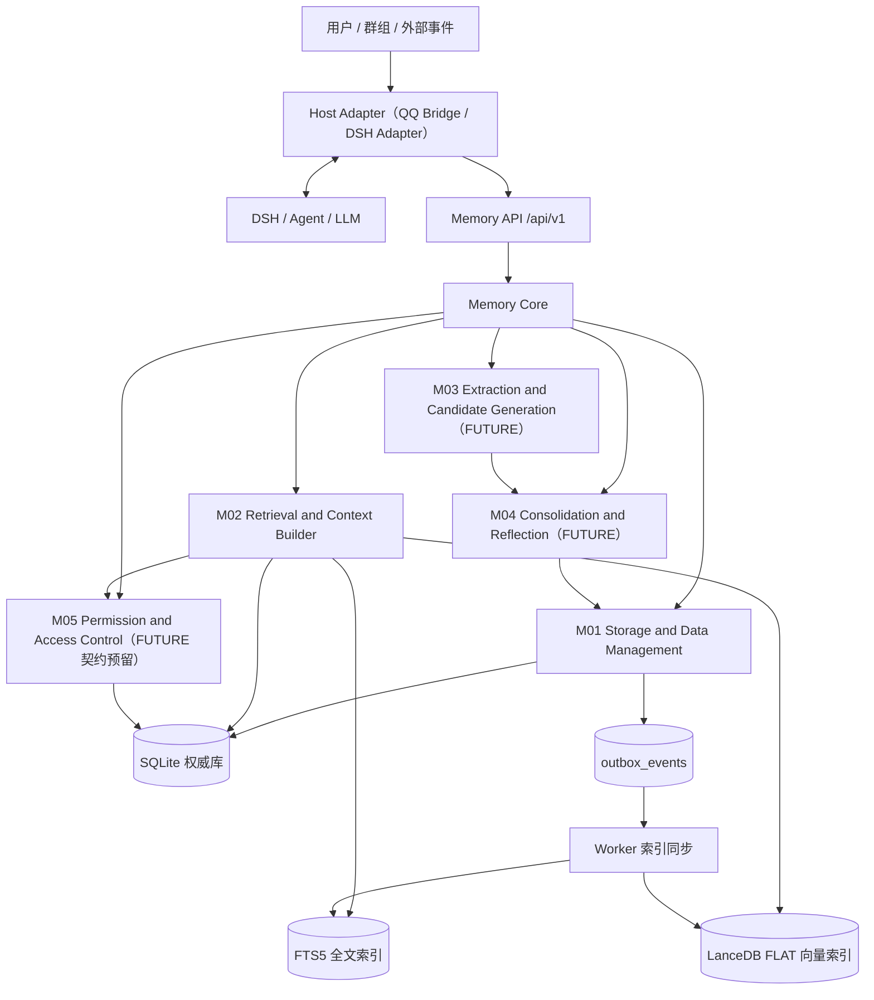
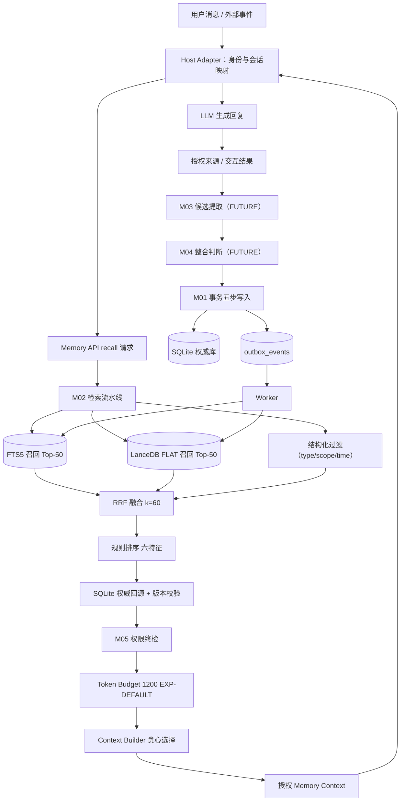
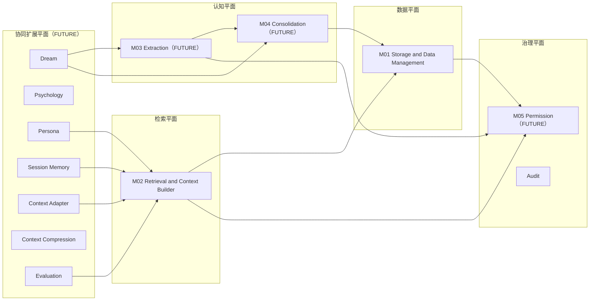

# 00 — 总体架构与设计原则

> 文件代号：00 ｜ 所属交付：Memory Core R4.1 全量详细设计（DD）｜ 设计 Agent 组：A 组（00/01/02）
> 基准文件：`DD-AUTHORITY.md` v1.0（本文件的最高行为依据）
> **⚠️ V2 架构升级（2026-11-04，用户《统一架构升级与设计文书迭代总任务书》）**
> 本文件已按 V2 升级：基准文件新增 **`DD-AUTHORITY-V2.md`（效力高于本文任何 v1 表述）**；冲突登记见 **`DOCUMENT-CONFLICT-REGISTER-V2.md`**。
> 关键变更（详见 §0）：①生命周期拆为 `memory_tier`(L1/L2/L3) + `status` + `candidate.status` 三层（取代单一 `lifecycle_state`）；②`content_kind` 废弃，语义由 `semantic_type`(6 类) + `semantic_tags`(多标签) + `source_type`(5 值) 表达；③检索改为**五阶段 + 8 锚点路由**；④新增 **Memory Ingestion Pipeline**（16 阶段）；⑤新增 **MemoryUnit / Event / EmotionContext / PersonProfile** 四对象；⑥新增 **9 个 Memory Read/Write API**（聊天 LLM 主动读写）；⑦路线图扩为 **P0–P6**（**实施授权不变**：当前仍 P0–P3=M01+M02，P3–P6 需阶段授权）；⑧文档体系扩为 **00–15 共 16 份**。
> 本文与台账冲突的 7 项（CR-01~CR-07）一律"保留原裁决 + 标记重新裁决"，登记 OI-025~OI-031。

---

# 0. V2 架构升级摘要（本文件的新增首章）

## 0.1 V2 五条核心原则（任务书 §2.2，MUST）

1. **多维组织，不采用单一分类树**：一条记忆同时具有生命周期(tier)、语义类型、主体、获取锚点、证据来源、可信度、权限、时间有效性、情感关联 —— **九个维度相互独立**，不得用一个文件夹或标签承担全部职责。
2. **人物理解优先**：人物理解任务默认获取顺序 = SELF_EXPLICIT → PERSON_PROFILE → PREFERENCE → SELF_DERIVED → 相关 RELATIONSHIP → 相关 EVENT（**非**所有查询的固定顺序；明确自述优先于系统推断）。
3. **记忆单元碎片化，原始证据完整保留**：MemoryUnit 必须可独立理解/检索/更新；Evidence 必须保留原句，支持从记忆反向追溯原句。
4. **事实与情绪分离**：事件事实（Event.content）与事件情绪（EmotionContext）分别存储；情绪不得成为事实的一部分。
5. **LLM 理解，规则控制，数据库执行**：LLM 无数据库写权限，只产生结构化候选与读取请求；规则负责校验/权限/冲突/流程；M01 负责权威落库。

## 0.2 V2 系统定位（任务书 §2.1）

Memory Core **不是**聊天记录数据库、不是普通知识库、不是单纯向量检索系统，而是**聊天 LLM 的长期信息管理系统**。核心职责：
理解用户信息 → 整理为可独立使用的记忆单元 → 保留原始证据 → 维护人物/关系/事件/状态 → 当前对话需要时准确提供 → 允许聊天 LLM 主动查询与提议写入 → 通过记忆保持长期互动连续性 → 管理事件情绪与当前心理状态的**有限**关联。

**最终目标**：不把过去的全部聊天重新塞进上下文，而是让聊天 LLM 在需要时获得最有价值、最相关、最可靠的信息。

## 0.3 V2 十七项正式能力（MUST NOT 标为可选或无限期 Future）

自动记忆摄取 ｜ LLM 协作式语义理解 ｜ 信息自动碎片化 ｜ 多维度语义分类 ｜ 独立记忆获取锚点 ｜ 人物核心信息优先获取 ｜ 生命周期与语义类型解耦 ｜ 原始证据与原句追溯 ｜ 聊天 LLM 主动读取 ｜ 聊天 LLM 主动提出写入 ｜ 人物画像持续整合 ｜ 事件事实与情绪关联分离 ｜ 事件情绪对当前情绪的有限影响 ｜ 多模型能力分级和动态调用 ｜ 自动去重/冲突检测/版本维护 ｜ 统一权限控制 ｜ 可观察/可配置/可验证运行体系

> 这 17 项**属于 V1 必须解决的系统能力**；可**分阶段实施**（P3–P6 需阶段授权），但 MUST 在 V1 架构、数据模型、接口与验收体系中完整定义。

## 0.4 V2 模块定位表（任务书 §3.2）

| 模块 | 正式职责 |
|---|---|
| M01 | 权威存储、数据版本、事务、证据与关联数据管理 |
| M02 | **锚点路由**、混合检索、排序、证据获取、上下文构建 |
| M03 | 记忆候选生成、结构化提取、**语义碎片化** |
| M04 | 记忆整合、**人物画像维护**、冲突处理、视图维护 |
| M05 | 权限、访问控制、可见性、读写保护 |
| **Ingestion Pipeline** | 协调摄取流程（16 阶段），**不替代 M03**、不直写库、不绕 M05 |
| **Memory API** | 聊天 LLM 统一读取与写入入口（9 接口） |
| **Psychology** | 当前情绪状态与事件情绪关联的**有限影响**管理（独立模块，不得并入 M01–M05） |

**模块边界铁律**：M03、M04、Ingestion Pipeline **三者不得重复承担同一职责**；Psychology 必须通过正式接口交互。

## 0.5 V2 文档体系（16 份，任务书 §21）

| 编号 | 文档 | 承担的 V2 能力 |
|---|---|---|
| 00 | 总体架构与设计原则 | 架构总纲/模块职责/五原则/索引 |
| 01 | 记忆本体与数据模型 | MemoryUnit/Evidence/Event/EmotionContext/PersonProfile + SQLite Schema |
| 02 | 核心算法规范 | 五阶段检索/Anchor Router/RRF/画像整合/ΔE/去重冲突 |
| 03 | 系统运行与协作协议 | Pipeline 编排/9 API/Outbox/事务/幂等 |
| 04 | 权限与治理规范 | 全链路权限/visibility/证据权限继承 |
| 05 | 可靠性与运维规范 | 新故障矩阵（LLM/LanceDB/情感/画像/证据） |
| 06 | 测试与评估规范 | 8 组新测试体系 |
| 07 | 扩展与演进规范 | P0–P6 路线图/新对象迁移 |
| 08 | DSH 与 QQ Bridge 集成 | 聊天 LLM 接入/Psychology 边界/L3 事件 |
| **09** | **记忆摄取 Pipeline** | 16 阶段详细设计 |
| **10** | **LLM 调用体系** | L1/L2/L3 分级/动态调用/能力测试集 |
| **11** | **Memory Anchor 与语义分类** | 8 锚点/6 类语义/多标签/人物优先 |
| **12** | **人物画像整合** | 11 分区/basis 三值/自述优先 |
| **13** | **Evidence 与 EmotionContext** | 4 种读取模式/原句追溯/事实情绪分离/ΔE |
| **14** | **Chat LLM 读写 API** | 9 接口详情/主动读写链路 |
| **15** | **参数注册表** | 15 属性 × 全部参数/启用门禁 |

## 0.6 旧→新术语与模型映射（MUST，禁止两套并存）

| v1（本文件旧表述） | v2（唯一有效） |
|---|---|
| lifecycle_state（六值） | memory_tier(L1/L2/L3) + status(ACTIVE/SUPERSEDED/ARCHIVED/DELETED) + candidate.status(6 值) |
| content_kind（八值） | 废弃 → semantic_type + semantic_tags + source_type |
| 	ype（七值） | semantic_type(6 值) + semantic_tags（映射表见 DD-AUTHORITY-V2 §4.1） |
| scope（五值） | isibility(三值，对外) + scope(五值，内部细分)；映射见 §4.3 |
| 三路召回 | 五阶段检索（锚点路由 + 混合检索） |
| 候选→M04→M01 | 候选→**Pipeline 16 阶段**→M03/M04→M01 |
| P0–P3 / P4+ Future | P0–P6（**实施授权不变**） |

---

---

## 1. 文档状态

| 项目 | 内容 |
|---|---|
| 文件编号 | 00 |
| 文件名称 | 总体架构与设计原则 |
| 当前版本 | 1.0 |
| 设计状态 | **PROPOSED**（设计成稿，未获用户逐条批准；正式裁决部分另见 §5） |
| 实施授权 | **无**。本文件不授予任何代码实施权限（依据 `DD-AUTHORITY.md` §1「设计完成 ≠ 实施授权」） |
| 完成等级自评 | **F2 已达成**；F3 部分达成（本文件给出验收项与判定条件，但无测试数据/实测结果，**不得**声明 F3/F4 通过） |
| F4 | **未达成**，且本次任务不要求（sf 后文 §九「F4：实践验证」） |
| 撰写依据 | m.md 第二十一部分 00 条目 + sf 后文（L3878–6731 总规范）§1/§3.1 00 条目 + sf 冻结任务书（L6732–8081）§三 3.1 |
| 语言/编码 | 中文／UTF-8（无 BOM） |

**分节状态矩阵**

| 章节 | 状态 | 说明 |
|---|---|---|
| §7.2 三组件 + 五平面 | APPROVED（裁决 R3/R4） | 组件=部署边界、平面=逻辑职责，二者并存 |
| §7.4 A/B 层迁移定位 | APPROVED（硬约束 §5.2 + m.md §2.1 方向） | 具体字段映射表在 01 文档，状态 PROPOSED |
| §7.8 技术选型表 | EXP-DEFAULT | 全部为实验初值，**不得**写成已裁决 |
| §7.9 系统不变量 | APPROVED（sf 后文 §1.4 原文 12 条） | 逐条编号 INV-01…INV-12 |
| §7.11 实施范围 | APPROVED（m.md 第二十三 + sf 后文 §13 一致） | P0–P3 = M01 + M02 |
| LanceDB FLAT 执行路径 | **VERIFY** | P0 必须真实验证 Node SDK 行为，否则 BLOCKED |
| §7.7 扩展模块 | **FUTURE** | Dream/Psychology/Persona/Session/Context Adapter/Context Compression/Evaluation |

---

## 2. 适用版本

| 维度 | 版本值 | 说明 |
|---|---|---|
| 母本版本 | `R4.1-MASTER-01` | m.md 文首声明 |
| 规范基准 | `R4.1 Specification Baseline` | sf 后文 L3882 |
| 任务书编号 | `MC-R41-DESIGN-FREEZE-01` | sf 后文 L6735 |
| 基准裁决文件 | `DD-AUTHORITY.md` v1.0（APPROVED，2026-11-04 用户指令） | 冲突时以本文件为最高行为依据 |
| 正式裁决台账 | `08-adjudication-ledger.md`（391 行，第六轮后状态） | 唯一权威裁决来源 |
| 本节 Schema 版本 | `schema_version = "1.0"` | 与 `contracts/schemas/memory-object.schema.json` 一致 |
| API 版本 | `/api/v1/` | m.md §15.1；状态 PROPOSED（裁决 R8） |
| 算法版本 | `algorithm_version = "1.0"` | 与响应 `meta.algorithm_version` 一致 |

**版本兼容规则（MUST）**：任意两份文档若引用同一对象的版本号不同，以本文件 §7.12 的六版本模型为准；不一致时不得自行取舍，必须登记 OI 并等待裁决。

---

## 3. 适用范围

### 3.1 覆盖范围（本文档内有效）

1. 系统定位、总体架构、模块职责与依赖、数据流总图。
2. A/B 原有记忆体系的迁移定位（语义保留，落地字段见 01）。
3. 时间尺度三层（Session / Working / Long-term）与晋升规则。
4. M01–M05 职责边界与"不负责"清单。
5. 扩展模块边界（FUTURE）。
6. 技术选型表（全部 EXP-DEFAULT）。
7. 系统不变量 12 条。
8. 设计状态与用语规范。
9. 实施范围 P0–P3 与 P4+ 边界。
10. 版本策略与模块完成标准 F1–F4。

### 3.2 明确不覆盖（FUTURE / 不实施）

| 对象 | 状态 | 边界说明 |
|---|---|---|
| M03 自动候选提取 | **FUTURE** | 设计先行；P0–P3 不实施（sf 后文 §3.3、§13.2） |
| M04 自动整合/反思 | **FUTURE** | 同上（sf 后文 §3.4） |
| M05 完整权限引擎 | **FUTURE** | 但 M02 必须预留权限终检契约（sf 后文 §3.5、§13.3） |
| Dream 周期维护 | **FUTURE** | sf 后文 §10.1 |
| Psychology | **FUTURE／DEFERRED** | I-3/I-4/I-7、X-1/X-2/X-3、X-6（台账 I-7/X-6 暂缓） |
| Persona | **FUTURE** | m.md §13.2 |
| Session Memory | **FUTURE** | m.md §14.1、X-2 |
| Context Compression | **FUTURE** | 独立于 Memory Core（m.md §14.2） |
| Context Adapter 实现 | **FUTURE** | 本文件只定义其边界 |
| 缓存库 `cache.sqlite` 表结构/校验实现 | **DEFERRED 至实施阶段** | 台账 U-1/U-2（不得在本阶段冻结表结构） |
| Graphiti 旁路索引 | 仅登记，**不启动** | 台账 优化-3 |
| psy-model 引入 | **BLOCKED／暂缓** | 台账 I-7 / X-6 |

### 3.3 读者对象

代码 Agent（P0–P3 实施 M01+M02）、测试 Agent、审查 Agent、后续 03–08 文档撰写 Agent。

---

## 4. 依赖文档

| 编号 | 文件 | 用途 | 权威层 | 读取范围 |
|---|---|---|---|---|
| D1 | `_sources/m.md`（2156 行） | 母本总则 | 第三层 | 全文 |
| D2 | `_sources/sf.md`（8081 行） | 最新规 | 第三层（后文优先） | L3878–6731 总规范；L6732–8081 冻结任务书；L3085–3170 关系/索引框架 |
| D3 | `08-adjudication-ledger.md`（391 行） | 正式裁决 | **第一层** | 全文 |
| D4 | `03-m01.md` / `03-m02.md` | 冻结设计 | 第二层 | D1–D40 / D1–D27 决策编号与验收表 |
| D5 | `data-samples/*`（A 层 jsonl、B 层 json） | 真实数据格式 | 事实证据 | 前若干行 + 字段分布 |
| D6 | `Memory-Core-R4.1-Design/DD-AUTHORITY.md` | 基准与冲突裁决 | 最高行为依据 | 全文（§4 R1–R10、§5、§6、§8） |
| D7 | `contracts/schemas/*.schema.json`（已有 12 个） | 机器级契约 | 派生契约（PROPOSED） | memory-object / evidence / candidate / observation / relation / search-document / embedding-space / outbox-event / permission-context / retrieval-request / retrieval-response / context-response |
| D8 | `01-记忆库项目设计宗旨与统一设计原则.md` | 九问评估标准 | 横切评估 | 全文 |
| D9 | `06-最小记忆闭环验收标准.md` | A1–A15 验收项 | 第二层 | 全文 |

**依赖关系约束**：本文件**不得**引用 03–08 文档中尚未成稿的条款作为依据；如必须交叉引用，一律写"见 0x（待成稿）"，状态标 TBD。

---

## 5. 正式裁决引用

> 引用格式：（台账 D-AP-05）。只有本表列出的条目才允许在正文写"已裁决"；其余一律 PROPOSED/TBD。

| 台账编号 | 裁决要点（摘要） | 对本文档的约束 |
|---|---|---|
| D-AP-01 | 维持五模块边界；M03 与 M04 不可合并 | §7.6 边界表按五模块编写，禁止合并叙述 |
| D-AP-02 | M04 §6.2 为唯一 LLM Gateway 入口；Embedding Provider 归 M01 | §7.3 依赖矩阵标注：LLM 调用口唯一；Embedding 归 M01（M02 只经 Adapter 调用） |
| D-AP-03 | 接受 P0 平台层为横切能力宿主；不新增第六模块、不新增进程 | §7.3 明确横切能力 owner，模块数固定为 5 |
| D-AP-04 | 有摘要时索引主体="摘要+cue"，无摘要须定义回退 | §7.8 索引主体原则；回退策略见 01 §7.10 |
| D-AP-05 | confirmed 仅 M04 审核通道写入；last_retrieved 按命中规则写入；**reinforce 仅由 DSH 回传最终 prompt 实际出现记忆 ID 触发；E14 未落地/B04 未确认前只预留 schema、禁止写入** | §7.6 M02 禁止项；02 §7.14 reinforce 红线专节 |
| D-AP-06 | 生活化测试集为主要验收依据；研究报告收益不得写成实测 | §12 测试要求；§13 验收标准 |
| D-AP-07 | 五级可插拔分类接受；C40 权限引擎不可插拔；trusted_context_source: entry-only | §7.7 扩展模块可插拔边界；§11 安全边界 |
| D-AP-08 | 可判定触发器驱动演进，不采用预定时间表；实际触发后仍需单独授权 | §7.12 版本策略：演进由触发器驱动 |
| D-AP-09 | 拒绝第三方托管记忆平台；**不得声称"记忆文本不出本机"**；本地持久化与云端推理传输分开评估 | §11 安全边界逐条落实 |
| D-AP-10 | m03 冻结稿继续冻结；不授权文档合并 | §4 依赖说明：m03 只读 |
| I-3 | L0+L2 起步、五层 schema 预留；PC-6 待明确 | §7.7 Psychology 边界 |
| I-4 | 影子模式为最低门禁，≥2 周/≥75% 不构成自动晋升 | §7.7；02 §7.13 |
| I-5 | 心理状态机只改运行时状态，不直接产生记忆候选 | §7.6 边界表（Psychology 行） |
| I-7 | psy-model 暂不引入 | §3.2 BLOCKED 行 |
| J2/J4–J8 | 写时情绪标注、15 受控标签、清除能力、首版关闭查询侧感知、只预留接口、affect_source='external' 预留不启用 | §7.7；01 §7.9 Candidate 字段 |
| K-1 | 有条件接受 O1（M01 命名空间内非权威运行时 KV），待 K-2 + D2/D10 落位后生效 | §7.6 M01 行注记：**本阶段 PROPOSED，不实施** |
| K-2 | 用户可获取关系性内容与互动状态；内部参数不默认导出；导出边界须逐项确定 | §11 导出边界 |
| K-6 | openLoop 只能由明确事件触发，永不由沉默触发；禁止催促、禁止与信任度联动 | §7.7；01 §7.8（FUTURE） |
| X-1 | delta-only 影子验证，不改变 M02 最终排序 | §7.7 与 02 §7.5 禁止项 |
| X-2 | Session 结束丢弃短期情绪；L1 仅预留 | §7.5 时间尺度；§7.7 |
| X-3 | Recall 结果可参与推理，禁止直接改 PAD；持久变更走独立审核（③默认关闭） | §7.6 M02 行 |
| X-6 | 五方法/十二阶段接口形态暂缓 | §7.7 DEFERRED |
| X-8 | A/B valence 暂不直接映射 | §7.7 TBD |
| 优化-1 | Token 计量须区分五类消耗 | §7.8 参数可观测；02 §7.6 |
| 优化-3 | Graphiti 旁路索引仅登记不启动 | §3.2 |
| 优化-4 | 拔除测试从 7 条外部依赖起步 | §7.7 |
| 优化-5 | 参数 ID 稳定唯一可追踪；展示名可改、身份不丢 | §7.8 参数规范 |
| U-1/U-2 | cache.sqlite 表结构与校验实现暂缓至实施阶段 | §3.2 DEFERRED |
| CR-08A | 域内答复授权（≠用户批准） | §14 OI 处理流程 |
| CR-08B | Persona D1–D3 单独呈报 | §7.7 Persona 行 |
| CR-09 | 接受伦理门禁框架，未实施验证 | §7.7；K-6 不得视为闭环 |
| CR-10 | 暂缓（ME-4 材料不足） | §14 OI-00-07 |

**未列入上表的任何"做法"均为 PROPOSED 或 TBD**，不得写作"已裁决"。

---

## 6. 术语表

| 术语 | 定义 | 来源 |
|---|---|---|
| Memory Object | 统一记忆对象，权威存储于 SQLite，含三类独立状态 | m.md §3.4；sf §2.3 |
| 权威数据（Authority） | 只能由 SQLite 承载、可独立恢复的业务数据 | sf §1.4 不变量 1 |
| 派生数据（Derived） | FTS5/LanceDB/SearchDocument/Embedding/Context 等可重建数据 | sf §1.4 不变量 2/3/4 |
| Evidence | 证据对象，说明记忆从哪里来；不等于 Memory | m.md §6.1 |
| Provenance | 记忆形成与修改过程记录（operation 九种） | m.md §6.2 |
| Observation | 由多条证据/记忆归纳的派生视图，不是原始事实 | m.md §11.1；sf §3.4.5 |
| Candidate | M03 产出、尚未成为正式记忆的候选对象 | sf §3.3.3 |
| Scope | 权限边界（五类），不是记忆类型、不是标签 | m.md §3.3；sf §2.2 |
| type | 记忆类型（语义/情节/程序/偏好/意图/关系/观察） | sf §2.1.1 |
| content_kind | 内容性质（事实/观点/偏好/意图/假设/推断/事件/流程） | sf §2.1.2 |
| validation_state | 验证状态（unverified/confirmed/disputed/rejected） | sf §2.3.3 |
| lifecycle_state | 生命周期状态（candidate…deleted 六态） | sf §2.3.3 |
| availability_state | 可用状态（available/restricted/suspended） | sf §2.3.3 |
| Outbox | 与权威写入同事务提交、驱动派生索引同步的事件表 | sf §3.1.6 |
| Worker | 异步消费 Outbox 的索引同步执行体（不是第六模块） | sf §4.7 |
| Context Adapter | 宿主侧适配层，构造可信身份并调用 Memory API | sf §9.4 |
| 五平面 | 数据/检索/认知/治理/协同扩展（逻辑职责划分） | sf 后文 §1.2（裁决 R3） |
| 三组件 | Memory Core / Memory API / Host Adapter（部署边界） | m.md §1.2（裁决 R4） |
| A 层 | 原向量语义记忆（`state/memory-vectors.jsonl`），迁移后成为统一 Memory Object 的语义检索视图 | m.md §2.1 |
| B 层 | 原 SocialV2 轻量状态（`state/social-v2.json`），保留轻量状态语义 | m.md §2.1 |
| EXP-DEFAULT | 实验初值，正式化前必须可配置、不得写成已裁决 | sf §15 |
| F1–F4 | 框架完成／详细设计完成／可验证／实践验证 | sf §17 |
| PROPOSED / TBD / VERIFY / BLOCKED / FUTURE / DEFERRED | 设计状态用语，语义见 §7.10 | sf §0.2/§0.3 |

---

## 7. 规范正文

### 7.1 系统定位

Memory Core 是**独立于 LLM、Agent 框架、聊天平台与机器人实现**的长期记忆基础设施（m.md §1.1）。

**MUST** 满足以下定位：

1. 权威记忆唯一写入通道经 Memory Core；DSH **MUST NOT** 直连 Core 数据库、**MUST NOT** 绕过 Memory API 写入权威记忆（m.md §1.2）。
2. Memory Core **MUST NOT** 被设计为 DSH 插件、QQ Bridge 附属库、单纯向量库、自动总结工具、人格提示词管理器、上下文压缩算法或 Agent 知识库（m.md §1.1 反面清单）。
3. 核心目标沿用 m.md §1.1 八条：跨会话保留、证据与版本可追溯、可检索/更新/整合/撤销、多宿主共享、降低对全量历史上下文的依赖、降低无效记忆的 Token 消耗、主体间隔离、独立升级。
4. 设计宗旨（D8）：**节省上下文与 Token，提升智能**；不追求记住全部，追求"用更少上下文保留更有价值的信息"。

### 7.2 总体架构：三组件与五平面并存

**已裁决（决策 R4）**：保留 m.md §1.2 的 **Memory Core + Memory API + Host Adapter** 三部分架构，用户约束明确"三部分边界不得改变"。

**已裁决（决策 R3）**：采用 sf 后文 §1.2 的**五平面**命名（数据/检索/认知/治理/协同扩展）；sf 前文 §0.3 的"记忆处理/持久化/检索与上下文/治理/集成与运行"作为历史提法，仅在本节一笔带过，**不得**再作为设计基线。

**共存规则（MUST）**：组件视图与平面视图是同一系统的两种正交切面——

- **组件 = 部署边界**：决定进程、调用链、网络与权限入口（谁可以调用谁）。
- **平面 = 逻辑职责**：决定职责归属与禁止越界（谁负责判断什么）。

平面与组件的映射（MUST 一致）：

| 平面 | 职责 | 承载模块 | 主要部署组件 | 当前实施状态 |
|---|---|---|---|---|
| 数据平面 | 权威持久化、版本、事务、索引同步事件、一致性检查 | M01 | Memory Core（进程内） | P1 实施 |
| 检索平面 | 多路召回、融合、排序、权威回源、权限终检、Token Budget、上下文组装 | M02 | Memory Core（进程内） | P2 实施 |
| 认知平面 | 候选提取（M03）、整合/反思/视图维护（M04） | M03、M04 | Memory Core（进程内） | **FUTURE** |
| 治理平面 | 权限判定（M05）、审计、用户控制 | M05、Audit | Memory Core + 治理入口 | **FUTURE**（契约预留） |
| 协同扩展平面 | Dream、Psychology、Persona、Session Memory、Context Adapter、Context Compression、Evaluation | 扩展模块 | 宿主侧或独立调度体 | **FUTURE** |

**组件职责边界（MUST NOT 混淆）**：

| 组件 | 负责 | 明确不负责 |
|---|---|---|
| Memory Core | 存储、检索、提取、整合、证据、生命周期、权限判定、任务恢复、审计、质量评估（m.md §1.2） | 不负责人格生成、不决定 Agent 行为策略、不替代 LLM 推理（sf §1.1） |
| Memory API | 请求验证、参数规范化、身份与租户上下文传递、接口版本管理、请求响应标准化、错误码、幂等请求、调用权限检查（m.md §1.2） | **MUST NOT** 做业务判断（不说"这条记忆重要"）；**MUST NOT** 直接操作数据库 |
| Host Adapter | 用户/群组/会话身份映射、调用 Memory API、接收记忆上下文、注入宿主、提交授权来源（m.md §1.2） | **MUST NOT** 读 SQLite/SQL 直连；**MUST NOT** 自行合成 memory_id；**MUST NOT** 自行放宽 Scope |

**数据流总图与总体架构图见 §9（图00-1、图00-2、图00-3）**；三图与本节文字一一对应，图中出现的模块名与接口名必须在本节或 §8 中有定义。

### 7.3 模块职责与依赖

**模块清单（MUST 固定为五个核心模块 + 扩展模块，不新增第六模块——台账 D-AP-03）**

| 模块 | 全称 | 平面 | 一句话职责 |
|---|---|---|---|
| M01 | Storage & Data Management | 数据 | 唯一权威持久化与事务、版本、Outbox |
| M02 | Retrieval & Context Builder | 检索 | 把记忆变成"当前调用的授权上下文" |
| M03 | Extraction & Candidate Generation | 认知 | 把授权来源变成候选（FUTURE） |
| M04 | Consolidation & Reflection | 认知 | 判断候选与既有记忆如何共存（FUTURE） |
| M05 | Permission & Access Control | 治理 | 唯一权限判定入口（FUTURE，契约预留） |

**依赖矩阵（行=调用方，列=被调用方；A=允许并有接口，R=只读接口，C=仅契约预留，—=禁止）**

| 调用方＼被调用方 | M01 | M02 | M03 | M04 | M05 | SQLite | FTS5/LanceDB | Outbox | Worker |
|---|---|---|---|---|---|---|---|---|---|
| M01 | — | — | — | — | A（判权） | A（唯一写者） | A（经 Index Adapter，异步） | A | — |
| M02 | R（权威回源/读取） | — | — | C（关系一跳，FUTURE） | A（权限终检） | —（**MUST NOT** 直连） | R（检索） | — | — |
| M03 | —（经 M04→M01 落库） | — | — | A（提交候选） | A（判权） | — | — | — | — |
| M04 | A（事务写入） | — | — | — | A（判权） | — | — | — | — |
| M05 | R（读权限元数据） | — | — | — | — | — | — | — | — |
| Worker | A（回调 M01 记录同步结果） | — | — | — | — | R | A（写索引） | R/W | — |
| Dream（FUTURE） | C | C | C | C | C | — | — | — | — |
| Persona（FUTURE） | — | C（授权视图） | — | — | C | — | — | — | — |

**硬性依赖规则（MUST）**

1. 业务模块 **MUST NOT** 直接拼接 SQL 或直接维护向量索引（m03 D25）；所有持久化经 M01 Storage API。
2. **MUST NOT** 任意访问其他模块内部表、**MUST NOT** 直接修改其他模块文件、**MUST NOT** 自行构造不符合协议的事件（sf §4.1）。
3. **LLM Gateway 唯一入口 = M04 §6.2**（台账 D-AP-02）；任何模块 **MUST NOT** 另建 LLM 调用通道；Embedding Provider 归 M01（M02 只经 Embedding Adapter 调用）。
4. 索引同步只能由 Outbox → Worker 驱动；**MUST NOT** 双写；**MUST NOT** 用索引内容覆盖权威（sf §1.4 不变量 10）。
5. 横切能力（配置、日志、审计、任务调度）**MUST** 有唯一 owner，**MUST NOT** 通过新增进程或第六模块实现（台账 D-AP-03）。

### 7.4 A/B 原有记忆体系及迁移定位

**已裁决依据**：`DD-AUTHORITY.md` §5.2「保留原有 A 层向量语义记忆与 B 层 SocialV2 记忆（语义保留）」。

| 层 | 原位置 | 原职责 | 迁移定位（语义保留） | 不变量 |
|---|---|---|---|---|
| A 层 | `state/memory-vectors.jsonl` | 长期语义记忆、Embedding、相似度检索、跨会话召回 | **不再是独立 JSONL 权威存储**，而成为统一 Memory Object 的**语义检索视图**（SQLite 权威 + LanceDB 向量索引 + FTS5 全文索引） | 迁移 MUST 保留：原始 ID 或映射 ID、原始内容、来源、权限、置信度、Embedding 模型信息、时间信息；**缺失信息 MUST NOT 编造**（m.md §2.1） |
| B 层 | `state/social-v2.json` | 活跃话题、待处理想法、成员印象、近期互动状态、轻量社会关系、对话连续性 | 保留其**轻量状态语义**，但由 Memory Core 统一管理数据结构、版本、权限与持久化 | **MUST NOT** 被简单全部转换为普通长期事实（m.md §2.1） |
| C（DSH 历史） | 宿主对话历史 | 宿主历史与当前上下文，为 M03 提供授权来源 | **不是第三个权威记忆层**；只作为 Authorized Source → Evidence → Candidate → Review → Memory 的入口 | **MUST NOT** 要求每次检索读取完整 DSH 历史；**MUST NOT** 把完整历史直接向量化并视为高质量记忆（m.md §2.2） |

**B 层内容迁移方向（m.md §2.1 原表，字段级映射见 01 §7.13）**

| 原有内容 | 迁移目标 |
|---|---|
| activeTopic | Session / Topic State |
| pendingThought | Pending Intent / Task |
| memberImpression | Relationship / Observation |
| 近期互动状态 | Episodic / Session State |
| 稳定成员偏好 | Preference Memory |
| 稳定关系事实 | Relationship Memory |

**memberImpression 特别约束（MUST）**：不得把模型印象直接升级为确定事实；MUST 保留推断性质（`content_kind` 取 `inference`/`inference` 或 `opinion`，不得取 `fact`）；MUST 保留来源与置信度；MUST 继承原始访问权限；MUST NOT 跨用户泄露私人印象。

**A 层真实字段（data-samples 实测）**：`key / text / time / vec[1024] / category / subjectId / subjectName / subjectType / sourceType / visibility / needs_review`。迁移时必须为缺失字段填 `null` 或系统派生值并登记来源，**MUST NOT** 编造 `confidence`、`valid_from`、`scope_id` 等原始格式中不存在的信息（详见 01 §7.17）。

### 7.5 时间尺度三层

时间尺度是**统一模型中的组织维度**，不以新的时间层级取代 A/B（m.md 第四部分）。

| 层 | 承载内容 | 生命周期特征 | 晋升条件 |
|---|---|---|---|
| Session Context | 当前主题、当前任务、未完成问题、临时信息、当前互动状态 | 短、可快速更新、不保证跨会话 | **默认不自动晋升**；Session 结束即丢弃（X-2 对情绪状态的约束同类适用） |
| Working Memory | 跨会话话题、未完成目标、近期事件、阶段计划、待确认事实、临时关系状态 | 跨会话、频繁更新、需过期检测、可由 Dream 维护 | 需 Evidence + Validation + Review 后才可晋升 |
| Long-term Memory | 稳定事实、长期偏好、重要经历、稳定关系、长期目标、程序性知识 | 长期保留、需来源与证据、允许版本演进、受严格权限约束 | 已是最终层，受更严格权限与证据要求 |

**层级与类型分离（MUST）**

1. 一条 `type=preference` 可存在于 Working，也可成为 Long-term；一条 `type=episodic` 可短期保留也可长期保存。**层级 MUST NOT 决定 type**。
2. **层级 MUST NOT 绕过验证**：晋升 MUST 经过 Evidence → Validation → Review（m.md §4.5 图）。
3. 禁止：一次出现自动晋升；重复出现自动认定为事实；模型总结自动变成用户事实；低置信度观察自动升级；未经权限检查跨层复制（m.md §4.5 禁止清单）。
4. 层级字段 **MUST NOT** 与 `lifecycle_state` 混用：层级表达"组织位置"，`lifecycle_state` 表达"对象生命周期"，二者独立（见 01 §7.4）。

### 7.6 M01–M05 职责边界（含"不负责"清单）

| 模块 | 负责（MUST 覆盖） | **不负责（MUST NOT 承担）** | 核心接口（逻辑名） |
|---|---|---|---|
| M01 | Memory CRUD、Evidence CRUD、Relation CRUD、Observation 持久化、Version 管理、SQLite 事务、Outbox、一致性、索引同步任务、备份恢复、迁移版本（m.md §5.1；sf §3.1.1） | 事实真实性判断、自动合并、记忆保留决策、权限策略制定、LLM 推理、检索排序 | createMemory / getMemory / getMemoryVersion / queryMemories / updateMemory / deleteMemory / listMemoryVersions（sf §3.1.4） |
| M02 | 查询规范化、全文召回、向量召回、RRF 融合、规则排序、去重、权威回源、Token Budget、Context 构建、权限终检调用、检索过程记录（m.md §5.2；sf §3.2.1） | 修改事实、自动确认记忆、绕过权限、直接写入新记忆、自行创建不存在的记忆、新建正式关系 | retrieve / rankCandidates / buildContext / invalidateCaches（见 `contracts/api/api-contracts.md` §3，本文档 §8 只给边界契约） |
| M03 | 消息筛选、来源切分、事实/事件/偏好/意图/关系抽取、Evidence 关联、置信度估算、Candidate 生成（m.md §5.3） | 最终记忆确认、权限放宽、覆盖正式记忆、直接写入 active、自动提升 Scope、来源不明时构造证据 | submitSource / runQualityCheck / linkEvidence（FUTURE） |
| M04 | 精确去重、语义去重、冲突检测、合并建议、版本修订、Observation 生成、视图维护、稳定性判断（m.md §5.4） | 无依据确认事实、删除证据、越权修改 Scope、自行改变权限、无限制批量重写 | reviewCandidate / detectDuplicates / classifyConflict / proposeMerge / recomputeObservation（FUTURE） |
| M05 | 统一权限判定：canRead/canWrite/canUpdate/canDelete/canShare/canExport（m.md §5.5；sf §3.5.3） | **MUST NOT** 发明权限策略以外的业务判断；**MUST NOT** 输出"默认允许"；**MUST NOT** 被任何模块绕过 | 六动作判定接口（FUTURE；M02 侧契约已预留） |

**跨模块红线**

1. **M02 MUST 执行 M05 权限终检契约**：deny/error/timeout/未知状态一律拒绝；生产配置 **MUST NOT** 使用 allow-all（`DD-AUTHORITY.md` §5.8；sf §3.2.11）。
2. **M02 MUST NOT 因检索命中而写入 `last_retrieved` 之外的状态**；`last_retrieved` 只能按命中规则写入，且 **MUST NOT** 作为衰减 v2 的正向权重（台账 D-AP-05）。
3. **reinforce 只预留 schema、禁止写入**（台账 D-AP-05/J1/K-4）；**MUST NOT** 由 M02 检索命中触发（细则见 02 §7.13）。
4. 任何派生数据 **MUST** 继承来源权限；多来源取**最严格交集**；无法确认即拒绝（`DD-AUTHORITY.md` §5.9；sf §3.5.5）。
5. M03/M04/M05 **MUST NOT** 绕过 M01 的数据事务接口（sf §1.2 认知平面）。
6. K-1 运行时 KV（M01 命名空间内非权威运行时态）**当前为 PROPOSED**，待 K-2 导出边界清单 + M01 D2/D10 落位设计完成后才生效；本阶段 **MUST NOT** 实施（台账 K-1）。

### 7.7 扩展模块（全部 FUTURE）

| 模块 | 边界（MUST 遵守） | 禁止 | 状态 |
|---|---|---|---|
| Dream | 周期维护调度器，**不是超级 Agent**；只组织维护任务，无独立 DB 写权限；任务八类（重复扫描/冲突扫描/过期意图/Observation 候选/低质量识别/索引一致性/待处理任务/报告） | 绕过 M04/M05、直接删除重要记忆、自动扩大 Scope、把推断变事实、未授权大规模重写 | **FUTURE** |
| Psychology | 只管理近期互动状态、轻量情绪参数、交互倾向、状态衰减与变化记录；**只改运行时状态，不直接产生记忆候选**（台账 I-5）；L0+L2 起步、五层 schema 预留（I-3）；影子模式为最低门禁（I-4）；psy-model **暂不引入**（I-7） | 认定用户事实、生成长期关系事实、改用户权限、取代正式记忆、把模拟状态描述为真实人类情感、直接影响 M02 最终排序（X-1） | **FUTURE／DEFERRED** |
| Persona | 记忆**消费者**；经授权视图接收记忆，形成角色上下文 | 直连 SQLite/LanceDB、绕过 M05、读取无权私人记忆、修改权威记忆、要求全库暴露 | **FUTURE**（D1–D3 待 CR-08B 单独呈报） |
| Session Memory | 当前会话短期信息（主题/任务/未解决问题/临时约定/会话状态）；**不自动晋升长期记忆**；Session 结束丢弃短期情绪（X-2） | 跨会话泄露、自动迁移为长期记忆、作为 Context Builder 的权限依据 | **FUTURE** |
| Context Adapter | 宿主侧：解析可信身份、构造检索请求、接收 Context、注入宿主、回传 L3 事件 | 自造身份、扩大 Scope、缓存最终授权结果、跳过 Memory API | **FUTURE**（边界见 08） |
| Context Compression | **独立于 Memory Core** 的上下文处理体系（去冗余/摘要/提纯/预算/Compaction 连续性） | 绕过 M03/M04/M05、把压缩摘要自动变成长期记忆、替代当前任务上下文 | **FUTURE** |
| Audit | 观测授权操作、记录删除与权限变更、支撑审计追溯 | 记录不必要的私人正文、成为删除后内容的旁路 | **FUTURE**（最小审计字段见 01 §7.15 audit_metadata） |
| Evaluation | Benchmark 15 类测试集、指标计算（Recall@K/HitRate/Precision@K/MRR/NDCG）、消融、参数更新七步 | 把 Injected 当 Used、把研究报告收益写成实测、无测试集宣称指标 | **FUTURE**（算法规格见 02 §7.13） |

**可插拔与拔除（台账 D-AP-07 / 优化-4）**：扩展模块 **MUST** 具备独立拔除能力，拔除后 R3 主链（M01+M02 检索闭环）**MUST** 仍可运行；**C40 权限引擎不可插拔**；首版拔除测试从 7 条外部依赖起步，范围可后续扩展；`trusted_context_source: entry-only` 为可信上下文来源约束。

### 7.8 技术选型表（全部为实验初值）

> 以下数值 **MUST** 标注为"实验初值（EXP-DEFAULT）"，**MUST NOT** 写成已裁决；正式化前 **MUST** 保持可配置（sf §15）。

| 项目 | 选型/默认值 | 状态 | 说明 |
|---|---|---|---|
| 权威数据库 | SQLite | APPROVED（不变量 1） | 唯一权威业务存储 |
| 写入模式 | SQLite + Transactional Outbox | APPROVED（m.md 第二十二） | 同一事务 |
| 全文检索 | FTS5 | APPROVED（不变量 2） | 派生、可重建 |
| 向量数据库 | LanceDB | APPROVED（不变量 3） | 派生、可重建 |
| 向量检索 | FLAT 精确检索 | **VERIFY（P0）** | Node SDK 执行路径必须真实证明，否则 BLOCKED |
| ANN | 关闭 | APPROVED（当前范围） | 未授权不得切换 |
| Embedding | Adapter 可替换 | APPROVED（台账 D-AP-02） | Provider 归 M01 |
| 向量维度 | 读取模型元数据（现网参考 1024） | **不得写死**（裁决 R9） | `dimension ≥ 1` 必填 |
| FTS Top-K | 50 | 实验初值（EXP-DEFAULT） | |
| Vector Top-K | 50 | 实验初值（EXP-DEFAULT） | |
| RRF k | 60 | 实验初值（EXP-DEFAULT） | rank 从 1 起 |
| FTS 权重 | 1.0 | 实验初值（EXP-DEFAULT） | |
| Vector 权重 | 1.0 | 实验初值（EXP-DEFAULT） | |
| Rerank | 规则排序（六特征） | APPROVED（裁决 R10） | 不引入 Cross-Encoder |
| Cross-Encoder | 暂不启用 | APPROVED（当前范围） | |
| RRF 权重 α | 0.55 | 实验初值（EXP-DEFAULT） | |
| Exact Match 权重 β | 0.15 | 实验初值（EXP-DEFAULT） | |
| Type 权重 γ | 0.10 | 实验初值（EXP-DEFAULT） | |
| Time 权重 δ | 0.10 | 实验初值（EXP-DEFAULT） | |
| Source 权重 ε | 0.10 | 实验初值（EXP-DEFAULT） | |
| Duplicate Penalty ζ | 0.10 | 实验初值（EXP-DEFAULT） | |
| Rerank Top-K | 20 | 实验初值（EXP-DEFAULT） | |
| Memory Token Budget | 1200 tokens | 实验初值（EXP-DEFAULT） | 必须真实 Tokenizer |
| Outbox Poll | 1000 ms | 实验初值（EXP-DEFAULT） | |
| ID | UUIDv7 格式约束（`format: uuid`，版本不锁） | **PROPOSED**（裁决 R5） | 登记 DESIGN-DECISION-REGISTER |
| 时间 | RFC 3339 / UTC ISO 8601 | APPROVED（裁决 R6） | 六字段语义 |
| 默认权限 | Deny | APPROVED（不变量+sf §5.1） | |
| 索引主体 | 有摘要时="摘要+cue"，无摘要须定义回退 | APPROVED 方向（台账 D-AP-04） | 回退策略见 01 |
| 旁路图索引（Graphiti） | 仅登记，不启动 | 台账 优化-3 | |
| 缓存库 | `cache.sqlite` 表结构/校验 | **DEFERRED 至实施阶段**（U-1/U-2） | 本阶段不得给表结构 |

**参数规范（台账 优化-5 + A16）**：每个参数 **MUST** 具备稳定唯一可追踪的参数 ID（如 `retrieval.rrf.k`），展示名可改而身份不可丢；**MUST** 具备 11 属性（参数 ID/名称/所属模块/默认值/合法范围/当前值/生效状态/影响范围/修改权限/修改副作用/验证方法）；**MUST** 区分可观察/可配置/可验证三层。

### 7.9 系统不变量（12 条，MUST 逐条成立）

| 编号 | 不变量（sf 后文 §1.4 原文语义） | 校验方式 | 违反后果 |
|---|---|---|---|
| INV-01 | SQLite 是唯一权威业务数据源 | 检查是否存在绕过 M01 的写入路径（静态扫描 + 运行探针） | 数据不可恢复 → BLOCKED |
| INV-02 | FTS5 是全文索引，不是权威存储 | 删除 FTS5 后系统仍可恢复并检索 | 降级为 INDEX_ERROR |
| INV-03 | LanceDB 是独立向量检索层，不是权威存储 | 删除 LanceDB 后可从 SQLite 重建 | 降级为 INDEX_ERROR |
| INV-04 | 检索索引可以重建 | 执行全量重建并对账 0 差异 | 视为 P0 失败 |
| INV-05 | 权威记忆不能依赖索引是否存在才能恢复 | 空索引环境恢复演练 | 数据风险 |
| INV-06 | 所有最终记忆读取必须回到权威数据源 | 校验响应中的 `memory_id + version` 与 SQLite 一致 | 内容不得注入 |
| INV-07 | 所有最终读取必须通过权限终检 | 请求日志中每个注入项都有 permission decision_id | 必须拒绝 |
| INV-08 | 任何派生数据必须继承来源权限 | 多来源派生取最严格交集；抽查 Observation/Relation/SearchDocument | 默认拒绝 |
| INV-09 | 任何写入必须具备来源和事务记录 | Evidence 非空 + 同事务 Outbox | 拒绝写入 |
| INV-10 | 不允许索引数据覆盖权威数据 | 版本回退检测（旧事件不得覆盖新版本） | 拒绝同步 |
| INV-11 | 不允许静默降级到未经批准的替代检索算法 | 故障时必须显式报 `INDEX_ERROR`/`EMBEDDING_ERROR` | BLOCKED |
| INV-12 | 不允许模块跨越职责边界直接修改其他模块数据 | 依赖矩阵（§7.3）静态审查 | 设计不合规 |

### 7.10 设计状态与用语规范

| 用语 | 含义（sf §0.2） | 本文件用法 |
|---|---|---|
| MUST / MUST NOT | 必须遵守／严禁执行 | 硬约束段使用 |
| SHOULD / SHOULD NOT | 原则上应当／不应，例外须说明理由 | 推荐做法 |
| MAY | 允许选择但必须在规定范围内 | 可选实现 |
| TBD | 尚未确定，不得填入正式实现 | 未定项 |
| VERIFY | 必须通过实际环境或实验验证 | LanceDB FLAT、Tokenizer 误差、驱动行为 |
| BLOCKED | 条件不满足，停止相关工作 | psy-model、FLAT 未验证时的向量验收 |
| FUTURE | 未来设计，不属当前实施授权 | M03/M04/M05/Dream/… |

**设计状态（sf §0.3）**：APPROVED / PROPOSED / VERIFIED / REJECTED / DEFERRED / TBD / BLOCKED。

**禁止（MUST NOT）**：

1. 将 PROPOSED、TBD、DEFERRED 自动解释为 APPROVED。
2. 将"代码已实现"解释为"设计已批准"。
3. 将"测试通过"解释为"设计已获授权"。
4. 将 Agent 建议写成用户批准。
5. 将模拟数据、未验证接口写成已实现。

### 7.11 实施范围：P0–P3（M01+M02）与 P4+ FUTURE 边界

| 阶段 | 允许内容 | 停止条件/说明 |
|---|---|---|
| P0 | 环境检查、目录骨架、Schema v1、SQLite 驱动验证、LanceDB SDK 验证、配置结构、基础测试框架 | 五项技术验证（SQLite Driver / LanceDB FLAT / B-010 八字段 / B-011 九步 / SQLite-LanceDB 边界）有结论；FLAT 无法证明 → BLOCKED |
| P1 | M01 基础实现：SQLite 权威存储、Memory CRUD、版本、Outbox、索引同步基础 | 事务三关键测试通过（见 §12） |
| P2 | M02 基础实现：FTS5、LanceDB FLAT、Embedding Adapter、RRF、规则排序、权威回源、Token Budget、Context Builder、权限终检契约 | 权限默认 DENY |
| P3 | M01+M02 闭环验收：真实数据测试、故障测试、索引一致性、备份恢复、E2E | 输出真实结果 + 偏差清单后**停止**，不得自动进入 P4 |
| P4+ | M03/M04/M05/Dream/Psychology/Persona/高级关系/自动反思/DSH 正式接入 | **FUTURE**，须另行授权；设计可先行，**设计完成 ≠ 实施授权** |

**P0–P3 明确禁止**：修改 `D:\qq-bridge` 源码/配置/state/Persona；启动正式机器人；修改生产数据库；执行未批准迁移；实现完整 M03/M04/M05/Dream/Context Compression；扩大实施授权（sf §13.2、§十）。

### 7.12 版本策略

| 版本维度 | 字段 | 规则 |
|---|---|---|
| Schema 版本 | `schema_version` | 每个权威对象必带；迁移 MUST 可重复执行、可验证、有备份、有回滚、保留历史兼容（m.md §20.1） |
| API 版本 | `/api/v1/` | 破坏性变更 MUST 升级版本；**MUST NOT** 直接修改旧版本字段语义（m.md §20.3） |
| Event 版本 | `payload_version` | 事件结构变更必须升版；未知版本 → VALIDATION_ERROR，不得静默解析 |
| Embedding Space 版本 | `embedding_space_id` | 换模型 MUST 新建独立空间；**MUST NOT** 混合检索（m.md §20.2；sf §8.2） |
| Search Document 版本 | `schema_version`（SD 自有） | 投影结构变更必须重建投影 |
| Context Format 版本 | `adapter_version` + 响应 `meta.schema_version` | 宿主与 Core 版本不兼容时 MUST 拒绝或进入显式兼容分支 |

**演进触发（台账 D-AP-08）**：采用可判定触发器（指标阈值 + 可复现实验），**MUST NOT** 采用预定时间表；触发后 **MUST** 重新评估并单独授权。

**对象版本号策略**：`version` 整数、单调递增、每次实质性更新 +1（PROPOSED，裁决 R5 未锁版本语义细节；不得让不同模块采用不同递增规则——sf §2.7）。

### 7.13 模块完成标准 F1–F4

| 等级 | 定义（sf §17） | 本文件对应证据 | 自评 |
|---|---|---|---|
| F1 | 模块定位、职责、范围、依赖、基本数据结构 | §7.1–§7.7 | 达成 |
| F2 | 完整 Schema、接口定义、算法步骤、状态转换、异常处理、权限边界、版本规则、迁移策略 | §7 + §8 + §10 + §11 + 01/02 交叉 | 达成 |
| F3 | 测试用例、边界条件、错误场景、验收指标、测试数据、预期结果 | §12 + §13（给出用例编号与判定条件，缺真实数据） | 部分达成 |
| F4 | 实际运行结果、测试记录、已知问题、设计偏差、可重复验证 | **无**（本任务不要求） | 未达成 |

**MUST NOT** 把 F2/F3 写成 F4（`DD-AUTHORITY.md` §6）。

---

## 8. 接口或数据结构

本节只定义**组件间顶层契约**与**对象清单**；字段级定义见 01，接口细节与错误码见 03。所有接口 **MUST** 经 Schema 校验、**MUST** 带 `request_id`、**MUST NOT** 暴露私人记忆正文于错误信息。

### 8.1 顶层接口契约（摘要表）

| 接口 | 目的 | 输入（必填 / 可选） | 输出 | 幂等 | 权限 | 超时 | 重试 | 错误码 | 版本 | 实施范围 |
|---|---|---|---|---|---|---|---|---|---|---|
| `MemoryAPI.retain` | 提交授权来源/候选，非直接 active | req: tenant/actor/subject/source；opt: scope_hint | `{candidate_id, status}` | 是（`idempotency_key`） | canWrite | 5 s | 幂等重试 1 次 | VALIDATION_ERROR / PERMISSION_DENIED / STORAGE_ERROR | v1 | **FUTURE**（P0–P3 仅契约） |
| `MemoryAPI.recall` | 检索授权记忆并返回上下文 | req: query/tenant/actor/subject/session；opt: scope_filter/type/time_range/budget | `{context_id, memory_refs[], token_usage, retrieval_status, permission_status}` | 否（只读，可缓存中间候选） | canRead（逐条终检） | 3 s（软）/ 8 s（硬） | 安全重试（无写） | PERMISSION_DENIED / INDEX_ERROR / TIMEOUT / VALIDATION_ERROR | v1 | **P2** |
| `MemoryAPI.confirm` | 确认待审核记忆 | req: memory_id/version/actor | `{memory_id, version}` | 是（版本条件） | canUpdate + M04 通道 | 5 s | 冲突不重试 | VERSION_CONFLICT / PERMISSION_DENIED / NOT_FOUND | v1 | **FUTURE** |
| `MemoryAPI.revise` | 修订既有记忆 | req: memory_id/expected_version/patch | `{memory_id, new_version}` | 是（乐观并发） | canUpdate | 5 s | 冲突不自动重试 | VERSION_CONFLICT / VALIDATION_ERROR | v1 | P1（M01 内部） |
| `MemoryAPI.revoke` | 撤销授权/可用性 | req: memory_id/target_state | `{memory_id, availability_state}` | 是 | canDelete/canShare | 5 s | 幂等 | PERMISSION_DENIED / NOT_FOUND | v1 | P1（M01 内部） |
| `MemoryAPI.get` | 读取单条记忆 | req: memory_id；opt: version | `{memory_object}` | 是（只读） | canRead | 2 s | 安全重试 | NOT_FOUND / PERMISSION_DENIED | v1 | P1 |
| `M01.createMemory` | 权威写入（事务五步） | req: validated memory + evidence_refs | `{memory_id, version, outbox_event_id}` | 是（`idempotency_key`） | canWrite | 5 s | 幂等重试 | VALIDATION_ERROR / STORAGE_ERROR / PERMISSION_DENIED | v1 | **P1** |
| `M01.updateMemory(memoryId, patch, expectedVersion)` | 乐观并发更新 | req: memoryId/patch/expectedVersion | `{memory_id, new_version}` | 是（版本条件） | canUpdate | 5 s | 不自动重试 | VERSION_CONFLICT / VALIDATION_ERROR | v1 | **P1** |
| `M01.deleteMemory(memoryId, context)` | 逻辑删除 + 传播 | req: memoryId/context | `{memory_id, lifecycle_state:"deleted", outbox_event_id}` | 是（重复删除返回同结果，不复活） | canDelete | 5 s | 幂等 | NOT_FOUND / PERMISSION_DENIED / STORAGE_ERROR | v1 | **P1** |
| `M01.queryMemories(query)` | 结构化查询 | req: filter；opt: pagination/sort | `{items[], next_cursor}` | 是（只读） | canRead | 3 s | 安全重试 | VALIDATION_ERROR / STORAGE_ERROR | v1 | **P1** |
| `M01.listMemoryVersions(memoryId)` | 版本列表 | req: memoryId | `{versions[]}` | 是 | canRead | 2 s | 安全重试 | NOT_FOUND | v1 | **P1** |
| `M05.canRead(context)` | 权限终检 | req: PermissionContext（actor/subject/tenant/session/action/resource/scope） | `{allowed, reason_code, policy_version, decision_id}` | **是**（同 request 内可复用，见 02 §7.10） | 自判 | 500 ms（软）/ 1 s（硬） | 超时即拒绝，不重试放行 | PERMISSION_ERROR | v1 | **契约预留**（FUTURE 实现） |
| `EmbeddingAdapter.embedQuery(text)` | 查询向量化 | req: text/space | `{vector, space_id}` | 是 | 内部 | 2 s | 可重试 | EMBEDDING_ERROR | v1 | **P2** |
| `EmbeddingAdapter.embedDocument(doc)` | 文档向量化 | req: search_document | `{vector, space_id}` | 是 | 内部 | 5 s | 可重试（Outbox） | EMBEDDING_ERROR | v1 | **P2** |
| `EmbeddingAdapter.getProfile(space_id)` | 读取空间元数据（B-010 八字段） | req: space_id | `{EmbeddingProfile}` | 是 | 内部 | 500 ms | 可重试 | CONFIGURATION_ERROR | v1 | **P2** |
| `EmbeddingAdapter.validateCompatibility(a, b)` | 空间兼容性 | req: 两个 space_id | `{compatible:boolean, reason_code}` | 是 | 内部 | 500 ms | 无需 | VALIDATION_ERROR | v1 | **P2** |

**接口命名说明**：Embedding Adapter 的 `embedQuery / embedDocument / getProfile / validateCompatibility` 为本次设计的 **PROPOSED 规范名**；m.md §7.4 的 `embedQuery / embedDocument / getModelMetadata / validateVector` 与 sf §3.2.6 的 `embed / getModelMetadata / validateVector` 登记为历史别名，映射由 03 的 interface map 维护。

### 8.2 对象清单

| 对象 | 权威存储 | 机器契约 | 状态 |
|---|---|---|---|
| Memory Object | SQLite `memory_objects` | `contracts/schemas/memory-object.schema.json` | 已存在（PROPOSED） |
| Memory Version | SQLite `memory_versions` | 同 memory-object（历史快照） | 待补 |
| Evidence | SQLite `evidence` | `evidence.schema.json` | 已存在（PROPOSED） |
| Provenance | SQLite（随 evidence/audit 记录） | 待补 | PROPOSED |
| Relation | SQLite `memory_relations` | `relation.schema.json` | 已存在（PROPOSED） |
| Observation | SQLite `observations` | `observation.schema.json` | 已存在（PROPOSED，FUTURE 对象） |
| Candidate | 候选池（SQLite，FUTURE） | `candidate.schema.json` | 已存在（PROPOSED，FUTURE 对象） |
| Search Document | 派生（FTS5/LanceDB 输入） | `search-document.schema.json` | 已存在（PROPOSED） |
| Embedding Space | SQLite `embedding_spaces` | `embedding-space.schema.json` | 已存在（PROPOSED） |
| Outbox Event | SQLite `outbox_events` | `outbox-event.schema.json` | 已存在（PROPOSED） |

---

## 9. 流程图

> 本节三图与 §7 正文严格一致。图中出现的模块名、组件名、数据存储名 **MUST** 在正文有定义；**禁止**出现图中存在而正文未定义的接口或状态。

### 9.1 图00-1 系统总体架构图

**与正文对应**：Host Adapter 不直连 DB（§7.2）；M02 必须经 M05 终检（§7.6）；Outbox→Worker 是唯一索引同步路径（§7.3 规则 4）。

### 9.2 图00-2 数据流总图

**与正文对应**：写入与检索是两条独立流程（m.md §1.3 注意项）；**不是每条消息都产生记忆**；模型生成内容 **MUST NOT** 直接成为事实。

### 9.3 图00-3 五平面图（逻辑职责）

**与正文对应**：平面=逻辑职责、组件=部署边界（§7.2）；扩展平面模块只经明确接口协作，**MUST NOT** 直接访问 SQLite 内部表（sf §1.2 E）。

---

## 10. 异常情况

| 编号 | 异常 | 检测点 | 处置（MUST） | 禁止 |
|---|---|---|---|---|
| E00-01 | SQLite 不可用 | 连接/事务失败 | 停止权威读写，返回 `STORAGE_ERROR`，不注入记忆 | 用索引代答、用缓存代答 |
| E00-02 | FTS5 不可用 | 查询异常 | 报告并按已批准策略降级（记录为部分降级） | 声称检索完整 |
| E00-03 | LanceDB 不可用 | SDK 调用失败 | 返回 `INDEX_ERROR`；**不得静默换向量引擎** | 用 SQLite Vector Adapter 替代 |
| E00-04 | Embedding 不可用 | Adapter 失败 | 保留 Outbox 待处理任务，检索侧标记降级 | 伪造向量、混用其他空间向量 |
| E00-05 | M05 不可用/超时 | 权限调用无结论 | **默认拒绝**（deny） | 默认允许；生产 allow-all |
| E00-06 | Worker 失败 | Outbox 重试超限 | 记录、进入可观测失败态（dead_letter 或人工修复） | 静默丢弃事件 |
| E00-07 | 版本不一致（旧事件晚到） | `aggregate_version` 比较 | 拒绝覆盖新版本索引，记录不一致事件 | 以旧版本覆盖 |
| E00-08 | 版本冲突（并发更新） | `expected_version` 不匹配 | 返回 `VERSION_CONFLICT` | 最后写入者胜出（未批准业务规则） |
| E00-09 | 删除同步失败 | 删除事件未完成 | 阻止相关数据继续被召回；持续重试 | 恢复访问、重建索引时复活 |
| E00-10 | 索引落后 | 索引版本落后 | 检索回源 SQLite 并校验版本；不一致不输出过期内容 | 输出过期正文 |
| E00-11 | 配置非法/未知配置键 | 启动校验 | 拒绝应用，返回 `CONFIGURATION_ERROR` | 未知配置静默生效 |
| E00-12 | 宿主身份缺失/不可信 | 请求校验 | 拒绝（`PERMISSION_DENIED`/`VALIDATION_ERROR`） | 用 LLM 自述身份兜底 |

**故障矩阵来源**：m.md §17.4 + sf §6.2；四类故障（SQLite/FTS5/LanceDB/Embedding）处置与本表一致。

---

## 11. 安全边界

1. **默认拒绝**：无明确授权的读取一律拒绝；权限不足不返回数据；身份不明不返回数据；权限异常不返回数据；权限超时不返回数据（m.md §12.3）。
2. **派生继承**：Observation / Evidence 摘要 / Relation / Search Document / Vector Index / Recall Cache / Context Cache / Export / Backup **MUST** 继承原始权限；**MUST NOT** 扩大（m.md §12.4；sf §3.5.5）。
3. **删除传播**：SQLite → FTS5 → LanceDB → Observation → Relation → 缓存 → 派生上下文；保留删除审计与必要墓碑；备份恢复后 **MUST** 重新应用删除状态（m.md §12.5）。
4. **主体隔离**：owner_private 不跨主体；group_shared 仅授权群组；session_only 不跨会话；project_scoped 不跨项目；system_internal 不暴露给普通用户（sf §7.4）。
5. **DSH/宿主边界**：DSH **MUST NOT** 直连 Core 数据库；宿主 **MUST NOT** 读 Core 内部表；（sf §9.1）。
6. **隐私表述（台账 D-AP-09）**：拒绝第三方托管记忆平台；**MUST NOT** 声称"记忆文本不出本机"；**MUST** 区分"本地记忆持久化"与"云端模型推理数据传输"，后者须另行评估约束。
7. **导出边界（台账 K-2）**：导出是独立权限动作（canExport）；用户可获取与自己相关的关系性内容与互动状态；内部计算参数/系数默认不纳入导出；导出边界 **MUST** 逐项确定（openLoop.text、关系基调、历史峰值、信任度、互动统计）；删除/删号连带/tombstone/缓存/备份语义 **MUST** 一并考虑。
8. **可信上下文来源（台账 D-AP-07）**：`trusted_context_source: entry-only`；不得因内容"看起来不敏感"放宽 Scope（sf §2.2）。
9. **实施环境红线**：**MUST NOT** 接触 `D:\qq-bridge` 实际源码/配置/state/Persona；**MUST NOT** 启动正式机器人服务（`DD-AUTHORITY.md` §5.14/§5.15）。

---

## 12. 测试要求

| 编号 | 测试类 | 要求 | 判定 |
|---|---|---|---|
| T00-01 | 架构静态审查 | 依赖矩阵违规扫描（无 M02 直连 SQLite、无模块越界写） | 0 违规 |
| T00-02 | 不变量验证 | INV-01…INV-12 逐条有对应探针或演练 | 全部可判定 |
| T00-03 | 索引可重建 | 删除 FTS5/LanceDB 后从 SQLite 全量重建，对账 0 差异 | PASS/FAIL |
| T00-04 | 权威恢复 | 空索引 + 备份恢复后检索可用 | PASS/FAIL |
| T00-05 | 权限边界 | 跨用户/跨群/跨会话/跨项目/管理员越权/派生扩大 六类 | 全部 DENY |
| T00-06 | 版本与并发 | 旧事件晚到不覆盖；expected_version 冲突返回 409 语义错误 | PASS/FAIL |
| T00-07 | 故障降级 | 四类故障下行为与 §10 一致，且无静默替换 | PASS/FAIL |
| T00-08 | 迁移一致性 | A/B 样例数据迁移后：字段可追溯、缺失为 null、无编造 | PASS/FAIL |
| T00-09 | 严禁虚假验收 | 测试报告区分 PASS / FAIL / BLOCKED / NOT RUN / MOCKED（sf §7.7） | 报告合规 |

**M01 三大关键测试（sf §7.2，**MUST** 必过）**

1. Memory 写入成功但 Outbox 写入失败 → 整个事务回滚。
2. 旧版本事件晚于新版本事件执行 → 不能覆盖新版本索引。
3. 删除事件重复执行 → 不能导致数据恢复。

**M02 测试（sf §7.3）**：FTS5 召回、LanceDB 召回、**FLAT 精确检索实证**、RRF 融合、规则排序、权威回源、权限终检、Token Budget、Context Builder、索引故障处理。

---

## 13. 验收标准

### 13.1 本文件验收（00 文档级）

| 编号 | 验收项 | 判定 |
|---|---|---|
| A00-01 | 三组件与五平面并存，且给出映射表 | 存在且无矛盾 |
| A00-02 | M01–M05 各自"负责/不负责"清单齐备 | 5/5 齐备 |
| A00-03 | 扩展模块 8 项边界齐备且全部标 FUTURE | 8/8 |
| A00-04 | 技术选型表全部标 EXP-DEFAULT（除已裁决项） | 100% 标注 |
| A00-05 | 12 条不变量编号化且有校验方式 | 12/12 |
| A00-06 | 实施范围 P0–P3 / P4+ 边界明确 | 存在 |
| A00-07 | 三张 Mermaid 图与正文一致 | 一致 |
| A00-08 | 正式裁决引用逐条带台账编号 | 齐全 |
| A00-09 | 未决事项编号 OI-00-xx 且与 OPEN-ISSUES 对齐 | 齐全 |
| A00-10 | 无任何"已实现/已通过/已批准"的未授权表述 | 0 处 |

### 13.2 系统级验收（P3 最小闭环，D9）

A1 写入路径唯一、A2 候选不入库、A3 黑名单生效、A4 来源可追溯（B-010 齐备）、A5 三路检索可用、A6 RRF 稳定、A7 呈现合规（无内部 ID/分数）、A8 预算生效、A9 修改同步、A10 删除同步、A11 恢复一致、A12 备份可恢复、**A13 权限挂载点存在且默认 DENY**、A14 无红线违规（无 reinforce 写入路径）、A15 偏差清单。

**F2 达标声明**：本文档达到 F2；F3 仅在"给出用例与判定条件"意义上部分达成；**F4 未达成**。

---

## 14. 未决事项

| 编号 | 事项 | 类型 | 当前信息 | 缺失 | 风险 | 推荐方案 | 阻塞实施 | 需用户决定 |
|---|---|---|---|---|---|---|---|---|
| OI-00-01 | LanceDB Node SDK 的 FLAT 是否真正精确检索 | **VERIFY** | sf §16.2 要求实机验证 | 实验证据（8 项验证） | 向量召回质量不可控 | P0 建最小实验：写入 N 向量 + 全量比对 + 明示查询方式 | 是（P0 门禁） | 否（技术验证即可） |
| OI-00-02 | SQLite 驱动选型（node:sqlite / better-sqlite3 / sqlite3） | **VERIFY** | sf §16.1 七项 | 当前 Node 版本与实测 | 事务/并发行为差异 | 按七项实测后登记 | 是（P0） | 否 |
| OI-00-03 | `embedding_space_id` 的 B-010 八字段在现有样例中缺失 | **TBD** | A 层样例无 space 元数据 | 现网模型名/版本/归一化状态 | 空间定义不完整 → 禁止混合检索 | 迁移时以"未知"建空间并标 `dimension=1024` 参考值 | 否（可后补） | 是（模型版本确认） |
| OI-00-04 | A 层 `category` 到 `type/content_kind` 的映射规则 | **TBD** | 样例有 character/event/fact/relationship/unclassified | 业务映射口径 | 误分类污染 | 01 §7.13 给 PROPOSED 映射，待确认 | 否 | 是 |
| OI-00-05 | 五平面与三组件的组织落地（文件名/进程划分） | **PROPOSED** | 本文件 §7.2 | 目录与进程边界确认 | 后期返工 | 维持单进程、模块内包划分 | 否 | 否 |
| OI-00-06 | Psychology 五层隔离与 PC-6（L0 跨用户作用域） | **TBD（台账 I-3/PC-6）** | 仅 L0+L2 起步 | 隔离/继承/读写契约 | 越权渗透 | 先不做跨用户影响，等 PC-6 | 否（FUTURE） | 是 |
| OI-00-07 | Persona D1–D3 与 CR-10（ME-4 材料不足） | **TBD（台账 CR-08B/CR-10）** | 待单独呈报 | 逐项材料 | 设计不确定 | 保持 FUTURE，不合并批准 | 否 | 是 |
| OI-00-08 | K-1 运行时 KV 落位（M01 D2/D10） | **PROPOSED→待生效（台账 K-1）** | 方向已接受 | K-2 导出边界清单 + 落位设计 | 提前实施越权 | 本阶段不实施，仅登记 | 否 | 是 |
| OI-00-09 | 参数正式化前的 Benchmark 方案 | **TBD** | 15 参数均 EXP-DEFAULT | 测试集与测量方法 | 参数不可信 | 06 文档定义后逐项实验 | 否 | 否 |
| OI-00-10 | `last_retrieved` 命中写入规则细节 | **PROPOSED（台账 D-AP-05）** | 只写命中、不得作衰减正向权重 | 字段与写入时机 | 反向污染排序 | 在 01/02 定义字段与写入点 | 否 | 否 |

> 与 `OPEN-ISSUES.md` 的对齐规则：本表编号 **MUST** 在 OPEN-ISSUES 中同号登记；状态变化 **MUST** 双向同步。

---

## 15. 变更记录

| 版本 | 日期 | 变更内容 | 变更人 | 依据 |
|---|---|---|---|---|
| 1.0 | 2026-11-04 | 首版成稿：三组件+五平面并存、模块边界、A/B 迁移定位、三层时间尺度、扩展模块边界、技术选型表、12 条不变量、设计状态用语、P0–P3 范围、版本策略、F1–F4 | 设计 Agent 组 A | `DD-AUTHORITY.md` v1.0；m.md 第二十一/二十二/二十三部分；sf 后文 §1/§3.1/§13/§15–§18；sf 冻结任务书 §三 3.1 |

**变更规则**：本文件任何变更 **MUST** 走 sf §18.2 的十要素变更申请（原设计/新设计/原因/影响模块/数据兼容/安全影响/测试影响/迁移影响/回滚方案/是否需裁决）；未批准前 **MUST NOT** 修改正式实现、Schema、公共接口或正式参数。