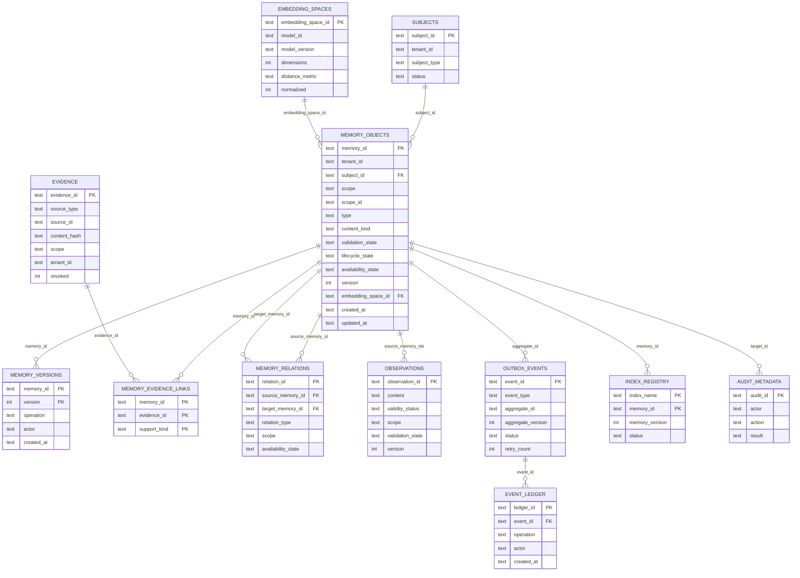
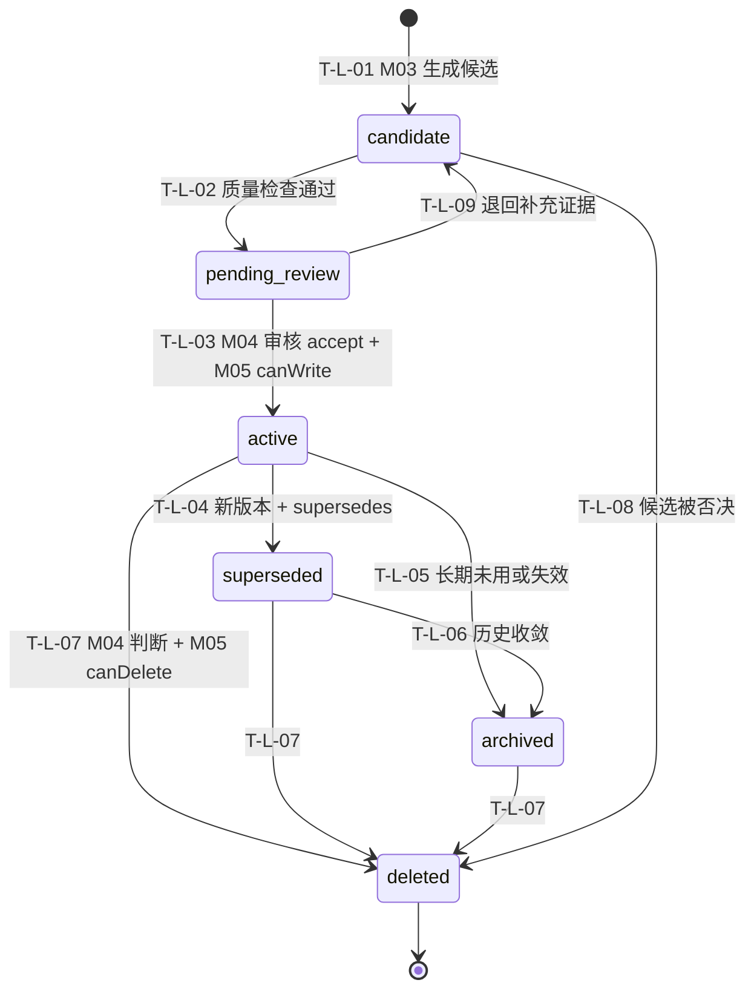
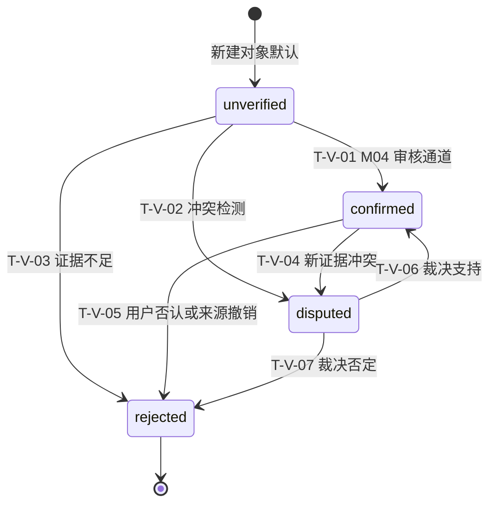
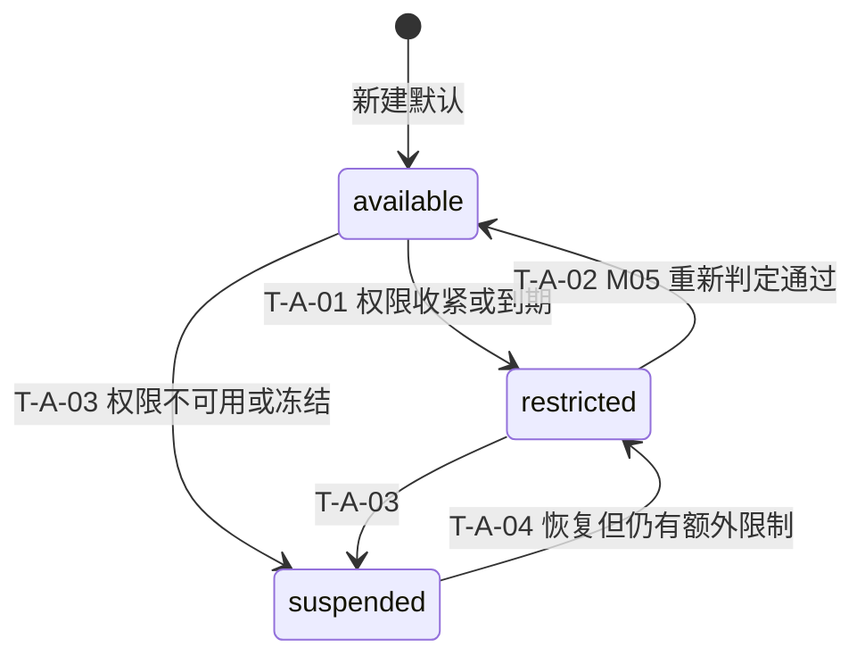
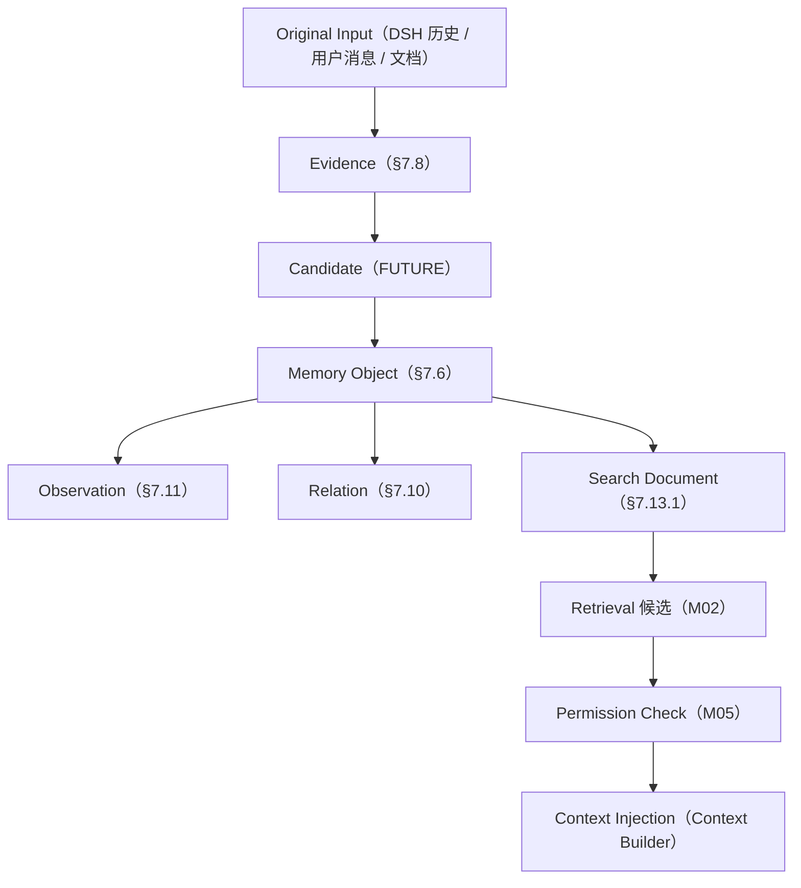

# 01 — 记忆本体与数据模型

> **⚠️ V2 架构升级（2026-11-04）**：本文件的**主数据模型以 DD-AUTHORITY-V2.md §3 五个对象为准**。变更要点：①MemoryObject 保留为**存储层复合视图**，对外与 Pipeline 使用 **MemoryUnit**（28 字段，见 §3.1）；②新增 **Event、EmotionContext、PersonProfile** 三对象；③生命周期拆 memory_tier+status+candidate.status；④content_kind 废弃（映射见 DD-AUTHORITY-V2 §4.2）；⑤新增 semantic_type/semantic_tags/nchor/subject_type/source_type(5 值)/isibility(3 值)；⑥SQLite 需新增 event / emotion_context / person_profile / candidate / memory_evidence_link(已有) / profile_version 表。旧字段→新字段的逐条映射见 DOCUMENT-CONFLICT-REGISTER-V2.md §一/§四 与 DD-AUTHORITY-V2 §4。**本文件下文 v1 字段表继续有效，但凡与 V2 冲突处一律以 V2 为准**。
> 文件代号：01 ｜ 所属交付：Memory Core R4.1 全量详细设计（DD）｜ 设计 Agent 组：A 组（00/01/02）
> 基准文件：`DD-AUTHORITY.md` v1.0（最高行为依据）

---

## 1. 文档状态

| 项目 | 内容 |
|---|---|
| 文件编号 | 01 |
| 文件名称 | 记忆本体与数据模型 |
| 当前版本 | 1.0 |
| 设计状态 | **PROPOSED**（字段级设计成稿；已裁决部分见 §5） |
| 实施授权 | **无**（本文件不授予代码实施权限） |
| 完成等级自评 | **F2 达成**；F3 部分（有边界值与预期结果，无执行记录）；F4 **未达成** |
| 机器契约配套 | `contracts/schemas/memory-object.schema.json`、`evidence.schema.json`、`relation.schema.json`、`observation.schema.json`、`candidate.schema.json`（均已存在，Draft-07） |
| 其余契约 | `search-document` / `embedding-space` / `outbox-event` 三份 Schema 均已存在（Draft-07），无"待补"契约 |
| 语言/编码 | 中文／UTF-8（无 BOM） |

**分节状态矩阵**

| 章节 | 状态 | 说明 |
|---|---|---|
| §7.2 type / §7.3 content_kind | APPROVED（sf 后文 §2.1.1/§2.1.2 原文枚举） | 7 类 / 8 类，不得增删 |
| §7.4 组合矩阵 | **PROPOSED** | 矩阵为设计推断，非裁决 |
| §7.5 Scope 五类 | APPROVED（m.md §3.3；sf §2.2） | 语义不得改 |
| §7.6 Memory Object 字段 | **PROPOSED**（字段集与 schema 文件一致；ID 格式见裁决 R5） | 字段名不得各文档自立 |
| §7.7 三类状态机 | 状态集 APPROVED（sf §2.3.3）；转换矩阵 **PROPOSED** | 禁止合并为一个 status |
| §7.8 Evidence | 字段 APPROVED（m.md §6.1）；扩展字段 PROPOSED | |
| §7.9 Provenance | 字段与 operation 九种 APPROVED（m.md §6.2） | |
| §7.10 Relation | 八种关系类型 APPROVED（sf 前文 §13） | |
| §7.11 Observation | 核心字段 APPROVED（sf §3.4.5） | 对象本身 FUTURE |
| §7.12 Candidate | APPROVED（sf §3.3.3） | 对象 FUTURE |
| §7.13 SearchDocument / EmbeddingSpace | APPROVED（sf 前文 §14.1/§14.2） | B-010 八字段 |
| §7.14 时间六字段 | APPROVED（裁决 R6） | |
| §7.15 版本七要求 | APPROVED（sf §2.7） | 版本号策略 PROPOSED |
| §7.16 SQLite 13 表 | **PROPOSED** | 建表建议，非冻结 |
| §7.17 A/B 迁移映射 | **PROPOSED**（方向已裁决） | 字段映射为设计结论 |
| §7.18 数据完整性约束 | **PROPOSED** | |

---

## 2. 适用版本

| 维度 | 版本 | 说明 |
|---|---|---|
| 母本 | `R4.1-MASTER-01` | m.md |
| 规范 | `R4.1 Specification Baseline`（sf 后文 L3878–6731） | §2「01 — 记忆本体与数据模型」 |
| 任务书 | `MC-R41-DESIGN-FREEZE-01`（sf L6732–8081） | §三 3.1 「01」 |
| 基准 | `DD-AUTHORITY.md` v1.0 | R5（ID）/R6（时间）/R9（维度）裁决 |
| 对象 Schema | `schema_version = "1.0"` | 与 `memory-object.schema.json` 一致 |
| JSON Schema 方言 | Draft-07 | 所有 `contracts/schemas/*.json` 已声明 |
| ID 格式 | `format: uuid`（UUIDv7 形态，**不锁版本**） | 裁决 R5，PROPOSED |
| 时间格式 | RFC 3339 / UTC ISO 8601 | 裁决 R6 |

---

## 3. 适用范围

### 3.1 覆盖

本文件定义 Memory Core 的**全部权威数据对象**（Memory Object / Version / Evidence / Provenance / Relation / Observation / Candidate / Search Document / Embedding Space）及其字段级约束、三类状态机、时间语义、版本语义、迁移映射、建表建议与完整性约束。

### 3.2 不覆盖（FUTURE 边界）

| 对象/能力 | 状态 | 说明 |
|---|---|---|
| Candidate 持久化与候选池 | **FUTURE** | M03 对象，P0–P3 仅 Schema 预留（sf §3.3） |
| Observation 生成与维护 | **FUTURE** | M04 对象；P0–P3 仅建表预留（是否建表见 OI-01-07） |
| Relation 自动生成 | **FUTURE** | M04；P0–P3 只支持显式关系写入 |
| 情绪标注字段（affect_tags/affect_source） | **FUTURE 预留** | J2/J4/J7/J8；**不得**在 P0–P3 写入 |
| `cache.sqlite` 表结构 | **DEFERRED** | 台账 U-1/U-2；本文件**不**给出任何缓存表结构 |
| 心理层五层 schema | **FUTURE** | I-3；仅在 07 预留 |
| Graphiti 图索引结构 | 仅登记不复用 | 优化-3 |

### 3.3 与其他文档的界面

- 字段语义 → 本文件为准；其他文档引用 **MUST** 使用同名同义。
- 接口行为 → 03；算法 → 02；权限矩阵 → 04；迁移流程 → 07。
- 本文件 **MUST NOT** 定义接口错误码集合（归 03 / `error-codes.md`）。

---

## 4. 依赖文档

| 编号 | 文件 | 用途 | 权威层 |
|---|---|---|---|
| D1 | `_sources/m.md` §3.1–§3.5、§6.1–§6.2、§7、§11 | 类型/Scope/Object/Evidence/Provenance/Relation 基线 | 第三层 |
| D2 | `_sources/sf.md` L4166–4470（§2 01 规范）、L3122–3170（§14 索引框架）、L5136–5152（候选字段） | 字段级要求 | 第三层（后文优先） |
| D3 | `08-adjudication-ledger.md` | 正式裁决 | **第一层** |
| D4 | `03-m01.md` D2/D4/D5/D19/D22、`03-m02.md` D6/D12/D23 | 表组织、向量记录、Search Document、结果字段 | 第二层 |
| D5 | `data-samples/memory-vectors-样例(A层向量记忆真实格式).jsonl`（75 行，vec=1024） | A 层真实格式 | 事实证据 |
| D6 | `data-samples/social-v2-样例(B层近期状态真实格式).json` | B 层真实格式 | 事实证据 |
| D7 | `contracts/schemas/*.schema.json`（12 个已有） | 机器契约一致性 | 派生契约 |
| D8 | `00-总体架构与设计原则.md` | 不变量、Scope 语义、迁移定位 | 同组交付 |

**实测数据事实（data-samples，MUST 作为迁移依据而非推测）**

- A 层单条字段：`key, text, time, vec, category, subjectId, subjectName, subjectType, sourceType, visibility, needs_review`；`vec` 长度 = **1024**；`time` 为 **epoch 毫秒整数**（如 `1793369095957`）。
- A 层实测取值：`category ∈ {character, event, fact, relationship, unclassified}`；`sourceType ∈ {manual, observed}`；`visibility ∈ {group_shared, owner_private}`；`subjectType ∈ {bot, owner, unknown}`；`needs_review = true`（样本内全部为 true）；`key` 形如 `private:[OWNER_QQ]` / `group:[GROUP_ID]`。
- B 层结构：`{paused, conversations{ "<key>": {wakeConfig, recentMessages[], unread[], activeTopics[], pendingThoughts[], memberImpressions{ "<名字>": {traits[], interactionCount, lastSeenAt} }, ...} }}`。
- **MUST NOT** 从上述字段推断出 `confidence`、`valid_from`、`permission_id`、`evidence_id` 等原始格式中不存在的值。

---

## 5. 正式裁决引用

| 台账编号 | 相关内容 | 对本文件的约束 |
|---|---|---|
| D-AP-01 | 五模块边界；M03 候选 / M04 整合不可合并 | Candidate 与 Memory Object 是两个对象，**MUST NOT** 合并为一张表的一个状态位 |
| D-AP-02 | M04 §6.2 唯一 LLM Gateway；Embedding Provider 归 M01 | `embedding_space_id` 由 M01 维护；Candidate 的 `extraction_model` 只记录不调用 |
| D-AP-04 | 有摘要时索引主体="摘要+cue"；无摘要须回退 | Search Document 需 `summary`/`tags`；回退策略见 §7.13 |
| D-AP-05 | confirmed 仅 M04 审核通道写入；last_retrieved 按命中规则写入；reinforce 只预留 schema 禁写 | §7.7 状态机 V1 触发者限定 M04；`last_retrieved`/`reinforced` 字段只登记不写入（见 §7.6 注记） |
| D-AP-07 | 五级可插拔；C40 不可插拔；trusted_context_source: entry-only | Evidence 扩展字段 `visibility_scope` 语义 |
| I-5 | 心理状态机不直接产生记忆候选 | B 层 memberImpression 只能进 Observation/Relationship，不得直接进 Candidate |
| J2/J4/J7/J8 | 写时标注、15 受控标签、只预留、external 预留不启用 | Candidate `affect_tags`/`affect_source` 仅定义不启用 |
| K-1 | M01 命名空间内非权威运行时 KV（有条件接受，未生效） | **不在本文件定义表结构** |
| K-2 | 导出边界逐项确定；内部参数不默认导出 | §7.15 版本字段与内部参数列分离 |
| X-2 | Session 结束丢弃短期情绪 | `session_only` 数据不进入长表（见 §7.5） |
| U-1/U-2 | 缓存表结构与校验暂缓 | 本文件**不含** cache 表 |
| CR-09 | 伦理门禁框架（openLoop 等） | B 层 openLoop 类字段不得在本文件定义持久结构（FUTURE） |

---

## 6. 术语表

| 术语 | 定义 |
|---|---|
| 记忆主体（subject） | 记忆归属的主体标识 `subject_id`，须可经宿主身份映射解析 |
| 内容主体（content subject） | 记忆正文所描述的人/物（可能与 subject 不同） |
| Scope | 权限边界五类；不是标签、不是类型 |
| type | 记忆类型七类；表达"这是哪一类记忆" |
| content_kind | 内容性质八类；表达"这句话是什么性质" |
| Validation State | 事实可靠性的验证状态，与生命周期独立 |
| Lifecycle State | 对象在系统中的生命周期状态 |
| Availability State | 当前是否可被（有权限者）使用 |
| Evidence | 证据；说明记忆从哪里来；不等于 Memory |
| Provenance | 形成/修改过程记录；operation 九种 |
| Observation | 由多条证据/记忆归纳的派生视图 |
| Candidate | M03 产出、未成为正式记忆的对象 |
| Search Document | 检索投影，FTS5 与 LanceDB 的共同输入 |
| Embedding Space | 向量空间，由 B-010 八字段唯一确定 |
| normalized_content | 归一化检索文本；不替代原文 |
| 事实时间 | 事实在现实中生效的时间（`valid_from`/`valid_to`/`observed_at`） |
| 记录时间 | 系统写入/更新时间（`recorded_at`/`created_at`/`updated_at`） |
| 乐观并发 | 以 `expected_version` 条件更新，不匹配即冲突 |
| 墓碑（tombstone） | 删除后保留的最小定位信息，用于阻止复活与传播 |
| EXP-DEFAULT | 实验初值，非裁决值 |

---

## 7. 规范正文

### 7.1 本体总览

Memory Core 的权威对象共 9 类（+2 类 FUTURE），关系如下图（图见 §9.1）。总体规则：

1. **MUST** 区分两个独立分类维度：`type`（记忆类型）与 `content_kind`（内容性质），**MUST NOT** 合并为一个字段（sf §2.1）。
2. **MUST** 保持三类状态（validation/lifecycle/availability）独立，**MUST NOT** 合并为单一 `status`（sf §2.3.3）。
3. 每个权威对象 **MUST** 带 `schema_version`；每次实质性更新 **MUST** 产生版本变化（sf §2.7）。
4. 正式记忆 **MUST** 有 Evidence 与 Provenance；**MUST NOT** 在缺少来源时生成虚构引用（sf §2.5）。

| 对象 | 主键 | 权威存储 | 生命周期 | 当前实施 |
|---|---|---|---|---|
| Memory Object | `memory_id` | SQLite `memory_objects` | 六态（§7.7.2） | P1 |
| Memory Version | `(memory_id, version)` | SQLite `memory_versions` | 随主对象 | P1 |
| Evidence | `evidence_id` | SQLite `evidence` | 保留 + `revoked` | P1 |
| Provenance | `provenance_id` | SQLite `event_ledger` / `audit_metadata` | 追加不覆盖 | P1 |
| Relation | `relation_id` | SQLite `memory_relations` | `availability_state` | P1（仅显式关系） |
| Observation | `observation_id` | SQLite `observations` | `validity_status` | **FUTURE** |
| Candidate | `candidate_id` | 候选池（FUTURE） | `quality_status`/`review_state` | **FUTURE** |
| Search Document | `document_id` | 派生（FTS5/LanceDB） | 随索引重建 | P1/P2 |
| Embedding Space | `embedding_space_id` | SQLite `embedding_spaces` | 追加不覆盖 | P1 |
| Outbox Event | `event_id` | SQLite `outbox_events` | 五态（见 03） | P1 |

### 7.2 记忆类型 type（七类）

| 枚举值 | 含义 | 典型示例 | 默认时间策略 | 默认 Scope 建议 |
|---|---|---|---|---|
| `semantic` | 稳定事实与知识 | 用户正在学习 C 语言 | 长半衰期 | owner_private |
| `episodic` | 具体事件 | 用户在某天完成了一个项目 | 中半衰期，需 `observed_at` | owner_private / group_shared |
| `procedural` | 操作流程 | 某项目的部署流程 | 长半衰期 | project_scoped |
| `preference` | 用户偏好 | 用户偏好逐步讲解 | 长半衰期，可变 | owner_private |
| `intent` | 目标与计划 | 用户计划申请某类硕士 | 短半衰期（过期检测） | owner_private |
| `relationship` | 主体之间的关系 | 用户与某项目的参与关系 | 长长半衰期 | owner_private |
| `observation` | 多条记忆形成的观察 | 某主题近期被反复讨论 | 依赖来源 | 继承最严格交集 |

**MUST**：`type=observation` 为**派生记忆**，**MUST NOT** 自动等同已确认事实；其 `validation_state` 默认 `unverified`。

### 7.3 内容性质 content_kind（八类）

| 枚举值 | 含义 | 允许的来源类型（§7.8） | 是否可 `confirmed` |
|---|---|---|---|
| `fact` | 明确陈述的事实 | direct_user_statement / imported_document / tool_result / system_event | 是（须 M04） |
| `opinion` | 主观观点 | direct_user_statement / assistant_observation | 是（观点可被确认"用户确有此观点"） |
| `preference` | 偏好 | direct_user_statement / assistant_observation | 是 |
| `intent` | 意图 | direct_user_statement | 是 |
| `hypothesis` | 假设 | assistant_observation / approved_inference | 否（只能 `unverified`/`disputed`） |
| `inference` | 推断 | assistant_observation / approved_inference | 否（默认 `unverified`） |
| `event` | 事件 | direct_user_statement / system_event / tool_result | 是 |
| `procedure` | 流程或方法 | imported_document / direct_user_statement | 是 |

**MUST**：`content_kind ∈ {hypothesis, inference}` 的记忆 **MUST NOT** 被写成 `validation_state=confirmed` 的"用户事实"（sf §2.5 禁止"把模型推断伪装成用户原话"）。

### 7.4 type × content_kind 组合矩阵（PROPOSED）

图例：`✔` 允许；`△` 允许但需质量标记（`quality_flags` 命中）；`✘` 禁止（Schema 层拒绝）。

| type ＼ content_kind | fact | opinion | preference | intent | hypothesis | inference | event | procedure |
|---|---|---|---|---|---|---|---|---|
| semantic | ✔ | △ | ✘ | ✘ | △ | △ | ✘ | ✘ |
| episodic | ✘ | ✘ | ✘ | ✘ | ✘ | △ | ✔ | ✘ |
| procedural | ✘ | ✘ | ✘ | ✘ | ✘ | ✘ | ✘ | ✔ |
| preference | ✘ | △ | ✔ | ✘ | ✘ | △ | ✘ | ✘ |
| intent | ✘ | ✘ | ✘ | ✔ | △ | △ | ✘ | ✘ |
| relationship | ✘ | △ | ✘ | ✘ | ✘ | ✔ | ✘ | ✘ |
| observation | ✘ | ✔ | ✘ | ✘ | △ | ✔ | ✘ | ✘ |

**矩阵使用规则（MUST）**

1. `✘` 组合 **MUST** 在写入校验中被拒绝，返回 `VALIDATION_ERROR`，且错误信息不得回显 `content`。
2. `△` 组合 **MUST** 在 Candidate 的 `quality_flags` 中至少命中 `inferred` 或 `ambiguous` 之一，否则降级为 `✘`。
3. 矩阵为 **PROPOSED**；变更 **MUST** 走 §15 变更流程，且需同步 `memory-object.schema.json`。

### 7.5 Scope（五类）

| Scope | 定义 | 权限含义 | 必填附加字段 | 禁止 |
|---|---|---|---|---|
| `owner_private` | 仅授权主体可读 | 只有 owner/subject 本人与其明确授权者可读 | `subject_id` | **MUST NOT** 因内容对群组有用而自动转 `group_shared` |
| `group_shared` | 明确共享给指定群组 | 仅该群组上下文可读 | `scope_id`（群ID） | **MUST NOT** 无显式共享动作即生效 |
| `session_only` | 仅当前会话 | 会话结束即不可用 | `scope_id`（会话ID） | **MUST NOT** 跨会话召回；**MUST NOT** 自动晋升长期记忆 |
| `project_scoped` | 特定项目内 | 仅该项目上下文可读 | `scope_id`（项目ID） | **MUST NOT** 跨项目 |
| `system_internal` | 系统内部运行数据 | 不对普通用户暴露 | — | **MUST NOT** 进入宿主可见上下文 |

**Scope 与权限主体（MUST 区分）**：Scope 描述"数据的边界"，权限主体（owner/user/group/agent/system/service）描述"谁在访问"；**MUST NOT** 把 Scope 当作权限主体的替代（sf 冻结任务书 §三 3.1「01」）。

**`scope_id` 说明**：Schema 中 `scope` 为单值枚举；群组/会话/项目标识以 `scope_id` 承载（PROPOSED，见 OI-01-02），`owner_private`/`system_internal` 时 `scope_id` 为 null。

### 7.6 Memory Object 字段级定义

> 与 `memory-object.schema.json` 一致；`additionalProperties: false`。
> 列说明：`合法值 / 格式` 一列同时承载**合法取值**与**格式约束**（`format:` 前缀为 JSON Schema 格式约束，正则为字符级约束）；`唯一性` 列"否"表示不做单独唯一约束（可与其他列组合唯一，见 §7.16 的 UNIQUE 定义）。

#### 7.6.1 标识与版本字段

| 字段 | 含义 | 类型 | 必填 | 允许 NULL | 默认值 | 合法值 / 格式 | 长度 | 唯一性 |
|---|---|---|---|---|---|---|---|---|
| `memory_id` | 记忆唯一 ID | string | 是 | 否 | 无（必填） | `format:uuid` 正则 `^[0-9a-fA-F]{8}-…-…-…-…{12}$`；UUIDv7 形态 PROPOSED | 36 | **全局唯一**，不可复用 |
| `schema_version` | 对象结构版本 | string | 是 | 否 | `"1.0"` | `const "1.0"` | ≤8 | 否 |
| `tenant_id` | 租户/隔离域 | string | 是 | 否 | 无 | 非空、`[A-Za-z0-9._:-]` | 1–128 | 否（参与隔离） |
| `subject_id` | 记忆所属主体 | string | 是 | 否 | 无 | 非空；**MUST** 可经宿主映射解析 | 1–128 | 否 |
| `scope` | 权限边界 | string | 是 | 否 | 无 | 五枚举（§7.5） | — | 否 |
| `scope_id` | Scope 具体标识（群/会话/项目） | string\|null | 否 | 是 | `null` | 非空串当 `scope ∈ {group_shared, session_only, project_scoped}` | 1–128 | 否 |
| `version` | 版本号，乐观并发依据 | integer | 是 | 否 | `1` | `≥1` 整数，单调递增 +1 | — | 否（与 `memory_id` 组合唯一） |

#### 7.6.2 内容字段

| 字段 | 含义 | 类型 | 必填 | 允许 NULL | 默认值 | 合法值 / 格式 | 长度 | 唯一性 |
|---|---|---|---|---|---|---|---|---|
| `type` | 记忆类型 | string | 是 | 否 | 无 | 七枚举（§7.2） | — | 否 |
| `subtype` | 可选子类型 | string\|null | 否 | 是 | `null` | 受控词表（实施期配置，**非** LLM 自由生成） | ≤128 | 否 |
| `content_kind` | 内容性质 | string | 是 | 否 | 无 | 八枚举（§7.3），与 `type` 组合须过 §7.4 矩阵 | — | 否 |
| `content` | 主要语义内容 | string | 是 | 否 | 无 | 非空；**MUST NOT** 写入模型推断却当作用户原话 | 1–10000 | 否 |
| `normalized_content` | 归一化检索文本 | string\|null | 否 | 是 | `null` | 与 `content` 同语言；**MUST NOT** 替代原文 | ≤10000 | 否 |

**归一化禁令（MUST）**：不得因归一化改变原始语义；不得去掉否定词；不得删除时间条件；不得把推断改写成陈述（sf §3.2.3 同类约束）。

#### 7.6.3 状态与质量字段

| 字段 | 含义 | 类型 | 必填 | 允许 NULL | 默认值 | 合法值 / 格式 | 长度 | 唯一性 |
|---|---|---|---|---|---|---|---|---|
| `validation_state` | 验证状态 | string | 是 | 否 | `unverified` | `unverified` / `confirmed` / `disputed` / `rejected` | — | 否 |
| `lifecycle_state` | 生命周期状态 | string | 是 | 否 | `candidate` | `candidate` / `pending_review` / `active` / `superseded` / `archived` / `deleted` | — | 否 |
| `availability_state` | 可用状态 | string | 是 | 否 | `available` | `available` / `restricted` / `suspended` | — | 否 |
| `confidence` | 系统内部可靠度评估 | number\|null | 否 | 是 | `null` | `0 ≤ x ≤ 1`；**MUST** 记录计算来源；不同算法值不得直接比较 | — | 否 |
| `importance` | 重要度 | number\|null | 否 | 是 | `null` | `0 ≤ x ≤ 1`；**不得**覆盖 M05 结果；频繁检索 ≠ 重要 | — | 否 |
| `sensitivity` | 敏感度 | string | 是 | 否 | `private` | `public` / `normal` / `private` / `restricted` | — | 否 |

**交叉约束（Schema allOf，MUST）**

1. `lifecycle_state = active` ⇒ `validation_state ∈ {confirmed, disputed}`（`active` 的 `unverified`/`rejected` 非法）。
2. `lifecycle_state ∈ {candidate, pending_review}` ⇒ `validation_state = unverified`。
3. `content_kind ∈ {hypothesis, inference}` ⇒ `validation_state ≠ confirmed`（§7.3）。
4. `validation_state = confirmed` **仅** 允许由 M04 审核通道写入（台账 D-AP-05）；M01/M02/M03 **MUST NOT** 写该值。

#### 7.6.4 时间字段

| 字段 | 含义 | 类型 | 必填 | 允许 NULL | 默认值 | 合法值 / 格式 | 长度 | 唯一性 |
|---|---|---|---|---|---|---|---|---|
| `valid_from` | 事实开始有效时间 | string(date-time)\|null | 否 | 是 | `null` | RFC 3339 UTC；未知 **MUST** 为 null，**MUST NOT** 填推测日期 | 20–35 | 否 |
| `valid_to` | 事实失效时间 | string(date-time)\|null | 否 | 是 | `null` | 同上；若存在须 `≥ valid_from` | 20–35 | 否 |
| `observed_at` | 观察（事件发生）时间 | string(date-time)\|null | 否 | 是 | `null` | 同上；事件时间 **MUST NOT** 默认等于 `recorded_at` | 20–35 | 否 |
| `recorded_at` | 系统记录时间 | string(date-time)\|null | 否 | 是 | 记录时刻 | 同上 | 20–35 | 否 |
| `created_at` | 首次创建时间 | string(date-time) | 是 | 否 | 创建时刻 | 同上；不可变 | 20–35 | 否 |
| `updated_at` | 最后更新时间 | string(date-time) | 是 | 否 | 创建时刻 | 同上；`≥ created_at` | 20–35 | 否 |
| `expires_at` | 过期时间（可选） | string(date-time)\|null | 否 | 是 | `null` | 同上；到期不删除，只影响可用性（见 §7.7.3） | 20–35 | 否 |

#### 7.6.5 引用与空间字段

| 字段 | 含义 | 类型 | 必填 | 允许 NULL | 默认值 | 合法值 / 格式 | 长度 | 唯一性 |
|---|---|---|---|---|---|---|---|---|
| `source_refs` | 来源引用（evidence/provenance id） | array\<uuid\> | 是 | 否（空数组允许，但正式记忆须非空） | `[]` | 每项 `format:uuid`；正式记忆 **MUST** 非空（不变量 INV-09） | 每项 36 | 否 |
| `evidence_refs` | 证据引用 | array\<uuid\> | 是 | 否 | `[]` | 同上；`lifecycle_state ∈ {pending_review, active}` 时 **MUST** 非空 | 每项 36 | 否 |
| `relation_refs` | 关系引用 | array\<uuid\> | 是 | 否 | `[]` | 同上；为派生视图，**MUST** 以 `memory_relations` 为准 | 每项 36 | 否 |
| `supersedes` | 被本版本取代的旧 `memory_id` | string(uuid)\|null | 否 | 是 | `null` | `format:uuid`；**MUST NOT** 自引用；**MUST NOT** 成环（§7.18 C-07） | 36 | 否 |
| `embedding_space_id` | 向量空间身份 | string\|null | 否 | 是 | `null` | 指向 `embedding_spaces.embedding_space_id`；跨空间 **MUST NOT** 混合检索 | ≤128 | 否 |

**字段注记（只登记、不写入，MUST）**

| 字段 | 状态 | 约束 |
|---|---|---|
| `last_retrieved_at` | **PROPOSED（D-AP-05）** | 仅在 M02 检索命中且通过权限终检后写入；**MUST NOT** 作为衰减 v2 的正向权重输入 |
| `reinforced_at` / `reinforce_count` | **只预留 schema，禁止写入**（D-AP-05/J1/K-4） | E14 未落地、B04 回传链路未确认前，**任何模块 MUST NOT 写入**；**MUST NOT** 由 M02 检索命中触发 |
| `affect_tags` / `affect_source` | **FUTURE 预留**（J4/J7/J8） | 词表配置管理；`external` 仅预留不启用 |

### 7.7 三类状态机

> 三个状态机 **MUST** 独立；**MUST NOT** 合并成一个 `status` 字段。全部转换 **MUST** 记录 `audit` 事件与 `provenance.operation`。

#### 7.7.1 Validation State（验证状态）

| 状态 | 含义 | 初始？ | 终态？ | 规则 |
|---|---|---|---|---|
| `unverified` | 尚未验证（默认） | **是**（所有新建对象） | 否 | 未审候选、迁移对象、推断对象 |
| `confirmed` | 已确认 | 否 | 否 | **仅** M04 审核通道可写入（D-AP-05） |
| `disputed` | 存在争议 | 否 | 否 | 冲突保留，可继续与 `confirmed` 并存 |
| `rejected` | 已否决 | 否 | **是**（不可原地复活） | 需要新对象 + 新证据才能重新建立记忆 |

**转换矩阵**

| 编号 | 起始 | 目标 | 触发条件 | 执行主体 | 可逆 | 审计 |
|---|---|---|---|---|---|---|
| T-V-01 | unverified | confirmed | Evidence 齐备 + 质量检查通过 + 审核决策 accept | **M04**（唯一） | 是（可回 disputed/rejected） | 必需 |
| T-V-02 | unverified | disputed | 冲突检测命中（与既有 confirmed 冲突） | M04 | 是 | 必需 |
| T-V-03 | unverified | rejected | 来源失效/证据不足/权限不允许保留 | M04 | 否 | 必需 |
| T-V-04 | confirmed | disputed | 新证据与既有确认冲突 | M04 | 是 | 必需 |
| T-V-05 | confirmed | rejected | 用户明确否认或来源撤销 | M04（须用户指令依据） | 否 | 必需 |
| T-V-06 | disputed | confirmed | 冲突裁决完成且支持原记忆 | M04 | 是 | 必需 |
| T-V-07 | disputed | rejected | 裁决否定 | M04 | 否 | 必需 |

**禁止转换（MUST NOT）**

- `unverified → confirmed` 由 M01/M02/M03 或任何自动流程直接写入。
- `rejected → confirmed/disputed/unverified`（原地复活）。
- 任何状态由 M02 检索命中触发变化（检索只可写 `last_retrieved_at`）。
- 批量后台任务在无审核决策的情况下批量置 `confirmed`。

#### 7.7.2 Lifecycle State（生命周期状态）

| 状态 | 含义 | 可被检索？ | 可被修改？ |
|---|---|---|---|
| `candidate` | 候选，尚未成为正式记忆 | 否 | 是（FUTURE） |
| `pending_review` | 待审核/待解决冲突 | 否 | 是（限审核通道） |
| `active` | 正式可用 | 是（须过 M05） | 是（须版本更新） |
| `superseded` | 被新版本取代，保留历史 | **否**（默认不作为当前事实返回） | 否（只读历史） |
| `archived` | 已归档，不参与常规召回 | 否 | 否（可恢复须审核） |
| `deleted` | 逻辑删除 | 否（**必须立即屏蔽**） | 否 |

**转换矩阵**

| 编号 | 起始 | 目标 | 触发条件 | 执行主体 | 可逆 | 审计 |
|---|---|---|---|---|---|---|
| T-L-01 | （新建） | candidate | M03 生成候选 + `quality_status=checked` | M03（FUTURE） | 可丢弃 | 轻量 |
| T-L-02 | candidate | pending_review | 质量十项检查通过 + `evidence_refs` 非空 | M03/M04 | 是（可退回 candidate，T-L-09） | 必需 |
| T-L-03 | pending_review | active | M04 审核 accept + M05 `canWrite` 允许 + `validation_state ∈ {confirmed, disputed}` | M04（经 M01 事务） | 是（→superseded/archived） | **必需** |
| T-L-04 | active | superseded | 新版本建立并写 `supersedes` 关系 | M04 | 是（回滚版本） | 必需 |
| T-L-05 | active | archived | 长期未使用/事实失效/用户归档（M04 判断，Dream 可建议） | M04 决策 + M01 持久化 | 是（需审核恢复） | 必需 |
| T-L-06 | superseded | archived | 历史收敛 | M04 决策 + M01 持久化 | 是 | 必需 |
| T-L-07 | active/superseded/archived | deleted | M04 判断 + M05 `canDelete` 允许 + M01 事务标记 | 见 D7 分工 | **否**（物理清理后不可恢复；备份恢复须重放删除） | **必需** |
| T-L-08 | candidate | deleted | 候选被否决 | M03/M04 | 否 | 必需 |
| T-L-09 | pending_review | candidate | 退回补充证据 | M04 | 是 | 必需 |

**禁止转换（MUST NOT）**

- `candidate → active`（跳过审核）。
- `deleted → active/archived/superseded`（除备份恢复后**重放删除状态**，且重放本身不得视为"复活"）。
- `superseded → active`（须新建版本，不得原地回退版本号）。
- 任何由 M02 触发的生命周期变化。

#### 7.7.3 Availability State（可用状态）

| 状态 | 含义 | 检索期行为 |
|---|---|---|
| `available` | 可（在权限允许时）使用 | 正常进入候选 |
| `restricted` | 存在额外使用限制（如部分来源受限、敏感度提升） | 进入候选但降权或需二次授权；**不得**直接注入 |
| `suspended` | 暂停使用（权限服务不可用/合规冻结/用户暂停） | **必须排除**，不得注入 |

**转换矩阵**

| 编号 | 起始 | 目标 | 触发条件 | 执行主体 | 可逆 | 审计 |
|---|---|---|---|---|---|---|
| T-A-01 | available | restricted | 权限收紧、来源受限、`sensitivity` 提升、`expires_at` 到期 | M05 决定 + M01 持久化 | 是 | 必需 |
| T-A-02 | restricted | available | 限制解除且 M05 重新判定通过 | M05 | 是 | 必需 |
| T-A-03 | available/restricted | suspended | 权限服务不可用、合规冻结、用户暂停、删除传播中 | M05 或系统事件 | 是 | 必需 |
| T-A-04 | suspended | restricted | 恢复但仍有额外限制（**MUST 经 restricted 复检**） | M05 | 是 | 必需 |

**禁止转换**：`suspended → available` 一步直跳（**MUST** 经 `restricted`）；任何由 M02 触发的可用性变化；以索引状态作为 `availability_state` 依据。

### 7.8 Evidence（证据）字段级

> 依据 m.md §6.1（13 字段）+ sf 后文 §2.5（来源类型与七问）+ `evidence.schema.json`。

| 字段 | 含义 | 类型 | 必填 | NULL | 默认 | 合法值/格式 | 长度 |
|---|---|---|---|---|---|---|---|
| `evidence_id` | 证据唯一 ID | string(uuid) | 是 | 否 | 无 | `format:uuid` | 36 |
| `source_type` | 来源类型 | string | 是 | 否 | 无 | 六类规范值（下表） | — |
| `source_id` | 来源对象 ID | string\|null | 是（列存在；值可 null 仅当 `source_type=system_event`） | 是 | null | 非空串 | ≤256 |
| `source_version` | 来源版本 | string\|null | 否 | 是 | null | 宿主可提供则填，否则 null（**不得编造**） | ≤64 |
| `source_locator` | 定位表达式 | string\|null | 否 | 是 | null | 如 `session:msg:seq` | ≤512 |
| `excerpt` | 受控摘录 | string\|null | 否 | 是 | null | 仅在确有保存必要且权限允许时保存 | ≤2000 |
| `content_hash` | 原始内容/摘录 SHA-256 | string | 是 | 否 | 无 | `^[0-9a-fA-F]{64}$` | 64 |
| `observed_at` | 来源出现时间 | string\|null | 否 | 是 | null | RFC 3339 UTC | 20–35 |
| `recorded_at` | 系统记录时间 | string | 是 | 否 | 记录时刻 | 同上 | 20–35 |
| `actor_id` | 提供信息的行动者 | string\|null | 否 | 是 | null | 可信身份映射结果 | ≤128 |
| `tenant_id` | 租户 | string | 是 | 否 | 无 | 非空 | 1–128 |
| `scope` | 证据自身权限范围 | string | 是 | 否 | 无 | 五枚举 | — |
| `provenance_id` | 关联形成过程 | string(uuid)\|null | 否 | 是 | null | `format:uuid` | 36 |
| `source_session_id` | 来源会话 | string\|null | 否 | 是 | null | — | ≤128 |
| `source_message_id` | 来源消息 | string\|null | 否 | 是 | null | — | ≤128 |
| `source_subject_id` | 来源主体 | string\|null | 否 | 是 | null | — | ≤128 |
| `extraction_method` | 提取方法 | string\|null | 否 | 是 | null | 受控词表（实施期确定） | ≤128 |
| `model_version` | 生产该证据的模型版本 | string\|null | 否 | 是 | null | 仅记录，不推测 | ≤128 |
| `visibility_scope` | 可见范围（entry-only 约束） | string\|null | 否 | 是 | null | 受控词表 | ≤128 |
| `retention_policy` | 保留策略 | string\|null | 否 | 是 | null | 受控词表 | ≤128 |
| `revoked` | 是否被撤销/标记不可靠 | boolean | 是 | 否 | false | `true` 时 **MUST** 记录 provenance | — |

**来源类型（六种规范值，sf 后文 §2.5）**

| 值 | 含义 | 可信度语义 |
|---|---|---|
| `direct_user_statement` | 用户直接陈述 | 来源类型 ≠ 可信度等级；**MUST NOT** 据此直接置 `confirmed` |
| `assistant_observation` | 助手观察 | 不得伪装为用户原话 |
| `imported_document` | 导入文档 | 保留文档标识与版本 |
| `tool_result` | 工具结果 | 保留工具名与调用 ID |
| `system_event` | 系统事件 | 允许 `source_id` 为 null |
| `approved_inference` | 经批准的推断 | 仅 `content_kind ∈ {inference, hypothesis}` |

**别名登记（PROPOSED，与 `evidence.schema.json` 兼容）**：`explicit_user`≡`direct_user_statement`；`conversation`/`repeated_statement`→`direct_user_statement` + `extraction_method` 区分；`imported`≡`imported_document`；`system_generated`≡`system_event`；`human_reviewed`→ 保留为审核标记而非来源类型（映射表由 03 维护）。

**Evidence 七问必答（MUST）**

| # | 问题（sf §2.5） | 应答字段 | 无法回答时 |
|---|---|---|---|
| Q1 | 证据来自哪里？ | `source_type` + `source_id` + `source_locator` | **拒绝**建立正式记忆 |
| Q2 | 谁提供了信息？ | `actor_id` / `source_subject_id` | `actor_id=null` 且标 `quality_flags=no_source` |
| Q3 | 信息何时出现？ | `observed_at` | 允许 null，**MUST NOT** 填推测时间 |
| Q4 | 原始内容是否仍可用？ | `excerpt` + `content_hash` + `retention_policy` | 只存 hash，正文不回填 |
| Q5 | 该证据支持哪条记忆？ | `memory_evidence_links` | 孤立证据允许暂存，但不得作为正式记忆依据 |
| Q6 | 是否被撤销/不可靠？ | `revoked` + provenance | 默认 false，撤销须审计 |
| Q7 | 属于哪个权限范围？ | `scope` + `tenant_id` | 拒绝（无法确认即拒绝） |

**禁止（MUST NOT）**：把模型推断伪装成用户原话；把搜索结果伪装成用户确认；把 Agent 总结伪装成原始证据；缺少来源时生成虚构 `source_ref`；把来源丢失的记忆标记为已验证。

### 7.9 Provenance（形成过程）

| 字段 | 含义 | 类型 | 必填 | NULL | 合法值/格式 | 长度 |
|---|---|---|---|---|---|---|
| `provenance_id` | 过程记录 ID | string(uuid) | 是 | 否 | `format:uuid` | 36 |
| `operation` | 操作类型 | string | 是 | 否 | 九种（下表） | — |
| `input_refs` | 输入对象引用 | array\<uuid\> | 是 | 否（可为空仅 delete/archive） | 每项 uuid | 每项 36 |
| `output_refs` | 输出对象引用 | array\<uuid\> | 是 | 否 | 每项 uuid | 每项 36 |
| `actor` | 执行者（主体或模块） | string | 是 | 否 | `M01`…`M05` / `dream` / `user:<id>` / `system` | ≤128 |
| `model` | 涉及的模型（如 LLM/Embedding） | string\|null | 否 | 是 | 模型标识 | ≤128 |
| `prompt_version` | 提示版本 | string\|null | 否 | 是 | 语义版本 | ≤64 |
| `algorithm_version` | 算法版本 | string\|null | 否 | 是 | 语义版本 | ≤64 |
| `created_at` | 记录时间 | string | 是 | 否 | RFC 3339 UTC | 20–35 |

**operation 九种（m.md §6.2）**

| 值 | 语义 | 典型 actor | 是否改变权威数据 |
|---|---|---|---|
| `extract` | 从来源提取候选 | M03 | 否（只产候选） |
| `confirm` | 审核确认 | M04 | 是（validation_state） |
| `merge` | 合并 | M04 | 是（新版本 + supersedes） |
| `supersede` | 版本取代 | M04 | 是（lifecycle_state） |
| `observe` | 生成 Observation | M04 | 是（observations） |
| `infer` | 推断 | M04 | 是（`content_kind=inference`） |
| `migrate` | 迁移 | M01（迁移作业） | 是（批量，须单独授权） |
| `archive` | 归档 | M04 + M01 | 是（lifecycle_state） |
| `delete` | 删除 | M04 判断 + M05 判权 + M01 执行 | 是（`deleted` + 传播） |

**MUST**：`operation=confirm` 的 `actor` **MUST** 为 `M04`（台账 D-AP-05）；其他模块写 `confirm` 视为越权。

### 7.10 Relation（关系）

| 字段 | 含义 | 类型 | 必填 | NULL | 合法值/格式 |
|---|---|---|---|---|---|
| `relation_id` | 关系 ID | string(uuid) | 是 | 否 | uuid |
| `source_memory_id` | 起点记忆 | string(uuid) | 是 | 否 | 存在且未删除 |
| `target_memory_id` | 终点记忆 | string(uuid) | 是 | 否 | 存在且未删除；**MUST NOT** 等于起点 |
| `relation_type` | 关系类型 | string | 是 | 否 | 八枚举（下表） |
| `confidence` | 关系置信度 | number\|null | 否 | 是 | 0–1 |
| `provenance_id` | 形成过程 | string(uuid)\|null | 否 | 是 | uuid |
| `scope` | 关系权限范围 | string | 是 | 否 | 五枚举；**MUST** 取两端最严格交集 |
| `created_at` | 创建时间 | string | 是 | 否 | RFC 3339 |
| `version` | 版本 | integer | 是 | 否 | ≥1 |
| `availability_state` | 可用状态 | string | 是 | 否 | 三枚举 |

**八种关系类型（sf 前文 §13）**

| 类型 | 语义 | 方向 | 是否可自动生成 |
|---|---|---|---|
| `RELATED_TO` | 一般相关 | 有向（视作双向语义） | 否（须 M04 显式） |
| `DERIVED_FROM` | 派生自 | 派生 → 来源 | 是（M04，须审计） |
| `CONFIRMS` | 佐证 | 佐证 → 被佐证 | 是（M04） |
| `CONTRADICTS` | 矛盾 | 双向 | 是（M04） |
| `SUPERSEDES` | 取代 | 新 → 旧 | 是（M04，与 `supersedes` 字段同步） |
| `BUILDS_ON` | 基于 | 新 → 旧 | 是（M04） |
| `PART_OF` | 属于 | 子 → 整体 | 否 |
| `ABOUT` | 关于某主体/主题 | 记忆 → 主体 | 是（M04） |

**约束（MUST）**：关系类型 **MUST** 使用受控枚举；**MUST NOT** 让任意 LLM 输出直接创建高权限关系；关系任一端不可访问时 **MUST NOT** 通过关系边泄露受限对象信息（只可返回"存在不可见关联"这一事实，不返回对象内容）；**MUST NOT** 成环（`DERIVED_FROM`/`SUPERSEDES`/`BUILDS_ON` 必须无环）。

### 7.11 Observation（派生观察，FUTURE 对象）

**核心十字段（sf §3.4.5 必录字段）**

| # | 字段 | 含义 | 类型 | 必填 |
|---|---|---|---|---|
| 1 | `observation_id` | 观察 ID | uuid | 是 |
| 2 | `source_memory_ids` | 依据记忆（≥1） | array\<uuid\> | 是 |
| 3 | `derivation_method` | 推导方法 | string ≤128 | 是 |
| 4 | `derivation_version` | 推导版本 | string ≤64 | 是 |
| 5 | `generated_at` | 生成时间 | date-time | 是 |
| 6 | `confidence` | 置信度 | number 0–1 | 是 |
| 7 | `validity_status` | 有效性 | `valid`/`needs_recompute`/`invalidated`/`restricted` | 是 |
| 8 | `content` | 观察内容 | string 1–10000 | 是 |
| 9 | `scope` | 权限范围（继承交集） | 五枚举 | 是 |
| 10 | `availability_state` | 可用状态 | 三枚举 | 是 |

**扩展字段**：`source_evidence_ids[]`、`validation_state`（默认 `unverified`）、`version`、`invalidated_reason`。

**约束（MUST）**：Observation **MUST NOT** 自动成为 Fact；来源变化（删除/修改/权限收紧）时 **MUST** 置 `needs_recompute`/`invalidated`/`restricted` 并重算；**MUST** 记录推导过程与失效条件。

### 7.12 Candidate（候选，FUTURE 对象）

| 字段 | 含义 | 类型 | 必填 | NULL | 合法值 |
|---|---|---|---|---|---|
| `candidate_id` | 候选 ID | uuid | 是 | 否 | uuid |
| `proposed_type` | 建议类型 | string | 是 | 否 | 七枚举 |
| `proposed_content_kind` | 建议内容性质 | string | 是 | 否 | 八枚举 |
| `proposed_content` | 建议内容 | string | 是 | 否 | 1–10000 |
| `proposed_scope` | 建议 Scope | string | 是 | 否 | 五枚举 |
| `subject_id` | 主体 | string\|null | 否 | 是 | ≤128 |
| `tenant_id` | 租户 | string\|null | 否 | 是 | ≤128 |
| `source_refs` | 来源 | array\<string\> | 是 | 否 | `[]` 允许 |
| `evidence_refs` | 证据 | array\<uuid\> | 是 | 否 | **非空才可进 `pending_review`** |
| `extraction_model` | 提取模型 | string\|null | 否 | 是 | 记录值，不推测 |
| `extraction_version` | 提取版本 | string\|null | 否 | 是 | ≤64 |
| `extraction_method` | 提取方法 | string\|null | 否 | 是 | `explicit_save`/`automatic_extraction`/`human_owner_review`/`llm_gateway`/`rule_based` |
| `confidence` | 候选置信度 | number\|null | 否 | 是 | 0–1 |
| `created_at` | 创建时间 | date-time | 是 | 否 | — |
| `quality_status` | 质量状态 | string | 是 | 否 | `draft`/`checked`/`needs_review`/`rejected` |
| `quality_flags` | 质量标记 | array\<string\> | 否 | 是 | 十项标记（见 02 §7.8） |
| `review_state` | M04 审核状态 | string | 是 | 否 | `queued`/`in_review`/`accepted`/`rejected`/`merged` |
| `duplicate_of_memory_id` / `duplicate_of_candidate_id` | 重复指向 | uuid\|null | 否 | 是 | uuid |
| `affect_tags` / `affect_source` | 情绪标注 | array/string\|null | 否 | 是 | FUTURE 预留（J2/J4/J7/J8） |

**MUST**：Candidate **MUST NOT** 直接成为 `active`；**MUST NOT** 自动提升 Scope；`review_state=accepted` **仅**允许 M04 审核通道写入（D-AP-05）。

### 7.13 Search Document 与 Embedding Space

#### 7.13.1 Search Document（sf 前文 §14.1，全字段）

| 字段 | 含义 | 类型 | 必填 | 说明 |
|---|---|---|---|---|
| `document_id` | 投影 ID | string（≤256） | 是 | 每（memory_id, space）唯一；建议 `memory_id:version:space` 组合（PROPOSED） |
| `memory_id` | 权威对象 ID | uuid | 是 | **唯一真值来源** |
| `memory_version` | 权威版本 | integer | 是 | 与 SQLite 一致，防旧覆盖 |
| `schema_version` | 投影结构版本 | string | 是 | — |
| `embedding_space_id` | 向量空间 | string | 是（向量投影） | 与 FTS5 共用同一权威版本 |
| `title` | 标题 | string\|null | 否 | 纳入索引 |
| `content` | 正文 | string | 是 | 纳入索引 |
| `summary` | 摘要 | string\|null | 否 | **有摘要时索引主体="摘要+cue"**（D-AP-04） |
| `cue` | 检索提示词 | string\|null | 否 | 与 summary 共同构成索引主体（D-AP-04）；≤512 |
| `tags` | 标签 | array\<string\> | 否 | 纳入索引 |
| `type` | 记忆类型 | string | 是 | 过滤元数据 |
| `subject_id` | 主体 | string | 是 | 过滤元数据 |
| `scope` | 权限范围 | string | 是 | **过滤元数据，不构成授权** |
| `sensitivity` | 敏感度 | string | 是 | 过滤元数据 |
| `lifecycle_state` | 生命周期 | string | 是 | 过滤元数据 |
| `availability_state` | 可用性 | string | 是 | 过滤元数据 |
| `source_refs` | 来源 | array\<uuid\> | 是 | 元数据 |
| `document_hash` | 投影内容 hash | string（64 hex） | 是 | 64 位十六进制；用于"内容变化→重建文档并重算向量"判定 |
| `created_at` / `updated_at` | 时间 | date-time | 是 | 元数据 |
| `index_versions` | 索引版本对 | object | 否 | `{fts_version, vector_version}`；各通道各自版本，防旧覆盖 |

**回退策略（D-AP-04"无摘要时须定义"）——PROPOSED**：无 `summary` 时，索引主体 = `title + content` 的首 512 字符（按句末标点优先截断，不硬切词）+ `tags`；`content` 超长时以**段落级切块**（`chunk_id` 保留），**MUST NOT** 改变原意、**MUST NOT** 只索引前半段而丢弃后半段。切块与投影版本 **MUST** 记录在 `chunker_version`/`text_projection_version`。

#### 7.13.2 Embedding Space（B-010 八字段 = 必填最小集）

| # | 字段 | 含义 | 类型 | 必填 | 说明 |
|---|---|---|---|---|---|
| 1 | `model_id` | 模型标识 | string | **是** | 别名 `model_name`（sf §14.2）；同一取值 |
| 2 | `model_version` | 模型版本 | string | **是** | 换版本 = 换空间 |
| 3 | `dimensions` | 维度 | integer ≥1 | **是** | 现网参考 1024，**不得写死**（裁决 R9） |
| 4 | `distance_metric` | 距离度量 | string | **是** | `cosine`/`l2`/`dot_product`（`ip` 为历史别名，等同 `dot_product`）；**MUST** 与检索实现一致 |
| 5 | `normalized` | 是否已归一化 | boolean | **是** | 影响度量选择，必须显式 |
| 6 | `chunker_version` | 分块版本 | string | **是** | 切块策略变更需重新索引 |
| 7 | `text_projection_version` | 文本投影版本 | string | **是** | 拼接/截断/摘要口径版本 |
| 8 | `vector_schema_version` | 向量记录结构版本 | string | **是** | 与 §7.13.3 记录结构对应 |
| + | `embedding_space_id` | 空间身份（主键） | string | **是** | 由上述八字段派生/绑定 |
| + | `created_at` | 建立时间 | date-time | **是** | 追加不覆盖 |

**MUST**：任一八字段缺失 ⇒ 该空间**不完整**，**MUST** 视为不可用（sf §16.3）；同维度 **≠** 同语义空间；不同空间 **MUST NOT** 混合检索；新模型 **MUST** 新空间。

#### 7.13.3 向量记录（LanceDB 侧，派生）

| 字段 | 含义 | 必填 |
|---|---|---|
| `vector_id` | 向量记录 ID | 是 |
| `memory_id` | 权威对象 ID | 是 |
| `memory_version` | 权威版本（防覆盖） | 是 |
| `source_type` | 来源对象类型 | 是 |
| `embedding_space_id` | 空间 | 是 |
| `vector` | 定长向量（维度取自 Profile） | 是 |
| `content_hash` | 文本投影 hash | 是 |
| `created_at` / `updated_at` | 时间 | 是 |

**MUST**：LanceDB **仅**保存检索所需数据，**MUST NOT** 保存完整权威副本；正文 **MUST** 回源 SQLite（m01 D19）。

### 7.14 时间六字段语义：事实时间 ≠ 记录时间

| 字段 | 语义 | 是否可推测 | 典型用途 |
|---|---|---|---|
| `valid_from` | 事实在现实中开始成立 | **否**，未知即 null | 时间过滤、衰减起算 |
| `valid_to` | 事实失效（可为 null = 仍有效） | 否 | 过期判定、`availability_state` |
| `observed_at` | 该陈述/事件被观察到的时间 | 否 | 事件时间、时态判断 |
| `recorded_at` | 系统写入该证据/记忆的时间 | 系统生成 | 审计 |
| `created_at` | 对象首次创建 | 系统生成 | 审计、版本链 |
| `updated_at` | 对象最后更新 | 系统生成 | 缓存失效、并发 |

**例子（MUST 理解正确）**：用户今天说"去年我参加过某比赛" ⇒ `observed_at` 可为去年（若可从上下文确定），`recorded_at` 为今天；**MUST NOT** 因今天录入就把事件时间设为今天；无法确定时 **MUST** 留 null 或标记不确定，**MUST NOT** 自动填推测日期（sf §2.4）。

**时间格式**：所有内部时间 **MUST** 为 UTC（RFC 3339 / ISO 8601 带 `Z`）；宿主展示时转换时区；**MUST NOT** 存本地时间偏移量作为权威值。

**实测格式转换（A 层）**：原 `time` 为 epoch 毫秒整数 ⇒ 迁移时 **MUST** 转 `observed_at`（RFC 3339 UTC），并同时写 `recorded_at`=迁移时刻；转换函数与精度（毫秒）**MUST** 在迁移脚本中固定并测试。

### 7.15 版本控制（七要求）

| # | 要求（sf §2.7） | 落地 |
|---|---|---|
| R1 | 更新前保留旧版本或可恢复记录 | `memory_versions` 追加写，不覆盖 |
| R2 | 更新必须具备变更来源 | `source_refs`/`provenance_id` 必填（更新路径） |
| R3 | 变更必须具备时间 | `updated_at` + version 记录时间 |
| R4 | 变更必须能区分自动维护与用户修改 | `provenance.actor` + `operation` |
| R5 | 并发更新必须具备冲突检测 | `expected_version`（乐观并发） |
| R6 | 不得静默覆盖用户明确确认的信息 | 冲突时返回 `VERSION_CONFLICT`，不自动胜出 |
| R7 | 不得删除旧版本后假装未发生变更 | `memory_versions` **MUST NOT** 物理删除（除合规删除流程并留审计） |

**版本号策略（PROPOSED）**：`version` 为整数，从 1 起，每次实质性更新 +1；`memory_versions` 主键 `(memory_id, version)`；**禁止**不同模块采用不同递增规则（sf §2.7）；删除、权限变更等状态变更 **是否** 递增版本由 03 统一规定（本文件不擅自决定，见 OI-01-05）。

**版本 vs 新记忆（MUST 区分）**：同一事实的演进 = 新版本 + `supersedes`；不同事实 = 新 `memory_id`。**MUST NOT** 用版本号表达"换了主题"。

### 7.16 SQLite 建表建议（13 张表，PROPOSED）

> **状态 PROPOSED**：这是建表建议，不是冻结 DDL。P0 由 Schema 校验器与迁移脚本定稿后，**MUST** 经 §15 变更流程方可修改。**本文件不含 `cache.sqlite` 任何表结构**（台账 U-1/U-2）。
> 通用约定：全部表 **MUST** 显式声明 `PRIMARY KEY`；**MUST NOT** 使用 `rowid` 作为业务 ID；时间列统一 `TEXT`（RFC 3339 UTC）；布尔列统一 `INTEGER 0/1`；`JSON` 列仅承载非关键的扩展属性，**权限、版本、生命周期、关联 MUST NOT 仅存于 JSON**（m01 D4）。

| # | 表名 | 职责 | 关键列 | 索引与约束 |
|---|---|---|---|---|
| 1 | `subjects` | 主体登记与身份映射锚点 | `subject_id` PK、`tenant_id`、`subject_type`(user/group/bot/agent/system/service)、`mapping_ref`、`status`、`created_at`、`updated_at` | UNIQUE(`tenant_id`,`subject_id`)；INDEX(`subject_type`) |
| 2 | `memory_objects` | 权威记忆主体（不含历史版本） | 全部 Memory Object 字段（§7.6） | PK `memory_id`；UNIQUE(`memory_id`)；FK `subject_id`→subjects；INDEX(`tenant_id`,`scope`,`lifecycle_state`)、INDEX(`subject_id`,`type`)、INDEX(`observed_at`)、INDEX(`updated_at`)；CHECK 状态枚举；CHECK `version>=1` |
| 3 | `memory_versions` | 历史版本快照（追加不覆盖） | `memory_id`、`version`、`snapshot_json`、`changed_fields`、`operation`、`actor`、`created_at` | PK(`memory_id`,`version`)；FK `memory_id`→memory_objects；**禁止** UPDATE/DELETE（触发器保护） |
| 4 | `evidence` | 证据（§7.8） | `evidence_id` PK、`source_type`、`source_id`、`content_hash`、`observed_at`、`recorded_at`、`actor_id`、`tenant_id`、`scope`、`provenance_id`、`revoked` | PK `evidence_id`；INDEX(`tenant_id`,`scope`)、INDEX(`source_type`,`source_id`)、INDEX(`content_hash`)；CHECK `content_hash` 长 64 |
| 5 | `memory_evidence_links` | 记忆 ↔ 证据多对多 | `memory_id`、`evidence_id`、`support_kind`(supports/contradicts/partial)、`created_at` | PK(`memory_id`,`evidence_id`,`support_kind`)；FK 双向；INDEX(`evidence_id`)（支撑删除传播与派生识别） |
| 6 | `memory_relations` | 关系（§7.10） | `relation_id` PK、`source_memory_id`、`target_memory_id`、`relation_type`、`confidence`、`provenance_id`、`scope`、`availability_state`、`version`、`created_at` | PK `relation_id`；FK 两端→memory_objects；UNIQUE(`source_memory_id`,`target_memory_id`,`relation_type`)；CHECK 八枚举；CHECK 两端不等；INDEX(`target_memory_id`) |
| 7 | `observations` | 派生观察（§7.11，FUTURE 对象） | `observation_id` PK、`content`、`source_memory_ids_json`、`source_evidence_ids_json`、`derivation_method`、`derivation_version`、`confidence`、`validity_status`、`scope`、`availability_state`、`validation_state`、`version`、`generated_at` | PK `observation_id`；INDEX(`validity_status`)、INDEX(`scope`)；CHECK `confidence` 0–1 |
| 8 | `outbox_events` | 事务性事件表（索引同步唯一入口） | `event_id` PK、`event_type`(memory_upsert/memory_delete/memory_reindex)、`aggregate_id`、`aggregate_version`、`payload_version`、`payload_json`、`status`(pending/processing/succeeded/retry_wait/dead_letter)、`retry_count`、`next_retry_at`、`created_at`、`processed_at`、`last_error` | PK `event_id`；INDEX(`status`,`next_retry_at`)（Worker 拉取）、INDEX(`aggregate_id`,`aggregate_version`)；UNIQUE(`event_id`)；CHECK 状态五枚举 |
| 9 | `event_ledger` | 不可变事件/变更台账 + Provenance 载体 | `ledger_id` PK、`event_id`、`aggregate_id`、`aggregate_version`、`from_state`、`to_state`、`operation`(九种)、`actor`、`model`、`prompt_version`、`algorithm_version`、`request_id`、`created_at` | PK `ledger_id`；INDEX(`aggregate_id`,`created_at`)、INDEX(`operation`)；**仅追加**（禁止 UPDATE） |
| 10 | `index_registry` | 派生索引版本登记（FTS5/LanceDB/向量空间） | `index_name`(fts5/lancedb:<space>)、`index_version`、`memory_id`、`memory_version`、`embedding_space_id`、`last_synced_at`、`status`(in_sync/lagging/error) | PK(`index_name`,`memory_id`)；INDEX(`status`)、INDEX(`last_synced_at`)；用于"索引落后程度"与重建对账 |
| 11 | `embedding_spaces` | 向量空间定义（B-010 八字段） | `embedding_space_id` PK、`model_id`、`model_version`、`dimensions`、`distance_metric`、`normalized`、`chunker_version`、`text_projection_version`、`vector_schema_version`、`status`(active/retired)、`created_at` | PK `embedding_space_id`；UNIQUE 八字段组合；CHECK `dimensions>=1`；CHECK `normalized IN (0,1)` |
| 12 | `schema_migrations` | Schema 版本与迁移记录 | `migration_id` PK、`from_version`、`to_version`、`script_hash`、`applied_at`、`result`(success/failed/rolled_back)、`backup_ref` | PK `migration_id`；UNIQUE(`from_version`,`to_version`)；**仅追加** |
| 13 | `audit_metadata` | 审计最小集（操作者/动作/结果/对象定位） | `audit_id` PK、`actor`、`action`、`target_type`、`target_id`、`result`、`request_id`、`policy_version`、`decision_id`、`created_at` | PK `audit_id`；INDEX(`actor`,`created_at`)、INDEX(`target_type`,`target_id`)；**MUST NOT** 存私人正文（只存指针与 hash） |

**FUTURE 表（不在 P0–P3 建表集）**：`candidate_pool`（M03）、`dream_runs`（Dream）、`runtime_kv`（K-1，仅登记）、`session_state`（Session Memory）。**MUST NOT** 在 P0–P3 提前创建（sf §13.2）。

**建表硬规则（MUST）**

1. `PRAGMA journal_mode=WAL`、`PRAGMA foreign_keys=ON`、`PRAGMA busy_timeout` 显式设置（m01 D6）。
2. 所有 `*_at` 列 **MUST** 为 RFC 3339 UTC 文本；**MUST NOT** 存 epoch 整数（迁移时转换，见 §7.14）。
3. 枚举列 **MUST** 用 CHECK 约束（或等价的应用层校验 + 生成列），**MUST NOT** 自由文本。
4. `memory_versions`、`event_ledger`、`schema_migrations` **MUST** 只追加；**MUST NOT** 提供删除/更新 API。
5. 表结构变更 **MUST** 走 `schema_migrations` + 备份 + 回滚策略；**MUST NOT** 直接改生产库。

### 7.17 A/B 层迁移映射

#### 7.17.1 A 层（`memory-vectors.jsonl`）字段映射

> 实测字段：`key, text, time, vec[1024], category, subjectId, subjectName, subjectType, sourceType, visibility, needs_review`。

| 原始字段 | 迁移目标 | 转换规则 | 缺失/不可得时 | 状态 |
|---|---|---|---|---|
| `key` | `scope` + `scope_id` | `private:<id>` ⇒ `scope=owner_private`, `scope_id=null`,`subject_id=<id>`；`group:<id>` ⇒ `scope=group_shared`, `scope_id=<id>` | 无法解析 ⇒ 该条 **MUST** 整体进入人工复核队列，不得猜测 | PROPOSED |
| `text` | `content` | 原文照存；**MUST NOT** 改写、截断（>10000 字符需切块并保留原文引用） | — | PROPOSED |
| （由 `text` 派生） | `normalized_content` | 可选的检索归一化（保守：仅空白与全半角），**MUST NOT** 改变语义 | 允许 null | PROPOSED |
| `time`（epoch ms） | `observed_at` + `recorded_at` | `observed_at`=转换后的 UTC；`recorded_at`=迁移执行时刻 | — | PROPOSED |
| `vec`（1024 维） | LanceDB 向量表 + `embedding_space_id` | **MUST** 作为**独立 legacy 空间**导入（`legacy-a-layer-1024-v?`），空间八字段中未知项填 `unknown` 并登记 | 维度不一致 ⇒ 拒绝该条并登记 | **VERIFY**（现网模型/归一化未知） |
| `category` | `type` / `content_kind` | 见 §7.17.3 映射表 | `unclassified` ⇒ `type=semantic`? **否**：标 `quality_flags` 并进复核队列 | PROPOSED（OI-00-04） |
| `subjectId` | `subject_id` | 存在且可解析 ⇒ 直接用；`unknown` ⇒ 保留字面值 + 标 `needs_review` | — | PROPOSED |
| `subjectName` | 元数据（`subjects.display_name`? 不建正文列） | **MUST NOT** 作为永久身份（sf §2.3.1 第 3 条）；只作展示元数据 | — | PROPOSED |
| `subjectType` | `subjects.subject_type` | `bot`/`owner`/`unknown` 映射；`unknown` 保留原值 | — | PROPOSED |
| `sourceType` | Evidence `source_type` | `manual` ⇒ `direct_user_statement`；`observed` ⇒ `assistant_observation`（**PROPOSED**） | 其他值 ⇒ 登记映射请求 | PROPOSED |
| `visibility` | `scope`（与 `key` 交叉校验） | `owner_private`/`group_shared` 直接映射；与 `key` 冲突 ⇒ 取**更严格**者并审计 | — | PROPOSED |
| `needs_review` | `lifecycle_state` / `quality_flags` | `true` ⇒ `lifecycle_state=pending_review`；`false` ⇒ 见 OI-01-03 | — | **TBD（OI-01-03）** |
| （不存在） | `confidence` | **null**（**MUST NOT** 编造数值） | null | **强制** |
| （不存在） | `importance` | **null**（**MUST NOT** 编造） | null | **强制** |
| （不存在） | `sensitivity` | `private`（Schema 默认值，**不是推断**） | 默认 | **强制** |
| （不存在） | `valid_from` / `valid_to` | **null**（**MUST NOT** 用 `time` 冒充事实时间） | null | **强制** |
| （不存在） | `evidence_refs` | **空数组**，且 **MUST NOT** 伪造 evidence | `[]` | **强制** |
| （不存在） | `source_refs` | 指向 `migrate` operation 的 provenance | 由迁移过程生成 | **强制** |

#### 7.17.2 B 层（`social-v2.json`）映射（FUTURE，不实施）

| 原始节点 | 迁移目标（m.md §2.1） | 约束 |
|---|---|---|
| `conversations[*].activeTopics[]` | Session / Topic State（`session_only`，不进长期表） | **MUST NOT** 转成长期 semantic 记忆 |
| `conversations[*].pendingThoughts[]` | Pending Intent / Task（`type=intent`，`content_kind=intent`） | 需来源与时间；**MUST NOT** 自动 `active` |
| `conversations[*].memberImpressions{name:{traits,interactionCount,lastSeenAt}}` | Observation（`content_kind=inference`）/ Relationship | **MUST** 保留推断性质；**MUST** 继承原会话权限；**MUST NOT** 跨用户泄露；`interactionCount` 为内部统计，**不默认导出**（K-2） |
| `recentMessages[]`（`seq,messageId,sender,userId,text,time`） | Evidence（`source_type=direct_user_statement`，`source_locator=session:msg:seq`） | 仅作证据，**MUST NOT** 直接成为记忆正文 |
| `wakeConfig`/`agentToken`/`sendTimes` 等运行态 | **MUST NOT** 迁入 Memory Core 权威表 | 属宿主运行态；`agentToken` 类敏感值 **MUST NOT** 进入任何 Core 表 |

#### 7.17.3 `category` → `type`/`content_kind` 映射（PROPOSED）

| 原 `category` | 建议 `type` | 建议 `content_kind` | 备注 |
|---|---|---|---|
| `fact` | `semantic` | `fact` | — |
| `event` | `episodic` | `event` | 需 `observed_at` |
| `relationship` | `relationship` | `inference` | 原为模型归纳 ⇒ 不得 `fact` |
| `character` | `relationship` | `inference` | 人物印象类 ⇒ 保留推断性质 |
| `unclassified` | —— | —— | **不迁移**，进人工复核队列（**MUST NOT** 强行归类） |

### 7.18 数据完整性约束

| 编号 | 约束 | 层级 | 违反时 |
|---|---|---|---|
| C-01 | 三状态取值必须在枚举内 | Schema + DB CHECK | `VALIDATION_ERROR` |
| C-02 | `active` ⇒ `validation_state ∈ {confirmed, disputed}` | Schema allOf + 应用校验 | 拒绝写入 |
| C-03 | `pending_review/active` ⇒ `evidence_refs` 非空（INV-09） | 应用校验 | 拒绝写入 |
| C-04 | `content_kind ∈ {inference, hypothesis}` ⇒ 不得 `confirmed` | 应用校验 | 拒绝写入 |
| C-05 | `content_kind`/`type` 组合符合 §7.4 矩阵 | 应用校验 | 拒绝并记 `quality_flags` |
| C-06 | `valid_to ≥ valid_from`；`updated_at ≥ created_at` | DB CHECK（可用触发器） | 拒绝 |
| C-07 | `supersedes` 不成环、不自引用 | 应用校验（递归检查） | 拒绝 |
| C-08 | 关系两端必须存在且非 `deleted`；两端不相等 | FK + 应用校验 | 拒绝 |
| C-09 | 关系 `scope` = 两端最严格交集 | 应用校验 | 降级或拒绝 |
| C-10 | Observation `scope` 继承来源交集；来源删除 ⇒ 失效 | 应用校验（FUTURE） | 置 `invalidated` |
| C-11 | `embedding_space_id` 必须存在于 `embedding_spaces` 且空间完整 | 应用校验 | 拒绝索引写入 |
| C-12 | 同一 `(tenant_id, subject_id, scope, scope_id, normalized_content)` 不得产生两条完全相同的 `active` 记忆（精确重复） | 应用校验 | 转 M04 判定为 `exact_duplicate`（FUTURE）；P0–P3 只告警 |
| C-13 | `deleted` 对象 **MUST** 在任何检索/关系/派生路径被屏蔽 | 应用校验 + 索引校验 | 视为一致性事故 |

**跨表约束（MUST）**：`memory_objects.embedding_space_id` 必须与 `index_registry`/LanceDB 记录一致；`memory_evidence_links` 的删除 **MUST** 随证据撤销传播；`event_ledger` 与 `outbox_events` 的 `aggregate_version` **MUST** 单调一致（旧事件不得覆盖新版本，INV-10）。

---

## 8. 接口或数据结构

### 8.1 契约文件与 Schema 对应

| 契约 | 对象 | 关键 required | 状态 |
|---|---|---|---|
| `memory-object.schema.json` | Memory Object | memory_id, schema_version, tenant_id, subject_id, scope, type, content_kind, content, validation_state, lifecycle_state, availability_state, sensitivity, version, created_at, updated_at | 已存在（Draft-07） |
| `evidence.schema.json` | Evidence | evidence_id, source_type, source_id, tenant_id, scope, content_hash, recorded_at | 已存在 |
| `relation.schema.json` | Relation | relation_id, source/target_memory_id, relation_type, scope, created_at, version | 已存在 |
| `observation.schema.json` | Observation | observation_id, content, source_memory_ids(≥1), derivation_method/version, generated_at, confidence, validity_status, scope, availability_state, version | 已存在 |
| `candidate.schema.json` | Candidate | candidate_id, proposed_type/content_kind/content, proposed_scope, created_at, quality_status | 已存在 |
| `search-document.schema.json` | Search Document | document_id, memory_id, memory_version, schema_version, embedding_space_id, content, type, subject_id, scope, lifecycle_state, availability_state, document_hash, created_at, updated_at | 已存在（Draft-07） |
| `embedding-space.schema.json` | Embedding Space | 八字段 + embedding_space_id + created_at | 已存在（Draft-07） |
| `outbox-event.schema.json` | Outbox Event | event_id, event_type, aggregate_id, aggregate_version, payload_version, created_at, status | 已存在（Draft-07） |

**校验层级（MUST 三级，任一失败即拒绝）**

1. **Schema 层**：JSON Schema Draft-07 校验（`additionalProperties:false`）。
2. **语义层**：§7.4 矩阵、§7.7 转换合法性、§7.18 约束 C-02…C-13。
3. **存储层**：DB PK/FK/UNIQUE/CHECK + 触发器（只追加表保护）。

### 8.2 Schema 字段 ↔ DB 列映射（要点）

| Schema 字段 | DB 列 / 存储方式 | 说明 |
|---|---|---|
| `source_refs` / `evidence_refs` / `relation_refs` | 规范化为 `memory_evidence_links`、`memory_relations`；`relation_refs` 为查询期派生视图 | **MUST NOT** 以 JSON 数组作为唯一真值 |
| `confidence` / `importance` | `REAL NULL` | 允许 null，**MUST NOT** 用 0 冒充"未评估" |
| 时间字段 | `TEXT`（RFC 3339） | 排序依赖字典序，前提是统一 `Z` 与定长格式 |
| `sensitivity` | `TEXT` + CHECK | 默认 `private` |
| `embedding_space_id` | `TEXT` + FK | 空间不完整即拒绝索引 |

### 8.3 完整性校验流程（数据结构视角）

```text
输入对象
  → ① Schema 校验（类型/枚举/长度/format/additionalProperties）
  → ② 语义校验（矩阵 §7.4、状态机 §7.7、约束 §7.18）
  → ③ 引用校验（subject/evidence/space 存在且可用）
  → ④ 存储校验（事务内 PK/FK/UNIQUE/CHECK）
  → ⑤ 写入 + 同事务 Outbox
任一失败 → 结构化错误（不泄露正文）→ 不产生副作用
```

---

## 9. 流程图

### 9.1 图01-1 完整 ER 图



**说明**：`AUDIT_METADATA.target_id` 与 `MEMORY_OBJECTS.memory_id` 为逻辑关联（审计也指向 evidence/candidate），故以逻辑边表示。`candidate_pool`（FUTURE）不在本图，避免与 P0–P3 建表集混淆。

### 9.2 图01-2 生命周期状态机



### 9.3 图01-3 验证状态机



### 9.4 图01-4 可用状态机



**注意（与正文一致）**：`suspended` **不得** 直连 `available`；恢复必须经 `restricted` 复检（禁止转换见 §7.7.3）。

### 9.5 图01-5 Provenance 链（对象派生关系）



**与正文一致**：派生对象 **MUST** 保留来源引用（§7.1 第 4 条）；来源删除/权限变化必须能识别依赖它的派生数据（sf §2.6）。

---

## 10. 异常情况

| 编号 | 异常 | 检测 | 处置（MUST） |
|---|---|---|---|
| E01-01 | 字段越界/未知字段 | Schema `additionalProperties:false` | 拒绝，`VALIDATION_ERROR`，不回显正文 |
| E01-02 | 状态值非法或转换不允许 | §7.7 转换矩阵 | 拒绝，记录尝试来源与 actor |
| E01-03 | `active` 但 `validation_state=unverified` | C-02 | 拒绝写入（不得"先 active 后补确认"） |
| E01-04 | 正式记忆无 Evidence | C-03 | 拒绝进入 `pending_review/active` |
| E01-05 | 时间倒挂（`valid_to < valid_from`） | C-06 | 拒绝；若为数据损坏，标记 `disputed` 并审计 |
| E01-06 | `supersedes` 成环 | C-07 | 拒绝，返回冲突；不得自动打断环 |
| E01-07 | 关系指向已删除对象 | C-08 + C-13 | 拒绝建立；已有关系置 `availability_state=restricted` |
| E01-08 | 关系两端 Scope 不同 | C-09 | 取最严格交集；无法计算 ⇒ 拒绝（默认拒绝） |
| E01-09 | 向量空间不完整/混用 | C-11 | 拒绝索引写入；检索侧 `CONFIGURATION_ERROR`；**MUST NOT** 用他空间向量兜底 |
| E01-10 | 重复 `active` 记忆 | C-12 | P0–P3 告警并交 M04（FUTURE）；**MUST NOT** 自动删除 |
| E01-11 | 证据被撤销但其记忆仍 `active` | `revoked=true` | 记忆降级为 `disputed` 或 `restricted`（由 M04 决定，FUTURE）；P0–P3 至少告警 |
| E01-12 | 迁移数据缺失关键字段 | 迁移校验 | 缺失填 null 并入复核队列；**MUST NOT** 编造（§7.17） |
| E01-13 | `deleted` 对象仍出现在索引 | 一致性对账 | 立即屏蔽 + 触发删除传播重试（INV-10/删除不复活） |
| E01-14 | 版本号重复或回退 | `(memory_id, version)` 唯一 | 拒绝；登记一致性事故 |

---

## 11. 安全边界

1. **敏感度不得靠关键词**（sf §2.3.6）：`sensitivity` 判定规则归 04，本文件只定义字段与默认值。
2. **`scope` 变更即权限变更**：**MUST** 经 M05 判定与审计；**MUST NOT** 由 M01/M02/M03 自行改写。
3. **Evidence 摘录最小化**：`excerpt` **MUST** 仅在必要时保存；**MUST NOT** 成为绕过删除的正文副本。
4. **审计不存正文**：`audit_metadata` **MUST NOT** 保存私人正文；**MUST** 只存指针、hash、决策 ID。
5. **导出边界（K-2）**：内部参数与系数（如 `confidence` 的计算中间量、排序特征值）**MUST NOT** 默认纳入用户导出；`memberImpression.interactionCount` 等统计 **MUST** 逐项确认。
6. **删除**：`deleted` 为逻辑删除 + 传播；墓碑保留最小信息；**MUST NOT** 在索引重建时复活。
7. **迁移**：迁移作业 **MUST** 独立授权；**MUST NOT** 在 P0–P3 自动执行；迁移前后 **MUST** 备份 + SHA256 校验。

---

## 12. 测试要求

| 编号 | 测试项 | 输入 | 预期结果 |
|---|---|---|---|
| T01-01 | Schema 校验（正例） | 合法 Memory Object | 通过，`additionalProperties` 无告警 |
| T01-02 | Schema 校验（负例） | 缺 `memory_id` / 非法 `scope` / 多余字段 | 全部拒绝，错误码 `VALIDATION_ERROR`，无正文回显 |
| T01-03 | 组合矩阵 | `type=semantic + content_kind=preference`（✘）；`type=observation + content_kind=inference`（✔） | 前者拒绝，后者通过 |
| T01-04 | C-02 约束 | `active` + `unverified` | 拒绝 |
| T01-05 | C-03 约束 | `active` + `evidence_refs=[]` | 拒绝 |
| T01-06 | 状态机正例 | 合法路径 T-V-01/T-L-03/T-A-01 | 全部成功且写 audit |
| T01-07 | 状态机负例 | `rejected→confirmed`、`deleted→active`、`candidate→active` | 全部拒绝 |
| T01-08 | 时间语义 | "去年参加比赛" | `observed_at`≠今天；不确定时为 null |
| T01-09 | 版本 | 并发两次 `updateMemory` 同 `expected_version` | 一次成功，一次 `VERSION_CONFLICT` |
| T01-10 | 旧版本保护 | 先写 v3 索引事件，再执行 v2 事件 | v2 不得覆盖 v3 |
| T01-11 | 关系约束 | 自引用/成环/指向 deleted | 全部拒绝 |
| T01-12 | Scope 交集 | 两来源 `owner_private` + `group_shared` | 派生取 `owner_private`（更严格） |
| T01-13 | 空间完整性 | 缺 `chunker_version` 的空间 | 视为不可用，禁止索引写入 |
| T01-14 | 迁移映射 | A 层 5 条真实样例 | 字段可追溯、缺失为 null、无编造；`vec` 维度 1024 |
| T01-15 | 迁移负例 | `category=unclassified` | 不迁移，入复核队列 |
| T01-16 | 删除屏蔽 | 删除后检索/关系/Observation | 全部不可见；索引对账 0 残留 |
| T01-17 | 审计最小化 | 执行删除 | audit 无正文，仅指针 + hash |

**测试数据要求**：**MUST** 使用独立测试库与固定样例（m01 D38）；**MUST NOT** 读取或修改正式记忆；报告 **MUST** 区分 PASS / FAIL / BLOCKED / NOT RUN / MOCKED。

---

## 13. 验收标准

| 编号 | 验收项 | 判定条件 |
|---|---|---|
| A01-01 | 29 个 Memory Object 字段齐备且与 `memory-object.schema.json` 完全一致 | 字段名/类型/必填/枚举 diff = 0 |
| A01-02 | 三类状态机各自有状态表 + 转换矩阵 + 禁止转换 + 图 | 3/3 齐备且与 §9.2–§9.4 一致 |
| A01-03 | type 7 类、content_kind 8 类、组合矩阵 7×8 完整 | 矩阵无空缺单元格 |
| A01-04 | Evidence 13 字段 + 六来源类型 + 七问映射 | 齐备 |
| A01-05 | Provenance 字段 + operation 九种 | 齐备，`confirm` 限定 M04 |
| A01-06 | Relation 8 类型 + 方向 + 权限交集规则 | 齐备 |
| A01-07 | Observation 核心十字段 + 失效规则 | 齐备 |
| A01-08 | Candidate 字段与 `candidate.schema.json` 一致 | diff = 0 |
| A01-09 | SearchDocument 21 字段 + EmbeddingSpace B-010 八字段 | 齐备 |
| A01-10 | 时间六字段语义 + 事实时间≠记录时间例 | 齐备 |
| A01-11 | 版本七要求 | 7/7 |
| A01-12 | 13 张表清单 + 关键列 + 索引，且全标 PROPOSED | 13/13 |
| A01-13 | ER 图与表结构一致（实体/关系/主键） | 一致 |
| A01-14 | A 层字段映射逐项 + 缺失标 null 规则 | 齐备，无编造 |
| A01-15 | 完整性约束 C-01…C-13 每条可判定 | 13/13 |
| A01-16 | 无 `cache.sqlite` 表结构 | 0 处 |

**F 等级**：本文档达 **F2**；F3 部分（用例与预期结果已给，未执行）；**F4 未达成**。

---

## 14. 未决事项

| 编号 | 事项 | 类型 | 现状 | 缺失 | 风险 | 推荐方案 | 阻塞实施 | 需用户决定 |
|---|---|---|---|---|---|---|---|---|
| OI-01-01 | `scope_id` 是否作为独立列（当前 Schema 未含） | **PROPOSED** | §7.5 采用 `scope_id` 承载群/会话/项目标识 | 是否入 Schema 正式字段 | 无 `scope_id` 则 `group_shared` 无法定位 | 在 `memory-object.schema.json` 增补 `scope_id`（可空） | 否 | 是（Schema 变更） |
| OI-01-02 | `sensitivity` 枚举与 m.md "normal" 的差异 | **PROPOSED** | Schema 用 `public/normal/private/restricted`，默认 `private` | 与 m.md §3.4 示例 `"normal"` 的口径统一 | 默认值差异影响判权 | 保留四值，`normal` 为"无额外标记"，默认 `private` 更保守 | 否 | 是 |
| OI-01-03 | **A 层迁移后 `needs_review=false` 的对象能否直接进入检索** | **BLOCKED（子目标）** | 迁移无 Evidence；`active` 需 `confirmed`；`confirmed` 仅 M04 通道（D-AP-05） | 用户裁决：迁移对象是否视为"等同于已确认" | 方案冲突：`pending_review` 可保安全但 A 层语义（可召回）丢失 | 方案 A：迁移置 `pending_review` + 分批人工确认；方案 B：新增 `migrated_confirmed` 审核通道（需裁决） | **是**（迁移后即可召回这一子目标） | **是** |
| OI-01-04 | A 层 `category=character` 的语义归类 | **TBD** | 现有映射为 `relationship/inference` | 业务口径 | 误归类污染关系记忆 | 先入复核队列，不自动归类 | 否 | 是 |
| OI-01-05 | 状态类变更（删除、可用性、Scope）是否递增 `version` | **PROPOSED** | 本文件只定"实质性更新 +1" | 03 的统一规定 | 版本语义分裂 | 由 03 统一：状态变更递增、读操作不递增 | 否 | 否 |
| OI-01-06 | `normalized_content` 的归一化算法与版本 | **TBD** | 仅约束"不得改变语义" | 具体算法与 `text_projection_version` | 影响召回一致性 | 保守方案：空白/全半角 + 标点规范化，版本号入 Profile | 否 | 否 |
| OI-01-07 | Observation/Relation 表是否在 P1 建表 | **PROPOSED** | 建表建议已含 | 是否 P1 建空表 | 提前建表 ≠ 实施 M04 | 允许建空表（不含业务逻辑），标 FUTURE 对象 | 否 | 否 |
| OI-01-08 | A 层 legacy 向量空间的八字段取值 | **VERIFY** | 现网仅知 1024 维 | 模型名/版本/归一化/度量 | 空间不完整 ⇒ 禁止混合检索 | 以 `unknown` 建空间，仅用于只读回放；新空间独立 | **是**（向量检索验收） | 是（现网模型确认） |
| OI-01-09 | `excerpt` 保存上限与保留策略 | **TBD** | 上限 2000 字符（PROPOSED） | 合规与删除连带口径 | 正文副本绕过删除 | 默认不存正文，仅 hash + locator | 否 | 是（K-2 相关） |
| OI-01-10 | 多租户 `tenant_id` 与宿主映射的一对多 | **TBD** | 字段已定义 | 08 集成口径 | 隔离错误 | 一宿主一 tenant，映射表由 08 定义 | 否 | 否 |

---

## 15. 变更记录

| 版本 | 日期 | 变更 | 变更人 | 依据 |
|---|---|---|---|---|
| 1.0 | 2026-11-04 | 首版：29 字段 Memory Object、7×8 组合矩阵、三类状态机（含转换矩阵与禁止转换）、Evidence/Provenance/Relation/Observation/Candidate 字段级、SearchDocument/EmbeddingSpace（B-010）、时间六字段、版本七要求、13 表建表建议、A/B 迁移映射、完整性约束 13 条、ER 图与 4 张状态/链路图 | 设计 Agent 组 A | `DD-AUTHORITY.md` v1.0；m.md §3/§6/§7/§11/§22；sf 后文 §2、§3.3.3、§14、§16.3；m01 D2/D4/D19/D22；data-samples 实测 |

**变更规则**：字段级变更 **MUST** 同步 `contracts/schemas/*.schema.json` 与本文件，并走 sf §18.2 十要素变更申请；**MUST NOT** 单方面改枚举（type/content_kind/scope/三状态/关系类型）。
