# 02 — 核心算法规范

> **⚠️ V2 架构升级（2026-11-04）**：本文件算法按 V2 扩展，**新增能力以下列文件为准**：①检索改为**五阶段**（意图识别 9 类 → 锚点路由 8 锚点 → 候选检索 → 排序 → 权限过滤 → 证据扩展与预算），见 11-MemoryAnchor与语义分类.md 与 DD-AUTHORITY-V2 §8；②**Anchor Router**、**人物理解优先顺序**、**意图→锚点映射** 见 11 号；③**LLM 三层调用（L1/L2/L3）** 与抽取/整合分工见 10-LLM调用体系.md；④**Ingestion Pipeline 16 阶段算法**（含碎片化/分类/时间/实体/锚点/证据/情绪/去重/冲突/校验）见 9-记忆摄取Pipeline.md；⑤**人物画像整合算法**见 12-人物画像整合.md；⑥**ΔE=I×C×R×D 情绪影响公式与 8 条门禁**见 13-Evidence与EmotionContext.md；⑦参数以 15-参数注册表.md 为唯一 ID 来源。**本文件既有的 RRF、规则排序、Token 预算、权限终检、事务五步、reinforce 红线继续有效且未被取代**；RRF 仍不计入 structured 通道（OI-022 结论）。凡与 V2 冲突处一律以 V2 为准。
> 文件代号：02 ｜ 所属交付：Memory Core R4.1 全量详细设计（DD）｜ 设计 Agent 组：A 组（00/01/02）
> 基准文件：`DD-AUTHORITY.md` v1.0（最高行为依据）

---

## 1. 文档状态

| 项目 | 内容 |
|---|---|
| 文件编号 | 02 |
| 文件名称 | 核心算法规范 |
| 当前版本 | 1.0 |
| 设计状态 | **PROPOSED**（算法规格成稿；已裁决部分见 §5） |
| 实施授权 | **无**。P0–P3 仅 M01+M02 可实施；M03/M04/M05/Dream/评估标 **FUTURE** |
| 完成等级自评 | **F2 达成**；F3 部分（给出测试方法与验收判据，**无实测**）；F4 **未达成** |
| 关键 VERIFY | LanceDB FLAT 执行路径、真实 Tokenizer 误差、RRF/排序参数最优性 |
| 关键 BLOCKED | 若 FLAT 无法证明为精确检索 ⇒ 向量检索验收 **BLOCKED** |
| 语言/编码 | 中文／UTF-8（无 BOM） |

**算法状态矩阵**

| 编号 | 算法 | 状态 | 当前实施 |
|---|---|---|---|
| ALG-01 | M01 写入（事务五步 + 乐观并发） | PROPOSED | **P1 实施** |
| ALG-02 | M02 多路检索（含查询规范化、FTS5、Embedding Adapter、FLAT） | PROPOSED（FLAT=VERIFY） | **P2 实施** |
| ALG-03 | RRF 融合 | PROPOSED（参数 EXP-DEFAULT） | **P2 实施** |
| ALG-04 | 规则排序（六特征） | PROPOSED（公式已裁决 R10，权重 EXP-DEFAULT） | **P2 实施** |
| ALG-05 | Token Budget | PROPOSED（1200 EXP-DEFAULT） | **P2 实施** |
| ALG-06 | Context Builder | PROPOSED | **P2 实施** |
| ALG-07 | M03 候选提取 | **FUTURE** | 不实施 |
| ALG-08 | M04 整合（去重/冲突/Observation） | **FUTURE** | 不实施 |
| ALG-09 | M05 权限判定 | **FUTURE**（契约必须预留） | 仅契约 |
| ALG-10 | 生命周期算法 | PROPOSED（状态集 APPROVED） | 部分（M01 持久化） |
| ALG-11 | Dream 调度 | **FUTURE** | 不实施 |
| ALG-12 | 评估算法 | **FUTURE**（方法学先行） | 不实施 |
| ALG-X | reinforce 红线 | **只预留 schema，禁止写入**（D-AP-05） | 不实施 |

---

## 2. 适用版本

| 维度 | 版本 | 说明 |
|---|---|---|
| 母本 | `R4.1-MASTER-01` | m.md §8/§9/§10/§18 |
| 规范 | `R4.1 Specification Baseline`（sf 后文 §3.2.1–3.2.14） | M02 十四节强制要求 |
| 任务书 | `MC-R41-DESIGN-FREEZE-01` §三 3.1「02」+ §五 5.1–5.6 | 17 要素 × 算法 |
| 算法版本 | `algorithm_version = "1.0"` | 随响应 `meta` 返回；权重变更须升版 |
| 参数状态 | 全部 **实验初值（EXP-DEFAULT）** | 除已裁决结构（如公式形态、rank 起点） |
| 计算版本 | 每算法的 `feature_version` / `scoring_version` | **MUST** 随结果记录，便于复现 |

---

## 3. 适用范围

**覆盖**：ALG-01…ALG-12 的完整 17 要素规格、公式与归一化、边界与禁止行为、测试方法与验收判据、reinforce 红线。

**不覆盖（FUTURE / 不实施）**：

| 项 | 状态 |
|---|---|
| M03 自动提取的 LLM 提示词与模型选型 | **FUTURE**（且 LLM 入口唯一为 M04 §6.2，D-AP-02） |
| M04 自动反思、自动合并上线 | **FUTURE** |
| M05 完整权限引擎实现 | **FUTURE**（本文件只给判定算法与契约） |
| Dream 实际调度运行 | **FUTURE** |
| Cross-Encoder / ANN / 图检索 | **REJECTED（当前范围）**／FUTURE |
| 心理层排序加成（delta-only） | **FUTURE**（X-1：**不得**改变 M02 最终排序） |
| 情绪标注（J2/J4/J7/J8） | **FUTURE 预留** |
| 参数最优性结论 | **VERIFY**（无 Benchmark 不得宣称最优） |

---

## 4. 依赖文档

| 编号 | 文件 | 用途 |
|---|---|---|
| D1 | `_sources/m.md` §8（检索算法）/§9（生命周期）/§10（Dream）/§18（评估） | 公式与流程基线 |
| D2 | `_sources/sf.md` L4472–5392（§3.1–§3.5）、L5751–5880（§7 测试）、L6452–6485（§15 参数）、L6487–6562（§16 P0 验证） | 强制条款 |
| D3 | `08-adjudication-ledger.md` | 正式裁决（D-AP-05 等） |
| D4 | `03-m01.md` D6/D17/D24/D36、`03-m02.md` D3/D7/D9/D23/D25 | 冻结设计约束 |
| D5 | `01-记忆本体与数据模型.md` §7.6/§7.7/§7.13 | 字段与状态机（**同名字段必须一致**） |
| D6 | `00-总体架构与设计原则.md` §7.9 | 12 条不变量 |
| D7 | `contracts/schemas/*.schema.json` | 输入输出对象 |

---

## 5. 正式裁决引用

| 台账编号 | 要点 | 对本文件的约束 |
|---|---|---|
| D-AP-01 | M03/M04 不可合并 | ALG-07 与 ALG-08 分列，**MUST NOT** 写成单一"提取-整合"算法 |
| D-AP-02 | M04 §6.2 唯一 LLM Gateway；Embedding Provider 归 M01 | ALG-07 的模型调用 **MUST** 经该入口；ALG-02 的 `embedQuery/embedDocument` 由 M01 提供 |
| D-AP-04 | 索引主体=摘要+cue，无摘要须回退 | ALG-02 的 FTS/向量输入主体规则 |
| D-AP-05 | confirmed 仅 M04；last_retrieved 按命中规则；**reinforce 只预留 schema 禁止写入，不得由 M02 检索命中触发** | §7.14 红线专节；ALG-02/ALG-04 禁止项 |
| D-AP-06 | 生活化测试集为主要验收；研究报告收益≠实测 | ALG-12 测试集与报告口径 |
| D-AP-07 | C40 权限引擎不可插拔；trusted_context_source: entry-only | ALG-09 禁止插拔权限；ALG-02 输入信任边界 |
| X-1 | delta-only 影子验证，**不改变 M02 最终排序** | ALG-04 **MUST NOT** 引入心理加成项 |
| X-3 | Recall 可参与推理，禁止直接改 PAD；持久变更走独立审核 | ALG-06 输出禁止回写状态 |
| 优化-1 | Token 计量区分五类消耗 | ALG-05 计量拆分 |
| 优化-3 | Graphiti 仅登记不启动 | ALG-02 通道集固定为两路 + 结构化 |
| 优化-5 | 参数 ID 稳定唯一 | 所有参数带 ID（如 `retrieval.rrf.k`） |
| 1-7/X-6 | psy-model 暂缓 | ALG-04/ALG-12 **MUST NOT** 依赖 psy-model |

---

## 6. 术语表

| 术语 | 定义 |
|---|---|
| 通道（channel） | 一路召回来源：`fts5`、`vector`、`structured` |
| `channel_rank` | 该通道内的排名，**从 1 起** |
| `channel_score` | 通道原始分数（FTS5 rank / 向量距离），**仅供参考，不直接相加** |
| `index_version` | 该索引在同步时的权威版本 |
| RRF | Reciprocal Rank Fusion，倒数排名融合 |
| 归一化 | 把特征映射到 [0,1]，**MUST** 逐特征定义方式 |
| 缺失值（missing） | 该特征无法计算的输入状态；**MUST NOT** 产生 NaN |
| `feature_version` | 特征计算口径版本 |
| `cost_tokens` | 序列化后真实 Token 数 |
| 贪心选择（GreedySelect） | 每步选边际价值最大者，不做全局最优 |
| 边际价值 U | `Relevance − λ·Redundancy` |
| Injection（注入） | 记忆进入最终 Prompt（**≠ 模型使用**） |
| 分级标签 rel | NDCG 用的相关度等级 {0,1,2,3} |
| 消融（ablation） | 去掉某组件后对比指标变化 |

---

## 7. 规范正文

### 7.1 统一约定

1. **每个算法 MUST 具备 17 要素**：目的／输入／输出／前置条件／处理步骤／数据依赖／状态变化／异常／失败处理／权限／幂等／复杂度／配置参数／默认值与批准状态／测试方法／验收标准／禁止行为。本文件逐条编号给全。
2. 所有参数 **MUST** 标注"实验初值（EXP-DEFAULT）"，**MUST** 带稳定参数 ID；**MUST NOT** 写成已裁决（sf §15）。
3. 所有评分 **MUST** 给出数学表达式、变量定义、数值范围、缺失值处理、归一化方式；**MUST NOT** 出现"综合考虑"式描述（`DD-AUTHORITY.md` §8 写作硬规则）。
4. 所有算法 **MUST** 记录 `algorithm_version` + `feature_version` + 配置版本；结果可复现。
5. **MUST NOT** 在算法内部做权限判断（唯一入口 M05）；**MUST NOT** 由算法写权威数据（唯一入口 M01）。
6. **MUST NOT** 静默降级：任何通道失败必须显式标记 `retrieval_status=partial|failed`。

### 7.2 ALG-01：M01 写入算法（事务五步 + 乐观并发）

**1) 目的**：以唯一权威路径把已校验对象写入 SQLite，并在**同一事务**内写 Outbox 事件，保证权威与派生索引最终一致（sf §3.1.5）。

**2) 输入**：

| 参数 | 类型 | 必填 | 说明 |
|---|---|---|---|
| `memory` | Memory Object（未含 version） | 是 | 已过 Schema + 语义校验（01 §8.3） |
| `evidence_refs` | uuid[] | 是（正式记忆） | **MUST** 非空 |
| `provenance` | Provenance | 是 | `operation` 九种之一，`actor` 必填 |
| `actor` / `tenant_id` | string | 是 | 可信身份（**MUST NOT** 由 LLM 自述） |
| `expected_version` | integer | 条件 | 更新时必填；新建省略 |
| `idempotency_key` | string | 是 | 幂等键 |

**3) 输出**：`{memory_id, version, outbox_event_id, status:"committed"}`；重复请求返回首次结果（同 `memory_id`/`version`）。

**4) 前置条件**：① Schema 校验通过；② `subject_id` 在 `subjects` 存在；③ M05 `canWrite` 返回 `allowed=true`；④ `evidence_refs` 均存在且未撤销；⑤ 若携带向量，`embedding_space_id` 空间完整；⑥ 幂等键未命中已完成事务。

**5) 处理步骤（七步，MUST 严格顺序）**：

```text
BEGIN IMMEDIATE TRANSACTION
 1. Validate            —— Schema + 语义 + 引用（01 §8.3 ①②③）
 2. Check expectedVersion —— 更新：SELECT version WHERE memory_id=?；
                            version != expected_version → VERSION_CONFLICT，ROLLBACK
 3. Write memory        —— INSERT/UPDATE memory_objects（version = expected+1 或 1）
 4. Write memory version—— INSERT memory_versions（snapshot + changed_fields）
 5. Write outbox event  —— INSERT outbox_events(event_type, aggregate_id,
                            aggregate_version = 新版本, payload_version, status=pending)
 6. Write ledger/audit  —— INSERT event_ledger（同一事务）
 7. Commit              —— 任一步失败 → ROLLBACK（无部分提交）
```

**6) 数据依赖**：`memory_objects`、`memory_versions`、`outbox_events`、`event_ledger`、`evidence`、`subjects`、`embedding_spaces`。

**7) 状态变化**：`version+1`（新建为 1）；`lifecycle_state` 按 01 §7.7.2；`outbox_events.status=pending`；**MUST NOT** 在此算法内置 `confirmed`（D-AP-05）。

**8) 异常**：`VALIDATION_ERROR`（校验失败）、`VERSION_CONFLICT`（版本不匹配）、`PERMISSION_DENIED`（M05 拒绝）、`STORAGE_ERROR`（SQLite 故障/超时）、`TIMEOUT`。

**9) 失败处理**：整体 ROLLBACK；**MUST NOT** 留下"Memory 已写但 Outbox 未写"或反向；幂等键重放返回原结果而非二次写入；重试 **MUST** 复用同一 `idempotency_key`；重试上限后返回 `STORAGE_ERROR` 并告警。

**10) 权限要求**：写前 **MUST** 调用 M05 `canWrite`；默认 **DENY**；生产 **MUST NOT** allow-all。

**11) 幂等要求**：`idempotency_key` 唯一索引 + 结果表；同一键重复执行 **MUST** 返回首次 `{memory_id, version}`，**MUST NOT** 产生第二版本。

**12) 复杂度**：事务内 ≤ 7 条语句 + O(k) 证据链接（k = evidence 数）；写放大 = 1 行主表 + 1 行版本 + 1 行事件 + 1 行台账；并发由 WAL + `BEGIN IMMEDIATE` 串行化写者；P99 目标值 **TBD**（需实测，见 OI-02-06）。

**13) 配置参数**：`storage.busy_timeout_ms`、`storage.retry_max`、`storage.idempotency_ttl_s`、`storage.tx_timeout_ms`。

**14) 默认值及批准状态**：`busy_timeout_ms=5000`（EXP-DEFAULT）、`retry_max=3`（EXP-DEFAULT）、`idempotency_ttl_s=86400`（EXP-DEFAULT）、`tx_timeout_ms=5000`（EXP-DEFAULT）。**均未裁决**。

**15) 测试方法**：① 事务回滚（Outbox 写入失败 → 主表无残留）；② 旧版本事件晚到不覆盖；③ 删除幂等；④ 并发双写同 `expected_version`；⑤ 幂等键重放；⑥ 崩溃重启后 Outbox 可继续消费（sf §7.2）。

**16) 验收标准**：三项关键测试全 PASS；`memory_versions` 与 `memory_objects.version` 一致率 100%；`outbox_events.aggregate_version` 单调；无孤儿事件（对账 0）。

**17) 禁止行为**：Memory 已提交而 Outbox 未写；Outbox 已写而 Memory 未提交；版本变化而事件指向旧版本；`UPDATE`/`DELETE` 历史版本行；绕过 M05 写入；由 M02 触发写入；在 P0–P3 写 `confirmed` 或 `reinforced_*`。

### 7.3 ALG-02：M02 多路检索算法

**1) 目的**：把查询转换为候选记忆集合，且每个候选可回溯到通道证据与权威版本（sf §3.2.2）。

**2) 输入（RetrievalRequest）**：

| 字段 | 类型 | 必填 | 说明 |
|---|---|---|---|
| `query` | string | 是 | 原始查询（**MUST** 原样保留） |
| `tenant_id` / `actor` / `subject_id` / `session_id` | string | 是 | 可信身份（Host Adapter 构造） |
| `scope_filter` | enum[] | 否 | **只用于排除**，**MUST NOT** 用于授予 |
| `type_filter` / `time_range` | enum[] / range | 否 | 结构化过滤 |
| `top_k_per_channel` | integer | 否 | 默认 50 |
| `budget_tokens` | integer | 否 | 默认 1200 |
| `request_id` | uuid | 是 | 追踪与判权复用域 |

**3) 输出（RetrievalResponse）**：`candidates[]`（含 `memory_id`、`channel_evidence[]`、`rrf_score`、`rank_features`、`index_version`、`retrieval_time`）、`trace`（`raw_query`、`normalized_query`、`channel_status{}`、`failure_reasons[]`）、`retrieval_status ∈ {complete, partial, failed}`。

**4) 前置条件**：身份可信；FTS5/LanceDB 可用状态已知；`embedding_space_id` 完整；请求预算 ≤ 硬上限。

**5) 处理步骤（查询规范化七步 + 召回 + 融合入口）**：

```text
S1 保留原始查询（raw_query 原样入库）
S2 清理无意义空白（连续空格/换行/零宽字符）
S3 统一文本格式（全半角、拉丁大小写归一、去控制字符）
S4 提取显式实体/主题（仅用户已明确提及，不得推断补全）
S5 生成 FTS5 查询表达式（分词 + MATCH 语法 + 字段权重）
S6 生成向量查询文本（= 规范化查询，不扩写、不改写语义）
S7 生成结构化过滤条件（type/scope/time/state；不得扩权）
→ 通道并行召回：fts5 / vector / structured
→ 输出通道结果集（含 channel_rank、channel_score、index_version）
→ 交 ALG-03（RRF）
```

**5.1 查询规范化禁令（MUST NOT）**：删除否定词；把推测意图当成用户明确意图；擅自补充用户未提及的个人信息；通过改写扩大查询权限范围；用 LLM 重写查询（当前范围未授权）。

**5.2 结构化过滤**：仅允许 `type ∈ 七枚举`、`lifecycle_state=active`、`availability_state ≠ suspended`、`observed_at/valid_from/valid_to` 区间、`subject_id`、`scope ∈ 五枚举`。**MUST** 把 `lifecycle_state=deleted` 与 `availability_state=suspended` 作为**硬排除**。

**5.3 FTS5 召回**：字段 = `title`（权重 3.0，EXP-DEFAULT）、`content`（1.0）、`tags`（1.5）、`summary`（1.2）；排序使用 FTS5 内置 `bm25()`（`ORDER BY rank`），**MUST NOT** 改写成自定义打分；分词方案 **MUST** 可替换且版本入日志；查询表达式 **MUST** 经过转义（防注入）；返回 Top-50；**MUST NOT** 直接把 FTS5 原始 rank 与向量相似度相加。

**5.4 Embedding Adapter 契约（MUST 预留，M01 提供）**：

| 接口 | 输入 | 输出 | 失败语义 |
|---|---|---|---|
| `embedQuery(text)` | `text`, `space_id` | `{vector, space_id, dimensions}` | `EMBEDDING_ERROR` |
| `embedDocument(doc)` | SearchDocument | `{vector, space_id}` | `EMBEDDING_ERROR`（Outbox 重试） |
| `getProfile(space_id)` | `space_id` | EmbeddingProfile（B-010 八字段） | `CONFIGURATION_ERROR` |
| `validateCompatibility(a,b)` | 两 space_id | `{compatible:boolean, reason_code}` | `VALIDATION_ERROR` |

**MUST**：调用前用 `getProfile` 校验维度与度量；`validateCompatibility=false` 时 **MUST** 拒绝检索该空间；**MUST NOT** 跨空间拼接候选。

**5.4.1 通道追踪字段（sf §3.2.7，MUST 全带）**：`memory_id`、`source_channel`、`channel_rank`、`channel_score`、`index_version`、`retrieval_time`。缺任一字段的通道结果 **MUST** 视为不可用（不得参与 RRF）。

**5.5 LanceDB FLAT 八项验证（P0 门禁，VERIFY）**：

| # | 验证项 | 判定方法 | 失败处置 |
|---|---|---|---|
| V1 | Node SDK 是否支持目标查询方式 | 官方 API + 实际调用 | **BLOCKED** |
| V2 | FLAT 是否真正执行精确检索 | 与小规模暴力全量计算结果比对（Top-K 完全一致） | **BLOCKED** |
| V3 | 结果能否与权威 `memory_id` 对应 | 抽样反查 SQLite | **BLOCKED** |
| V4 | 删除是否有效 | 删除后查询不得返回 | 失败即 BLOCKED |
| V5 | 更新是否有效 | 更新向量/元数据后结果变化 | 失败即 BLOCKED |
| V6 | 版本是否可校验 | 返回 `memory_version` 与 SQLite 一致 | 失败即 BLOCKED |
| V7 | 数据目录是否可备份 | 目录级备份 + 恢复后可查询 | 失败即 BLOCKED |
| V8 | 索引是否可重建 | 从 SQLite 全量重建并比对 | 失败即 BLOCKED |

**MUST**：上述 8 项任一项无实证 ⇒ 向量通道 **MUST** 标 `BLOCKED`，检索只能以 `partial` 返回并说明；**MUST NOT** 用 SQLite Vector Adapter 静默替代（sf §16.5）。

**5.6 权威回源九步（sf §3.2.10，MUST 严格顺序）**：

| 步 | 动作 | 失败处置 |
|---|---|---|
| 1 | 取候选 `memory_id` 集合 | 空集 ⇒ 返回空（非错误） |
| 2 | 查询 SQLite 权威行 | `STORAGE_ERROR` ⇒ 整体失败，不输出 |
| 3 | 检查对象是否存在 | 不存在 ⇒ 剔除（索引残留） |
| 4 | 检查版本（`memory_version` vs `version`） | 不一致 ⇒ 剔除并触发索引修复 |
| 5 | 检查 `lifecycle_state` | 非 `active` ⇒ 剔除（`superseded`/`archived`/`deleted`） |
| 6 | 检查 `availability_state` | `suspended` ⇒ 剔除；`restricted` ⇒ 降权/二次授权 |
| 7 | 检查主体与 Scope | 不匹配 ⇒ 剔除 |
| 8 | 执行 M05 权限终检 | deny/error/timeout/未知 ⇒ 剔除 |
| 9 | 生成最终候选（携带 `decision_id` 与权威版本） | — |

**MUST**：第 1–8 步全部通过才可进入第 9 步；**MUST NOT** 用索引正文作为最终内容；**MUST NOT** 跳过第 4 步（版本）或第 8 步（判权）。

**6) 数据依赖**：FTS5 索引、LanceDB 表、`memory_objects`（回源）、`embedding_spaces`、`index_registry`。

**7) 状态变化**：**MUST NOT** 改变权威状态；仅允许在候选通过权限终检后写 `last_retrieved_at`（按命中规则，D-AP-05）；**MUST NOT** 写 `reinforced_*`。

**8) 异常**：`INDEX_ERROR`（FTS/Lance 故障）、`EMBEDDING_ERROR`、`TIMEOUT`、`PERMISSION_DENIED`、`VALIDATION_ERROR`（查询非法）。

**9) 失败处理**：单通道失败 → 记录 `channel_status=error` + `failure_reasons`，其余通道继续，`retrieval_status=partial`；双通道失败 → `failed` 并返回空结果（**MUST NOT** 编造记忆）；**MUST NOT** 把部分结果描述为完整。

**10) 权限要求**：检索前过滤只能排除；**每条**最终候选 **MUST** 过 M05 `canRead`；deny/error/timeout/未知一律拒绝。

**11) 幂等要求**：只读；同一输入在同一索引版本下 **MUST** 输出相同候选序列（排序稳定，含并列打破规则：`rrf_score` 降序 → `observed_at` 降序 → `memory_id` 升序）。

**12) 复杂度**：FTS5 `O(log N + K)`；LanceDB FLAT `O(N·d)` 全量距离 + `O(N log K)` Top-K（N=向量数，d=维度）；结构化 `O(log N + M)`；内存峰值与 `top_k_per_channel × 通道数` 成正比。

**13) 配置参数**：`retrieval.fts.top_k`、`retrieval.vector.top_k`、`retrieval.fts.field_weights`、`retrieval.structured.max_rows`、`retrieval.timeout_ms`、`retrieval.tokenizer_id`。

**14) 默认值及批准状态**：`fts.top_k=50`（EXP-DEFAULT）、`vector.top_k=50`（EXP-DEFAULT）、`field_weights={title:3.0, content:1.0, tags:1.5, summary:1.2}`（EXP-DEFAULT）、`timeout_ms=3000`（软，EXP-DEFAULT）、`tokenizer_id`（**TBD**，随宿主模型，见 OI-02-04）。

**15) 测试方法**：① 精确关键词查询（人名/型号/数字）；② 同义/模糊查询（向量通道）；③ 否定查询不被改写；④ 时间/类型/主体过滤；⑤ 权限不可访问记忆不出现；⑥ 单通道故障降级；⑦ FLAT 八项验证；⑧ 索引版本落后时回源校验。

**16) 验收标准**：每条候选带 `channel_rank`/`channel_score`/`index_version`/`retrieval_time`；`raw_query` 与 `normalized_query` 同时留痕；越权召回率 = **0**；FLAT 八项全 PASS 才可声明向量通道可用。

**17) 禁止行为**：把原始 FTS rank 与 cosine 直接相加；静默替换检索算法/引擎；把部分结果说成完整；用 LLM 改写查询扩权；检索命中直接写 `reinforced_*`；返回索引正文代替权威正文。

### 7.4 ALG-03：RRF 融合

**1) 目的**：把不同通道的**排名**（而非原始分数）融合为统一可比分数，避免量纲冲突（sf §3.2.8）。

**2) 输入**：各通道结果集 `{(memory_id, channel_rank, channel_score, index_version)}`，`channel ∈ {fts5, vector, structured}`；通道权重 `w_r`；平滑参数 `k`。

**3) 输出**：`[{memory_id, rrf_score, channel_evidence[]}]`，按 `rrf_score` 降序。

**4) 前置条件**：各通道 `channel_rank` 从 1 起且无重复；同一通道内同一 `memory_id` 只出现一次（去重后）。

**5) 处理步骤**：

```text
 1. 收集所有通道结果，按 memory_id 建索引
 2. 同通道重复项合并（保留最小 rank，记录合并次数）
 3. 对每个 d：RRF(d) = Σ_{r ∈ R(d)} w_r / (k + rank_r(d))
 4. 未出现在通道 r 的候选：该通道贡献 = 0（不参与分母，不补 rank）
 5. 保留每个 d 的 channel_evidence[]（通道、rank、score、index_version）
 6. 按 rrf_score 降序；并列按 observed_at 降序 → memory_id 升序
 7. 输出全量候选集交 ALG-04
```

**6) 数据依赖**：通道结果集；`memory_objects.observed_at`（并列打破）。

**7) 状态变化**：无。

**8) 异常**：通道结果为空（RRF 无候选 → 空集，非错误）；`channel_rank < 1`（`VALIDATION_ERROR`）；权重缺失（取默认并记录配置版本）。

**9) 失败处理**：某通道失败 ⇒ 该通道整体不参与（贡献恒 0），其余照算；**MUST** 在 `retrieval_status` 标记 partial。

**10) 权限要求**：不判权（RRF 不感知权限）；越权候选在 ALG-02 终检阶段已被剔除。

**11) 幂等要求**：确定性函数；同输入同输出。

**12) 复杂度**：`O(C·K)`，C=通道数，K=每通道 Top-K。

**13) 配置参数**：`retrieval.rrf.k`、`retrieval.rrf.weights.fts5`、`retrieval.rrf.weights.vector`、`retrieval.rrf.weights.structured`、`retrieval.rrf.version`。

**14) 默认值及批准状态**：`k=60`（EXP-DEFAULT）、`w_fts5=1.0`（EXP-DEFAULT）、`w_vector=1.0`（EXP-DEFAULT）、`w_structured=1.0`（EXP-DEFAULT，仅在有结构化通道时启用）。**MUST NOT** 标为正式裁决（sf §3.2.8 末段）。

**公式与变量**：

- `RRF(d) = Σ_{r∈R(d)} w_r / (k + rank_r(d))`
- `d`：候选记忆；`R(d)`：召回 d 的通道集合；`w_r ∈ (0, 2]`：通道权重；`k=60`；`rank_r(d) ∈ [1, K]`。
- **数值范围**：`RRF(d) ∈ (0, Σ w_r / (k+1)]`，两通道 + k=60 时上限 ≈ 0.032787。
- **缺失处理**：缺失通道贡献 = 0（不是 k+∞，不是最小值）；**MUST NOT** 产生 NaN/Inf。

**示例（k=60，权重 1.0）**：

| 候选 | FTS5 rank | Vector rank | RRF | 排名 |
|---|---:|---:|---:|---:|
| d4 | 1 | 1 | 1/61 + 1/61 = 0.0327869 | 1 |
| d1 | 1 | 3 | 1/61 + 1/63 = 0.0322664 | 2 |
| d3 | — | 1 | 1/61 = 0.0163934 | 3 |
| d2 | 2 | — | 1/62 = 0.0161290 | 4 |

**15) 测试方法**：① 单通道全命中；② 双通道重叠去重；③ 缺失通道贡献为 0；④ 并列打破确定性；⑤ 权重变更后结果可复现（记录配置版本）；⑥ 与手算结果一致。

**16) 验收标准**：同输入同输出；`channel_evidence` 完整；无 NaN；去重后每个 `memory_id` 仅一条候选。

**17) 禁止行为**：把 FTS rank 与 cosine 混合后直接排序；对缺失通道补"最差排名"以惩罚（未批准）；同一候选在同一通道重复计分；把实验权重写成正式参数。

### 7.5 ALG-04：规则排序（六特征）

**1) 目的**：在 RRF 之后用可解释特征做精排，输出最终候选顺序（sf §3.2.9；裁决 R10 采用六特征）。

**2) 输入**：RRF 候选集、查询上下文（`type_filter`、实体命中集、时间意图）、候选元数据（`type`、`observed_at`、`recorded_at`、来源类型、`normalized_content`、`importance`）、已选集合（用于重复惩罚）。

**3) 输出**：`[{memory_id, final_score, feature_values{}, scoring_version}]` 降序。

**公式**：

```
Score(d) = α·R(d) + β·E(d) + γ·N(d) + δ·T(d) + ε·S(d) − ζ·P(d)
其中 Score ∈ [0, 1]（负值截断为 0）
α=0.55, β=0.15, γ=0.10, δ=0.10, ε=0.10, ζ=0.10   ← 全部 EXP-DEFAULT
```

**归一化与缺失处理总则（MUST）**：

- **正向特征（R/E/N/T/S）先各自归一化到 [0,1]**，再做加权和；**惩罚项 P 独立归一化到 [0,1]** 后按 ζ 相减（正向与惩罚**分开归一化**）。
- **缺失处理**：某特征不可计算时记 `available=false`，从分子与分母中同时剔除该特征（权重重分配）：
  `Score⁺ = Σ_{i∈A} w_i·f_i / Σ_{i∈A} w_i`，A=可用特征集；A 为空 ⇒ `Score⁺ = 0`。
- **MUST NOT** 用 0 冒充缺失（0 是合法值，缺失是"未知"）；**MUST NOT** 产生 NaN。
- 最终 `Score = clamp(Score⁺ − ζ·P, 0, 1)`。

**3.1 六特征规格（每个特征 7 要素）**

| 特征 | 输入来源 | 数值范围 | 缺失值处理 | 方向 | 归一化方式 | 权重 | 计算版本 |
|---|---|---|---|---|---|---|---|
| **R**（RRF 相关度） | 候选集内 `rrf_score` | [0,1] | 无（RRF 恒有值；若 RRF 未算则为空集） | 正向 | 集内最大最小归一：`R = (rrf − min)/(max − min)`；`max=min` 时全置 1.0 | α=0.55 | `rank.r.v1` |
| **E**（精确匹配） | `normalized_query` 与 `title`/`tags`/`content` 的命中 | {0, 0.5, 1} | 缺失 ⇒ available=false | 正向 | 离散映射：实体/书名号/引号精确命中=1.0；长词完全命中=0.5；否则 0 | β=0.15 | `rank.e.v1` |
| **N**（类型匹配） | `memory.type`、`memory.content_kind` 与请求 `type_filter`/意图 | {0, 0.5, 1} | 无 `type_filter` ⇒ available=false（**不加分不减分**） | 正向 | `type` 命中=1.0；仅 `content_kind` 命中=0.5；否则 0 | γ=0.10 | `rank.n.v1` |
| **T**（时间适配） | `observed_at`（缺失回退 `recorded_at`）；时间意图 | [0,1] | 两者皆 null ⇒ available=false | 正向（越近越高） | `T = exp(−λ_type · Δt_days)`；Δt 取"查询时间意图中心 − 记忆时间"绝对值；λ 见 §3.2 | δ=0.10 | `rank.t.v2` |
| **S**（来源质量） | `source_type` 聚合成 `max(类型分)` | [0,1] | 无 evidence ⇒ 0 且 available=true（视为最低质量） | 正向 | 查表（§3.3），直接落在 [0,1] | ε=0.10 | `rank.s.v1` |
| **P**（重复惩罚） | 与**已选集合**的相似度 | [0,1] | 已选集为空 ⇒ P=0 | 惩罚（越大越扣分） | `P = max_j sim(d, s_j)`，`sim` = 归一化文本的 3-gram Jaccard（§3.4） | ζ=0.10 | `rank.p.v1` |

**3.2 时间衰减 λ（按记忆类型分策略，EXP-DEFAULT）**

| type | λ（每天） | 半衰期 ≈ ln2/λ | 说明 |
|---|---:|---:|---|
| `semantic` | 0.002 | ≈347 天 | 稳定事实衰减慢 |
| `preference` | 0.001 | ≈693 天 | 偏好更稳定 |
| `procedural` | 0.0005 | ≈1386 天 | 流程几乎不衰减 |
| `relationship` | 0.001 | ≈693 天 | 关系稳定 |
| `episodic` | 0.010 | ≈69 天 | 事件时效性强 |
| `intent` | 0.020 | ≈35 天 | 目标/计划易过期 |
| `observation` | 0.005 | ≈139 天 | 派生视图中等 |

**MUST**：历史查询（明确时间范围）时，`T` **MUST** 改为"时间窗命中度"（落在窗内=1.0，窗外按距离衰减）；**MUST NOT** 让旧记忆因衰减而不可被找到。

**3.3 来源质量 S 查表（PROPOSED，EXP-DEFAULT）**

| `source_type` | S 值 | 理由（不等同事实可信度） |
|---|---:|---|
| `direct_user_statement` | 1.00 | 直接来源 |
| `tool_result` | 0.85 | 可复核 |
| `system_event` | 0.80 | 系统产生 |
| `imported_document` | 0.70 | 需人工判断 |
| `human_reviewed`（标记） | 0.65 | 审核增强但仍需来源 |
| `assistant_observation` | 0.50 | 助手观察 |
| `approved_inference` | 0.40 | 推断 |
| 无证据 | 0.00 | 最低 |

**MUST**：`S` **MUST NOT** 替代 `validation_state`；**MUST NOT** 用 `S` 推导"已确认"。

**3.4 重复惩罚 P 的计算**

`sim(a,b) = |A∩B| / |A∪B|`，A/B 为 `normalized_content` 的 3-gram 集合（去空白与标点）；`P(d) = max_{s ∈ Selected} sim(d,s)`；若 `sim ≥ 0.9` 且 `type` 相同，**MUST** 判为 `semantic_duplicate`（后续 M04 处理），本算法只降权不删除。

**3.5 importance 的定位（台账 D-AP 语义，MUST）**

`importance` **只用于候选过滤与并列打破**，**MUST NOT** 进入 Score 公式：

- 过滤：请求可带 `min_importance`（默认 0，EXP-DEFAULT），低于阈值直接剔除；
- 并列：`Score` 相同时按 `importance` 降序 → `observed_at` 降序 → `memory_id` 升序；
- **MUST NOT** 写成 `+ω·importance`；**MUST NOT** 用 `importance` 覆盖权限结果；**MUST NOT** 把"被频繁检索"当重要性提升。

**4) 前置条件**：候选均已通过 M05 终检（**MUST** 先判权再排序，避免对无权数据排序泄露）；`scoring_version` 固定。

**5) 处理步骤**：

```text
 1. 取 RRF 候选集（已判权）
 2. 应用 importance 下限过滤（默认 0）
 3. 逐特征计算并标记 available（R/E/N/T/S）
 4. 计算 Score⁺ = Σ_{i∈A} w_i f_i / Σ_{i∈A} w_i（A 为空则 0）
 5. 计算 P（贪心选择过程见 ALG-06；本步用当前已选集）
 6. Score = clamp(Score⁺ − ζ·P, 0, 1)
 7. 排序（Score → importance → observed_at → memory_id）
```

**6) 数据依赖**：`memory_objects`（type/observed_at/importance）、`evidence`（source_type）、`normalized_content`。

**7) 状态变化**：无（**MUST NOT** 改变 `importance`，**MUST NOT** 写 `last_retrieved` 以外的字段）。

**8) 异常**：特征计算异常（时间解析失败、文本为空）→ 该特征 `available=false` 并记录 `feature_errors[]`；**MUST NOT** 整批失败。

**9) 失败处理**：全部特征缺失 ⇒ Score=0 但**MUST** 保留候选（不得因无法评分而删除），并标记 `degraded_ranking=true`。

**10) 权限要求**：排序前 **MUST** 已判权；**MUST NOT** 对未判权候选计算特征（防时序泄露）。

**11) 幂等要求**：确定性；同输入同 `scoring_version` 同输出。

**12) 复杂度**：`O(K·F + K·|Selected|·L)`，F=6，L=文本长度（3-gram 生成）；K 通常 ≤ 100。

**13) 配置参数**：`retrieval.rank.alpha/beta/gamma/delta/epsilon/zeta`、`retrieval.rank.decay.{type}`、`retrieval.rank.source_quality_table`、`retrieval.rank.min_importance`、`retrieval.rank.scoring_version`。

**14) 默认值及批准状态**：α=0.55、β=0.15、γ=0.10、δ=0.10、ε=0.10、ζ=0.10（**全部 EXP-DEFAULT**）；λ 表（§3.2，EXP-DEFAULT）；S 表（§3.3，PROPOSED + EXP-DEFAULT）；`min_importance=0`（EXP-DEFAULT）。公式形态已裁决（R10），**权重未裁决**。

**15) 测试方法**：① 单特征单调性（R 升高则 Score 不降）；② 缺失特征无 NaN 且权重重分配正确；③ 惩罚只降权不删除；④ `importance` 不入公式（代码扫描 + 数值对照：改 importance 不得改变 Score）；⑤ 归一化边界（max=min）；⑥ 衰减按类型差异；⑦ 排序可解释性（每候选给出特征值）。

**16) 验收标准**：任一轮排序输出 **MUST** 可解释（给出 6 个特征值与权重）；缺失输入 **MUST NOT** 产生 NaN；同一输入重放结果一致；`importance` 改动不影响 Score。

**17) 禁止行为**：把不同量纲原始分数直接相加；引入不可解释隐藏评分；把 `importance`/`last_retrieved`/心理加成写入公式（X-1：心理层 **MUST NOT** 改变最终排序）；用 LLM 打分替代规则排序；未实验即宣称权重最优。

### 7.6 ALG-05：Token Budget

**1) 目的**：用**真实 Token 计量**约束注入量，保证记忆上下文不挤占宿主其它预算（sf §3.2.12）。

**2) 输入**：已判权且已排序候选、`budget_tokens`、Tokenizer 标识与版本、宿主剩余预算（可选）。

**3) 输出**：`{selected[], skipped[{memory_id, reason}], token_usage{...}, budget_status}`。

**4) 前置条件**：Tokenizer 可用且版本已知；`budget_tokens` ≤ 硬上限；候选序列化模板版本固定。

**成本公式（MUST）**：

```
Cost(d) = TokenCount( Serialize(d) )
Serialize(d) = 标题行 + 分隔符 + 来源标记 + 记忆正文 + 时间标记 + 不确定性标记
```

- `Serialize` **MUST** 包含标题、来源标记（来源类型/版本）与分隔符，**MUST NOT** 只算正文（否则实际注入超预算）。
- `TokenCount` **MUST** 使用目标模型的真实 Tokenizer；**MUST NOT** 用字符数/字节数/词数代替（m.md §8.4）。
- `token_usage` **MUST** 拆分五类（优化-1）：`system_prompt`、`chat_history`、`memory_retrieval`、`injected_content`、`module_calls`。

**5) 处理步骤**：

```text
 1. 读取 budget_tokens 与宿主剩余预算，取较小者（MUST）
 2. 逐候选计算 Cost(d)（真实 Tokenizer）
 3. 按最终排序顺序累积 sum(Cost)；sum + Cost > budget ⇒ 停止加入
 4. 超长单条：若 Cost(d) > 剩余预算 ⇒ 跳过并记录 reason=oversize_single
    （若该条有 summary 且以摘要替代不改变语义，可按 summary 版本注入，须标 degraded）
 5. 生成 token_usage 分项
 6. 输出 selected/skipped 与 budget_status ∈ {ok, truncated, oversize}
```

**截断优先级（MUST）**：① 先去掉重复/低分候选（整条丢弃，**MUST NOT** 截断正文致语义改变）；② 再降级为摘要（若存在且标注）；③ **MUST NOT** 中途硬切正文；④ **MUST NOT** 因预算删除否定词或时间条件。

**6) 数据依赖**：候选 `content`/`summary`/`source_refs`/`observed_at`；Tokenizer Profile。

**7) 状态变化**：无。

**8) 异常**：Tokenizer 不可用 ⇒ `CONFIGURATION_ERROR`（**MUST NOT** 用估计值静默替代；若必须估计，**MUST** 标 `estimated=true` + 误差上限 + 单独配置开关，且默认关闭）；预算非法（≤0）⇒ `VALIDATION_ERROR`。

**9) 失败处理**：预算耗尽 ⇒ 返回已选部分 + `truncated`；**MUST NOT** 返回超预算结果；**MUST NOT** 因预算不足而放弃权限检查（判权在预算之前）。

**10) 权限要求**：**MUST** 只对已判权候选计量（防通过 Token 侧信道推断无权内容大小）。

**11) 幂等要求**：确定性（同 Tokenizer 版本同输入同输出）。

**12) 复杂度**：`O(K·L)` Token 化，K 候选数，L 文本长度。

**13) 配置参数**：`retrieval.budget.tokens`、`retrieval.budget.max_tokens_hard_cap`、`retrieval.tokenizer.id`、`retrieval.tokenizer.version`、`retrieval.budget.allow_estimate`。

**14) 默认值及批准状态**：`budget.tokens=1200`（EXP-DEFAULT，sf §3.2.12 明确"1200 是实验初值"）、`max_tokens_hard_cap=2000`（EXP-DEFAULT，PROPOSED）、`allow_estimate=false`（PROPOSED）、Tokenizer id/version（**TBD**，依赖宿主模型，OI-02-04）。

**15) 测试方法**：① Token≠字：用 "中文一句话" 与等长英文分别计量，差异必须体现；② 序列化完整性（含标题/来源/分隔符后成本增加）；③ 边界（恰好等于预算、超 1 token）；④ 超长单条策略；⑤ 五类消耗拆分；⑥ 预算与权限顺序（无权候选不计入）。

**16) 验收标准**：注入总 Token ≤ `budget_tokens`；`token_usage` 五类齐备且可加总核对；无硬切正文；`budget_status` 与实际一致。

**17) 禁止行为**：字符数当 Token；估算值当精确值且不标 `estimated`；超预算返回；为省 Token 删除否定/时间条件；混合不同主体内容省 Token（sf §3.2.13 禁令）。

### 7.7 ALG-06：Context Builder

**1) 目的**：把授权候选组装为可注入宿主的 Context，保留来源、时间与不确定性，不改变语义（sf §3.2.13）。

**2) 输入**：已判权 + 已排序 + 已计量候选、预算、Context 格式版本、分区策略。

**3) 输出**：`ContextPackage{context_id, request_id, items[], zones{}, token_usage, memory_refs[{memory_id, version}], permission_status, format_version, adapter_version}`。

**4) 前置条件**：每条 item 均有 `decision_id`（权限决策）；版本与 SQLite 一致；`format_version` 受支持。

**5) 处理步骤（GreedySelect 八步）**：

```text
 1. 规范化候选序列（去已注入重复项）
 2. 计算 Relevance（= ALG-04 的 Score）
 3. 计算 Redundancy（与已选集的最大 3-gram Jaccard）
 4. 计算边际价值 U = Relevance − λ · Redundancy（λ=0.5 EXP-DEFAULT）
 5. 选 argmax U；并列按 Score → observed_at → memory_id
 6. 加入选集，更新 Redundancy 表，更新剩余预算
 7. 停止条件：预算不足 / 候选耗尽 / 达到 max_items / U ≤ 0
 8. 分区输出（见 §5.1），标注 inferred/uncertain/time/来源
```

**5.1 分区（MUST）**：

| 分区 | 内容 | 标注要求 |
|---|---|---|
| `must` | 用户明确要求记住/当前任务关键项 | 原文 + 来源 |
| `relevant` | 高相关（U 最高） | 来源类型 + 时间 |
| `background` | 历史/低相关补充 | 时间显式（"较早"） |
| `uncertain` | 推断/不确定/冲突保留 | **MUST** 标 `inferred`/`uncertain`/`disputed` |

**5.2 禁令清单（MUST NOT）**：

1. 把推断改写成确定事实。
2. 把多条冲突记忆强行合成一个结论。
3. 删除否定信息。
4. 删除必要的时间条件。
5. 删除记忆的权限边界标记。
6. 为节省 Token 混合不同主体信息。
7. 丢弃 `memory_id`/版本（导致无法追溯）。
8. 输出"命中分数/内部 ID"给最终用户可见层（呈现合规，D9 A7）。

**6) 数据依赖**：候选集、`memory_objects`（正文与版本）、Evidence 来源标记。

**7) 状态变化**：无权威状态变化；**MUST NOT** 回写记忆；L3 事件只记录"进入 Prompt"（**MUST NOT** 视为"已使用"）。

**8) 异常**：版本不一致（SQLite 与响应版本不符）⇒ 剔除该项并记 `version_mismatch`；格式不支持 ⇒ `VALIDATION_ERROR`；分区规则冲突 ⇒ 保守归入 `uncertain`。

**9) 失败处理**：全部剔除 ⇒ 返回空 Context（`retrieval_status=failed`），**MUST NOT** 编造；部分失败 ⇒ 标注 `partial`。

**10) 权限要求**：**只能**接收已通过终检的记忆；**MUST** 每条都带 `decision_id`；无权项 **MUST NOT** 出现在 Context（包括"占位符"形式）。

**11) 幂等要求**：确定性；同输入同输出（含顺序）。

**12) 复杂度**：`O(K²)`（贪心 × 冗余计算，K ≤ 100）；可用倒排近似降至 `O(K)`。

**13) 配置参数**：`context.redundancy_lambda`、`context.max_items`、`context.zone_policy`、`context.format_version`、`context.serialize_template_version`。

**14) 默认值及批准状态**：`redundancy_lambda=0.5`（EXP-DEFAULT）、`max_items=20`（EXP-DEFAULT，与 `retrieval.schema.json` 的 `context.max_items` 默认值一致）、`format_version="1.0"`（PROPOSED）、`zone_policy="must>relevant>background>uncertain"`（PROPOSED）。

**15) 测试方法**：① 冲突记忆并列保留且分别标注；② 推断不被写成陈述（人工 + 规则检查）；③ 否定句保留；④ 时间条件保留；⑤ 单一主体不混合；⑥ 每条可追溯至 `memory_id`+`version`；⑦ 预算不超。

**16) 验收标准**：注入项 100% 可追溯；无推断变事实；无否定丢失；无跨主体混合；`token_usage.injected_content ≤ budget`。

**17) 禁止行为**：把 Context 当完整 System Prompt；在 Context 中做权限判断；用"更通顺"为由改写记忆；注入未判权内容；把 L3 当使用证据。

### 7.8 ALG-07：M03 候选提取（FUTURE）

> **状态 FUTURE**：设计先行，**P0–P3 不实施**（sf §3.3、§13.2）。以下 17 要素为完整规格。

**1) 目的**：把**已授权来源**转化为候选记忆，候选不是正式记忆（sf §3.3.1）。

**2) 输入**：授权来源集 `{source_type, source_id, session_id, message_ids[], actor, subject, scope, time_range}`；提取策略标识；模型与提示版本（经 M04 §6.2 唯一 Gateway）。

**3) 输出**：`Candidate[]`（字段见 §8.5），`quality_status ∈ {draft, checked, needs_review, rejected}`，`quality_flags[]`。

**4) 前置条件**：来源已授权且不再扩大；`tenant_id`/`subject_id` 可信；策略版本已批准；LLM 调用经唯一入口。

**5) 处理步骤（十步）**：

```text
 1. 来源校验：确认来源属于本次授权范围（entry-only）
 2. 消息筛选：黑名单过滤（纯寒暄、无意义重复、明显敏感信息）
 3. 来源切分：按话题边界/时间窗/发言者切分（保留 segment 定位）
 4. 证据捕获：为每段生成 Evidence（source_type、locator、hash、observed_at）
 5. 候选抽取：事实/事件/偏好/意图/关系 五类抽取
 6. 类型分类：type 七类 + content_kind 八类（须过 01 §7.4 矩阵）
 7. Scope 提议：只能等于或**更严格于**来源 scope（MUST NOT 放宽）
 8. 来源校验：Evidence 七问（01 §7.8）可答性检查
 9. 置信度估算：规则/统计信号（来源类型、明确程度、重复一致性）
10. 质量检查十项 + 入候选池（quality_status=checked 或 needs_review）
```

**5.1 质量检查十项（sf §3.3.4，MUST 全查）**

| # | 检查 | 不通过标记 |
|---|---|---|
| 1 | 是否有来源 | `no_source` |
| 2 | 是否有明确主体 | `no_subject` |
| 3 | 是否存在语义歧义 | `ambiguous` |
| 4 | 是否属于长期记忆（价值判断） | `temporary` |
| 5 | 是否可能与现有记忆重复 | `duplicate_risk` |
| 6 | 是否可能与现有记忆冲突 | `conflict_risk` |
| 7 | 是否涉及敏感信息 | `sensitive` |
| 8 | 是否存在权限问题 | `out_of_authorized_scope` |
| 9 | 是否属于模型推断 | `inferred` |
| 10 | 是否需要用户确认 | `needs_review` |

**结果规则**：命中 `no_source`/`no_subject`/`out_of_authorized_scope` ⇒ `quality_status=rejected`（不进候选池）；命中 `inferred`/`ambiguous`/`duplicate_risk`/`conflict_risk` ⇒ `needs_review`；其余 `checked`。

**5.2 提取三策略**

| 策略 | 触发 | 特征 | 风险控制 |
|---|---|---|---|
| `explicit_save` | 用户明确要求记住 | 高置信、低误报 | 仍需 Evidence |
| `automatic_extraction` | 规则 + 受控 LLM | 覆盖广、误报高 | 一律 `pending_review`，**MUST NOT** 自动 active |
| `human_owner_review` | 人工确认 | 质量最高 | 成本高，用于高价值/敏感 |

**6) 数据依赖**：授权来源、`evidence`、候选池（FUTURE）、既有记忆（去重预览）。

**7) 状态变化**：新建 `candidate`（`validation_state=unverified`）；**MUST NOT** 直接写 `active`。

**8) 异常**：来源不可用（`NOT_FOUND`）、模型失败（经 Gateway 的 `INTERNAL_ERROR`）、质量检查不通过（非错误，落 flags）。

**9) 失败处理**：单段失败 ⇒ 跳过该段并记录，不阻塞整批；整批失败 ⇒ 不产生候选（**MUST NOT** 用空壳候选占位）。

**10) 权限要求**：只能提取授权来源；**MUST** 在候选生成时携带来源 scope；**MUST NOT** 通过候选扩大权限。

**11) 幂等要求**：同一 `(session_id, message_ids, strategy_version)` **MUST** 产出相同候选集（或按 `dedupe_key` 去重），**MUST NOT** 重复入池。

**12) 复杂度**：`O(S·L)`，S=段数，L=LLM 成本主导；批量受预算与并发限制。

**13) 配置参数**：`extraction.strategy`、`extraction.model_id`、`extraction.prompt_version`、`extraction.max_candidates_per_batch`、`extraction.confidence.thresholds`。

**14) 默认值及批准状态**：策略默认 `automatic_extraction`（**FUTURE 未批准**）、阈值（**TBD**，需生活化测试集标定）。

**15) 测试方法**：① 六段生活化对话（D9）提取质量；② 寒暄黑名单；③ 敏感信息不产生候选；④ 推断标记；⑤ Scope 不放宽；⑥ 候选不入正式检索。

**16) 验收标准**：候选 100% 有 Evidence；`quality_status` 与十项检查一致；正式检索结果中候选数 = 0（A2）。

**17) 禁止行为（六条）**：自动把所有候选变 `active`；自动提升 Scope；自动删除旧记忆；自动覆盖用户明确确认的记忆；将推断伪装成用户陈述；来源不明时构造证据。

### 7.9 ALG-08：M04 整合（FUTURE）

> **状态 FUTURE**：设计先行，**P0–P3 不实施**（sf §3.4）。

**1) 目的**：判断候选与既有记忆如何共存（重复/冲突/合并/版本/观察），**不**无依据确认事实（m.md §5.4）。

**2) 输入**：Candidate、候选相关既有记忆集合（同主体同 Scope）、既有 Evidence。

**3) 输出**：`ConsolidationDecision{decision ∈ reject|hold|merge|supersede|create_new|observe|dispute, target_memory_id?, new_version?, observation?, reasons[], confidence}`。

**4) 前置条件**：候选质量 `checked/needs_review`；目标记忆可读；M05 `canRead/canWrite` 允许。

**5) 处理步骤**：

```text
 1. 精确重复判定（normalized_content 完全一致 + type/scope 一致）
 2. 语义重复判定（3-gram Jaccard ≥ 0.9 或向量相似 ≥ 阈值）
 3. 部分重叠判定（共享实体但不同属性/时间）
 4. 冲突判定（八类）
 5. 合并前提检查（六条，全满足才可 merge）
 6. 决策生成（reject/hold/merge/supersede/create_new/observe/dispute）
 7. 交 M01 事务写入（**MUST NOT** 自行写库）
 8. Observation 生成/重算（若满足条件）
 9. 记录 Provenance（operation ∈ merge/supersede/observe/confirm）
```

**5.1 重复四分类（sf §3.4.2）**

| 分类 | 判定 | 处置 |
|---|---|---|
| `exact_duplicate` | 归一化文本完全一致 + type 一致 | `reject`（或合并证据链接，不新建） |
| `semantic_duplicate` | 语义等价（Jaccard ≥ 0.9 或向量 ≥ 阈值） | `merge`（须六前提） |
| `partial_overlap` | 部分属性重叠 | `merge` 或 `create_new`（按属性可合并性） |
| `related` | 有关联但不重复 | `create_new` + `RELATED_TO` 关系 |

**MUST NOT**：仅凭向量相似度删除记忆（sf §3.4.2）。

**5.2 冲突八分类（sf §3.4.3）**

| 分类 | 判定 | 处置 |
|---|---|---|
| `temporal_conflict` | 同一属性不同时间且互斥 | 版本演进（旧 `superseded`）或并存（`valid_from/to` 区分） |
| `numeric_conflict` | 数值不一致 | `dispute` + 保留双证据 |
| `subject_conflict` | 主体不同 | **MUST** 拒绝合并（`create_new`） |
| `state_conflict` | 状态互斥（已婚/未婚） | `dispute` + 待用户确认 |
| `opinion_difference` | 观点差异 | 并存（不视为错误） |
| `preference_change` | 偏好变化 | 版本演进（保留历史） |
| `source_credibility` | 来源可信度差异 | 保留双版本，按 S 排序 |
| `semantic_wording` | 表述差异 | `merge`（六前提） |

**MUST**：冲突 ≠ 错误；**MUST NOT** 强行合成单一结论（Context 侧同样禁止）。

**5.3 合并六前提（sf §3.4.4，MUST 全部满足）**：① 主体一致；② Scope 兼容（取更严格）；③ 语义关系明确；④ 来源链可保留；⑤ 时间关系明确；⑥ 合并后不丢失重要信息。任一不满足 ⇒ **MUST NOT** 合并。

**5.4 Observation 十字段（sf §3.4.5）**：`observation_id`、`source_memory_ids`、`derivation_method`、`derivation_version`、`generated_at`、`confidence`、`validity_status` + `content`、`scope`、`availability_state`（字段细节见 01 §7.11）。**MUST NOT** 自动成为 Fact。

**5.5 来源变化的失效/重算（MUST）**：来源记忆被删除、修改、权限收紧或证据撤销 ⇒ 依赖的 Observation **MUST** 置 `needs_recompute`（可重算）/`invalidated`（来源消失）/`restricted`（权限收紧），并记录 `invalidated_reason`；Relation **MUST** 同步降级 `availability_state`。

**6) 数据依赖**：`memory_objects`、`memory_versions`、`memory_evidence_links`、`observations`、`memory_relations`。

**7) 状态变化**：可触发 `validation_state` 变更（**唯一**允许写 `confirmed` 的算法）、`lifecycle_state` 演进、Observation 版本递增。

**8) 异常**：目标记忆版本冲突（`VERSION_CONFLICT`）；合并后丢失信息（拒绝并记 `merge_rejected`）；Observation 来源不存在（`invalidated`）。

**9) 失败处理**：决策失败 ⇒ 保持 `hold`（候选留在池中），**MUST NOT** 丢候选也 **MUST NOT** 误写。

**10) 权限要求**：合并/取代 **MUST** 有 `canUpdate`；跨 Scope 合并 **MUST** 拒绝；**MUST NOT** 扩大 Scope。

**11) 幂等要求**：同一候选重复整合 **MUST** 得到同一决策（决策缓存 + 版本条件）；`observe` 重复执行 **MUST NOT** 产生重复 Observation（按来源集合去重）。

**12) 复杂度**：`O(C·M·L)`，M=候选相关既有记忆数（受检索预算限制）。

**13) 配置参数**：`consolidation.dup_jaccard_threshold`、`consolidation.vector_dup_threshold`、`consolidation.merge_max_sources`、`consolidation.observation_min_sources`。

**14) 默认值及批准状态**：`dup_jaccard_threshold=0.9`（EXP-DEFAULT）、`vector_dup_threshold`（**TBD**，依赖空间标定）、`merge_max_sources=5`（EXP-DEFAULT）、`observation_min_sources=3`（EXP-DEFAULT）。全部 **FUTURE 未批准**。

**15) 测试方法**：① 四类重复判定；② 八类冲突判定；③ 六前提任一不满足时拒绝合并；④ 跨主体/跨 Scope 合并必须失败；⑤ 来源删除后 Observation 失效；⑥ 重复整合幂等。

**16) 验收标准**：`confirmed` 仅由 ALG-08 写出（代码扫描 0 例外）；合并后信息无损（人工 + 字段覆盖比对）；Observation 全部可回溯来源。

**17) 禁止行为**：无依据确认事实；删除证据；越权修改 Scope；自行改变权限；无限制批量重写；把 Observation 当 Fact 返回。

### 7.10 ALG-09：M05 权限判定（FUTURE，契约必须预留）

> **状态 FUTURE**：完整实现不在 P0–P3；但 **M02 MUST 预留并遵守本契约**（sf §3.5、§13.3）。C40 权限引擎 **不可插拔**（D-AP-07）。

**1) 目的**：作为**唯一**权限判定权威，对六动作给出可审计的判定（m.md §5.5；sf §3.5.3）。

**2) 输入**：`PermissionContext{actor{type,id}, subject_id, tenant_id, session_id, group_id?, action, resource{memory_id?, scope, scope_id?, sensitivity}, purpose?, auth_source?, auth_expiry?}`。

**3) 输出（MUST 固定四字段）**：

```json
{
  "allowed": false,
  "reason_code": "SCOPE_MISMATCH",
  "policy_version": "1.0.0",
  "decision_id": "uuid"
}
```

`allowed` 为布尔；`reason_code` ∈ 受控枚举（`DEFAULT_DENY`/`NO_IDENTITY`/`SCOPE_MISMATCH`/`SUBJECT_MISMATCH`/`TENANT_MISMATCH`/`SENSITIVITY_BLOCK`/`SESSION_MISMATCH`/`PROJECT_MISMATCH`/`POLICY_ERROR`/`TIMEOUT`/`UNKNOWN_STATE`/`ALLOWED_BY_POLICY`）；`policy_version` 用于判定失效；`decision_id` 用于审计与同请求复用。

**兼容说明**：sf §3.2.11 的 `allow/deny/error` 三态 **MUST** 可映射（`allowed=true`↔allow；`false`+非错误码↔deny；`POLICY_ERROR/TIMEOUT/UNKNOWN_STATE`↔error），error 语义 **MUST** 归入拒绝。

**4) 前置条件**：身份来自可信 Adapter（**MUST NOT** 采信 LLM 自述）；`policy_version` 已加载；请求动作 ∈ 六动作。

**5) 处理步骤**：

```text
 1. 身份校验：缺失/不可解析 → allowed=false, reason=NO_IDENTITY
 2. 租户与主体校验：tenant/subject 不匹配 → 拒绝
 3. Scope 校验：owner_private 仅 owner/授权者；group_shared 仅该 group；
    session_only 仅当前 session；project_scoped 仅该项目；system_internal 不对外
 4. 敏感度校验：sensitivity=restricted 需显式授权（缺则拒绝）
 5. 动作校验：六动作独立判定（读≠写≠分享≠导出）
 6. 状态校验：lifecycle_state≠active（或 deleted/archived/superseded）→ 拒绝读取
 7. 派生继承校验：派生对象权限 = 来源最严格交集；无法计算 → 拒绝
 8. 授权来源/有效期校验：过期或来源不明 → 拒绝
 9. 产出 {allowed, reason_code, policy_version, decision_id}
10. 审计：写 audit_metadata（不存正文）
```

**5.1 六动作（MUST 独立判定）**：`canRead`、`canWrite`、`canUpdate`、`canDelete`、`canShare`、`canExport`。

**5.2 默认拒绝十原则（sf §5.1，MUST 逐条）**

1. 默认拒绝：无明确授权即无读取。
2. 最小权限：只给完成当前动作所需的最小范围。
3. 显式授权：授权必须可追溯（`auth_source`）。
4. 访问目的限制：目的不符即拒绝。
5. 权限可撤销：撤销即时生效（`policy_version` 递增）。
6. 操作可审计：每次判定留 `decision_id`。
7. 派生数据继承：多来源取**最严格交集**。
8. 身份必须可验证：不可验证即拒绝。
9. 权限错误不降级为允许：error/timeout/未知一律拒绝。
10. 管理权限 ≠ 私人内容读取权：群管理员/Bot 所有者不自动获得私人记忆读取权。

**5.3 派生数据继承交集规则（MUST）**：`scope(derived) = strictest(scope(source_i))`，严格序 `system_internal > owner_private > project_scoped > session_only > group_shared`（"严格"以"可访问面更小"为准）；`sensitivity(derived) = max(sensitivity(source_i))`；任一来源不可判权 ⇒ 派生 **拒绝**。

**6) 数据依赖**：权限元数据（Memory/Evidence/Relation/Observation 的 scope 与 sensitivity）、主体映射、`policy_version`。

**7) 状态变化**：不改变被判定对象；仅新增审计记录；撤销动作会使既有 `decision_id` 失效（同请求复用条件见 ALG-02/§7.10 注）。

**8) 异常**：`PERMISSION_ERROR`（策略加载失败）、`TIMEOUT`（> `permission.timeout_ms`）、未知状态。

**9) 失败处理**：任何异常 ⇒ `allowed=false`，`reason_code ∈ {POLICY_ERROR, TIMEOUT, UNKNOWN_STATE}`；**MUST NOT** 回退到允许；**MUST NOT** 缓存跨请求结果。

**10) 权限要求**：本算法自身不可被调用方指定策略；**MUST NOT** 允许宿主注入"允许"；生产 **MUST NOT** allow-all。

**11) 幂等要求**：同 `(actor, memory_id, action, policy_version, request_id)` 可复用判定；**MUST** 在授权撤销/记忆删除/状态变化/`policy_version` 递增时失效。

**12) 复杂度**：`O(1)`~`O(S)`（S=来源数，派生交集）；P99 目标 `≤ 50ms`（**TBD**，EXP-DEFAULT 目标而非实测）。

**13) 配置参数**：`permission.policy_version`、`permission.timeout_ms`、`permission.allow_all`（**仅测试环境**）、`permission.audit_mode`。

**14) 默认值及批准状态**：`timeout_ms=500`（EXP-DEFAULT）、`allow_all=false`（**MUST**；测试环境显式开启且与生产隔离）、`audit_mode=full`（PROPOSED）。

**15) 测试方法**：跨用户/跨群/跨会话/跨项目；群管理员读私人；Bot 所有者读私人；权限服务超时/错误；缺少身份；派生权限扩大；删除后索引残留（sf §7.4）。

**16) 验收标准**：越权访问 0 通过；所有拒绝均有 `reason_code` 与 `decision_id`；生产配置 `allow_all=false` 可被静态检查证明。

**17) 禁止行为**：任何形式 allow-all 进生产；把"未配置"当允许；群管理员/Bot 所有者特权读私；用 LLM 判断权限；派生数据权限放宽；返回记忆正文于错误信息。

### 7.11 ALG-10：生命周期算法

**1) 目的**：把状态转换限制为"由对应模块授权"的合法路径，避免任意模块改状态（01 §7.7）。

**2) 输入**：`{memory_id, from_state, to_state, requested_by(module), reason, evidence_refs?, audit_context}`。

**3) 输出**：`{applied:boolean, from_state, to_state, version, audit_id, rejection_reason?}`。

**4) 前置条件**：转换在 01 §7.7 矩阵中存在；`requested_by` 是该转换的**授权模块**；M05 对需要的动作允许。

**4.1 授权矩阵（MUST，唯一权威）**

| 转换组 | 授权模块 | M01 角色 | 其他模块 |
|---|---|---|---|
| T-V-01…T-V-07（validation） | **仅 M04** | 持久化 | **禁止**（M01/M02/M03 写 `confirmed` = 越权） |
| T-L-01…T-L-09（lifecycle） | M03（候选）/M04（审核与演进） | 持久化 | **M02 禁止** |
| T-A-01…T-A-04（availability） | **M05** 决定 | 持久化 | 其他模块只能"请求" |
| 删除（T-L-07） | M04 判断 + M05 `canDelete` | 持久化 + 物理清理 | — |

**5) 处理步骤**：

```text
 1. 校验 from_state 与当前权威状态一致（不一致 → 拒绝，VERSION_CONFLICT）
 2. 校验 to_state 在允许集合内
 3. 校验 requested_by 的授权（§4.1）
 4. 需要判权的转换 → 调 M05（deny/error/timeout → 拒绝）
 5. 经 M01 事务更新（版本、审计、必要时 Outbox）
 6. 需要传播的（删除/归档）→ 写 outbox 事件
 7. 返回 applied + 新版本 + audit_id
```

**5.1 过期处理（MUST NOT 单一 TTL）**：过期判断 **MUST** 综合：`type`、时间属性（`valid_to`/`expires_at`）、来源是否仍有效、是否被更新、是否仍有效、`importance`、是否存在冲突（m.md §9.4）。**MUST NOT** 用一个固定 TTL 清除所有记忆。

**5.2 衰减与重要性（PROPOSED，EXP-DEFAULT）**：检索排序使用 `T = exp(−λΔt)`（ALG-04），衰减只影响排序、**不删除**记忆；`last_retrieved` **MUST NOT** 作为衰减 v2 的正向权重（D-AP-05）；`importance` **MUST NOT** 因"被检索"自动提升（sf §2.3.5 禁止）。

**6) 数据依赖**：`memory_objects`、`memory_versions`、`event_ledger`、`outbox_events`。

**7) 状态变化**：目标状态 + `version+1`（是否递增见 OI-01-05）+ 审计。

**8) 异常**：非法转换（`VALIDATION_ERROR`）、越权请求（`PERMISSION_DENIED`）、状态已变（`VERSION_CONFLICT`）。

**9) 失败处理**：拒绝且不改状态；**MUST NOT** 部分应用（如改了 lifecycle 未改 validation）。

**10) 权限要求**：见 §4.1；删除 **MUST** 经 M05 `canDelete`。

**11) 幂等要求**：同 `(memory_id, from_state, to_state, version)` 重复请求返回同结果；删除重复执行 **MUST NOT** 复活（sf §7.2 关键测试三）。

**12) 复杂度**：`O(1)` + 传播任务 `O(派生对象数)`。

**13) 配置参数**：`lifecycle.expiry_policy.{type}`、`lifecycle.archive_after_days.{type}`（**TBD**，不得在无实验下启用自动归档）、`lifecycle.decay_lambda.{type}`（见 ALG-04）。

**14) 默认值及批准状态**：`decay_lambda` 表（EXP-DEFAULT）；`archive_after_days` **TBD**；**自动归档/自动删除 MUST 分别授权**（sf §3.4.6）。

**15) 测试方法**：① 全矩阵正例；② 全矩阵反例（越权/非法转换）；③ 删除不复活；④ 状态与版本原子性；⑤ 过期不误删。

**16) 验收标准**：状态转换 100% 有 audit 与授权模块；非法转换 0 通过；`deleted` 不再出现在任何检索路径。

**17) 禁止行为**：M02 改状态；M01 自行决定业务状态；用 TTL 一刀切删除；把 `archived` 当 `deleted`；绕过 M05 删除。

### 7.12 ALG-11：Dream 调度（FUTURE）

> **状态 FUTURE**：Dream 是**周期维护调度器**，不是超级 Agent，无独立 DB 写权限（m.md §10.1）。

**1) 目的**：按计划组织维护任务，产出建议与报告，**不直接**改数据。

**2) 输入**：`{dream_run_id, task_type, schedule_window, input_version, budget}`。

**3) 输出**：`DreamRunReport{dream_run_id, task_id, task_type, input_version, output_refs, status, started_at, completed_at, error}`。

**4) 前置条件**：授权已批准；M01/M02/M03/M04/M05 接口可用；资源预算已定。

**5) 处理步骤（七步）**：

```text
 1. 生成/读取 dream_run_id 与 task_id（幂等键）
 2. 固定 input_version（视图快照）
 3. 扫描目标集（受预算限制，分批）
 4. 生成建议（重复/冲突/过期/Observation 候选/低质量/索引一致性/待处理）
 5. 交对应模块执行（**MUST NOT** 直写）
 6. 记录报告与 output_refs
 7. 关闭 run（成功/失败/部分），写审计
```

**5.1 任务八类（m.md §10.2）**：重复记忆扫描、冲突扫描、过期意图扫描、Observation 候选生成、低质量记忆识别、索引一致性检查、待处理任务检查、维护报告生成。

**6) 数据依赖**：只读视图 + 各模块接口；`dream_runs`（FUTURE 表）。

**7) 状态变化**：Dream **MUST NOT** 直接改变记忆状态；只能产生"建议"，由 M04/M01 执行。

**8) 异常**：接口失败、预算超限、输入版本漂移。

**9) 失败处理**：任务失败记录并不影响其它任务；**MUST NOT** 半途丢弃审计。

**10) 权限要求**：Dream 访问 **MUST** 经 M05；**MUST NOT** 因"维护"获得额外读取权。

**11) 幂等要求**：同 `(task_type, input_version, task_id)` 重复执行 **MUST NOT** 产生重复建议/重复 Observation；报告以 `dream_run_id` 唯一。

**12) 复杂度**：`O(N)` 扫描 × 分批；受 `dream.max_scan_rows` 限制。

**13) 配置参数**：`dream.cron`、`dream.max_scan_rows`、`dream.batch_size`、`dream.task_enabled.{type}`。

**14) 默认值及批准状态**：`cron`（**TBD**）、`max_scan_rows=10000`（EXP-DEFAULT）、所有任务默认**关闭**（**MUST**，需单独授权）。

**15) 测试方法**：① 幂等（重复 run 无重复结果）；② 边界（空库、超大库）；③ 不得改数据（只写报告）；④ 失败可恢复；⑤ 与索引不一致时只报告不"修复"。

**16) 验收标准**：Dream 写路径 0（代码扫描）；报告字段齐备；重复执行无重复副作用。

**17) 禁止行为（六条）**：绕过 M04；绕过 M05；直接删除重要记忆；自动扩大 Scope；把推断变成事实；未经授权大规模重写。

### 7.13 ALG-12：评估算法

> **状态 FUTURE（方法学先行）**：本算法定义评估口径；**当前无任何实测结果**，**MUST NOT** 声称已达标。

**1) 目的**：用固定测试集与可复现指标衡量检索/记忆质量，避免主观体验判断（m.md §18.2）。

**2) 输入**：测试集 `{query, gold_memory_ids[], graded_rel{0..3}, scope_case}`；系统输出 Top-K；运行环境与配置版本。

**3) 输出**：指标集 + 分级标签 + 消融表 + 报告（区分 PASS/FAIL/BLOCKED/NOT RUN/MOCKED）。

**4) 前置条件**：测试集版本冻结；数据隔离（测试库）；配置版本记录。

**5) 处理步骤**：

```text
 1. 载入测试集（固定版本）
 2. 逐 query 运行检索（同一配置、同一索引版本）
 3. 计算 Recall@K / HitRate@K / Precision@K / MRR / NDCG@K
 4. 计算 Token 成本与延迟
 5. 消融实验 A–F
 6. 输出报告（含置信区间与样本量）
 7. 参数变更走"参数更新七步"
```

**5.1 Benchmark 15 类测试集（MUST 覆盖）**

| # | 类别 | 示例 |
|---|---|---|
| 1 | 精确事实查询 | "我之前说想买什么？" |
| 2 | 同义/模糊表达 | "那个我提过好几次的东西" |
| 3 | 时间限定 | "去年我说过什么计划" |
| 4 | 主体限定 | "小A喜欢什么" |
| 5 | 否定表达 | "我没说过要买 X" |
| 6 | 多条相关记忆 | "我最近在忙什么" |
| 7 | 冲突记忆 | 偏好前后变化 |
| 8 | 过期记忆 | 已失效计划 |
| 9 | 无相关记忆 | 空结果正确性 |
| 10 | 权限不可访问 | 越权召回率 = 0 |
| 11 | 跨会话召回 | 上一会话信息 |
| 12 | 人物/关系 | 成员印象类 |
| 13 | 数值/型号 | "STM32F103 波特率" |
| 14 | 中英混排 | 英文 + 数字 |
| 15 | 敏感信息 | 必须不召回/不注入 |

**5.2 指标公式（MUST 给数学表达）**

- `Recall@K = |Rel ∩ TopK| / |Rel|`，`Rel` 为 gold 集合，`TopK` 为前 K 条；范围 [0,1]；`Rel=∅` 时该 query 不计入（记录 `no_gold`）。
- `HitRate@K = (1/|Q|) · Σ_q 1[ |Rel_q ∩ TopK_q| > 0 ]`；范围 [0,1]。
- `Precision@K = |Rel ∩ TopK| / K`；K 固定（默认 10，EXP-DEFAULT）。
- `MRR = (1/|Q|) · Σ_q 1/rank_q(first relevant)`；`rank_q ∈ [1, K]`，未命中记 0；范围 (0,1]。
- `NDCG@K = DCG@K / IDCG@K`；`DCG@K = Σ_{i=1..K} (2^{rel_i} − 1) / log2(i + 1)`；`rel_i ∈ {0,1,2,3}`；`IDCG@K` 为理想排序的 DCG；范围 [0,1]。

**分级标签（0–3，MUST）**

| 标签 | 含义 | NDCG 增益 |
|---|---|---|
| 3 | 高度相关，可直接支撑回答 | 2³−1 = 7 |
| 2 | 相关，有辅助价值 | 3 |
| 1 | 部分相关（同主题不同细节） | 1 |
| 0 | 不相关或错误 | 0 |

**5.3 消融六实验（A–F）**

| 实验 | 变更 | 目的 |
|---|---|---|
| A | 全通道 + RRF + 规则排序（基线） | 基线指标 |
| B | 仅 FTS5 | 全文通道贡献 |
| C | 仅向量 | 语义通道贡献 |
| D | 去掉 RRF，改线性加权原始分 | 验证 RRF 必要性 |
| E | 去掉规则排序（纯 RRF 顺序） | 规则排序增益 |
| F | 去掉 Token Budget 上限（对照，仅离线） | 预算对指标/成本影响 |

**MUST**：A–F 使用同一测试集与同一索引版本；结论 **MUST** 给置信区间与样本量。

**5.4 参数更新七步（MUST）**

```text
 1. 冻结测试集与数据切片
 2. 测量基线（当前参数）
 3. 单参数扫描（其余固定）
 4. 消融验证（A–F 相关项）
 5. 统计判定（置信区间/显著性，样本量记录）
 6. 登记 DESIGN-DECISION-REGISTER（status=PROPOSED）
 7. 用户裁决后才可置为正式值
```

**5.5 五阶段区分（sf §3.2.14，MUST 分开统计）**

| 阶段 | 含义 | 可证明 | 不可证明 |
|---|---|---|---|
| Retrieved | 索引召回命中 | 召回存在 | 是否相关、是否可用 |
| Authorized | 通过 M05 终检 | 有权读取 | 是否被注入 |
| Injected | 进入最终 Prompt（Event-L3） | 已注入 | 模型是否关注/理解/**使用**/引用正确 |
| Model Used | 模型实际使用（需独立评估证据） | 需额外实验 | **MUST NOT** 用 Injected 代替 |
| Answer Correct | 最终回答正确 | 需人工/评测判定 | 不可由任一前序阶段推导 |

**MUST NOT** 把 `Injected` 直接当作 `Used`（m.md §16.4；sf §3.2.14）；评估报告 **MUST** 分列五阶段计数。

**6) 数据依赖**：测试集、索引版本、配置版本、运行环境快照。

**7) 状态变化**：不改生产参数；不改记忆状态。

**8) 异常**：测试集缺失/漂移（`BLOCKED`）；环境不一致（记录并标 `NOT RUN`）；Mock 环境（标 `MOCKED`）。

**9) 失败处理**：任一指标未达门槛 ⇒ 报告 FAIL 并保留证据；**MUST NOT** 只报最优切片。

**10) 权限要求**：评测数据 **MUST** 使用授权测试数据；**MUST NOT** 用真实私人记忆做公开评测。

**11) 幂等要求**：同测试集/配置/索引版本 ⇒ 同指标（允许数值误差 ≤ 1e-6）。

**12) 复杂度**：`O(Q·K)` + 检索成本；离线批量。

**13) 配置参数**：`eval.k`、`eval.testset_version`、`eval.stratified_sampling`、`eval.confidence_level`。

**14) 默认值及批准状态**：`k=10`（EXP-DEFAULT）、`testset_version`（**TBD**，生活化测试集为主要依据，D-AP-06）、`confidence_level=0.95`（EXP-DEFAULT）。

**15) 测试方法**：① 指标与手算一致；② 空 gold 处理；③ 分级标签一致性（第二标注者 κ 口径见 I-8，**未执行**）；④ 消融可复现；⑤ 报告字段完整。

**16) 验收标准**：指标可复现；报告区分五种状态；**MUST** 同时报告 Token 成本与延迟；结论 **MUST NOT** 超出测试集覆盖范围。

**17) 禁止行为**：把 `Injected` 当 `Used`（**MUST NOT**）；把研究报告收益写成实测；无测试集宣称指标；只测正常路径；把部分成功写成全部通过；用 Mock 结果冒充真实服务结果。

### 7.14 reinforce 红线（独立专节）

> 依据：台账 **D-AP-05**（J1/K-4 去重登记）。本节为**强制红线**，优先于任何算法优化诉求。

**7.14.1 唯一合法触发条件**

`reinforce` **只允许**由 **DSH 回传"最终 prompt 中实际出现的记忆 ID"** 触发（台账 D-AP-05）。任何其他信号 **MUST NOT** 触发。

**7.14.2 当前状态：只预留 schema，禁止写入**

| 项 | 状态 | 约束 |
|---|---|---|
| `reinforced_at` / `reinforce_count` 字段 | **预留** | 可存在于 Schema/表结构（可空），**MUST NOT** 写入任何值 |
| E14（DSH 回传链路） | **未落地** | 未落地前 **MUST NOT** 启用 reinforce |
| B04（回传链路确认） | **未确认**（属 CR-08A 域内事项） | 未确认前 **MUST NOT** 启用 reinforce |
| 写入代码路径 | **禁止存在** | 代码扫描 **MUST** 证明 0 条 reinforce 写入路径（D9 A14） |

**7.14.3 明确禁止的替代信号（MUST NOT）**

1. **M02 检索命中** ⇒ **MUST NOT** 触发 reinforce（检索命中只能写 `last_retrieved_at`）。
2. L3 注入事件 ⇒ **MUST NOT** 触发（Injected ≠ Used，sf §3.2.14）。
3. 用户未否定 ⇒ **MUST NOT** 触发（沉默不是正反馈）。
4. 重复出现 ⇒ **MUST NOT** 直接升级为强化（重复不等于证实，m.md §6.3）。
5. 模型回答"看起来用到了" ⇒ **MUST NOT** 触发（需独立评估证据）。
6. 心理层/情绪加成 ⇒ **MUST NOT** 触发或影响排序（X-1）。

**7.14.4 若未来启用（前置门禁，全部满足才可提案）**

① E14 落地有实证；② B04 回传链路确认；③ 触发口径有可测试条款；④ 与 `last_retrieved` 语义分离；⑤ 不进入衰减 v2 正向权重；⑥ 变更走 §15 流程并获用户裁决。

**7.14.5 验证方法**

- 静态：代码扫描 `reinforce` 写入点必须为 0；Schema 字段存在但无赋值语句。
- 动态：检索命中后 `reinforced_at` 保持 NULL；删除/更新路径亦不得写入。
- 报告：验收项 A14 需给出"0 条写入路径"的证据（文件 + 行级扫描结果）。

## 8. 接口或数据结构

### 8.1 ScoredCandidate（ALG-02/03/04 输出单元）

| 字段 | 类型 | 必填 | 说明 |
|---|---|---|---|
| `memory_id` | uuid | 是 | 权威对象 ID |
| `memory_version` | integer | 是 | 回源后填入 |
| `channel_evidence` | array | 是 | `[{channel, channel_rank, channel_score, index_version}]` |
| `rrf_score` | number | 是 | ALG-03 输出，范围 (0, Σw/(k+1)] |
| `rank_features` | object | 是 | `{R,E,N,T,S,P}` + `available{}` |
| `final_score` | number | 是 | ALG-04 输出，[0,1] |
| `feature_version` / `scoring_version` | string | 是 | 复现用 |
| `degraded_ranking` | boolean | 否 | 特征缺失导致降级时 true |

### 8.2 ContextPackage（ALG-06 输出）

| 字段 | 类型 | 必填 | 说明 |
|---|---|---|---|
| `context_id` / `request_id` | uuid | 是 | 追踪 |
| `items[]` | array | 是 | `{memory_id, version, zone, content, source_marker, time_marker, uncertainty_marker, decision_id}` |
| `zones` | object | 是 | `{must[], relevant[], background[], uncertain[]}` |
| `token_usage` | TokenUsage | 是 | §8.3 |
| `memory_refs[]` | array | 是 | `{memory_id, version}` |
| `permission_status` | enum | 是 | `all_allowed` / `partial_denied` / `denied` |
| `retrieval_status` | enum | 是 | `complete` / `partial` / `failed` |
| `format_version` / `adapter_version` | string | 是 | 兼容校验 |

### 8.3 TokenUsage（ALG-05 输出，优化-1 五类）

| 字段 | 说明 |
|---|---|
| `system_prompt_tokens` | 系统提示词占用（只读、由宿主提供） |
| `chat_history_tokens` | 聊天历史占用 |
| `memory_retrieval_tokens` | 检索候选总成本（未注入） |
| `injected_content_tokens` | 实际注入的记忆 Token |
| `module_calls_tokens` | 模块调用（LLM/Embedding）消耗 |
| `budget_tokens` / `budget_status` | 预算与状态（ok/truncated/oversize） |
| `tokenizer_id` / `tokenizer_version` | 计量依据 |
| `estimated` | 是否估算（默认 false） |

### 8.4 PermissionDecision（ALG-09 输出）

| 字段 | 类型 | 必填 | 说明 |
|---|---|---|---|
| `allowed` | boolean | 是 | **false 为默认** |
| `reason_code` | enum | 是 | 受控枚举（见 ALG-09 §3） |
| `policy_version` | string | 是 | 判定依据版本 |
| `decision_id` | uuid | 是 | 审计与复用 |

### 8.5 ExtractionCandidate（ALG-07 输出，FUTURE）

字段同 `candidate.schema.json`（01 §7.12）：`candidate_id`、`proposed_type`、`proposed_content_kind`、`proposed_content`、`proposed_scope`、`subject_id`、`tenant_id`、`source_refs`、`evidence_refs`、`extraction_model`、`extraction_version`、`extraction_method`、`confidence`、`created_at`、`quality_status`、`quality_flags[]`、`review_state`。

### 8.6 ConsolidationDecision（ALG-08 输出，FUTURE）

| 字段 | 类型 | 必填 | 说明 |
|---|---|---|---|
| `decision` | enum | 是 | `reject`/`hold`/`merge`/`supersede`/`create_new`/`observe`/`dispute` |
| `target_memory_id` | uuid | 条件 | merge/supersede/dispute 必填 |
| `duplicate_class` | enum | 否 | 四类 |
| `conflict_class` | enum | 否 | 八类 |
| `reasons[]` | string[] | 是 | 可解释理由 |
| `confidence` | number | 否 | 决策置信度 0–1 |
| `provenance` | object | 是 | `operation` + `actor` |

### 8.7 DreamRunReport（ALG-11 输出，FUTURE）

`dream_run_id`、`task_id`、`task_type`、`input_version`、`output_refs[]`、`status`、`started_at`、`completed_at`、`error`（m.md §10.4 字段全集）。

### 8.8 算法 ↔ 对象契约总表

| 算法 | 输入对象 | 输出对象 | 是否写权威 | 契约文件 |
|---|---|---|---|---|
| ALG-01 | Memory Object + Provenance | `{memory_id, version, outbox_event_id}` | **是（唯一）** | memory-object / outbox-event |
| ALG-02 | RetrievalRequest | RetrievalResponse | 否（仅 `last_retrieved_at`） | retrieval-request（已存在） |
| ALG-03 | 通道结果集 | ScoredCandidate[]（rrf） | 否 | — |
| ALG-04 | ScoredCandidate[] | ScoredCandidate[]（final） | 否 | — |
| ALG-05 | 已排序候选 | selected/skipped + TokenUsage | 否 | — |
| ALG-06 | 已判权候选 | ContextPackage | 否 | context-response（已存在） |
| ALG-07 | 授权来源 | Candidate[] | 否（FUTURE） | candidate |
| ALG-08 | Candidate + 既有记忆 | ConsolidationDecision | 经 M01 | observation / relation |
| ALG-09 | PermissionContext | PermissionDecision | 否（写审计） | permission-context（已存在） |
| ALG-10 | 状态转换请求 | 状态变更结果 | 经 M01 | — |
| ALG-11 | 调度输入 | DreamRunReport | 否（FUTURE 表） | — |
| ALG-12 | 测试集 + 系统输出 | 指标报告 | 否 | — |

---

## 9. 流程图

> 12 张图与 §7 各算法步骤**逐一对应**；图中节点名与正文步骤名一致，**禁止**出现正文未定义的步骤或分支。

### 9.1 图02-1 ALG-01 M01 写入（事务五步 + 并发）

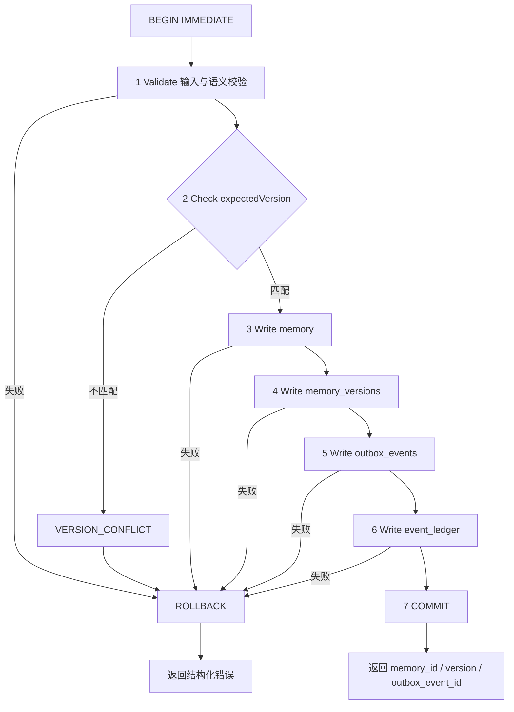

### 9.2 图02-2 ALG-02 M02 多路检索（查询规范化七步）

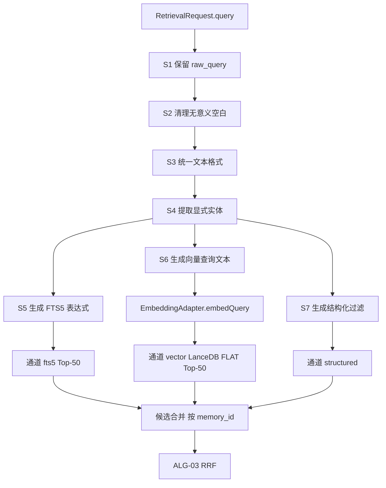

### 9.3 图02-3 ALG-03 RRF 融合

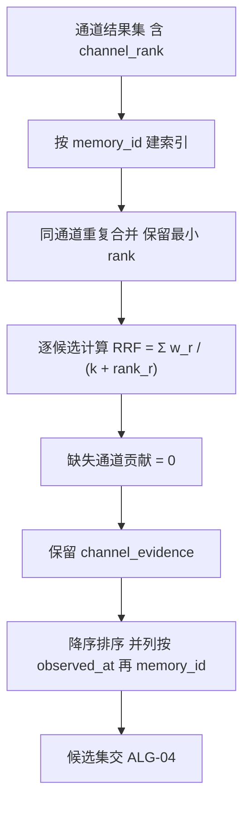

### 9.4 图02-4 ALG-04 规则排序（六特征）

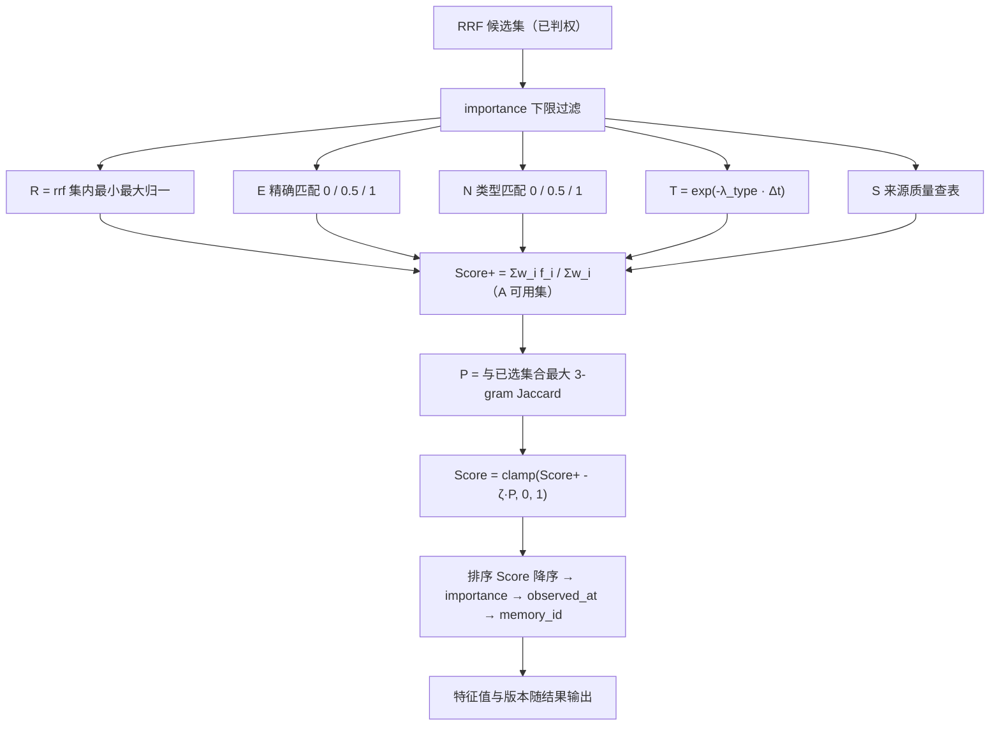

### 9.5 图02-5 ALG-05 Token Budget

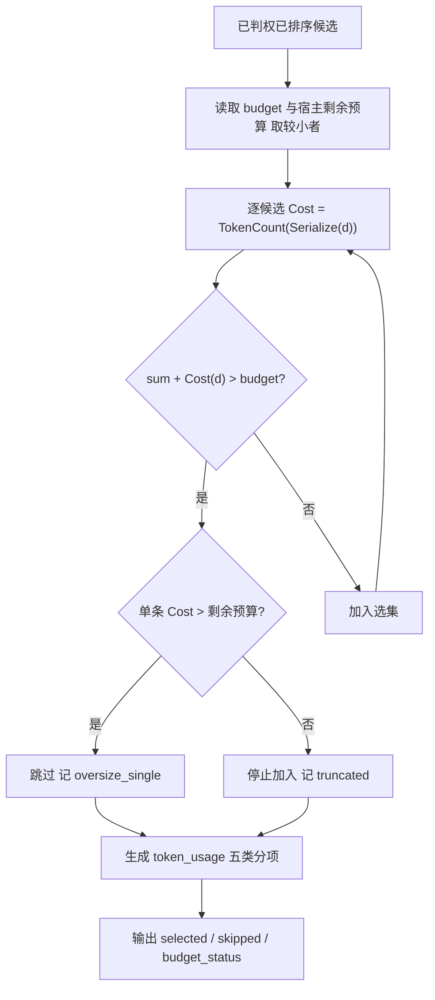

### 9.6 图02-6 ALG-06 Context Builder（GreedySelect 八步）

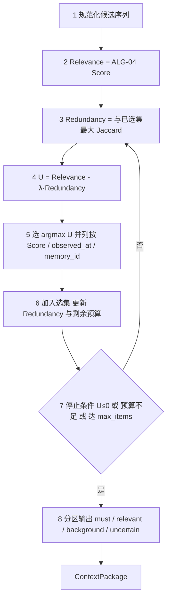

### 9.7 图02-7 ALG-07 M03 候选提取（FUTURE，十步）

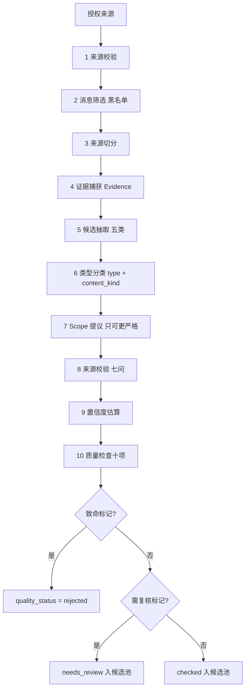

### 9.8 图02-8 ALG-08 M04 整合（FUTURE）

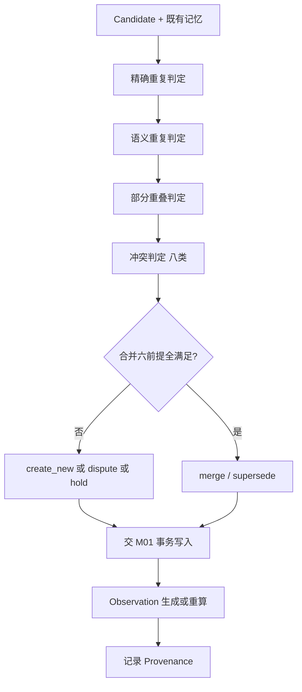

### 9.9 图02-9 ALG-09 M05 权限判定（FUTURE，契约预留）

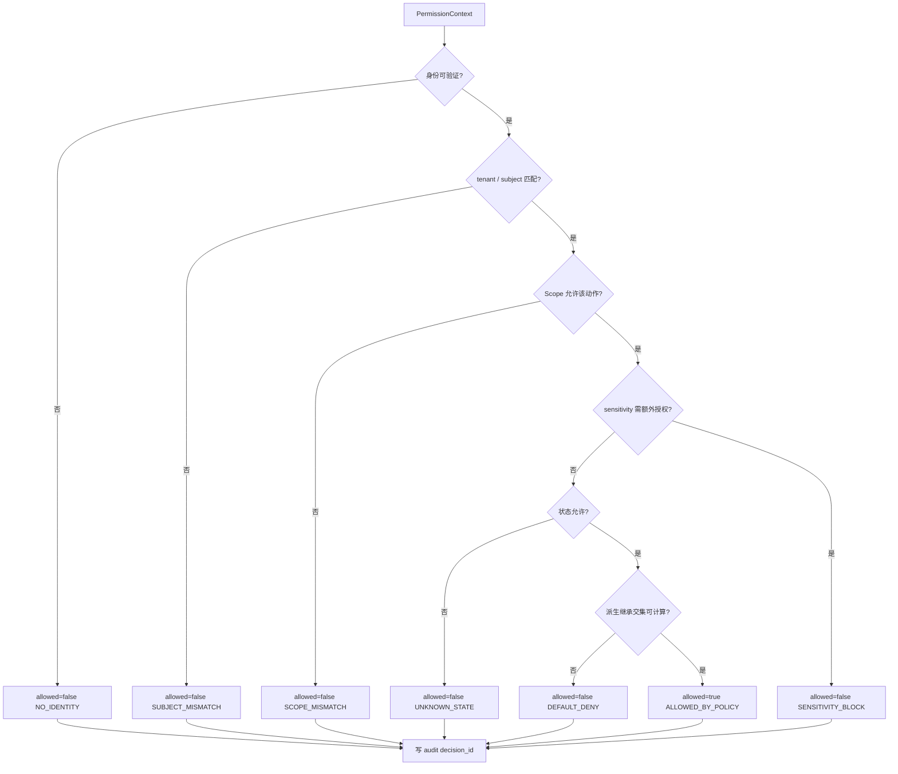

### 9.10 图02-10 ALG-10 生命周期算法

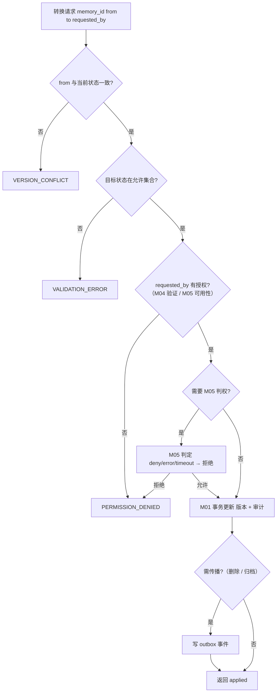

### 9.11 图02-11 ALG-11 Dream 调度（FUTURE）

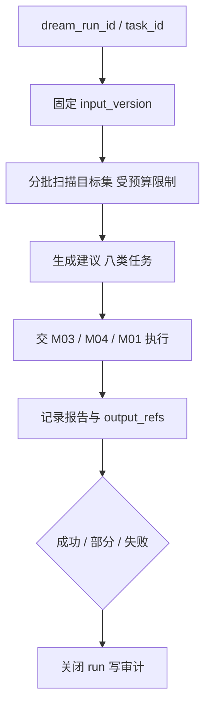

### 9.12 图02-12 ALG-12 评估算法

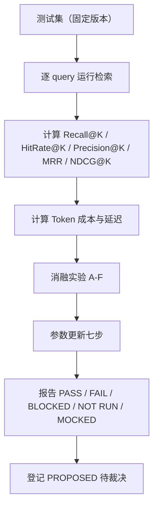

---

## 10. 异常情况

| 编号 | 异常 | 涉及算法 | 检测 | 处置（MUST） |
|---|---|---|---|---|
| E02-01 | 事务部分提交 | ALG-01 | 提交前后行数/版本核对 | 视为严重缺陷，ROLLBACK 后停止写入 |
| E02-02 | 幂等键重复但载荷不同 | ALG-01 | `idempotency_key` 命中 + 载荷 hash 不同 | 拒绝，返回 `VALIDATION_ERROR`（不得静默覆盖） |
| E02-03 | 版本冲突 | ALG-01/10 | `expected_version` 不匹配 | `VERSION_CONFLICT`，不自动重试 |
| E02-04 | 查询被改写导致语义变化 | ALG-02 | 否定词/时间条件丢失检查 | 拒绝该次规范化，`VALIDATION_ERROR` |
| E02-05 | 通道部分失败 | ALG-02 | `channel_status` | `retrieval_status=partial`，记录失败原因 |
| E02-06 | FLAT 未能证明精确检索 | ALG-02 | P0 八项验证 | **BLOCKED**，向量通道不可用于验收 |
| E02-07 | 向量空间不兼容/不完整 | ALG-02 | `validateCompatibility` / Profile | 拒绝检索该空间；`CONFIGURATION_ERROR` |
| E02-08 | RRF 出现 NaN/Inf | ALG-03 | 数值检查 | 该候选剔除并告警（不得输出 NaN） |
| E02-09 | 特征全缺失 | ALG-04 | `available` 全 false | 保留候选、Score=0、标 `degraded_ranking` |
| E02-10 | Tokenizer 不可用 | ALG-05 | 加载失败 | `CONFIGURATION_ERROR`；不得静默用估算 |
| E02-11 | 注入超预算 | ALG-05/06 | 累计核对 | 截断，标 `truncated`，不硬切正文 |
| E02-12 | 版本不一致导致注入过期正文 | ALG-06 | 与 SQLite 比对 | 剔除该项，`version_mismatch` |
| E02-13 | 越权候选进入 Context | ALG-06/09 | `decision_id` 缺失/deny | 剔除并告警（安全事件） |
| E02-14 | 状态转换越权 | ALG-10 | 授权矩阵 | `PERMISSION_DENIED` |
| E02-15 | Dream 直接改数据 | ALG-11 | 代码扫描/审计 | 视为红线违规，停止 Dream |
| E02-16 | 指标不可复现 | ALG-12 | 重放比对 | 标 FAIL，不发布结论 |
| E02-17 | reinforce 写入路径存在 | §7.14 | 代码扫描 | **红线违规**，立即停止并报告 |

---

## 11. 安全边界

1. **算法不判权**：ALG-02/03/04/05/06 **MUST NOT** 做权限判断；判权唯一入口 ALG-09；判权 **MUST** 在排序前完成。
2. **算法不写权威**：仅 ALG-01（及经其写入的 ALG-08）可写；**MUST NOT** 出现第二条写路径。
3. **不泄露**：错误信息、trace、Token 计量 **MUST NOT** 包含私人正文；预算侧信道亦须防范（只对已判权候选计量）。
4. **不静默降级**：任何通道/引擎/Tokenizer 失败 **MUST** 显式标记；**MUST NOT** 替换为未批准实现（sf §1.4 不变量 11）。
5. **不扩权**：查询规范化、Scope 提议、合并、派生继承 **MUST NOT** 放宽权限；无法计算交集 ⇒ 拒绝。
6. **不伪造**：**MUST NOT** 编造记忆、证据、向量、指标或 SDK 能力；FLAT 未证即 BLOCKED。
7. **可复现**：算法版本/特征版本/配置版本 **MUST** 随结果记录，便于审计与争议复现。
8. **红线**：reinforce 写入 **MUST NOT** 存在（§7.14）；心理加成 **MUST NOT** 改变 M02 最终排序（X-1）。

---

## 12. 测试要求

| 编号 | 测试 | 算法 | 预期 |
|---|---|---|---|
| T02-01 | 事务回滚（Outbox 失败） | ALG-01 | 主表与版本均无残留，PASS/FAIL 明确 |
| T02-02 | 旧版本事件晚到 | ALG-01 | 不覆盖新版本索引 |
| T02-03 | 删除幂等 | ALG-01/10 | 重复删除不复活、不报错 |
| T02-04 | 并发冲突 | ALG-01 | 一成一败（`VERSION_CONFLICT`） |
| T02-05 | 查询规范化否定词保留 | ALG-02 | "我没说过要买 X" 语义不变 |
| T02-06 | 三通道独立可用 | ALG-02 | 三路均返回并带 `channel_rank` |
| T02-07 | FLAT 八项验证 | ALG-02 | 8/8 PASS 或 BLOCKED |
| T02-08 | RRF 手算一致 | ALG-03 | 与 §7.4 示例一致（±1e-6） |
| T02-09 | 缺失通道贡献 0 | ALG-03 | 不补排名、不产生 NaN |
| T02-10 | 特征缺失无 NaN | ALG-04 | 权重重分配正确 |
| T02-11 | importance 不入公式 | ALG-04 | 改 importance 后 Score 不变 |
| T02-12 | 衰减按类型 | ALG-04 | episodic 衰减快于 preference |
| T02-13 | Token≠字符 | ALG-05 | 中英文同长度 token 数不同 |
| T02-14 | 预算边界 | ALG-05 | 恰好=预算通过；超 1 拒绝 |
| T02-15 | 贪心选择确定性与可解释 | ALG-06 | 同输入同输出 + 每项可追溯 |
| T02-16 | 推断不被写成事实 | ALG-06 | `inferred` 标记保留 |
| T02-17 | 候选不入正式检索 | ALG-07 | 正式结果候选数 = 0 |
| T02-18 | 合并六前提 | ALG-08 | 任一不满足即拒绝合并 |
| T02-19 | 权限十原则 | ALG-09 | deny/error/timeout/未知 全拒绝 |
| T02-20 | 派生交集 | ALG-09 | 取最严格；无法计算即拒绝 |
| T02-21 | 状态矩阵 | ALG-10 | 正例全通过、反例全拒绝 |
| T02-22 | Dream 只写报告 | ALG-11 | 数据变更 0 处 |
| T02-23 | 指标可复现 | ALG-12 | 重放差异 ≤ 1e-6 |
| T02-24 | reinforce 零写入 | §7.14 | 代码扫描 0 路径 + 运行期 NULL |

**报告纪律（MUST）**：区分 PASS / FAIL / BLOCKED / NOT RUN / MOCKED；**MUST NOT** 用模拟结果冒充真实运行（sf §7.7）。

---

## 13. 验收标准

### 13.1 文档级（02）

| 编号 | 验收项 | 判定 |
|---|---|---|
| A02-01 | 12 个算法均具备 17 要素 | 12×17 = 204 项无空缺 |
| A02-02 | 每个评分算法有公式/变量/范围/缺失/归一化 | RRF、规则排序、Token、U、NDCG 齐备 |
| A02-03 | 每算法有 Mermaid 流程图且与步骤一致 | 12/12 |
| A02-04 | 所有参数标 EXP-DEFAULT 或已裁决 | 100% |
| A02-05 | M03/M04/M05/Dream/评估全标 FUTURE | 5/5 |
| A02-06 | reinforce 红线独立成节且含六类禁止信号 | 齐备 |
| A02-07 | importance 明确"只过滤与平局" | 齐备 |
| A02-08 | Token ≠ 字符明确写死 | 齐备 |
| A02-09 | 禁止行为逐算法 6–8 条 | ≥6/算法 |
| A02-10 | FLAT 八项验证表存在且判 BLOCKED 条件明确 | 齐备 |

### 13.2 算法级（P2/P3 可验收部分）

- ALG-01：三项关键测试 PASS + 幂等 + 并发。
- ALG-02：三通道可用 + FLAT 八项 PASS（否则 BLOCKED）+ 越权召回 0。
- ALG-03/04：结果确定、可解释、无 NaN。
- ALG-05/06：注入 Token ≤ 预算且可追溯。
- ALG-09：契约存在、默认 DENY、生产无 allow-all。

**F 等级**：本文件 **F2 达成**；F3 部分；**F4 未达成**（无实测）。

---

## 14. 未决事项

| 编号 | 事项 | 类型 | 现状 | 缺失 | 风险 | 推荐方案 | 阻塞 | 需用户决定 |
|---|---|---|---|---|---|---|---|---|
| OI-02-01 | LanceDB FLAT 精确检索执行路径 | **VERIFY** | sf §16.2 八项 | 实机证据 | 向量验收不可做 | P0 建实验比对暴力计算 | **是** | 否 |
| OI-02-02 | SQLite 驱动与并发行为 | **VERIFY** | 三候选 | 实测 | 事务语义风险 | 按七项验证后登记 | 是（P0） | 否 |
| OI-02-03 | `getProfile` 八字段现网取值 | **VERIFY** | 仅知 1024 维 | 模型/度量/归一化 | 空间不完整 | 以 unknown 建 legacy 空间 | 是 | 是 |
| OI-02-04 | Tokenizer 选型与误差 | **TBD** | 需真实 Tokenizer | 模型对应 tokenizer | 预算不准 | 由宿主模型决定，记录 id+version | 否 | 否 |
| OI-02-05 | 六特征权重最优性 | **VERIFY** | 全部 EXP-DEFAULT | Benchmark | 排序质量未知 | 按 ALG-12 做参数更新七步 | 否 | 是（正式化） |
| OI-02-06 | 各算法 P99 延迟目标 | **TBD** | 无基线 | 实机测量 | 性能不可承诺 | 先测后定，不预设指标 | 否 | 否 |
| OI-02-07 | `S` 来源质量表取值依据 | **PROPOSED** | 本文件 §7.5 3.3 | 标定实验 | 排序偏向 | 用生活化测试集标定 | 否 | 是 |
| OI-02-08 | 时间衰减 λ 表标定 | **PROPOSED** | 本文件 §7.5 3.2 | 实验 | 旧记忆过度衰减 | 专项实验（历史查询回归） | 否 | 是 |
| OI-02-09 | 结构化通道是否计入 RRF | **PROPOSED** | 现设计计入（w=1.0） | 裁决 | 排序失真 | 首版只作过滤、不计入 RRF，待实验 | 否 | 是 |
| OI-02-10 | 摘要回退的产物版本管理 | **TBD** | 有回退策略 | `summary_version` 归属 | 索引漂移 | 归 M02 定义、M01 持久化 | 否 | 否 |
| OI-02-11 | 情绪标注对候选/排序的影响 | **FUTURE** | J2/J6 已裁（写时标注、首版关闭查询侧） | 实施方案 | 越权扩功能 | 保持预留，不实现 | 否 | 否 |

---

## 15. 变更记录

| 版本 | 日期 | 变更 | 变更人 | 依据 |
|---|---|---|---|---|
| 1.0 | 2026-11-04 | 首版：ALG-01…ALG-12 全 17 要素规格；RRF 公式与示例；六特征排序（归一化/缺失/衰减/source 表/重复惩罚/importance 定位）；Token Budget 与五类计量；GreedySelect 八步与分区；M03 十步与十项检查；M04 四重复/八冲突/六前提/Observation 十字段；M05 六动作与返回四字段、十原则、派生交集；生命周期授权矩阵；Dream 八任务七步；评估 15 类测试集与 5 指标公式 + 分级标签 + 消融 A–F + 参数七步；reinforce 红线专节；12 张流程图 | 设计 Agent 组 A | `DD-AUTHORITY.md` v1.0；m.md §8/§9/§10/§17/§18；sf 后文 §3.2.1–3.2.14、§3.3–§3.5、§5.1、§7、§15、§16；台账 D-AP-01/02/04/05/06/07、X-1/X-3、优化-1/3/5 |

**变更规则**：算法行为变更 **MUST** 走 sf §18.2 十要素申请；权重/阈值属实验参数，**MUST** 保持可配置；**MUST NOT** 未裁决即把 EXP-DEFAULT 写成正式值。