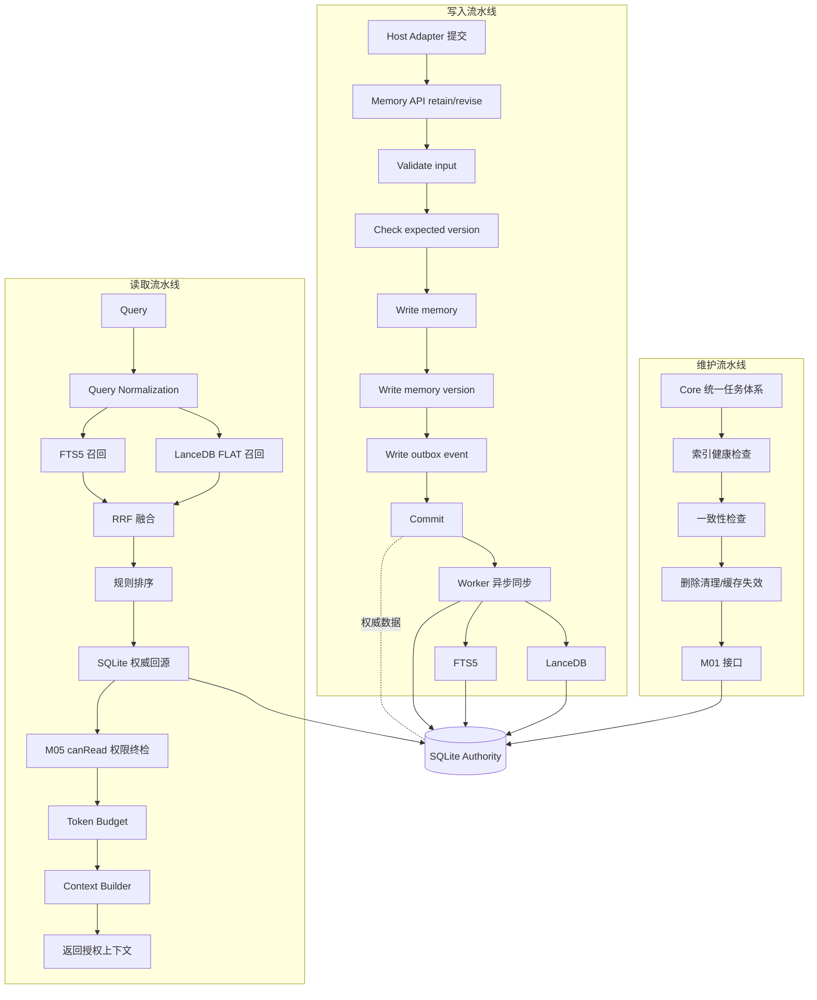
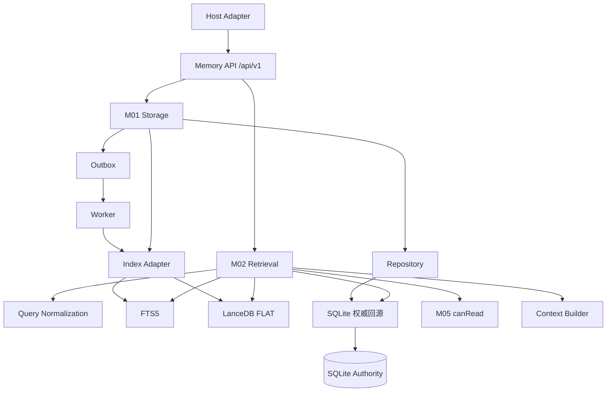
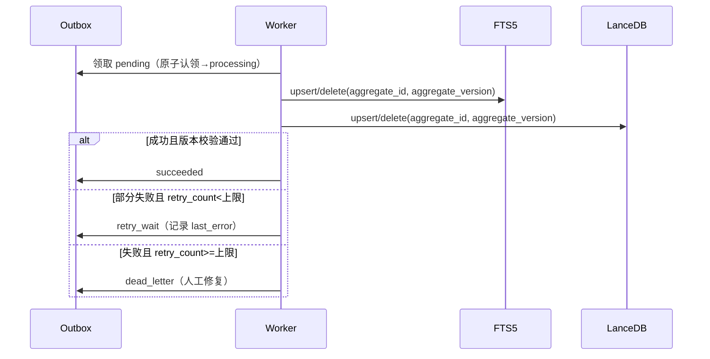
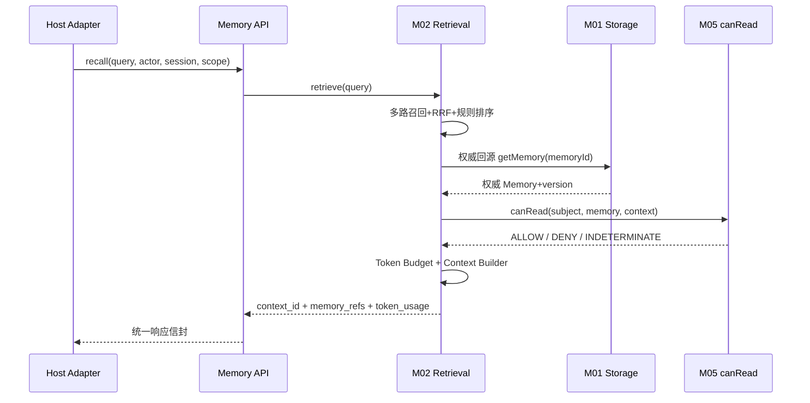

# 03 — 系统运行与协作协议

> **⚠️ V2 架构升级（2026-11-04）**：运行协议按 V2 扩展，以下为新增并以对应文件为准：①写入链路改为 **候选 → Ingestion Pipeline（16 阶段，见 `09-记忆摄取Pipeline.md`）→ M03/M04 → M01 Commit → Outbox**；Pipeline 为协调层，不直写库、不取代 M03、不绕 M05。②新增 **9 个 Memory Read/Write API**（memory.search / getProfile / getByAnchor / getEvent / getEvidence / getRelated / getEmotionContext / getMemoryById / propose），契约见 `14-ChatLLM读写API.md` 与 `contracts/api/`。③候选状态 6 值（PENDING/AUTO_ACCEPT/NEEDS_REVIEW/REJECTED/DEFERRED/COMMITTED，见 DD-AUTHORITY-V2 §2.7）；**AUTO_ACCEPT ≠ confirmed**（CR-01）。④响应新增 `semantic_type/anchor/memory_tier/evidence_refs/visibility` 必备字段。⑤事务五步、乐观并发、Outbox 五态、错误码 16 规范码、幂等要求**全部不变**。凡与 V2 冲突处一律以 V2 为准。

> 文件代号：03-系统运行与协作协议 ｜ 归属：组 B 文档 03/04/05 ｜ 状态：详细设计（F2 达成、F3 尽可能）
> 本文件展开 m.md 第二十一部分"03 — 系统运行与协作协议"与 sf 后文《总规范》§4（运行协议），定义模块通信、事件、Outbox、Worker、事务、幂等、并发、重试、超时、取消、错误码与追踪链。

---

## 1. 文档状态

| 项 | 值 |
|---|---|
| 文档编号 | 03 |
| 标题 | 系统运行与协作协议 |
| 设计基线 | R4.1-MASTER-01 |
| 完成等级自评 | **F2 达到**（接口/状态机/事务/错误/权限边界/版本规则齐全）；F3 部分达到（测试用例与预期结果见 §12，验收见 §13） |
| 实施范围 | P0–P3 = M01 + M02；M03/M04/M05 接口仅预留契约 |
| 状态用语 | APPROVED（台账）/ PROPOSED（本 Agent 默认）/ TBD / VERIFY / BLOCKED / FUTURE |

本文件不授予任何代码实施授权。设计完成 ≠ 实施授权（台账 §3e 统一限制）。

---

## 2. 适用版本

- 适用目标版本：**R4.1-MASTER-01**。
- 设计基准文件：**DD-AUTHORITY 1.0**（单一事实来源）。
- 权威顺序：正式裁决台账 > 已批准设计文件 > sf 后文 > sf 前文 > m.md（DD-AUTHORITY §2.2）。
- 冲突裁决已由 DD-AUTHORITY §4 裁定，本文件直接采用裁决结果，不再自行取舍。

---

## 3. 适用范围

本文件覆盖：

1. 三流水线完整数据流（写入 / 读取 / 维护）。
2. 模块调用关系与模块通信禁令。
3. `/api/v1/` 八端点 API 总览与统一请求/响应信封。
4. M01 内部 API（七函数）、M02 内部 API（三段式）、Permission API（六动作）。
5. 事件协议（信封、命名清单、事件八问）。
6. Outbox 完整协议（状态机、事件类型、处理规则、删除传播、版本过期、幂等）。
7. Worker 协议（八项）。
8. 事务边界、异步任务协议、并发控制、错误处理协议、追踪 ID 链、配置管理。

**边界（FUTURE / 不实施）**：M03、M04、M05 完整实现、Dream、Psychology、Persona、Session Memory、Context Compression 均为 FUTURE；本文件只为其保留接口契约，不纳入 P0–P3 实施（sf 后文 §13.2；台账 D-AP-10、I-7、X-6）。

---

## 4. 依赖文档

| 依赖 | 用途 |
|---|---|
| `DD-AUTHORITY.md` | 基准与冲突裁决（R1–R10、§8 写作硬规则） |
| `_sources/m.md`（第二十一部分、第七部分、第十五部分） | 03 文档母本要求、Outbox、Memory API |
| `_sources/sf.md`（§3.1.4–3.1.9、§4、§15、§16、§18） | 数据访问接口、事务、Outbox、运行协议、错误、配置 |
| `08-adjudication-ledger.md` | 唯一权威裁决（D-AP 系、R 系） |
| `03-m01.md`（D1–D40） | M01 冻结设计的存储、事务、备份、恢复细节 |
| `01-记忆本体与数据模型.md` | Memory Object / Evidence / Version 字段契约 |
| `04-权限与治理规范.md` | Permission API 语义、权限终检契约 |
| `05-可靠性与运维规范.md` | Outbox 恢复、Worker 故障、索引重建的运行衔接 |

---

## 5. 正式裁决引用

| 台账编号 | 内容 | 本文件落点 |
|---|---|---|
| D-AP-01（§3） | 五模块边界维持；M03 候选提取与 M04 整合裁决不可合并 | §7.2 模块通信禁令 |
| D-AP-02/10（§3/§3b） | M04 §6.2 为唯一 LLM Gateway 入口；Embedding Provider 归 M01；m03 冻结 | §7.2 |
| D-AP-05（§3b） | confirmed 仅 M04 审核通道写入；last_retrieved 按命中规则写入；reinforce 禁写（E14 未落地） | §7.3 事件/写入语义 |
| D-AP-07（§3b） | C40 权限引擎不可插拔；trusted_context_source: entry-only | §7.5 Permission API |
| D-AP-09（§3b） | 拒绝第三方托管；不声称"记忆文本不出本机"；本地持久化与云端推理分开评估 | §11 安全边界 |
| K-1（§3f） | M01 命名空间运行时态非权威 KV，待 K-2 完成后生效，仅 PROPOSED | §7.3 M01 API |
| K-6（§3f） | openLoop 只能由明确事件触发 | §7.3 事件命名（无 openLoop 事件） |
| 优化-1（§3e） | Token 计量区分系统提示词/聊天历史/记忆检索/实际注入/模块调用 | §7.4 M02 API |
| 优化-5（§3e） | 稳定、唯一、可追踪的参数 ID 规范 | §7.11 配置管理 |
| R1（DD-AUTHORITY §4） | 错误码采用 sf 后文 §4.5 规范名；m.md §15.5 为兼容别名 | §7.10 错误协议 |
| R2（DD-AUTHORITY §4） | Outbox 事件类型规范名 = memory_upsert/memory_delete/memory_reindex | §7.6 Outbox |
| R5（DD-AUTHORITY §4） | ID 用 UUIDv7（format: uuid，不锁版本），PROPOSED 默认 | §7.3/§7.6 |
| R6（DD-AUTHORITY §4） | 时间六字段语义，UTC 存储，RFC 3339 | §7.6/§7.9 |
| R7（DD-AUTHORITY §4） | Outbox 五态与异步任务五态是不同对象，不合并 | §7.6/§7.9 |
| R8（DD-AUTHORITY §4） | `/api/v1/` 八端点为 API 设计基线（PROPOSED） | §7.3 |

---

## 6. 术语表

| 术语 | 定义 |
|---|---|
| Authority / 权威 | SQLite 为唯一权威业务存储；FTS5/LanceDB 为可重建派生索引 |
| Outbox | 事务内随权威数据一同写入的事件表，驱动异步索引同步 |
| Worker | 消费 Outbox 事件并更新 FTS5/LanceDB 的后台任务 |
| 幂等键 | 唯一标识一次可重试操作、保证重复执行不产生重复业务结果的键 |
| 乐观并发 | 以 expectedVersion 为条件更新，版本不匹配即返回冲突 |
| 事件信封 | 业务事件的统一外层结构（11 字段，见 §7.6） |
| 事件八问 | 每个事件必须能回答的八个问题（sf 后文 §4.2） |
| 事务边界 | 必须处于同一 SQLite 事务内的操作集合 |
| 追踪 ID 链 | request_id → retrieval_id → … 的端到端关联链 |
| 配置八类 | Core/Storage/Retrieval/Embedding/Index/Security/Test/Host Adapter |
| EXP-DEFAULT | 实验初值，未批准、须可配置，禁止写成已裁决 |

---

## 7. 规范正文

### 7.1 三流水线总览（写入 / 读取 / 维护）

Memory Core 存在三条相互独立的流水线，任何时刻不得把三者混为一个串行流程。

- **写入流水线**：Host Adapter 提交 → Memory API → M01 事务（Validate → Check Version → Write Memory → Write Version → Write Outbox → Commit）→ Worker 异步同步 FTS5/LanceDB。
- **读取流水线**：Query → Query Normalization → 多路召回（FTS5 + LanceDB FLAT）→ RRF → 规则排序 → SQLite 权威回源 → M05 权限终检 → Token Budget → Context Builder → 返回。
- **维护流水线**：由 Core 统一任务体系调度（Dream 为 FUTURE），执行索引健康检查、一致性检查、删除清理、缓存失效，全部经 M01 接口，不直连底层存储。

三流水线完整数据流见 §9.1 Mermaid 图。写入与读取是两个独立流程（m.md §1.3）；模型生成内容不能直接成为事实；权威写入必须经正式记忆处理流程。

### 7.2 模块通信与调用关系

模块之间**只**通过明确接口与事件通信。每个模块 MUST 具备：输入契约、输出契约、错误契约、版本契约、权限契约、幂等契约（sf 后文 §4.1）。

**模块通信禁令（MUST NOT）**：

1. 任意访问其他模块内部表。
2. 直接修改其他模块的文件。
3. 绕过 API 写数据库。
4. 自行构造不符合协议的事件。
5. 依赖未公开的内部变量。
6. 业务模块直连 SQLite / LanceDB（台账 D-AP-01；03-m01 D3）。
7. M02 绕过 M05 权限终检（m.md 最终原则 8）。
8. 模块跨职责边界改其他模块数据（sf 后文 §1.4 不变量 12）。

模块调用关系（见 §9.2 Mermaid）：Host Adapter → Memory API → M02（读）/ M01（写）；M02 内依次调用 FTS5、LanceDB、SQLite 回源、M05 canRead、Context Builder；M01 内 Repository 落 SQLite、Index Adapter 落 FTS5/LanceDB；Worker 消费 Outbox 事件调用 Index Adapter。M04 §6.2 为唯一 LLM Gateway 入口（台账 D-AP-02），Embedding Provider 归 M01（台账 D-AP-02/10）。

### 7.3 REST API 总览（`/api/v1/`，PROPOSED 基线）

统一接口版本前缀：`/api/v1/`（m.md §15.1；R8 保留为 API 基线）。

#### 7.3.1 端点清单（八端点）

| 方法 | 路径 | 目的 |
|---|---|---|
| POST | `/api/v1/memories/retain` | 提交记忆候选或授权来源，不直接成为 active |
| POST | `/api/v1/memories/recall` | 检索授权记忆并返回授权上下文 |
| POST | `/api/v1/memories/confirm` | 确认待审核记忆（须相应权限） |
| POST | `/api/v1/memories/revise` | 修订已有记忆（须提供版本） |
| POST | `/api/v1/memories/revoke` | 撤销授权或记忆可用性（语义须区分） |
| GET | `/api/v1/memories/{memory_id}` | 查询单条权威记忆 |
| GET | `/api/v1/tasks/{task_id}` | 查询异步任务状态 |
| GET | `/api/v1/health` | 服务健康状态（不返回私人正文） |

MUST NOT：`revoke` 的"撤销授权"与"撤销可用性"语义 MUST 在实现前明确区分（m.md §15.2），本文件不替实现做语义合并（TBD：由 04 权限治理 + 07 演进共同裁定精确语义）。

#### 7.3.2 统一请求上下文（九字段）

身份字段 MUST 由可信 Host Adapter 构造，MUST NOT 直接信任 LLM 自行生成的身份（m.md §15.3；sf 后文 §14.5）。九字段（actor 展开为 type + id）：

| # | 字段 | 类型 | 必填 | 说明 |
|---|---|---|---|---|
| 1 | request_id | uuid | 是 | 请求唯一 ID，全链路追踪根 |
| 2 | tenant_id | string | 是 | 租户 / 隔离域 |
| 3 | actor.type | enum | 是 | owner/user/group/agent/system/service/bot（七类主体，与 04 §7.2、`permission-context.schema.json` 一致） |
| 4 | actor.id | string | 是 | 可信映射后的主体 ID |
| 5 | subject_id | string | 是 | 记忆所属主体 |
| 6 | session_id | string | 是 | 当前会话 |
| 7 | scope | enum[] | 是 | 请求作用域（owner_private 等） |
| 8 | timestamp | RFC 3339 UTC | 是 | 请求时间 |
| 9 | idempotency_key | string | 是(写) | 幂等键（读可为空） |

任何身份字段缺失或不可验证 → 拒绝（详见 04 §7.5）。

#### 7.3.3 统一响应信封

所有端点返回同一信封（m.md §15.4）：

```json
{
  "request_id": "uuid",
  "status": "success | error",
  "data": { },
  "meta": { "schema_version": "1.0", "algorithm_version": "1.0" },
  "errors": [ ]
}
```

- `status` MUST 为 `success` 或 `error`。
- 错误时 `data` 可为空对象，`errors` 为结构化错误数组（§7.10）。
- 错误响应 MUST NOT 泄露私人记忆正文或敏感信息。

#### 7.3.4 逐端点契约

##### POST /api/v1/memories/retain

| 项 | 值 |
|---|---|
| 目的 | 提交记忆候选 / 授权来源，进入候选或待审核，不代表直接 active |
| 请求字段 | request_id、actor、subject_id、session_id、scope、candidate（type/subtype/content_kind/content）、source_refs、evidence_refs、idempotency_key |
| 响应字段 | request_id、memory_id（候选 ID）、lifecycle_state（candidate/pending_review）、version、meta |
| 必填 | actor、subject_id、scope、content、idempotency_key |
| 可选 | source_refs、evidence_refs、subtype、confidence（不得由 LLM 自报充当事实真实性） |
| 错误码 | VALIDATION_ERROR、PERMISSION_DENIED、STORAGE_ERROR、INTERNAL_ERROR |
| 幂等键 | idempotency_key |
| 权限 | canWrite（主体身份经可信映射） |
| 超时 | 1500ms（EXP-DEFAULT） |
| 重试 | 仅幂等键相同可安全重试 |
| 版本 | v1；PROPOSED；实施范围 P1 |

MUST NOT：retain 直接写 active（m.md §15.2）；confirmed 仅允许 M04 审核通道写入（台账 D-AP-05）。

##### POST /api/v1/memories/recall

| 项 | 值 |
|---|---|
| 目的 | 检索授权记忆，返回经权限终检与 Token Budget 后的上下文 |
| 请求字段 | request_id、actor、subject_id、session_id、scope、query、top_k、filters、idempotency_key |
| 响应字段 | request_id、context_id、memory_refs[]（memory_id/version/scope/source_refs）、**versions**（schema_version/algorithm_version/embedding_space_id/context_contract_version）、token_usage、retrieval_status、permission_status、adapter_version ——共八字段（sf 后文 §9.4；与 08 集成规范一致） |
| 必填 | actor、subject_id、session_id、scope、query |
| 可选 | top_k（默认见 02 检索参数）、filters |
| 错误码 | VALIDATION_ERROR、PERMISSION_DENIED、INDEX_ERROR、TIMEOUT、INTERNAL_ERROR |
| 幂等键 | request_id（读操作为自然幂等；不因重复调用产生副作用） |
| 权限 | M05 canRead 终检（默认 DENY） |
| 超时 | 3000ms（EXP-DEFAULT） |
| 重试 | 可安全重试（无写副作用） |
| 版本 | v1；PROPOSED；实施范围 P2 |

##### POST /api/v1/memories/confirm

| 项 | 值 |
|---|---|
| 目的 | 确认待审核记忆（validation_state → confirmed） |
| 请求字段 | request_id、actor、memory_id、expected_version、idempotency_key |
| 响应字段 | request_id、memory_id、version、validation_state |
| 必填 | actor、memory_id、expected_version |
| 错误码 | VALIDATION_ERROR、NOT_FOUND、VERSION_CONFLICT、PERMISSION_DENIED、INTERNAL_ERROR |
| 幂等键 | idempotency_key |
| 权限 | M04 审核通道写权限（台账 D-AP-05） |
| 超时 | 1500ms（EXP-DEFAULT） |
| 版本 | v1；FUTURE（M04 未实施，仅预留契约） |

##### POST /api/v1/memories/revise

| 项 | 值 |
|---|---|
| 目的 | 修订已有记忆，须提供版本，产生新版本并建立 supersedes |
| 请求字段 | request_id、actor、memory_id、patch、expected_version、reason、idempotency_key |
| 响应字段 | request_id、memory_id、new_version、lifecycle_state |
| 必填 | actor、memory_id、patch、expected_version |
| 错误码 | VALIDATION_ERROR、NOT_FOUND、VERSION_CONFLICT、PERMISSION_DENIED、INTERNAL_ERROR |
| 幂等键 | idempotency_key |
| 权限 | canUpdate |
| 超时 | 1500ms（EXP-DEFAULT） |
| 版本 | v1；实施范围 P1（M01 提供版本持久化，业务判断归 M04） |

##### POST /api/v1/memories/revoke

| 项 | 值 |
|---|---|
| 目的 | 撤销授权或记忆可用性（TBD 精确语义） |
| 请求字段 | request_id、actor、memory_id、revoke_type（authorization/availability，TBD）、expected_version、idempotency_key |
| 响应字段 | request_id、memory_id、availability_state、version |
| 必填 | actor、memory_id、expected_version |
| 错误码 | VALIDATION_ERROR、NOT_FOUND、VERSION_CONFLICT、PERMISSION_DENIED、INTERNAL_ERROR |
| 幂等键 | idempotency_key |
| 权限 | canDelete（授权撤销）/ canUpdate（可用性） |
| 超时 | 1500ms（EXP-DEFAULT） |
| 版本 | v1；TBD 语义，FUTURE 精确化 |

##### GET /api/v1/memories/{memory_id}

| 项 | 值 |
|---|---|
| 目的 | 查询单条权威记忆 |
| 请求字段 | path: memory_id；query: version（可选） |
| 响应字段 | request_id、memory（Memory Object）、version、scope |
| 必填 | memory_id |
| 错误码 | NOT_FOUND、PERMISSION_DENIED、INTERNAL_ERROR |
| 幂等键 | 读自然幂等 |
| 权限 | canRead |
| 超时 | 1000ms（EXP-DEFAULT） |
| 版本 | v1；实施范围 P1 |

##### GET /api/v1/tasks/{task_id}

| 项 | 值 |
|---|---|
| 目的 | 查询异步任务状态（不返回私人正文） |
| 请求字段 | path: task_id |
| 响应字段 | request_id、task（§7.9 九字段）、status |
| 必填 | task_id |
| 错误码 | NOT_FOUND（或 TASK 状态 failed）、INTERNAL_ERROR |
| 幂等键 | 读自然幂等 |
| 权限 | 任务属主或受控维护接口 |
| 超时 | 1000ms（EXP-DEFAULT） |
| 版本 | v1；实施范围 P1 |

##### GET /api/v1/health

| 项 | 值 |
|---|---|
| 目的 | 服务健康状态，MUST NOT 返回私人记忆内容 |
| 请求字段 | 无 |
| 响应字段 | request_id、status（normal/degraded/error）、components（sqlite/fts5/lancedb/outbox/embedding） |
| 必填 | 无 |
| 错误码 | INTERNAL_ERROR（服务本身异常） |
| 幂等键 | 读自然幂等 |
| 权限 | 公开健康元数据（不含正文） |
| 超时 | 1000ms（EXP-DEFAULT） |
| 版本 | v1；实施范围 P1 |

### 7.4 M01 内部 API（七函数）

逻辑接口（sf 后文 §3.1.4；具体签名与 03 统一，逻辑接口名不等于已有代码）：

| 函数 | 目的 | 乐观并发 | 事务边界 | 超时 |
|---|---|---|---|---|
| `createMemory(input)` | 创建权威记忆 | 首版 expected_version=0 | 同一事务：memory + version + outbox | 1500ms（EXP-DEFAULT） |
| `getMemory(memoryId)` | 读权威记忆当前态 | —（读） | 短读事务，不跨对话占用 | 500ms（EXP-DEFAULT） |
| `getMemoryVersion(memoryId, version)` | 读指定历史版本 | —（读） | 短读事务 | 500ms（EXP-DEFAULT） |
| `queryMemories(query)` | 结构化分页查询 | —（读） | 短读事务 + 固定视图版本 | 1000ms（EXP-DEFAULT） |
| `updateMemory(memoryId, patch, expectedVersion)` | 原子更新，版本不匹配返回冲突 | 是 | 同一事务：memory + version + outbox | 1500ms（EXP-DEFAULT） |
| `deleteMemory(memoryId, context)` | 逻辑删除/标记 Deleted，产生删除事件 | 是 | 同一事务：删除状态 + version + outbox(delete) | 1500ms（EXP-DEFAULT） |
| `listMemoryVersions(memoryId)` | 列版本历史 | —（读） | 短读事务 | 500ms（EXP-DEFAULT） |

**接口要求（MUST）**：所有输入经 Schema 校验；所有更新带预期版本；所有写入在事务内；业务 ID 格式校验；MUST NOT 传任意 SQL；MUST NOT 让调用方操作内部表；失败返回结构化错误。

**事务边界（核心，sf 后文 §3.1.5 五步）**：

```text
BEGIN TRANSACTION
  1. Validate input
  2. Check expected version
  3. Write memory
  4. Write memory version
  5. Write outbox event
COMMIT
```

任一步骤失败 → ROLLBACK。MUST NOT 出现：Memory 已提交但 Outbox 未写入；Outbox 已写入但 Memory 未提交；版本变化但事件仍指向旧版本。

**K-1 预留**：M01 命名空间内可存在运行时态非权威 KV（不参与权威判定、Outbox、判权），方向待 K-2 完成后正式生效，本文件仅标 PROPOSED（台账 K-1/§3f）。

### 7.5 Permission API 契约（六动作）

M05 为唯一权限判定入口（m.md §5.5）。C40 权限引擎不可插拔（台账 D-AP-07）。六动作独立判断，读取权不等于修改权：

| 动作 | 语义 | 本文件落点 |
|---|---|---|
| `canRead(subject, memory, context)` | 读 | M02 权威回源后终检 |
| `canWrite` | 写（新建候选/来源） | retain |
| `canUpdate` | 更新 | revise |
| `canDelete` | 删除 | revoke/delete |
| `canShare` | 共享 | 04 §7.7 |
| `canExport` | 导出 | 04 §7.8 |

返回 MUST 明确为 `ALLOW` / `DENY` / `INDETERMINATE` 三态业务语义（`allowed` 为布尔字段；`ERROR`/`TIMEOUT`/未知一律归入 `INDETERMINATE`，与 `context-response.schema.json` 的 `permission_result` 枚举一致）。规则：DENY=拒绝、INDETERMINATE=拒绝、timeout=拒绝、未知=拒绝、缺权限模块=不能默认为允许（sf 后文 §3.2.11）。生产 MUST NOT 用 allow-all；测试 allow-all 只允许在隔离测试环境显式开启，不得进入生产配置（sf 后文 §13.3；台账 D-AP-07）。M05 = FUTURE，M02 保留并遵守该终检契约。完整语义见 04。

### 7.6 事件协议与 Outbox 协议

#### 7.6.1 业务事件信封（11 字段）

统一事件信封（sf 前文 §15.1，本文件视为 PROPOSED 规范，字段名与正文一致）：

| # | 字段 | 类型 | 说明 |
|---|---|---|---|
| 1 | event_id | uuid | 事件唯一 ID |
| 2 | event_type | string | 事件类型（§7.6.2 命名清单） |
| 3 | aggregate_id | uuid | 聚合根 ID（memory_id 等） |
| 4 | aggregate_version | int | 聚合版本 |
| 5 | schema_version | string | 事件结构版本 |
| 6 | occurred_at | RFC 3339 UTC | 发生时间 |
| 7 | producer | string | 产生方模块（M01 等） |
| 8 | correlation_id | uuid | 关联根（= request_id） |
| 9 | causation_id | uuid | 因果前序事件 ID |
| 10 | payload_ref | string | 载荷引用（正文不入信封） |
| 11 | scope | enum | 事件作用域 |

#### 7.6.2 事件命名清单（21 种，sf 前文 §15.2）

```text
memory.candidate.created
memory.created
memory.updated
memory.superseded
memory.archived
memory.deleted

evidence.created
observation.created
observation.invalidated

index.upsert.requested
index.delete.requested
index.sync.completed
index.sync.failed

permission.changed
permission.denied

retrieval.started
retrieval.completed
context.assembled

dream.task.started
dream.task.completed
dream.task.failed
```

其中 `dream.task.*` 三事件为 FUTURE（Dream 未实施）；`observation.*`、`permission.*` 与 M04/M05 关联，为预留契约。openLoop 只能由明确事件触发（台账 K-6），故本命名清单 MUST NOT 出现由"沉默"触发的 openLoop 事件。

#### 7.6.3 事件八问（每个事件必须能回答）

1. 谁产生了事件？2. 事件针对哪个对象？3. 对象当前版本是多少？4. 事件类型是什么？5. 事件何时产生？6. 事件是否已经处理？7. 是否允许重试？8. 失败原因是什么？（sf 后文 §4.2）

#### 7.6.4 Outbox 事件字段

Outbox 是权威数据变化传播到派生索引的载体（sf 后文 §3.1.6）。字段（规范名）：

| 字段 | 类型 | 说明 |
|---|---|---|
| event_id | uuid | 幂等主键 |
| event_type | enum | memory_upsert / memory_delete / memory_reindex |
| aggregate_id | uuid | memory_id |
| aggregate_version | int | 权威版本 |
| payload_version | string | 载荷结构版本（如 `"1.0"`，≤32 字符；与 `outbox-event.schema.json` 一致） |
| document_hash | string\|null | 检索文档内容哈希（64 位 hex），Worker 一致性校验用 |
| embedding_profile_id | string\|null | 产生该事件的向量空间/Profile 标识（≤128） |
| created_at | RFC 3339 UTC | 写入时间 |
| status | enum | pending/processing/succeeded/retry_wait/dead_letter |
| retry_count | int | 重试次数 |
| next_retry_at | RFC 3339 UTC\|null | 下次重试调度时间（SM-4 使用；正式字段，非别名） |
| last_error | string | 最近错误（脱敏） |
| processed_at | RFC 3339 UTC\|null | 处理完成时间 |

（`next_retry_at`、`document_hash`、`embedding_profile_id` 均为 `contracts/schemas/outbox-event.schema.json` 的正式字段；Outbox 事件共 13 字段。）

#### 7.6.5 Outbox 事件类型（DD-AUTHORITY R2）

- **规范名**：`memory_upsert` / `memory_delete` / `memory_reindex`。
- **历史别名**：`CREATE` / `UPDATE` / `DELETE` / `REINDEX`（sf 前文/m 旧名），契约中 mapping 字段兼容，MUST NOT 作为新事件类型的规范名。
- MUST NOT 自行增加有业务含义的新事件类型而不更新事件协议。

#### 7.6.6 Outbox 状态机（五态）

状态：`pending` / `processing` / `succeeded` / `retry_wait` / `dead_letter`（m.md §7.5；R7 判定为独立于异步任务状态机的对象）。

| 当前态 | 触发 | 下一态 |
|---|---|---|
| pending | Worker 领取（原子认领） | processing |
| processing | 成功 + 索引版本校验通过 | succeeded |
| processing | 失败 + retry_count ≤ retry_max | retry_wait |
| processing | 失败 + retry_count > retry_max | dead_letter |
| retry_wait | next_retry_at 到期（重新认领） | processing |
| retry_wait | retry_count > retry_max | dead_letter |
| pending/processing | 聚合对象已删除且无需传播（幂等短路） | cancelled |
| processing | v_event < v_current（过期版本） | succeeded（SkipOrSupersede 终态标记，记录 `last_error=superseded_by_version`） |
| dead_letter | 人工修复并复位 retry_count | pending |

（转换矩阵为 PROPOSED 默认，与 `contracts/state-machines/state-machines.md` SM-4 逐条一致：五态枚举内不含 `superseded` 状态值，过期事件以 `succeeded` + `last_error` 标记；重试上限具体数值 TBD，须可配置。）

#### 7.6.7 处理规则十条（sf 后文 §3.1.6）

1. 事件处理 MUST 幂等。
2. 相同事件重复执行 MUST NOT 产生重复业务结果。
3. 事件 MUST 携带权威版本。
4. 过期版本 MUST NOT 覆盖新版本索引（v_event < v_current ⇒ SkipOrSupersede）。
5. 删除事件 MUST 传播至所有相关索引。
6. 失败 MUST 记录。
7. 重试 MUST 有上限或明确的持续重试策略。
8. 重试失败 MUST 进入可观测状态（dead_letter）。
9. 索引同步失败 MUST NOT 回滚已提交的权威数据。
10. MUST 支持从 SQLite 重新构建索引。

**版本过期规则**：当 `v_event < v_current` 时，处理结果为 SkipOrSupersede —— 跳过该事件（不得覆盖新索引），并标记为已处理（避免永久重试），可选记录 supersede 审计。

#### 7.6.8 删除传播七步（sf 后文 §3.1.6）

1. SQLite 记录删除状态或删除事件。
2. Outbox 产生删除事件（event_type = memory_delete）。
3. FTS5 删除对应索引记录。
4. LanceDB 删除对应向量记录。
5. 相关缓存失效。
6. 相关派生数据按权限与删除策略处理。
7. 审计记录操作结果。

MUST NOT：只删 SQLite 而保留仍可被召回的索引内容。

#### 7.6.9 幂等七要求

1. 事件有稳定唯一 ID（event_id）。
2. 幂等键覆盖重试（重复投递同 event_id 只执行一次副作用）。
3. 重复执行不得重复创建记忆 / 生成版本 / 增加计数 / 传播删除。
4. 处理前校验 aggregate_version，过期即 SkipOrSupersede。
5. Worker 不得假定事件只执行一次（sf 后文 §4.7）。
6. 索引写入为 upsert/delete 语义，天然可重复。
7. 幂等键与 aggregate_id、aggregate_version 联合约束，禁止同名异义。

### 7.7 Worker 协议（八项）

Worker 消费 Outbox 事件。MUST NOT 假定事件只执行一次，MUST 支持（sf 后文 §4.7）：

1. **重复投递**：同 event_id 幂等处理（§7.6.9）。
2. **进程重启**：重启后恢复 `processing` 与 `pending` 事件（认领需可恢复/带租约或心跳）。
3. **处理中断**：中断后半程不产生半写状态；索引 upsert 原子、版本校验兜底。
4. **版本过期**：v_event < v_current ⇒ SkipOrSupersede。
5. **部分索引失败**：FTS5 成功、LanceDB 失败时，事件回 retry_wait，且不得回滚权威数据；下次仅补失败通道（通道级幂等）。
6. **长时间未处理**：超过阈值（TBD，可配置）的 pending/processing 事件告警并重新调度。
7. **失败重试**：指数退避（EXP-DEFAULT：初始 1s、倍率 2、上限 60s、最大次数 TBD）。
8. **人工修复**：dead_letter 支持人工检查、修复、复位后重新入队。

Worker 同步时序见 §9.3 Mermaid。

### 7.8 事务边界汇总表

| 操作 | MUST 处于同一 SQLite 事务 |
|---|---|
| 记忆创建（memory + version + outbox upsert） | 是 |
| 记忆更新（memory + version + outbox upsert） | 是 |
| 记忆删除（删除状态 + version + outbox delete） | 是 |
| 关系变更（03-m01 D6） | 是 |
| 任务及检查点更新（03-m01 D6） | 是 |
| 变更记录（Change Log）与正式数据更新（03-m01 D39） | 是 |
| FTS5 索引写入 | 否（事务提交后异步） |
| LanceDB 索引写入 | 否（事务提交后异步） |
| 缓存失效 | 否（异步，靠权威状态兜底） |

索引同步 MUST NOT 回滚权威数据；权威提交独立于索引结果（sf 后文 §3.1.6 规则 9）。

### 7.9 异步任务协议

通用异步任务（区别于 Outbox 事件，R7）字段九项（sf 后文 §4.6）：

`task_id` / `task_type` / `status` / `created_at` / `started_at` / `completed_at` / `retry_count` / `error` / `idempotency_key`。

状态五态：`pending` / `running` / `succeeded` / `failed` / `cancelled`。

- `cancelled` MUST NOT 被解释为 `succeeded`（sf 后文 §4.6）。
- 任务取消 ≠ 成功；取消后若权威数据已变更，须有补偿或幂等兜底。
- 时间语义遵循 R6：created/started/completed 与事实时间/记录时间分开。

### 7.10 错误处理协议

**规范错误码集（唯一登记处 `contracts/error-codes.md` §1，枚举见 `error.schema.json`；R1 裁决：sf 后文 §4.5 的 11 个为核心名）**：

`VALIDATION_ERROR` / `NOT_FOUND` / `VERSION_CONFLICT` / `PERMISSION_DENIED` / `PERMISSION_ERROR` / `STORAGE_ERROR` / `INDEX_ERROR` / `EMBEDDING_ERROR` / `TIMEOUT` / `CONFIGURATION_ERROR` / `INTERNAL_ERROR`（11 核心）+ `DUPLICATE_REQUEST` / `BUDGET_EXCEEDED` / `TASK_NOT_FOUND` / `RETRIEVAL_FAILED` / `UNAVAILABLE`（5 个 API/运维层扩展）= **16 规范码**。

**扩展属性（sf 后文 §4.4，R1 要求）**：每个错误码带 `code` / `category` / `message` / `retryable` / `severity` / `handling` / `exposure_policy`。

**兼容别名映射表（m.md §15.5 → sf 后文 §4.5）**：

| m.md §15.5 旧名 | 规范码（`error-codes.md`） |
|---|---|
| INVALID_ARGUMENT / VALIDATION_FAILED | VALIDATION_ERROR |
| UNAUTHORIZED / FORBIDDEN | PERMISSION_DENIED |
| （权限系统故障类） | PERMISSION_ERROR |
| NOT_FOUND | NOT_FOUND |
| VERSION_CONFLICT | VERSION_CONFLICT |
| DUPLICATE_REQUEST | DUPLICATE_REQUEST（独立保留；返回首次结果） |
| STORAGE_UNAVAILABLE | STORAGE_ERROR（health 层可用 UNAVAILABLE） |
| INDEX_UNAVAILABLE | INDEX_ERROR |
| RETRIEVAL_FAILED | RETRIEVAL_FAILED（独立保留，category=index） |
| EMBEDDING_FAILED | EMBEDDING_ERROR |
| BUDGET_EXCEEDED | BUDGET_EXCEEDED（独立保留，category=validation） |
| TASK_NOT_FOUND | TASK_NOT_FOUND（独立保留，category=not_found） |
| INTERNAL_ERROR | INTERNAL_ERROR |

MUST NOT 各模块自行命名错误码（sf 后文 §4.4）。错误信息可追踪但 MUST NOT 泄露私人正文（sf 后文 §4.5）。`DUPLICATE_REQUEST` 与 `BUDGET_EXCEEDED` 已由 `contracts/error-codes.md` §1 定为独立规范码（OI-03-02 已结），新增或归并 MUST 同步更新 error-codes.md / error.schema.json enum / 本节三处。

### 7.11 配置管理八类

配置 MUST 分八类并 Schema 校验（sf 后文 §4.8）：

1. Core Config（实例、数据目录、进程锁）
2. Storage Config（SQLite 路径、WAL、Busy Timeout、备份周期）
3. Retrieval Config（Top-K、RRF k、排序权重）
4. Embedding Config（model_id/version/dimension/metric/space_id）
5. Index Config（FTS5/LanceDB 同步、重建参数）
6. Security Config（权限默认 DENY、敏感度规则、C40 开关）
7. Test Config（测试数据库、allow-all 仅测试）
8. Host Adapter Config（身份映射、超时、重试）

未知配置项 MUST NOT 静默生效；生产/测试配置 MUST 隔离；MUST NOT 将测试权限配置带入生产（sf 后文 §4.8）。所有参数标"实验初值（EXP-DEFAULT）"，正式化前 MUST 可配置，并遵循稳定、唯一、可追踪参数 ID 规范（台账 优化-5）。

### 7.12 追踪 ID 链

端到端追踪链（sf 前文 §11）：

```text
request_id
  → retrieval_id
  → memory_ids（候选）
  → permission_decisions
  → context_build_id
  → prompt_injection_event_id（= Event-L3）
```

- `prompt_injection_event_id` 只证明记忆进入最终 Prompt，MUST NOT 证明模型已使用（sf 后文 §3.2.14；m.md §16.4）。
- Token 计量 MUST 区分：系统提示词 / 聊天历史 / 记忆检索 / 实际注入内容 / 模块调用消耗（台账 优化-1）。

---

## 8. 接口或数据结构

本节汇总第 7 章定义的机器可读结构，避免重复定义：

- 统一请求上下文：9 字段（§7.3.2）。
- 统一响应信封：`{request_id, status, data, meta, errors}`（§7.3.3）。
- 事件信封：11 字段（§7.6.1）。
- Outbox 事件：13 字段（§7.6.4）。
- 异步任务：9 字段（§7.9）。
- 错误码：16 规范码（11 核心 + 5 扩展）+ 7 扩展属性（§7.10）。

所有字段 MUST 在对应机器契约文件落地（`contracts/api/*.md`、`contracts/schemas/outbox-event.schema.json`、`contracts/error-codes.md`），本文件不重复撰写 Schema 本体。

---

## 9. 流程图

### 9.1 三流水线数据流



### 9.2 模块调用关系



### 9.3 Worker 同步时序



### 9.4 请求-响应时序



---

## 10. 异常情况

| 异常 | 行为 |
|---|---|
| 事务中途失败 | ROLLBACK，Memory/Outbox 均不落盘 |
| 版本冲突（expectedVersion 不匹配） | 返回 VERSION_CONFLICT，不得覆盖 |
| 索引同步失败 | 权威数据不回滚，事件回 retry_wait / dead_letter |
| 旧版本事件晚到 | SkipOrSupersede，不得覆盖新索引 |
| Worker 崩溃 | 重启后恢复未完成事件（幂等 + 版本校验） |
| 权限终检 timeout/error/unknown | 一律拒绝（sf 后文 §3.2.11） |
| 幂等键重复 | 返回首次结果或 DUPLICATE_REQUEST，不得二次副作用 |
| 取消任务 | cancelled ≠ succeeded |
| Embedding 失败 | 事件回 retry_wait，不得写入伪造向量 |

---

## 11. 安全边界

- 身份 MUST 由可信 Host Adapter 构造（m.md §15.3）。
- 错误与日志 MUST NOT 泄露私人正文（sf 后文 §4.5；03-m01 D13）。
- 生产 MUST NOT 使用 allow-all；测试 allow-all 仅隔离环境（sf 后文 §13.3）。
- 本地持久化与云端推理传输 MUST 分开评估（台账 D-AP-09）。
- 事件正文（payload）经 payload_ref 引用，MUST NOT 把私人正文塞进事件信封。
- 记忆正文是数据不是指令（防提示注入，详见 04 §7.12）。

---

## 12. 测试要求

- M01 三大关键测试（sf 后文 §7.2）：① Memory 写入成功但 Outbox 失败 → 整个事务回滚；② 旧版本事件晚于新版本执行 → 不覆盖新索引；③ 删除事件重复执行 → 不导致数据恢复。
- Outbox 状态机测试：五态全转换 + dead_letter 人工修复。
- 幂等测试：重复投递同 event_id 只执行一次副作用。
- 版本过期测试：v_event < v_current ⇒ SkipOrSupersede。
- 并发测试：乐观并发四步，版本冲突返回且不覆盖。
- 端点测试：八端点请求/响应/错误码/幂等键/权限/超时/重试。
- 结果标注 MUST 区分 PASS/FAIL/BLOCKED/NOT RUN/MOCKED（sf 后文 §7.7）。

---

## 13. 验收标准

| 编号 | 项目 | 标准 |
|---|---|---|
| P03-1 | 事务原子性 | 五步事务任意失败即回滚，无半写 |
| P03-2 | 事件幂等 | 同 event_id 重复执行无重复业务结果 |
| P03-3 | 版本防覆盖 | 过期事件不覆盖新索引 |
| P03-4 | 删除传播 | 七步传播完成后索引不可召回已删内容 |
| P03-5 | 错误码统一 | 16 规范码（11 核心 + 5 扩展）+ 7 属性，无模块自造码 |
| P03-6 | 权限终检 | deny/error/timeout/unknown 均拒绝 |
| P03-7 | 追踪链完整 | request_id → prompt_injection_event_id 可关联 |
| P03-8 | 配置隔离 | 生产/测试配置隔离，未知项不生效 |

F2 全部达到；F3 以 §12 测试用例支撑。禁止把 F2/F3 写成 F4。

---

## 14. 未决事项

| 编号 | 事项 | 状态 |
|---|---|---|
| OI-03-01 | revoke 的"撤销授权"与"撤销可用性"精确语义 | TBD（04/07 联合） |
| OI-03-02 | DUPLICATE_REQUEST / BUDGET_EXCEEDED 是否独立保留为规范码 | 已结：`contracts/error-codes.md` §1 定为独立规范码（不再 TBD） |
| OI-03-03 | Outbox 重试上限与退避参数具体数值 | TBD（EXP-DEFAULT：初始 1s/倍率 2/上限 60s） |
| OI-03-04 | Worker 认领租约/心跳与长时间未处理阈值 | TBD |
| OI-03-05 | K-1 运行时态 KV 正式落位（待 K-2 导出边界清单 + M01 D2/D10 落位设计） | BLOCKED（台账 K-1） |
| OI-03-06 | reinforce 回传链路（E14/B04） | BLOCKED（台账 D-AP-05，仅预留 schema） |
| OI-03-07 | 宿主真实接口 / DSH Prompt 组装契约 | VERIFY（不可编造宿主 API） |

---

## 15. 变更记录

| 版本 | 日期 | 变更 | 作者 |
|---|---|---|---|
| 1.0 | 2026-11-04 | 初始详细设计（03 系统运行与协作协议） | 组 B Agent |

（END）
