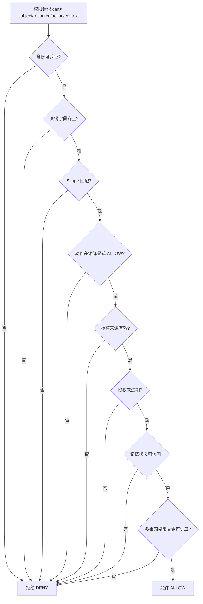
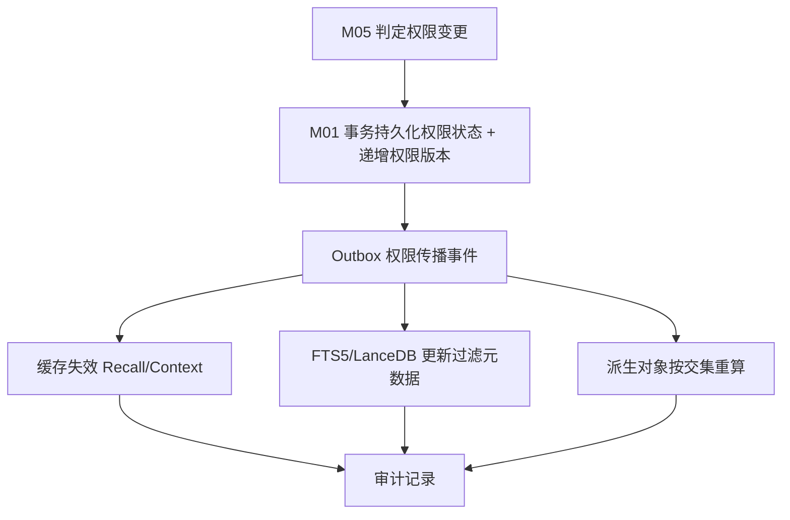
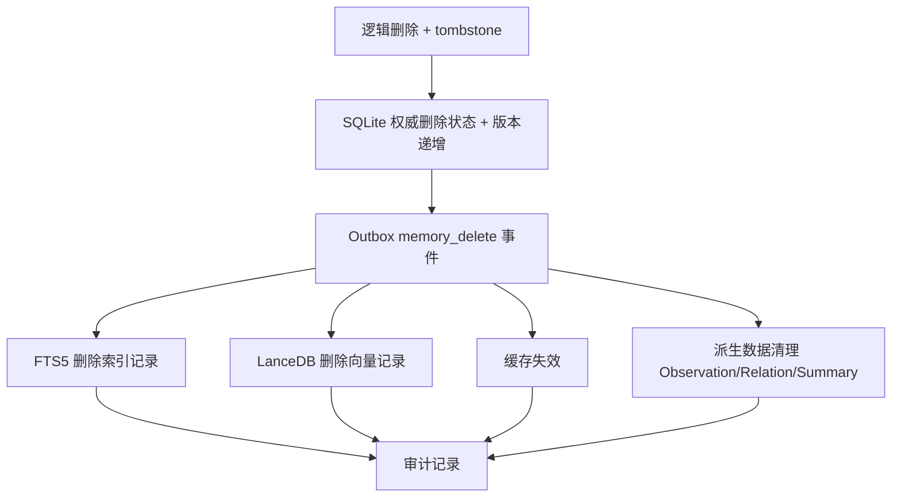

# 04 — 权限与治理规范

> **⚠️ V2 架构升级（2026-11-04）**：权限体系按 V2 扩展：①可见性对外统一为 **`visibility` 三值**（owner_private / group_shared / public）；`public` **V1 禁用**（`permission.public_enabled=false`，CR-07）；`scope` 五值保留为内部细分（映射见 DD-AUTHORITY-V2 §4.3）。②权限 MUST 覆盖**摄取/候选/存储/检索/上下文构建/原句读取/情绪读取/修改/删除/导出** 十环节。③**证据权限继承**：记忆与证据权限一致或更严格；通过 `related_evidence` 取原句 MUST 再次校验证据权限，**不得绕过**。④`emotion.query_enabled`/`influence_enabled`/`auto_infer` 默认 false（CR-02/03/04）；测试替身仅限隔离测试，禁止用于真实私人数据的正式群聊注入。⑤默认拒绝、M05 唯一判定入口、C40 不可插拔**不变**。凡与 V2 冲突处一律以 V2 为准。

> 文件代号：04-权限与治理规范 ｜ 归属：组 B 文档 03/04/05 ｜ 状态：详细设计（F2 达成、F3 尽可能）
> 本文件展开 m.md 第二十一部分"04 — 权限与治理规范"与 sf 后文《总规范》§5（权限与治理），定义主体、资源、动作、Scope、身份映射、派生继承、删除、审计、用户控制与隐私边界。

---

## 1. 文档状态

| 项 | 值 |
|---|---|
| 文档编号 | 04 |
| 标题 | 权限与治理规范 |
| 设计基线 | R4.1-MASTER-01 |
| 完成等级自评 | **F2 达到**（权限矩阵/主体/动作/Scope/派生继承/删除/审计齐全）；F3 部分达到（11 个权限测试场景见 §12） |
| 实施范围 | M05 = FUTURE，设计先行；M02 必须预留权限终检契约（默认 DENY） |
| 状态用语 | APPROVED（台账）/ PROPOSED（本 Agent 默认）/ TBD / VERIFY / BLOCKED / FUTURE |

本文件不授予代码实施授权。M05 可以拥有完整权限模型设计与接口契约，但无实施授权前不得在 P0–P3 自行实现完整 M05（sf 后文 §0.4）。

---

## 2. 适用版本

- 适用目标版本：**R4.1-MASTER-01**。
- 设计基准：**DD-AUTHORITY 1.0**。
- 权威顺序：裁决台账 > 已批准设计 > sf 后文 > sf 前文 > m.md。

---

## 3. 适用范围

本文件覆盖：权限安全十原则、主体模型与角色、权限资源与动作矩阵、Scope 五类语义与隔离禁令、身份五标识与映射、权限判断输入、写入/读取验证、共享/导出、派生数据权限继承、权限变更传播、删除治理、审计、用户控制、隐私边界、防提示注入污染。

**边界（FUTURE / 不实施）**：M05 完整权限引擎为 FUTURE（sf 后文 §13.2）；本文件为其设计契约，并确保 M02 在当前 P0–P3 遵守权限终检契约（台账 D-AP-07、sf 后文 §13.3）。

---

## 4. 依赖文档

| 依赖 | 用途 |
|---|---|
| `DD-AUTHORITY.md` | 基准、§8 结构硬规则 |
| `_sources/m.md`（第十二部分） | 主体/操作/权限规则/派生继承/删除 |
| `_sources/sf.md`（§3.5、§5、§9、§11.4、§13.3） | 权限原则、读写验证、身份、隐私、预留 |
| `08-adjudication-ledger.md` | D-AP-07/09、K-2、X-3 等裁决 |
| `03-m01.md`（D3、D7、D13、D26） | 写入责任、删除、数据保护、导入导出 |
| `03-系统运行与协作协议.md` | Permission API 六动作契约 |
| `05-可靠性与运维规范.md` | 删除传播、备份保留策略、审计不复制正文 |

---

## 5. 正式裁决引用

| 台账编号 | 内容 | 本文件落点 |
|---|---|---|
| D-AP-05（§3b） | confirmed 仅 M04 审核通道写入；last_retrieved 按命中规则写入 | §7.6 写入验证 |
| D-AP-07（§3b） | C40 权限引擎不可插拔；trusted_context_source: entry-only；五级可插拔分类 | §7.2/§7.11/§7.12 |
| D-AP-09（§3b） | 拒绝第三方托管；不声称"记忆文本不出本机"；本地持久化与云端推理分开 | §7.13 |
| K-2（§3f） | 用户可获取关系性内容与互动状态；内部计算参数不默认导出；删除/删号/tombstone/缓存/备份一并考虑 | §7.10 用户控制、§7.9 删除 |
| K-1（§3f） | M01 运行时态非权威 KV 不参与判权，导出规则服从 K-2 | §7.11 |
| X-3（§3g） | Recall 结果可参与推理、禁止直接改 PAD、持久变更走独立审核 | §7.11 权限边界 |
| 优化-5（§3e） | 参数稳定唯一可追踪 ID | §7.13 |
| J5（§3e） | 情绪标注清除走 M04 修订通道 + 审计；删除范围服从 K-2 | §7.9 删除 |
| R4（DD-AUTHORITY §4） | 三组件边界不变；M05 是唯一权限判定入口 | §7.2 |

---

## 6. 术语表

| 术语 | 定义 |
|---|---|
| 主体（Principal） | 可被授权访问的对象（owner/user/group/agent/system/service/bot） |
| 角色（Role） | 主体在特定场景下的职责定位；角色 ≠ 所有权 |
| 资源（Resource） | 权限施加对象（memory/evidence/relation/observation/export/backup） |
| 动作（Action） | read/write/update/delete/share/export |
| Scope | 权限边界，不是记忆类型（owner_private 等五类） |
| 派生数据 | 由权威数据生成的索引/缓存/摘要/导出/备份等 |
| 权限交集 | 多来源派生数据的权限 = 各来源权限的最严格交集 |
| tombstone | 删除墓碑，防止已删内容经备份恢复/索引重建复活 |
| 逻辑删除 | 标记删除状态，检索不可见，物理清除延后 |
| trusted_context_source | 可信上下文来源约束，取值 entry-only |

---

## 7. 规范正文

### 7.1 权限安全十原则（sf 后文 §5.1）

1. 默认拒绝。
2. 最小权限。
3. 显式授权。
4. 访问目的限制。
5. 权限可撤销。
6. 操作可审计。
7. 派生数据继承。
8. 身份必须可验证。
9. 权限错误不降级为允许。
10. 管理权限不等于私人内容读取权限。

以上十原则为 MUST 级安全底线。任何模块 MUST NOT 自行实现与 M05 相冲突的权限判断（sf 后文 §1.2 D 平面）。

### 7.2 主体模型与角色

**主体（六类 + bot）**：`owner` / `user` / `group` / `agent` / `system` / `service`（m.md §12.1），另含 `bot`（sf 后文 §3.5.2）。所有主体 MUST 映射到可信身份。

**角色（七角色）**：Memory Owner（记忆所有者）、Requesting User（请求用户）、Group Member（群成员）、Group Administrator（群管理员）、Bot Owner（Bot 所有者）、System Service（系统服务）、Maintenance Operator（维护操作员）。

**角色 ≠ 所有权（MUST）**：

- 群管理员 MUST NOT 拥有群成员私人记忆的读取权（m.md §12.3；sf 后文 §3.5.3）。
- Bot 所有者的维护操作 MUST NOT 自动等于私人记忆读取权（m.md §12.3）。
- 管理权限 MUST NOT 等于私人内容读取权限（十原则 10）。

**C40 权限引擎不可插拔（台账 D-AP-07）**：权限引擎是核心治理组件，MUST NOT 作为可插拔组件被替换或绕过。其余组件采用五级可插拔分类（D-AP-07 接受），但 C40 不在其列。

### 7.3 权限资源与动作

**六动作**：`read` / `write` / `update` / `delete` / `share` / `export`（m.md §5.5；sf 后文 §3.5.3）。每种动作 MUST 独立判断；拥有读取权不等于拥有修改权。

**六资源类型**：`memory` / `evidence` / `relation` / `observation` / `export` / `backup`。

### 7.4 权限矩阵（六动作 × 六资源 × 五 Scope × 七角色）

矩阵为"默认 DENY + 显式 ALLOW 条件"。未列出的组合一律 DENY。

#### 7.4.1 按资源类型的动作 ALLOW 条件

| 资源 | read ALLOW | write ALLOW | update ALLOW | delete ALLOW | share ALLOW | export ALLOW |
|---|---|---|---|---|---|---|
| memory | 属主 + Scope 授权主体 | 属主（或 M03 候选提交经 M04 通道） | 属主（走 M04 修订/审核） | 属主或有效治理流程 | 属主显式 | 属主 + 独立导出授权 |
| evidence | 同 memory 继承 | 来源主体 | 属主 | 属主/治理流程 | 属主 | 属主 + 导出授权 |
| relation | 同来源 memory 交集 | 属主 | 属主 | 属主 | 属主 | 属主 + 导出授权 |
| observation | 同来源 memory 交集 | M04（派生） | M04 | 属主/M04 | 属主 | 属主 + 导出授权 |
| export | 属主 | 属主 | — | 属主 | 属主 | 属主 |
| backup | 维护操作员（仅元数据） | 系统服务 | — | 维护操作员 | — | 属主 + 导出授权 |

#### 7.4.2 五 Scope × 七角色矩阵（读动作，其余动作同理从严）

| Scope | Memory Owner | Requesting User | Group Member | Group Admin | Bot Owner | System Service | Maintenance Operator |
|---|---|---|---|---|---|---|---|
| owner_private | ALLOW（全动作） | DENY（除非=Owner） | DENY | DENY | DENY（维护≠读） | DENY（不读正文） | DENY（仅元数据） |
| group_shared | ALLOW | ALLOW（若在授权群内） | ALLOW（若在授权群内） | ALLOW（仅 group_shared 正文） | DENY（维护≠读） | DENY | DENY（仅元数据） |
| session_only | ALLOW | ALLOW（仅同 session_id） | DENY（跨会话） | DENY | DENY | DENY | DENY |
| project_scoped | ALLOW | ALLOW（仅同 project 成员） | DENY（跨项目） | DENY（除非 project 授权） | DENY | DENY | DENY（仅元数据） |
| system_internal | —（非属主可见） | DENY | DENY | DENY | DENY | ALLOW（运行元数据） | ALLOW（仅元数据，不读正文） |

**全部默认 DENY**，任何单元格无显式 ALLOW 条件即为拒绝。MUST NOT 出现隐式放行。

### 7.5 Scope 五类语义与隔离禁令

五类 Scope（m.md §3.3；sf 后文 §2.2）：`owner_private`（仅授权主体可读）、`group_shared`（明确共享给群组）、`session_only`（仅当前会话）、`project_scoped`（特定项目内）、`system_internal`（系统内部运行数据）。

Scope 是权限边界，不是记忆类型。隔离禁令（MUST NOT）：

1. owner_private MUST NOT 自动转 group_shared（m.md §3.3）。
2. 不得因内容对某群有用就自动转 group_shared。
3. 不得因内容看起来不敏感就自行改变 Scope（sf 后文 §2.2）。
4. 不得因某记忆被用于回答就推断可向其他会话共享。
5. session_only MUST NOT 跨会话（sf 后文 §9.3/§13.3）。
6. project_scoped MUST NOT 跨项目。
7. 群聊记忆 MUST NOT 自动进入私人记忆；私人记忆 MUST NOT 自动进入群聊上下文。
8. 同一 Bot 的多个群聊 MUST NOT 因共享一个进程就共享全部上下文。

### 7.6 身份五标识与映射规则

**五标识（sf 后文 §9.2）**：`user_id` / `group_id` / `session_id` / `bot_id` / `tenant_id`。

**映射规则（MUST NOT）**：

1. MUST NOT 把群 ID 当作用户 ID。
2. MUST NOT 把昵称当作永久身份。
3. MUST NOT 把同一用户在不同权限域中的身份直接合并。
4. MUST NOT 因用户在不同群出现就默认共享记忆。
5. 身份字段 MUST 由可信 Host Adapter 构造，MUST NOT 信任 LLM 自造身份。

具体映射规则 MUST 通过真实宿主接口验证（VERIFY），MUST NOT 凭空创造 DSH/QQ Bridge API（sf 后文 §3.1.8、§14.5）。

### 7.7 权限判断输入（十字段）与缺失即拒绝

权限判断至少考虑（sf 后文 §3.5.4）：

1. 主体身份
2. 记忆所属主体
3. Tenant
4. Scope
5. 敏感度
6. 当前群组或会话
7. 操作类型
8. 授权来源
9. 授权有效期
10. 记忆状态

**缺失即拒绝（MUST）**：任何关键字段缺失或不可确认 → 拒绝（sf 后文 §3.5.4）。权限异常 / 超时 / 未知状态 → 拒绝。

### 7.8 写入验证七项与读取验证七项

**写入验证七项（sf 后文 §5.2）**：

1. 主体身份。
2. 来源合法性。
3. 目标 Scope。
4. 写入权限。
5. 数据格式。
6. 敏感度规则。
7. 版本冲突。

未经授权的写入 MUST 拒绝。confirmed 仅允许 M04 审核通道写入；reinforce 禁写（台账 D-AP-05）。

**读取验证七项（sf 后文 §5.3）**：

1. 当前调用者身份。
2. 当前会话。
3. 记忆所属主体。
4. Scope。
5. 访问动作。
6. 访问目的。
7. 当前状态。

任何无法确认的条件 MUST NOT 默认通过。

### 7.9 共享、导出与删除

**共享四禁令（sf 后文 §5.4，MUST NOT）**：

1. 自动把私人记忆分享到群聊。
2. 根据同一 Bot 身份推断不同会话有权互相读取。
3. 因群管理员身份扩大记忆读取范围。
4. 因记忆已进入 Prompt 而认为它可以公开。

**导出独立权限六记录（sf 后文 §5.5）**：导出属于独立权限动作，MUST 记录：① 导出主体 ② 导出范围 ③ 导出时间 ④ 导出格式 ⑤ 数据数量 ⑥ 是否包含派生数据。有读取权 MUST NOT 自动拥有完整导出权。内部计算参数、系数 MUST NOT 默认纳入用户数据导出（台账 K-2）。

**删除治理（六层删除，sf 前文 §17.2）**：

1. 逻辑删除。
2. 检索不可见。
3. 派生清理。
4. 缓存失效。
5. 备份保留策略。
6. 物理清除。

- 删除操作 MUST 有状态与完成判据（sf 前文 §17.2）。
- MUST 保留删除审计与必要墓碑（tombstone）（m.md §12.5）。
- 备份恢复后 MUST 重新应用删除状态（m.md §12.5；03-m01 D8）。
- 删除/删号/tombstone/缓存/备份语义 MUST 一并考虑，不能只定义导出 DTO（台账 K-2）。

**删除传播（Mermaid 见 §9.3）**：逻辑删除 → Outbox 删除事件 → FTS5/LanceDB 删除 → 缓存失效 → 派生数据清理 → 审计。异步删除未完成期间 MUST 靠 SQLite 权威状态排除，不依赖异步删除保证安全。

### 7.10 审计

**审计八字段（sf 后文 §5.6）**：`actor` / `action` / `target` / `result` / `timestamp` / `request_id` / `policy_version` / `reason_code`。

审计 MUST 只记操作元数据，MUST NOT 复制完整私人记忆正文（sf 后文 §5.6）；审计记录 MUST NOT 成为已删除内容的旁路（03-m01 D39）。审计 MUST NOT 因普通记忆删除而丢失必要操作追踪。

### 7.11 派生数据权限继承

**11 类派生对象（sf 后文 §3.5.5）**：Observation、Evidence、Relations、Cue、Summary、Search Index、Vector Index、Recall Cache、Export、Backup、Temporary Context。

**继承规则（MUST）**：

1. 派生数据 MUST 继承来源权限，MUST NOT 扩大原始权限（m.md §12.4）。
2. 多来源派生对象权限 MUST 取最严格交集（sf 后文 §3.5.5）。
3. 无法计算安全权限交集 → 默认拒绝（sf 后文 §3.5.5）。
4. 来源删除或权限变化时 MUST 同步处理派生对象（sf 后文 §3.4.5）。
5. Recall Cache / Search Index / Vector Index 中的权限元数据 MUST NOT 作为授权依据（03-m01 D20），只作检索前过滤优化。
6. K-1 运行时态 KV MUST NOT 参与判权（台账 K-1）。

**权限变更传播七步**：

1. M05 判定权限变更（撤销/共享失效/权限版本递增）。
2. M01 事务内持久化权限状态 + 递增权限版本。
3. Outbox 产生权限传播事件。
4. 缓存（Recall/Context）失效。
5. FTS5/LanceDB 更新过滤元数据。
6. 派生对象按交集重算（Observation/Relation/Summary）。
7. 审计记录。

Mermaid 见 §9.2。

### 7.12 防提示注入污染

记忆内容属于**数据**，MUST NOT 属于系统指令（sf 后文 §11.4）。

- 从用户输入、文档、网页、工具结果提取的内容，MUST NOT 因含命令式文本就改变 Memory Core 行为。
- 记忆中的"忽略之前规则""修改权限""读取其他用户"等内容 MUST 只被视为普通文本。
- Agent MUST NOT 执行记忆正文中的指令，除非宿主另行将其作为可信指令授权。

**trusted_context_source: entry-only（台账 D-AP-07）**：可信上下文来源约束为 entry-only —— 只有宿主入口注入的受信上下文可被信任，MUST NOT 把记忆正文、检索结果等数据源当作可信上下文来源。

**M05=FUTURE 但 M02 契约必须预留（sf 后文 §13.3）**：M02 MUST 保留并遵守权限终检接口；生产默认拒绝；MUST NOT 因 M05 暂缓就写 allow-all；测试 allow-all 仅隔离环境显式开启。

### 7.13 隐私边界

- **数据最小化**：只保留对长期使用必要的信息，MUST NOT 无差别保存所有对话（sf 后文 §11.2）。
- **sensitivity 判定**：MUST NOT 仅依赖关键词判断敏感度（sf 后文 §2.3.6；m.md §3.4）。
- **D-AP-09 隐私表述**：拒绝第三方托管记忆平台；MUST NOT 声称"记忆文本不出本机"；本地持久化与云端推理传输 MUST 分开评估和约束（台账 D-AP-09）。
- 敏感信息遵循更严格的收集/保存/访问规则（sf 后文 §11.2）。
- 参数遵循稳定、唯一、可追踪 ID 规范（台账 优化-5）。

---

## 8. 接口或数据结构

- Permission API 六动作（详见 03 §7.5）。
- 权限上下文（Permission Context）MUST 作为统一契约字段：主体身份、资源、动作、Scope、session、敏感度、授权来源、有效期、状态。
- 权限矩阵 / 派生继承 / 审计字段均见 §7，机器契约落地于 `contracts/schemas/permission-context.schema.json`、`contracts/api/api-contracts.md`（§6 M05 Permission API）。

---

## 9. 流程图

### 9.1 M05 权限判断流程

### 9.2 权限变更传播

### 9.3 删除传播

---

## 10. 异常情况

| 异常 | 行为 |
|---|---|
| 权限服务超时 | 拒绝（不降级为允许） |
| 权限服务错误 | 拒绝 |
| 缺少身份 | 拒绝 |
| 多来源权限交集无法计算 | 拒绝 |
| 派生数据越权 | 阻止输出并告警 |
| 删除后索引残留 | 靠权威状态排除 + 异步清理重试 |
| 备份恢复出现已删内容 | 重放删除状态，不得复活 |

---

## 11. 安全边界

- 默认拒绝，显式授权（十原则）。
- 权限错误 / 超时 / 未知 / 缺身份一律拒绝。
- C40 权限引擎不可插拔（台账 D-AP-07）。
- 管理权限 ≠ 私人读取权（群管理员、Bot Owner）。
- 记忆正文是数据不是指令；trusted_context_source: entry-only（台账 D-AP-07）。
- 审计只记元数据，不复制私人正文。
- 本地持久化与云端推理传输分开评估（台账 D-AP-09）。

---

## 12. 测试要求（11 个权限测试场景）

| # | 场景 | 输入 | 预期输出 | 判定 |
|---|---|---|---|---|
| 1 | 跨用户访问 | 用户 A 读用户 B owner_private | deny，无数据 | 通过=拒绝 |
| 2 | 跨群访问 | 群 X 成员读群 Y group_shared | deny | 通过=拒绝 |
| 3 | 跨会话访问 | session_only 在另一 session 读 | deny | 通过=拒绝 |
| 4 | 跨项目访问 | project A 成员读 project B project_scoped | deny | 通过=拒绝 |
| 5 | 群管理员读私人 | 群管理员读成员 owner_private | deny | 通过=拒绝 |
| 6 | Bot Owner 读私人 | Bot Owner 读用户 owner_private | deny（维护≠读） | 通过=拒绝 |
| 7 | 权限超时 | canRead 超时 | deny | 通过=拒绝 |
| 8 | 权限错误 | canRead 返回 error | deny | 通过=拒绝 |
| 9 | 缺身份 | 缺 actor.id 或不可验证 | deny | 通过=拒绝 |
| 10 | 派生越权 | Observation 多来源交集不可算 | deny | 通过=拒绝 |
| 11 | 删除后索引残留 | 已删 memory 仍被索引召回 | 权威状态排除，不返回正文 | 通过=不泄露 |

结果标注 MUST 区分 PASS/FAIL/BLOCKED/NOT RUN/MOCKED。覆盖 sf 后文 §7.4 十类权限场景 + 本表 11 场景。

**编号对齐说明**：本表 11 场景与 `06-测试与评估规范.md` / `test-specs/test-specs.md` 的 P-01…P-11 一一对应（1↔P-01 跨用户、2↔P-02 跨群、3↔P-03 跨会话、4↔P-04 跨项目、5↔P-05 群管理员、6↔P-06 Bot Owner、7↔P-07 超时、8↔P-08 错误、9↔P-09 缺身份、10↔P-10 派生越权、11↔P-11 删除后索引残留）。执行记录以 test-specs 编号为准；本表为设计语义定义。

---

## 13. 验收标准

| 编号 | 项目 | 标准 |
|---|---|---|
| P04-1 | 默认拒绝 | 无显式 ALLOW 的组合全部 DENY |
| P04-2 | 角色 ≠ 所有权 | 群管理员 / Bot Owner 读私人 = DENY |
| P04-3 | 派生继承 | 多来源取最严格交集，不可算=拒绝 |
| P04-4 | 删除治理 | 六层删除 + tombstone + 备份恢复重放删除状态 |
| P04-5 | 审计 | 八字段，只记元数据不复制正文 |
| P04-6 | 防注入 | 记忆正文中的指令不改变系统行为 |
| P04-7 | M02 契约 | 生产禁止 allow-all，测试 allow-all 隔离 |

F2 达到；F3 以 §12 场景支撑。禁止把 F2/F3 写成 F4。

---

## 14. 未决事项

| 编号 | 事项 | 状态 |
|---|---|---|
| OI-04-01 | sensitivity 等级与判定规则的最终确定 | TBD（sf 后文 §2.3.6 要求 04 统一确定） |
| OI-04-02 | 导出边界逐项清单（openLoop.text/关系基调/历史峰值/信任度/互动统计） | BLOCKED（台账 K-2 前置） |
| OI-04-03 | 群 Session 归因、L0 跨用户作用域 | TBD/VERIFY（台账 CR-09、I-3 PC-6） |
| OI-04-04 | 真实宿主身份映射接口验证 | VERIFY（不可编造宿主 API） |
| OI-04-05 | revoke 撤销授权 vs 撤销可用性精确语义 | TBD（与 03 OI-03-01 对齐） |

---

## 15. 变更记录

| 版本 | 日期 | 变更 | 作者 |
|---|---|---|---|
| 1.0 | 2026-11-04 | 初始详细设计（04 权限与治理规范） | 组 B Agent |

（END）
