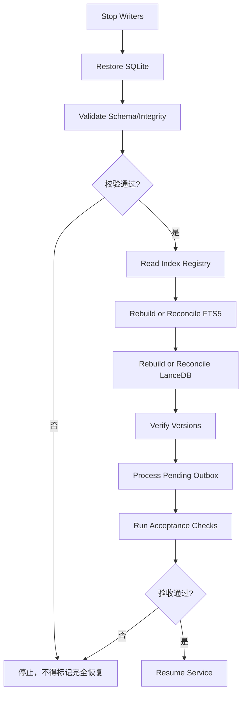
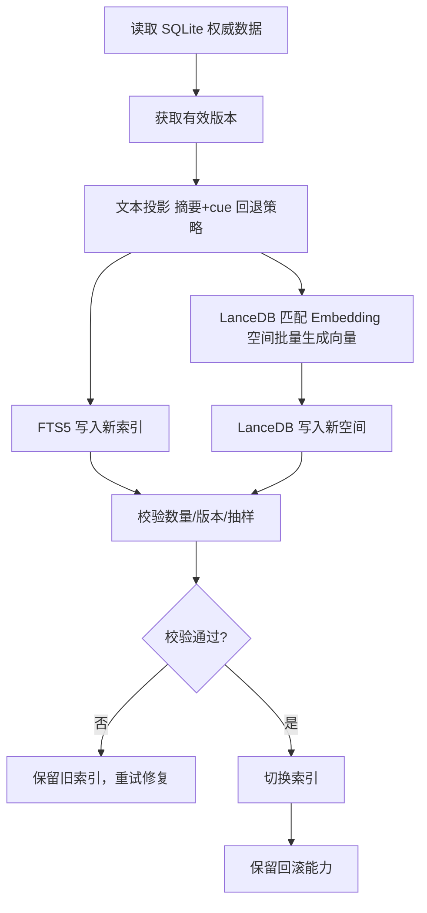
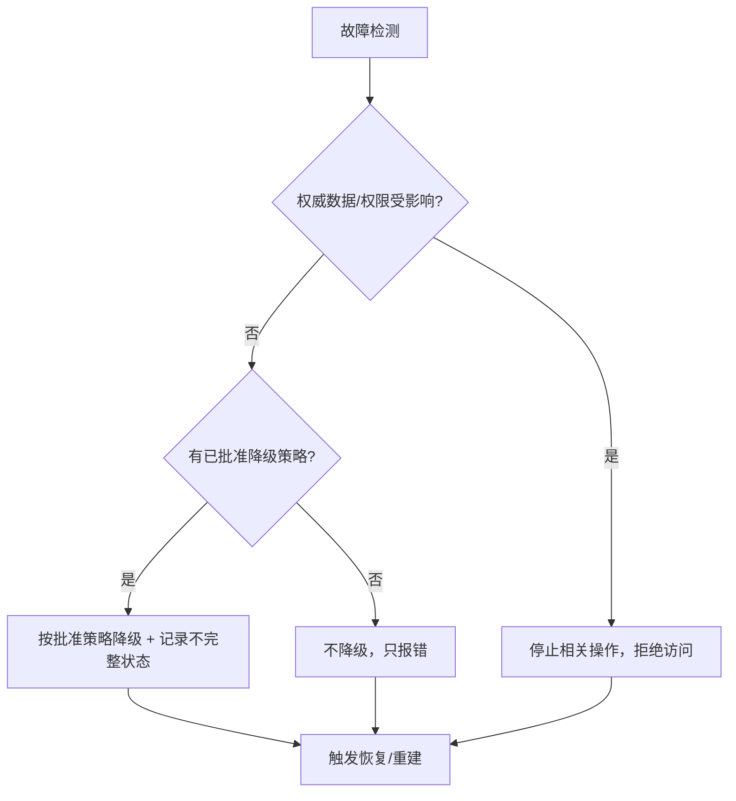

# 05 — 可靠性与运维规范

> **⚠️ V2 架构升级（2026-11-04）**：故障矩阵需新增五类（任务书 §16）：①**LLM 不可用** → 正常聊天继续、复杂摄取暂停、明确记忆指令保留待处理、**不得用低质量规则猜复杂语义**；②**LanceDB 不可用** → SQLite 不受影响、FTS5 可独立运行、恢复后经 Outbox 重建（既有行为不变）；③**情感模块不可用** → 事件事实正常存储、情绪提取暂停、不影响普通读取；④**画像整合失败** → 保留原始 MemoryUnit + 保留旧画像 + 记录失败 + **不得覆盖有效版本**；⑤**证据丢失** → 记忆标记证据缺失、**不得伪造原句**、不得把无证据推断包装成明确自述。既有故障矩阵、备份六步、恢复十步、对账**全部不变**。凡与 V2 冲突处一律以 V2 为准。

> 文件代号：05-可靠性与运维规范 ｜ 归属：组 B 文档 03/04/05 ｜ 状态：详细设计（F2 达成、F3 尽可能）
> 本文件展开 m.md 第二十一部分"05 — 可靠性与运维规范"与 sf 后文《总规范》§6（可靠性与运维），定义故障矩阵、备份、恢复、索引重建、Outbox 恢复、数据一致性、监控、日志与降级处置。

---

## 1. 文档状态

| 项 | 值 |
|---|---|
| 文档编号 | 05 |
| 标题 | 可靠性与运维规范 |
| 设计基线 | R4.1-MASTER-01 |
| 完成等级自评 | **F2 达到**（故障矩阵/备份/恢复/索引重建/一致性/监控/日志齐全）；F3 部分达到（验收标准见 §13） |
| 实施范围 | P0–P3 = M01 + M02；可靠性规范为 M01/M02 运行保障 |
| 状态用语 | APPROVED（台账）/ PROPOSED（本 Agent 默认）/ TBD / VERIFY / BLOCKED / FUTURE |

本文件不授予代码实施授权。

---

## 2. 适用版本

- 适用目标版本：**R4.1-MASTER-01**。
- 设计基准：**DD-AUTHORITY 1.0**。
- 权威顺序：裁决台账 > 已批准设计 > sf 后文 > sf 前文 > m.md。

---

## 3. 适用范围

本文件覆盖：可靠性目标、故障矩阵、备份规范、恢复流程、FTS5/LanceDB 重建、Outbox 恢复、数据一致性四分检查与对账脚本、监控指标、日志规范、磁盘不足/进程崩溃/服务不可用处置、删除最终一致性。

**边界（FUTURE / 不实施）**：分布式存储、多实例共享写入、高可用集群、云端同步为 FUTURE（03-m01 D40）。索引与恢复流程仅针对 M01+M02 的 SQLite/FTS5/LanceDB/Outbox。

---

## 4. 依赖文档

| 依赖 | 用途 |
|---|---|
| `DD-AUTHORITY.md` | 基准、§8 结构硬规则 |
| `_sources/m.md`（第十七部分） | 数据库/备份/恢复/故障处理 |
| `_sources/sf.md`（§3.1.7、§3.1.9、§6） | 一致性、备份、可靠性、故障分类、监控 |
| `08-adjudication-ledger.md` | D-AP-04（索引主体=摘要+cue）、A18（Graphiti 旁路仅登记）等 |
| `03-m01.md`（D8、D9、D11、D12、D28、D29、D34、D37） | 备份恢复、完整性、并发、健康检查、故障降级、进程模型、目录迁移 |
| `03-系统运行与协作协议.md` | Outbox 状态机、Worker 协议、事务边界 |
| `04-权限与治理规范.md` | 删除治理、tombstone、备份恢复重放删除状态 |

---

## 5. 正式裁决引用

| 台账编号 | 内容 | 本文件落点 |
|---|---|---|
| D-AP-04（§3b） | 有规范摘要时索引主体="摘要+cue"，无摘要须定义回退策略 | §7.4 FTS5/LanceDB 重建 |
| A18/优化-3（§3e） | Graphiti 旁路索引仅登记不启动 | §7.4 索引重建（不纳入重建） |
| U-1/U-2（§3e） | cache.sqlite 表结构与校验实现暂缓至实施阶段 | §7.7 一致性（不冻结 cache 校验） |
| R2（DD-AUTHORITY §4） | Outbox 事件类型规范名 | §7.5 Outbox 恢复 |
| R6（DD-AUTHORITY §4） | 时间六字段、UTC 存储 | §7.8 日志时间 |
| R7（DD-AUTHORITY §4） | Outbox 五态 vs 异步任务五态分离 | §7.5 |

（03-m01 D1–D40 为用户逐项确认的冻结设计，其中 D8 恢复顺序、D29 故障降级为已批准行为，直接采用并标注来源。）

---

## 6. 术语表

| 术语 | 定义 |
|---|---|
| 权威（Authority） | SQLite 唯一权威业务存储 |
| 派生索引 | FTS5 全文索引、LanceDB 向量索引，可重建 |
| 一致性四分 | Authority / Index / Version / Permission Consistency |
| 对账脚本 | 对比 SQLite/FTS5/LanceDB 三方版本与哈希的校验程序 |
| tombstone | 删除墓碑，防止删除内容经恢复复活 |
| 一致性备份 | 通过 Backup API / 快照获得的 SQLite 有效副本 |
| 降级 | 在故障下缩小功能范围继续服务（须有批准状态） |
| 死信（dead_letter） | 超过重试上限的 Outbox 事件，需人工修复 |
| EXP-DEFAULT | 实验初值，未批准、须可配置 |

---

## 7. 规范正文

### 7.1 可靠性目标（十类故障）

系统 MUST 能够处理（sf 后文 §6.1）：① 进程崩溃 ② 数据库异常 ③ 磁盘空间不足 ④ 索引不可用 ⑤ Embedding 服务不可用 ⑥ 网络异常 ⑦ 重复事件 ⑧ 数据版本冲突 ⑨ 备份损坏 ⑩ 数据迁移失败。

总体原则：SQLite 是唯一权威，FTS5/LanceDB 可重建；索引失败 MUST NOT 污染权威数据；恢复时 MUST 校验版本；恢复后 MUST 验证一致性（sf 后文 §3.1.3、§5.1）。

### 7.2 故障矩阵（≥12 行）

| 故障 | 检测方式 | 系统行为 | 是否降级 | 恢复方式 | 验收标准 |
|---|---|---|---|---|---|
| SQLite 不可用 / 写失败 | 事务抛错 / 连接失败 | 停止依赖权威数据的操作，禁止 LanceDB 结果冒充权威 | 否（不降级） | 恢复连接 / 恢复备份 | 权威读写恢复且校验通过 |
| FTS5 不可用 | 查询抛错 / 完整性检查 | 暂停全文检索，记录检索不完整状态 | 是（已批准：03-m01 D29 暂停全文检索） | 重建 FTS5（§7.4） | FTS5 重建后检索回归通过 |
| LanceDB 不可用 | 查询抛错 / 映射检查失败 | 暂停向量检索，不得静默切 SQLite 向量或 ANN | 部分（已批准：03-m01 D29 暂停向量检索；**"仅以 FTS5 降级继续"= TBD 未批准**，sf 后文 §6.2，未批准前不降级只报错——见 OI-05-04） | 重建 LanceDB（§7.4） | FLAT 精确检索回归通过 |
| Embedding 不可用 / 超时 | 调用失败 / 超时 | 记录失败，不得写伪造向量；已有向量在空间有效时可用 | 是（已批准：03-m01 D29 暂停新向量生成） | 恢复服务后重试积压事件 | 无伪造向量，积压清零 |
| M05 不可用 | canRead 超时/错误/未知 | 默认拒绝一切访问 | 否（fail-closed，非降级） | 恢复 M05 后重新判权 | 权限异常时零泄露 |
| Outbox 积压 | backlog 计数 / 最老事件年龄 | 保留任务并重试，告警 | 否（重试，不降级） | 续跑积压（§7.5） | backlog 回落到阈值内 |
| Worker 崩溃 | 心跳/租约失效 | 事件回 pending，重启后恢复 | 否（重试，不降级） | 重启 Worker + 幂等恢复 | 无半写，事件不丢失 |
| 磁盘不足 | 磁盘空间阈值告警 | 暂停非必要写入和维护 | 是（已批准：03-m01 D29） | 清理/扩容后恢复写入 | 权威数据无损坏 |
| 进程崩溃 | 进程退出 / 实例锁失效 | 停止服务，写事务未提交即回滚 | 否（不降级） | 重启 + 恢复未完成事务 | 无半写，权威一致 |
| 重复事件 | event_id 幂等键命中 | 幂等处理，只执行一次副作用 | 否（天然幂等） | 无需恢复 | 无重复业务结果 |
| 版本冲突 | expectedVersion 不匹配 | 返回 VERSION_CONFLICT，拒绝覆盖 | 否（不降级） | 调用方重读最新版本 | 无静默覆盖 |
| 备份损坏 | SHA256 不一致 / 无法读取 | 停止基于该备份的恢复，切换更早有效备份 | 否（不降级） | 从有效备份恢复 | 恢复后校验通过 |
| 迁移失败 | 迁移版本号不一致 / 校验失败 | 回滚迁移，保留旧目录 | 否（不降级） | 回滚 + 修正迁移脚本 | 可回滚且数据不丢 |

**降级批准状态规则（MUST）**：任何降级 MUST 标注批准状态；未批准 = 不降级只报错（sf 后文 §3.1.3、§6.2）。上表"已批准"均来自 03-m01 D29（用户逐项确认的冻结设计）；"仅 FTS5 降级检索"等未在冻结稿明确的方案 MUST 标 PROPOSED 且不得擅自启用（sf 后文 §6.2 LanceDB 故障）。

### 7.3 备份规范

#### 7.3.1 SQLite 一致性备份

- MUST 采用 SQLite Backup API 或一致性快照；MUST NOT 直接复制正在写入的数据库文件并假定有效（sf 后文 §3.1.9；03-m01 D8）。
- 备份内容 MUST 含：Evidence、Fact/Event、Observation、Relation、权限及撤销状态、删除状态、任务与检查点、Outbox、必要版本信息（03-m01 D8）。
- WAL 模式下 MUST 用一致性方式（Backup API / checkpoint + 快照）。

#### 7.3.2 LanceDB 备份

- LanceDB 可备份但 MUST 可重建；MUST 与 SQLite 权威版本和索引重建策略配套（sf 后文 §3.1.9）。
- LanceDB 备份若与 SQLite 权威版本不一致，恢复时 MUST 以 SQLite 为准重建。

#### 7.3.3 配置 / Schema 版本备份

- 备份配置、Schema 版本、迁移记录、embedding_spaces 元数据、index_registry（sf 后文 §6.3）。
- 恢复时 MUST 校验 Schema 版本与备份元数据一致。

#### 7.3.4 文件修改六步备份协议（MUST）

修改任何已有核心文件前：

1. 创建独立备份。
2. 计算 SHA256。
3. 验证备份可读取。
4. 确认 Hash 一致。
5. 才允许修改。
6. 改后复查（完整性/编码/差异/范围外改动）。

备份失败 MUST 停止修改（m.md §17.2；sf 后文 §3.1.9；03-m01 D8）。本次为全新文件，不覆盖既有正式文件（DD-AUTHORITY §5.17）。

### 7.4 索引重建

#### 7.4.1 FTS5 重建九步

1. 读取 SQLite 权威数据。
2. 获取有效版本（排除 deleted/superseded 当前态）。
3. 按规定文本投影生成检索文档：有规范摘要时索引主体="摘要+cue"，无摘要采用回退策略（台账 D-AP-04；回退策略具体内容 TBD）。
4. 写入新 FTS5 索引。
5. 校验数量（与 SQLite 有效记忆数一致）。
6. 校验版本（与权威版本一致）。
7. 校验抽样结果（关键词命中回归）。
8. 完成后切换索引。
9. 保留回滚能力（旧索引保留至新索引验证通过）。

#### 7.4.2 LanceDB 重建（含 Embedding 空间重建）

1. 读取 SQLite 权威数据 + index_registry + embedding_spaces 元数据。
2. 确认匹配 Embedding 空间（model_id/model_version/dimension/distance_metric/normalized）。
3. 按规定文本投影（摘要+cue 回退策略同 FTS5）批量生成向量。
4. 写入新 LanceDB 索引（独立新空间）。
5. 校验数量。
6. 校验版本。
7. 校验抽样（FLAT 精确检索结果与基准一致，VERIFY SDK 真实执行路径）。
8. 完成后切换索引。
9. 保留回滚能力（旧索引保留；旧空间退役前 MUST 完成验证）。

MUST NOT 将旧模型向量混入新模型索引；MUST NOT 未验证新空间就删除旧空间；MUST NOT 静默用 SQLite Vector Adapter 替代 LanceDB（sf 后文 §6.4、§16.5）。FLAT 精确检索 MUST 真实验证 Node SDK 执行路径，否则标 BLOCKED（DD-AUTHORITY §5.6；sf 后文 §5.2）。

Graphiti 旁路索引仅登记不启动（台账 优化-3），MUST NOT 纳入重建流程。

### 7.5 Outbox 恢复

- **积压续跑**：backlog 超阈值时 Worker 按最老事件优先续跑；保留任务并重试，不得丢弃。
- **最老事件年龄**：MUST 监控 Outbox 最老事件年龄（sf 后文 §6.5）；超过阈值告警并触发续跑/扩容。
- **死信人工修复**：dead_letter 事件 MUST 支持人工检查、修复、复位 retry_count 后重新入队（sf 后文 §4.7）。
- 恢复后 MUST 重新处理 pending 与 processing（幂等 + 版本校验兜底）。
- 索引同步失败 MUST NOT 回滚已提交权威数据（sf 后文 §3.1.6 规则 9）。

### 7.6 恢复流程（十步）

```text
1. Stop Writers
2. Restore SQLite
3. Validate Schema/Integrity
4. Read Index Registry
5. Rebuild or Reconcile FTS5
6. Rebuild or Reconcile LanceDB
7. Verify Versions
8. Process Pending Outbox
9. Run Acceptance Checks
10. Resume Service
```

- 一致性检查失败 MUST NOT 标记完全恢复（sf 后文 §6.3）。
- 恢复顺序的跨模块权威见 03-m01 D8（恢复删除状态/权限撤销状态优先）；本十步为 sf 后文 §6.3 流程 + 03-m01 D8 的整合展开。
- 恢复旧备份时 MUST 以最新删除状态与撤销记录为准，旧授权 MUST NOT 覆盖更新撤销（03-m01 D8）。
- MUST NOT 因索引重建/缓存恢复/历史版本复活已删除内容（03-m01 D8）。

Mermaid 见 §9.1。

### 7.7 数据一致性四分检查与对账脚本

**四分检查（sf 后文 §3.1.7）**：Authority / Index / Version / Permission Consistency。

- 允许索引短时间延迟，但不允许最终返回错误版本记忆。
- 不一致时：以 SQLite 为准 → 检查索引版本 → 触发修复/重建 → 记录不一致事件 → MUST NOT 用索引覆盖 SQLite。

**对账脚本规格**：

- 对比 SQLite / FTS5 / LanceDB 三方版本与哈希，输出差异清单。
- 输入：SQLite 权威 memory_id/version/content_hash；FTS5 索引文档 version；LanceDB 向量记录 source_version。
- 输出：差异清单（memory_id、权威版本、各索引版本、是否缺失/过期、建议动作）。
- 差异处理：索引缺失/过期 → 重建或补同步；权威侧无对应索引 → 不动作。
- cache.sqlite 的表结构与校验实现暂缓至实施阶段，MUST NOT 在本文档冻结（台账 U-1/U-2）。

### 7.8 监控指标清单（sf 后文 §6.5）

MUST 至少监控：① SQLite 操作耗时 ② FTS5 查询耗时 ③ LanceDB 查询耗时 ④ Embedding 耗时 ⑤ Outbox backlog ⑥ Outbox 最老事件年龄 ⑦ 索引版本差异 ⑧ 检索候选数量 ⑨ 权限拒绝数量 ⑩ Token Budget 使用量 ⑪ 失败率 ⑫ 数据库大小 ⑬ 索引大小。

监控指标 MUST NOT 泄露私人记忆正文（sf 后文 §6.5）。

### 7.9 日志规范

- 结构化日志：级别（DEBUG/INFO/WARN/ERROR）、trace 链（request_id → retrieval_id → …）、耗时、错误码、任务 ID（03-m01 D39）。
- 日志 MUST 脱敏：MUST NOT 记录凭据、访问令牌、密码、密钥、不必要的完整私人内容（03-m01 D13）。
- 日志 MUST NOT 成为已删除内容的旁路（03-m01 D39）。
- 时间 MUST 用 UTC RFC 3339（R6）。
- Change Log（对象变更）与运行日志分开（03-m01 D39）。

### 7.10 磁盘不足 / 进程崩溃 / 服务不可用处置

| 场景 | 处置 |
|---|---|
| 磁盘不足 | 暂停非必要写入和维护（03-m01 D29 已批准）；告警；不破坏权威数据 |
| 进程崩溃 | 未提交事务回滚；重启后恢复 Outbox pending/processing（幂等 + 版本校验） |
| 服务不可用 | 健康检查降级态；普通聊天尽量不中断，权威/权限不可靠时拒绝访问（03-m01 D29） |
| 单实例锁 | 实例锁 MUST 识别有效进程，MUST NOT 仅凭锁文件存在判定存活（03-m01 D34） |

### 7.11 删除最终一致性

- 异步删除未完成期间 MUST 靠 SQLite 权威状态排除，MUST NOT 依赖异步删除保证安全（sf 后文 §3.1.7；m.md §12.5）。
- 删除传播：逻辑删除 → Outbox delete → FTS5/LanceDB 删除 → 缓存失效 → 派生清理 → 审计（详见 04 §7.9/§9.3）。
- 删除 MUST 幂等：删除事件重复执行 MUST NOT 导致数据恢复（sf 后文 §7.2）。
- 备份恢复后 MUST 重放删除状态，tombstone 防止复活（m.md §12.5；03-m01 D8）。

---

## 8. 接口或数据结构

- 健康检查：`GET /api/v1/health` 返回 normal/degraded/error + 组件状态（03 §7.3.4）。
- Outbox 状态机 / 事件字段（03 §7.6）。
- 对账脚本输入/输出（§7.7）。
- 监控指标 / 日志字段（§7.8/§7.9）。
- 机器契约落地：`contracts/config/*.schema.json`、`contracts/state-machines/state-machines.md`（SM-4 Outbox / SM-5 Worker / SM-6 Migration / SM-7 Deletion / SM-8 Embedding Migration 同文件）。

---

## 9. 流程图

### 9.1 恢复流程



### 9.2 索引重建流程



### 9.3 故障处置决策



---

## 10. 异常情况

| 异常 | 行为 |
|---|---|
| 一致性检查失败 | 不得标记完全恢复 |
| 备份 SHA256 不一致 | 停止基于该备份恢复，切更早有效备份 |
| FLAT 精确检索无法验证 | BLOCKED，停止向量检索验收 |
| 索引重建校验不过 | 保留旧索引，重试修复 |
| Outbox 死信 | 人工修复后复位重试 |
| 迁移失败 | 回滚，保留旧目录（03-m01 D37） |
| 旧模型向量混入 | 禁止，隔离空间重建 |

---

## 11. 安全边界

- SQLite 唯一权威；索引可重建；恢复不依赖索引存在（sf 后文 §1.4）。
- 备份 MUST 一致性获取，禁止复制写入中的库文件。
- 监控/日志 MUST NOT 泄露私人正文。
- 未批准降级 MUST NOT 启用（只报错）。
- 文件修改 MUST 遵循六步备份协议。

---

## 12. 测试要求

- 备份恢复测试：数据/权限/删除状态正确（03-m01 T07）。
- 索引重建测试：能从 SQLite 重建（03-m01 T08）。
- Outbox 恢复测试：失败可恢复、死信人工修复（03-m01 T05）。
- 故障注入测试：SQLite/FTS5/LanceDB/Embedding 故障（sf 后文 §7.6）。
- 删除最终一致性测试：旧索引不能重新暴露已删除内容（03-m01 T06）。
- 一致性对账测试：三方版本/哈希差异清单输出。
- 结果标注 MUST 区分 PASS/FAIL/BLOCKED/NOT RUN/MOCKED（sf 后文 §7.7）；禁止把模拟当真实。

---

## 13. 验收标准

| 编号 | 项目 | 标准 |
|---|---|---|
| P05-1 | 权威优先 | 索引失败不污染 SQLite，恢复不依赖索引 |
| P05-2 | 备份一致 | Backup API/快照，禁止复制写入中文件 |
| P05-3 | 恢复完整 | 十步流程，一致性失败不标记完全恢复 |
| P05-4 | 索引重建 | FTS5/LanceDB 可从 SQLite 重建并校验通过 |
| P05-5 | 删除不复活 | tombstone + 备份恢复重放删除状态 |
| P05-6 | 降级批准 | 未批准降级只报错，批准降级有来源 |
| P05-7 | 监控日志 | 13 项指标 + 脱敏 + trace 链 |

F2 达到；F3 以 §12 支撑。禁止把 F2/F3 写成 F4。

---

## 14. 未决事项

| 编号 | 事项 | 状态 |
|---|---|---|
| OI-05-01 | 无摘要时索引主体回退策略具体内容 | TBD（台账 D-AP-04） |
| OI-05-02 | cache.sqlite 表结构与校验实现 | 暂缓至实施（台账 U-1/U-2） |
| OI-05-03 | FLAT 精确检索 Node SDK 真实执行路径验证 | VERIFY/BLOCKED（sf 后文 §5.2） |
| OI-05-04 | LanceDB"仅 FTS5 降级"是否批准的正式策略 | TBD（sf 后文 §6.2，未批准前不降级） |
| OI-05-05 | 备份周期与保留数量 | TBD（03-m01 待确认清单 11） |
| OI-05-06 | Outbox 重试上限/退避/最老事件年龄阈值数值 | TBD（EXP-DEFAULT，须可配置） |

---

## 15. 变更记录

| 版本 | 日期 | 变更 | 作者 |
|---|---|---|---|
| 1.0 | 2026-11-04 | 初始详细设计（05 可靠性与运维规范） | 组 B Agent |

（END）
