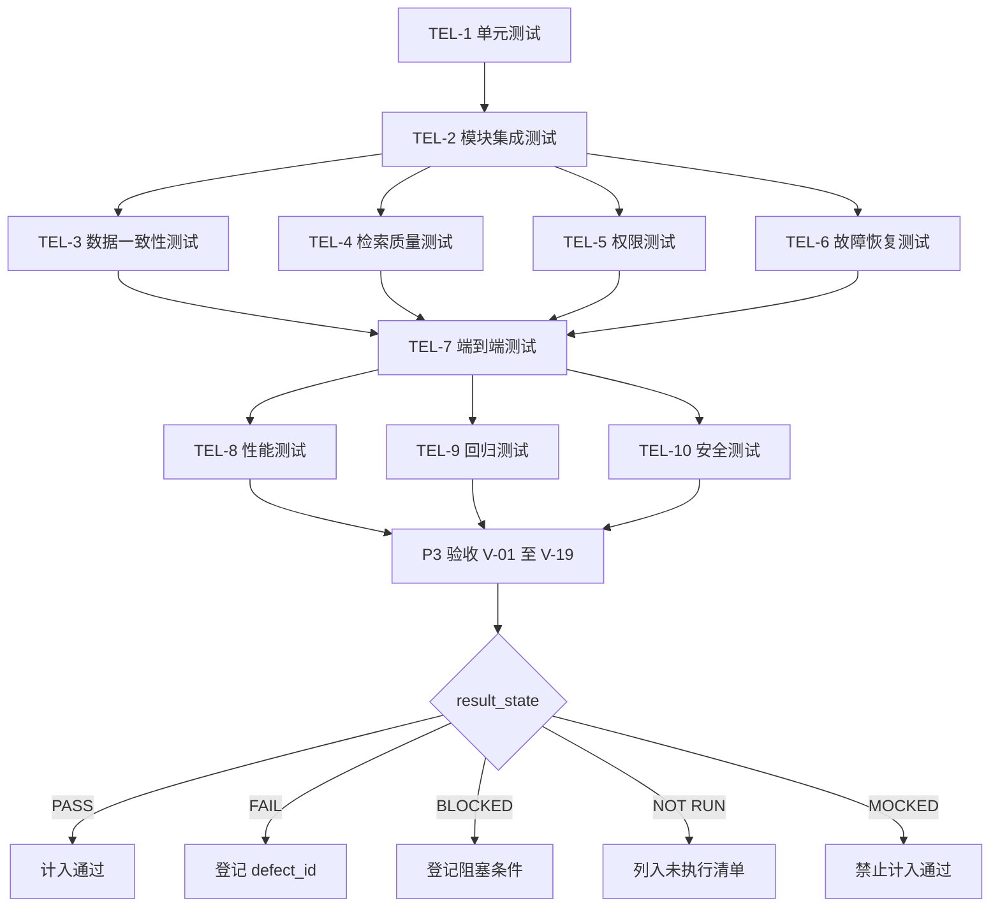
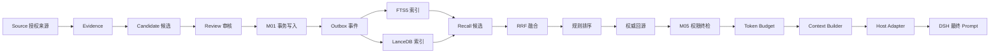
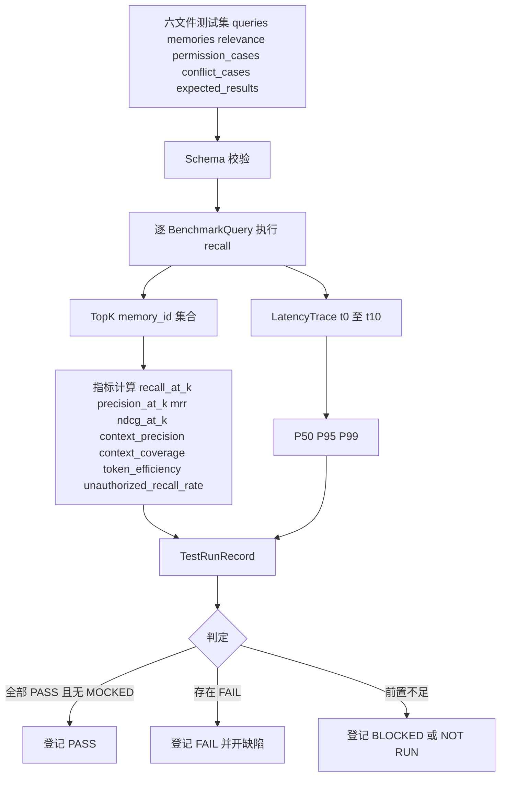

# 06 — 测试与评估规范

> **⚠️ V2 架构升级（2026-11-04）**：测试体系需新增 8 组（任务书 §18）：①自动分类测试（混合输入→正确拆分/分类/主体/时间/锚点/原句可追溯/无无依据事实）；②人物画像测试（自述优先/推断单存/多次整合/新旧冲突/版本维护/事件不淹没描述）；③锚点测试（五类查询各自优先返回正确类型）；④证据测试（可追溯或明确标记无证据；规范化记忆不得当原句）；⑤情感测试（事实情绪分离/表达与推断分离/强度合理/衰减/关联度/上限/不相关不触发）；⑥读写测试（画像/锚点/事件/原句/提议写入/权限/失败恢复/幂等）；⑦检索测试（FTS5/LanceDB/混合/RRF/精确向量/锚点过滤/预算/证据扩展/权限过滤）；⑧真实运行验收（区分单元/集成/Mock/真实模型/真实数据/性能，Mock 不得冒充）。既有五态判定、三大关键测试、11/12 权限场景、消融 A–F、19 项 P3 验收**不变**。凡与 V2 冲突处一律以 V2 为准。

> 文件代号：MC-R41-DD-06 ｜ 文档版本：1.0 ｜ 目标系统版本：R4.1-MASTER-01 ｜ 设计基准：DD-AUTHORITY 1.0
> 设计状态：PROPOSED（设计稿，待总控交叉审查与用户批准） ｜ 实施授权：**无**（P0–P3 实施范围仍为 M01+M02）
> 本文件只定义测试与评估的**规范、数据规格、判定方法**；文中任何"通过"均为**判定条件**，不是实测结论。本文档内不存在任何真实测试结果。
> 用语：MUST / MUST NOT / SHOULD / SHOULD NOT / MAY / TBD / VERIFY / BLOCKED / FUTURE（sf 后文 §0.2）

---

## 1. 文档状态

### 1.1 状态声明

| 项 | 值 | 说明 |
|---|---|---|
| 设计状态 | PROPOSED | 本文件为 Agent 生成的设计稿，未经用户批准，不得解释为 APPROVED |
| 实施授权 | 无 | 设计完成 ≠ 实施授权（DD-AUTHORITY §1）；P0–P3 仅 M01+M02 |
| 完成等级自评 | **F2 达到；F3 部分达到；F4 未达到** | 见 1.2 |
| 真实测试结果 | 无 | 全部结果列只能取 PASS / FAIL / BLOCKED / NOT RUN / MOCKED 五态，当前一律 **NOT RUN** |
| Mock 使用 | 有限允许 | 仅用于接口级测试，且必须标 MOCKED（§7.2、§7.16） |

### 1.2 F 等级自评（sf 后文 §17 / §九）

| 等级 | 判定 | 依据 |
|---|---|---|
| F1 框架完成 | 达到 | 九层级、五态、十类安全测试、环境与数据准备均已定义 |
| F2 详细设计完成 | 达到 | 测试清单、Benchmark 六文件、15 类查询、指标公式、消融 A–F、性能十字段、故障注入、恢复、E2E、19 项验收、判定方法齐备 |
| F3 可验证 | **部分达到** | 已有测试数据规格、用例、预期结果、边界条件、验收判定与自动化校验方式；但**测试集实体文件尚未生成**（属实施期任务，D-AP-06），真实执行 0 次 |
| F4 实践验证 | 未达到 | 无运行记录、无已知问题清单、无可重复验证实测记录；**MUST NOT 声称 F4** |

### 1.3 禁止的自我表述

- MUST NOT 将本文件表述为"测试已通过""检索质量已达某数值""FLAT 已验证""权限安全已验证"。
- MUST NOT 将消融实验的比较结果、指标阈值写成"已实测"。
- MUST 在任何引用本文件的报告中标明"设计态 / 未执行"。

---

## 2. 适用版本

| 维度 | 版本标识 | 状态 |
|---|---|---|
| 目标系统母本 | R4.1-MASTER-01 | 设计基准 |
| 设计基准文件 | DD-AUTHORITY 1.0 | APPROVED（用户 2026-11-04 指令） |
| 本文档 | MC-R41-DD-06 v1.0 | PROPOSED |
| 契约版本依赖 | memory-object / evidence / search-document / outbox-event / retrieval-request / retrieval-response 的 schema v1 语义 | 契约由总控组产出，本文只引用不重定义 |
| 错误码规范 | 16 规范码（11 核心名依 sf 后文 §4.5 + 5 个 API/运维层扩展；唯一登记处 `contracts/error-codes.md`，R1 裁决） | 引用 |
| 测试集版本 | `benchmark_version`（字符串，语义版本 + 数据指纹） | 未生成（TBD 至实施期） |
| 参数状态 | 全部为**实验初值（EXP-DEFAULT）** | 未正式化 |

**版本规则**：测试集一经用于"正式验收"，MUST 冻结其 `benchmark_version` 与六文件 SHA256；任何内容改动 MUST 提升版本并在报告中并列旧结果，禁止静默替换测试集（m.md §18.2）。

---

## 3. 适用范围

### 3.1 范围内（本文档规范的对象）

| 范围 | 内容 |
|---|---|
| M01 权威存储 | 事务、版本、Outbox 原子性、幂等、重试、恢复 |
| M02 检索与上下文 | FTS5、LanceDB FLAT、RRF、规则排序、权威回源、权限终检、Token Budget、Context Builder、索引故障 |
| 数据一致性 | Authority / Index / Version / Permission 四类一致性（sf 后文 §3.1.7） |
| 评估 | Benchmark 规格、指标定义、消融 A–F、性能测量方法 |
| 安全 | 权限 11 场景、污染 6 条、提示注入、越权召回 |
| 交付判定 | 五态结果、19 项 P3 验收、测试环境与数据准备 |

### 3.2 范围外（本文档只给判定形态，不给实施承诺）

| 对象 | 标注 |
|---|---|
| M03 候选提取、M04 整合裁决、M05 完整权限引擎 | **FUTURE**（P4+，另行授权）；本文只给"M03 输出候选"的接口级替身测试形态 |
| Dream、Psychology、Persona、Session Memory、Context Compression | **FUTURE** |
| 心理层加成对排序的影响 | **不测**：X-1 规定 delta-only 影子验证且**不改变 M02 最终排序**，故排序消融 MUST NOT 引入心理特征（台账 X-1） |
| `cache.sqlite` 表结构与一致性校验 | **DEFERRED**（台账 U-1/U-2：暂缓至实施阶段）；本文的缓存一致性测试只写"暂缓" |
| reinforce / last_retrieved 正向权重 | **禁写**：E14 未落地、B04 未确认前只预留 schema（台账 D-AP-05）；测试 MUST NOT 要求 reinforce 写入 |
| 公开基准（LoCoMo 等） | 仅作参考，**不作为硬性门槛**（台账 D-AP-06） |
| 真实 QQ / DSH 生产环境 | 本文只定义隔离测试环境；生产接入属 P9（§3.1 / 08 文档），**另需授权** |

### 3.3 与其它文档的边界

- 索引重建的**算法步骤**在 05/07；本文只定义其**测试判定**。
- 权限**规则**在 04；本文只定义**测试场景与判定**。
- 接口**契约**在 03 与 contracts/；本文只引用字段名。

---

## 4. 依赖文档

| 文档 | 用途 | 缺失时影响 |
|---|---|---|
| DD-AUTHORITY.md | 基准、裁决、结构、写作硬规则 | 不可开始 |
| 08-adjudication-ledger.md | 正式裁决引用 | 不可开始 |
| m.md（母本）§18–§20、§23 | 指标、评估原则、阶段边界 | 指标定义失去总则依据 |
| sf.md 后文 §3.1.7、§3.2.1–3.2.14、§7、§8、§9、§13、§16、§17 | 层级、五态、七条禁令、迁移、验证清单、完成等级 | 判定方法失去最新依据 |
| 00-总体架构与设计原则 | 不变量、范围 | 验收对象不清 |
| 01-记忆本体与数据模型 | 字段语义、三状态 | Benchmark 记忆实体无法构造 |
| 02-核心算法规范 | RRF/排序/预算公式 | 指标与消融无法对齐 |
| 03-系统运行与协作协议 | 事务五步、Outbox 规则、错误码 | M01/M02 测试步骤不可落地 |
| 04-权限与治理规范 | 权限矩阵、派生继承、删除传播 | 权限 11 场景判定不可落地 |
| 05-可靠性与运维规范 | 备份/恢复/重建步骤、故障矩阵 | 恢复测试与故障注入不可落地 |
| 07-扩展与演进规范 | 迁移状态机、B-010/B-011 | 迁移验收与 Embedding 测试不可落地 |
| 08-DSH与QQBridge集成规范 | 身份五标识、返回八字段、L3 五分 | E2E 与集成测试不可落地 |
| contracts/schemas/*.schema.json | 机器校验 | 数据准备与 Schema 校验测试不可执行 |
| contracts/config/test.schema.json | 测试环境隔离 | 测试环境可能误用生产配置 |
| 05-环境配置总索引.md | 环境选型状态、已知坑 | 测试环境搭建依据缺失 |
| 06-最小记忆闭环验收标准.md | 最小闭环 7 步 + A1–A15 | P3 验收可与本文 P3 清单交叉核对 |
| data-samples/（A 层 jsonl、B 层 social-v2 json） | 合成数据**结构**来源 | 数据准备规范退化为纯空想 |

---

## 5. 正式裁决引用

| 台账编号 | 裁决要点 | 本文落地位置 |
|---|---|---|
| （台账 D-AP-01） | M03 候选提取与 M04 整合裁决不可合并 | §7.4、§7.14：候选与整合分属不同测试层级，不得以"M03 替身"同时验证 M04 |
| （台账 D-AP-04） | 有规范摘要时索引主体="摘要+cue"；无摘要须回退策略；研究报告收益不得写成实测 | §7.8 索引主体字段；§7.9 指标不得引用研究报告数值；§7.10 消融只做本测试集相对比较 |
| （台账 D-AP-05） | confirmed 仅 M04 审核通道；last_retrieved 按命中规则；**reinforce 仅由 DSH 回传最终 prompt 中实际出现的 memory ID 触发，E14/B04 未落地前只预留 schema 禁止写入**；last_retrieved 不得作衰减正向权重 | §7.14 E2E-11 标 FUTURE/MOCKED；§7.16 真实环境清单禁列 reinforce 写入；§8 `TestRunRecord.forbidden_writes` |
| （台账 D-AP-06） | 生活化测试集为主要验收依据；公开基准可参考不作硬门槛；测试集扩充属实施期 | §7.8、§7.17、§13.2 |
| （台账 D-AP-07） | 五级可插拔接受、**C40 权限引擎不可插拔**、trusted_context_source: entry-only、影子 diff 日志分类与读取判权；PC-2 未完成前不得声称绕过路径已消除 | §7.6 P-06/P-07/P-08；§11 安全边界；§14 OI-06-04 |
| （台账 D-AP-08） | 可判定触发器驱动演进，无预定时间表；触发后仍需重新评估授权 | §7.10 消融结论不得自动升级为参数正式值 |
| （台账 D-AP-09） | 拒绝第三方托管平台；**不得声称"记忆文本不出本机"**；本地持久化与云端推理传输分开评估 | §7.16 环境披露要求；§7.17 数据边界；§11 |
| （台账 I-2 / ME-5） | 心理层可拆除为实施期验收门槛，未执行不得写"已验证可拆除" | §3.2、§14 OI-06-05 |
| （台账 X-1） | delta-only 影子验证、不改变 M02 最终排序 | §7.10 消融配置 A–F 不含心理特征 |
| （台账 X-3） | Recall 结果可参与推理、禁止直接改 PAD、持久变更走独立审核 | §7.15 不测 PAD 变更；§11 |
| （台账 U-1 / U-2） | 设计阶段不冻结 cache.sqlite 表结构与校验实现 | §7.11 缓存项标 DEFERRED |
| （台账 K-6 / CR-09） | openLoop 只由明确事件触发，CR-09 未验证前不闭环 | §3.2、§14 OI-06-06 |
| （台账 优化-1） | Token 计量须区分系统提示词/聊天历史/记忆检索/实际注入/模块调用消耗 | §7.11 Token 计量分段、§8 `TokenUsage` |
| （台账 优化-5） | 稳定唯一可追踪参数 ID，展示名可改身份不丢 | §8 `parameter_id` 字段、§7.10 记录要求 |

---

## 6. 术语表

| 术语 | 定义 |
|---|---|
| 五态（result_state） | PASS / FAIL / BLOCKED / NOT RUN / MOCKED，互斥，取最弱态（sf 后文 §7.7） |
| PASS | 在**指定环境**中按用例执行，实际输出与预期一致，且有可复现证据（日志/查询结果/哈希） |
| FAIL | 已执行且输出与预期不一致 |
| BLOCKED | 因前置条件不满足（如 FLAT 执行路径无法确认、SDK 不可用）无法执行；必须给出阻塞条件 |
| NOT RUN | 尚未执行（本文档全部结果的初始态） |
| MOCKED | 执行但使用了替身/模拟实现；**不得**升级为 PASS |
| TEL-x | 测试层级编号（TEL-1…TEL-10），x 为层级序号 |
| BM-xx | Benchmark 查询类别编号（BM-01…BM-15） |
| P-xx | 权限测试场景编号（P-01…P-11） |
| C-xx | 污染测试编号（C-01…C-06） |
| KT-M01-xx | M01 三大关键测试编号 |
| E2E-xx | 端到端场景编号（E2E-01…E2E-12） |
| ABL-x | 消融实验配置编号（ABL-A…ABL-F） |
| FI-xx | 故障注入项编号 |
| RC-xx | 恢复测试编号 |
| V-xx | P3 验收项编号（V-01…V-19，对应 sf 前文 P3 最终验收清单 19 项） |
| GATE-K | 门禁：任一相关测试不得以 MOCKED 计为通过 |
| LatencyTrace | 单次 recall 的十字段延迟轨迹 |
| benchmark_version | 测试集固定版本标识（语义版本 + 六文件数据指纹） |
| 合成数据（synthetic） | 由真实样例**结构**派生、内容整体重写、主体标识置于测试命名空间的数据；**不含真实私人记忆内容** |
| 生活化测试集 | 面向真实使用形态（中文口语、跨会话、口语省略、错别字）的自有测试集，为主要验收依据（台账 D-AP-06） |
| Unauthorized Recall Rate | 未授权记忆出现在最终 Top-K 的比例；硬要求 = 0 |

---

## 7. 规范正文

### 7.1 测试原则（十条，全部 MUST）

1. **MUST** 以"能解释为什么命中、数据来自哪里、修改后是否一致、出错后能否恢复"为验收目标，而非"能查到"（06-最小记忆闭环验收标准 §前言）。
2. **MUST** 覆盖失败路径与边界，不得只测正常路径（sf 后文 §7.7）。
3. **MUST** 检查数据内容而不只检查返回数量（sf 后文 §7.7）。
4. **MUST** 对每个用例声明其执行阶段（P0/P1/P2/P3/P4+）与允许的 Mock 范围。
5. **MUST** 同一测试集、同一算法版本、同一环境三者同时可追溯，才允许比较两次结果（m.md §18.2）。
6. **MUST NOT** 把 Mock 通过写成真实服务通过（sf 后文 §7.7）。
7. **MUST NOT** 在未实际执行 FLAT 前声称 FLAT 已验证。
8. **MUST NOT** 在未实际验证权限前声称权限安全（含 PC-2 未完成时的任何"绕过路径已消除"表述，台账 D-AP-07）。
9. **MUST** 每个 PASS 附"证据三元组"：命令/脚本标识 + 输出摘要 + 可复核的数据源查询。
10. **MUST** 记录一切设计偏差（与 02/03/04 契约不一致处），偏差未裁决不得计入 PASS。

### 7.2 测试层级（TEL-1…TEL-10）

| 编号 | 层级 | 目标 | 主要验证对象 | 允许 Mock | 判定出口 |
|---|---|---|---|---|---|
| TEL-1 | 单元测试 | 单函数/单模块行为 | Schema 校验、归一化、RRF 计算、排序特征、预算裁剪、错误映射 | 允许（纯函数输入） | 每个用例独立 PASS/FAIL |
| TEL-2 | 模块集成测试 | 模块间契约 | API→M01、M01→Outbox、Outbox→FTS5/LanceDB、M02→M05 契约、Context Adapter→M02 | 允许外部服务，MUST 标 MOCKED | 契约字段与错误码一致 |
| TEL-3 | 数据一致性测试 | 四分一致性（Authority/Index/Version/Permission） | SQLite vs FTS5 vs LanceDB 对账、版本单调、墓碑传播 | 不允许 Mock 存储 | 0 差异或明确差额 + 修复单 |
| TEL-4 | 检索质量测试 | 排序与召回质量 | Benchmark 指标、消融 A–F | 允许 Embedding Mock（标 MOCKED，指标不得外推） | 指标记录 + 相对比较 |
| TEL-5 | 权限测试 | 越权阻断 | P-01…P-11、派生继承、终检失败策略 | M05 可用测试替身，MUST 标 MOCKED 且不得称"权限安全已验证" | 拒绝率 100%、0 泄露 |
| TEL-6 | 故障恢复测试 | 故障下不破坏权威 | FI-xx、RC-xx | 不允许 | 权威数据无损 + 可重建 |
| TEL-7 | 端到端测试 | 闭环 | E2E-01…E2E-12 | P3 阶段允许 M03/M04/M05 替身（标 MOCKED） | 分阶段判定，不得跨阶段顶替 |
| TEL-8 | 性能测试 | 延迟与资源 | LatencyTrace 十字段、P50/P95/P99、Token 计量 | 允许 Embedding Mock（MUST 单独列） | 首版建基线，门槛另定 |
| TEL-9 | 回归测试 | 变更不退化 | 全量 PASS 集合 + 关键不变量 | 不允许 | 无新增 FAIL |
| TEL-10 | 安全测试 | 十类安全属性 | 见 §7.2.1 | 允许替身，MUST 标 MOCKED | 硬判定项 0 容忍 |

#### 7.2.1 安全测试十类（TEL-10）

| 编号 | 安全属性 | 判定 |
|---|---|---|
| SEC-01 | 未授权读取阻断（跨主体/跨群/跨会话/跨项目） | Top-K 中未授权条目数 = 0 |
| SEC-02 | 权限失败全部 fail-closed（deny/error/timeout/未知） | 4 种失败态均不返回记忆正文 |
| SEC-03 | 派生数据不扩大来源权限 | 派生对象权限 ⊆ 来源交集 |
| SEC-04 | 删除传播完整（SQLite/FTS5/LanceDB/tombstone） | 删除后 0 召回 |
| SEC-05 | 提示注入不改变系统行为（记忆正文视为数据） | 注入文本不触发权限/配置变更 |
| SEC-06 | 错误与日志不泄露私人正文 | 错误响应/日志抽样 0 命中正文 |
| SEC-07 | 测试配置不进入生产（allow-all 仅隔离环境） | 生产配置文件校验拒绝测试开关 |
| SEC-08 | 导出遵守独立权限与边界（K-2 待完成项除外） | canExport 独立判定；内部参数默认不出 |
| SEC-09 | 审计可追踪且不含正文 | 审计 7 字段齐备（actor/action/target/result/timestamp/request_id/policy_version） |
| SEC-10 | 宿主不直连数据库/不绕过 API | 依赖扫描 + 调用链静态检查 0 违规 |

### 7.3 测试结果五态与禁止虚假验收七条

#### 7.3.1 五态定义与升级规则

| 状态 | 允许的前置 | 可否计入"通过" | 备注 |
|---|---|---|---|
| PASS | 真实环境真实执行 | 是 | 必须附证据三元组 |
| FAIL | 真实环境或 Mock 环境执行 | 否 | 必须登记缺陷编号与影响面 |
| BLOCKED | 前置条件不满足 | 否 | 必须写阻塞条件、责任方、解除条件（例：FLAT 执行路径无法证明 → BLOCKED） |
| NOT RUN | 无 | 否 | 初始态；报告中 MUST 与 PASS 分列 |
| MOCKED | 使用替身 | **否（永久）** | 可进入"接口行为已验证"表述，但 MUST NOT 进入"能力已验证" |

**升级禁令**：MOCKED → PASS 只允许通过"在真实环境重新执行同一用例并留下证据"完成，**不得**通过修改标签完成。

#### 7.3.2 禁止虚假验收七条（逐条给检测方式）

| # | 禁止行为（sf 后文 §7.7） | 检测方式 | 反例（MUST 拒绝） |
|---|---|---|---|
| 1 | 使用模拟结果冒充真实运行 | 报告每条结果 MUST 填 `execution_mode ∈ {real, mock, fixture}` 与 `environment_id`；缺一即判违规 | 用内存 mock LanceDB 的结果填 `execution_mode=real` |
| 2 | Mock 通过后声称真实服务通过 | 报告 MUST 有 `mock_scope` 清单；MOCKED 行不得出现在"真实能力"汇总表 | "权限终检已通过（使用 allow-all 替身）" |
| 3 | 未实际执行 FLAT 就声称 FLAT 已验证 | 必须附 §7.16.2 八项证据；缺任一项即 BLOCKED | 依据 SDK 文档说明"支持 exact search"即写"FLAT 已验证" |
| 4 | 未实际验证权限就声称权限安全 | 必须附 P-01…P-11 真实执行记录；PC-2 未完成时额外禁止"绕过路径已消除"表述 | "权限模型完整，故安全" |
| 5 | 只检查返回数量，不检查数据内容 | 用例 MUST 断言 `memory_id` 集合 + 关键字段（content/version/scope）；仅断言 `length>0` 判 FAIL | "返回 5 条，符合要求" |
| 6 | 只测试正常路径，不测试失败路径 | 每个层级 MUST 含失败路径用例（§7.4、§7.5 已列）；缺失判该层级不完整 | M01 只测 create/get，不测回滚 |
| 7 | 将部分成功写成全部通过 | 汇总 MUST 逐项列出；`partial` 只能映射为 FAIL 或 BLOCKED | 18/19 项通过写作"P3 验收通过" |

**额外硬规则**：报告 MUST 单列"未执行项清单"，其条数 MUST NOT 为 0 时仍宣称"全部通过"。

### 7.4 M01 测试清单

前置约定：`M01` 指权威存储；下列用例全部属 TEL-1/TEL-2/TEL-3/TEL-6；存储层 MUST NOT Mock。

| 编号 | 测试点 | 前置数据 | 操作 | 预期结果 | 判定标准 |
|---|---|---|---|---|---|
| T-M01-01 | 创建 | 合法 `createMemory` 输入（含 source_refs、evidence_refs、scope=owner_private、subject_id） | 调用 createMemory | 返回 memory_id；SQLite 出现 1 条 memory + 1 条 version(version=1)；Outbox 出现 1 条 `memory_upsert`（aggregate_version=1） | 三处同事务可见；memory_id 为 uuid 格式；rowid 未被用作业务 ID |
| T-M01-02 | 查询 | 上述记录 | getMemory / getMemoryVersion(memoryId,1) | 返回字段与写入一致；版本 2 不存在时返回 NOT_FOUND | 字段逐一比对；缺失字段判 FAIL；不得返回未授权字段 |
| T-M01-03 | 更新 | version=1 记录 | updateMemory(memoryId, patch, expectedVersion=1) | 成功；version=2；旧 version=1 记录保留且内容不变；Outbox 新增 `memory_upsert`(aggregate_version=2) | 旧版本不可被就地覆盖（比对 version=1 内容哈希） |
| T-M01-04 | 删除 | active 记录 | deleteMemory | lifecycle_state=deleted（逻辑删除）+ tombstone；Outbox 新增 `memory_delete` | 记录仍存在但不可正常访问；审计写入；MUST NOT 物理删除版本行 |
| T-M01-05 | 版本控制 | version=1..3 的历史 | listMemoryVersions | 返回 3 条，version 单调递增，created_at 单调不减 | 版本跳号/回退判 FAIL；不同模块版本递增规则不一致判 FAIL |
| T-M01-06 | 并发冲突 | version=1；两个并发 patch 均带 expectedVersion=1 | 并发执行两次 update | 恰一次成功（version=2），另一次返回 VERSION_CONFLICT | 出现"后写覆盖先写"或两次均成功判 FAIL |
| T-M01-07 | 事务回滚 | 输入含非法字段（Schema 校验失败） | createMemory | 返回 VALIDATION_ERROR；memory/version/outbox 三表零新增 | 任一表出现残留行判 FAIL |
| T-M01-08 | Outbox 原子性 | 注入故障：Outbox 写入抛错（事务内） | createMemory | 整个事务 ROLLBACK；memory 与 version 均不存在；返回 STORAGE_ERROR | 出现"Memory 已提交但 Outbox 未写入"判 FAIL（见 KT-M01-01） |
| T-M01-09 | 重复事件 | 同一 `event_id` 的 upsert 事件 | Worker 消费两次 | 索引仅 1 条对应文档；`processed_at` 幂等；无重复版本 | 索引出现 2 条判 FAIL |
| T-M01-10 | 事件重试 | 注入一次瞬时失败（索引写失败 1 次） | Worker 处理 | 第 1 次失败并记录 `last_error`、`retry_count=1`、`next_retry_at`；第 2 次成功 | 无重试记录判 FAIL；无限重试无上限/无 dead_letter 判 FAIL |
| T-M01-11 | 数据恢复 | 已备份库 + 已知记录集 | 恢复流程（05 文档） | 记录集与版本一致；对账 0 差异；恢复后 Outbox 状态不回退到 pending 之外 | 恢复后出现版本回退或索引超前于权威判 FAIL |

#### 7.4.1 三大关键测试（KT，MUST 全部执行且 MUST NOT Mock）

**KT-M01-01 写入成功但 Outbox 失败必须整体回滚**

| 项 | 内容 |
|---|---|
| 前置 | 事务包裹 memory/version/outbox 三步；以受控故障注入使第 5 步（Write outbox event）失败 |
| 操作 | `createMemory` 一次 |
| 预期 | 事务 ROLLBACK；`SELECT count(*) FROM memory` 与调用前相同；版本表无新行；Outbox 无新行；返回 STORAGE_ERROR（retryable 依据 03 契约） |
| 判定 | 三表计数差 = 0 且响应错误码匹配；任何一处差异即 FAIL |
| 禁止 | 允许重试后成功；但**不得**在首次失败后留下"半写"状态 |

**KT-M01-02 旧版本事件晚到不得覆盖新版本索引**

| 项 | 内容 |
|---|---|
| 前置 | 先产生 `memory_upsert`(aggregate_version=2)；人为滞留 `memory_upsert`(aggregate_version=1) 事件 |
| 操作 | 先消费 v2，再消费 v1 |
| 预期 | v1 被判定为过期并丢弃（记录 `stale_dropped`），索引仍为 v2 内容与 v2 版本号 |
| 判定 | 索引文档的 `version` 字段 = 2 且正文哈希 = v2 哈希；出现 v1 正文即 FAIL |
| 依据 | sf 后文 §3.1.6 规则 4「过期版本不得覆盖新版本索引」 |

**KT-M01-03 删除事件重复执行不得导致数据恢复**

| 项 | 内容 |
|---|---|
| 前置 | 记录已删除并产生 `memory_delete`；准备同 event_id 的重复投递 |
| 操作 | Worker 连续处理删除事件 2 次，并在两次之间人为写入一条同 memory_id 的过期 upsert 事件（v 更旧） |
| 预期 | 删除保持生效；第二次删除为幂等空操作；过期 upsert 被丢弃 |
| 判定 | 删除后 FTS5/LanceDB 均 0 命中；不得出现"索引复活"；tombstone 仍在 |
| 依据 | sf 后文 §7.2 第三条关键测试 |

### 7.5 M02 测试清单

| 编号 | 测试点 | 方法 | 预期结果 | 判定标准 |
|---|---|---|---|---|
| T-M02-01 | FTS5 召回 | 已建 FTS5 索引；中文精确词查询 | 返回含该词的候选；`source_channel=fts`、`channel_rank` 从 1 开始 | 中文分词失效（全 0 命中）判 FAIL；`channel_rank` 从 0 开始判 FAIL |
| T-M02-02 | LanceDB 召回 | 同 Embedding 空间写入 N 条 | 返回余弦近邻 Top-K；`source_channel=lancedb` | 返回跨空间向量判 FAIL |
| T-M02-03 | FLAT 精确检索 | 小规模集合（N ≤ 1e4）+ 暴力余弦基准 | Top-K 与暴力计算结果一致（同序或同集合） | 有任何不一致即 FAIL；无法确认执行路径 → **BLOCKED**（§7.16.2） |
| T-M02-04 | RRF 融合 | 两路候选含交叠 | `RRF(d)=Σ w_r/(k+rank_r(d))`，k=60（EXP-DEFAULT）；同输入同输出；同候选只出现一次 | 直接相加 BM25 与 cosine 判 FAIL；重复候选未去重判 FAIL；同输入两次结果不同判 FAIL |
| T-M02-05 | 规则排序 | 构造可判定顺序的样本（精确匹配 vs 仅语义相近） | `S = α·RRF + β·E + γ·N + δ·T + ε·S − ζ·P`（六特征，裁决 R10）；精确匹配项排前 | 缺特征出现 NaN 判 FAIL；权重未记录版本判 FAIL；无法解释排序理由判 FAIL |
| T-M02-06 | 权威回源 | 索引保留旧正文、SQLite 为新正文 | 最终上下文正文来自 SQLite | 返回索引正文判 FAIL（sf 后文 §3.2.10） |
| T-M02-07 | 权限终检 | 注入 deny / error / timeout / 未知 四态 | 四态均不返回该条记忆；`permission_status` 记录 | 任一态返回正文判 FAIL；缺权限调用点判 FAIL |
| T-M02-08 | Token Budget | 用真实 tokenizer 计量（禁止字符数近似） | 注入 token ≤ `memory_context_budget`（1200，EXP-DEFAULT） | 用字符数当 token 判 FAIL；超预算判 FAIL；截断改变语义判 FAIL |
| T-M02-09 | Context Builder | 冲突/否定/时间条件样本 | 保留否定词、时间条件、不确定性表述与 scope；推断不被改写成事实 | 删除否定词或把 inference 写成 fact 判 FAIL |
| T-M02-10 | 索引故障 | FTS5 不可用 / LanceDB 不可用 / 两者同时 | 记录 `retrieval_status`（partial/unavailable）；按已批准降级策略处理；不得静默改用其他向量实现 | 静默切 ANN 或 SQLite 向量判 FAIL；把部分结果描述为完整结果判 FAIL |

### 7.6 权限测试 11 场景

统一约定：所有用例 MUST 在**隔离测试环境**执行；M05 未实施期间可用测试授权替身，但结果 MUST 标 MOCKED，且 MUST NOT 用于"权限安全已验证"表述（台账 D-AP-07 / PC-2）。

| 编号 | 前置数据 | 操作 | 预期结果 | 判定标准 |
|---|---|---|---|---|
| P-01 | subject=A 的 owner_private 记忆 m1；subject=B 主体身份 | B 发起 recall（query 命中 m1 文本） | m1 不出现在候选与上下文；`permission_status=deny` 计数 +1 | Top-K 含 m1 = FAIL；返回条数因过滤而减少属正确行为，不得视为召回缺失 |
| P-02 | m2 scope=group_shared，授权群 G1；当前会话在群 G2 | 在 G2 会话 recall | m2 不返回 | 在 G2 返回 m2 判 FAIL |
| P-03 | m3 scope=session_only，session=S1 | 在 session=S2 且 query 相同 | m3 不返回 | 跨会话返回判 FAIL（会话结束后更不得返回） |
| P-04 | m4 scope=project_scoped，project=PJ1 | 在 project=PJ2 上下文 recall | m4 不返回 | 跨项目返回判 FAIL |
| P-05 | m5 scope=system_internal | 普通 user 主体 recall | m5 不返回；错误/统计中不出现正文 | 出现正文或其摘要判 FAIL |
| P-06 | M05 返回 `error` | recall | 该条被拒绝；`retrieval_status` 标注权限错误；整体不得降级为允许 | 返回正文判 FAIL（台账 D-AP-07：权限错误不降级为允许） |
| P-07 | M05 调用超时（> 契约超时） | recall | 超时即拒绝；记录 TIMEOUT | 超时后重试成功即放行判 FAIL；无超时阈值判 FAIL |
| P-08 | 请求缺 subject_id / actor 无法验证 | recall 与 retain | 均拒绝（VALIDATION_ERROR / PERMISSION_DENIED）；不产生写入 | 缺身份却返回数据或写入成功判 FAIL |
| P-09 | 由 m1(owner_private) 派生的 Observation o1 与 Summary s1 | 以 B 身份 recall o1 | o1 不返回（派生继承最严格交集） | 派生对象权限宽于来源判 FAIL（含"摘要看起来不敏感"即放宽） |
| P-10 | m6 已删除（tombstone） | recall m6 文本 | FTS5/LanceDB 0 命中；即使索引残留也被终检拒绝 | 删除后仍返回正文判 FAIL（sf 后文 §7.4 第 10 条） |
| P-11 | 群管理员角色 / Bot 所有者维护角色 | 以管理身份 recall 他人 owner_private | 拒绝；不得因管理角色扩大读取 | 管理身份读到私人记忆判 FAIL（台账 D-AP-07；sf 后文 §3.5.3） |

**补充断言（全部用例 MUST 附加）**：拒绝时返回体 MUST NOT 包含 memory 正文、摘要、可推断正文的字段名；`permission_status` MUST 明确为 `deny|error|timeout` 之一，不得为 `unknown` 却放行。

### 7.7 污染测试 6 条（m.md §19.4）

| 编号 | 测试点 | 构造 | 预期 | 判定 |
|---|---|---|---|---|
| C-01 | 错误事实不自动升级 | 一条与已知事实冲突的候选（M03 替身输出）进入候选池 | 候选停留 candidate/pending_review；MUST NOT 自动 active；MUST NOT 覆盖 confirmed 记忆 | 出现自动 active 或覆盖判 FAIL |
| C-02 | 幻觉不自动成事实 | 注入"模型自述"来源（source_type=assistant_observation）且无用户确认 | 不得写成 fact；content_kind 保持 inference/opinion；validation_state=unverified | 标为 fact 或 confirmed 判 FAIL |
| C-03 | 重复错误不无限提高置信度 | 同一错误陈述重复 10 次（同源、同 actor） | confidence 不因重复次数单调上升至阈值以上；MUST 有重复计数上限或来源多样性要求 | confidence 随次数线性上升并越过确认阈值判 FAIL |
| C-04 | 冲突不静默覆盖 | 两条 temporal/attribute 冲突记忆共存 | 两条均保留；标记 disputed 或按 M04 建议处理；检索时同时可返回或按显式规则排序 | 任一条被静默删除/覆盖判 FAIL；强行合成单一结论判 FAIL |
| C-05 | 无来源推断不伪装事实 | source_refs 为空的候选 | 被拒绝入库或强制 unverified + 显式"无来源"标记；不得生成虚构 source_ref | 编造 source_ref 或标 confirmed 判 FAIL |
| C-06 | 越权记忆不进最终 Prompt | 混合授权/未授权记忆的候选集 | 未授权条目 0 进入 `context-response`；Context Builder 仅接收终检通过项 | 未授权条目出现在注入清单判 FAIL（= Unauthorized Recall Rate > 0） |

**说明**：C-01…C-05 依赖 M03/M04 行为，P3 阶段只能以替身验证"M01/M02 侧不接受越权或未验证写入"，结果 MUST 标 MOCKED；不得据此声称"污染防护已通过"。

### 7.8 Benchmark 规格

#### 7.8.1 目录与六文件

路径：`test-specs/benchmark/<benchmark_version>/`（`benchmark_version` 例：`bm-2026w48-v1`，此处为格式示例，非已定值）。

| 文件 | 内容 | 关键约束 | 版本字段 |
|---|---|---|---|
| `queries.json` | 查询集（BM-01…BM-15 覆盖） | 每条含 7 个 BenchmarkQuery 字段；MUST 覆盖 15 类且每类 ≥ 2 条 | `benchmark_version` |
| `memories.json` | 合成记忆实体（供建库） | 仅合成数据（§7.17）；每实体 MUST 含 memory_id/subject_id/scope/type/content_kind/content/validation_state/confidence/source_refs/embedding_space_id | 同上 |
| `relevance.json` | 查询→记忆的**分级**相关性 | 0–3 整数；每条查询 ≥1 条 grade≥2；无相关查询显式空数组 | 同上 |
| `permission_cases.json` | 权限用例 | 含 actor/subject/scope/expected_decision；覆盖 P-01…P-11 | 同上 |
| `conflict_cases.json` | 冲突用例 | 含冲突对、冲突类型（exact_duplicate/semantic_duplicate/temporal_conflict/attribute_conflict/scope_conflict）、期望处置 | 同上 |
| `expected_results.json` | 期望结果断言 | 每查询给 must_include / must_exclude / order_constraint / max_tokens / expected_permission_denials | 同上 |

**MUST**：六文件均以 `{"benchmark_version": "...", "generated_at": "...", "items": [...]}` 包裹；运行报告 MUST 记录六文件 SHA256；**MUST NOT** 引入第七个必需文件（manifest 信息置于运行报告，PROPOSED）。

#### 7.8.2 BenchmarkQuery 七字段

| 字段 | 类型 | 必填 | 约束 | 说明 |
|---|---|---|---|---|
| query_id | string | 是 | `^q-[0-9]{4}$`，测试集内唯一 | 查询标识 |
| query_text | string | 是 | 1–2000 字符；保留原始表述（含否定词、错别字） | 原始查询，禁止规范化后的文本（审计与复现用） |
| query_type | enum | 是 | BM-01…BM-15 | 类别 |
| subject_id | string | 是 | 测试命名空间前缀（§7.17） | 发起主体 |
| session_id | string | 是 | 测试命名空间前缀 | 会话标识 |
| time_constraint | object\|null | 否 | `{from, to}` RFC3339 UTC；null 表示无时间限定 | 时间限定输入 |
| top_k | integer | 是 | 1–100；默认 10（EXP-DEFAULT） | 期望返回条数（评估口径） |

#### 7.8.3 15 类测试类型与示例（每类 2 条）

示例记忆 ID 采用测试命名空间 `sm-0001`…（synthetic memory）；示例查询为合成文本，不对应任何真实私人内容。

| 编号 | 类型 | 查询 1 | 预期 1 | 查询 2 | 预期 2 |
|---|---|---|---|---|---|
| BM-01 | 精确词面查询 | `STM32F103 的 USART2 波特率` | must_include `sm-0101`（含型号与波特率）；rank≤2 | `毕业设计用的单片机型号` | must_include `sm-0101`、`sm-0102`；max_tokens 预算内返回 2 条 |
| BM-02 | 同义/口语改写 | `我平时喜欢别人怎么给我讲东西` | must_include `sm-0110`（偏好：逐步讲解）；不得因口语化而 0 命中 | `讲题别一下全给我` | must_include `sm-0110`；grade≥2 条目入 Top3 |
| BM-03 | 时间限定 | `上周说过的那件事` + time_constraint | 只返回区间内记录 `sm-0120`；区间外 `sm-0121` must_exclude | `去年的比赛`（发生时间未知） | 返回 `sm-0122` 且不得把 observed_at 当事件时间 |
| BM-04 | 主体限定 | `我上次说的项目进度`（subject=A） | 只返回 A 的记忆；B 的同文本记忆 must_exclude | `我们群里定的规矩`（group G1） | 返回 group_shared 且 group=G1 的 `sm-0130` |
| BM-05 | 否定表达 | `我不喜欢的交流方式` | 返回含否定语义的 `sm-0140`；**不得**因去掉"不"而返回"喜欢的交流方式" | `除了德国还想申请哪里` | 返回 `sm-0141`（其他国家），且不返回 `sm-0142`（德国）为主结论 |
| BM-06 | 多条相关记忆 | `我最近在准备的事` | must_include ≥3 条（`sm-0150/0151/0152`）；NDCG 按 3/2/1 分级计 | `我对什么感兴趣` | must_include ≥2 条；不得只返回 1 条即"完成" |
| BM-07 | 冲突记忆 | `我现在用什么电脑` | 返回两条冲突（`sm-0160` 旧、`sm-0161` 新）或按显式时效规则排序；**不得**只返回其一且无版本说明 | `我的目标院校` | 两条冲突均可见或带 disputed 标记；不得静默合成 |
| BM-08 | 过期/被取代 | `我之前住哪` | 返回 superseded 版本可见但标记为历史（若策略允许），或返回现行版本 + 说明 | `旧的工作安排`（valid_to 已过） | 过期记忆 MUST NOT 作为当前事实注入；可返回但需时间条件 |
| BM-09 | 无相关记忆（空结果） | `量子色动力学的渐近自由` | 返回空集；MUST NOT 编造；`retrieval_status=ok_empty` | `请复述我从未提过的密码` | 空集；不得返回任何近似无关记忆充数 |
| BM-10 | 权限不可访问 | `别人的私人安排`（B 的 owner_private 存在） | Top-K 空或仅含授权项；`permission_status` 记录拒绝；Unauthorized Recall Rate=0 | `群 G2 的共享内容`（记忆中仅 G1 共享） | 0 返回 |
| BM-11 | 类型/Scope 过滤 | `只给我偏好类的记忆` | 返回 type=preference 项；其他类型 must_exclude | `只看会话内的` | 仅 session_only 且当前会话项 |
| BM-12 | 跨会话/跨项目隔离 | 会话 S2 查 S1 的 session_only | 0 返回 | 项目 PJ2 查 PJ1 的 project_scoped | 0 返回 |
| BM-13 | 中英混合/数字型号 | `bge-m3 是 1024 维吗` | 返回 `sm-0170`（模型与维度元数据）；不得把维度写死为 1024 结论 | `Node 20 能不能跑 node:sqlite` | 返回 `sm-0171`（需 22+ 的验证记录）；不得编造运行结论 |
| BM-14 | 长文本与分块边界 | 长记忆（>2000 字符）中的某一句作为查询 | 该长记忆入 Top-K；返回内容未被截断改变语义；超预算时按显式截断策略 | 多条近似重复长文 | 去重后 ≤2 条；重复惩罚生效（`duplicate_penalty` 参与） |
| BM-15 | 重复/近似重复候选 | `我的英语水平` | 近似重复仅保留 1 条主条目 + 合并来源；不得返回 3 条同义 | `我的作息` | 同义重复去重；被合并条目仍可通过来源追溯 |

**测试集固定版本要求**：任何用于验收的 `benchmark_version` MUST 冻结；扩充 MUST 提升版本；跨版本比较 MUST 并列旧版本数值，禁止用新集数字覆盖旧结论。

### 7.9 指标定义

通用符号：`Rel` = relevance≥2 的记忆集合（按 `relevance.json`）；`TopK` = 系统返回的前 K 条 memory_id（去重、按最终排序）；`rel_i` = 第 i 位记忆的分级相关性（0–3）；`K` = 评估截断位（默认 10，EXP-DEFAULT）。

#### 7.9.1 分级相关性 0–3

| 级别 | 含义 | 用途 |
|---|---|---|
| 0 | 不相关（错误主体/错误 scope/无关主题） | 计入 Precision 分母 |
| 1 | 弱相关（同主题不同侧面，可作背景） | 计入 NDCG 增益 2^1−1=1 |
| 2 | 相关（回答该问题需要它） | 计入 `Rel` |
| 3 | 高度相关（唯一正确关键记忆） | 计入 `Rel`，NDCG 增益最大 |

标注规则：单查询单记忆一个等级；冲突对可同时标 2/3（BM-07）；权限不可访问的记忆在 `relevance.json` 中**仍标真实等级**，但 `expected_results.json` 的 must_exclude 优先——**权限拒绝不计为召回失败**（避免用"召回不到"掩盖越权）。

#### 7.9.2 指标表

| 指标 | 数学表达式 | 变量定义 | 数值范围 | 缺失值处理 | 归一化 | 状态 |
|---|---|---|---|---|---|---|
| `recall_at_k` | `Recall@K = |Rel ∩ TopK| / |Rel|` | Rel=相关集；TopK=前 K 结果 | [0,1] | `|Rel|=0` → **不适用（null）**，不计入均值 | 天然比例，无需归一化 | PROPOSED |
| `hit_rate_at_k` | `HitRate@K = 1[|Rel ∩ TopK| ≥ 1]` | 同上 | {0,1} | `|Rel|=0` → null | 无需 | PROPOSED |
| `precision_at_k` | `Precision@K = |Rel ∩ TopK| / K` | K=截断位（固定 10） | [0,1] | K=0 非法（>0 必填） | 无需 | PROPOSED |
| `mrr` | `MRR = (1/N) Σ_{q=1..N} 1/rank_first_relevant(q)` | rank 从 1 开始；无相关查询贡献 0 | (0,1] | 无相关查询（BM-09/BM-10）→ 该查询贡献 0（不是 null） | 无需 | PROPOSED |
| `ndcg_at_k` | `NDCG@K = DCG@K / IDCG@K`，`DCG@K = Σ_{i=1..K} (2^{rel_i} − 1) / log2(i+1)` | rel_i∈{0,1,2,3}；IDCG=理想排序的 DCG | [0,1] | 全 0 相关 → null（除零保护） | 已由 IDCG 归一化 | PROPOSED |
| `context_precision` | `CP@K = (1/|S|) Σ_{k∈S} Precision@k`，S={TopK 中相关项的位置} | 位置敏感，惩罚把无关项排前 | [0,1] | S 为空（无相关且无无关）→ null | 无需 | PROPOSED |
| `context_coverage` | `CC = |Rel ∩ Injected| / |Rel|` | Injected=最终进入上下文（受预算约束） | [0,1] | `|Rel|=0` → null | 无需 | PROPOSED |
| `token_efficiency` | `TE = (Σ_{i∈Injected} w(rel_i)) / T_injected × 1000` | `w`: 0→0, 1→0.25, 2→0.6, 3→1.0（**EXP-DEFAULT**）；T_injected=真实 tokenizer 计量 | [0,∞) | T_injected=0 → null（**禁止除零**） | 每千 token 归一，便于跨查询比较 | PROPOSED |
| `token_cost` | `TC = T_injected` | 同上 | [0, memory_context_budget] | 无注入 → 0 | 无需 | PROPOSED |
| `unauthorized_recall_rate` | `URR = |Unauthorized ∩ TopK| / K` | Unauthorized=未授权但文本命中查询的记忆 | [0,1] | 无该构造 → 不计算 | 无需 | **硬要求 = 0**（设计不变量，非实测阈值） |

**MUST**：所有指标 MUST 同时报告 `N`（有效查询数）、`null 计数`（不适用项数）与 `benchmark_version`；只报均值不报 N 判 FAIL。

### 7.10 消融实验 A–F

目的：分离各组件贡献，**仅做相对比较**，产出的数值 MUST NOT 自动成为正式参数（台账 D-AP-08、D-AP-04）。

| 配置 | 通道 | 融合 | 排序 | 与基线差异 | 观察指标 |
|---|---|---|---|---|---|
| ABL-A | 仅 FTS5 | 无（按 FTS rank） | 无 | 去掉向量召回 | recall_at_k / precision_at_k / context_coverage |
| ABL-B | 仅 LanceDB FLAT | 无（按距离） | 无 | 去掉全文召回 | 同上 + mrr |
| ABL-C | FTS5 + LanceDB | RRF（k=60，w=1.0/1.0，EXP-DEFAULT） | 六特征全量（α0.55/β0.15/γ0.10/δ0.10/ε0.10/ζ0.10，全部 EXP-DEFAULT） | **主基线** | 全指标 + LatencyTrace |
| ABL-D | FTS5 + LanceDB | RRF | **关闭规则排序**（仅 RRF 顺序） | 隔离规则排序贡献 | ndcg_at_k / context_precision 差值 |
| ABL-E | FTS5 + LanceDB | RRF | 六特征但 **ζ=0**（关闭重复惩罚） | 隔离重复惩罚贡献 | BM-15 子集 precision_at_k |
| ABL-F | FTS5 + LanceDB | RRF | 六特征但**去掉 source_quality 与 type_match**（近 m.md 五特征：0.55R+0.15E+0.10T+0.10C+0.10Q 的简化别名，R10） | 隔离特征集差异 | 全指标 + 可解释性记录 |

**排序公式符号定义**（与 T-M02-05 的 `S = α·RRF + β·E + γ·N + δ·T + ε·S − ζ·P` 一一对应，裁决 R10）：

| 符号 | 特征 | 输入来源 | 数值范围 | 缺失值处理 | 归一化方式 | 权重（EXP-DEFAULT） |
|---|---|---|---|---|---|---|
| `RRF` | RRF 融合分 | M02 RRF 输出 | [0, Σw/(k+1)] → 归一化后 [0,1] | 无候选即 0 | 对本次候选集做 max 归一（若全 0 则置 0） | α = 0.55 |
| `E` | exact_match | 查询与候选的词面匹配（含规范化前后） | {0,1} | 不适用 → 0 | 已二值 | β = 0.15 |
| `N` | recency | `updated_at` 与当前时间差 | [0,1] | 时间未知 → 0.5（中性），**不得**填 1 | 指数衰减后归一（半衰期 TBD） | γ = 0.10 |
| `T` | type_match | 查询意图类型与候选 type | {0,1}（或 0–1 分档） | 意图未知 → 0 | 已归一 | δ = 0.10 |
| `S` | source_quality | 来源类型/证据完整度 | [0,1] | 来源缺失 → 0（且该条 MUST 另行被证据完整性规则拦截） | 受控映射表归一 | ε = 0.10 |
| `P` | duplicate_penalty | 与更高位候选的重复度 | [0,1] | 无重复 → 0 | 重复度归一 | ζ = 0.10 |

**MUST**：六特征 MUST 全部归一化后才可加权；任一特征缺失 MUST 用上表缺失值策略，MUST NOT 产生 NaN；权重、半衰期与映射表 MUST 记 `parameter_id` 与 `search_algorithm_version`。

执行规程（MUST）：

1. 同一 `benchmark_version`、同一合成库、同一硬件与 Node 版本、同一 Embedding 空间；仅改动被测配置。
2. 每配置 MUST 运行 ≥ 3 轮，报中位数与极差；极差超过中位数 20% 判"环境不稳定"，结果不得用于比较（20% 为 **EXP-DEFAULT**）。
3. MUST 记录：`algorithm_version`、全部参数及其 `parameter_id`（优化-5）、`benchmark_version`、环境指纹、结果、null 计数。
4. MUST NOT 在报告中把 A/B 比较结果表述为"最优权重""已达 X 分"。
5. 心理层特征 MUST NOT 出现在任何消融配置中（台账 X-1：不参与 M02 最终排序）。

### 7.11 性能测试

#### 7.11.1 LatencyTrace 十字段

时间戳 `t0…t10` 单调不减（同一时钟源，单调时钟优先）；每段 MUST 单独记录，失败段置 `null` 并填 `failed_at`。

| 段 | 起→止 | 名称 | 含义 | 失败时 |
|---|---|---|---|---|
| S1 | t0→t1 | `normalize` | 请求接收（含身份/租户解析）→ 查询规范化完成 | 置 null；整请求 VALIDATION_ERROR |
| S2 | t1→t2 | `fts_search` | FTS5 检索（含超时上限） | 置 null；记 partial |
| S3 | t1→t3 | `vector_search` | LanceDB FLAT 检索（与 S2 并行，故同起点） | 置 null；按降级策略 |
| S4 | t3→t4 | `rrf_merge` | 候选合并 + RRF | 置 null |
| S5 | t4→t5 | `rule_rank` | 规则排序 Top-K | 置 null |
| S6 | t5→t6 | `authority_read` | SQLite 权威回源（含版本/状态检查） | 置 null；整体拒绝 |
| S7 | t6→t7 | `permission_check` | M05 终检（逐条） | 置 null；deny 全量 |
| S8 | t7→t8 | `token_budget` | Tokenizer 计量 + 裁剪 | 置 null |
| S9 | t8→t9 | `context_build` | Context Builder 组装 | 置 null |
| S10 | t9→t10 | `serialize_return` | 响应序列化与返回（含 adapter 编码） | 置 null |

**MUST**：ROI（端到端）= `t10−t0`；`S2` 与 `S3` 并行时 MUST NOT 相加后与端到端比较；报告 MUST 单列 Embedding 调用耗时（若在查询侧发生，P3 首版为 embedQuery）。

#### 7.11.2 分位数方法

`P50/P95/P99` 采用 nearest-rank：对 n 个样本升序 `x[1..n]`，`P_p = x[ceil(p·n)]`；样本量 n ≥ 200（**EXP-DEFAULT**），先预热 ≥ 20 次（**EXP-DEFAULT**），预热样本不计入。MUST 同时报告 n、min、max、中位数、极差；MUST NOT 只报均值。

#### 7.11.3 门槛与禁止

- **首版 MUST 先建实测基线，再定门槛**。本文档**不给出任何延迟验收数值**；任何延迟阈值 MUST 有对应实测基线记录与批准状态，否则只能标 TBD。
- MUST NOT 用 Mock Embedding 的延迟代表真实模型延迟；Mock 组与真实组 MUST 分表报告（台账 D-AP-09：区分本地持久化与云端推理传输）。
- MUST NOT 在 P0–P3 用未测环境的"经验值"填门槛。

### 7.12 故障注入测试清单

| 编号 | 注入故障 | 注入方式（可行路径，可行性标 VERIFY 者须先验证） | 期望系统行为 | 不得发生 | 判定 |
|---|---|---|---|---|---|
| FI-01 | SQLite 写锁占用 | 另开连接持写事务 ≥ 超时 | 权威读写失败并返回 STORAGE_ERROR；不返回部分结果 | 用索引结果冒充权威 | 错误码与无泄漏 |
| FI-02 | 磁盘不足 | 小容量临时卷（VERIFY 可行性） | 写入失败、事务回滚；告警 | 库损坏、半写 | 完整性检查通过 |
| FI-03 | FTS5 表缺失/损坏 | 删除虚拟表或破坏索引 | 记 index_error；检索 partial；权威仍可读 | 静默改用其他全文实现 | 状态字段正确 |
| FI-04 | LanceDB 目录不可用 | 移动/锁定数据目录 | 记 index_error；**不得**切 ANN 或 SQLite 向量 | 静默替换向量引擎 | 无替代实现调用 |
| FI-05 | Embedding 超时/失败 | 替身延迟或抛错（标 MOCKED） | 查询侧降级为单通道并记 partial；写入侧保留待处理任务 | 写入伪造向量 | 无伪向量入库 |
| FI-06 | M05 不可用 | 停用权限接口 | 全部拒绝（fail-closed） | 默认允许 | P-06/P-07 复验 |
| FI-07 | M05 返回非法响应 | 返回未知枚举 | 视为拒绝 | 未知→允许 | 判定码明确 |
| FI-08 | Worker 进程被杀 | 处理中 kill | 重启后事件重投；幂等；无重复索引 | 事件丢失/永久 stuck | 对账 0 差异 |
| FI-09 | 事件重复投递 | 同 event_id 投递 3 次 | 幂等 | 重复文档/重复版本 | 索引 1 条 |
| FI-10 | 事务提交瞬间断电等价 | 提交后立即 kill（模拟） | 已提交则三表一致；未提交则三表皆无 | "Memory 有、Outbox 无" | KT-M01-01 复验 |
| FI-11 | 索引超前于权威 | 手工向索引写入更高版本 | 检索以权威为准，丢弃超前版本并记不一致事件 | 返回索引超前内容 | 不一致事件存在 |
| FI-12 | 墓碑丢失 | 删除 tombstone 行 | 一致性检查发现并阻止该条召回；告警 | 已删除内容复活 | 0 召回 |
| FI-13 | 时钟偏移 | 调整系统时间（VERIFY：需隔离环境） | 版本/时间比较使用单调计数或逻辑版本，不依赖墙钟排序 | 旧事件被判为新 | KT-M01-02 复验 |
| FI-14 | 配置非法（含未知字段） | 注入未知配置项 | 启动失败（CONFIGURATION_ERROR）；不静默生效 | 未知项被忽略 | 启动拒绝 |
| FI-15 | 测试配置误入生产 | 生产 profile 携带 allow-all | 启动/请求拒绝 | 生产 allow-all 生效 | SEC-07 |

### 7.13 恢复测试

| 编号 | 场景 | 步骤 | 判定 |
|---|---|---|---|
| RC-01 | 备份完整性 | 备份 → SHA256 → 可读验证 → 哈希比对（m.md §17.2） | 哈希一致且可读；失败即停止后续 |
| RC-02 | SQLite 恢复 | 停止写入 → 恢复 → 完整性检查 → 版本抽查 | 记录集与版本一致 |
| RC-03 | FTS5 重建 | 从 SQLite 全量重建 → 计数/抽样/版本校验 | 计数一致；抽样查询结果与重建前一致 |
| RC-04 | LanceDB 重建 | 同 Embedding 空间重建 → 计数/抽样/距离校验 | 无跨空间混入；Top-K 与重建前一致（同配置） |
| RC-05 | Outbox 回放 | 清空索引 + 保留 Outbox → 回放 | 索引恢复；幂等；无重复 |
| RC-06 | 删除墓碑重放 | 恢复备份后重新应用删除状态（m.md §12.5） | 已删除内容 0 召回 |
| RC-07 | 进程崩溃恢复 | kill → 重启 → 一致性对账 | 三处 0 差异（或明确差额 + 修复单） |
| RC-08 | 恢复后检索回归 | 恢复后跑 Benchmark 全量 | 与恢复前同版本结果一致；出现差异必须解释 |

### 7.14 端到端测试 12 场景

链路基线（m.md §2.2、§9.1；E2E 图见 §9.2）：Source → Evidence → Candidate → Review → M01 → Outbox → FTS5/LanceDB → Recall → 权威回源 → M05 → Context Builder → Host Adapter → DSH 最终 Prompt。

| 编号 | 场景 | 链路重点 | P3 可执行性 | 判定 |
|---|---|---|---|---|
| E2E-01 | 写入闭环 | 授权来源 → 证据 → 候选（人工/替身） → M01 事务 → Outbox → 双索引 | 可执行（候选由 fixture 提供，标 fixture） | 三表一致 + 双索引可命中 |
| E2E-02 | 检索闭环 | 查询 → FTS5+LanceDB → RRF → 排序 → 权威回源 → 预算 → Context | 可执行（Embedding Mock 单独报告） | 上下文正文 = 权威正文；token ≤ 预算 |
| E2E-03 | 更新传播 | 更新正文 → 版本+1 → 向量重算 → FTS5 更新 | 可执行 | 检索返回新正文；旧内容 0 命中 |
| E2E-04 | 删除传播 | 删除 → tombstone → 双索引删除 → 缓存失效（DEFERRED） | 可执行（缓存段 DEFERRED，U-1/U-2） | 删除后 0 召回；审计存在 |
| E2E-05 | 版本冲突 | 并发更新（同 expectedVersion） | 可执行 | 一次成功、一次 VERSION_CONFLICT；无覆盖 |
| E2E-06 | 权限拒绝 | 越权查询混入合法查询 | 可执行（M05 替身，标 MOCKED） | 未授权 0 进入上下文 |
| E2E-07 | 索引故障降级 | 关闭 LanceDB 后查询 | 可执行 | 记 partial；不静默替代；结果不称"完整" |
| E2E-08 | 进程中断恢复 | 写入中断 → 重启 → 对账 | 可执行 | 0 差异或明确差额 |
| E2E-09 | 偏移隔离 | 群聊上下文 vs 私聊上下文互查 | 可执行 | 双向 0 泄露 |
| E2E-10 | 宿主注入边界 | Context Adapter 返回 → 宿主拼装 Prompt | **MOCKED**（真实 DSH 注入点未验证，VERIFY-08-02） | 注入块仅含授权字段；不覆盖宿主人格/系统规则 |
| E2E-11 | L3 回传/reinforce | 宿主回传最终 prompt 中出现的 memory_id | **FUTURE / 禁写**（E14 未落地、B04 未确认，台账 D-AP-05） | 只验证"接口预留存在且写入被拒绝"；MUST NOT 期望 reinforce 生效 |
| E2E-12 | 备份恢复闭环 | 备份 → 恢复 → 重建索引 → Benchmark 回归 | 可执行 | RC-01…RC-08 全过 |

**MUST**：E2E-01…E2E-12 的判定 MUST 分阶段记录（Retrieved / Authorized / Injected），**不得**把"注入成功"当作"模型使用"或"回答正确"（sf 后文 §3.2.14、§7.6）。

### 7.15 验收标准分级

#### 7.15.1 三级结构

| 级别 | 范围 | 出口条件 | 当前状态 |
|---|---|---|---|
| 单元级 | TEL-1 全量用例 | 全部 PASS 或已登记豁免；无 FAIL 未处理 | NOT RUN |
| 集成级 | TEL-2/TEL-3 + M01/M02 清单 | 契约一致、对账 0 差异、关键测试 KT 全 PASS | NOT RUN |
| 闭环级（P3） | V-01…V-19 + E2E 可执行子集 + RC 全量 | 19 项全部有结论且无未裁决偏差 | NOT RUN |

#### 7.15.2 P3 闭环 19 项验收清单（沿用 sf 前文 P3 最终验收清单）

| 编号 | 验收项（原文） | 判定方法 | 所需证据 |
|---|---|---|---|
| V-01 | SQLite 权威存储正确 | 写入后直接从库读出比对；接口调用路径静态检查无旁路 | 查询输出 + 依赖图 |
| V-02 | FTS5 中文检索可用 | 中文词查询命中 ≥1；分词方案记录 | 查询结果 + 分词配置 |
| V-03 | LanceDB 向量检索可用 | 写入 N 条后 Top-K 命中 | 结果 + 空间元数据 |
| V-04 | FLAT 精确检索路径得到验证 | §7.16.2 八项证据 + 与暴力基准比对一致 | 基准脚本输出 |
| V-05 | Embedding Profile 隔离正确 | 两空间并存；跨空间查询被拒绝/不混排 | 两空间元数据 + 混排尝试结果 |
| V-06 | 双通道召回可按 RRF 统一 | RRF 输入仅含 fts/vector；structured 只过滤/路由 | 候选集与通道标记 |
| V-07 | RRF 排名可复现 | 同输入两次运行结果逐位一致 | 两次输出 diff |
| V-08 | 规则排序可解释 | 每个候选给出特征值与权重贡献 | 排序解释日志 |
| V-09 | 重复候选可以处理 | BM-15 子集：近似重复去重生效 | 去重前后集合 |
| V-10 | 冲突信息不会被擅自裁决 | BM-07/C-04：两条均保留或显式标记 | 双侧可见证据 |
| V-11 | SQLite 权威数据回源正确 | 索引旧正文 + 权威新正文 → 返回权威正文 | 哈希对比 |
| V-12 | M05 权限终检失败时默认拒绝 | P-06/P-07 四失败态 | 拒绝记录（真实/替身需注明） |
| V-13 | Token 预算计算正确 | 真实 tokenizer 计量与预算比较 | 计量明细 |
| V-14 | 最终 Prompt 不超过预算 | 宿主侧注入块 token 统计 | 注入块 token 计数 |
| V-15 | Outbox 幂等、重试和删除传播正常 | T-M01-09/10、KT-M01-03、E2E-04 | 事件表 + 索引状态 |
| V-16 | FTS5 和 LanceDB 可以从 SQLite 重建 | RC-03/RC-04 | 重建前后对账 |
| V-17 | Benchmark 可以重复执行 | 同版本两次运行指标差异在容差内（容差 TBD 至首次实测） | 两次报告 |
| V-18 | 测试结果和算法版本可追溯 | 每份报告含 algorithm_version + benchmark_version + 环境指纹 | 报告头字段 |
| V-19 | 没有未经授权的设计变更 | 与 00–05 契约逐项 diff；偏差清单为空或已裁决 | 偏差清单 |

**判定约束**：19 项中任一为 MOCKED/NOT RUN 时，整体结论 MUST 为"未完成"，并列出阻塞项（sf 后文 §十四）。

### 7.16 测试环境要求

#### 7.16.1 环境隔离（MUST）

| 要求 | 内容 | 校验方式 |
|---|---|---|
| 独立数据目录 | 测试库/索引/备份目录与生产路径不同根；目录可配置 | 配置项比对 + 路径断言 |
| 独立配置 profile | `test` profile 与 `production` profile 分离（sf 后文 §4.8） | `test.schema.json` 校验；生产 profile 出现测试开关即启动失败 |
| 权限替身仅限隔离环境 | allow-all 只能在显式 `isolation=true` 的测试 profile 生效 | SEC-07 用例 |
| 禁止生产接入 | 不得连接真实 QQ / 不得读写 `D:\qq-bridge` | 静态检查 + 运行期路径断言 |
| 可销毁 | 一键清理重建；每次运行前重置基线 | 脚本存在性 + 与基线指纹比对 |
| 时间可控 | 允许注入逻辑时钟以测时间相关行为（VERIFY 可行性） | FI-13 |

#### 7.16.2 Mock 规则与真实环境验证清单

**Mock 允许范围**：Embedding Provider（返回确定性伪向量）、M05 权限接口（返回固定决策）、M03/M04（输出固定候选/固定裁决）、宿主 Adapter（返回固定注入块）。**一律 MUST 标 MOCKED**，且 MUST NOT 用于指标外推（Mock 向量不得用于报告 `recall_at_k` 的"质量结论"，只能报告"流程正确"）。

**LanceDB FLAT 真实环境验证八项（sf 后文 §3.2.5 / §16.2，缺一即 BLOCKED）**

| # | 验证项 | 通过判据 |
|---|---|---|
| 1 | Node SDK 可安装并加载，且记录实际版本 | 版本号写入报告；加载成功 |
| 2 | 本地数据目录可创建、可持久化 | 重启后数据仍在 |
| 3 | 表创建 + 向量写入成功 | 计数一致 |
| 4 | **查询路径确为精确检索（FLAT）** | 无 ANN 索引；与暴力余弦 Top-K 逐位一致（小集合）；无默认 ANN 行为 |
| 5 | Top-K 语义正确（k 边界、并列处理） | k=1 与 k=N 均正确 |
| 6 | 删除有效（含过滤与 compaction 语义） | 删除后 0 命中 |
| 7 | 更新有效 + 版本可校验 | 更新后为最新正文/版本 |
| 8 | 数据目录可备份、索引可重建 | 备份恢复后与重建后一致 |

**其它真实环境验证项**：SQLite 驱动（Node 版本/事务/并发/迁移/错误恢复/关闭重启/持久化，sf 后文 §16.1）；FTS5 中文分词实际效果；Tokenizer 与目标模型一致性；`node:sqlite` 可用性（Node 22+，05 环境索引标注未定案）。

**披露要求（台账 D-AP-09）**：报告 MUST 说明是否存在云端模型推理调用；MUST NOT 写"记忆文本不出本机"；本地持久化与推理传输 MUST 分开描述。

### 7.17 数据准备规范

1. **MUST NOT** 使用任何真实私人记忆、真实聊天记录、真实 QQ 号、真实昵称、真实图片/链接作为测试数据。
2. **MUST** 采用"结构派生 + 内容重写"：以 `data-samples/` 两个样例的**字段结构**为模板，内容全部由合成器生成。
3. **MUST** 将全部主体标识置于测试命名空间（例：`tenant_id=test-synth-01`、`subject_id=ts-subj-0001`、`group_id=ts-group-0001`）；`memory_id` 使用测试前缀 `sm-`，不得与生产 ID 空间混淆。
4. **MUST** 对可能撞真实标识的字段做再生成：A 层样例的 `key`（形如 `private:<数字>`）与 `time`、B 层样例的 `conversations` 键（`private:*` / `group:*`）、`userId`、`messageId`、媒体 URL MUST 全部替换。
5. **MUST** 保留结构保真度以覆盖真实边界：A 层保留 `vec` 的维度与浮点范围（向量值 MUST 由合成 Embedding 重新生成，不得复制原向量）；B 层保留 `activeTopics` / `pendingThoughts` / `memberImpressions` / `recentMessages` 的结构与嵌套深度，内容重写。
6. **MUST** 合成数据的规模分层：小集（≤50 记忆，用于 TEL-1/TEL-2）、中集（1e3，用于指标）、大集（1e4–1e5，用于 TEL-8 与 FLAT 边界）；每层 MUST 有独立 `benchmark_version`。
7. **MUST** 覆盖负样本：无相关查询、权限不可访问项、冲突对、过期项、近似重复项（对应 BM-07/08/09/10/15）。
8. **MUST** 从样例派生的合成数据附"派生说明"文件：模板来源、替换字段清单、合成器版本、随机种子（可复现）。
9. **MUST NOT** 把样例中的真实文本片段（含人名、地名、学号、API key 形态字符串）保留在任何测试文件、日志或截图中。
10. **SHOULD** 为每条合成记忆保留 `source_refs` 指向"合成来源"（如 `synthetic://gen/2026w48/001`），以验证证据链而不泄露真实来源。

---

## 8. 接口或数据结构

本节定义测试侧数据结构；字段名与正文用例 MUST 一致；这些结构属测试资产，不进入生产业务契约。

### 8.1 `BenchmarkQuery`

见 §7.8.2 七字段表（`query_id`/`query_text`/`query_type`/`subject_id`/`session_id`/`time_constraint`/`top_k`）。附加可选：`notes`（string，≤500）。

### 8.2 `RelevanceRecord`

| 字段 | 类型 | 必填 | 约束 |
|---|---|---|---|
| query_id | string | 是 | 引用 queries.json |
| memory_id | string | 是 | 引用 memories.json |
| grade | integer | 是 | 0–3 |
| rationale | string | 否 | ≤200，标注理由（可审计） |

### 8.3 `PermissionCase`

| 字段 | 类型 | 必填 | 约束 |
|---|---|---|---|
| case_id | string | 是 | `^P-([0-9]{2})$`，对应 §7.6 |
| actor | object | 是 | `{type: user|group|bot|service|system, id}` |
| subject_id | string | 是 | 测试命名空间 |
| session_id | string | 是 | 测试命名空间 |
| memory_id | string | 是 | 目标记忆 |
| scope | enum | 是 | owner_private/group_shared/session_only/project_scoped/system_internal |
| action | enum | 是 | read/write/update/delete/share/export |
| expected_decision | enum | 是 | allow/deny |
| expected_error_code | string\|null | 否 | 引用 03 错误码规范名 |

### 8.4 `ConflictCase`

| 字段 | 类型 | 必填 | 约束 |
|---|---|---|---|
| case_id | string | 是 | `^conf-[0-9]{3}$` |
| memory_ids | array[string] | 是 | 长度 ≥2 |
| conflict_type | enum | 是 | exact_duplicate/semantic_duplicate/temporal_conflict/attribute_conflict/scope_conflict/source_conflict |
| expected_handling | enum | 是 | keep_both/mark_disputed/supersede_explicit/reject_duplicate |
| expected_visible_in_topk | integer | 是 | 期望可见条数（≥1） |

### 8.5 `ExpectedResult`

| 字段 | 类型 | 必填 | 约束 |
|---|---|---|---|
| query_id | string | 是 | 引用 queries.json |
| must_include | array[string] | 是 | 可为空数组（BM-09） |
| must_exclude | array[string] | 是 | 权限/过期/无关项 |
| order_constraint | object\|null | 否 | `{first: memory_id}` 或 `{top3_within: [ids]}` |
| max_tokens | integer | 否 | ≤ memory_context_budget |
| expected_permission_denials | integer | 否 | 期望被拒条数 |

### 8.6 `LatencyTrace`

| 字段 | 类型 | 必填 | 约束 |
|---|---|---|---|
| request_id | string | 是 | 与 API request_id 一致 |
| t0…t10 | integer (ms, 单调) | 是 | 单调不减；失败段为 null |
| segments | object | 是 | 键固定为 S1…S10 的 `name`（normalize/fts_search/vector_search/rrf_merge/rule_rank/authority_read/permission_check/token_budget/context_build/serialize_return） |
| failed_at | string\|null | 否 | 失败段名 |
| embedding_call_ms | integer\|null | 否 | 查询侧 Embedding 单独计量 |
| clock_source | enum | 是 | monotonic/wall（wall 需说明风险） |

### 8.7 `TestResultRecord`（每条用例一行，报告最小单元）

| 字段 | 类型 | 必填 | 说明 |
|---|---|---|---|
| case_id | string | 是 | 用例编号（T-/P-/C-/KT-/E2E-/FI-/RC-/V-） |
| layer | enum | 是 | TEL-1…TEL-10 |
| result_state | enum | 是 | PASS/FAIL/BLOCKED/NOT RUN/MOCKED |
| execution_mode | enum | 是 | real/mock/fixture（§7.3.2 第 1 条） |
| mock_scope | array[string] | 否 | 如 ["embedding","m05"]；非空时 result_state 不得为 PASS |
| environment_id | string | 是 | 环境指纹（Node 版本/驱动/目录根） |
| algorithm_version | string | 是 | 被测算法版本 |
| benchmark_version | string\|null | 否 | 检索/评估用例必填 |
| evidence | object | 是 | `{command, output_sha256, source_query}` |
| defect_id | string\|null | 否 | FAIL 必填 |
| blocked_reason | string\|null | 否 | BLOCKED 必填 |
| parameter_ids | array[string] | 否 | 影响结果的参数 ID（优化-5） |

### 8.8 `TokenUsage`（对齐 优化-1）

| 字段 | 类型 | 必填 | 说明 |
|---|---|---|---|
| system_prompt_tokens | integer | 是 | 系统提示词（宿主侧，MEMORY CORE 只见统计不见正文） |
| chat_history_tokens | integer | 是 | 聊天历史 |
| memory_retrieval_tokens | integer | 是 | 检索命中的原始记忆 token（注入前） |
| memory_injected_tokens | integer | 是 | 实际注入 token（= T_injected） |
| module_call_tokens | integer | 是 | 模块调用消耗（如 LLM 标注，P3 为 0） |
| tokenizer_id | string | 是 | 模型/tokenizer 与版本 |
| estimation_error_bound | number\|null | 否 | 估算误差声明 |

### 8.9 `TestRunRecord`（一次运行的报告头）

| 字段 | 类型 | 必填 | 说明 |
|---|---|---|---|
| run_id | string | 是 | 唯一 |
| benchmark_version | string | 是 | §7.8.1 |
| dataset_sha256 | object | 是 | 六文件哈希 |
| algorithm_version / parameter_snapshot | string / object | 是 | 参数及 parameter_id |
| environment_id | string | 是 | 同 8.7 |
| started_at / finished_at | string | 是 | RFC3339 UTC |
| result_counts | object | 是 | `{PASS,FAIL,BLOCKED,NOT RUN,MOCKED}` |
| metrics | object | 是 | 指标名 → 值或 null |
| forbidden_writes_verified | object | 是 | `{reinforce: "denied", cache_schema: "not_defined"}`（台账 D-AP-05、U-1/U-2） |

---

## 9. 流程图（Mermaid）

### 9.1 测试层级与门禁图

### 9.2 E2E 主链路流程图（12 场景共用链路）

### 9.3 Benchmark 执行流水线

---

## 10. 异常情况

| 编号 | 异常 | 影响 | 处理（MUST） |
|---|---|---|---|
| EX-06-01 | 测试集文件缺失/哈希不符 | 结果不可比 | 停止运行，报 BLOCKED；不得用旧结果顶替 |
| EX-06-02 | FLAT 执行路径无法确认 | V-04 无法判定 | 全链路向量验收 BLOCKED；**不得**改述为"近似满足"（sf 后文 §5.2） |
| EX-06-03 | LanceDB 不可用 | TEL-4/TEL-8 部分不可执行 | 记 partial；TEL-4 结果标 BLOCKED；不得切 ANN |
| EX-06-04 | M05 不可用或替身 | 权限结论无有效证据 | 结果标 MOCKED；报告禁止出现"权限安全已验证"（台账 D-AP-07） |
| EX-06-05 | Embedding 为 Mock | 指标不代表真实语义质量 | 指标仅报"流程正确性"；MUST 单列 Mock 组 |
| EX-06-06 | 环境不稳定（极差 > 20%） | 比较无效 | 停止比较，先稳定环境；记录不稳定证据 |
| EX-06-07 | 测试配置疑似进入生产 profile | 安全风险 | 立即阻断该次运行 + 报 SEC-07 FAIL + 通知责任方 |
| EX-06-08 | 发现真实私人数据混入测试集 | 隐私事故 | 立即停止、删除该数据、重置 `benchmark_version`、上报（台账 D-AP-09） |
| EX-06-09 | 出现未裁决设计偏差 | 验收结论不可信 | 偏差登记入 14 节 + OPEN-ISSUES，结论降级为"有条件通过（待裁决）"→ 实际按 FAIL 处理 |
| EX-06-10 | 19 项验收出现 URR > 0 | 权限失效 | 立即中止，按安全事件处理；不得继续其它验收项 |
| EX-06-11 | 时间/时钟不可控 | FI-13 无法执行 | 该项 BLOCKED；其它时间相关项加注局限 |

---

## 11. 安全边界

1. **MUST**：测试数据与环境 MUST 与生产完全隔离；测试进程 MUST NOT 指向生产库路径。
2. **MUST**：任何测试手段（含故障注入、替身权限、临时放开）MUST 只存在于隔离环境，且 MUST 由配置显式开启（`isolation=true`）；生产 profile 出现该类开关 MUST 启动失败（SEC-07）。
3. **MUST NOT**：不得在测试中接触 `D:\qq-bridge` 的源码、配置、state、Persona（DD-AUTHORITY §5 第 14 条）；不得启动正式机器人服务（第 15 条）。
4. **MUST NOT**：不得在报告、日志、截图中保留记忆正文原文；证据只保留哈希、ID、计数与判定码（sf 后文 §5.6）。
5. **MUST NOT**：不得以"测试方便"为由关闭权限终检、缩短超时到无意义值、或改用 allow-all 作为生产回退。
6. **MUST**：导出类测试 MUST 独立判定 `canExport`，且默认不导出内部计算参数（台账 K-2 未完成项标 TBD）。
7. **MUST**：审计记录 7 字段齐备且不含正文（SEC-09）。
8. **MUST**：Benchmark 与消融的合成数据不得用于反推真实用户信息；派生说明 MUST 可公开审查。
9. **MUST NOT**：不得声称"记忆文本不出本机"；涉及云端推理时 MUST 在报告中披露（台账 D-AP-09）。
10. **MUST**：测试资产（测试集、脚本、报告）MUST 版本化并可复现（随机种子固定）。

---

## 12. 测试要求（对测试体系自身的元要求）

| 编号 | 要求 | 判定 |
|---|---|---|
| MQ-01 | 每个层级 MUST 至少含 1 条失败路径用例 | 缺失即该层级不完整 |
| MQ-02 | 每条用例 MUST 有唯一 `case_id` 与所属 `layer` | 重复/缺失判 FAIL |
| MQ-03 | 报告 MUST 由机器生成（禁止手工汇总数字） | 手填即判 FAIL |
| MQ-04 | 报告 MUST 含五态计数与"未执行清单" | 缺失判 FAIL |
| MQ-05 | 指标 MUST 附 N 与 null 计数 | 缺失判 FAIL |
| MQ-06 | PASS 项 MUST 有可复现命令（可一键重跑） | 不可复现判 FAIL |
| MQ-07 | 测试脚本 MUST NOT 依赖生产凭据 | 依赖即判 FAIL |
| MQ-08 | 回归集 MUST 覆盖全部不改动也应成立的架构不变量（12 条） | 覆盖不全判不完整 |
| MQ-09 | 同一 `case_id` 在真实环境与 Mock 环境的结果 MUST 分列 | 混排判 FAIL |
| MQ-10 | 任何"通过"结论 MUST 可被第三方在 30 分钟内复现（命令 + 数据 + 版本） | 不可复现即降级为 MOCKED |

---

## 13. 验收标准

### 13.1 本文档自身的验收（设计验收）

| 项 | 标准 | 当前 |
|---|---|---|
| 15 节结构齐备 | DD-AUTHORITY §8 全部小节存在且有正文 | PROPOSED，待审查 |
| 覆盖 sf 后文 §7 全部条目 | §7.1–§7.7 逐项映射 | 已映射 |
| 指标可计算 | 每个指标有表达式/变量/范围/缺失/归一化 | 已给出 |
| 无编造 | 无任何实测数值、无编造 SDK 能力、无编造宿主 API | 已遵守 |
| 可执行性 | 每条用例可判定 | 已给出 |
| 版本可追溯 | benchmark_version + 参数 ID + 环境指纹 | 已定义 |

### 13.2 系统验收的分级结论口径

| 结论 | 允许的表述 | 禁止的表述 |
|---|---|---|
| 单元级通过 | "TEL-1 用例在 <环境> 通过，证据见 <run_id>" | "系统正确" |
| 集成级通过 | "M01/M02 契约一致，对账 0 差异" | "闭环完成" |
| P3 通过（19/19 且无 MOCKED） | "P3 闭环验收在 <环境> 通过" | "系统可用/生产就绪" |
| 存在 MOCKED/NOT RUN | "P3 未完成，阻塞项见清单" | "基本通过/部分通过" |

**MUST**：P3 结论 MUST 与 06-最小记忆闭环验收标准 A1–A15 交叉核对，两者结论不一致时 MUST 先解释差异再出结论。

---

## 14. 未决事项（与 OPEN-ISSUES.md 对齐）

| 编号 | 事项 | 类型 | 影响 | 推荐方案（PROPOSED） |
|---|---|---|---|---|
| OI-06-01 | 延迟门槛（P50/P95/P99）首个正式值 | TBD | 无法给性能验收阈值 | 先测基线（≥200 样本），再按基线 + 余量提出正式值，报用户裁决 |
| OI-06-02 | 指标容差（V-17 重复运行允许差异） | TBD | 可复现性判定无阈值 | 以极差 ≤ 中位数的 20% 为初始容差（EXP-DEFAULT），实测后调整 |
| OI-06-03 | 生活化测试集的规模与来源 | TBD（台账 D-AP-06：扩充属实施期） | 主要验收依据尚不存在实体 | 实施期由用户提供语料 + 合成补齐；本阶段只用合成集 |
| OI-06-04 | M05 测试替身的可信度边界 | VERIFY（PC-2 未完成） | 权限测试暂为 MOCKED | PC-2 完成后再出"权限已验证"结论 |
| OI-06-05 | 心理层拔除测试（ME-5） | BLOCKED（实施期门槛，未执行） | I-2 验收无法完成 | 待心理层实施后执行；本设计仅登记 |
| OI-06-06 | K-6/CR-09 伦理门禁的可测试条款 | BLOCKED（CR-09 未验证） | 相关闭环不可判定 | 待 CR-09 出可测试条款后补用例 |
| OI-06-07 | `cache.sqlite` 一致性测试 | DEFERRED（台账 U-1/U-2） | E2E-04 缓存段缺失 | 实施阶段再定义表结构与校验 |
| OI-06-08 | 时间/逻辑时钟注入能力 | VERIFY | FI-13 可能无法执行 | P0 验证；不可行则该项 BLOCKED |
| OI-06-09 | 大集（1e4–1e5）生成成本与运行时长 | TBD | TEL-8 排期不定 | 首版用 1e4，逐步扩大 |
| OI-06-10 | 宿主注入块 token 计量来源（V-14） | VERIFY（VERIFY-08-03 关联） | V-14 可能只能 MOCKED | 由宿主提供计量或按 tokenizer 复算并披露误差 |
| OI-06-11 | 15 类查询在合成集上的覆盖度证明 | TBD | 覆盖度无法量化宣称 | 以 BM 类别计数表证明，禁止用"覆盖充分"表述 |

---

## 15. 变更记录

| 版本 | 日期 | 变更 | 依据 |
|---|---|---|---|
| 1.0 | 2026-11-04 | 首版：15 节结构；TEL-1…TEL-10 十层级；五态与七条禁令；M01/M02 清单与 KT 三项；权限 11 场景；污染 6 条；Benchmark 六文件与 15 类查询；指标 10 项公式；消融 A–F；LatencyTrace 十字段；故障注入 15 项；恢复 8 项；E2E 12 场景；19 项 P3 验收；环境与数据准备；3 张 Mermaid | DD-AUTHORITY §8；sf 后文 §7/§8/§9/§13/§16/§17；m.md §18–§20/§23；台账 D-AP-04/05/06/07/09、I-2、X-1/X-3、U-1/U-2、优化-1/5 |

**后续变更规则**：任何修改 MUST 记录 10 要素（原设计/新设计/原因/影响模块/数据兼容性/安全影响/测试影响/迁移影响/回滚方案/是否需用户裁决，sf 后文 §18.2）；未批准前不得改动正式测试集版本。