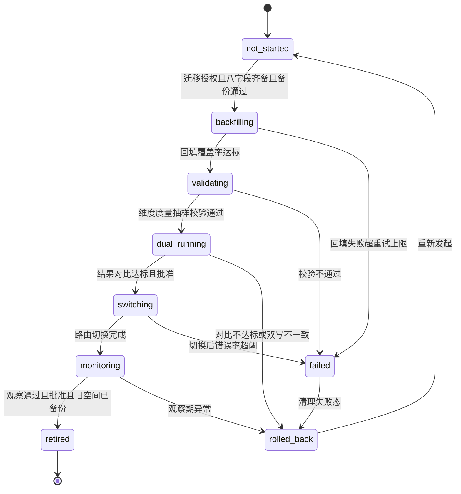
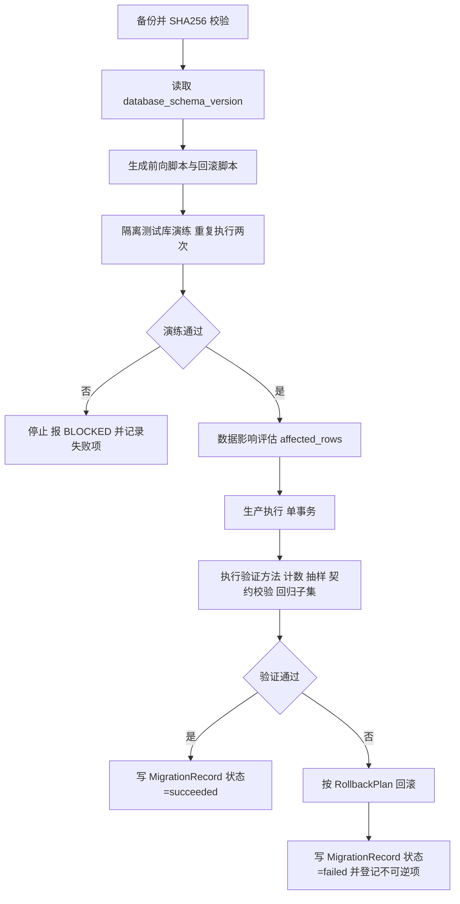
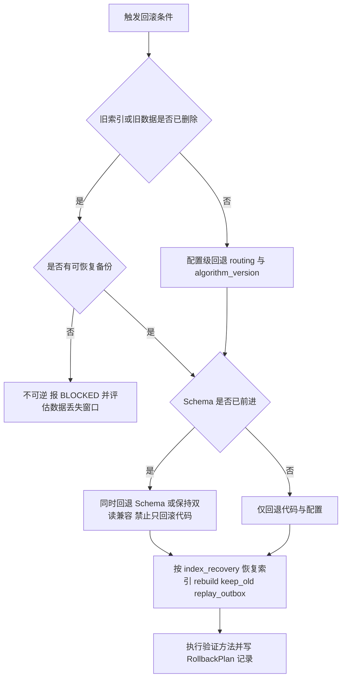

# 07 — 扩展与演进规范

> **⚠️ V2 架构升级（2026-11-04）**：路线图更新为 **P0–P6**（任务书 §19）：P0 环境与设计基础 / P1 M01（含 MemoryUnit+Evidence+Event+EmotionContext+关联表）/ P2 M02（含 **Anchor Router**）/ **P3 M03+Ingestion Pipeline** / **P4 M04 人物画像与整合** / **P5 M05+聊天 LLM 读写 API** / **P6 Psychology 集成与完整验收**。⚠️ **实施授权不变**：历史裁决「当前 P0–P3 = M01+M02」继续保持；P3–P6 新增内容属「V1 范围内、需阶段授权」，**不得因架构已定义而自行扩大实施**。版本维度新增 `memory_schema_version`、`anchor_set_version`、`profile_schema_version`。既有八维版本、迁移六要素、B-010/B-011、回滚六明确**不变**。凡与 V2 冲突处一律以 V2 为准。

> 文件代号：MC-R41-DD-07 ｜ 文档版本：1.0 ｜ 目标系统版本：R4.1-MASTER-01 ｜ 设计基准：DD-AUTHORITY 1.0
> 设计状态：PROPOSED（设计稿，待总控交叉审查与用户批准） ｜ 实施授权：**无**（P0–P3 = M01+M02）
> 本文件定义版本登记、Schema/API/Embedding/Search Document 迁移、兼容性、回滚、索引重建与 Future 模块登记。文中所有迁移流程均为**设计**，未执行任何真实迁移。
> 用语：MUST / MUST NOT / SHOULD / SHOULD NOT / MAY / TBD / VERIFY / BLOCKED / FUTURE

---

## 1. 文档状态

### 1.1 状态声明

| 项 | 值 | 说明 |
|---|---|---|
| 设计状态 | PROPOSED | 未经用户批准，不得解释为 APPROVED |
| 实施授权 | 无 | 设计完成 ≠ 实施授权；迁移执行 MUST 另行授权（sf 后文 §8、§十） |
| 完成等级 | **F2 达到；F3 部分达到；F4 未达到** | 见 1.2 |
| 真实迁移记录 | 无 | 所有迁移状态为 `not_started`；本文档 MUST NOT 声称任何迁移已执行 |
| 现行 Embedding 空间 | 未定案 | 现网参考 BGE-M3 1024 维（05 环境索引），**不得写死**（裁决 R9） |

### 1.2 F 等级自评

| 等级 | 判定 | 依据 |
|---|---|---|
| F1 | 达到 | 版本八维、迁移六要素、九步状态机、B-010/B-011、兼容六版本、回滚六明确、Future 登记齐备 |
| F2 | 达到 | 每个状态转换给出触发条件/执行主体/事务要求/失败处理/可逆性/审计；字段级校验规则；回滚步骤可执行 |
| F3 | **部分达到** | 给出迁移验收清单与判定方法；但**无真实迁移演练记录**，B-010 八字段取值未在真实环境验证（VERIFY） |
| F4 | 未达到 | 无任何实践验证 |

### 1.3 禁止表述

- MUST NOT 写"Embedding 迁移已完成""已平滑切换""旧空间已退役"。
- MUST NOT 把"流程设计完整"写成"迁移能力已验证"。
- MUST NOT 给出未实测的迁移耗时、回填速率、覆盖率数值。

---

## 2. 适用版本

| 维度 | 版本 | 状态 |
|---|---|---|
| 母本 | R4.1-MASTER-01 | 设计基准 |
| 设计基准 | DD-AUTHORITY 1.0 | APPROVED |
| 本文档 | MC-R41-DD-07 v1.0 | PROPOSED |
| 契约依赖 | `embedding-space.schema.json`、`outbox-event.schema.json`、`search-document.schema.json`、`migration-state.md`、`embedding-migration-state.md` | 由总控组产出，本文只引用 |
| 参数 | 全部 **EXP-DEFAULT** | 未正式化 |
| 迁移状态枚举 | `not_started/backfilling/validating/dual_running/switching/monitoring/retired/rolled_back/failed`（九态） | PROPOSED 默认，与 `contracts/state-machines/state-machines.md` SM-8 一致 |

---

## 3. 适用范围

### 3.1 范围内

| 主题 | 内容 |
|---|---|
| 版本治理 | 八维版本登记、禁止单一总版本号 |
| Schema 迁移 | 六要素 + 验证方法、迁移脚本规则、迁移记录 |
| API 迁移 | 破坏性变更升级、字段语义不变、弃用流程 |
| Embedding 迁移 | 九步状态机、完整转换矩阵、B-010 八字段、B-011 九项必备 + 四禁令 |
| Search Document 迁移 | 文本投影/分词/文档版本变更 |
| 兼容性 | 六版本、兼容矩阵、不兼容处理 |
| 回滚 | 六明确、禁止只回滚代码 |
| 算法替换 | 六前提 |
| 数据迁移 | 导出/导入、ID 映射、权限继承 |
| 索引重建 | 六种重建模式的规范引用与判定 |
| Future | 八模块登记与可判定触发器 |

### 3.2 范围外

| 对象 | 标注 |
|---|---|
| 实际执行任何迁移 | MUST 另行授权；属 P4+ 运维动作 |
| 心理层（psy-model 五方法/十二阶段接口形态） | **DEFERRED**（台账 I-7 / X-6：暂缓且绑定） |
| Graphiti 旁路索引启动 | **FUTURE，仅登记**（台账 优化-3） |
| 五级可插拔分类中的可插拔实现 | PROPOSED 方向，C40 权限引擎**不可插拔**（台账 D-AP-07） |
| `cache.sqlite` 表结构与校验 | **DEFERRED**（台账 U-1/U-2） |
| 分布式/多宿主落地 | FUTURE（§7.13） |

---

## 4. 依赖文档

| 文档 | 用途 |
|---|---|
| DD-AUTHORITY.md | 基准与结构 |
| 08-adjudication-ledger.md | 正式裁决 |
| sf.md 后文 §3.2.5/§3.2.6/§8/§16.3/§16.4/§18 | 迁移与冻结条款来源 |
| m.md §7.4/§17/§20 | Embedding 元数据、备份、版本演进总则 |
| 00-总体架构与设计原则 | 不变量（索引可重建、权威唯一） |
| 01-记忆本体与数据模型 | schema_version、Embedding Space、Search Document 字段语义 |
| 02-核心算法规范 | search_algorithm 版本、特征计算版本 |
| 03-系统运行与协作协议 | event payload_version、错误码、幂等 |
| 04-权限与治理规范 | permission_policy 版本、派生继承、导出边界 |
| 05-可靠性与运维规范 | 备份/重建/恢复步骤（本文只引用并给迁移判定） |
| 06-测试与评估规范 | 迁移验收用例形态、五态、禁止虚假验收 |
| 08-DSH与QQBridge集成规范 | context_contract 版本、adapter 兼容 |
| contracts/schemas/embedding-space.schema.json | B-010 机器校验载体 |
| contracts/state-machines/state-machines.md（SM-6 Migration、SM-8 Embedding Migration） | 状态机机器载体 |
| 05-环境配置总索引.md | 驱动/模型选型未定案状态 |
| data-samples/（A 层 jsonl） | 历史向量来源（迁移回填对象的现实形态） |

---

## 5. 正式裁决引用

| 台账编号 | 要点 | 落地位置 |
|---|---|---|
| （台账 D-AP-04） | 有规范摘要时索引主体="摘要+cue"，正文降为元数据；无摘要须定义回退策略；研究报告收益不得写成实测 | §7.7 Search Document 迁移必须同时迁移"投影版本"与"回退策略"；§7.13 触发器不得基于研究报告 |
| （台账 D-AP-05） | reinforce 仅由 DSH 回传最终 prompt 实际出现的 memory_id 触发；E14/B04 未落地前只预留 schema 禁止写入 | §7.2 迁移不得为 reinforce 增加"迁移期回填"；§7.9 回滚不得引入 reinforce 写入 |
| （台账 D-AP-07） | C40 权限引擎不可插拔；五级可插拔仅限非权限层；trusted_context_source: entry-only | §7.10 算法替换六前提**不适用于** C40；§7.13 FUT 登记须声明"不改变权限判定入口" |
| （台账 D-AP-08） | 可判定触发器驱动演进，不采用预定时间表；触发后仍需重新评估与单独授权 | §7.13 全部 Future 条目的启用条件与再评估触发器 |
| （台账 D-AP-09） | 拒绝第三方托管记忆平台；不得声称"记忆文本不出本机"；本地持久化与云端推理传输分开评估 | §7.4 回填若调用云端 Embedding MUST 披露传输；§7.11 导出导入安全边界 |
| （台账 优化-3） | Graphiti 旁路仅登记不启动 | §7.13 FUT-03 |
| （台账 优化-5） | 稳定唯一可追踪参数 ID | §7.10 算法替换须保留 parameter_id；§8.3 VersionRegistryEntry |
| （台账 U-1/U-2） | 不冻结 cache.sqlite 表结构与校验实现 | §7.12 重建范围明确排除缓存库；§14 OI-07-05 |
| （台账 X-1） | 心理层 delta-only，不进入 M02 最终排序 | §7.10 算法替换不得借迁移引入心理加成 |
| （台账 K-2） | 导出边界逐项确定；内部参数默认不导出 | §7.11 导出规则 |
| （台账 I-7 / X-6） | psy-model 暂缓、接口形态暂缓 | §3.2、§14 OI-07-06 |

---

## 6. 术语表

| 术语 | 定义 |
|---|---|
| 版本维度（八维） | database_schema / memory_schema / event_schema / embedding_space / search_algorithm / permission_policy / context_contract / module |
| 迁移记录（migration record） | 一次迁移的权威登记行：来源版本、目标版本、状态、时间、执行者、结果、回滚点 |
| B-010 | Embedding Space 八字段完整定义（模型/维度/度量/归一化/分块/投影/向量 schema） |
| B-011 | Embedding 模型迁移九项必备 + 四项禁令 |
| 向量空间（embedding space） | 由 B-010 八字段唯一确定的可比较向量集合；不同空间向量 MUST NOT 混合比较 |
| 回填（backfill） | 用新模型对历史权威记忆重新生成向量的过程 |
| 双读（dual read） | 同一查询在两空间分别执行并比较结果的验证模式 |
| 双写（dual write） | 写入时同时向新旧空间写入向量；**仅允许在批准阶段执行** |
| 路由切换（switch routing） | 把查询默认指向新空间的配置变更 |
| 退役（retire） | 旧空间删除或封存；MUST 在观察期通过且批准后执行 |
| 兼容性六版本 | API / Schema / Event / Embedding Space / Search Document / Context Format |
| 可判定触发器 | 能用客观度量判真假的演进触发条件，禁止"感觉需要"式条件 |
| 迁移容差 | 新旧空间检索结果比较时允许的差异范围；具体值 TBD |
| 权威回填口径 | 回填只读 SQLite 权威正文 + 匹配的文本投影版本生成向量，禁止读索引正文 |

---

## 7. 规范正文

### 7.1 八维版本登记（禁止一个总版本号代替全部）

**MUST** 分别登记下列八个版本维度；**MUST NOT** 用单一"system_version / 4.1"代表全部维度，也 **MUST NOT** 让不同模块各自定义同名不同义的版本。

| 维度 | 标识符字段 | 载体 | 递增规则 | 兼容语义 | 不兼容处理 | 登记位置 |
|---|---|---|---|---|---|---|
| database_schema | `database_schema_version` | `manifest/schema-version.json` + 迁移记录表 | 正整数，每次 DDL 变更 +1（含回滚脚本） | 仅相邻版本可自动迁移；跨版本 MUST 顺序迁移 | 拒绝启动并报 CONFIGURATION_ERROR（reason_code=VERSION_INCOMPATIBLE） | 库内 `schema_migration` 表 + manifest |
| memory_schema | `memory.schema_version` | Memory Object 字段 | 语义版本 `major.minor`；字段删除/语义变更 = major | 读取旧 minor 允许；读旧 major MUST 经显式升级 | 拒绝读取并返回 VALIDATION_ERROR | 01 文档 + `memory-object.schema.json` |
| event_schema | `outbox_event.payload_version` | Outbox 事件 | 正整数，payload 结构变更 +1 | 消费者 MUST 支持当前 + 前一版本 | 未支持版本 → 事件进 dead_letter 并告警 | 03 文档 + `outbox-event.schema.json` |
| embedding_space | `embedding_space_id` + B-010 八字段 | Embedding Space 描述与索引元数据 | 任一字段变化即产生**新** space id（不可原地改） | 不同 space 之间零兼容（禁止混排） | 查询/写入携带未知 space → 拒绝 | 01/02 文档 + `embedding-space.schema.json` |
| search_algorithm | `search_algorithm_version` / `algorithm_version` | 检索配置与响应 meta | 语义版本；特征集/公式/权重语义变更 = major，权重数值变更 = minor | 结果 MUST 可追溯到算法版本 | 版本未知 → 结果标 `unverified_algorithm` 且不得用于验收 | 02 文档 + 检索配置 |
| permission_policy | `policy_version` | 权限判定配置 | 正整数；规则增删改 +1 | 审计 MUST 记录判定时的 policy_version | 缺失 policy_version 的判决 MUST 拒绝 | 04 文档 + 审计记录 |
| context_contract | `context_contract_version` | `context-response` | 语义版本；字段增删 = major | 宿主 MUST 声明支持的版本区间 | 不匹配 → 拒绝注入并按 §7.8 处理 | 08 文档 + `context-response.schema.json` |
| module | `module_version`（每模块独立，如 M01/M02） | 模块 manifest | 语义版本 | 模块间只依赖对方公开契约版本 | 依赖不满足 → 该模块不启动 | 各模块 manifest |

**规则**：
1. **MUST** 每个权威对象同时带 `schema_version` 与（若含向量）`embedding_space_id`。
2. **MUST** 任何响应 `meta` 至少含 `schema_version` 与 `algorithm_version`（m.md §15.4）。
3. **MUST** 版本号只增不减；回滚不改版本号，而是回到上一版本并**新增**一条回滚迁移记录。
4. **MUST NOT** 用时间戳或文件修改时间充当版本。

### 7.2 Schema 迁移（六要素 + 验证方法）

#### 7.2.1 每次 Schema 变化 MUST 定义七项

sf 后文 §8.1 列六要素；本文档将"验证方法"作为**第七必填项**（与六要素同等级），缺失任一项 MUST 拒绝执行迁移。

| # | 要素 | 必填内容 | 判定 |
|---|---|---|---|
| 1 | 当前版本 | `from_version`（database_schema_version 与 memory_schema 分别给） | 与库内记录一致 |
| 2 | 目标版本 | `to_version`（必须 = 当前 +1，或显式声明跨版本顺序链） | 链完整可执行 |
| 3 | 迁移脚本 | 前向脚本 + 回滚脚本；幂等；可重复执行；不依赖交互 | 在测试库重复执行 2 次结果一致 |
| 4 | 数据影响 | 受影响表/行数估算、字段增删、语义变化、是否需要回填 | 与演练结果一致（±容差） |
| 5 | 兼容策略 | 旧代码/旧数据/旧事件如何共存；双版本窗口长度（TBD） | 混版本运行无错误 |
| 6 | 回滚策略 | 见 §7.9 六明确 | 回滚演练通过 |
| 7 | 验证方法 | 完整性/计数/抽样/契约校验/回归子集 | 可自动执行且判据明确 |

#### 7.2.2 迁移脚本规则（全部 MUST）

1. **MUST** 使用事务（DDL 在 SQLite 中亦 MUST 包在事务内；不可事务的步骤 MUST 显式记录为"不可回滚步骤"）。
2. **MUST** 幂等：重复执行不产生二次副作用（以 `schema_migration` 记录 + 条件判断实现）。
3. **MUST** 先备份并 SHA256 校验（m.md §17.2），备份失败即停止。
4. **MUST** 先在隔离测试库演练并通过验证方法，才允许在目标库执行。
5. **MUST** 由单一执行者执行；**MUST NOT** 多 Agent 并发改同一 Schema（sf 后文 §14.4）。
6. **MUST NOT** 直接修改生产库结构而不增加迁移记录（sf 后文 §8.1）。
7. **MUST NOT** 在迁移脚本内修改业务语义（语义变更 MUST 走版本 + 单独审批）。
8. **MUST** 记录：`migration_id`、from/to、脚本哈希、执行者、开始/结束时间、结果、回滚点、受影响行数。

#### 7.2.3 迁移流程（图见 §9.2）

备份 → 校验当前版本 → 生成前向/回滚脚本 → 测试库演练 → 数据影响评估 → 生产执行（事务） → 验证方法 → 登记 → 失败则回滚并登记。

### 7.3 API 迁移

| 规则 | 内容 | 判定 |
|---|---|---|
| 破坏性变更 MUST 升级版本 | 删除字段、改字段类型/含义/必填性、改错误语义、改幂等语义 = breaking → major +1 | 未升版本即判违规 |
| **MUST NOT 修改旧版本字段语义** | 旧版本字段只能"保留原义"或"标记 deprecated"，不得改义 | 语义 diff 为空 |
| 增量变更 | 新增可选字段 = minor；旧客户端忽略未知字段 MUST 不报错（额外字段策略由 Schema 声明） | 旧客户端可继续工作 |
| 弃用流程 | deprecated 声明 → 至少保留 1 个 major 周期（TBD 具体长度）→ 移除（再 +1 major） | 有弃用公告与期限记录 |
| 错误码 | MUST 使用 03 规范名；不得新增同义错误码；映射旧名（R1 别名表） | 错误码表 diff |
| 幂等 | 迁移前后 `idempotency_key` 语义 MUST 不变 | 重复请求行为一致 |
| 版本协商 | 客户端 MUST 声明支持的 API 版本（`X-API-Version` 或请求字段，具体形式 TBD） | 未声明则按最低受支持版本处理并记录 |

**MUST**：API 版本变更 MUST 同步更新 Schema / Event / Tests / Migration / 文档（sf 后文 §12）。

### 7.4 Embedding 迁移：九步状态机

#### 7.4.1 九步流程（sf 后文 §8.2）

| 步骤 | 名称 | 动作 | 关键约束 |
|---|---|---|---|
| 1 | Old Space | 冻结旧空间元数据与索引版本 | 旧空间 MUST 只读，不删不改 |
| 2 | Create New Space | 按 B-010 八字段创建新 `embedding_space_id` 与新索引表 | 新空间元数据 MUST 八字段齐备 |
| 3 | Backfill | 用新模型对历史权威记忆重新生成向量（可断点续跑） | 只读 SQLite 权威正文；MUST NOT 读索引正文 |
| 4 | Validate | 覆盖率、维度、归一化、抽样距离与自检索一致性校验 | 覆盖率 MUST 100% 才可进入下一步（部分覆盖率方案 TBD） |
| 5 | Dual Read / Approved Dual Write | 查询双读对比；写入双写**仅在被批准时** | 双写期 MUST 记录两空间写入结果一致性 |
| 6 | Compare Results | 同查询集在新旧空间的结果对比（Top-K 交叠、排序差） | 容差值 TBD；禁止以研究报告数值当容差 |
| 7 | Switch Routing | 查询路由指向新空间（配置变更） | 切换 MUST 可单点回退（配置项回退） |
| 8 | Monitor | 观察窗口内的错误率/空结果率/延迟/一致性 | 观察窗口长度 TBD |
| 9 | Retire Old Space | 删除或封存旧空间索引 | MUST 在观察通过 + 批准后执行；删除前 MUST 有备份 |

#### 7.4.2 九个迁移状态

`not_started` / `backfilling` / `validating` / `dual_running` / `switching` / `monitoring` / `retired` / `rolled_back` / `failed`

初始状态 = `not_started`；终态 = `retired`（成功）或 `rolled_back`（已回退，可重新发起）。

#### 7.4.3 完整转换矩阵

| # | 转换 | 触发条件 | 执行主体 | 事务要求 | 失败处理 | 是否可逆 | 是否审计 |
|---|---|---|---|---|---|---|---|
| 1 | not_started → backfilling | 迁移被授权 + B-010 八字段齐备 + 备份通过 | 运维（migration runner） | 先写 migration 记录（状态=backfilling）再启动；与业务写入无跨库事务 | 停止回填；状态 → failed；不删任何数据 | 是 | 是 |
| 2 | backfilling → validating | 回填覆盖率 = 100%（或经批准的部分覆盖率）且断点表为空 | migration runner | 写迁移记录状态 + 覆盖率快照 | — | 是 | 是 |
| 3 | backfilling → failed | 回填错误超重试上限 / 空间不可用 / 模型不可用 | migration runner | 记录最后成功位点 | 保留位点以便续跑；告警 | 是 | 是 |
| 4 | validating → dual_running | 维度/归一化/距离度量校验通过；抽样自检索一致；无跨空间混入 | 验证者（人工确认或脚本 + 批准记录） | 校验报告写入 migration 记录 | — | 是（可退回 validating 重验） | 是 |
| 5 | validating → failed | 覆盖率不足 / 维度或度量不匹配 / 抽样不一致超容差 | 验证者 | 记录失败项 | 不切换；旧空间继续服务 | 是 | 是 |
| 6 | dual_running → switching | 对比结果在容差内 + 双写一致性通过（若启用）+ 显式批准 | 批准人 + 运维 | 配置变更 MUST 单事务提交（路由表版本 +1） | — | 是（回退配置） | 是 |
| 7 | dual_running → rolled_back | 对比不达标 / 双写不一致 / 线上异常 / 主动放弃 | 批准人 | 写回滚记录（含回滚对象与证据） | 停止双写；保留新空间数据（不删） | 是 | 是 |
| 8 | switching → monitoring | 路由切换完成且服务健康检查通过 | 运维 | 路由切换 MUST 原子；切换前写切换点 | — | 是 | 是 |
| 9 | switching → failed | 切换后错误率/空结果率超阈（阈值 TBD 至实测基线）/ 服务不可用 | 运维 | 记录故障窗口 | 立即回退路由（→ rolled_back） | 是 | 是 |
| 10 | monitoring → retired | 观察窗口通过 + 退役批准 + 旧空间备份完成 | 批准人 + 运维 | 删除索引 MUST 分批且可中止；记录删除计数 | 中止删除，状态回 monitoring | **否**（删除后仅能靠备份恢复） | 是 |
| 11 | monitoring → rolled_back | 观察期发现质量/一致性异常 | 批准人 | 路由回退原子提交 | 旧空间恢复正常服务 | 是 | 是 |
| 12 | failed → rolled_back | 清理失败态并确认旧空间可用 | 运维 | 写回滚记录 | — | 是 | 是 |
| 13 | rolled_back → not_started | 重新发起（可复用同一 `embedding_space_id` 或新建；复用 MUST 先清空新空间） | 运维（需重新授权） | 重置迁移记录 | — | 是 | 是 |
| 14 | 任意非终态 → failed | 不可恢复异常（进程崩溃、磁盘损坏、权限失效） | 系统自动 | 记录最后已知状态 | 按 05 恢复流程；不丢权威数据 | 视情况 | 是 |

**禁止转换（MUST NOT，出现即判设计违规/实现缺陷）**

| 禁止 | 原因 |
|---|---|
| not_started → switching | 未回填即切换（sf 后文 §8.2 禁令 2） |
| backfilling → switching | 回填未完成即切换 |
| validating → retired | 未验证即删旧空间（禁令 3） |
| dual_running → retired | 跳过切换与观察 |
| retired → 任意 | 终态不可回退（只能靠备份重建） |
| 任意 → not_started（除 rolled_back 外） | 丢失审计连续性 |
| switching 期间并发两次切换 | 路由版本冲突，MUST 拒绝第二次 |

### 7.5 B-010：Embedding Space 八字段完整定义

| # | 字段 | 类型 | 必填 | 校验规则 | 缺失后果 |
|---|---|---|---|---|---|
| 1 | `model_id` | string | 是 | 长度 1–128；`^[A-Za-z0-9._:-]+$`；不含空白；区分大小写 | 无法确定语义空间 → 拒绝写入/查询 |
| 2 | `model_version` | string | 是 | 长度 1–64；不得为空或 `"latest"`（MUST 是具体版本标识） | 版本漂移不可追溯 → 拒绝 |
| 3 | `dimensions` | integer | 是 | ≥1 且 ≤ 65536；MUST 与该模型实际输出一致（运行时断言） | 维度不匹配 → 拒绝，**不得截断/补零** |
| 4 | `distance_metric` | enum | 是 | `cosine` / `l2` / `dot_product`（`ip` 为历史别名，等同 `dot_product`）；MUST 与索引配置一致 | 度量不一致 → 排序无意义 → 拒绝 |
| 5 | `normalized` | boolean | 是 | true 表示写入前已 L2 归一化；true + `cosine` 与 false + `cosine` 属**不同**空间 | 归一化状态未知 → 拒绝 |
| 6 | `chunker_version` | string | 是 | 长度 1–64；受控版本标识（如 `chunk-v1`） | 分块边界变化会使历史向量不可比 → 拒绝 |
| 7 | `text_projection_version` | string | 是 | 长度 1–64；定义"哪些字段/如何拼接成被嵌入文本" | 投影变化会使向量语义漂移 → 拒绝 |
| 8 | `vector_schema_version` | string | 是 | 语义版本 `major.minor`；定义向量行结构（id/vector/metadata 字段集） | 结构不可解析 → 拒绝 |

**派生规则（PROPOSED）**：`embedding_space_id = "space-" + sha256(canonical_json(eight_fields))[0:16]`。

- 规范化 JSON MUST 按字段名排序、布尔/整数固定表示；任一字段变更 → 新 id。
- **MUST NOT** 手工指定或复用 `embedding_space_id` 表达"同一空间的新版本"。
- **MUST** 在索引元数据、Memory 记录、检索响应三处同时可读到同一 `embedding_space_id`。

**同维度禁令**：`dimensions` 相同但任一其它字段不同，**MUST NOT** 视为同一空间（sf 后文 §3.2.6；裁决 R9：1024 不得写死）。

### 7.6 B-011：迁移九项必备与四项禁令

#### 7.6.1 九项必备（缺一即 MUST 拒绝迁移）

| # | 必备项 | 判定证据 |
|---|---|---|
| 1 | 新旧向量空间隔离 | 两个独立 `embedding_space_id` + 两个索引表/目录；跨空间查询被拒绝 |
| 2 | 新索引构建 | 新空间索引存在，写入/查询可用，元数据八字段齐备 |
| 3 | 历史数据回填 | 覆盖率报告（分子/分母/缺失清单）+ 断点位点 |
| 4 | 迁移期间同步 | 双写或增量补写机制（仅批准阶段启用）；期间新写入 MUST 有明确归属策略 |
| 5 | 迁移追赶 | 回填完成到切换之间的增量补齐机制与追赶完成证明（增量计数=0） |
| 6 | 结果对比 | 同查询集双读对比报告（Top-K 交叠、排序差异、空结果差异） |
| 7 | 路由切换 | 原子配置变更 + 切换点记录 + 单点回退能力 |
| 8 | 回滚 | 回滚脚本/配置 + 回滚演练记录（§7.9） |
| 9 | 旧索引退役 | 退役批准 + 备份 + 分批删除记录 |

#### 7.6.2 四项禁令（绝对禁止）

1. **同维度不得直接混合** —— 维度相同不等于同一语义空间；混合检索即 MUST 判 FAIL。
2. **未完成回填不得切换** —— 覆盖率未达批准阈值前 MUST NOT 进入 `switching`。
3. **未验证新空间不得删旧空间** —— `validating`/`dual_running`/`monitoring` 期间 MUST NOT 删除旧空间索引；删除仅允许在 `monitoring → retired` 且批准后。
4. **新模型失败不得静默返回旧模型结果伪装为新模型结果** —— 降级 MUST 显式（响应标 `embedding_space_id` 实际使用值 + `degraded=true` + 告警），否则判安全违规。

### 7.7 Search Document 迁移

Search Document 是 FTS5 的派生可重建文档，其迁移不改变权威数据。

| 变更类型 | 影响 | 迁移方式 | 判定 |
|---|---|---|---|
| `schema_version`（Search Document 自有投影结构版本）变更（字段增删） | FTS5 表结构/列映射 | 全量重建 FTS5（从 SQLite 重新投影） | 重建后计数/抽样一致 |
| `text_projection_version` 变更（拼接字段变化） | 全文召回语义 | **MUST** 全量重建；MUST NOT 增量修补 | 同查询前后命中差异有解释 |
| `chunker_version` 变更 | 文档切分边界 | 全量重建 + 同步触发向量重算（因向量输入改变） | 向量空间 MUST 同步变更或显式重算 |
| `tokenizer` 变更（分词器） | 中文召回效果 | 重建 + 记录分词器版本 | 中文查询回归集无退化 |
| 索引主体由"正文"改为"摘要+cue" | 召回与呈现 | 重建；无摘要时 MUST 走回退策略（台账 D-AP-04） | 回退策略有显式记录，不得静默取正文 |

**规则**：
1. **MUST** 每个 Search Document 带 `schema_version`（投影结构版本）+ `text_projection_version` + `chunker_version` + `embedding_space_id`（若含向量引用）。
2. **MUST NOT** 直接编辑索引行来"迁移"，只能重建或按 Outbox 重放。
3. **MUST** 迁移期间 `memory_delete`/`memory_upsert` 事件 MUST 保持可处理（重建不应阻塞 Outbox，可暂停消费但 MUST 保留 backlog）。
4. **MUST** 重建完成后切换索引版本并保留旧索引一个观察窗口（TBD）。

### 7.8 兼容性六版本与不兼容处理

| 版本 | 兼容范围 | 向后兼容要求 | 向前兼容要求 | 不兼容处理 |
|---|---|---|---|---|
| API Version | 客户端 ↔ Memory API | 旧客户端在 N-1 major 内可用 | 新客户端对旧服务 MUST 显式失败而非静默降级 | 返回 CONFIGURATION_ERROR（reason_code=VERSION_INCOMPATIBLE）+ 受支持版本列表 |
| Schema Version | 数据 ↔ 代码 | 读旧 minor 允许 | 读新 minor 的旧代码 MUST 报错而非忽略字段 | 拒绝读取；不得按旧 schema 解释 |
| Event Version | Outbox ↔ Worker | Worker 支持当前 + 前一 payload_version | — | 不支持 → dead_letter + 告警，禁止猜测 payload |
| Embedding Space Version | 索引 ↔ 查询 | 零兼容（独立空间） | — | 空间不匹配 → 拒绝检索（MUST NOT 混排） |
| Search Document Version | 索引 ↔ 检索代码 | 重建即兼容 | — | 版本不匹配 → 触发重建，不得用旧文档 |
| Context Format Version | Core ↔ Host Adapter | 宿主声明支持区间 | 适配器 MUST 声明 `adapter_version` | 区间不交 → 拒绝注入（宿主降级为无记忆对话，§08） |

**总规则**：版本不兼容时 **MUST** 明确拒绝或进入**明确登记**的兼容处理，**MUST NOT** 静默继续（sf 后文 §8.3）。

**命名对齐（MUST）**：八维登记名 `context_contract` 与 sf 后文 §8.3 的 "Context Format Version" 是**同一维度的两个称谓**，MUST NOT 各自独立取值；该维度与 `adapter_version`、响应 `meta.schema_version` 的组合关系由 00 文档"版本策略"章节统一，本文只登记维度与不兼容处理规则。其余五个兼容性版本（API / Schema / Event / Embedding Space / Search Document）与八维中的 `memory_schema`、`event_schema`、`embedding_space`、`database_schema` 的对应关系 MUST 在 `VersionRegistryEntry` 中逐条注明（§8.3）。

### 7.9 回滚六明确

| # | 明确项 | 必填内容 | 判定 |
|---|---|---|---|
| 1 | 回滚对象 | 代码 / 配置 / Schema / 索引 / 数据 / 路由，逐一列出（可多选） | 对象清单与实际变更一一对应 |
| 2 | 回滚条件 | 触发回滚的客观条件（错误率阈值、校验失败、人工决定） | 条件可判定 |
| 3 | 回滚步骤 | 有序步骤 + 每步事务性 + 预计时长（时长 TBD 至实测） | 演练可完成 |
| 4 | 数据可逆性 | 逐项标 reversible / irreversible / partially | 不可逆项 MUST 有备份 |
| 5 | 数据丢失风险 | 说明回滚会丢失哪些写入（如切换后的新空间写入） | 有量化口径 |
| 6 | 索引恢复 | 回滚后索引如何恢复（重建 / 保留旧索引 / 重放 Outbox） | 有验证方法 |

**MUST NOT 只回滚代码而忽略数据结构变化**（sf 后文 §8.4）。若 Schema 已前进，只回退代码会读到不认识的结构 → MUST 同时回退 Schema 或保持双读兼容。

**回滚决策（图见 §9.3）**：先判"是否已删旧索引/旧数据"——已删则不可逆，只能按备份重建并接受数据窗口丢失；未删则可配置级回退。

### 7.10 算法替换六前提

适用对象：RRF、规则排序特征集、Token 预算策略、文本投影、分块算法、检索通道实现。**不适用**：C40 权限引擎（不可插拔，台账 D-AP-07）、M05 判定入口。

| # | 前提 | 要求 | 判定 |
|---|---|---|---|
| 1 | 输入输出兼容 | 函数签名与返回结构不变；字段语义不变 | 契约 diff 为空 |
| 2 | 结果语义兼容 | 排序/分数的语义与范围不改变解释方式（如 0–1 归一化仍成立） | 语义说明与实测范围一致 |
| 3 | 版本记录 | 新算法 MUST 有新 `search_algorithm_version`；旧结果 MUST 可追溯旧版本 | 响应 meta 含版本 |
| 4 | 历史数据处理 | 说明历史记录是否需重算；需重算则 MUST 有重算作业与完成证明 | 重算覆盖率记录 |
| 5 | 是否需要重新计算 | 显式声明（是/否）+ 影响范围 | 声明存在 |
| 6 | 如何回滚 | 保留旧实现可切换 + 配置回退点 | 回退演练通过 |

**规则**：**MUST NOT** 在不兼容情况下仅修改配置名称（sf 后文 §8.5）；**MUST** 保留参数 `parameter_id`（优化-5），改名不丢身份；**MUST NOT** 借算法替换引入心理层加成（台账 X-1）。

### 7.11 数据迁移与导出导入

#### 7.11.1 数据迁移（A/B 层）

| 对象 | 迁移目标 | 必保留 | 禁止 |
|---|---|---|---|
| A 层 `state/memory-vectors.jsonl` | Memory（SQLite）+ LanceDB 索引 | 原始 ID 或映射 ID、内容、来源、权限、置信度、模型信息、时间信息 | 编造缺失信息；把 vec 直接当新空间向量 |
| B 层 `social-v2.json` | Session/Topic State、Pending Intent、Relationship/Observation、Episodic、Preference、Relationship Memory | activeTopics/pendingThoughts/memberImpressions 的推断性质、来源、置信度、权限 | 把 memberImpression 升级为确定事实；把全部内容转成长期事实 |

**迁移规则**：
1. **MUST** 逐条迁移并保留 `provenance_id`（operation=`migrate`）。
2. **MUST** 缺失字段留空并记 `unknown`，**MUST NOT** 编造默认值冒充已知。
3. **MUST** 迁移后做"数量 + 抽样内容 + 权限继承 + 可检索性"四项校验。
4. **MUST NOT** 迁移期间改变 scope（禁止顺手把 owner_private 放宽）。
5. **MUST** 迁移脚本幂等；重复执行不产生重复记忆（以原始 ID 映射表去重）。
6. **MUST** 保留映射表（`legacy_id → memory_id`）以便回滚与审计。

#### 7.11.2 导出与导入

| 动作 | 规则 |
|---|---|
| 导出权限 | `canExport` 独立判定；有读取权不等于有导出权（sf 后文 §5.5） |
| 导出内容 | 逐项边界：用户相关内容可导出；**内部计算参数、系数默认不导出**（台账 K-2）；openLoop.text / 关系基调 / 历史峰值 / 信任度 / 互动统计 MUST 逐项判定（K-2 未完成项标 TBD） |
| 导出记录 | 导出主体、范围、时间、格式、数量、是否含派生数据（6 项 MUST） |
| 导入校验 | Schema 校验、ID 冲突检测、权限继承（不得宽于来源）、来源链完整性 |
| 导入 ID | MUST 生成新 `memory_id` 并保留 `legacy_id`；MUST NOT 复用已删除 ID |
| 导入 Scope | MUST NOT 扩大；源 scope 不可解析时 MUST 拒绝该条 |
| 删除语义 | 导出包中已删除项 MUST 不出现；tombstone 语义随 K-2 一并确定（TBD） |
| 备份 | 备份属派生物，MUST 继承权限与删除策略；备份过期窗口 TBD |

### 7.12 索引重建规范（引用 05，本文给判定）

**重建六模式**：

| 模式 | 输入范围 | 版本要求 | 验证 | 失败回滚 |
|---|---|---|---|---|
| 单条重建 | 指定 memory_id | 用该记录当前版本 | 该条可命中且正文=权威 | 保留旧索引行，重试；失败记 dead_letter |
| 范围重建 | 时间/主体/类型/空间过滤 | 每条用其当前版本 | 计数 + 抽样 | 分批提交，失败停止该批并保留已成功批 |
| 全量重建 | 全部未删除记忆 | 全量 + 单一 `embedding_space_id` | 计数、版本、抽样、Benchmark 子集 | 切回旧索引（保留至观察窗口结束） |
| Embedding 空间重建 | 某 space 全部 | 命中该 space 的 B-010 八字段 | 覆盖率、维度、自检索一致 | 新建同 space 索引目录，完成后原子切换 |
| 删除清理 | tombstone 列表 | 只处理已删除 | 清理后 0 召回 | 不适用（删除不可逆，但权威无影响） |
| 失败回滚 | 任一批次 | 保留重建前索引版本号 | 回退到上一索引版本并可查询 | 见 §7.9 第 6 项 |

**规则**：
1. **MUST** 重建只读 SQLite 权威 + 匹配投影版本生成文档；**MUST NOT** 用索引正文当输入（sf 后文 §6.4）。
2. **MUST NOT** 把旧模型向量混入新模型索引。
3. **MUST** 重建期间不删除旧索引；切换 MUST 原子。
4. **MUST** 排除 `cache.sqlite`（表结构与校验 DEFERRED，台账 U-1/U-2）。

### 7.13 Future 模块登记（全部 FUTURE）

**全部条目状态 = FUTURE**；**MUST NOT** 因在本文档出现而进入实施范围（sf 后文 §0.4）。
启用遵循（台账 D-AP-08）：可判定触发器驱动、无预定时间表、触发后 MUST 重新评估并单独授权。

| 编号 | 模块 | 当前状态 | 启用条件（可判定触发器） | 再评估触发器 | 前置依赖 |
|---|---|---|---|---|---|
| FUT-01 | ANN（向量近似检索） | FUTURE（首版 MUST FLAT） | 全量集合规模使 FLAT 查询延迟基线超过批准阈值，且召回损失在容差内（阈值 TBD 至实测） | 每次规模翻倍或延迟回归 >20% 时再评估 | 06 TEL-8 基线；FLAT 验证先通过 |
| FUT-02 | Cross-Encoder 重排 | FUTURE（首版规则排序） | 规则排序在 Benchmark 上的 NDCG 相对基线提升已饱和（连续 2 个版本无显著提升），且重排延迟与成本可被预算容纳 | 每次模型替换或延迟超预算时 | 06 消融 A–F 结论 + Token 预算证据 |
| FUT-03 | 关系图谱 / Graphiti 旁路索引 | FUTURE，**仅登记不启动**（台账 优化-3） | 显式关系已不足以支撑查询（关系中转查询失败率超过阈值，阈值 TBD），且达到既定准入条件 | 准入条件满足时单独评估 | 00 架构评估；01 关系模型先行 |
| FUT-04 | 自动反思（Observation 自动生成/更新） | FUTURE（M03/M04 属 P4+） | M03/M04 正式实现并通过各自验收；Observation 误报率低于阈值（TBD） | 每轮 Observation 质量报告后 | M03/M04 验收；来源删除传播已验证 |
| FUT-05 | Dream 完整实现（周期维护调度） | FUTURE | 维护任务可幂等执行且不绕过 M01/M05 的证据齐备；人工维护成本超过阈值 | 维护积压趋势指标连续上升 | 05 运维；M03/M04 |
| FUT-06 | Context Compression 接入 | FUTURE | 宿主上下文长度成为瓶颈（压缩前超预算比例超阈值），且压缩不改变语义的验证通过 | 每次压缩算法版本变更 | 08 协作契约；Compaction 事件字段 |
| FUT-07 | 多宿主 | FUTURE | 出现第二个真实宿主且其身份映射、注入点、L3 回传均通过验证（VERIFY） | 新宿主接入申请时 | 08 VERIFY 清单全部关闭 |
| FUT-08 | 分布式部署 | FUTURE | 单机容量/吞吐达到批准上限（上限 TBD 至实测），且一致性方案（权威单写）已设计 | 容量指标接近上限时 | 权威单点约束的分布式方案；备份恢复 |

**登记纪律**：
1. MUST 每条 Future 有唯一编号与"不实施"声明。
2. MUST NOT 在 P0–P3 代码中出现 FUT 条目的实现（允许预留字段/接口，但 MUST 标 `reserved` 且不可写入）。
3. FUT 启用 MUST 附：影响模块、兼容性、回滚方案、测试方案、是否需用户裁决。

---

## 8. 接口或数据结构

### 8.1 `MigrationRecord`（迁移权威登记，`schema_migration` 与迁移状态共用）

| 字段 | 类型 | 必填 | 约束 | 说明 |
|---|---|---|---|---|
| migration_id | string | 是 | uuid | 唯一 |
| migration_type | enum | 是 | database_schema / memory_schema / event_schema / embedding_space / search_document / data | 迁移类别 |
| from_version | string | 是 | 非空 | 源版本 |
| to_version | string | 是 | ≠ from_version | 目标版本 |
| embedding_space_id_from / _to | string\|null | 否 | embedding_space 类必填 | 空间标识 |
| script_sha256 | string | 是 | 64 hex | 前向脚本哈希 |
| rollback_script_sha256 | string\|null | 否 | 64 hex；不可逆项为 null 并标 irreversible=true | 回滚脚本哈希 |
| status | enum | 是 | 九态之一 | 迁移状态 |
| irreversible | boolean | 是 | 与 rollback_script_sha256 一致性校验 | 是否不可逆 |
| started_at / finished_at | string\|null | 是/否 | RFC3339 UTC | 时间 |
| actor | string | 是 | 可信执行者标识 | 主体 |
| affected_rows | integer\|null | 否 | ≥0 | 数据影响实测值 |
| coverage | object\|null | 否 | `{done, total, missing_ids_sha256}` | 回填覆盖率 |
| evidence_refs | array[string] | 是 | ≥1 | 校验报告引用 |
| rollback_point | string\|null | 否 | 备份标识 | 回滚点 |

### 8.2 `EmbeddingSpaceDescriptor`（B-010 机器载体，与 `embedding-space.schema.json` 一致）

| 字段 | 类型 | 必填 | 约束 |
|---|---|---|---|
| embedding_space_id | string | 是 | `^space-[0-9a-f]{16}$`（§7.5 派生规则，PROPOSED） |
| model_id | string | 是 | §7.5 第 1 行 |
| model_version | string | 是 | §7.5 第 2 行 |
| dimensions | integer | 是 | ≥1，≤65536 |
| distance_metric | enum | 是 | cosine / l2 / dot_product（`ip` 为历史别名） |
| normalized | boolean | 是 | — |
| chunker_version | string | 是 | 1–64 |
| text_projection_version | string | 是 | 1–64 |
| vector_schema_version | string | 是 | `^[0-9]+\.[0-9]+$` |
| created_at | string | 是 | RFC3339 UTC |
| status | enum | 是 | active / draining / retired（**与迁移九态区分**：本字段描述空间生命周期，迁移状态见 MigrationRecord） |

### 8.3 `VersionRegistryEntry`（八维版本登记行）

| 字段 | 类型 | 必填 | 说明 |
|---|---|---|---|
| dimension | enum | 是 | 八维之一 |
| current_value | string | 是 | 版本值 |
| previous_value | string\|null | 否 | 上一版本 |
| changed_at | string | 是 | RFC3339 UTC |
| changed_by | string | 是 | 执行者 |
| change_ref | string | 是 | migration_id 或变更申请编号 |
| compatibility | enum | 是 | backward / forward / none |
| notes | string\|null | 否 | ≤500 |

### 8.4 `RollbackPlan`

| 字段 | 类型 | 必填 | 说明 |
|---|---|---|---|
| rollback_id | string | 是 | 唯一 |
| target_ref | string | 是 | migration_id 或变更申请编号 |
| objects | array[enum] | 是 | code / config / schema / index / data / routing（§7.9 第 1 项） |
| conditions | array[string] | 是 | 客观触发条件 |
| steps | array[object] | 是 | `{seq, action, transactional, expected_duration_note}` |
| reversibility | enum | 是 | reversible / partially / irreversible |
| data_loss_risk | object | 是 | `{scope, window, estimate_note}` |
| index_recovery | enum | 是 | rebuild / keep_old / replay_outbox |
| verified_by | string\|null | 否 | 演练记录引用 |

### 8.5 `IndexRebuildRequest`

| 字段 | 类型 | 必填 | 约束 |
|---|---|---|---|
| rebuild_mode | enum | 是 | single / range / full / space / delete_cleanup |
| target_index | enum | 是 | fts5 / lancedb |
| filter | object\|null | 否 | 时间/主体/类型范围（range 模式必填） |
| embedding_space_id | string\|null | 否 | lancedb + space 模式必填 |
| consistency_check | boolean | 是 | 默认 true |
| dry_run | boolean | 是 | 默认 true（MUST 先演练） |

### 8.6 `ExportManifest`

| 字段 | 类型 | 必填 | 说明 |
|---|---|---|---|
| export_id | string | 是 | 唯一 |
| actor | object | 是 | 导出主体 |
| scope_exported | array[enum] | 是 | 已导出的 scope 列表 |
| record_count | integer | 是 | ≥0 |
| includes_derived | boolean | 是 | 是否含派生数据（Observation/Summary） |
| includes_internal_params | boolean | 是 | 默认 **false**（K-2） |
| format_version | string | 是 | 导出格式版本 |
| created_at | string | 是 | RFC3339 UTC |
| policy_version | string | 是 | 判定时的权限策略版本 |

---

## 9. 流程图（Mermaid）

### 9.1 Embedding 迁移状态机

### 9.2 Schema 迁移流程

### 9.3 回滚决策

---

## 10. 异常情况

| 编号 | 异常 | 影响 | 处理（MUST） |
|---|---|---|---|
| EX-07-01 | 迁移脚本不可幂等 | 重跑破坏数据 | 立即停止；回滚；修脚本；重新演练 |
| EX-07-02 | 备份失败 | 不可逆风险 | 停止一切迁移（m.md §17.2） |
| EX-07-03 | 回填覆盖率长期不足（存在无法生成的记录） | 无法切换 | 列缺失清单；缺失项按"不可回填"登记并批准例外；**MUST NOT** 用零向量补齐冒充完成 |
| EX-07-04 | 新空间维度/度量与索引配置不一致 | 结果无意义 | 拒绝写入/查询；修正配置；重跑 validating |
| EX-07-05 | 迁移期新写入未纳入新空间 | 数据缺口 | 走迁移追赶；增量计数 MUST 归零后才允许切换 |
| EX-07-06 | 双写不一致 | 质量风险 | 记录不一致条目；按容差判定；超差则 rolled_back |
| EX-07-07 | 切换后空结果率骤升 | 服务退化 | 立即回退路由（单点回退）；保持 monitoring → rolled_back |
| EX-07-08 | 旧空间索引已删除但新空间未验证 | **不可逆** | 按备份重建旧空间；登记不可逆事件与影响窗口 |
| EX-07-09 | 版本号冲突（两处登记不一致） | 无法判定当前版本 | 以 MigrationRecord 为准；修正 manifest；禁止继续迁移 |
| EX-07-10 | 迁移期间权限策略变更 | 判定不一致 | 记录 policy_version；迁移前后判定差异 MUST 复核；不得借迁移放宽 scope |
| EX-07-11 | 导出请求含内部参数 | 越界 | 拒绝或剥离内部参数并记录（K-2） |
| EX-07-12 | Future 条目被提前实现 | 越权 | 停止该实现；回退代码；登记违规（FUT 纪律） |

---

## 11. 安全边界

1. **MUST** 迁移脚本与执行者 MUST 具有显式授权；**MUST NOT** 由 Agent 自行决定执行迁移。
2. **MUST** 迁移全程备份 + 校验；不可逆步骤 MUST 在 `MigrationRecord.irreversible=true` 明示并获批准。
3. **MUST NOT** 迁移期间改变任何记忆的 scope、validation_state、权限继承结果（除经单独批准的修正流程）。
4. **MUST** 新空间向量的生成若调用外部/云端 Embedding 服务，MUST 在报告中披露传输事实；**MUST NOT** 声称"记忆文本不出本机"（台账 D-AP-09）。
5. **MUST** 导出/导入 MUST 遵守 `canExport` 独立权限与 K-2 边界；导入 MUST NOT 扩大权限。
6. **MUST NOT** 用迁移"顺带"修复权限数据；权限修正 MUST 走 04 的正式通道。
7. **MUST NOT** 触碰 `D:\qq-bridge` 的源码、配置、state、Persona；A/B 层数据迁移 MUST 通过授权副本进行（DD-AUTHORITY §5 第 14 条）。
8. **MUST** 迁移日志 MUST NOT 记录记忆正文（只记 ID/计数/哈希）。
9. **MUST** 索引重建 MUST NOT 引入未批准技术（如用 SQLite 向量替代 LanceDB）。
10. **MUST** Future 条目 MUST NOT 在未授权时进入生产配置（未批准实验参数不得写入生产默认，sf 后文 §4.5）。

---

## 12. 测试要求（迁移与演进专用，与 06 对齐）

| 编号 | 测试 | 判定 |
|---|---|---|
| MIG-T-01 | 迁移脚本幂等 | 重复执行两次，数据与版本一致 |
| MIG-T-02 | 前向/回滚双脚本可执行 | 演练库往返成功，数据回到起点（或差异有解释） |
| MIG-T-03 | 版本登记一致性 | 八维登记与库内/manifest 一致；无单一总版本号 |
| MIG-T-04 | B-010 八字段校验 | 缺任一字段 → 拒绝；同维度不同字段 → 不同 space id |
| MIG-T-05 | 跨空间混排拒绝 | 混合查询 → 拒绝；结果中 space id 唯一 |
| MIG-T-06 | 回填覆盖率计算 | 分子/分母/缺失清单可复算 |
| MIG-T-07 | 非法状态转换拒绝 | 矩阵中 14 条允许之外全部拒绝（如 not_started→switching） |
| MIG-T-08 | 退役前保护 | validating/dual_running/monitoring 期间删除旧索引 → 拒绝 |
| MIG-T-09 | 降级显式性 | 新空间失败时响应含 degraded 与真实 space id，不伪装 |
| MIG-T-10 | Search Document 重建 | 重建后计数/抽样/中文召回回归 |
| MIG-T-11 | 导出边界 | includes_internal_params 默认 false；canExport 独立判定 |
| MIG-T-12 | Future 隔离 | P0–P3 构建中不出现 FUT-01…FUT-08 实现（静态扫描） |

**五态要求**：迁移类测试同样 MUST 区分 PASS/FAIL/BLOCKED/NOT RUN/MOCKED；未做真实演练的迁移 MUST 标 NOT RUN 或 BLOCKED，**MUST NOT** 标 PASS（06 §7.3）。

---

## 13. 验收标准

### 13.1 迁移能力验收清单（执行迁移前必须全部满足；当前全部 NOT RUN）

| # | 项 | 判定方法 |
|---|---|---|
| MV-01 | 八维版本登记齐备且互不替代 | 逐维检查登记行 + 静态扫描无总版本号滥用 |
| MV-02 | 每次 Schema 变化有七项定义 | MigrationRecord 字段完整度检查 |
| MV-03 | 迁移可重复执行 | 演练库双跑一致 |
| MV-04 | B-010 八字段完整且派生 id 稳定 | 同输入两次派生一致；缺字段拒绝 |
| MV-05 | 九步流程可走通（演练环境） | 状态按矩阵推进，无禁止转换 |
| MV-06 | 回填覆盖率可证明 | 覆盖率报告可复算 |
| MV-07 | 结果对比有报告且容差已批准 | 对比报告 + 容差批准记录 |
| MV-08 | 路由切换可单点回退 | 演练回退成功 |
| MV-09 | 回滚六明确齐备且演练通过 | RollbackPlan 完整 + 演练记录 |
| MV-10 | 旧空间退役前备份完成 | 备份哈希 + 可读验证 |
| MV-11 | 兼容六版本可协商 | 版本不匹配时明确拒绝（CONFIGURATION_ERROR + reason_code） |
| MV-12 | 索引重建六模式可执行 | 每模式一次演练 + 验证方法 |
| MV-13 | Future 全部保持未实施 | 静态扫描 + 配置检查 |
| MV-14 | 无未裁决设计偏差 | 偏差清单为空或已裁决 |

### 13.2 结论口径

- 全部满足且无 MOCKED/NOT RUN → 可表述"迁移能力已验收（环境=<id>）"。
- 存在任一项 NOT RUN → MUST 表述"迁移能力未验收"，并列阻塞项。
- **MUST NOT** 由本设计文档得出任何"已可安全迁移生产"的结论。

---

## 14. 未决事项（与 OPEN-ISSUES.md 对齐）

| 编号 | 事项 | 类型 | 影响 | 推荐方案（PROPOSED） |
|---|---|---|---|---|
| OI-07-01 | 回填覆盖率阈值（是否允许 <100%） | TBD | 无法判定能否切换 | 首版要求 100%，例外需逐条批准并登记缺失原因 |
| OI-07-02 | 双读结果容差（Top-K 交叠/排序差） | TBD | 对比结论无标准 | 首版以"Top-3 交叠 ≥2 且 MRR 差不劣于基线"为初判（数值待实测后批准） |
| OI-07-03 | 观察窗口长度 | TBD | 退役时机无标准 | 首版以"连续 N 次健康检查通过 + 无质量告警"（N 待定） |
| OI-07-04 | `embedding_space_id` 派生算法 | PROPOSED | 需与契约组对齐 | 采用 §7.5 sha256 规则；如需人读前缀另行登记 |
| OI-07-05 | `cache.sqlite` 迁移与一致性 | DEFERRED（台账 U-1/U-2） | 缓存重建不在本文范围 | 实施阶段再定 |
| OI-07-06 | psy-model 接口形态 | DEFERRED（台账 I-7/X-6） | 心理层演进不可设计 | 待独立审查与架构映射 |
| OI-07-07 | B 层 social-v2 结构迁移的字段级映射 | TBD | 迁移脚本无法编写 | 由 01/08 给出字段映射表后细化（memberImpression → Observation 推断性质必须保留） |
| OI-07-08 | A 层历史向量的空间归属 | VERIFY | 无法判定旧 vec 属于哪个模型/维度 | 需核对现网模型与维度；不可确认则标 unknown-space 并整体重算 |
| OI-07-09 | 迁移期间的写入归属策略（只写旧/双写/只写新） | TBD | 追赶策略依赖此决定 | 首版建议"写旧 + 队列补写新"，最终以批准为准 |
| OI-07-10 | API 弃用窗口长度（保留几个 major） | TBD | 客户端兼容策略不定 | 首版建议保留 1 个 major 周期 |
| OI-07-11 | 导出边界逐项清单（K-2） | BLOCKED（K-2 未完成） | 导出实现无法冻结 | 待 K-2 逐项裁决后补 §7.11.2 |

---

## 15. 变更记录

| 版本 | 日期 | 变更 | 依据 |
|---|---|---|---|
| 1.0 | 2026-11-04 | 首版：15 节结构；八维版本登记；Schema 迁移七项（六要素 + 验证方法）；API 迁移规则；Embedding 九步九态 + 14 条转换矩阵 + 7 条禁止转换；B-010 八字段校验；B-011 九项 + 四禁令；Search Document 迁移；兼容六版本；回滚六明确；算法替换六前提；数据迁移与导出导入；索引重建六模式；8 项 Future 登记；3 张 Mermaid | DD-AUTHORITY §8；sf 后文 §3.2.5/§3.2.6/§8/§16.3/§16.4/§18；m.md §7.4/§17/§20；台账 D-AP-04/05/07/08/09、优化-3/5、U-1/U-2、X-1/X-6、I-7、K-2 |

**变更申请 MUST 含十要素**（原设计 / 新设计 / 原因 / 影响模块 / 数据兼容性 / 安全影响 / 测试影响 / 迁移影响 / 回滚方案 / 是否需用户裁决）。