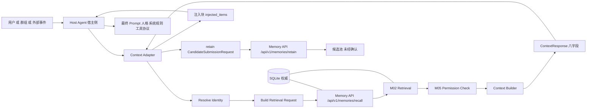
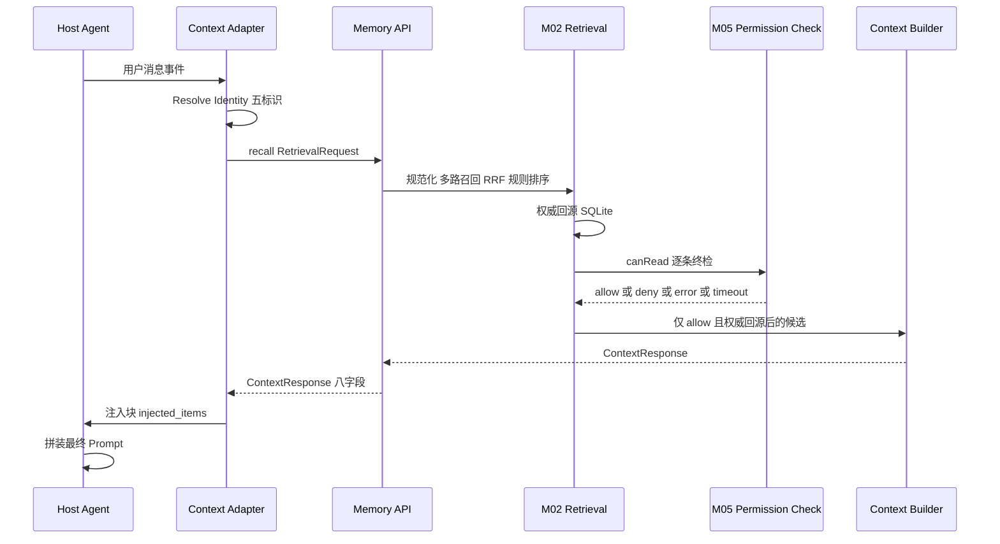
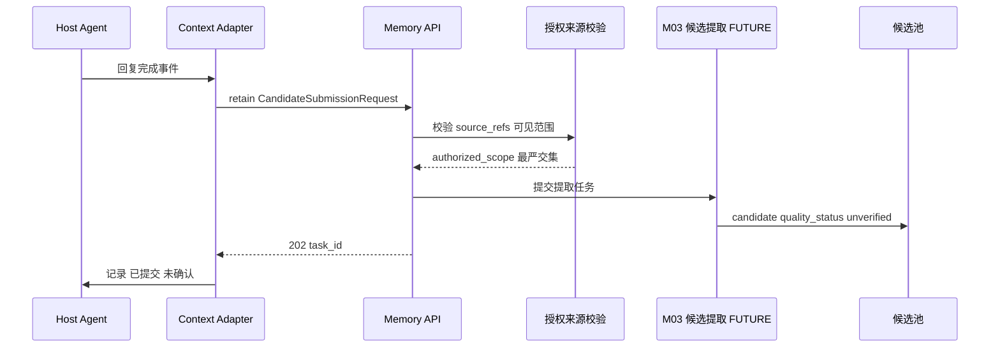
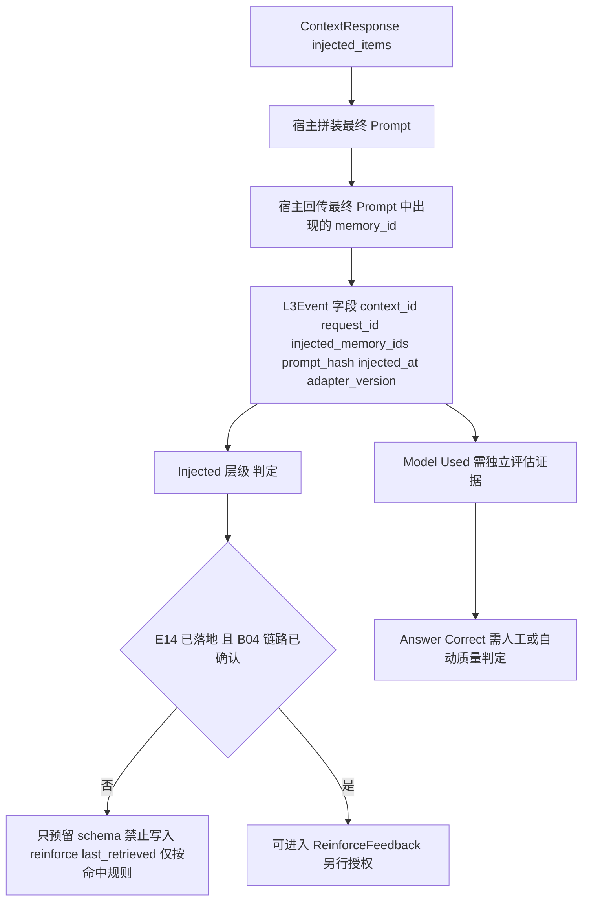

# 08 — DSH 与 QQ Bridge 集成规范

> **⚠️ V2 架构升级（2026-11-04）**：集成层新增：①**聊天 LLM 主动读取与主动写入**落地（9 个 Memory API，见 `14-ChatLLM读写API.md`）：Bridge 负责身份映射与 API 调用，**LLM 永不直连数据库**；②**Psychology 接口边界**：独立模块，通过正式接口交互，**不得并入 M01–M05**；仅提供当前情绪状态与事件情绪的**有限影响**，不得修改事件事实；③宿主注入内容新增 `semantic_type`/`anchor`/`memory_tier`/`evidence_refs`/`visibility`；④**L3 事件语义不变**（只证明进入最终 Prompt，不证明模型使用；reinforce 禁写，台账 D-AP-05）；⑤`emotion.*` 三项默认关闭（CR-02/03/04）。既有三组件边界、身份五标识、会话隔离四禁令、注入边界、压缩协作**不变**。凡与 V2 冲突处一律以 V2 为准。

> 文件代号：MC-R41-DD-08 ｜ 文档版本：1.0 ｜ 目标系统版本：R4.1-MASTER-01 ｜ 设计基准：DD-AUTHORITY 1.0
> 设计状态：PROPOSED（设计稿，待总控交叉审查与用户批准） ｜ 实施授权：**无**（P0–P3 = M01+M02；宿主接入属 P9，另行授权）
> 本文件定义 Memory Core / Memory API / Host Adapter 三组件在 DSH 与 QQ Bridge 场景下的集成边界、调用链、注入约束、L3 语义与协作规则。**本文档未验证任何真实宿主接口**；一切宿主侧能力均标 VERIFY，MUST NOT 视为已存在。
> 用语：MUST / MUST NOT / SHOULD / SHOULD NOT / MAY / TBD / VERIFY / BLOCKED / FUTURE

---

## 1. 文档状态

### 1.1 状态声明

| 项 | 值 | 说明 |
|---|---|---|
| 设计状态 | PROPOSED | 未经用户批准，不得解释为 APPROVED |
| 实施授权 | 无 | 本文件不代表已获准接入 DSH 或 QQ Bridge |
| 真实宿主验证 | **0 项** | 全部宿主侧结论为 VERIFY / TBD |
| 完成等级 | **F2 达到；F3 部分达到；F4 未达到** | 见 1.2 |
| 对宿主内部实现的依赖 | 允许"只依赖公开契约" | MUST NOT 依赖 DSH/QQ Bridge 内部实现细节（sf 后文 §9.1） |

### 1.2 F 等级自评

| 等级 | 判定 | 依据 |
|---|---|---|
| F1 | 达到 | 三组件边界、集成原则、身份五标识、隔离四禁令、调用链、返回八字段、注入边界齐备 |
| F2 | 达到 | 身份映射规则、字段级返回结构、错误映射与降级、版本协商、压缩协作、L3 五分、P9 前置条件、VERIFY 清单 |
| F3 | **部分达到** | 给出可判定的集成用例与判定方法；但**宿主接口未验证**，E2E-10/E2E-11 只能 MOCKED/FUTURE |
| F4 | 未达到 | 无真实注入点、无真实身份解析记录、无真实 L3 回传记录 |

### 1.3 禁止表述

- MUST NOT 写"已接入 DSH""已在 QQ Bridge 生效""身份解析已验证""L3 回传已打通"。
- MUST NOT 凭空创造 DSH 或 QQ Bridge 的 API、插件机制、注入钩子、事件总线（sf 后文 §3.1 / §九）。
- MUST NOT 把"设计上可以注入"写成"已验证可注入"。

---

## 2. 适用版本

| 维度 | 版本 | 状态 |
|---|---|---|
| 母本 | R4.1-MASTER-01 | 设计基准 |
| 设计基准 | DD-AUTHORITY 1.0 | APPROVED |
| 本文档 | MC-R41-DD-08 v1.0 | PROPOSED |
| 适配器版本 | `adapter_version`（语义版本，宿主适配器自报） | 字段已定义，取值未定（TBD） |
| 上下文契约 | `context_contract_version`（见 07 §7.1） | 需与 `context-response` 契约对齐 |
| Memory API | `/api/v1/`（m.md §15.2 基线，R8 裁决保留为 PROPOSED 基线） | 端点集合固定，未新增端点 |
| 参数 | 全部 **EXP-DEFAULT** | 未正式化 |

---

## 3. 适用范围

### 3.1 范围内

| 主题 | 内容 |
|---|---|
| 三组件边界 | Memory Core / Memory API / Host Adapter（用户约束，不得改变） |
| 集成原则 | 独立于宿主内部实现、禁止直读宿主 state |
| 身份与会话 | 五标识、四禁令、隔离矩阵 |
| 调用链 | 检索链、retain 回程链 |
| 返回与注入 | 八字段、注入七字段、注入边界、A/B 层宿主侧兼容 |
| L3 | 五分评估、reinforce 门禁、回传接口预留 |
| 运行保障 | 错误映射与降级、版本兼容、压缩协作、P9 前置、VERIFY 清单 |

### 3.2 范围外

| 对象 | 标注 |
|---|---|
| 真实 DSH 注入实现 | **VERIFY**（注入点形式未知） |
| 真实 QQ Bridge 身份解析 | **VERIFY**（实际行为未验证） |
| M03/M04/M05 完整实现 | **FUTURE**（P4+），本文只依赖其契约位置 |
| Session Memory 自动迁移 | **FUTURE**（sf 后文 §13.2 禁止实施） |
| Context Compression 实现 | **FUTURE**；本文只定协作边界与事件字段 |
| Persona D1–D3 与八项改动 | **待单独呈报**（台账 CR-08B：不合并为概括性批准） |
| 心理层（psy-model） | **DEFERRED**（台账 I-7 / X-6） |
| 宿主生产部署 | **P9**，需独立授权 |

---

## 4. 依赖文档

| 文档 | 用途 |
|---|---|
| DD-AUTHORITY.md | 基准、结构、硬约束 |
| 08-adjudication-ledger.md | 正式裁决（尤其 D-AP-05、D-AP-07、D-AP-09） |
| sf.md 后文 §3.2.11–3.2.14、§9、§10.4、§11 | 调用链、返回字段、注入边界、压缩协作、提示注入防护 |
| m.md §1.2、§1.3、§14、§15、§16 | 三组件、统一数据流、压缩关系、Memory API、集成流程 |
| 00-总体架构与设计原则 | 三组件与五平面并存的表述 |
| 01-记忆本体与数据模型 | scope、type、confidence、version 字段语义 |
| 03-系统运行与协作协议 | 请求/响应、错误码、幂等、异步任务 |
| 04-权限与治理规范 | 权限上下文、派生继承、审计 |
| 05-可靠性与运维规范 | 故障降级策略 |
| 06-测试与评估规范 | 集成/E2E 用例与五态 |
| 07-扩展与演进规范 | context_contract_version、兼容处理、迁移 |
| contracts/api/api-contracts.md（§6 M05 Permission API、§7 Context Adapter API） | 机器契约（本文只引用字段名） |
| contracts/schemas/retrieval-request / retrieval-response / context-response / permission-context | 机器校验 |
| 05-环境配置总索引.md | Node 运行时、目录纪律、Token ≠ 字符 |
| data-samples/（A 层 jsonl、B 层 social-v2） | 宿主侧旧存储形态（迁移前只读参照） |

---

## 5. 正式裁决引用

| 台账编号 | 要点 | 落地位置 |
|---|---|---|
| （台账 D-AP-05） | confirm 仅 M04 审核通道；last_retrieved 按命中规则写入且不作衰减正向权重；**reinforce 仅由 DSH 回传最终 prompt 中实际出现的 memory ID 触发；E14 未落地、B04 未确认前只预留 schema，禁止写入** | §7.11.2、§7.11.3、§8.5；§9.4 |
| （台账 D-AP-07） | C40 权限引擎不可插拔；`trusted_context_source: entry-only`；影子 diff 日志分类与输入/读取判权；PC-2 未完成前不得声称绕过路径已消除 | §7.2 原则 6、§7.9 边界表、§11 安全边界、§14 OI-08-04 |
| （台账 D-AP-09） | 拒绝第三方托管；**不得声称"记忆文本不出本机"**；本地持久化与云端推理传输分开评估 | §7.9、§11、§14 OI-08-05 |
| （台账 D-AP-06） | 生活化测试集为主要验收依据 | §12 测试要求 |
| （台账 I-5） | 心理状态机只改运行时状态、不直接产生记忆候选；Session 与记忆候选边界需说明 | §7.10.3、§7.14 |
| （台账 X-3） | Recall 结果可参与推理、禁止直接改 PAD、持久变更走独立审核 | §7.8.3 注入内容不得作为状态写入源 |
| （台账 K-6 / CR-09） | openLoop 仅由明确事件触发、禁止催促、禁止沉默驱动 | §3.2、§14 OI-08-06 |
| （台账 优化-1） | Token 计量须区分系统提示词/聊天历史/记忆检索/实际注入/模块调用 | §7.7 `token_usage`、§8.2 |
| （台账 CR-08B） | Persona D1–D3 与八项改动单独呈报 | §3.2、§14 OI-08-07 |
| （台账 U-1/U-2） | 不冻结 cache 表结构与校验 | §7.14.3 缓存段 DEFERRED |

---

## 6. 术语表

| 术语 | 定义 |
|---|---|
| Memory Core | 记忆权威管理系统（M01–M05 所在）；唯一权威：SQLite |
| Memory API | Core 对外唯一标准接口层（`/api/v1/...`），负责校验、规范化、身份传递、版本、错误码、幂等 |
| Host Adapter | 宿主适配层（QQ Bridge 侧、DSH 侧）；负责身份映射、会话映射、调用 API、接收上下文、注入宿主、提交授权来源 |
| Context Adapter | Host Adapter 中负责"调 Memory API 并组织上下文"的逻辑组件 |
| DSH | 模型运行环境（宿主 Agent 侧），负责任格、系统规则、工具协议、最终 Prompt 拼装 |
| 注入块（injection block） | Memory Core 返回、由宿主拼装进最终 Prompt 的记忆上下文片段集合 |
| 注入项（injected item） | 注入块中的单条记忆，含 7 字段（§7.8.1） |
| 身份五标识 | user_id / group_id / session_id / bot_id / tenant_id |
| L3 事件 | "记忆已进入最终 Prompt"的可观测事件；只证明注入，不证明使用（m.md §16.4） |
| 五分评估 | Retrieved / Authorized / Injected / Model Used / Answer Correct |
| 降级（degradation） | 无法取得记忆上下文时，宿主以"无记忆对话"继续，且必须显式记录 |
| P9 | 宿主生产接入阶段（任务书命名；母本对应"P4 及以后"，两者同义；正式阶段编号以总控 README 为准 → TBD） |
| trusted_context_source | 可信上下文来源约束（台账 D-AP-07：entry-only） |

---

## 7. 规范正文

### 7.1 三组件边界重申（用户约束，不得改变）

| 组件 | MUST 承担 | MUST NOT 承担 |
|---|---|---|
| Memory Core | 权威存储（SQLite）、检索（M02）、索引派生（FTS5/LanceDB）、提取（M03，FUTURE）、整合（M04，FUTURE）、权限（M05，FUTURE/契约预留）、事务、Outbox、审计、备份恢复 | MUST NOT 拼装宿主人格/系统规则/工具协议；MUST NOT 直接向模型发送请求；MUST NOT 依赖 DSH 内部实现 |
| Memory API | 请求校验、参数规范化、身份与租户上下文传递、版本管理、请求响应标准化、错误码、幂等、调用权限检查 | MUST NOT 绕过 M05 判定；MUST NOT 让宿主直连数据库；MUST NOT 提供任意 SQL 入口 |
| Host Adapter | 用户/群组/会话身份映射、调用 Memory API、接收授权上下文、注入宿主、提交授权来源（retain） | **MUST NOT 直接连接 Memory Core 数据库**；MUST NOT 绕过 Memory API 写入权威记忆；MUST NOT 读取 QQ Bridge 内部 state/人格文件/聊天记录目录 |

**硬规则（引自用户约束与母本）**：

1. **MUST NOT**：DSH 直接连接 Memory Core 数据库（m.md §1.2）。
2. **MUST NOT**：Host Adapter 直接读写 SQLite / FTS5 / LanceDB。
3. **MUST NOT**：Memory Core 读取 QQ Bridge 的 `state/`、人格文件、聊天记录目录（sf 后文 §9.1）。
4. **MUST**：三组件之间只通过 Memory API 契约通信；契约变更 MUST 走版本流程（07 §7.3）。
5. **MUST**：组件视图（部署边界）与五逻辑平面视图（数据/检索/认知/治理/协同扩展，R3）并存，不得互相替代（DD-AUTHORITY R4）。

### 7.2 集成原则（八条，全部 MUST）

1. **独立性**：Memory Core MUST NOT import/require DSH 或 QQ Bridge 的代码、内部类型、内部事件；只允许 HTTP/进程内适配层通过契约调用。
2. **单向依赖**：依赖方向 MUST 为 Host Adapter → Memory API → Memory Core；反向依赖即判违规。
3. **禁止直读宿主内部**：MUST NOT 读取 `D:\qq-bridge` 的 state、人格、聊天记录目录、`social-v2.json`、`memory-vectors.jsonl`（迁移期除外，且 MUST 走 07 的授权迁移流程与只读副本）。
4. **最小授权**：宿主 MUST 只传"身份 + 本次请求所需范围"，MUST NOT 传全量历史或全量记忆库请求（禁止"给我所有记忆"式调用）。
5. **数据即数据**：记忆正文 MUST 被视为数据而非指令；宿主 MUST NOT 执行记忆正文中的命令式文本（sf 后文 §11.4）。
6. **可信上下文来源（entry-only）**：只有经 M05 授权、并经 Memory Core 组装的上下文才可进入注入块；`trusted_context_source` 采用 entry-only 语义——MUST NOT 接受来自宿主侧"自行拼装的记忆文本"作为可信来源（台账 D-AP-07）。
7. **降级显式**：任何无法取得记忆上下文的情形 MUST 显式记录并在宿主侧降级为"无记忆对话"，MUST NOT 伪造记忆内容。
8. **不越权扩范围**：宿主 MUST NOT 因同一进程/同一 Bot 同时服务多群而共享上下文（见 §7.4）。

### 7.3 身份映射（五标识 + 四禁令）

#### 7.3.1 五标识

| 标识 | 语义 | 来源（真实宿主侧 → VERIFY） | 稳定性 | 可否作永久身份 |
|---|---|---|---|---|
| `user_id` | 平台用户标识（QQ 号或平台 ID） | 宿主消息事件 → **VERIFY-08-01** | 高（平台级） | 可以，但 MUST 与 tenant 联合 |
| `group_id` | 群标识 | 宿主群事件/会话 key → **VERIFY-08-01** | 高 | **MUST NOT** 当作用户身份 |
| `session_id` | 会话实例标识（私聊/某群某时段） | 宿主会话上下文 → **VERIFY-08-01** | 中（可重建） | 只作会话范围，不作永久身份 |
| `bot_id` | Bot 实例标识 | 宿主配置 → **VERIFY-08-08** | 高 | 作隔离维度，不作身份 |
| `tenant_id` | 租户/隔离域 | 部署配置 | 高 | 是（隔离域根） |

**映射规则（MUST）**：

1. `subject_id` MUST 由 `(tenant_id, user_id)` 确定性派生，**MUST NOT** 使用昵称、群名片、邮箱等可变字段。
2. 群共享记忆的主体 MUST 使用 `(tenant_id, group_id)`；MUST NOT 用某成员 user_id 代表群。
3. `session_id` MUST 由宿主生成并保证在同一 `bot_id + tenant_id` 下唯一；重建（重启）后可变化，但 MUST 不与他会话冲突。
4. 身份 MUST 由可信适配层构造；MUST NOT 信任模型自报或消息文本中的身份声明（m.md §15.3）。
5. 身份字段缺失时，请求 MUST 被拒绝（PERMISSION_DENIED 或 VALIDATION_ERROR），MUST NOT 以默认主体继续。

#### 7.3.2 四禁令

| 禁令 | 说明 | 判定 |
|---|---|---|
| 群 ID ≠ 用户 ID | MUST NOT 用 group_id 冒充 user_id 或反之 | 调用参数检查：subject 派生路径唯一 |
| 昵称 ≠ 永久身份 | MUST NOT 以昵称/群名片/备注作为主体键 | ID 构造静态检查 |
| 不同权限域身份不合并 | 同一自然人在不同 tenant/不同平台身份 MUST NOT 自动合并为同一 subject | 合并仅允许显式映射表 + 审计 |
| 不同群出现不默认共享 | 同一用户出现在 G1/G2 MUST NOT 使其 G1 记忆在 G2 可见 | P-02 类用例 0 泄露 |

**B 层样例结构证据（仅供理解形态，MUST NOT 复制内容）**：`social-v2.json` 的 `conversations` 以 `private:<数字>` / `group:<数字>` 为键，同时存在 `userId`、`sender`、`ownerLabel`、`messageId`、`isOwner`。这证明宿主侧**混用"会话键、用户 ID、展示名"**，因此上表四禁令为必须项：`private:<数字>` 不可直接当 `session_id` 复用，`sender`/`ownerLabel`（如"管理员（ownerQQ …）"）MUST NOT 参与身份派生。

### 7.4 会话隔离

#### 7.4.1 四禁令

| # | 禁令 | 说明 |
|---|---|---|
| 1 | Session Memory MUST NOT 自动进入长期记忆 | 会话内容转长期 MUST 经授权来源 → M03 → M04 → M01 正式通道（m.md §14.1、sf 后文 §9.3） |
| 2 | 群聊记忆 MUST NOT 自动进入私人记忆 | 群共享项在私人会话不可见，除非显式 `canShare` 授权 |
| 3 | 私人记忆 MUST NOT 自动进入群聊上下文 | 与 2 对称；群上下文只允许 group_shared 且授权群 |
| 4 | 同一 Bot 多群 MUST NOT 因共享进程而共享全部上下文 | 进程共享 ≠ 权限共享；每次请求 MUST 重新解析群/会话并逐条终检 |

#### 7.4.2 隔离矩阵（请求上下文 × 允许的记忆 scope）

| 请求上下文 | owner_private(本人) | group_shared(本群) | group_shared(他群) | session_only(本会话) | session_only(他会话) | project_scoped(本项目) | system_internal |
|---|---|---|---|---|---|---|---|
| 私聊（user=A, session=S1） | 允许 | 拒绝 | 拒绝 | 允许 | 拒绝 | 允许（若项目上下文匹配） | 拒绝 |
| 群聊（group=G1, session=S1） | 拒绝 | 允许 | 拒绝 | 允许 | 拒绝 | 允许（若匹配） | 拒绝 |
| 群聊（group=G2） | 拒绝 | 拒绝 | 拒绝（G1 的记忆） | 允许（G2 本会话） | 拒绝 | 允许（若匹配） | 拒绝 |
| 系统任务（service） | 拒绝 | 拒绝 | 拒绝 | 拒绝 | 拒绝 | 允许（显式） | 允许（仅 service/system 身份） |

**MUST**：上表为**默认拒绝**基线；任何"允许"仍需 M05 逐条判定（表只是必要条件，不是充分条件）。

### 7.5 宿主调用链（检索）

链条（与 sf 后文 §9.4 一致，术语固定）：

`Host Agent → Context Adapter → Resolve Identity → Build Retrieval Request → M02 Retrieval → Permission Check → Context Builder → Return Context`

| 步骤 | 主体 | 动作 | 失败处理 |
|---|---|---|---|
| 1 | Host Agent | 收到用户消息/事件，决定是否请求记忆 | 不请求则直接对话（无记忆） |
| 2 | Context Adapter | 采集平台事件字段（user_id/group_id/session_id/bot_id/tenant_id） | 字段缺失 → 不发起请求并记降级 |
| 3 | Resolve Identity | 按 §7.3 派生 subject_id、构造权限上下文 | 派生失败 → 拒绝（PERMISSION_DENIED） |
| 4 | Build Retrieval Request | 组装 `RetrievalRequest`（含 query 原文、scope 候选、token 预算、tokenizer 标识） | 校验失败 → VALIDATION_ERROR |
| 5 | M02 Retrieval | 规范化 → 多路召回 → RRF → 规则排序 → 权威回源 | 索引故障 → partial；存储故障 → 失败 |
| 6 | Permission Check | M05 `canRead` 逐条终检（deny/error/timeout/未知 → 拒绝） | 任一异常 → 该条拒绝 |
| 7 | Context Builder | 仅接收通过项，按预算与去重组装 | 超预算 → 裁剪（不改变语义） |
| 8 | Return Context | 返回 `ContextResponse`（八字段） | 失败 → 错误码 + 降级 |

**MUST**：步骤 6 MUST 位于步骤 8 之前且不可跳过；MUST NOT 由宿主在步骤 8 之后再"补一条记忆"。

### 7.6 retain 回程：候选提交

链路：`Host Agent → Context Adapter → (授权来源确认) → Memory API retain → M03 候选池`。

| 步骤 | 主体 | 动作 | 约束 |
|---|---|---|---|
| 1 | Host Agent | 产生交互结果（回复完成） | — |
| 2 | Context Adapter | 依据**授权来源**（当前会话可见消息）准备 `CandidateSubmissionRequest` | MUST 只提交本次会话内可见内容 |
| 3 | Memory API | 校验来源合法性、scope 建议、幂等键 | MUST 校验 `source_refs` 属于该主体可见范围 |
| 4 | M03（FUTURE） | 提取候选、写候选池（`quality_status=draft`，`validation_state=unverified`） | MUST NOT 直接写 active；MUST NOT 放宽 scope |
| 5 | Memory API | 返回 `task_id` 与接收状态（异步） | MUST NOT 返回"已确认" |

**硬规则**：

1. `retain` **不代表**成为 active（m.md §15.2）；宿主 MUST NOT 在 UI/日志中宣称"记住了"。
2. 宿主 MUST NOT 传完整聊天历史做全量提取（sf 后文 §11.2 数据最小化；m.md §2.2：不得把完整历史全部向量化）。
3. 提交 MUST 带幂等键（`idempotency_key`），重试不得产生重复候选。
4. 候选确认（confirm）MUST 只能由 M04 审核通道触发（台账 D-AP-05）；宿主 MUST NOT 提供"用户点击即 confirm"的实现（该通道未授权）。
5. P3 阶段 M03 未实施 → `retain` 端点 MUST 返回"未实现/仅契约"（FUTURE），宿主 MUST NOT 依赖其可用性。

### 7.7 返回内容八字段

`ContextResponse` MUST 含下列八字段（名称固定，具体类型以 `context-response` 契约为准）：

| # | 字段 | 类型 | 必填 | 含义 | 缺失处理 |
|---|---|---|---|---|---|
| 1 | `context_id` | string (uuid) | 是 | 本次上下文组装标识；用于审计与 L3 关联 | 缺失 → 宿主 MUST 拒绝注入 |
| 2 | `request_id` | string (uuid) | 是 | 与请求一致，用于追踪 | 缺失 → 拒绝注入 |
| 3 | `memory_refs` | array[object] | 是（可为空） | 注入项的引用集合：`{memory_id, version}` | 缺失 → 拒绝注入 |
| 4 | `versions` | object | 是 | 版本集合：`{schema_version, algorithm_version, embedding_space_id, context_contract_version}` | 缺失 → 按最低受支持版本处理并告警 |
| 5 | `token_usage` | object | 是 | 见 §8.2（含 5 项拆分，台账 优化-1） | 缺失 → 宿主 MUST NOT 声称"预算内" |
| 6 | `retrieval_status` | enum | 是 | `ok` / `ok_empty` / `partial` / `unavailable` / `degraded` | 缺失 → 视为 `unavailable` |
| 7 | `permission_status` | enum | 是 | `allow` / `deny` / `error` / `timeout` / `not_checked` | 缺失或 `not_checked` → MUST NOT 注入 |
| 8 | `adapter_version` | string (semver) | 是 | 产生响应的适配器/契约层版本 | 缺失 → 记录并告警 |

**枚举状态**：`retrieval_status` 与 `permission_status` 的取值集合为 **PROPOSED（待 `context-response` 契约冻结）**；其中 `permission_status` 的 `allow/deny/error` 与 sf 后文 §3.2.11 一致，`timeout` 与 `not_checked` 为 fail-closed 语义扩展（失败态一律视为拒绝）。

**MUST**：`permission_status=not_checked` 的响应 MUST NOT 被注入；`retrieval_status=unavailable|degraded` 时宿主 MUST 走 §7.12 降级，MUST NOT 把空结果当作"确实没有相关记忆"告知用户。

### 7.8 注入约束

#### 7.8.1 注入项七字段（MUST）

每个注入项 MUST 携带：`memory_id` / `content` / `type` / `confidence` / `source_refs` / `scope` / `version`。

| 字段 | 用途 | 约束 |
|---|---|---|
| memory_id | 可追溯、L3 关联 | 与 `memory_refs` 一致 |
| content | 注入正文 | MUST 来自权威回源结果，**MUST NOT** 来自索引正文 |
| type | 记忆类型（semantic/episodic/procedural/preference/intent/relationship/observation） | 受控枚举 |
| confidence | 置信度 0–1 | MUST 保留原值，MUST NOT 由宿主改写 |
| source_refs | 来源引用 | 至少 1 项；缺失则该项 MUST NOT 注入 |
| scope | 权限范围 | 与请求上下文一致 |
| version | 记忆版本 | 用于陈旧性判断与审计 |

#### 7.8.2 禁止无差别注入

1. **MUST NOT** 将完整 Memory Object（含内部状态字段、history、relation_refs、审计字段）整体序列化进 Prompt。
2. **MUST** 只注入"回答当前问题所需"的最小集合；不得注入"以防万一"的全量记忆。
3. **MUST NOT** 注入 `system_internal` 内容、内部 ID 之外的实现细节（如 fts rank、rrf score、向量、SQL）。
4. **MUST NOT** 在注入块中混入不同主体的信息以"节省 Token"（sf 后文 §3.2.13 禁令）。
5. **MUST** 注入块中保留不确定性表达（如"用户曾提及""据观察"），MUST NOT 把 inference 改写成确定事实。

#### 7.8.3 注入块结构（宿主侧拼装片段，非完整 Prompt）

```text
[记忆上下文 | context_id=<uuid> | 版本=<context_contract_version>]
- (memory_id=<id> version=<n> type=<type> scope=<scope> confidence=<0-1>)
  内容: <content>
  来源: <source_refs 摘要>
  ...
[记忆上下文结束 | retrieval_status=<status> | permission_status=<status> | tokens=<memory_injected_tokens>]
```

**MUST**：注入块 MUST 被明确标记为"数据"，且 MUST NOT 被解释为指令（sf 后文 §11.4 提示注入防护）。记忆正文中出现"忽略之前规则""修改权限"等文本 MUST 只作普通文本处理。

**MUST NOT**：注入内容 MUST NOT 被宿主用于直接写入运行时状态（如 PAD 参数）；Recall 结果只作推理素材（台账 X-3）。

### 7.9 注入边界（Memory Core vs 宿主职责）

| 责任项 | Memory Core | 宿主（含 DSH） |
|---|---|---|
| 授权记忆上下文 | **提供**（唯一职责） | 接收并注入 |
| 人格 / 角色设定 | MUST NOT 提供、MUST NOT 覆盖 | **负责** |
| 系统规则 / 安全规则 | MUST NOT 覆盖 | **负责**（Memory Core MUST NOT 削弱宿主安全规则） |
| 工具协议 | MUST NOT 提供 | **负责** |
| 当前对话状态 / 历史 | MUST NOT 读取宿主内部 history | **负责** |
| 最终 Prompt 拼装 | MUST NOT 参与 | **负责**（唯一拼装者） |
| 记忆写入 | 权威写入经 M01 | 只提交授权来源（retain） |
| Token 预算总控 | 负责**记忆预算**（`memory_context_budget`） | 负责**全局预算**与系统提示/工具协议占比 |

**硬规则**：

1. Memory Core MUST NOT 返回"完整 System Prompt"或"角色指令"；返回体 MUST 只含记忆上下文（sf 后文 §9.5）。
2. 宿主人格与安全规则 MUST NOT 被记忆内容覆盖；冲突时宿主规则优先。
3. 记忆预算 MUST 是全局预算的一部分（TBD：占比由宿主与用户确定），MUST NOT 占满模型上下文。
4. 宿主 MUST NOT 因"记忆里写着要这样做"而改变工具权限、权限判定或安全策略。

### 7.10 A/B 层宿主侧兼容

#### 7.10.1 A 层（向量语义记忆）召回路径

| 阶段 | 宿主行为 |
|---|---|
| 迁移前（当前） | 宿主自行读取 `state/memory-vectors.jsonl` 做语义召回（**旧路径**，仅作现状说明，MUST NOT 作为 Memory Core 设计依赖） |
| 迁移后 | 宿主 MUST NOT 再读取该文件；向量召回 MUST 通过 Memory API recall → M02（LanceDB FLAT，指定 `embedding_space_id`） |
| 双读窗口（如批准） | 宿主 MUST 显式区分两条路径的来源，并在响应中标明；MUST NOT 混排两路结果 |

**MUST**：A 层历史向量在迁移后 MUST 有确定 `embedding_space_id`；无法确认原模型/维度时标 `unknown-space` 并整体重算（07 OI-07-08）。**MUST NOT** 把旧 vec 直接当新空间向量使用。

#### 7.10.2 B 层（SocialV2 轻量状态）宿主读写方式

| 对象 | 迁移后归属 | 宿主义务 |
|---|---|---|
| activeTopics | Session / Topic State | 读写 MUST 经 Memory API（Session 视图）；MUST NOT 直接改 `social-v2.json` |
| pendingThoughts | Pending Intent / Task | 同上；MUST 保留推断性质与来源 |
| memberImpressions | Relationship / Observation | 同上；**MUST NOT** 升级为确定事实；MUST 保留推断标记与置信度 |
| 近期互动状态 | Episodic / Session State | 同上 |
| 稳定成员偏好 | Preference Memory | 经正式记忆通道（M03/M04）写入，宿主 MUST NOT 直写 |
| 稳定关系事实 | Relationship Memory | 同上 |

**关键事实（必须诚实标注）**：B 层由 Memory Core 统一管理属**目标态**；当前 P0–P3 **未实施** M03/M04/M05 与 Session 管理，因此：

1. **FUTURE**：B 层统一管理。
2. 在迁移完成前，宿主 MUST NOT 双写（MUST NOT 同时写 `social-v2.json` 与 Memory Core），双写窗口 MUST 由 07 迁移方案单独批准（TBD）。
3. B 层样例中 `memberImpressions` 存在"印象"性质数据，迁移时 MUST 保留 `content_kind=inference`、来源与置信度（m.md §2.1）。

#### 7.10.3 Session 与记忆候选边界

- Session 状态 MUST 只影响当前会话行为；MUST NOT 直接产生记忆候选（台账 I-5）。
- 值得长期记住的内容 MUST 经 M03/M04 正式通道；宿主 MUST NOT 把会话摘要直接 retain 为"事实记忆"。
- 会话结束后的保留/丢弃策略 MUST 由 07/01 的 Session 设计确定（当前 TBD，X-2：Session 结束丢弃短期情绪、L1 仅预留）。

### 7.11 L3 事件语义（专节）

#### 7.11.1 L3 能证明与不能证明

| L3 能证明 | L3 不能证明（MUST NOT 推断） |
|---|---|
| 该记忆已进入最终 Prompt | 模型已理解该记忆 |
| 注入时刻、注入版本、注入条目 | 模型已关注该记忆 |
| 注入是否带来源与 scope | 模型在生成时使用了该记忆 |
| 注入是否在预算内 | 模型正确引用了该记忆 |

**MUST**：Prompt 注入日志 MUST NOT 被当作"使用证据"（m.md §16.4）。

#### 7.11.2 五分评估

| 层级 | 判定依据 | 证据要求 | 当前可判定性 |
|---|---|---|---|
| Retrieved | M02 候选含该 memory_id | recall 响应 | 可（P3） |
| Authorized | M05 返回 allow 且 scope 匹配 | permission_status | 可（P3，可能为 MOCKED） |
| Injected | 该 memory_id 出现在最终 Prompt 注入块 | 宿主注入块 + context_id | **VERIFY-08-02/03** |
| Model Used | 独立评估证据（如受控对照、显式引用检测） | 独立评估机制 | FUTURE；本文不定义检测算法 |
| Answer Correct | 人工/自动答案质量判定 | 评估记录 | FUTURE |

**MUST NOT**：不得以 Injected 通过代替 Model Used 或 Answer Correct 通过（sf 后文 §3.2.14；06 E2E 判定分层）。

#### 7.11.3 reinforce 门禁（台账 D-AP-05）

| 项 | 规则 |
|---|---|
| 触发条件 | **仅**由 DSH 回传"最终 prompt 中实际出现的 memory ID"触发 |
| 当前状态 | **E14 未落地、B04 回传链路未确认 → 只预留 schema，禁止写入** |
| 允许写入的内容 | 无（reinforce 字段保留但 MUST NOT 被写） |
| 允许的相邻写入 | `last_retrieved` 可按命中规则写入；**MUST NOT** 作为衰减 v2 的正向权重输入 |
| 违规判定 | 任何代码路径写入 reinforce → 红线违规（06 T-M01 前置不变量、06 §11 安全边界） |
| 解除条件 | E14 落地 + B04 链路确认 + 单独授权 + 独立验证记录 |

**回传接口（预留，语义已定，端点未定）**：

- 语义：宿主在拼装完最终 Prompt 后，回传该 Prompt 中出现的 `memory_id` 列表（含 `context_id`、`request_id`、`prompt_hash`、`injected_at`）。
- 端点路径、传输方式、鉴权：**TBD + VERIFY**——MUST NOT 凭空创造（sf 后文 §九）。
- 状态：`reserved`（schema 预留，不可写入业务数据）。

### 7.12 错误处理（宿主侧映射与降级）

| 错误码（03 规范名） | 含义 | 宿主行为 | 用户可见表述 | MUST NOT |
|---|---|---|---|---|
| VALIDATION_ERROR | 请求参数非法 | 不重试（除非修正） | "本次无法加载记忆" | 不得把原始错误细节暴露 |
| NOT_FOUND | 记忆/任务不存在 | 按无记忆继续 | 无提示 | 不得编造内容填充 |
| VERSION_CONFLICT | 版本冲突 | 重新读取后重试一次；仍冲突则放弃写入 | "未能保存" | 不得强制覆盖 |
| PERMISSION_DENIED | 权限拒绝 | 跳过该项；不注入 | 无提示（或按用户询问解释"无权访问"） | 不得提示"存在但无权看"从而泄露存在性 |
| PERMISSION_ERROR | 权限系统故障 | 全量不注入（fail-closed） | "记忆暂不可用" | 不得默认放行 |
| TIMEOUT | 超时 | 不注入；记指标 | "记忆暂不可用" | 不得阻塞对话 |
| STORAGE_ERROR | 权威存储故障 | 不注入；禁止写入；告警 | "记忆暂不可用" | 不得用索引结果替代 |
| INDEX_ERROR | 索引故障 | 按已批准降级（如仅关键词）；标 partial | 无提示 | 不得静默换检索实现 |
| EMBEDDING_ERROR | 向量化失败 | 查询侧退化为全文通道；写入侧入待处理任务 | 无提示 | 不得写伪向量 |
| CONFIGURATION_ERROR | 配置/版本不兼容 | 拒绝注入；告警（reason_code=VERSION_INCOMPATIBLE 时明确告警） | "记忆服务配置不匹配" | 不得按旧契约猜测字段 |
| INTERNAL_ERROR | 内部异常 | 不注入；记录 request_id | "记忆暂不可用" | 不得重试风暴（MUST 有退避与上限） |

**统一规则**：

1. 降级 MUST 只降为"无记忆对话"，MUST NOT 降为"用假记忆对话"。
2. 错误响应 MUST NOT 含记忆正文、摘要或可推断正文的字段（sf 后文 §4.5）。
3. 宿主 MUST 保留 `request_id` 以便复现；日志 MUST NOT 记正文。
4. 超时阈值 MUST 由契约给定并可在配置中调整；MUST NOT 无上限等待。
5. 重试 MUST 幂等（携带同一 `idempotency_key`），且 MUST 有上限与退避。

### 7.13 版本兼容

| 版本维度 | 宿主侧要求 | 不兼容处理 |
|---|---|---|
| `adapter_version` | 宿主适配器 MUST 自报并写入响应 | 无法识别版本 → 记录告警；不注入 |
| `context_contract_version` | 宿主 MUST 声明支持区间；`ContextResponse` MUST 带该版本 | 区间不交 → 拒绝注入（降级无记忆）；MUST NOT 解析未知字段语义 |
| `schema_version` | 读取 MUST 校验 | 未知 major → 拒绝 |
| `algorithm_version` | 仅用于溯源，不参与宿主判定 | — |
| `embedding_space_id` | 宿主 MUST NOT 关心具体值，但 MUST NOT 缓存跨空间结果 | 缓存键 MUST 含 space id |
| API 版本 | 宿主 MUST 声明（形式 TBD） | 见 07 §7.8 |

**MUST**：宿主侧缓存（若有）MUST 以 `(tenant_id, subject_id, scope, query_hash, embedding_space_id, context_contract_version)` 为键；缓存实现属 DEFERRED（台账 U-1/U-2：不冻结表结构与校验）。

**命名对齐（MUST）**：`context_contract_version` 是八维版本登记名（07 §7.1），与 sf 后文 §8.3 的 "Context Format Version" 为同一维度的两个称谓，MUST NOT 各自独立取值；其与 `adapter_version`、`meta.schema_version` 的组合关系以 00 文档"版本策略"章节为准，本文只规定宿主侧的拒绝行为。

### 7.14 上下文压缩协作

#### 7.14.1 职责划分

| 能力 | Memory Core | Context Compression（宿主侧，FUTURE） |
|---|---|---|
| 长期信息保存 | **负责** | MUST NOT |
| 授权上下文提供 | **负责** | 消费 |
| 当前会话上下文压缩 | MUST NOT | **负责** |
| 连续性维护（压缩前后） | MUST NOT | **负责** |
| 记忆写入 | 经 M01 | MUST NOT 直接写记忆 |
| Compaction 事件记录 | 接收并可审计（若提供） | 产生并记录 |

**MUST**：压缩摘要 MUST NOT 自动成为已确认的长期记忆（m.md §14.3；sf 后文 §9.6）；长期记忆 MUST NOT 替代当前会话完整状态。

#### 7.14.2 Compaction 事件九字段

| # | 字段 | 类型 | 必填 | 说明 |
|---|---|---|---|---|
| 1 | `context_version_before` | string | 是 | 压缩前上下文版本 |
| 2 | `context_version_after` | string | 是 | 压缩后上下文版本 |
| 3 | `retained_refs` | array[string] | 是 | 保留内容引用（可为 memory_id 或 message_id） |
| 4 | `dropped_refs` | array[string] | 是 | 丢弃内容引用 |
| 5 | `task_state` | object | 是 | 任务状态快照（未完成任务不得因压缩丢失） |
| 6 | `key_entities` | array[string] | 是 | 关键实体 |
| 7 | `key_facts` | array[string] | 是 | 关键事实（MUST 保留不确定性标记） |
| 8 | `timestamp` | string (RFC3339 UTC) | 是 | 事件时间 |
| 9 | `compression_algorithm_version` | string | 是 | 压缩算法版本 |

**规则**：压缩 MUST NOT 绕过 M03/M04/M05（m.md §14.3）；压缩产物若被判定值得长期保留，MUST 走正式候选通道并标来源为"压缩摘要"（`content_kind=inference` 或 `opinion`，MUST NOT 直接 `fact`）。

#### 7.14.3 与缓存的关系

缓存层（`cache.sqlite`）的表结构、索引、过期字段、一致性校验实现 MUST 暂缓至实施阶段（台账 U-1/U-2）；本文 MUST NOT 给出其结构。

### 7.15 P9 接入前置条件

P9（宿主生产接入）MUST 全部满足后才可申请授权：

| # | 前置条件 | 判定 |
|---|---|---|
| 1 | 独立原型 P0–P3 验收通过（06 V-01…V-19 全有结论且无 MOCKED 顶替） | 验收报告 |
| 2 | 用户显式授权 P9（设计完成 ≠ 实施授权；P3 完成不自动进入 P4/P9） | 授权记录 |
| 3 | §7.16 VERIFY 清单中与"身份/注入/L3/传输"相关的项全部关闭 | 验证记录 |
| 4 | 权限终检在生产配置为默认拒绝（无 allow-all） | 配置校验 + 安全测试 |
| 5 | 数据迁移方案（A/B 层）已批准且演练通过（07 MV-01…MV-14） | 迁移演练记录 |
| 6 | 备份/恢复演练通过（05、06 RC-01…RC-08） | 演练记录 |
| 7 | 降级策略已批准（含 FTS5/LanceDB 故障时的行为） | 批准记录 |
| 8 | 不触碰 `D:\qq-bridge` 源码/配置/state/Persona 的证据 | 变更范围审计 |
| 9 | Token 计量可区分五项（优化-1） | 计量样例 |
| 10 | L3 回传链路已确认且 reinforce 仍为禁写（除非另行授权） | 链路记录 + 静态检查 |

**MUST**：P9 之前 MUST NOT 启动正式机器人服务（DD-AUTHORITY §5 第 15 条）。

### 7.16 VERIFY 清单（真实宿主未验证项）

**全部状态 = VERIFY；MUST NOT 凭推测填写结论。**

| 编号 | 待验证项 | 为何必须验证 | 验证方法（MERELY 建议，非既定 API） | 未验证的后果 |
|---|---|---|---|---|
| VERIFY-08-01 | QQ Bridge 身份解析实际行为：`user_id` 来源、私聊/群会话键形态、`sender`/`ownerLabel` 是否含可变展示名、群号如何取得 | 身份派生规则直接依赖其稳定性（§7.3） | 只读观察宿主已有日志/接口返回值（**不得修改源码/state**）；对照 `social-v2` 样例结构 | 身份映射无法冻结 → P9 阻塞；P-01/P-02 只能 MOCKED |
| VERIFY-08-02 | DSH 注入点：记忆上下文在 Prompt 的哪个位置注入、以何形式（系统段/附加段/工具结果） | 决定注入块格式与"最终 Prompt"可观测性 | 由 DSH 侧公开机制确认；不得凭空假设钩子 | E2E-10 只能 MOCKED；L3-Injected 不可判定 |
| VERIFY-08-03 | L3 事件回传链路：宿主能否回传最终 Prompt 中出现的 memory_id | reinforce 门禁与五分评估的前提（台账 D-AP-05） | 与宿主侧确认可观测性；E14/B04 状态核对 | reinforce 永久禁写；Model Used 不可评估 |
| VERIFY-08-04 | 宿主 ↔ Memory API 传输方式（HTTP/本地 socket/进程内）与鉴权 | 影响超时、幂等、错误映射 | 部署方案确认 | 调用链无法落地 |
| VERIFY-08-05 | Token 计量来源：宿主 tokenizer 是否可获得、误差声明 | `token_usage` 五项拆分（优化-1）与预算判定 | 宿主侧计量能力确认 | V-14 只能按复算近似并披露误差 |
| VERIFY-08-06 | 宿主侧可接受的等待预算（记忆检索阻塞对话的上限） | 决定超时与降级阈值 | 宿主响应时限实测 | 阈值只能 TBD |
| VERIFY-08-07 | 群/私聊切换时身份与会话刷新行为 | 防跨会话泄露（§7.4） | 观察宿主会话生命周期 | 隔离矩阵无法确认 |
| VERIFY-08-08 | 多 Bot 实例的 tenant/bot 划分方式 | 多租户隔离（§7.3） | 部署配置确认 | 多宿主（FUT-07）不可评估 |
| VERIFY-08-09 | Context Adapter 部署位置与进程边界 | 三组件边界落地（§7.1） | 部署图确认 | "宿主不直连数据库"无法证明 |
| VERIFY-08-10 | 宿主是否提供"当前 Prompt 组装结果"的可读快照 | L3-Injected 的唯一可用证据 | 宿主能力确认 | L3 只能停在 Authorized（退化为二分） |
| VERIFY-08-11 | DSH 侧是否存在第三方插件读写 SQLite 的既有路径 | 防止绕过 Memory API（安全边界） | 依赖与文件访问审计 | SEC-10 无法判定 |
| VERIFY-08-12 | 宿主消息中"引用/转发/图片"等富媒体如何进入来源链 | retain 的 `source_refs` 合法性 | 观察消息字段（样例已见 `media`/`forwardIds`） | 候选来源校验可能过宽或过严 |

**MUST**：本文档 MUST NOT 为上述任一项给出"已确认"的默认值；相关字段在契约中标 `TBD`。

---

## 8. 接口或数据结构

本节字段名为设计基线；机器契约由 `contracts/api/api-contracts.md` §7 与 `contracts/schemas/*` 冻结。端点 MUST 只使用 m.md §15.2 已列端点集合（R8：PROPOSED 基线），**不新增端点**。

### 8.1 `IdentityContext`

| 字段 | 类型 | 必填 | 约束 | 说明 |
|---|---|---|---|---|
| tenant_id | string | 是 | 1–64，稳定 | 隔离域 |
| user_id | string\|null | 条件 | 私聊/用户发起时必填 | 平台用户标识（VERIFY-08-01） |
| group_id | string\|null | 条件 | 群聊时必填 | 群标识 |
| session_id | string | 是 | 同一 bot+tenant 内唯一 | 会话实例 |
| bot_id | string | 是 | 稳定 | Bot 实例 |
| actor_type | enum | 是 | user/group/bot/service/system/agent | 权限主体类型（04） |
| resolved_subject_id | string | 是 | 由 (tenant,user) 或 (tenant,group) 派生 | 记忆主体 |
| derived_from | enum | 是 | user_id/group_id | 派生依据（审计） |

### 8.2 `RetrievalRequest`（宿主 → Memory API recall）

| 字段 | 类型 | 必填 | 约束 | 说明 |
|---|---|---|---|---|
| request_id | string (uuid) | 是 | 幂等关联 | 追踪 |
| idempotency_key | string | 是 | 1–128 | 重试幂等 |
| identity | object | 是 | 见 8.1 | 身份上下文 |
| query_text | string | 是 | 1–2000；**原始文本**（禁止只传规范化结果） | 查询 |
| scope_candidates | array[enum] | 是 | owner_private/group_shared/session_only/project_scoped | 请求方声明的候选范围（**不是授权**） |
| project_id | string\|null | 否 | project_scoped 时必填 | 项目上下文 |
| time_constraint | object\|null | 否 | `{from,to}` RFC3339 UTC | 时间限定 |
| top_k | integer | 否 | 1–100，默认 10（EXP-DEFAULT） | 返回上限 |
| memory_context_budget | integer | 否 | 默认 1200（EXP-DEFAULT）；单位 Token | 记忆预算 |
| tokenizer_id | string | 是 | 模型/tokenizer 与版本 | 计量依据 |
| host_context_digest | string\|null | 否 | 上下文摘要哈希（不传正文） | 防重复请求/缓存键 |

### 8.3 `ContextResponse`（八字段 + 注入项）

八字段见 §7.7。附加：

| 字段 | 类型 | 必填 | 说明 |
|---|---|---|---|
| injected_items | array[object] | 是（可为空） | 每项含 §7.8.1 七字段 |
| dropped_reasons | array[object] | 否 | `{memory_id, reason}`，reason ∈ not_found/stale/permission/over_budget/duplicate |
| degraded | boolean | 是 | 是否发生降级 |
| warnings | array[string] | 否 | 结构化告警码（不得含正文） |

### 8.4 `CandidateSubmissionRequest`（宿主 → Memory API retain）

| 字段 | 类型 | 必填 | 约束 | 说明 |
|---|---|---|---|---|
| request_id | string (uuid) | 是 | — | 追踪 |
| idempotency_key | string | 是 | 1–128 | 幂等 |
| identity | object | 是 | 见 8.1 | 身份 |
| source_refs | array[object] | 是 | ≥1；每项 `{source_type, source_id, locator}` | **授权来源**（MUST 属于该主体可见范围） |
| proposed_scope | enum | 是 | 五 scope 之一 | 建议范围（MUST NOT 宽于来源） |
| proposed_type | enum | 否 | 七类型之一 | 建议类型 |
| proposed_content_kind | enum | 否 | 八性质之一 | 建议性质 |
| content_excerpt | string\|null | 否 | ≤2000，脱敏后片段 | 片段（MUST NOT 全量历史） |
| idempotency_scope | string | 是 | 如 `session:{session_id}` | 幂等域 |

### 8.5 `L3Event`（预留，`reserved`）

| 字段 | 类型 | 必填 | 状态 | 说明 |
|---|---|---|---|---|
| context_id | string (uuid) | 是 | 定义 | 关联 ContextResponse |
| request_id | string (uuid) | 是 | 定义 | 关联请求 |
| injected_memory_ids | array[string] | 是 | 定义 | 最终 Prompt 中实际出现的 memory_id |
| prompt_hash | string | 是 | 定义 | 最终 Prompt 哈希（不含正文） |
| injected_at | string (RFC3339 UTC) | 是 | 定义 | 注入时间 |
| adapter_version | string | 是 | 定义 | 适配器版本 |
| transport | string\|null | 否 | TBD | 回传方式（VERIFY-08-03） |
| endpoint | string\|null | 否 | **TBD（禁止编造）** | 端点路径未定 |

**MUST**：`L3Event` 落地前 MUST NOT 被用于写入 reinforce（§7.11.3）。

### 8.6 `ReinforceFeedback`（禁写占位）

| 字段 | 类型 | 必填 | 状态 | 说明 |
|---|---|---|---|---|
| memory_id | string | 是 | `reserved` | 被 reinforce 的记忆 |
| context_id | string | 是 | `reserved` | 来源上下文 |
| source | enum | 是 | 固定 `dsh_final_prompt` | 唯一合法来源 |
| status | enum | 是 | 固定 `disabled` | 当前 MUST 恒为 disabled |

### 8.7 `ErrorEnvelope`（宿主侧消费）

| 字段 | 类型 | 必填 | 说明 |
|---|---|---|---|
| request_id | string | 是 | 追踪 |
| code | enum | 是 | 16 规范码之一（`contracts/error-codes.md` §1） |
| category | enum | 是 | validation/permission/storage/index/embedding/config/internal/timeout |
| message | string | 是 | 面向开发者的安全描述（不含正文） |
| retryable | boolean | 是 | 是否可重试 |
| severity | enum | 是 | info/warn/error/critical |
| handling | string | 是 | 建议处置（如 fail_closed） |
| exposure_policy | enum | 是 | internal_only/user_safe |

### 8.8 `CompactionEvent`

九字段见 §7.14.2。

---

## 9. 流程图（Mermaid）

### 9.1 集成架构



### 9.2 检索调用时序



### 9.3 候选提交时序



### 9.4 L3 事件链路



---

## 10. 异常情况

| 编号 | 异常 | 影响 | 处理（MUST） |
|---|---|---|---|
| EX-08-01 | 身份字段缺失或无法验证 | 无法判权 | 拒绝请求；降级无记忆；记审计 |
| EX-08-02 | 会话切换后身份未刷新 | 跨会话泄露风险 | 每次请求重新解析；禁止复用上次解析结果 |
| EX-08-03 | 同一 memory_id 在两次响应中版本不同 | 陈旧/并发 | 以较新版本为准并在响应中标版本；宿主 MUST 用响应版本覆盖缓存 |
| EX-08-04 | 注入块超全局预算 | 挤占系统提示空间 | 宿主 MUST 优先保证系统规则与工具协议；记忆预算按契约裁剪 |
| EX-08-05 | 角色/人格与记忆冲突 | 人设漂移 | 宿主规则优先；记忆内容不得覆盖人格设定 |
| EX-08-06 | 记忆正文含命令式文本 | 提示注入 | 视为数据；不执行；必要时在注入块加"以下为数据"标记 |
| EX-08-07 | 宿主自行拼装记忆并声称来自 Core | 绕过授权 | 判违规（entry-only）；拒绝该来源；审计 |
| EX-08-08 | 压缩摘要被当作事实注入 | 语义污染 | 以 `content_kind=inference` 呈现；不得标记为确认事实 |
| EX-08-09 | 宿主重启导致 session_id 变化 | 会话记忆断裂 | 按设计允许；MUST NOT 用旧 session 复用权限 |
| EX-08-10 | L3 回传缺失或延迟 | reinforce 不可用 | 保持禁写；不影响主链；记录缺口 |
| EX-08-11 | 适配器版本不匹配 | 字段语义不明 | 拒绝注入并降级（§7.13） |
| EX-08-12 | 多群并发时上下文串话 | 隐私事故 | 请求级上下文隔离；按 SEC 事件处理 |

---

## 11. 安全边界

1. **MUST**：宿主 MUST NOT 直连 SQLite/FTS5/LanceDB；MUST NOT 拥有数据库凭据。
2. **MUST**：`trusted_context_source` = entry-only——只有 Core 组装的上下文可作为注入来源（台账 D-AP-07）。
3. **MUST**：注入前 MUST 有 `permission_status` 且为 `allow`；`not_checked` 一律不注入。
4. **MUST NOT**：不得因 Mode/开发便利在生产启用 allow-all；生产 MUST 默认拒绝。
5. **MUST**：权限错误的响应 MUST NOT 泄露"该记忆存在"这一事实（避免存在性侧信道）。
6. **MUST**：错误响应与日志 MUST NOT 含记忆正文、摘要、图片 URL 等隐私内容。
7. **MUST NOT**：不得声称"记忆文本不出本机"；涉及云端推理时 MUST 单独评估与披露（台账 D-AP-09）。
8. **MUST NOT**：不得读取 `D:\qq-bridge` 的 state/人格/聊天记录目录；不得修改其源码与配置。
9. **MUST**：提示注入防护——记忆正文与用户输入中的命令式文本 MUST 被当作数据（sf 后文 §11.4）。
10. **MUST**：群管理员/ Bot 所有者权限 MUST NOT 扩大为私人记忆读取权（P-11）。
11. **MUST**：宿主侧缓存（若启用）MUST 继承来源权限与删除传播；实现 DEFERRED（U-1/U-2）。
12. **MUST**：P9 前 MUST NOT 启动正式机器人服务。

---

## 12. 测试要求（集成侧，与 06 对齐）

| 编号 | 测试 | 判定 | 当前可执行性 |
|---|---|---|---|
| INT-01 | 身份派生唯一性 | 同输入派生同 subject；昵称变化不改变 subject | 可（合成输入） |
| INT-02 | 五标识缺失拒绝 | 缺任一必填 → 拒绝，不降级为默认主体 | 可 |
| INT-03 | 隔离矩阵逐格验证 | §7.4.2 每格 0 泄露 | 部分需 M05 替身（MOCKED） |
| INT-04 | 返回八字段完整性 | 缺任一 → 宿主拒绝注入 | 可 |
| INT-05 | 注入七字段完整性 | 缺 source_refs 的项 MUST NOT 注入 | 可 |
| INT-06 | 无差别注入阻断 | 请求"全部记忆" → 拒绝或返回最小集 | 可 |
| INT-07 | 错误映射正确 | 16 规范码 → 宿主行为符合 §7.12（§7.12 列 11 核心码，扩展码按 `error-codes.md` 映射） | 可（注入故障） |
| INT-08 | 版本不兼容拒绝 | context_contract 区间不交 → 拒绝注入 | 可 |
| INT-09 | L3 回传缺失时禁写 | 静态检查无 reinforce 写入路径 | 可（静态） |
| INT-10 | 压缩摘要不升级为事实 | 压缩产物经通道后 content_kind 正确 | FUTURE（压缩未实施） |
| INT-11 | 提示注入不改变行为 | 注入命令式正文后权限/配置无变化 | 可 |
| INT-12 | 宿主不直连数据库 | 依赖与连接审计 0 违规 | 可（静态 + 运行期） |

**五态要求**：真实宿主未验证项 MUST 标 MOCKED 或 BLOCKED，MUST NOT 标 PASS（06 §7.3）。生活化测试集为主要验收依据（台账 D-AP-06），公开基准不作硬门槛。

---

## 13. 验收标准

### 13.1 集成设计验收（本文档）

| 项 | 标准 | 当前 |
|---|---|---|
| 三组件边界不被改变 | 与 §7.1 逐项一致 | PROPOSED |
| 五标识 + 四禁令齐备 | 有映射规则与判定 | 已给出 |
| 会话隔离四禁令齐备 | 有隔离矩阵 | 已给出 |
| 调用链与回程链完整 | 两条链 + 时序图 | 已给出 |
| 返回八字段/注入七字段 | 字段级表 | 已给出 |
| L3 五分与 reinforce 门禁 | 明确禁写 | 已给出 |
| VERIFY 清单完整 | 12 项，全部未关闭 | 已给出 |
| 无编造宿主 API | 全文无新端点 | 已遵守 |

### 13.2 P9 接入验收（另行授权后判定）

| # | 项 | 判定 |
|---|---|---|
| P9-01 | 10 项前置条件全部满足 | §7.15 逐项 |
| P9-02 | 身份解析真实行为与设计一致或已按裁决调整 | VERIFY-08-01 关闭 |
| P9-03 | 注入点确认且注入块可见 | VERIFY-08-02/10 关闭 |
| P9-04 | L3 回传可用（或明确接受只有 Injected） | VERIFY-08-03 关闭 |
| P9-05 | 权限终检生产默认拒绝且 11 场景真实通过 | 06 P-01…P-11 真实记录 |
| P9-06 | 降级路径真实演练（每类错误一次） | 演练记录 |
| P9-07 | 无红线违规（不触碰 qq-bridge；无 reinforce 写入；无 allow-all） | 审计 |

---

## 14. 未决事项（与 OPEN-ISSUES.md 对齐）

| 编号 | 事项 | 类型 | 影响 | 推荐方案（PROPOSED） |
|---|---|---|---|---|
| OI-08-01 | QQ Bridge 身份解析实际行为 | VERIFY | 身份映射无法冻结 | 只读观察 + 样例结构对照，不改源码 |
| OI-08-02 | DSH 注入点形式 | VERIFY | 注入约束无法落地 | 待宿主公开机制确认；本文不预设钩子 |
| OI-08-03 | L3 回传端点与传输 | TBD + VERIFY | reinforce 永久禁写 | 端点未定，契约只保留字段 |
| OI-08-04 | 权限绕过路径是否已消除（PC-2） | BLOCKED | 不得声称安全 | PC-2 逐句核验完成后才能出结论 |
| OI-08-05 | 云端推理传输的隐私约束 | TBD | 隐私表述边界 | 单独评估；禁止"不出本机"表述 |
| OI-08-06 | K-6/CR-09 伦理门禁 | BLOCKED | openLoop 类交互不可闭环 | 待 CR-09 可测试条款 |
| OI-08-07 | Persona D1–D3 与八项改动 | 待单独呈报（CR-08B） | Persona 集成深度未定 | 逐项材料另行呈报 |
| OI-08-08 | 记忆预算占全局上下文比例 | TBD | 预算策略无法固定 | 首版 1200 token（EXP-DEFAULT），按实测调整 |
| OI-08-09 | 宿主侧缓存是否启用 | DEFERRED（U-1/U-2） | 缓存键与失效不可实现 | 实施阶段再定 |
| OI-08-10 | 群/私聊切换的会话刷新语义 | VERIFY-08-07 | 隔离矩阵可能需调整 | 观察宿主生命周期后确认 |
| OI-08-11 | 富媒体/引用消息的来源链字段 | VERIFY-08-12 | retain 来源校验粒度 | 由宿主字段确认后细化 |
| OI-08-12 | P9 阶段编号与母本 P4+ 的对应 | TBD | 阶段命名可能冲突 | 以总控 README 统一编号 |

---

## 15. 变更记录

| 版本 | 日期 | 变更 | 依据 |
|---|---|---|---|
| 1.0 | 2026-11-04 | 首版：15 节结构；三组件边界；八条集成原则；身份五标识 + 四禁令；会话隔离四禁令 + 隔离矩阵；检索链与 retain 回程链；返回八字段；注入七字段与注入边界；A/B 层宿主侧兼容；L3 专节（五分 + reinforce 门禁 + 预留接口）；错误映射 11 码与降级；版本兼容；压缩协作 + Compaction 九字段；P9 十项前置；VERIFY 12 项；4 张 Mermaid | DD-AUTHORITY §8；m.md §1.2/§1.3/§14/§15/§16；sf 后文 §3.2.11–3.2.14/§9/§10.4/§11；台账 D-AP-05/06/07/09、I-5、X-3、K-6/CR-09、优化-1、CR-08B、U-1/U-2 |

**变更申请 MUST 含十要素**（原设计 / 新设计 / 原因 / 影响模块 / 数据兼容性 / 安全影响 / 测试影响 / 迁移影响 / 回滚方案 / 是否需用户裁决）。