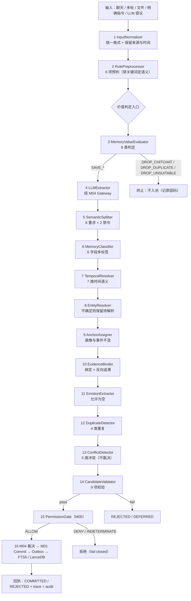
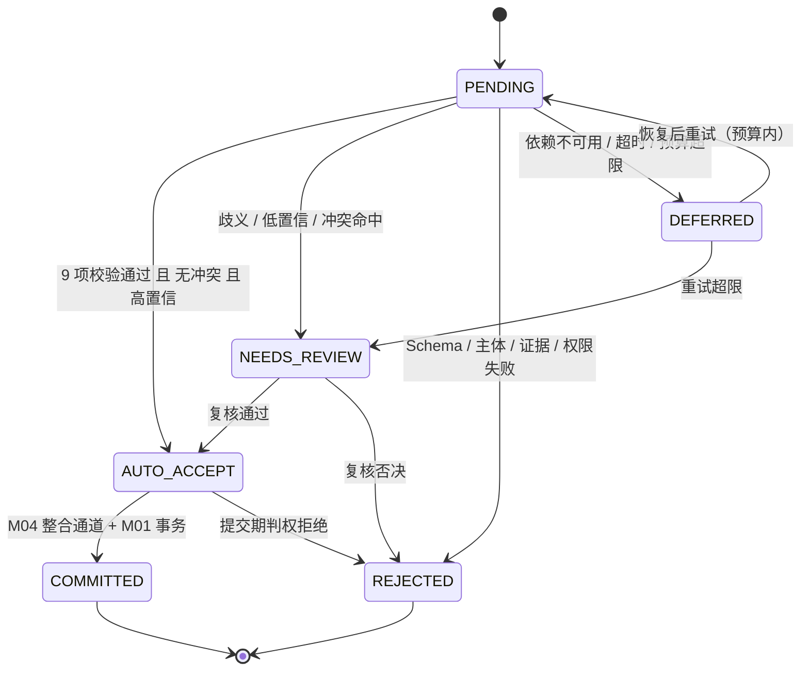
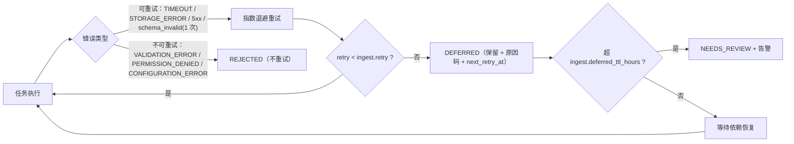

# 09 — 记忆摄取 Pipeline

> 文件代号：09 ｜ 所属交付：Memory Core R4.1 V1 架构升级（DD）｜ 设计 Agent 组：A 组（新增文档 09/10/11）
> 基准文件：`DD-AUTHORITY-V2.md` v2.0（**最高行为依据**，与 `DD-AUTHORITY.md` v1 冲突时以 V2 为准）｜ 正式裁决台账：`08-adjudication-ledger.md`
> 语言/编码：中文 ／ UTF-8（无 BOM）

---

## 1. 文档状态

| 项目 | 内容 |
|---|---|
| 文件编号 | 09 |
| 文件名称 | 记忆摄取 Pipeline |
| 当前版本 | 1.0 |
| 设计状态 | **PROPOSED**（设计成稿，未获用户逐条批准；已裁决部分另见 §5） |
| 实施授权 | **无**。本文件不授予任何代码实施权限（依据 `DD-AUTHORITY-V2.md` §1「设计范围 = P0–P6 全部；实施授权仍按阶段授予」） |
| 完成等级自评 | **F2 已达成**；F3 仅在"规格齐备、可执行判定"意义上达成；**F4 未达成**，且本次任务不要求 |
| 撰写依据 | `DD-AUTHORITY-V2.md` §5（16 阶段逐字名称）、§2（全部规范枚举）、§3（五个对象字段表）、§6（LLM 三层）、§12（CR-01~CR-07）、§13（写作硬规则）；`DD-AUTHORITY.md` §8（15 节结构） |
| 关联未决项 | OI-025（CR-01）、OI-028（CR-04）、OI-030（CR-06）、本文件自有 OI-09-01~OI-09-07 |
| 目标阶段 | P3（M03 + Ingestion Pipeline），**需阶段授权**；P0–P2 仅消费本文件的接口契约 |

**分节状态矩阵**

| 章节 | 状态 | 说明 |
|---|---|---|
| §7.1 Pipeline 定位 | APPROVED 语义继承（D-AP-01/D-AP-03 + V2 §5 末句） | 协调层，不直接写 SQLite、不取代 M03、不绕过 M05 |
| §7.4 16 阶段名称与顺序 | APPROVED（V2 §5，名称 MUST 逐字一致） | 任何改动走 §15 变更流程 |
| §7.21 候选 6 态流转 | **PROPOSED + CR-01 冲突未决** | 见 §14 OI-025 |
| §7.23 LLM 不可用降级 | PROPOSED | 与 05 号文档降级清单对齐前不升级 |
| §8 数据结构 | PROPOSED（契约草案） | 与 `contracts/schemas/candidate*.schema.json` 同步后方可冻结 |
| 参数（§8.7） | **EXP-DEFAULT** | 全部指向 15 号参数注册表，业务代码禁止硬编码 |

---

## 2. 适用版本

| 维度 | 版本值 |
|---|---|
| 母本版本 | `R4.1-MASTER-01` |
| 规范基准 | `R4.1 Specification Baseline` |
| 任务书编号 | `MC-R41-DESIGN-FREEZE-01` |
| 基准裁决文件 | `DD-AUTHORITY-V2.md` v2.0（APPROVED，2026-11-04） |
| 前一版基准 | `DD-AUTHORITY.md` v1.0（保留，冲突以 V2 为准） |
| 正式裁决台账 | `08-adjudication-ledger.md`（391 行，第六轮后状态） |
| 本文档适用的 Schema 版本 | `schema_version = "1.0"` |
| Pipeline 规格版本 | `pipeline_version = "1.0"`（写入每个任务的 `trace.pipeline_version`） |
| 枚举版本 | `enum_version = "v2"`（对应 V2 §2，禁止 v1 变体混入） |

**版本兼容规则（MUST）**：本文件的 `pipeline_version` 变更 **MUST** 与 `enum_version`、`prompt_version`、`ruleset_version` 分开登记；四者任一变化 **MUST** 在 `trace` 中分别留痕，**MUST NOT** 合并成一个"版本号"。

---

## 3. 适用范围

### 3.1 覆盖范围

1. Ingestion Pipeline 的定位、职责边界与运行模型（同步入口 / 异步执行）。
2. V2 §5 全部 16 阶段的逐阶段规格：编号、名称、职责、输入、输出、失败处理、是否可跳过、幂等要求、所属模块。
3. 输入五类形态（普通聊天 / 多轮 / 文件投喂 / 明确记忆指令 / LLM 提议）的归一化与来源时间保留。
4. 语义碎片化、多标签分类、时间解析、实体解析、锚点分配、证据绑定、情绪抽取、去重、冲突检测、候选校验的判定规则与禁令。
5. 候选 6 态流转（`PENDING` / `AUTO_ACCEPT` / `NEEDS_REVIEW` / `REJECTED` / `DEFERRED` / `COMMITTED`）与 CR-01 声明。
6. 幂等、重试、`DEFERRED` 处理与 LLM 不可用时的降级。
7. 测试要求与验收标准（引用 06 号测试体系与 OI 编号）。

### 3.2 明确不覆盖（边界声明）

| 对象 | 状态 | 边界说明 |
|---|---|---|
| M03 内部实现代码与算法库选型 | FUTURE（P3 待授权） | 本文件只定义规格与契约，不定义源码结构 |
| M04 整合裁决逻辑 | FUTURE（P4 待授权） | 本文件只定义"提交给 M04 的候选契约"与"冲突检测输出"，**不定义裁决** |
| M05 权限算法 | FUTURE（P5 待授权） | 本文件只调用 `PermissionGate`，**判权规则属 04 号文档** |
| 聊天 LLM 主动读写 | FUTURE（P5 待授权） | 见 14 号文档；本文件只定义 `memory.propose` 的摄取侧接收口径 |
| Psychology 集成 | **BLOCKED**（台账 I-7/X-6、CR-05） | 情绪抽取不写 Psychology 运行时；ΔE 见 13 号文档 |
| 情绪自动推断 | **默认关闭**（`emotion.auto_infer=false`，CR-04/OI-028） | 设计定义，实施默认只接受 `USER_EXPLICIT` |
| 缓存表结构与校验 | DEFERRED（U-1/U-2） | 本文件不含 `cache.sqlite` |
| 具体阈值数值 | TBD / EXP-DEFAULT | 需生活化测试集标定（D-AP-06），本文件不写死数值 |

### 3.3 读者对象

M03 实施 Agent（P3）、M04 实施 Agent（P4）、M05 实施 Agent（P5）、测试 Agent、审查 Agent、参数注册表维护者（15 号文档）。

---

## 4. 依赖文档

| 编号 | 文件 | 用途 | 权威层 | 读取范围 |
|---|---|---|---|---|
| D1 | `DD-AUTHORITY-V2.md` | 枚举/字段/16 阶段/CR-01~07 基准 | **最高行为依据** | 全文 |
| D2 | `DD-AUTHORITY.md` v1.0 | 15 节结构、R1–R10、状态用语 | 第二层（不冲突部分） | §4、§6、§8 |
| D3 | `08-adjudication-ledger.md` | 正式裁决 | **第一层** | 全文（重点 §3b/§3e/§3f/§3g） |
| D4 | `00-总体架构与设计原则.md` | 三组件/五平面、模块边界、不变量 | 第三层 | §7.2–§7.3、§7.9 |
| D5 | `01-记忆本体与数据模型.md` | MemoryUnit / Evidence / Event / EmotionContext 字段 | 第三层 | §7.6、§7.8、§7.12 |
| D6 | `02-核心算法规范.md` | ALG-07 候选提取、ALG-08 整合、ALG-09 权限 | 第三层 | §7.8–§7.10 |
| D7 | `03-系统运行与协作协议.md` | 事务五步、Outbox、错误协议、异步任务 | 第三层 | §7.4、§7.6 |
| D8 | `04-权限与治理规范.md` | M05 判权契约、`canWrite` | 第三层 | §7.4 |
| D9 | `05-可靠性与运维规范.md` | 重试/退避/降级清单 | 第三层 | §7.4–§7.6 |
| D10 | `06-测试与评估规范.md` | TEL-1~TEL-10、E2E-01~12、禁用虚假验收 | 第三层 | §7.2、§7.14、§7.15 |
| D11 | `10-LLM调用体系.md` | 三层定义、调用决策、降级矩阵 | 同级（本文引用） | §7.1–§7.9 |
| D12 | `11-MemoryAnchor与语义分类.md` | 语义 6 类、多标签、8 锚点、主体 6 类 | 同级（本文引用） | §7.1–§7.8 |
| D13 | `15-参数注册表.md`（待成稿） | 参数 ID 与 11 属性 | 引用目标 | 全部 `ingest.*` 项 |

**依赖约束**：D11/D12/D13 中尚未成稿的条款 **MUST NOT** 被本文当作"已批准依据"引用；交叉引用一律附"（待成稿/待裁决）"标注。

---

## 5. 正式裁决引用

> 引用格式：（台账 D-AP-05）。只有本表列出的条目允许在正文写"已裁决"；其余一律 PROPOSED/TBD。

| 台账编号 | 裁决要点（摘要） | 对本文档的约束 |
|---|---|---|
| D-AP-01 | 五模块边界维持；**M03 候选提取与 M04 整合裁决不可合并** | §7.1 明确 Pipeline 与 M03/M04 的职责切分；`ConflictDetector` 只检测、不裁决 |
| D-AP-02 | **M04 §6.2 为唯一 LLM Gateway 入口**；Embedding Provider 归 M01 | §7.8 阶段 4：LLM 调用 MUST 经 M04 Gateway，Pipeline **MUST NOT** 自建通道 |
| D-AP-03 | 不新增第六模块、不新增进程 | §7.1：Pipeline 是**协调层**，不是第六模块，**MUST NOT** 新增独立进程 |
| D-AP-04 | 有摘要时索引主体="摘要+cue"；无摘要须定义回退 | §7.20：Pipeline 只产出 `summary`/`cue` 供索引，回退策略见 01 §7.13 |
| D-AP-05 | **confirmed 仅允许 M04 审核通道写入**；reinforce 只预留 schema 禁写 | §7.21 CR-01 声明；§7.24 禁止 Pipeline 写 `validation_state=confirmed` |
| D-AP-06 | 生活化测试集为主要验收依据；研究报告收益不得写成实测 | §12/§13：验收数值全部标 TBD/待标定 |
| D-AP-07 | 五级可插拔；C40 权限引擎不可插拔；`trusted_context_source: entry-only` | §7.24：来源可信性只在入口判定，Pipeline 内不得放宽 |
| D-AP-09 | 拒绝第三方托管平台；**不得声称"记忆文本不出本机"**；本地持久化与云端推理传输分开评估 | §11 安全边界逐条落实 |
| D-AP-10 | m03 冻结稿继续冻结；不授权文档合并 | §4 依赖说明：m03 只读，本文件不修改其定义 |
| I-3 | L0+L2 起步、五层 schema 预留 | 情绪抽取**MUST NOT** 写心理层状态 |
| I-5 | 心理状态机只改运行时状态、**不直接产生记忆候选** | §7.15：`EmotionExtractor` 产物只能作为候选附属情绪，不得回写心理状态 |
| I-7 | psy-model 暂不引入 | §3.2 BLOCKED 行 |
| J2 | M03 **写时**情绪标注，检索期不调用 LLM | §7.15：情绪抽取只在摄取期发生 |
| J4 | 15 个受控标签起步，**配置方式管理** | §7.15：词表 MUST 来自配置，禁止模型自创 |
| J5 | 提供情绪标注清除能力（走 M04 修订通道） | §7.22：清除回执走 M04，Pipeline 不直接删 |
| J6 | **首版关闭查询侧情绪感知** | 本文只定义摄取侧，不涉及查询侧 |
| J7 | **只预留接口和字段，不实现 LLM 标注与批量重放** | §7.15 标 DEFERRED 的部分：批量重放 |
| J8 | 预留 `affect_source='external'`，不启用 | §7.15：外部来源情绪不启用 |
| K-1 | 有条件接受 O1（M01 非权威运行时 KV），**未生效** | 本文不依赖该 KV |
| K-2 | 导出边界逐项确定；内部参数不默认导出 | §11：Pipeline 中间产物不纳入导出 |
| K-6 | openLoop 只能由明确事件触发，**永不由沉默触发** | §7.15/§7.17：无明确事件即不产生情绪/冲突候选 |
| X-2 | Session 结束丢弃短期情绪；L1 仅预留 | §7.5：`session_only` 输入不晋升长期 |
| X-3 | Recall 可参与推理、禁止直接改 PAD；持久变更走独立审核（③默认关闭） | §7.15 禁止写 PAD |
| X-6 | 五方法/十二阶段接口形态暂缓 | §3.2 |
| 优化-1 | Token 计量须区分五类消耗 | §8.7：`ingest` 成本按五类计量 |
| 优化-3 | Graphiti 旁路索引仅登记不启动 | §7.20：Pipeline 不触发旁路索引 |
| 优化-4 | 拔除测试从 7 条外部依赖起步 | §12：LLM/Embedding 依赖纳入拔除测试 |
| 优化-5 | 参数 ID 稳定唯一可追踪；展示名可改、身份不丢 | §8.7：参数 ID 全部登记，禁止硬编码 |
| U-1/U-2 | cache 表结构与校验暂缓 | §3.2 |
| CR-08A | 域内答复授权（**≠ 用户批准**） | §14 OI 处理流程 |
| CR-09 | 接受伦理门禁框架，**未实施验证** | §11：K-6 不得视为闭环 |

**未列入上表的任何"做法"均为 PROPOSED 或 TBD**，不得写作"已裁决"。

---

## 6. 术语表

| 术语 | 定义 | 来源 |
|---|---|---|
| Memory Ingestion Pipeline（摄取 Pipeline） | 把授权来源转化为候选记忆、并协调至权威提交的**协调链路**（16 阶段） | V2 §5；术语统一 V2 §13.1 |
| Pipeline Coordinator（摄取协调器） | 承担阶段 1/10/14/16 的**编排与门禁**角色；不是第六模块、不是新进程 | D-AP-03；本文 §7.1 |
| Stage（阶段） | 16 阶段之一，名称 MUST 逐字一致 | V2 §5 |
| IngestEnvelope | InputNormalizer 输出的统一输入包（保留来源与时间） | 本文 §8.2 |
| CandidateDraft | 阶段 4–14 之间流转的候选草案（尚未入候选池） | 本文 §8.4 |
| 候选（Candidate） | M03 产出、尚未成为正式记忆的对象；6 态见 §7.21 | V2 §2.7 |
| 候选池 | 候选的持久暂存区（FUTURE，P3 实施） | 01 §7.12 |
| 语义碎片（semantic fragment） | 一条只承载一个核心语义的独立记忆片段 | V2 §5 阶段 5 |
| 锚点（Memory Anchor） | 检索时可独立路由的获取入口，8 值 | V2 §2.3；11 号文档 |
| 主体（Subject） | 记忆归属的稳定 ID + 主体类型（6 值） | V2 §2.4 |
| 生命周期层级（tier） | `L1`/`L2`/`L3`，与语义类型正交 | V2 §2.5 |
| 来源类型（source_type） | 5 值，表达"这条内容是怎么来的" | V2 §2.9 |
| 证据（Evidence） | 原始表达 + 定位 + 哈希，可反向取原句 | V2 §3.2 |
| 价值判定（value verdict） | 阶段 3 的 8 类保存/丢弃判定 | 本文 §7.7 |
| 幂等键（idempotency key） | 同一逻辑输入重复投递时用于去重的稳定键 | 03 §7.6 |
| DEFERRED（候选态） | 暂时无法完成、保留待处理的状态，不是丢弃 | V2 §2.7 |
| AUTO_ACCEPT | **不等于 confirmed**；只表示免人工复核进入 M04 整合通道 | V2 §12 CR-01 |
| EXP-DEFAULT | 实验初值，正式化前必须可配置 | sf §15；D2 §8 |
| PROPOSED / TBD / VERIFY / BLOCKED / FUTURE / DEFERRED | 设计状态用语 | D2 §6 |

---

## 7. 规范正文

### 7.1 Pipeline 定位与三不原则

**定位（MUST）**：Ingestion Pipeline 是**协调层**。它负责"顺序、门禁、留痕、重试、降级"，**不负责**"业务判定本身"——业务判定分散在 M03 的判定组件中，权限判定在 M05，整合裁决在 M04，持久化在 M01。

**三不原则（MUST NOT，逐条可测）**

| 编号 | 禁令 | 判定方式 | 违规后果 |
|---|---|---|---|
| P-01 | **MUST NOT 直接写 SQLite** | 依赖扫描：Pipeline 代码不出现 SQL 字符串、不 import 驱动 | 视为绕过 M01，架构不变量违反 |
| P-02 | **MUST NOT 取代 M03** | 候选抽取、分类、拆分、锚点判定必须由 M03 组件执行；协调器只编排 | 判定逻辑散入协调层 ⇒ 不可测 |
| P-03 | **MUST NOT 绕过 M05** | 每个进入候选池/提交的候选 MUST 有 `PermissionGate` 的 `decision_id` | 无 `decision_id` 的候选一律 `REJECTED` |

**协调层与模块的归属表（MUST 一致）**

| 归属 | 含义 | 本文阶段 |
|---|---|---|
| **Pipeline 协调** | 编排、门禁、留痕、幂等键、重试、降级决策；不做语义判定 | 1、10（编排侧）、14、16 |
| **M03** | 语义判定组件：规则、价值、抽取、拆分、分类、时间、实体、锚点、情绪、去重、冲突检测 | 2–9、11–13 |
| **M05** | 权限判定（唯一入口） | 15 |
| **M04** | 整合裁决、确认通道（`confirmed` 唯一写入者） | 16 的裁决子步 |
| **M01** | 权威写入、事务、Outbox | 16 的执行子步 |

**MUST**：协调层自身 **MUST NOT** 持有任何"重要性/真实性"判断；它只能根据 M03/M04/M05 的输出做**路由**（继续/暂停/重试/终止）。

### 7.2 Pipeline 与五模块的边界

| 边界对象 | 允许 | 禁止 |
|---|---|---|
| Pipeline → M03 | 调用判定组件、传 `IngestEnvelope`、收 `CandidateDraft` | 在协调层内实现分类/拆分逻辑 |
| Pipeline → M04 | 提交候选（经 `memory.propose` 语义）、请求整合裁决、请求 `confirmed` | 自行写 `confirmed`；自行合并/覆盖旧记忆 |
| Pipeline → M05 | 请求 `canWrite`/`canRead` 判定，带 `request_id` | 缓存判权结果跨请求复用（除同一 `request_id` 域） |
| Pipeline → M01 | **不直接调用**；只经 M04 提交，由 M01 事务写入 | 直接 `INSERT`；直接写 Outbox |
| Pipeline → M02 | 只读：去重/冲突检测时按 `memory.search` 语义查询既有记忆 | 用检索结果直接当作事实来源；以检索结果扩权 |
| Pipeline → LLM | 只经 M04 §6.2 LLM Gateway（L1/L2） | 自建 Provider、直连 HTTP、把密钥写入配置明文 |

**输入来源约束（MUST）**：Pipeline 只接受**已授权来源**；`trusted_context_source: entry-only`（D-AP-07）意味着来源可信性在**入口**一次判定，Pipeline 内部 **MUST NOT** 因"内容看起来可信"而提升可信度。

### 7.3 运行模型（同步入口 / 异步执行）

| 维度 | 规则 |
|---|---|
| 同步段 | 阶段 1–3（归一化、规则预处理、价值判定）：**MUST** 在请求返回前完成，用于判断"是否值得进入抽取"；耗时上限 `ingest.sync_budget_ms`（EXP-DEFAULT） |
| 异步段 | 阶段 4–16：**MUST** 异步执行（队列 + Worker）；**MUST NOT** 阻塞聊天响应 |
| 明确记忆指令 | 阶段 1–3 同步 + 阶段 4–16 异步；**优先级最高**（队列分级 `explicit` > `normal` > `bulk`） |
| 批量候选 | 只走 `bulk` 队列；批大小 `ingest.batch_size`（EXP-DEFAULT） |
| 后台抽取 | **MUST NOT** 阻塞聊天；单次调用超时 `ingest.timeout`（EXP-DEFAULT） |
| 失败传播 | 任一阶段失败 **MUST NOT** 使整批静默丢弃；单条进入 `DEFERRED` 或 `REJECTED` 并留原因码 |

**队列分级与并发（MUST）**

1. 同一 `subject_id` 的候选提交 **MUST** 串行化（避免同一主体并发写导致版本冲突风暴）。
2. 不同 `subject_id` 之间 **MAY** 并发，上限 `ingest.max_concurrency`（EXP-DEFAULT）。
3. 队列积压时 **MUST** 优先保证 `explicit` 级；`bulk` 级 **MAY** 被延迟，但 **MUST NOT** 被标记为成功。
4. **MUST NOT** 因队列积压而降低校验项（阶段 14 的 9 项校验在任何负载下都必须执行）。

### 7.4 16 阶段总表（编号 / 名称逐字 / 九字段索引）

> 名称 **MUST** 逐字取自 `DD-AUTHORITY-V2.md` §5，一个字母都不得改动。下表为**九字段一览**（编号、名称、职责、输入、输出、失败处理、是否可跳过、幂等要求、所属模块），逐阶段详细规则见 §7.5–§7.20。

| 编号 | 名称（逐字） | 职责 | 输入 | 输出 | 失败处理 | 可跳过 | 幂等要求（键） | 所属模块 |
|---|---|---|---|---|---|---|---|---|
| 1 | InputNormalizer | 统一输入格式，保留来源与时间 | 五类 `IngestRequest` | `IngestEnvelope` | `VALIDATION_ERROR` 终止 | 否 | `hash(tenant_id, source_id, source_locator, content_hash)` | Pipeline 协调 |
| 2 | RulePreprocessor | 合法性／长度／重复／来源／权限预判／明确记忆指令识别 | `IngestEnvelope` | `RuleVerdict`（keep/reject + flags + `ruleset_version`） | `CONFIGURATION_ERROR`（缺规则集）或 `REJECTED` | 否 | `(envelope_id, ruleset_version)` | M03 |
| 3 | MemoryValueEvaluator | 8 类长期保存价值判定 | `IngestEnvelope` + `RuleVerdict` | `ValueVerdict`（判定码 + 依据） | `DEFERRED`（`evaluator_unavailable`） | 否（`SAVE_EXPLICIT` 可快速通过） | `(envelope_id, evaluator_version)` | M03 |
| 4 | LLMExtractor | L1/L2 结构化抽取 | `ValueVerdict` + envelope + `prompt_version` | `ExtractionResult`（`units[]`、模型与 Token 信息） | 重试 → `DEFERRED`（`llm_timeout`/`schema_invalid`） | 否 | `(envelope_id, split_unit_id, model_id, prompt_version)` | M03（经 M04 Gateway） |
| 5 | SemanticSplitter | 语义碎片化，一条一核心语义 | `ExtractionResult` | `Fragment[]`（字符区间 + `context_ref`） | `oversplit` → 复核队列 | 否 | `(envelope_id, splitter_version, extraction_result_hash)` | M03 |
| 6 | MemoryClassifier | 多标签分类 6 字段输出 | `Fragment` | `ClassifiedDraft`（6 字段） | `schema_invalid` → `REJECTED` | 否 | `(candidate_draft_id, classifier_version, prompt_version)` | M03 |
| 7 | TemporalResolver | 7 类时间语义解析 | `ClassifiedDraft` + `base_time` | `TemporalResult`（`temporal_kind` + 时间候选） | `temporal_unresolved` 标记（不阻塞） | 否 | `(candidate_draft_id, temporal_version, base_time)` | M03 |
| 8 | EntityResolver | 人物与对象识别、统一 ID、指代处理 | `ClassifiedDraft` + 主体注册表 | `subject_id`/`subject_type` + `unresolved_reference` | `no_subject` → `REJECTED` | 否 | `(candidate_draft_id, entity_version, subject_registry_version)` | M03 |
| 9 | AnchorAssigner | 锚点分配，画像与事件不混单元 | draft + 分类 + 主体 | `anchor[]`（≥1） | `no_anchor` → `REJECTED` | 否 | `(candidate_draft_id, anchor_version, enum_version)` | M03 |
| 10 | EvidenceBinder | 记忆单元 ↔ 原始证据绑定 | draft + envelope + 证据草案 | `evidence_refs[]` + `span` + 链接表 | `no_evidence` → `REJECTED`；哈希不符 → `DEFERRED` | 否 | `(candidate_draft_id, evidence_refs_sorted_hash)` | Pipeline 协调（编排）+ M03（草案构造） |
| 11 | EmotionExtractor | 有依据的事件情绪，允许为空 | draft + 情绪表达 | `EmotionDraft[]`（可为空） | 不阻塞；`emotion_refs=[]` | 条件可跳过（`emotion.auto_infer=false` 且无明确表达） | `(candidate_draft_id, emotion_version, prompt_version)` | M03 |
| 12 | DuplicateDetector | 4 类重复检测 | draft + 既有记忆检索结果 | `duplicate_kind` + `duplicate_of_*` | `DEFERRED`（`dedupe_unavailable`） | 否 | `(candidate_draft_id, dedupe_version)` | M03 |
| 13 | ConflictDetector | 5 类冲突检测（不裁决） | draft + 目标记忆版本 | `conflict_flags[]` + `conflict_with[]` | `DEFERRED`（`conflict_check_unavailable`） | 否 | `(candidate_draft_id, conflict_version, target_memory_versions)` | M03 |
| 14 | CandidateValidator | 9 项校验 | 全量 draft + `decision_id` | `ValidationReport` | `validator_error` → `DEFERRED` | 否 | `(candidate_draft_id, validator_version, candidate_version)` | Pipeline 协调 |
| 15 | PermissionGate | M05 权限门禁 | 判权入参（身份／scope／动作） | `ALLOW`/`DENY`/`INDETERMINATE` + `decision_id` | 一律拒绝（fail-closed） | 否 | `request_id` 域内可复用 | M05 |
| 16 | M03/M04 → M01 Commit → Outbox → FTS5/LanceDB | 裁决 + 事务提交 + 索引同步 | 通过校验的候选 | `memory_id`/`version` + Outbox 事件 + 回执 | 回滚 → `DEFERRED` 重试 | 否 | `(candidate_id, commit_key)` | 协调 + M04 + M01 |

**阶段耗时预算（EXP-DEFAULT，指向 15 号参数注册表）**：同步段 ≤ `ingest.sync_budget_ms`；单阶段 ≤ `ingest.stage_timeout_ms`；整任务 ≤ `ingest.task_timeout_ms`；超时一律进入 `DEFERRED` 并留 `TIMEOUT` 原因码，**MUST NOT** 以"部分结果"冒充完成。

### 7.5 阶段 1：InputNormalizer

**职责**：把五类异构输入统一为 `IngestEnvelope`；**保留来源与时间**，不做任何语义删改。

**五类输入与归一化要求（MUST）**

| # | 输入形态 | 归一化动作 | 必须保留 | 禁止 |
|---|---|---|---|---|
| 1 | 普通聊天消息 | 单条 → 一个 envelope；补 `session_id`/`speaker_id`/`seq` | 原句、时间戳、会话/消息定位 | 拼接上下文进 `content` |
| 2 | 多轮对话 | 按话题边界/时间窗/发言者切分为多个 envelope，保留 `window_ref` | 轮次顺序、前后文引用 | 跨话题强行合并 |
| 3 | 文件投喂 | 解析为文本块 → 每块一个 envelope，保留文件名/版本/页码或偏移 | 文件标识、`source_id`、块定位 | 丢弃文档版本、把解析摘要当原句 |
| 4 | 明确记忆指令 | 标记 `is_explicit_instruction=true`，并保留指令原句与目标内容 | 指令句与被记内容的对应关系 | 把指令句本身当作记忆内容 |
| 5 | LLM 提议（`propose`） | 由助手侧提交的候选，标 `source_type=ASSISTANT_INFERRED`（除非携带用户原句） | 提议理由、原始引用、模型与提示版本 | 把提议当作 `USER_EXPLICIT` |

**字段规范**：`IngestEnvelope` 见 §8.2。**MUST**：`source_type` 五值（`USER_EXPLICIT` / `USER_INSTRUCTION` / `ASSISTANT_INFERRED` / `EXTERNAL_SOURCE` / `SYSTEM_GENERATED`）在此阶段**必须确定**，后续阶段 **MUST NOT** 变更（只能记录证据层面的细分，见 §7.14）。

**失败处理**：字段缺失/时间非法/来源不可解析 ⇒ `VALIDATION_ERROR`，任务终止并留 `normalize_error`；**MUST NOT** 用默认值填补未知时间（未知即 `null`）。

**是否可跳过**：否。

**幂等要求**：`idempotency_key = hash(tenant_id, source_id, source_locator, content_hash)`；同一键重复投递 **MUST** 返回同一 `envelope_id`，**MUST NOT** 生成第二份 envelope。

**所属模块**：Pipeline 协调（归一化函数由 M03 提供纯函数实现，无 DB 访问）。

### 7.6 阶段 2：RulePreprocessor

**职责（6 项，MUST 全做）**

| # | 职责 | 规则形式 | 失败/命中处理 |
|---|---|---|---|
| 1 | 合法性校验 | Schema + 字段域校验 | 非法 ⇒ `VALIDATION_ERROR` 终止 |
| 2 | 长度校验 | 单条/单块/单任务上限 | 超限 ⇒ 截断为多块（保留原句偏移）或 `DEFERRED` |
| 3 | 重复预判 | 内容哈希 + 近重复指纹（快速） | 完全重复 ⇒ 直接 `REJECTED`（原因 `exact_duplicate`） |
| 4 | 来源校验 | 来源是否属于本次授权范围、来源是否已撤销 | 越界/撤销 ⇒ `REJECTED`（`out_of_authorized_scope`） |
| 5 | 权限预判 | 只"排除"，不"授予"；调用 M05 轻量判定或使用入口可信上下文 | 预判拒绝 ⇒ `REJECTED`，并记 `decision_id` |
| 6 | 明确记忆指令识别 | 规则 + 受控触发词表（配置管理） | 命中 ⇒ 标 `explicit_save`，进入高优先队列 |

**禁令（MUST NOT）**

1. **MUST NOT 用关键词决定复杂语义**——关键词只允许用于"是否是明确的保存指令"这类**形式判定**；语义类型、主体、时间、情绪 **MUST NOT** 由关键词表决定。
2. **MUST NOT 在规则层做推断**（例如"用户提到三次 ⇒ 这是偏好"）。
3. **MUST NOT 因规则失败而丢弃来源**（失败只影响本条候选，不撤销来源）。

**示例（正/反）**

- 正例：`"记住：我不吃香菜"` ⇒ 命中明确记忆指令触发词（配置词表），标 `is_explicit_instruction=true`、`source_type=USER_INSTRUCTION`；语义判定留给阶段 6。
- 反例：根据"不吃"这个关键词直接把 `semantic_type` 定为 `PREFERENCE` —— 违反禁令 1（"不吃"也可能描述他人）。

**失败处理**：规则集版本缺失 ⇒ `CONFIGURATION_ERROR`（不降级）；规则命中拒绝 ⇒ 记 `REJECTED` + `ruleset_version`，可审计。

**是否可跳过**：否。

**幂等要求**：以 `(envelope_id, ruleset_version)` 为幂等域；同一规则集重复执行 **MUST** 产出相同判定。

**所属模块**：M03。

### 7.7 阶段 3：MemoryValueEvaluator

**职责**：8 类长期保存价值判定——决定"是否进入抽取"，**不决定**最终记忆类型。

**8 类判定（内部判定码，非规范枚举；MUST NOT 与 `semantic_type` 混用）**

| 判定码 | 含义 | 典型信号 | 后续动作 |
|---|---|---|---|
| `SAVE_EXPLICIT` | 明确保存 | `is_explicit_instruction=true` | 直接进入阶段 4，最高优先 |
| `SAVE_STABLE_PERSON` | 稳定人物信息 | 身份/背景/价值观/能力/长期目标的自述 | 进入阶段 4，倾向 `L3` 候选 |
| `SAVE_STABLE_PREFERENCE` | 稳定偏好 | 反复表达且跨会话一致的偏好 | 进入阶段 4 |
| `SAVE_IMPORTANT_EVENT` | 重要事件 | 有时间、有参与方、有结果的经历 | 进入阶段 4，`EVENT` 候选 |
| `SAVE_STAGE_STATE` | 阶段状态 | 进行中的计划/困难/进度 | 进入阶段 4，`CURRENT_STATE` 候选 |
| `DROP_CHITCHAT` | 闲聊 | 纯寒暄、无信息量 | 终止（`REJECTED` 或直接不入池，按配置） |
| `DROP_DUPLICATE` | 重复 | 与既有记忆/同批重复 | 终止，指向 `duplicate_of_*` |
| `DROP_UNSUITABLE` | 不宜保存 | 敏感度超限、无授权、无长期价值 | 终止，记原因码（不回显正文） |

**禁止（MUST NOT）**

1. **禁止全量入库**：**MUST NOT** 对每条输入都生成候选；`DROP_*` 是正常输出。
2. **MUST NOT** 用"Token 长度"或"消息条数"代替价值判定。
3. **MUST NOT** 把价值判定结果写入 `importance` 字段当作已裁决的重要度（`importance` 保留但不入排序公式，V2 §4.2）。
4. **MUST NOT** 因无法判定而默认 `SAVE_*`；无法判定 ⇒ `DROP_UNSUITABLE` + 标 `ambiguous`，交人工策略（如需）。

**失败处理**：判定器不可用 ⇒ 任务 `DEFERRED`（原因 `evaluator_unavailable`）；**MUST NOT** 全部按 `SAVE_*` 兜底。

**是否可跳过**：形式不可跳过；`SAVE_EXPLICIT` 可"快速通过"（跳过打分），但 **MUST** 记录 `bypass_reason=explicit_instruction`。

**幂等要求**：`(envelope_id, evaluator_version)`；同输入同版本 **MUST** 同判定。

**所属模块**：M03。

### 7.8 阶段 4：LLMExtractor

**职责**：L1/L2 结构化抽取（内容、类型候选、主体候选、时间表达、证据引用候选）。**MUST** 经 M04 §6.2 LLM Gateway（D-AP-02）；分层与决策见 10 号文档。

**输入**：`IngestEnvelope` + 价值判定结果 + `prompt_version` + 模型分层（`ingest.model_tier`，EXP-DEFAULT）。
**输出**：`ExtractionResult { units[], model_id, model_tier, prompt_version, token_usage, latency_ms }`；`units[]` 尚未碎片化（阶段 5 负责）。

**约束（MUST）**

1. 抽取结果 **MUST** 携带 `source_type`（继承自阶段 1，不得改写）。
2. **MUST NOT** 输出 `validation_state`；该字段不在抽取模型输出契约内。
3. **MUST NOT** 输出自由文本的情绪标签（只能输出受控词表值或 `raw_label`，见 §7.15）。
4. 结构化输出 **MUST** 通过 Schema 校验；失败重试上限 `ingest.retry`（EXP-DEFAULT），超限 ⇒ `DEFERRED`。
5. **MUST NOT** 把模型输出的"总结句"当作 `Evidence.original_text`。

**失败处理**

| 失败类型 | 处置 |
|---|---|
| Gateway 超时 | 重试（指数退避，上限 `ingest.retry`）；耗尽 ⇒ `DEFERRED`（`llm_timeout`） |
| 结构化输出非法 | 重试 1 次（附纠错提示）；仍非法 ⇒ `DEFERRED`（`schema_invalid`） |
| 模型不可用 | 见 §7.23 降级矩阵；**MUST NOT** 用低质量规则猜复杂语义 |
| 预算超限 | `DEFERRED`（`budget_exceeded`），保留 envelope 待后续批处理 |

**是否可跳过**：否（在 `LLM_DEGRADED` 模式下抽取被推迟，而不是被替换为猜测）。

**幂等要求**：`(envelope_id, split_unit_id, model_id, prompt_version)`；相同键 **MUST** 复用既有抽取结果，**MUST NOT** 重复计费。

**所属模块**：M03（调用经 M04 Gateway）。

### 7.9 阶段 5：SemanticSplitter

**职责**：把抽取结果切分为**语义碎片**，使每个碎片可独立成为一条 `MemoryUnit` 的候选内容。

**碎片化 6 项要求（MUST 全部满足）**

| # | 要求 | 判定方式 | 不满足时 |
|---|---|---|---|
| S1 | **一条一核心语义** | 一个碎片只断言一件事；出现"并且/同时"连接两个独立断言时须拆 | 拆分为两条候选 |
| S2 | **主体/对象/时间明确** | 碎片内三类要素可判定或显式标 `null`（未知） | 标 `ambiguous`，进入 `NEEDS_REVIEW` |
| S3 | **指代可独立理解** | 碎片脱离上下文仍可读懂"谁、何时、什么" | 补 `context_ref`（见 S5）或合并回上文 |
| S4 | **原句可追溯** | 每个碎片 MUST 能定位到 ≥1 条 `Evidence`（`source_locator` + 字符区间） | 无证据 ⇒ `REJECTED`（`no_evidence`） |
| S5 | **上下文依赖不丢失** | 否定词、条件、限定（"只有在…情况下"）、指代先行词 MUST 随碎片保留或经 `context_ref` 可达 | `REJECTED`（`context_lost`） |
| S6 | **不跨主体/不跨时间混合** | 一个碎片只含一个 `subject_id`、一个时间锚（或显式区间） | 拆分为多条；无法拆 ⇒ `ambiguous` |

**两项禁令（MUST NOT）**

1. **禁止机械切句**：**MUST NOT** 按标点、字数、Token 上限或换行做纯机械切割；切分依据只允许"语义边界"（断言边界、主体边界、时间边界）。
2. **禁止破坏上下文**：**MUST NOT** 在切分中丢弃否定、条件、比较基准、指代先行词、时间限定；**MUST NOT** 把一个因果句的两半分成两条互相矛盾的事实。

**正例（2 条）**

- 正例 1：原句"我上周三终于把论文初稿交了，导师说要改第三章" ⇒ 拆为两条：①`EVENT`「主人于上周三提交论文初稿」；②`CURRENT_STATE`「导师要求修改第三章（推进中的任务）」。两条各自主体明确、原句同一 `source_locator` 的不同字符区间。
- 正例 2：原句"我不喜欢开会，尤其是没有明确目标的会" ⇒ 一条 `PREFERENCE`「主人不喜欢开会」，限定条件"没有明确目标的会议"保留在同一碎片内（S5），**不**拆成"不喜欢开会"+"不喜欢目标"。

**反例（2 条）**

- 反例 1：按逗号机械切分，把"我不喜欢开会，除非是评审会"切成"我不喜欢开会"+"除非是评审会" ⇒ 破坏否定/例外条件，产生**与事实相反**的偏好碎片（违反禁令 1、2 与 S5）。
- 反例 2：把"主人说她妈妈下周来，她有点紧张"切为"她妈妈下周来"+"她有点紧张"两条独立单元，但第二条的"她"未解析 ⇒ 主体不明且无法独立理解（违反 S3、S6）。

**失败处理**：切分后碎片数 > `ingest.max_fragments_per_envelope`（EXP-DEFAULT）⇒ 标记 `oversplit` 并交人工复核队列，**MUST NOT** 静默丢弃尾部碎片。

**是否可跳过**：否（单碎片输入仍需"验证"是否满足 6 项要求）。

**幂等要求**：`(envelope_id, splitter_version, extraction_result_hash)`；同输入同版本 **MUST** 产出相同碎片集合与相同字符区间。

**所属模块**：M03。

### 7.10 阶段 6：MemoryClassifier

**职责**：多标签分类，输出**恰好 6 个字段**（MUST，字段名逐字）：

| # | 字段 | 取值域 | 规则 |
|---|---|---|---|
| 1 | `semantic_type` | V2 §2.1 六值，**单选** | 一碎片一主类；不得为空 |
| 2 | `subject_id` | 稳定 ID 字符串 | 由阶段 8 统一解析后**回填确认**；本阶段可为候选值 |
| 3 | `anchor` | V2 §2.3 八值，**多选，≥1** | 由阶段 9 最终定稿；本阶段给候选锚点 |
| 4 | `lifecycle_candidate` | `L1` / `L2` / `L3` | 生命周期**候选**，不是最终 tier；与语义类型正交（见 11 号 §7.12） |
| 5 | `source_type` | V2 §2.9 五值，单选 | **MUST** 继承阶段 1，不得改写 |
| 6 | `confidence` | number 0–1 | 提取/推断置信度，**≠ 事实真实性** |

**多标签规则（MUST）**

1. `semantic_type` 单选，`semantic_tags` 多选（可为空数组）；**MUST NOT** 用多个 `semantic_type` 表达多标签。
2. `SELF_EXPLICIT` 与 `SELF_DERIVED` **MUST NOT** 同时出现在同一单元上（互斥，见 11 号 §7.9）。
3. `PERSON` + `SELF_DERIVED` ⇒ `source_type` **MUST** 为 `ASSISTANT_INFERRED`。
4. 标签扩展（`tags_extra`）**MUST** 登记后才可使用（V2 §2.2 尾注）。

**多标签示例（MUST 逐字段给出，不得只给一句话）**

输入：「主人不太喜欢没有明确目标的长期任务」（`USER_EXPLICIT`，`Owner` 自述）

| 字段 | 取值 | 说明 |
|---|---|---|
| `semantic_type` | `PERSON` | 描述主体的稳定倾向，不是单个事件 |
| `semantic_tags` | `[SELF_EXPLICIT, PREFERENCE, INTERACTION]` | 自述 + 偏好语义 + 互动方式倾向 |
| `subject_type` / `subject_id` | `OWNER` / `owner:<id>` | 由"主人"经阶段 8 解析 |
| `anchor` | `[SELF_EXPLICIT, PERSON_PROFILE, PREFERENCE]` | **三值**：自述锚点 + 画像锚点 + 偏好锚点 |
| `lifecycle_candidate` | `L3` | 稳定倾向，倾向长期；最终 tier 由 M04 决定 |
| `source_type` | `USER_EXPLICIT` | 用户明确自述 |
| `confidence` | 0.9（EXP-DEFAULT，待标定） | 明确自述但含"不太"弱化语气 |

> 说明：本例 **MUST NOT** 被写成 `PREFERENCE` 单选而丢失 `SELF_EXPLICIT` 标签，也 **MUST NOT** 被写成 `EVENT`（它不是一次性事件）。

**失败处理**：六字段任一缺失 ⇒ 阶段 14 直接判 `REJECTED`（`schema_invalid`）；`semantic_type` 越界值 ⇒ 映射失败，`REJECTED`（禁止就近猜一个类型）。

**是否可跳过**：否。

**幂等要求**：`(candidate_draft_id, classifier_version, prompt_version)`。

**所属模块**：M03。

### 7.11 阶段 7：TemporalResolver

**职责**：解析 7 类时间语义，产出 `temporal_kind` 与时间字段候选（`valid_from`/`valid_until`/`observed_at` 候选值，未知为 `null`）。

**7 类时间语义（MUST 全部可区分）**

| # | `temporal_kind` | 定义 | 时间字段处置 |
|---|---|---|---|
| 1 | `PAST` | 已发生 | `observed_at` 必填（可解析则填），`valid_from` 可空 |
| 2 | `CURRENT` | 当前正在发生/当前状态 | `observed_at` = 表达时刻；`valid_from` ≤ now |
| 3 | `FUTURE_PLAN` | 未来计划/意图 | **MUST NOT** 写 `observed_at` 为未来时间；`valid_from` = 计划开始（未知 null）；标 `CURRENT_STATE` 倾向 |
| 4 | `HYPOTHETICAL` | 假设/设想（"如果…"） | 时间字段 **MUST** 为 null；标 `disputed` 倾向与 `ambiguous` |
| 5 | `CANCELLED` | 明确取消 | 保留原计划时间 + `cancelled_at`；标 `SUPERSEDED` 候选 |
| 6 | `ENDED` | 已结束 | `valid_until` 必填（可解析则填） |
| 7 | `ONGOING` | 持续中（无明确终点） | `valid_from` 可解析，`valid_until` = null |

**禁令（MUST NOT）**

1. **禁止把未来计划写成已发生**：`FUTURE_PLAN` 的单元 **MUST NOT** 使用过去时表述，**MUST NOT** 填 `observed_at=未来时间`，**MUST NOT** 在 `content` 中写"已经…"。
2. **MUST NOT** 用记录时间（`recorded_at`）填补未知事实时间。
3. **MUST NOT** 在时间不可解析时猜测绝对日期（只允许保留相对表达 + `null` 字段）。

**失败处理**：相对时间（"明天/下周"）无基准时刻 ⇒ 保留原表达，字段置 null，标 `temporal_unresolved`；该标记 **MUST** 传给阶段 14（仍可入库，但检索时不得作为"时间确定"证据）。

**是否可跳过**：否。

**幂等要求**：`(candidate_draft_id, temporal_version, base_time)`；`base_time` 变化（跨天重放）**MUST** 重算并留痕，**MUST NOT** 静默改写历史结果。

**所属模块**：M03。

### 7.12 阶段 8：EntityResolver

**职责**：人物与对象识别、统一 ID、别名/代词/昵称/关系指代处理；**不确定保留待解析，禁止强行合并**。

**处理规则（MUST）**

| 指代形态 | 处理 | 不确定时 |
|---|---|---|
| 别名（"老王"/"王哥"/"王XX"） | 按主体别名表匹配到同一 `subject_id` | 多个候选命中 ⇒ 保留 `subject_candidates[]`，不合并 |
| 代词（"我/你/他/她/它"） | 按会话发言者与最近先行词解析，**必须**记 `resolution_basis` | 无先行词 ⇒ `subject_id=null` + `unresolved_reference` |
| 昵称/群昵称 | 经宿主身份映射（Host Adapter）解析为稳定 ID | 映射失败 ⇒ 保留昵称原文，不猜测 |
| 关系指代（"我老板"/"她妈妈"） | 解析为"关系 + 指向"，主体字段填**可判定的一端**，另一端进 `relation_hint` | 两端均不可判定 ⇒ 保留关系描述，不建 `RELATIONSHIP` 单元 |
| 群体指代（"我们"/"大家"） | `subject_type=GROUP` + 群体 ID；成员不逐个展开 | 群体 ID 不明 ⇒ 不建单元，标 `ambiguous` |

**硬性约束（MUST NOT）**

1. **MUST NOT** 因出现"我/你/他"直接认定主体（V2 §2.4 配套条款）。
2. **MUST NOT** 强行合并两个"看起来像"的人物（宁可两条未解析，也不得错并）。
3. **MUST NOT** 用 `display_name` 作为主键；`subject_id` **MUST** 来自宿主身份映射或既有主体表。
4. **MUST NOT** 把 `ASSISTANT`（聊天机器人）与 `OWNER` 混同——"你"在主人对机器人说话时指 `ASSISTANT`。

**失败处理**：解析失败 ⇒ `subject_id=null` + `quality_flags=no_subject`；阶段 14 判 `REJECTED`（`no_subject`），进入人工待解析队列，**MUST NOT** 用"未知主体"占位写入候选池。

**是否可跳过**：否。

**幂等要求**：`(candidate_draft_id, entity_version, subject_registry_version)`；主体表变更后重放 **MUST** 产生新结果并留痕，旧结果不得被覆盖。

**所属模块**：M03。

### 7.13 阶段 9：AnchorAssigner

**职责**：为每个单元分配 `anchor[]`（≥1，8 值多选），并保证**画像与事件不混为一个单元**。

**分配规则（MUST）**

| 内容性质 | 必选锚点 | 可选锚点 | 禁止 |
|---|---|---|---|
| 主人明确自述 | `SELF_EXPLICIT` | `PERSON_PROFILE`、`PREFERENCE`、`RELATIONSHIP` | 只给 `EVENT` 而丢 `SELF_EXPLICIT` |
| 系统推断的人物特征 | `SELF_DERIVED` | `PERSON_PROFILE` | 与 `SELF_EXPLICIT` 同挂 |
| 画像整合描述 | `PERSON_PROFILE` | 按分区（偏好/关系/状态） | 把原始事件句挂到 `PERSON_PROFILE` |
| 偏好/互动习惯 | `PREFERENCE` | `PERSON_PROFILE` | 无证据的偏好 |
| 关系信息 | `RELATIONSHIP` | `PERSON_PROFILE` | 把一次性互动当关系 |
| 事件事实 | `EVENT` | `CURRENT_STATE`（仍进行中时） | 把情绪判断写进事件单元 |
| 当前状态/阶段目标 | `CURRENT_STATE` | `PERSON_PROFILE`（长期目标时） | 把已结束计划标 `CURRENT_STATE` |
| 情感关联 | `EMOTION_CONTEXT` | `EVENT`（有具体事件时） | 无依据情绪挂 `EMOTION_CONTEXT` |

**两条禁令（MUST NOT）**

1. **禁止把画像与事件混为一个单元**：一条单元 **MUST NOT** 同时以"稳定画像结论"和"具体事件事实"为内容；出现时 **MUST** 拆为两条（画像条 + 事件条），并用 `ABOUT`/`DERIVED_FROM` 关系连接（关系建立属 M04）。
2. **MUST NOT** 由锚点数量决定重要性；锚点多 ≠ 优先级高（见 11 号 §7.12）。

**失败处理**：无法给出任何锚点 ⇒ `REJECTED`（`no_anchor`），**MUST NOT** 默认挂 `PERSON_PROFILE` 兜底。

**是否可跳过**：否。

**幂等要求**：`(candidate_draft_id, anchor_version, enum_version)`；`enum_version` 变更 **MUST** 触发锚点重校验。

**所属模块**：M03。

### 7.14 阶段 10：EvidenceBinder

**职责**：把每个碎片绑定到 ≥1 条原始证据，并保证**反向可追溯**（从记忆 → 原句）。

**绑定规则（MUST）**

1. 每个碎片 **MUST** 至少绑定 1 条 `Evidence`，携带：`source_type`（证据形态：chat/file/import/tool/system）、`source_id`、`source_locator`（如 `session:msg:seq` + 字符区间）、`speaker_id`、`timestamp`、`original_text`、`content_hash`。
2. `original_text` **MUST** 为原句，**MUST NOT** 被规范化/改写/摘要覆盖（V2 §3.2）。
3. 一个碎片可绑定多条证据（多轮累积、文件 + 对话互证）；**MUST** 记录每条证据支持碎片的哪一部分（`span`）。
4. 反向追溯 **MUST** 支持 `related_evidence` 读取模式（V2 §2.12）：给定 `memory_id` ⇒ 返回相关原句集合。
5. 证据的 `visibility`/`scope` **MUST** 取来源交集，**MUST NOT** 因绑定而放宽。
6. `retention_policy` **MUST** 标注；证据被 `revoked` 时，关联记忆 **MUST** 标记"证据缺失"（不得继续当已证实）。

**失败处理**

| 情况 | 处置 |
|---|---|
| 无任何证据 | `REJECTED`（`no_evidence`）；**MUST NOT** 生成"无来源记忆" |
| 证据来源已撤销 | `REJECTED`（`evidence_revoked`） |
| 证据哈希校验失败 | `DEFERRED`（`evidence_hash_mismatch`），等待重新抓取 |
| 证据超保留期 | 允许绑定但标 `evidence_expired`，记忆 **MUST** 降权（不得与完整证据等价） |

**是否可跳过**：否。

**幂等要求**：`(candidate_draft_id, evidence_refs_sorted_hash)`；相同证据集 **MUST NOT** 产生重复 `memory_evidence_links`。

**所属模块**：Pipeline 协调（编排与校验）+ M03（证据草案构造）；**证据持久化只能由 M01 在阶段 16 执行**。

### 7.15 阶段 11：EmotionExtractor

**职责**：抽取**有依据的**事件情绪，产出 `EmotionContext` 草案（V2 §3.4）。

**规则（MUST）**

1. **允许为空**：无明确情绪表达 ⇒ 输出空集；**MUST NOT** 为"完整性"虚构情绪。
2. **明确表达与推断分离**：`source_type` 只能取 `USER_EXPLICIT` 或 `ASSISTANT_INFERRED`；二者 **MUST NOT** 合并为同一 `EmotionContext`。
3. **受控标签字典**：`emotion_label` **MUST** 取自 15 标签词表（配置管理，J4）：`neutral`、`happy`、`excited`、`calm`、`relieved`、`grateful`、`affectionate`、`sad`、`anxious`、`frustrated`、`angry`、`tired`、`lonely`、`guilty`、`confused`。
4. **越界映射**：模型输出不在词表 ⇒ `emotion_label=neutral` + 保留 `raw_label`（原始表达不得丢弃）。
5. **时间位置**：`temporal_position` **MUST** 取 `BEFORE`/`DURING`/`AFTER`/`UNKNOWN`；不可判定 ⇒ `UNKNOWN`。
6. `intensity`/`confidence` **MUST** 在 0–1；`event_id` 可为 null（无具体事件的持续情绪，但 **MUST** 有 `evidence_refs`）。
7. **MUST NOT** 写事件 `content`（事件只写事实，V2 §3.3）。
8. **MUST NOT** 写 Psychology 运行时状态、**MUST NOT** 产生 PAD 变更（I-5、X-3）。

**实施边界（CR-04 / OI-028）**：设计完整定义；实施默认 `emotion.auto_infer=false` ⇒ **只接受 `USER_EXPLICIT`** 情绪，`ASSISTANT_INFERRED` 路径 **MUST** 保持关闭，除非重新裁决。J7 的批量重放 **DEFERRED**，仅预留接口；`affect_source='external'`（J8）仅预留不启用。

**失败处理**：情绪抽取失败 **MUST NOT** 阻塞事实单元提交（情绪为附属产物）；失败记 `emotion_extraction_failed`，`emotion_refs=[]`。

**是否可跳过**：**条件可跳过**——`emotion.auto_infer=false` 且无 `USER_EXPLICIT` 情绪表达时跳过；跳过 **MUST** 显式记录 `skipped_reason=emotion_disabled`。

**幂等要求**：`(candidate_draft_id, emotion_version, prompt_version)`；同输入 **MUST NOT** 产生重复 `EmotionContext`。

**所属模块**：M03。

### 7.16 阶段 12：DuplicateDetector

**职责**：4 类重复检测；**只检测不合并**（合并属 M04，D-AP-01）。

| # | 重复类型 | 判定信号 | 输出 |
|---|---|---|---|
| 1 | **完全重复** | `content_hash` 相同（同主体同 scope） | `duplicate_kind=exact`，指向既有 `memory_id` |
| 2 | **语义重复** | 语义相似度 ≥ `dedupe.semantic_threshold`（EXP-DEFAULT）+ 同主体同语义类型 | `duplicate_kind=semantic` |
| 3 | **相近不同事件** | 相似但时间/参与方/结果不同 | `duplicate_kind=near_event`，**MUST NOT** 判为重复 |
| 4 | **同一事实不同表达** | 语义等价、措辞不同、时间一致 | `duplicate_kind=paraphrase` |

**禁令（MUST NOT）**

1. **禁止合并不同时间的相似事件**：同一主体在不同时间发生的同类事件（"每周三都开会"这类**习惯**除外，需由分类阶段先判为 `HABIT`）**MUST NOT** 合并为一条。
2. **MUST NOT** 跨主体去重（不同人的相同偏好不是重复）。
3. **MUST NOT** 跨 `scope`/`visibility` 去重（去重 **MUST NOT** 造成跨范围信息泄露）。
4. **MUST NOT** 在本阶段删除或覆盖任何既有记忆。

**失败处理**：检索不可用（M02 降级）⇒ `DEFERRED`（`dedupe_unavailable`），**MUST NOT** 跳过去重直接入库；完全重复在本地哈希层面仍可判定，可先 `REJECTED`。

**是否可跳过**：否。

**幂等要求**：`(candidate_draft_id, dedupe_version)`；`dedupe_key` **MUST** 稳定，重复投递 **MUST** 命中同一 `duplicate_of_*`。

**所属模块**：M03。

### 7.17 阶段 13：ConflictDetector

**职责**：5 类冲突检测；产出 `conflict_flags[]` 与冲突对清单，**不裁决**。

| # | 冲突类型 | 判定 | 输出 |
|---|---|---|---|
| 1 | **新旧矛盾** | 新候选与既有 `confirmed`/高置信记忆语义相反 | `conflict_kind=contradiction`，列 `conflict_with[]` |
| 2 | **状态变化** | 同一对象的状态从 A 变 B（如"在找工作"→"已入职"） | `conflict_kind=state_change` + 建议 `SUPERSEDES` 候选（关系由 M04 建） |
| 3 | **自述与推断不一致** | `SELF_EXPLICIT` 与 `SELF_DERIVED` 结论相反 | `conflict_kind=self_vs_derived`，**推断方 MUST 让位** |
| 4 | **关系变化** | 关系类型/方向与既有不一致（如"同事"→"前同事"） | `conflict_kind=relationship_change` |
| 5 | **时间冲突** | 同一事实的 `valid_from`/`valid_until` 互相排斥 | `conflict_kind=temporal_conflict` |

**禁令（MUST NOT）**

1. **禁止自动覆盖重要旧记忆**：**MUST NOT** 因检测到冲突就删除/改写旧记忆；旧记忆 **MUST** 保留至 M04 裁决。
2. **MUST NOT** 在本阶段把候选标为 `confirmed`/`disputed`（`validation_state` 变更仅 M04）。
3. **MUST NOT** 用"LLM 判断谁对"替代裁决流程；L2 只允许产出分析建议（10 号 §7.3）。
4. **MUST NOT** 因"沉默/无表达"推断冲突（K-6 同源纪律：无明确事件即无冲突）。

**失败处理**：冲突检测器不可用 ⇒ 候选 **MUST NOT** 直接入库；进 `DEFERRED`（`conflict_check_unavailable`）或 `NEEDS_REVIEW`（保守路径，按配置）。

**是否可跳过**：否。

**幂等要求**：`(candidate_draft_id, conflict_version, target_memory_versions)`；目标记忆版本变化 **MUST** 重算冲突。

**所属模块**：M03（检测）；**裁决属 M04（P4）**。

### 7.18 阶段 14：CandidateValidator

**职责**：9 项校验，全部通过才可进入权限门禁与提交。

| # | 校验项 | 判定内容 | 不通过结果 |
|---|---|---|---|
| 1 | **Schema 校验** | 六分类字段齐全、枚举值合法、长度/格式合法 | `REJECTED`（`schema_invalid`） |
| 2 | **主体校验** | `subject_id` 非空且可解析、`subject_type` 六值合法 | `REJECTED`（`no_subject`） |
| 3 | **时间校验** | `temporal_kind` 与时间字段一致（未来计划不得有过去 `observed_at`）；`valid_until ≥ valid_from` | `REJECTED`（`temporal_invalid`） |
| 4 | **来源校验** | `source_type` 五值且与证据形态不矛盾 | `REJECTED`（`source_invalid`） |
| 5 | **证据校验** | `evidence_refs` 非空、哈希可校验、未全部撤销 | `REJECTED`（`no_evidence`） |
| 6 | **锚点校验** | `anchor` ≥1、八值合法、`SELF_EXPLICIT`/`SELF_DERIVED` 未同挂 | `REJECTED`（`anchor_invalid`） |
| 7 | **权限校验** | 携带 `PermissionGate` 的 `decision_id` 且为 `ALLOW` | `REJECTED`（`permission_denied`） |
| 8 | **置信度校验** | `confidence` 在 0–1；低于 `candidate.min_confidence`（EXP-DEFAULT）⇒ 转 `NEEDS_REVIEW` | 降级而非拒绝 |
| 9 | **冲突状态校验** | `conflict_flags` 已评估（含"无冲突"结论）；未评估 ⇒ 拒绝 | `DEFERRED`（`conflict_unassessed`） |

**规则（MUST）**

1. **MUST** 在任何负载下执行全部 9 项；**MUST NOT** 因性能压力跳过第 7/9 项。
2. 校验输出 **MUST** 为结构化 `ValidationReport`（见 §8.6），逐项 `pass/fail/skip` + 原因码；**MUST NOT** 只给一个布尔值。
3. 校验失败信息 **MUST NOT** 回显记忆正文（06 SEC-06）。

**失败处理**：校验器自身异常 ⇒ `DEFERRED`（`validator_error`），**MUST NOT** 视为通过。

**是否可跳过**：否。

**幂等要求**：`(candidate_draft_id, validator_version, candidate_version)`；同版本重复校验 **MUST** 同结果。

**所属模块**：Pipeline 协调（门禁）；具体判定函数由 M03/M05 提供。

### 7.19 阶段 15：PermissionGate

**职责**：M05 权限门禁，覆盖**读/写/可见性**三类判定；Pipeline 只调用、不判权。

**规则（MUST）**

1. 判定入参 **MUST** 含：`tenant_id`、`actor`、`subject_id`、`scope`/`scope_id`、`visibility`、目标动作（`canWrite`/`canRead`/`canPublish`）、`request_id`。
2. 结果 **MUST** 为 `ALLOW` / `DENY` / `INDETERMINATE`；`DENY` 与 `INDETERMINATE` 一律**拒绝**（fail-closed）；`error`/`timeout`/未知 **MUST** 归入 `INDETERMINATE`。
3. **MUST NOT** 缓存跨 `request_id` 的判权结果；**MUST NOT** 在 `allow-all` 模式运行（生产禁止，06 SEC-07）。
4. 候选的 `visibility` **MUST** 默认 `owner_private`；`public` **MUST** 被拒绝（`visibility.public_enabled=false`，CR-07/OI-031）。
5. 判权 **MUST** 在 `scope` 收紧方向可用（更严格），**MUST NOT** 允许候选放宽来源 `scope`。

**失败处理**：M05 不可用 ⇒ 全链路 **DENY**（不降级、不猜测）；任务 `DEFERRED` 并告警；**MUST NOT** 先入库后补判。

**是否可跳过**：否（**MUST NOT** 任何路径绕过）。

**幂等要求**：同一 `request_id` + 同一请求体 **MUST** 返回同一判定（含拒绝理由），可复用域限定在单次请求内。

**所属模块**：M05（唯一判权入口）。

### 7.20 阶段 16：M03/M04 → M01 Commit → Outbox → FTS5/LanceDB

**职责**：把通过校验与判权的候选交给 M04 裁决，再由 M01 事务写入，Outbox 驱动派生索引。

**顺序（MUST，不得重排）**

```text
16.1 提交候选（带 ValidationReport、decision_id、conflict_flags、evidence_refs、trace）
16.2 M04 裁决：reject / hold / merge / supersede / create_new / observe / dispute
16.3 M01 事务五步：Validate → Check expected version → Write memory → Write memory version → Write outbox → Commit
16.4 Outbox → Worker → FTS5 / LanceDB 同步（派生索引，非权威）
16.5 回执：candidate.status 更新（COMMITTED/REJECTED），写 trace 与审计
```

**约束（MUST）**

1. Pipeline **MUST NOT** 直接写 `memory_objects`；写入只能由 M01 事务执行（P-01）。
2. **`validation_state=confirmed` 只能由 M04 审核通道写入**（D-AP-05）；M03/Pipeline **MUST NOT** 写该值。
3. 索引同步 **MUST** 由 Outbox → Worker 驱动；**MUST NOT** 双写、**MUST NOT** 用索引正文覆盖权威。
4. 命令式提交 **MUST** 携带 `expected_version`（乐观并发）；冲突 ⇒ `VERSION_CONFLICT`，候选回 `DEFERRED` 重试（上限 `ingest.retry`）。
5. `source_type=SYSTEM_GENERATED` 且 `evidence_refs` 为空的整合产物，**MUST** 显式标注 `no_original_evidence=true`（V2 §3.1 例外条款）。
6. 回执失败（写 trace 失败）**MUST NOT** 导致重复提交；以 `commit_key` 幂等。

**失败处理**

| 失败点 | 处置 |
|---|---|
| M04 不可用 | 候选保持 `PENDING`/`DEFERRED`，**MUST NOT** 由 Pipeline 代为裁决 |
| 事务失败 | 整体回滚；候选回 `DEFERRED`；**MUST NOT** 留下"记忆已写但 Outbox 未写" |
| Outbox 写入失败 | 事务回滚（两者同事务） |
| 索引同步失败 | Outbox 重试；检索侧标 `partial`；**MUST NOT** 声称索引已一致 |

**是否可跳过**：否。

**幂等要求**：`(candidate_id, commit_key)`；`commit_key = hash(tenant_id, candidate_id, content_hash, target_memory_id, expected_version)`；重复提交 **MUST** 返回同一 `memory_id`/`version`，**MUST NOT** 产生第二个版本。

**所属模块**：Pipeline 协调（编排）+ M04（裁决）+ M01（执行）。**D-AP-04 注记**：本阶段 **MUST** 产出 `summary`/`cue` 供索引主体使用；无摘要时的回退策略见 01 §7.13，不由 Pipeline 自行定义。

### 7.21 候选状态 6 态流转（V2 §2.7）与 CR-01 声明

**状态定义（MUST 逐字）**

| 状态 | 含义 | 可否进入 M04 | 终态 |
|---|---|---|---|
| `PENDING` | 已生成、尚未完成校验/判权 | 否 | 否 |
| `AUTO_ACCEPT` | **免人工复核**，可进入提交流程 | 是（经 M04 整合通道） | 否 |
| `NEEDS_REVIEW` | 需人工/规则复核（歧义、低置信、冲突） | 是（但须复核决策） | 否 |
| `REJECTED` | 否决（Schema/主体/证据/权限失败等） | 否 | 是（新对象才能重建） |
| `DEFERRED` | 暂缓（依赖不可用、超时、预算） | 否（待重试） | 否 |
| `COMMITTED` | 已完成 M01 提交（成为正式记忆或并入既有记忆） | — | 是 |

**CR-01 声明（MUST，写在实现注释与契约文档中）**

> `AUTO_ACCEPT` **不等于** `confirmed`。它只表示"无需人工复核即可进入 COMMITTED 流程"，**MUST NOT** 写 `validation_state=confirmed`；写入仍 **MUST** 经 M04 的整合通道（台账 D-AP-05）。当前默认约束：`AUTO_ACCEPT` **只允许用于 `L1`/`L2` 且 `visibility=owner_private`**；是否允许任何形式的自动确认，**须重新裁决**（OI-025 / CR-01）。

**状态机约束（MUST/MUST NOT）**

1. `PENDING → COMMITTED` **MUST NOT** 直接发生；**MUST** 经过 `AUTO_ACCEPT`、`NEEDS_REVIEW` 或 `DEFERRED` 三者之一。
2. `REJECTED` **MUST NOT** 原地复活为 `PENDING`；**MUST** 新建候选（新 `candidate_id`）。
3. `COMMITTED` **MUST NOT** 回退；如需修正 **MUST** 走 M04 的 `supersede` 版本链。
4. `DEFERRED → PENDING` 仅允许在重试预算内；超限 **MUST** 转 `NEEDS_REVIEW`（人工介入）而非静默丢弃。
5. `AUTO_ACCEPT` **MUST NOT** 提升 `scope`/`visibility`，**MUST NOT** 绕过 `PermissionGate`。
6. 任何状态转换 **MUST** 记录 `audit`（actor/action/target/result/timestamp/request_id/policy_version）。

### 7.22 幂等、重试与 DEFERRED 处理

**幂等总则（MUST）**

| 层级 | 幂等键 | 语义 |
|---|---|---|
| 输入层 | `(tenant_id, source_id, source_locator, content_hash)` | 同一条来源重复投递只归一化一次 |
| 抽取层 | `(envelope_id, split_unit_id, model_id, prompt_version)` | 重复抽取复用结果，不重复计费 |
| 候选层 | `dedupe_key = hash(subject_id, semantic_type, content_hash, time_bucket)` | 同批不产生重复候选 |
| 提交层 | `(candidate_id, commit_key)` | 重复提交返回同一 `memory_id`/`version` |

**重试纪律（MUST）**

1. 重试仅针对**可重试**错误：`TIMEOUT`、`STORAGE_ERROR`（瞬时）、`EMBEDDING_ERROR`、`INDEX_ERROR`、Gateway 5xx、`schema_invalid`（限 1 次纠错重试）。
2. **MUST NOT** 重试：`VALIDATION_ERROR`、`PERMISSION_DENIED`、`NOT_FOUND`（来源已撤销）、`CONFIGURATION_ERROR`。
3. 重试上限 `ingest.retry`（EXP-DEFAULT），退避策略 MUST 为指数退避 + 抖动，退避参数登记为 `ingest.retry_backoff_*`。
4. 重试 **MUST NOT** 改变候选内容；**MUST** 只重跑失败阶段及其下游必要阶段。
5. 超过重试上限 ⇒ `DEFERRED`（保留待人工/批处理），**MUST NOT** 丢弃、**MUST NOT** 标成功。

**DEFERRED 处理（MUST）**

- `DEFERRED` 候选 **MUST** 落盘可查（`deferred_reason`、`deferred_at`、`retry_count`、`next_retry_at`）。
- `DEFERRED` **MUST NOT** 进入检索、**MUST NOT** 计入"已入库"统计。
- 恢复条件满足时（依赖恢复/预算恢复）**MUST** 从失败阶段继续，**MUST NOT** 全链路重跑（除非上游数据已变更）。
- `DEFERRED` 超 `ingest.deferred_ttl_hours`（EXP-DEFAULT）⇒ 转 `NEEDS_REVIEW` 并告警。

### 7.23 LLM 不可用时的降级

**核心纪律（MUST）**：**保留待处理任务，不用低质量规则猜复杂语义**。

| 场景 | 允许 | 禁止 |
|---|---|---|
| L1 不可用 | 阶段 4 暂停；`DEFERRED` 保留 envelope；规则可完成的阶段（2/3/7/8 的表层判定）仍可跑 | 用关键词表冒充语义分类；把"未抽取"当"无价值"丢弃 |
| L2 不可用 | 冲突分析/复杂指代留待恢复；候选不裁决（M04 侧阻塞） | 用 L1 结果替代 L2 裁决；自动 `AUTO_ACCEPT` 绕过 |
| Gateway 全不可用 | 全链路 `DEFERRED`；明确告警；不影响聊天主链路 | 阻塞聊天；伪造成功回执 |
| Embedding 不可用 | 语义去重降级为哈希 + 字面近重复；记 `dedupe_degraded=true` | 声称"已完整去重" |
| 结构化输出持续非法 | `DEFERRED` + `schema_invalid` | 用自由文本硬解析结果入库 |

**降级态标记（MUST）**：任何降级运行的批次 **MUST** 在 `trace.degraded` 中标记，并在统计中与正常批次分开；**MUST NOT** 把降级批次计入"抽取质量"验收。

### 7.24 与 M01/M02/M04/M05 的接口约束（汇总）

| 约束 | 内容 |
|---|---|
| C-01 | 唯一写入者 = M01；Pipeline 无 SQL |
| C-02 | 唯一 LLM 入口 = M04 §6.2 Gateway；无第二条通道 |
| C-03 | 唯一判权入口 = M05；`decision_id` 强制携带 |
| C-04 | `confirmed` 唯一来源 = M04 审核通道 |
| C-05 | 派生索引只经 Outbox → Worker 同步；无旁路 |
| C-06 | 检索只读复用 M02；**MUST NOT** 用检索结果扩权/当事实 |
| C-07 | 禁止跨主体/跨 scope 复用中间结果（去重、实体解析、判权缓存） |
| C-08 | Pipeline 中间产物（envelope、碎片、日志）**MUST NOT** 纳入用户导出范围（K-2） |
| C-09 | 每阶段 **MUST** 写 `trace`（`stage`、`in/out ref`、`duration`、`model/prompt_version`、`result`） |
| C-10 | 任何阶段 **MUST NOT** 修改已通过的上一阶段输出；需要修正 ⇒ 回退重跑并留痕 |

---

## 8. 接口或数据结构

> 本节为**契约草案（PROPOSED）**，与 `contracts/schemas/` 同步后方可冻结。字段命名沿用 V2 §2/§3 的枚举与字段名。

### 8.1 `IngestRequest`

| 字段 | 类型 | 必填 | 说明 |
|---|---|---|---|
| `request_id` | string(uuid) | 是 | 追踪与判权复用域 |
| `tenant_id` | string | 是 | 隔离域 |
| `source_kind` | enum(`chat_message`,`conversation_window`,`file_chunk`,`explicit_instruction`,`llm_proposal`) | 是 | 五类输入 |
| `source_type` | enum(5 值，V2 §2.9) | 是 | 本阶段确定后不可变 |
| `payload` | object | 是 | 按 `source_kind` 变形（见 §8.2） |
| `actor` | object | 是 | 可信身份（Host Adapter 构造） |
| `subject_hint` | string\|null | 否 | 主体提示，**不得**直接认定 |
| `scope` / `scope_id` | enum / string\|null | 是/否 | 内部细分 |
| `background_ok` | boolean | 是 | 是否允许异步（普通聊天=true） |
| `priority` | enum(`explicit`,`normal`,`bulk`) | 是 | 队列分级 |

### 8.2 `IngestEnvelope`（阶段 1 输出）

| 字段 | 类型 | 必填 | 说明 |
|---|---|---|---|
| `envelope_id` | string(uuid) | 是 | 幂等键派生基准 |
| `tenant_id` | string | 是 | |
| `source_type` | enum(5 值) | 是 | 不可变 |
| `evidence_form` | enum(`chat`,`file`,`import`,`tool`,`system`) | 是 | 证据形态（V2 §3.2） |
| `source_id` / `source_locator` | string | 是 | 会话/文件/块定位 |
| `speaker_id` | string | 是 | 发言者主体 ID |
| `observed_at` | string(date-time)\|null | 否 | 原句出现时间；未知 null |
| `recorded_at` | string(date-time) | 是 | 摄取时刻 |
| `original_text` | string | 是 | **原句**，禁止改写 |
| `context_before` / `context_after` | string\|null | 否 | 受限长度的必要上下文 |
| `content_hash` | string(sha256) | 是 | 去重/校验 |
| `is_explicit_instruction` | boolean | 是 | 明确记忆指令标记 |
| `instruction_text` | string\|null | 否 | 指令原句（与内容分离保存） |
| `scope` / `scope_id` / `visibility` | enum | 是 | 来源权限 |
| `provenance_hint` | object | 否 | 模型/提示/工具调用信息 |

### 8.3 `PipelineTask`

| 字段 | 类型 | 必填 | 说明 |
|---|---|---|---|
| `task_id` | string(uuid) | 是 | |
| `envelope_id` / `candidate_draft_id` | string(uuid) | 是 | |
| `stage` | integer 1–16 | 是 | 当前阶段 |
| `status` | enum(`queued`,`running`,`succeeded`,`failed`,`deferred`,`cancelled`) | 是 | 与 03 §7.6 异步任务状态一致 |
| `attempt` | integer | 是 | ≥1 |
| `deferred_reason` | string\|null | 否 | 受控原因码 |
| `trace` | object | 是 | C-09 字段集 |

### 8.4 `CandidateDraft`

| 字段 | 类型 | 必填 | 说明 |
|---|---|---|---|
| `candidate_draft_id` | string(uuid) | 是 | |
| `content` | string | 是 | 规范化后的**独立可理解**内容（≠ 原句） |
| `semantic_type` | enum(6 值) | 是 | |
| `semantic_tags` | array\<enum\> | 是（可为 []） | |
| `subject_type` | enum(6 值) | 是 | |
| `subject_id` | string\|null | 是（可 null 但会被拒） | |
| `anchor` | array\<enum(8 值)\> | 是（≥1） | |
| `lifecycle_candidate` | enum(`L1`,`L2`,`L3`) | 是 | |
| `source_type` | enum(5 值) | 是 | |
| `confidence` | number 0–1 | 是 | |
| `temporal_kind` | enum(7 类) | 是 | `PAST`/`CURRENT`/`FUTURE_PLAN`/`HYPOTHETICAL`/`CANCELLED`/`ENDED`/`ONGOING` |
| `valid_from` / `valid_until` / `observed_at_candidate` | date-time\|null | 是 | 未知 null |
| `evidence_refs` | array\<uuid\> | 是 | 非空 |
| `emotion_drafts` | array\<object\> | 是（可为 []） | 见 §8.5 |
| `duplicate_of_memory_id` / `duplicate_of_candidate_id` | string\|null | 否 | |
| `conflict_flags` | array\<object\> | 是 | 含"已评估"结论 |
| `status` | enum(6 态) | 是 | 默认 `PENDING` |
| `quality_flags` | array\<string\> | 是 | `ambiguous`/`no_subject`/`no_evidence`/`temporal_unresolved` 等 |

### 8.5 `EmotionDraft`

| 字段 | 类型 | 必填 | 说明 |
|---|---|---|---|
| `emotion_label` | enum(15 标签) | 是 | 越界 → `neutral` |
| `raw_label` | string\|null | 是 | 原始表达，保留 |
| `intensity` / `confidence` | number 0–1 | 是 | |
| `temporal_position` | enum(4 值) | 是 | `BEFORE`/`DURING`/`AFTER`/`UNKNOWN` |
| `source_type` | enum(`USER_EXPLICIT`,`ASSISTANT_INFERRED`) | 是 | 二者不得合并 |
| `evidence_refs` | array\<uuid\> | 是 | 非空 |

### 8.6 `ValidationReport`（阶段 14 输出）

| 字段 | 类型 | 必填 | 说明 |
|---|---|---|---|
| `report_id` | string(uuid) | 是 | |
| `candidate_draft_id` | string(uuid) | 是 | |
| `checks` | array\<{check_id(1–9), result(`pass`/`fail`/`skip`), reason_code}\> | 是 | 9 项齐备 |
| `overall` | enum(`pass`,`fail`,`defer`) | 是 | `defer` ⇒ `DEFERRED` |
| `validator_version` | string | 是 | |
| `evaluated_at` | date-time | 是 | |

### 8.7 参数清单（全部 EXP-DEFAULT，指向 15 号参数注册表）

| 参数 ID | 用途 | 初值状态 | 归属 |
|---|---|---|---|
| `ingest.model` | 摄取抽取使用的模型标识 | EXP-DEFAULT | 15 号 |
| `ingest.model_tier` | 使用的 LLM 层（L1/L2） | EXP-DEFAULT | 15 号 |
| `ingest.batch_size` | 批量抽取批大小 | EXP-DEFAULT | 15 号 |
| `ingest.timeout` | 单次模型调用超时（毫秒） | EXP-DEFAULT | 15 号 |
| `ingest.retry` | 失败重试上限 | EXP-DEFAULT | 15 号 |
| `ingest.max_input_tokens` | 单次输入 Token 上限 | EXP-DEFAULT | 15 号 |
| `ingest.sync_budget_ms` | 同步段预算 | EXP-DEFAULT | 15 号 |
| `ingest.stage_timeout_ms` | 单阶段超时 | EXP-DEFAULT | 15 号 |
| `ingest.task_timeout_ms` | 整任务超时 | EXP-DEFAULT | 15 号 |
| `ingest.max_concurrency` | 不同主体并发上限 | EXP-DEFAULT | 15 号 |
| `ingest.max_fragments_per_envelope` | 单 envelope 碎片上限 | EXP-DEFAULT | 15 号 |
| `ingest.retry_backoff_base_ms` / `ingest.retry_backoff_jitter` | 退避参数 | EXP-DEFAULT | 15 号 |
| `ingest.deferred_ttl_hours` | DEFERRED 保留时长 | EXP-DEFAULT | 15 号 |
| `candidate.min_confidence` | 低于则 `NEEDS_REVIEW` | EXP-DEFAULT | 15 号 |
| `dedupe.semantic_threshold` | 语义重复阈值 | EXP-DEFAULT | 15 号 |
| `emotion.auto_infer` | 是否允许推断情绪（默认 false，CR-04） | **默认关闭** | 15 号 |
| `visibility.public_enabled` | `public` 是否启用（默认 false，CR-07） | **默认关闭** | 15 号 |

**硬性要求（MUST）**：业务代码 **MUST NOT** 硬编码上述数值；所有取值 **MUST** 经配置读取并带 `parameter_id` 与版本；参数身份 **MUST** 稳定唯一（优化-5），展示名可改。

---

## 9. 流程图（Mermaid）

### 9.1 图09-1 端到端 16 阶段



### 9.2 图09-2 候选状态机（6 态）



### 9.3 图09-3 失败、重试与 DEFERRED 路径



---

## 10. 异常情况

| 编号 | 异常 | 表现 | 处置 | 禁止 |
|---|---|---|---|---|
| E-09-01 | 来源缺失/不可解析 | `VALIDATION_ERROR` | 终止本条，不回显正文 | 编造 `source_id` |
| E-09-02 | 时间非法/未来事实 | `temporal_invalid` | `REJECTED` 或改标 `FUTURE_PLAN` | 用记录时间填事实时间 |
| E-09-03 | 主体不可解析 | `no_subject` | `REJECTED` + 待解析队列 | 归到 `OWNER` 兜底 |
| E-09-04 | 碎片上下文丢失 | `context_lost` | 重切分；仍失败 ⇒ `NEEDS_REVIEW` | 直接入库 |
| E-09-05 | 结构化输出非法 | `schema_invalid` | 重试 1 次 → `DEFERRED` | 自由文本硬解析 |
| E-09-06 | 冲突检测不可用 | `conflict_unassessed` | `DEFERRED` 或 `NEEDS_REVIEW` | 当无冲突入库 |
| E-09-07 | 判权超时 | `INDETERMINATE` | 一律拒绝 | 视为 `ALLOW` |
| E-09-08 | 事务冲突 | `VERSION_CONFLICT` | 候选 `DEFERRED` 重试 | 覆盖旧版本 |
| E-09-09 | Outbox 未写 | 事务不完整 | 回滚重试 | 仅补写 Outbox |
| E-09-10 | 索引同步落后 | 检索 `partial` | 重试 + 标记 | 声称索引已一致 |
| E-09-11 | 情绪词表越界 | 非法 `emotion_label` | 映射 `neutral` + 保留 `raw_label` | 丢弃原始表达 / 自创标签 |
| E-09-12 | 队列积压 | 延迟上升 | 降 `bulk` 级，不外溢到 `explicit` | 降低校验项 |

---

## 11. 安全边界

1. **fail-closed（MUST）**：M05 不可用/超时/未知 ⇒ 拒绝，不降级放行。
2. **证据与权限继承（MUST）**：候选 `scope`/`visibility` ⊆ 来源交集；多来源取最严格；无法确认即拒绝。
3. **不越权写入（MUST NOT）**：Pipeline **MUST NOT** 写 `confirmed`、**MUST NOT** 提升 `visibility`（`public` 默认禁用，CR-07）。
4. **正文不外泄（MUST NOT）**：错误响应、日志、审计 **MUST NOT** 含记忆正文（06 SEC-06）；日志只记 ID + 原因码 + 长度。
5. **提示注入隔离（MUST）**：记忆正文在模型调用中 **MUST** 作为**数据**传递（明确分隔与指令降权），**MUST NOT** 被当作指令执行（06 SEC-05）。
6. **不声称本地化（MUST NOT）**：涉及云端模型推理时，**MUST NOT** 声称"记忆文本不出本机"（D-AP-09）；本地持久化与云端推理传输分开评估。
7. **导出边界（MUST）**：Pipeline 中间产物不纳入用户导出（K-2/OI-030）；证据 `retention_policy` 必须标注。
8. **删除传播（MUST）**：证据 `revoked`/记忆删除时，关联候选与中间产物 **MUST** 一并失效，不留可召回残留。
9. **不触碰运行环境（MUST NOT）**：不得访问 `D:\qq-bridge` 源码/配置/state/Persona；不得启动正式机器人服务。
10. **伦理门禁（MUST NOT）**：**MUST NOT** 由沉默或缺失表达产生情绪/冲突/催促类候选（K-6/CR-09）。

---

## 12. 测试要求

> 测试层级引用 `06` §7.2（TEL-1…TEL-10），端到端引用 `06` §7.14（E2E-01…12），结果五态引用 `06` §7.3.1。执行阶段 P3（M03 + Pipeline），**需阶段授权**。

| 编号 | 测试项 | 层级 | 判定要点 | 关联 |
|---|---|---|---|---|
| TS-09-01 | 五类输入归一化 | TEL-1/TEL-2 | 五类各 3 条样例；来源与时间 100% 保留；明确指令与内容分离 | V2 §5 阶段 1 |
| TS-09-02 | 幂等：同输入重复投递 | TEL-2 | 不产生第二个 envelope/候选；`commit_key` 重复提交返回同一 `memory_id` | 03 §7.6 |
| TS-09-03 | 规则层禁令 | TEL-1 | 关键词不得决定 `semantic_type`/`subject`/`time`（构造对抗样例） | §7.6 |
| TS-09-04 | 价值判定不全面入库 | TEL-1 | 闲聊/重复/不宜保存样例 100% 不入池；无一条"默认 SAVE" | §7.7 |
| TS-09-05 | 碎片化 6 要求 | TEL-1 | 每碎片单主体单时间；否定/条件不丢；正反例各 2 条回归 | §7.9 |
| TS-09-06 | 多标签 6 字段 | TEL-1 | 缺字段即 `REJECTED`；`SELF_EXPLICIT` 与 `SELF_DERIVED` 互斥 | §7.10 |
| TS-09-07 | 时间语义 7 类 | TEL-1 | 未来计划不得有过去 `observed_at`；假设类时间字段全 null | §7.11 |
| TS-09-08 | 实体系留不合并 | TEL-1 | 歧义人名/代词无先行词 ⇒ `subject_id=null` 且被拒；0 强行合并 | §7.12 |
| TS-09-09 | 锚点分配与混单元 | TEL-1 | `anchor` ≥1；画像与事件同单元 0 例 | §7.13 |
| TS-09-10 | 证据绑定与反向追溯 | TEL-2 | 每个候选 ≥1 证据；`related_evidence` 可取回原句；哈希一致 | §7.14 |
| TS-09-11 | 情绪抽取边界 | TEL-1 | 允许空集；越界标签 → `neutral` + `raw_label`；推断默认关闭 | §7.15、CR-04 |
| TS-09-12 | 去重 4 类 | TEL-4 | 不同时间相似事件 **不合并**；跨主体/跨 scope 0 去重 | §7.16 |
| TS-09-13 | 冲突 5 类不裁决 | TEL-4 | 检测到即留 flags；旧记忆 0 覆盖 | §7.17 |
| TS-09-14 | 校验 9 项全执行 | TEL-2 | 9 项逐项留痕；高负载下第 7/9 项仍执行 | §7.18 |
| TS-09-15 | 判权 fail-closed | TEL-5 | deny/timeout/error/未知 4 态均不进入提交；越权 0 | §7.19 |
| TS-09-16 | AUTO_ACCEPT ≠ confirmed | TEL-2 | `AUTO_ACCEPT` 候选的 `validation_state` 恒非 `confirmed`；仅 M04 通道可写 | CR-01 |
| TS-09-17 | DEFERRED 全生命周期 | TEL-6 | 保留可查、可恢复、超限转复核；0 丢弃、0 计成功 | §7.22 |
| TS-09-18 | LLM 不可用降级 | TEL-6/故障注入 | 抽取暂停、任务保留；0 关键词冒充语义；聊天主链路不受阻 | §7.23 |
| TS-09-19 | 索引一致性 | TEL-3 | SQLite vs FTS5 vs LanceDB 对账 0 差异 | 06 §7.2 |
| TS-09-20 | E2E 写入闭环 | TEL-7 | E2E-01 全链路（P3 允许候选 fixture，标 fixture） | 06 §7.14 |

**禁止（MUST NOT）**

1. **MUST NOT** 用 Mock 通过写成"抽取质量已验证"（06 §7.3.1）。
2. **MUST NOT** 在无生活化测试集（D-AP-06）时给出精度/召回数字。
3. **MUST NOT** 用模型名/参数量替代能力测试结论（10 号 §7.5）。

---

## 13. 验收标准

| 编号 | 验收项 | 判定条件 | 当前状态 |
|---|---|---|---|
| V-09-01 | 16 阶段齐备且名称逐字一致 | 与 V2 §5 逐字比对，0 差异 | 设计级通过（待审查复核） |
| V-09-02 | 每阶段九字段齐备 | 16 × 9 字段无空缺 | 设计级通过 |
| V-09-03 | Pipeline 三不原则可测 | P-01/P-02/P-03 各有静态检查或运行时检查手段 | 设计级通过 |
| V-09-04 | 全链无直接 SQL / 无第二 LLM 通道 / 无绕过 M05 | 依赖扫描 0 违规 | NOT RUN（实施期） |
| V-09-05 | 候选 6 态与 CR-01 声明落地 | 状态机契约 + 代码断言 | NOT RUN（实施期） |
| V-09-06 | 去重/冲突不覆盖旧记忆 | 注入样例 0 覆盖 | NOT RUN |
| V-09-07 | 未来计划不写成已发生 | 对抗样例 0 违规 | NOT RUN |
| V-09-08 | 参数全部可配置且可追踪 | 15 号注册表登记率 100%；代码 0 硬编码 | NOT RUN |
| V-09-09 | 降级不丢候选 | 故障注入 0 丢失、0 假成功 | NOT RUN |
| V-09-10 | 证据 100% 可追溯 | 抽样 100% 可回原句（保留期内） | NOT RUN |

**判定口径（MUST）**：F2 = 规格齐备且判定条件明确；F3 = 有可执行用例与判定脚本；**F4 需真实运行证据**，本文件不主张 F4。任一 TBD 未标定项 **MUST NOT** 计为 PASS。

---

## 14. 未决事项

> 编号规则：`OI-025`~`OI-031` 为 V2 §12 的 CR-01~CR-07 登记号（本文件引用对应项）；`OI-09-xx` 为本文件自有编号。冲突处理一律"保留原裁决 + 需重新裁决"。

| 编号 | 事项 | 类型 | 关联裁决 | 影响 | 建议路径 |
|---|---|---|---|---|---|
| **OI-025** | CR-01：`AUTO_ACCEPT` 与 "confirmed 仅 M04 通道" 的张力；是否允许任何形式的自动确认 | **需重新裁决** | CR-01 ↔ D-AP-05 | 自动接受可能绕过 M04 确认通道 | 保留原裁决 D-AP-05；当前默认 `AUTO_ACCEPT` 仅 L1/L2 + `owner_private` 且不写 `confirmed`；启用更宽自动确认须重新裁决 |
| **OI-028** | CR-04：摄取期情绪抽取 vs "只预留接口不实现 LLM 标注" | **需重新裁决** | CR-04 ↔ J7 | 自动情绪推断与 J7 冲突 | 保留 J7；实施默认 `emotion.auto_infer=false`，仅 `USER_EXPLICIT`；自动推断须重新裁决 |
| **OI-030** | CR-06：原句长期保存 vs 数据最小化与导出边界 | **需重新裁决** | CR-06 ↔ K-2、D-AP-09 | 证据保存范围与导出边界未定 | 保留 K-2 与 D-AP-09；`retention_policy` 标注；导出边界 BLOCKED；**不得**声称"记忆文本不出本机" |
| **OI-029** | CR-05：Psychology 纳入正式架构 vs psy-model 暂缓 | **需重新裁决** | CR-05 ↔ I-7/X-6 | 架构含 Psychology 可能被误读为解锁；情绪抽取边界 | 保留 I-7/X-6；Psychology 实施仍 BLOCKED，接口按 DEFERRED 定义；Pipeline **MUST NOT** 写心理层状态 |
| **OI-031** | CR-07：`public` 可见性 vs 最小权限 | **需重新裁决** | CR-07 ↔ 最小权限原则 | `public` 可能被误启用 | 保留最小权限；`visibility.public_enabled=false`；启用须裁决（详见 11 号 §14） |
| OI-09-01 | 抽取质量阈值（置信度门槛/碎片上限）无标定数据 | TBD | D-AP-06 | 阈值只能用 EXP-DEFAULT | 生活化测试集建立后标定，登记 15 号 |
| OI-09-02 | `ingest.*` 参数最终 ID 与 15 号注册表可能不一致 | TBD | 优化-5、OI-023 | 参数追踪断链 | 以 15 号注册表/config schema 路径为准，本文仅引用 |
| OI-09-03 | `CandidateDraft` 与 `contracts/schemas/candidate*.schema.json` 字段对齐未完成 | VERIFY | D-AP-02 | 契约不一致导致返工 | P3 前完成 schema diff 并登记 |
| OI-09-04 | `DEFERRED` 的 TTL 与恢复调度策略未定 | TBD | 05 号文档 | 积压风险 | 与 05 §7.5 对齐后标定 |
| OI-09-05 | 多轮切分的"话题边界"判定依赖 L1，阈值未定 | TBD | — | 过切/欠切风险 | 以生活化测试集标定，禁机械切句 |
| OI-09-06 | 情绪草案与 `contracts/schemas/emotion-context.schema.json` 的字段映射 | VERIFY | J2/J4 | 契约不一致 | P3 前对齐 |
| OI-09-07 | 与 03 号文档"Pipeline 编排章节"的职责重述可能重复 | TBD | — | 双写风险 | 以本文为 Pipeline 权威，03 只引用 |

**冲突声明（MUST 保留）**：OI-025/OI-028/OI-029/OI-030/OI-031 五项 **一律保留原裁决**（D-AP-05 / J7 / I-7+X-6 / K-2 / 最小权限原则），本文档 **MUST NOT** 静默取舍；需重新裁决的事项已登记至 `OPEN-ISSUES.md` 与 `PENDING-USER-DECISIONS.md`（待总控合并）。

---

## 15. 变更记录

| 版本 | 日期 | 变更 | 依据 | 影响面 |
|---|---|---|---|---|
| 1.0 | 2026-11-04 | 首版：按 `DD-AUTHORITY-V2.md` §5 建立 16 阶段逐阶段规格（九字段齐备）、候选 6 态、CR-01 声明、幂等/重试/DEFERRED、LLM 降级、测试与验收 | V2 §5/§6/§12；DD v1 §8 | 新建文件，未修改同目录其他文件 |
| 1.0 | 2026-11-04 | 显式声明 v1 `lifecycle_state` 六态 → v2 `candidate.status` 六态 + `status` 四值的映射沿用 V2 §4.2 | V2 §4.2 | 与 01 §7.7 语义一致，不删旧依据 |

**保留旧依据说明（MUST）**：V2 §4 的旧模型映射（`type` 七值 → `semantic_type`；`source_type` v1 六值 → 五值；`lifecycle_state` → `candidate.status` + `status`）**继续有效**，本文档所有阶段输出的字段语义以 V2 §4 映射为准，**MUST NOT** 另立新映射。

**后续修订规则**：本文件任何修订 **MUST**（1）先备份当前版本；（2）在 §15 追加行而非改写历史行；（3）涉及枚举/阶段名称的变更 **MUST** 先取得用户裁决；（4）与台账冲突 **MUST** 标注"保留原裁决 + 需重新裁决"。