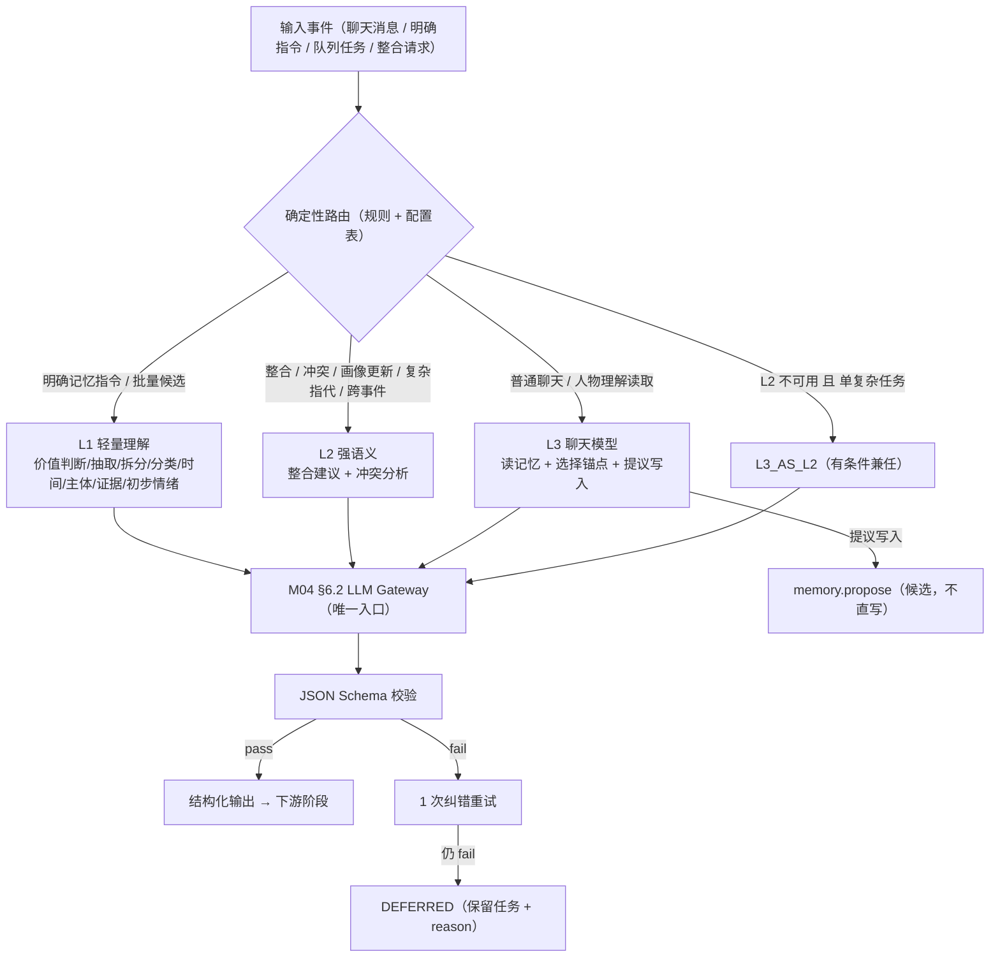
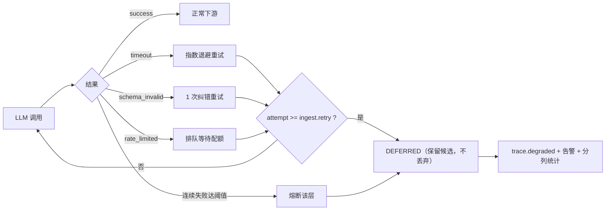
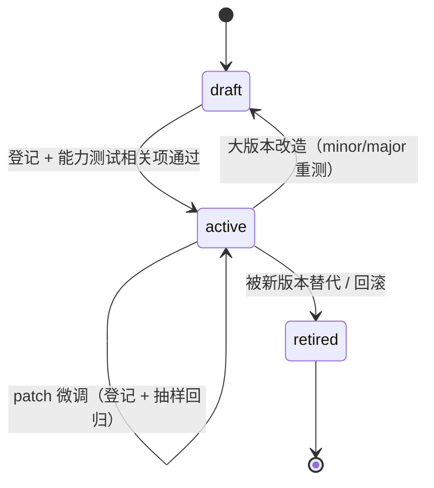

# 10 — LLM 调用体系

> 文件代号：10 ｜ 所属交付：Memory Core R4.1 V1 架构升级（DD）｜ 设计 Agent 组：A 组（新增文档 09/10/11）
> 基准文件：`DD-AUTHORITY-V2.md` v2.0（**最高行为依据**）｜ 正式裁决台账：`08-adjudication-ledger.md`
> 语言/编码：中文 ／ UTF-8（无 BOM）

---

## 1. 文档状态

| 项目 | 内容 |
|---|---|
| 文件编号 | 10 |
| 文件名称 | LLM 调用体系 |
| 当前版本 | 1.0 |
| 设计状态 | **PROPOSED**（设计成稿，未获用户逐条批准；已裁决部分见 §5） |
| 实施授权 | **无**（`DD-AUTHORITY-V2.md` §1：设计范围 P0–P6，实施按阶段授权） |
| 完成等级自评 | **F2 已达成**；F3 在"规格齐备 + 判定条件可执行"意义上达成；**F4 未达成**（本条**不得**写成"能力已通过测试"） |
| 撰写依据 | `DD-AUTHORITY-V2.md` §6（三层定义与调用纪律）、§1 能力 14（多模型分级与动态调用）、§12 CR-04/CR-05、§13；`DD-AUTHORITY.md` §8（15 节） |
| 关联未决项 | OI-025、OI-028、OI-029、本文件自有 OI-10-01~OI-10-08 |
| 目标阶段 | P3（摄取期 L1 调用）、P4（L2 整合/冲突）、P5（L3 聊天接入）；均**需阶段授权** |

**分节状态矩阵**

| 章节 | 状态 | 说明 |
|---|---|---|
| §7.1 三层职责表 | APPROVED（V2 §6 原文语义） | 职责逐条对齐，不得增删层级 |
| §7.2 同模型不同配置 | PROPOSED（V2 §6 未禁止，且"V1 不要求三独立模型"） | 约束：配置隔离、留痕隔离、预算隔离 |
| §7.5 11 项能力测试 | PROPOSED + 门槛 TBD | 测试集需建设，当前 NOT RUN |
| §7.6 结构化输出契约 | PROPOSED（契约草案） | 与 `contracts/schemas/` 对齐后冻结 |
| §7.9 降级矩阵 | PROPOSED | 与 05 号降级清单对齐 |
| §7.10 参数 | **EXP-DEFAULT** | 指向 15 号参数注册表 |
| LLM Gateway 唯一入口 | **APPROVED**（D-AP-02） | 任何第二通道均违规 |

---

## 2. 适用版本

| 维度 | 版本值 |
|---|---|
| 母本版本 | `R4.1-MASTER-01` |
| 基准裁决文件 | `DD-AUTHORITY-V2.md` v2.0（APPROVED，2026-11-04） |
| 正式裁决台账 | `08-adjudication-ledger.md`（第六轮后） |
| Schema 版本 | `schema_version = "1.0"` |
| Prompt 版本格式 | 语义版本 + 场景前缀，如 `ingest.extract@1.2.0`（见 §7.7） |
| 能力测试集版本 | `capability_suite_version`（**尚无版本，当前 NOT RUN**） |
| 枚举版本 | `enum_version = "v2"` |
| 参数版本 | 由 15 号参数注册表统一管理（本文不自行编号） |

**版本兼容（MUST）**：`prompt_version`、`model_id`、`pipeline_version`、`enum_version` 四者 **MUST** 分开记录；同一调用记录中任一缺失 ⇒ 该调用 **MUST** 视为不可复现，其结果 **MUST NOT** 计入质量统计。

---

## 3. 适用范围

### 3.1 覆盖范围

1. LLM 三层（L1 轻量理解 / L2 强语义 / L3 聊天模型）的职责定义与边界。
2. 三层可为同一模型的不同配置（V1 不要求部署三个独立模型）；L3 兼任 L2 的条件与限制。
3. 调用决策表：普通聊天 / 明确记忆指令 / 批量候选 / 整合 / 冲突 / 画像更新 / 复杂指代 / 跨事件各用哪层。
4. 调用频率与并发纪律：普通聊天不触发完整抽取、后台抽取不阻塞聊天、批量异步、失败不丢弃候选。
5. 模型选型 11 项能力测试清单、测试方法与评分口径；"不得以模型名与参数量代替能力测试"。
6. 结构化输出契约、few-shot 要求、失败重试与降级。
7. Prompt 版本管理、成本与限流（Token 五分类）、三层降级矩阵、参数清单。
8. 测试要求与验收标准。

### 3.2 明确不覆盖（边界声明）

| 对象 | 状态 | 边界说明 |
|---|---|---|
| 具体模型采购/部署方案 | TBD（实施期） | 本文只定义能力门槛与选型方法，不指定供应商 |
| L2 冲突裁决的具体算法 | P4 待授权（M04） | 本文只定义"L2 参与"，**裁决权属 M04** |
| 聊天 LLM 的宿主注入实现 | P5 待授权（08/14 号） | 本文只定义 L3 的调用边界 |
| Psychology / psy-model | **BLOCKED**（I-7/X-6、CR-05/OI-029） | LLM **MUST NOT** 写心理层运行时状态 |
| 云端推理的数据传输合规 | 需独立评估（D-AP-09） | **不得声称"记忆文本不出本机"** |
| 检索期情绪感知 | **默认关闭**（J6/CR-02/OI-026） | 见 11 号文档 §7.15 |
| 微调/蒸馏/自训练 | FUTURE，未批准 | 本文件不设计 |

### 3.3 读者对象

M03 实施 Agent、M04 实施 Agent、M05 实施 Agent、08/14 号文档撰写者、模型选型评估者、测试 Agent、审查 Agent。

---

## 4. 依赖文档

| 编号 | 文件 | 用途 | 权威层 |
|---|---|---|---|
| D1 | `DD-AUTHORITY-V2.md` | 三层定义、调用纪律、CR 清单 | **最高行为依据** |
| D2 | `DD-AUTHORITY.md` v1.0 | 15 节结构、R1（错误码）、状态用语 | 第二层 |
| D3 | `08-adjudication-ledger.md` | D-AP-02/05、I-7、J2/J4/J6/J7/J8、K-6、X-3、优化-1/4/5、CR-09 | **第一层** |
| D4 | `00-总体架构与设计原则.md` | 模块边界、LLM Gateway 归 M04 | 第三层 |
| D5 | `02-核心算法规范.md` | ALG-07/ALG-08 的 L1/L2 使用位置 | 第三层 |
| D6 | `03-系统运行与协作协议.md` | 异步任务五态、错误协议、幂等 | 第三层 |
| D7 | `05-可靠性与运维规范.md` | 超时/重试/降级基线 | 第三层 |
| D8 | `06-测试与评估规范.md` | TEL 层级、E2E、禁用虚假验收 | 第三层 |
| D9 | `09-记忆摄取Pipeline.md` | 阶段 4/13 的调用点 | 同级（互引） |
| D10 | `11-MemoryAnchor与语义分类.md` | 分类标签与锚点判定口径 | 同级（互引） |
| D11 | `15-参数注册表.md`（待成稿） | 参数 ID 与 11 属性 | 引用目标 |

**依赖约束**：D9/D10/D11 未成稿条款 **MUST NOT** 被当作已批准依据；引用须附"（待成稿）"。

---

## 5. 正式裁决引用

| 台账编号 | 裁决要点 | 对本文档的约束 |
|---|---|---|
| D-AP-02 | **M04 §6.2 为唯一 LLM Gateway 入口** | §7.1/§7.6：所有三层调用 **MUST** 经该入口；**MUST NOT** 自建通道、**MUST NOT** 直连 Provider |
| D-AP-05 | `confirmed` 仅 M04 审核通道写入；reinforce 只预留禁写 | §7.1：LLM 输出 **MUST NOT** 产生 `confirmed`；**MUST NOT** 触发 reinforce 写入 |
| D-AP-06 | 生活化测试集为主要验收依据；研究报告收益不得写成实测 | §7.5/§12：能力评分必须来自自有测试集；**MUST NOT** 引用榜单/论文数字当结论 |
| D-AP-07 | `trusted_context_source: entry-only` | §7.6：模型不得依据"内容看起来可信"提升来源可信度 |
| I-3 | L0+L2 起步、五层 schema 预留 | §7.1：LLM **MUST NOT** 更新心理层 schema |
| I-5 | 心理状态机只改运行时状态、不产生候选 | §7.9：L2 输出 **MUST NOT** 直接成候选 |
| I-7 | psy-model 暂不引入 | §3.2 BLOCKED |
| J2 | M03 **写时**情绪标注；检索期不调用 LLM | §7.3：EMOTION 相关调用只在摄取期 |
| J4 | 15 个受控标签，**配置管理** | §7.6：标签词表来自配置，禁模型自创 |
| J6 | **首版关闭查询侧情绪感知** | §7.3：不含查询期情绪推理 |
| J7 | 只预留接口/字段，**不实现 LLM 标注与批量重放** | §7.3/§7.9：批量重放 DEFERRED |
| J8 | `affect_source='external'` 预留不启用 | §7.6：外部情绪来源不调用 |
| K-6 | openLoop 只由明确事件触发，**永不由沉默触发** | §7.3：**MUST NOT** 因"无输入/沉默"发起 LLM 推断 |
| X-3 | Recall 可参与推理；**禁止直接改 PAD**；持久变更走独立审核（③默认关闭） | §7.9：L3 输出 **MUST NOT** 改 PAD |
| 优化-1 | Token 计量须区分五类消耗 | §7.8：计量口径 MUST 五分类 |
| 优化-4 | 拔除测试从 7 条外部依赖起步 | §7.2：模型 Provider 属可拔除外部依赖 |
| 优化-5 | 参数 ID 稳定唯一可追踪 | §7.10：参数全部登记，禁硬编码 |
| U-1/U-2 | cache 结构与校验暂缓 | §7.8：**MUST NOT** 设计 LLM 响应缓存表结构 |
| CR-08A | 域内答复授权（≠ 用户批准） | §14 流程 |
| CR-09 | 接受伦理门禁框架，未实施验证 | §7.3：**MUST NOT** 生成催促/愧疚导向内容 |

**未列入本表的做法均为 PROPOSED/TBD**，不得写作"已裁决"。

---

## 6. 术语表

| 术语 | 定义 | 来源 |
|---|---|---|
| LLM Gateway | 唯一 LLM 调用入口，实现归 M04 §6.2 | D-AP-02 |
| L1 轻量理解 | 低成本高频层：价值判断、候选提取、语义拆分、多标签分类、主体识别、时间识别、证据绑定、初步情绪识别 | V2 §6 |
| L2 强语义 | 整合与冲突层：多条记忆整合、画像更新、复杂指代、跨事件关联、冲突分析、关系变化、复杂时间线、复杂情感关联 | V2 §6 |
| L3 聊天模型 | 交互层：正常聊天、主动读记忆、判断是否需查询、选择锚点、请求原句、主动提议写入、保持连续性 | V2 §6 |
| 能力测试（capability test） | 用统一测试集验证模型在 11 项能力上的表现，**不以模型名/参数量替代** | V2 §6 尾段 |
| 分层路由（tier routing） | 按场景把请求分派给 L1/L2/L3 的决策 | 本文 §7.3 |
| 同模型多配置 | 同一模型实例通过不同提示/参数承担不同层 | 本文 §7.2 |
| 结构化输出（structured output） | 经 JSON Schema 约束的模型输出 | 本文 §7.6 |
| `prompt_version` | 提示模板语义版本，与模型版本独立 | 本文 §7.7 |
| Token 五分类 | 系统提示词/聊天历史/记忆检索/实际注入/模块调用消耗 | 优化-1 |
| 降级（degradation） | 能力部分不可用时的受限运行方式，**不等于成功** | 05 号文档 |
| DEFERRED | 暂缓但保留，不丢弃 | V2 §2.7 |
| EXP-DEFAULT | 实验初值，可配置、非裁决值 | sf §15 |
| PROPOSED / TBD / VERIFY / BLOCKED / FUTURE / DEFERRED | 设计状态用语 | D2 §6 |

---

## 7. 规范正文

### 7.1 三层定义表（职责 MUST 逐条落实）

| 层 | 职责（逐条，MUST 全部覆盖） | 成本/频率特征 | 同步性 | 输出约束 |
|---|---|---|---|---|
| **L1 轻量理解** | ① 价值判断；② 候选提取；③ 语义拆分；④ 多标签分类；⑤ 主体识别；⑥ 时间识别；⑦ 证据绑定；⑧ 初步情绪识别 | 低成本、高频；可批量异步 | 异步（阶段 4/5/6/7/8/10/11） | 只允许产出候选草案，**MUST NOT** 产出裁决结论 |
| **L2 强语义** | ① 多条记忆整合；② 人物画像更新；③ 复杂指代；④ 跨事件关联；⑤ 冲突分析；⑥ 关系变化；⑦ 复杂时间线；⑧ 复杂情感关联 | 高成本、低频 | 异步（批处理/按需） | 只产出**建议**（`ConsolidationDecision` 输入），**裁决权属 M04** |
| **L3 聊天模型** | ① 正常聊天；② 主动读记忆；③ 判断是否需查询；④ 选择锚点；⑤ 请求原句；⑥ 主动提议写入；⑦ 保持连续性 | 交互同步，受延迟约束 | 同步（交互内） | **MUST NOT** 直写记忆；写入只经 `memory.propose` |

**层级边界（MUST NOT）**

1. **MUST NOT** 新增第四层；**MUST NOT** 把 L2 职责下放给 L1（"冲突处理与整合必须 L2"，V2 §6）。
2. **MUST NOT** 由 L1 写 `validation_state`；**MUST NOT** 由 L2 写 `confirmed`（仅 M04 审核通道）。
3. **MUST NOT** 由 L3 绕过 Memory API 读写；**MUST NOT** 由 L3 直接改库。
4. LLM 输出 **MUST NOT** 作为 `Evidence.original_text`（原句只能来自来源）。
5. **MUST NOT** 用 LLM 判断权限（判权唯一入口 M05）；**MUST NOT** 用 LLM 判定"是否可信来源"。

### 7.2 三层可为同一模型的不同配置（V1 不要求部署三个独立模型）

**已允许的形态（MUST 明确）**

| 形态 | 是否允许 | 条件 |
|---|---|---|
| 同一模型 + 三套提示/参数配置，承担 L1/L2/L3 | **允许** | 见 §7.2.1 四项隔离 |
| L2 与 L3 共用同一部署（L3 兼任 L2） | **允许** | 见 §7.2.2 条件 |
| 同一模型 + 不同量化/上下文长度配置 | **允许** | 能力测试须**按配置**分别通过 |
| 三个独立模型部署 | 允许（非要求） | 成本不作为正当性理由 |
| 用一个模型承担全部三层且不区分配置 | **禁止** | 无法留痕、无法限流、无法降级 |

**7.2.1 四项隔离（MUST）**

1. **配置隔离**：每层 **MUST** 有独立的 `model_config_id`（提示模板、温度、最大输出、超时）；**MUST NOT** 共用同一配置对象。
2. **留痕隔离**：每次调用 **MUST** 记录 `model_tier`、`model_config_id`、`model_id`、`prompt_version`；统计与成本 **MUST** 按层分列。
3. **预算隔离**：每层 **MUST** 有独立 Token/并发预算（§7.8）；L1 预算耗尽 **MUST NOT** 挤占 L3 交互预算。
4. **降级隔离**：L2 不可用 **MUST NOT** 降低 L1 的结构化输出校验强度；L1 不可用 **MUST NOT** 让 L3 替代抽取。

**7.2.2 L3 兼任 L2 的条件（MUST 全部满足）**

1. 仅限**单一复杂任务**（一次对话内的一处复杂指代/一次跨事件关联），**MUST NOT** 用于批量候选、**MUST NOT** 用于批量画像更新。
2. **MUST** 使用 L2 专用 `model_config_id`（不复用聊天配置），并记 `tier=L3_AS_L2`。
3. **MUST** 独立超时与预算；超时 **MUST** 回落到"留待 L2 批处理"，**MUST NOT** 以聊天回复替代分析结果。
4. **MUST NOT** 因兼任而获得写权限：`confirmed` 仍只能由 M04 审核通道写入（D-AP-05）。
5. **MUST** 记录兼任原因（`degrade_reason=l2_unavailable`），并在质量统计中与常规 L2 分列。
6. 冲突处理与整合裁决 **MUST NOT** 由 L3 兼任承担（V2 §6"冲突处理与整合必须 L2"）；兼任只允许"分析输入"，不允许"裁决输出"。

### 7.3 调用决策表（场景 → 层 → 触发 → 同步性 → 失败处置）

| 场景 | 使用层 | 触发条件 | 同步/异步 | 失败处置 | 禁止 |
|---|---|---|---|---|---|
| **普通聊天** | L3（可选 L1） | 每条用户消息 | 同步 | 聊天继续；**MUST NOT** 触发完整抽取 | 每轮都跑完整 Pipeline；阻塞式抽取 |
| **明确记忆指令** | L1（同模型可配置） | `is_explicit_instruction=true` | 同步段（1–3）+ 异步（4–16） | 失败 ⇒ `DEFERRED` 保留下条，**MUST NOT** 丢弃 | 因失败静默忽略用户指令 |
| **批量候选** | L1 | 队列 `bulk` 级、批大小达标 | 异步批 | 单条 `DEFERRED`，不阻塞整批 | 同步执行；批量时降校验 |
| **整合/画像更新** | **L2** | 候选提交后需整合、或画像章节需刷新 | 异步批 | 保持候选 `PENDING`/`DEFERRED`；**MUST NOT** 由 L1 代裁决 | L1 直接更新画像；L3 兼任裁决 |
| **冲突分析** | **L2** | `ConflictDetector` 命中冲突 | 异步 | 转 `NEEDS_REVIEW`；旧记忆保持 | 自动覆盖旧记忆；L1 判谁对 |
| **复杂指代** | **L2**（或 L3_AS_L2 有条件） | 指代跨多轮/多主体且 L1 无法解析 | 异步或交互内受限 | 保留 `subject_id=null` 待解析 | L1 猜测主体；强行合并 |
| **跨事件关联** | **L2** | 需连接 ≥2 个事件或时间线推理 | 异步 | 保留单事件，关联延后 | L1 建立长期关系 |
| **画像读取（人物理解）** | **L3** | 用户提问涉及人物/画像 | 同步 | 直接返回既有画像，**MUST NOT** 现场推断补全 | 无画像时虚构人物描述 |
| **情绪识别（摄取期）** | L1（默认关闭推断） | `emotion.auto_infer=true`（默认 false） | 异步 | 允许空集；失败不阻塞事实 | 检索期情绪推理（J6）；由沉默触发（K-6） |
| **原句取证** | **无 LLM** | 用户要原句 | 同步（M02） | 直接读 Evidence | 让 LLM"复述"原句 |

**决策实现约束（MUST）**

1. 路由决策 **MUST** 由确定性规则 + 配置表完成，**MUST NOT** 让 LLM 自己选择"我该用哪层"。
2. 每个场景 **MUST** 有唯一默认层；升级到更高层 **MUST** 记录 `escalation_reason`。
3. **MUST NOT** 为"提高质量"而无条件把 L1 任务升级到 L2（成本与延迟失控），除 §7.3 明确场景外不得升级。

### 7.4 调用频率与并发纪律

**四条硬纪律（MUST）**

1. **普通聊天不触发完整抽取**：常规对话轮次 **MUST NOT** 跑 16 阶段全链；只允许 L3 交互 + 可选的价值预筛（阶段 2–3 的轻量判定），抽取按 `ingest.trigger_policy`（EXP-DEFAULT）择机异步触发。
2. **后台抽取不阻塞聊天**：抽取 **MUST** 在独立队列/Worker 执行；聊天链路等待预算 `ingest.chat_wait_budget_ms`（EXP-DEFAULT）内不等待抽取结果；超预算 **MUST** 继续聊天（"本次未取用记忆"），**MUST NOT** 让聊天超时。
3. **批量异步**：批量候选 **MUST** 走异步批处理，批大小 `ingest.batch_size`；**MUST NOT** 在交互线程中串行执行批量。
4. **失败不丢弃候选**：任一 LLM 调用失败 **MUST NOT** 导致候选被丢弃；候选 **MUST** 进入 `DEFERRED`（保留 `deferred_reason`）或按 §7.9 降级矩阵处置。

**并发与配额（MUST）**

| 约束 | 内容 |
|---|---|
| 并发上限 | 每层独立并发上限：`llm.l1.max_concurrency`、`llm.l2.max_concurrency`、`llm.l3.max_concurrency`（EXP-DEFAULT） |
| 队列优先级 | `explicit` > `normal` > `bulk`；同级 FIFO；**MUST NOT** 让 `bulk` 饿死 `explicit` |
| 同主体串行 | 同一 `subject_id` 的整合/提交 **MUST** 串行（避免版本冲突风暴） |
| 重试占用 | 重试 **MUST** 占用同一层配额并计入成本；**MUST NOT** 绕过配额 |
| 熔断 | 连续失败达 `llm.circuit_breaker_threshold`（EXP-DEFAULT）⇒ 该层熔断，请求转 `DEFERRED`；熔断 **MUST** 可观测、可手动解除 |
| 空闲保护 | **MUST NOT** 在无新输入时反复调用 LLM（禁止轮询式"思考"，K-6 同源纪律） |

### 7.5 模型选型：11 项能力测试清单

**总纲（MUST）**：模型是否可用，**MUST** 以 11 项能力测试的实测结果判定；**不得以模型名与参数量代替能力测试**。任何"某模型更强/更大参数所以更好"的推断 **MUST NOT** 进入选型结论；榜单成绩、厂商宣称、论文数字 **MUST NOT** 写成实测结果（D-AP-06）。

#### 7.5.1 11 项能力测试清单（CAP-01…CAP-11）

| 编号 | 能力 | 定义（本系统语境） | 测试要点 | 用例下限 | 主要层级 |
|---|---|---|---|---|---|
| CAP-01 | 中文理解 | 正确理解中文语义、否定、限定、量词、成语与隐含义 | 否定不丢、限定不丢、歧义识别 | 200 | L1/L2/L3 |
| CAP-02 | 口语理解 | 处理口语、错别字、省略、网络用语、混合中英 | 省略补全不越界、错别字不改变语义 | 150 | L1/L3 |
| CAP-03 | 结构化输出 | 严格按 JSON Schema 输出，字段齐全、枚举合法 | Schema 通过率、枚举越界率 | 300 | L1/L2 |
| CAP-04 | 指代消解 | 解析我/你/他/她/它、昵称、关系指代 | 正确率 + **不强行合并率** | 150 | L2（L1 表层） |
| CAP-05 | 时间推理 | 相对时间、区间、先后、未来计划 vs 已发生 | 未来计划误写为已发生 = **零容忍** | 150 | L1/L2 |
| CAP-06 | 事实与推断区分 | 区分用户明说 / 系统推断 / 假设 | 把推断写成事实 = **零容忍** | 200 | L1/L2 |
| CAP-07 | 多标签分类 | 输出 6 类主类 + 多标签，标签不越界 | 主类准确率、标签 F1、互斥对（`SELF_EXPLICIT`/`SELF_DERIVED`）违反率 | 250 | L1 |
| CAP-08 | 事件拆分 | 一条一核心语义、不机械切句、不破坏上下文 | 过切率、上下文丢失率、主体混合率 | 200 | L1 |
| CAP-09 | 画像整合 | 多记忆归并到画像分区、保留 `basis`（自述/推断/混合） | 归并正确率、`basis` 误标率（推断当自述 = **零容忍**） | 150 | L2 |
| CAP-10 | 冲突检测 | 识别新旧矛盾/状态变化/自述与推断不一致/关系变化/时间冲突 | 漏检率、误报率、**是否擅自裁决**（零容忍） | 150 | L2 |
| CAP-11 | 情绪识别 | 受控 15 标签、强度 0–1、明确表达与推断分离 | 越界标签率（应映射 `neutral` + `raw_label`）、explicit/inferred 混同率 | 150 | L1（默认关闭推断） |

#### 7.5.2 测试方法与评分口径（MUST）

1. **统一测试集**：11 项 **MUST** 共用同一套测试平台与同一份标注规范；用例 **MUST** 来自自有生活化语料（D-AP-06），**MUST NOT** 只用公开基准。
2. **用例结构**：每条用例 **MUST** 含 `case_id`、`capability_id`、`input`、`expected`（结构化）、`scoring_rule`、`provenance`（语料来源）、`created_at`。
3. **评分口径（四选一，逐用例声明）**：
   - `exact_match`：结构化字段完全一致；
   - `field_score`：按字段加权（权重表登记），得分 = Σ(权重 × 命中) / Σ权重；
   - `rubric_0_3`：人工分级 0–3（对齐 06 §7.9.1 分级相关性），**MUST** 双人标注；
   - `hard_gate`：硬判定项（零容忍），任一违反即该用例 FAIL 且该项能力不通过。
4. **零容忍项（hard_gate，MUST 单独统计）**：CAP-05 未来计划写成已发生；CAP-06 推断写成事实；CAP-07 互斥标签同挂；CAP-08 上下文丢失；CAP-09 `basis` 误标；CAP-10 擅自裁决（输出裁决而非建议）。
5. **标注一致性**：涉及 `rubric_0_3` 的能力 **MUST** 有第二标注者；一致性门槛参考台账 I-8 的 `κ≥0.6`（**当前 NOT RUN，MUST NOT 声称已达到**）。
6. **结果五态**：每条用例 **MUST** 记 `PASS`/`FAIL`/`BLOCKED`/`NOT RUN`/`MOCKED`（06 §7.3.1）；`MOCKED` **MUST NOT** 计入能力通过。
7. **门槛值**：各能力通过门槛 **TBD**（需测试集建成后标定，见 OI-10-01）；**MUST NOT** 在本阶段写死数值、**MUST NOT** 用行业经验值冒充标定值。
8. **可复现**：测试 **MUST** 固定 `capability_suite_version` + `model_config_id` + `prompt_version` + 温度；三者变化 ⇒ 结果不可比，**MUST** 重跑。

#### 7.5.3 选型结论表（模板，MUST 按配置而非按模型名）

| 字段 | 含义 | 必填 |
|---|---|---|
| `candidate_id` | 候选配置 ID（模型 + 配置 + 量化） | 是 |
| `model_id` / `model_config_id` | 模型标识 / 配置标识 | 是 |
| `intended_tiers` | 拟承担的层（L1/L2/L3，可多选） | 是 |
| `capability_results` | CAP-01…CAP-11 逐项结果（五态 + 分数） | 是 |
| `hard_gate_violations` | 零容忍违反清单（须为空才可通过） | 是 |
| `latency_profile` | P50/P95/P99（按层） | 是 |
| `cost_profile` | 每千次调用 Token 五分类成本 | 是 |
| `decision` | `ACCEPT_FOR_TIER` / `REJECT` / `DEFER` | 是 |
| `decision_basis` | 证据引用（测试运行 ID） | 是 |

**禁止（MUST NOT）**

1. **MUST NOT** 以"参数量更大""榜单更高""厂商推荐"作为通过依据。
2. **MUST NOT** 在测试未运行时给出 `ACCEPT_FOR_TIER`。
3. **MUST NOT** 用一次配置的测试结果代表同模型的其他配置（量化/上下文长度不同即不同配置）。

### 7.6 结构化输出契约

**7.6.1 契约要求（MUST）**

1. 所有 L1/L2 输出 **MUST** 经 JSON Schema 校验；Schema 文件 **MUST** 位于 `contracts/schemas/`（如 `extraction-result`、`classification-result`、`consolidation-suggestion`），Schema 版本 **MUST** 与调用一同记录。
2. **MUST** 使用 `additionalProperties: false`；**MUST** 显式声明 `required`；枚举字段 **MUST** 引用 V2 §2 的枚举名（不得内联自由字符串）。
3. 输出 **MUST NOT** 含自由文本解释字段作为"结论载体"；允许 `rationale` 字段，但 `rationale` **MUST NOT** 被下游当作事实来源。
4. **MUST NOT** 让模型输出 `validation_state`、`confirmed`、`permission`、`importance` 等权威决策字段。
5. 情绪标签 **MUST** 只输出受控 15 值或 `raw_label`；`raw_label` 与 `emotion_label` **MUST** 同时返回（越界时 `emotion_label=neutral`）。

**7.6.2 few-shot 要求（MUST）**

| 要求 | 内容 |
|---|---|
| 数量 | 每个提示模板 **MUST** 含 ≥2 条正例 + ≥1 条**反例**（反例说明"不要这样做"） |
| 覆盖 | few-shot **MUST** 覆盖该场景的高风险边界：否定、未来计划、代词、拒绝保存、越界标签 |
| 来源 | few-shot 样例 **MUST** 来自脱敏语料或人工构造，**MUST NOT** 含真实私人正文 |
| 稳定性 | few-shot 变更 **MUST** 视为 `prompt_version` 变更（§7.7），**MUST NOT** 热改 |
| 长度 | few-shot 计入输入 Token 预算（§7.8），**MUST NOT** 无上限堆样例 |

**7.6.3 失败重试与降级（MUST）**

```text
1) 首次调用 → Schema 校验
2) 校验失败 → 携带"错误字段 + 违反项"做 1 次纠错重试（不得改语义、不得放宽 Schema）
3) 仍失败 → DEFERRED（reason=schema_invalid）或按 §7.9 降级
4) 超时 → 重试（指数退避，上限 ingest.retry）
5) 重试耗尽 → DEFERRED，保留任务，MUST NOT 用自由文本硬解析
```

**禁令**：**MUST NOT** 用正则从自由文本"抢救"结构化结果并当作等价；**MUST NOT** 在校验失败时由调用方补默认值冒充模型输出。

### 7.7 Prompt 版本管理

**7.7.1 版本标识（MUST）**

- 格式：`<scene>@<major>.<minor>.<patch>`，`scene ∈ {ingest.extract, ingest.classify, ingest.split, ingest.temporal, ingest.entity, ingest.anchor, ingest.emotion, consolidate.profile, conflict.analyze, chat.route}`。
- 每个模板 **MUST** 有：`prompt_id`、`prompt_version`、`scene`、`applicable_tiers`、`schema_ref`、`few_shot_ref`、`created_at`、`author`、`change_reason`、`status`（`draft`/`active`/`retired`）。
- `prompt_version` **MUST** 写入 `LLMCallRecord` 与 `Provenance.prompt_version`（01 §7.9）。

**7.7.2 变更登记（MUST）**

| 变更类型 | 版本位 | 是否需登记 | 是否需重新跑能力测试 |
|---|---|---|---|
| 措辞微调（不改变输出结构） | `patch` | 是（登记表） | 否（但须抽样回归） |
| few-shot 增删 / 指令调整 | `minor` | 是 | **是**（至少相关 CAP 项） |
| 输出 Schema 变更 / 场景语义变更 | `major` | 是 + 需负责人记录 | **是（全量相关 CAP）** |
| 热改线上模板 | — | **禁止** | — |

**7.7.3 约束（MUST NOT）**

1. **MUST NOT** 在未登记的情况下切换 `prompt_version`；线上调用 **MUST** 只引用 `status=active` 的模板。
2. **MUST NOT** 用 A/B 实验同时向真实用户暴露两个版本（未获授权前禁止）；离线对比 **MUST** 使用脱敏语料。
3. 版本回滚 **MUST** 保留历史模板与历史调用记录，**MUST NOT** 删除旧版本（可 `retired`，不可删）。
4. `prompt_version` 与 `model_id` **MUST** 分别记录；**MUST NOT** 用"模型升级"隐含提示变更。

### 7.8 成本与限流

**7.8.1 Token 计量五分类（MUST，对齐优化-1）**

| # | 类别 | 计量对象 | 记录字段 |
|---|---|---|---|
| 1 | 系统提示词 | 系统指令 + few-shot | `tokens.system_prompt` |
| 2 | 聊天历史 | 送入模型的历史轮次 | `tokens.chat_history` |
| 3 | 记忆检索 | 检索所得记忆/证据内容 | `tokens.memory_context` |
| 4 | 实际注入 | 最终进入提示的记忆块 | `tokens.injected_context` |
| 5 | 模块调用消耗 | 本次 LLM 调用自身 input+output | `tokens.module_call` |

**MUST**：五类分别记数，**MUST NOT** 合并为单一"总 Token"；**MUST NOT** 用字数估算 Token（V2 §13.4：字符/汉字/字数/Token 必须分别标明）。

**7.8.2 限流与批处理（MUST）**

| 机制 | 规则 |
|---|---|
| 批大小 | `ingest.batch_size`（EXP-DEFAULT）；批内单条失败不拖累整批 |
| 单次输入上限 | `ingest.max_input_tokens`（EXP-DEFAULT）；超限 **MUST** 先切分再调用，**MUST NOT** 截断丢语义 |
| 超时 | `ingest.timeout`（EXP-DEFAULT，毫秒）；超时按 §7.9 处置 |
| 重试 | `ingest.retry`（EXP-DEFAULT）+ 指数退避；重试 Token **MUST** 计入成本 |
| 每层预算 | 每层独立 Token 预算与并发配额（§7.4） |
| 成本告警 | 超 `llm.cost_alert_threshold`（EXP-DEFAULT）⇒ 告警并可暂停 `bulk` 级，**MUST NOT** 暂停 `explicit` 级 |
| 缓存 | **MUST NOT** 设计 LLM 响应缓存表结构（U-1/U-2 暂缓）；允许进程内单次请求内复用同一调用的结果 |

### 7.9 三层降级矩阵

| 失败层 | 表现 | 处置（MUST） | 保留 | 禁止 |
|---|---|---|---|---|
| **L1 失败** | 抽取/拆分/分类不可用 | 阶段 4–11 暂停；候选 `DEFERRED`（`l1_unavailable`）；价值判定与规则阶段可继续 | envelope、价值判定结果、幂等键 | 用关键词冒充语义；丢候选；让 L3 替代抽取 |
| **L2 失败** | 整合/画像/冲突分析不可用 | 候选保持 `PENDING`/`DEFERRED`；**MUST NOT** 由 L1/L3 代裁决；画像维持旧版本并标 `stale` | 候选、冲突 flags、旧画像版本 | 用 L1 结果直接整合；自动确认；画像"猜测刷新" |
| **L3 失败** | 聊天模型不可用/超时 | 聊天降级为"无记忆增强"回复；**MUST NOT** 伪造记忆内容；抽取链路不受影响 | 会话、待提议候选 | 伪造成"已读取记忆"；用检索原文冒充模型回答 |
| **Gateway 全不可用** | 唯一入口不可达 | 全 LLM 依赖任务 `DEFERRED`；告警；聊天主链路按宿主策略降级 | 所有任务与幂等键 | 直连 Provider 绕过 Gateway；丢弃任务 |
| **Schema 持续非法** | 结构化输出不可用 | `DEFERRED` + `schema_invalid`；进入人工/离线修复队列 | 原始输出（受限保留，用于诊断，**不含正文回显**） | 自由文本硬解析；放宽 Schema |
| **L3 兼任 L2 失败** | 交互内兼任超时 | 回落为"留待 L2 批处理"；记 `degrade_reason` | 任务 | 用聊天回复替代分析结论 |

**降级通用纪律（MUST）**

1. 降级 **MUST** 可观测：`trace.degraded=true` + `degrade_reason` + 受影响阶段清单。
2. 降级 **MUST NOT** 改变数据语义：不得把"未抽取"写成"无价值"，不得把"未整合"写成"无冲突"。
3. 降级批次 **MUST NOT** 计入质量/性能验收。
4. 恢复后 **MUST** 从失败阶段继续，**MUST NOT** 全链重跑（除非上游数据变更）。
5. 熔断与恢复 **MUST** 有人工可控开关（配置项），**MUST NOT** 只靠自动逻辑无限重试。

### 7.10 参数清单（全部 EXP-DEFAULT，指向 15 号参数注册表）

| 参数 ID | 含义 | 作用层 | 初值状态 | 变更影响 |
|---|---|---|---|---|
| `ingest.model` | 摄取抽取所用模型标识 | L1 | EXP-DEFAULT | 能力结论失效，需重跑 CAP |
| `ingest.model_tier` | 抽取默认使用的层 | L1 | EXP-DEFAULT | 成本/延迟变化 |
| `ingest.batch_size` | 批量候选批大小 | L1 | EXP-DEFAULT | 成本与延迟 |
| `ingest.timeout` | 单次调用超时（毫秒） | L1/L2 | EXP-DEFAULT | 失败率与延迟 |
| `ingest.retry` | 重试上限 | L1/L2 | EXP-DEFAULT | 成本、延迟、成功率 |
| `ingest.max_input_tokens` | 单次输入 Token 上限 | L1/L2 | EXP-DEFAULT | 切分粒度 |
| `ingest.trigger_policy` | 抽取触发策略（普通聊天是否抽取） | L1 | EXP-DEFAULT | 调用频率 |
| `ingest.chat_wait_budget_ms` | 聊天链路等待预算 | L3 | EXP-DEFAULT | 交互延迟 |
| `llm.l1.max_concurrency` | L1 并发上限 | L1 | EXP-DEFAULT | 吞吐/成本 |
| `llm.l2.max_concurrency` | L2 并发上限 | L2 | EXP-DEFAULT | 吞吐/成本 |
| `llm.l3.max_concurrency` | L3 并发上限 | L3 | EXP-DEFAULT | 交互质量 |
| `llm.l2.batch_size` | 整合/画像批大小 | L2 | EXP-DEFAULT | 成本 |
| `llm.l2.timeout` | L2 超时（毫秒） | L2 | EXP-DEFAULT | 失败率 |
| `llm.l3.as_l2_enabled` | 是否允许 L3 兼任 L2 | L3 | EXP-DEFAULT（建议默认 false） | 架构一致性 |
| `llm.circuit_breaker_threshold` | 熔断阈值 | 全部 | EXP-DEFAULT | 可用性 |
| `llm.cost_alert_threshold` | 成本告警阈值 | 全部 | EXP-DEFAULT | 运维 |
| `prompt.registry_path` | 提示注册表位置 | 全部 | EXP-DEFAULT | 版本管理 |
| `capability.threshold.<cap_id>` | 11 项能力门槛 | 选型 | **TBD** | 选型结论 |
| `emotion.auto_infer` | 摄取期情绪推断开关 | L1 | **默认关闭**（CR-04/OI-028） | 合规边界 |
| `emotion.query_enabled` | 查询侧情绪感知开关 | L3 | **默认关闭**（J6/CR-02/OI-026） | 合规边界 |

**硬性要求（MUST）**：参数 **MUST** 经配置读取，携带稳定 `parameter_id`；**MUST NOT** 硬编码；**MUST NOT** 在代码注释里写"临时值"长期存在；展示名可改而 ID 不变（优化-5）。

### 7.11 调用留痕与可观察性

**每次调用 MUST 记录（`LLMCallRecord`，见 §8.3）**：`call_id`、`request_id`、`trace_id`、`model_id`、`model_config_id`、`model_tier`、`prompt_id`、`prompt_version`、`schema_ref`、`input_tokens`（五分类）、`output_tokens`、`latency_ms`、`attempt`、`result`（`success`/`schema_invalid`/`timeout`/`rate_limited`/`error`）、`degraded`、`degrade_reason`。

**可观察性要求（MUST）**

1. 按层、按场景、按 `prompt_version` 三维聚合成功率、P95 延迟、Token 五分类成本。
2. 日志 **MUST NOT** 含记忆正文（只记长度、哈希、ID、原因码）；诊断所需的原始输出保留 **MUST** 有期限与权限（`retention_policy`）。
3. **MUST NOT** 以调用次数作为"记忆能力"指标；指标只反映调用与质量，不代表用户价值。

---

## 8. 接口或数据结构

> 本节为**契约草案（PROPOSED）**；`LLMRequest`/`LLMResponse` 的实现归 M04 §6.2 Gateway，调用方（M03/L3）只可使用该接口（D-AP-02）。

### 8.1 `LLMRequest`

| 字段 | 类型 | 必填 | 说明 |
|---|---|---|---|
| `call_id` | string(uuid) | 是 | 调用唯一 ID（重试共享同一 `call_id`，`attempt` 递增） |
| `request_id` / `trace_id` | string | 是 | 串联来源请求与 Pipeline trace |
| `model_tier` | enum(`L1`,`L2`,`L3`,`L3_AS_L2`) | 是 | 分层路由结果 |
| `scene` | enum(§7.7.1 `scene`) | 是 | 场景标识 |
| `prompt_id` / `prompt_version` | string | 是 | 仅 `status=active` |
| `schema_ref` | string | 是 | 输出 Schema 路径 + 版本 |
| `input` | object | 是 | 结构化输入（含 `envelope_id`/`draft_id` 引用，**MUST NOT** 内联完整历史） |
| `input_tokens_budget` | integer | 是 | ≤ `ingest.max_input_tokens` |
| `timeout_ms` | integer | 是 | 由层配置决定（默认取 `ingest.timeout`） |
| `temperature` | number | 是 | 由层配置决定（抽取类建议低） |
| `idempotency_key` | string | 是 | 见 09 §7.8 |
| `data_classification` | enum(`synthetic`,`real_private`) | 是 | 真实私人数据调用 **MUST** 标 `real_private` 并受 §11 约束 |

### 8.2 `LLMResponse`

| 字段 | 类型 | 必填 | 说明 |
|---|---|---|---|
| `call_id` | string | 是 | 回显 |
| `status` | enum(`success`,`schema_invalid`,`timeout`,`rate_limited`,`error`,`deferred`) | 是 | `deferred` 表示已按 §7.9 保留任务 |
| `output` | object\|null | 否 | 已通过 Schema 校验的结构化输出 |
| `raw_output_ref` | string\|null | 否 | 原始输出引用（受限保留，诊断用） |
| `schema_errors` | array\<string\> | 否 | 校验失败明细（不含正文） |
| `tokens` | object | 是 | 五分类（§7.8.1） |
| `latency_ms` | integer | 是 | |
| `attempt` | integer | 是 | ≥1 |
| `degraded` / `degrade_reason` | boolean / string | 是 | 降级标记 |

### 8.3 `LLMCallRecord`（留痕）

见 §7.11 字段清单；**MUST** 追加写、**MUST NOT** 原地覆盖；保留期受 `retention_policy` 约束，**MUST NOT** 含记忆正文。

### 8.4 `CapabilityTestRecord`

| 字段 | 类型 | 必填 | 说明 |
|---|---|---|---|
| `run_id` | string(uuid) | 是 | 一次测试运行 |
| `capability_suite_version` | string | 是 | 测试集版本 |
| `candidate_id` | string | 是 | 被评测配置 |
| `model_id` / `model_config_id` | string | 是 | |
| `prompt_version` | string | 是 | |
| `cases` | array\<{case_id, capability_id, result(五态), score, hard_gate_violation}\> | 是 | 逐用例 |
| `aggregate` | object | 是 | 按能力分项得分 + 零容忍违反数 + 样本量 |
| `annotators` | array\<string\> | 否 | `rubric_0_3` 项必填（含第二标注者） |
| `kappa` | number\|null | 否 | 一致性；**未计算 MUST 为 null，MUST NOT 填估计值** |
| `conclusion` | enum(`PASS`,`FAIL`,`BLOCKED`,`NOT RUN`,`MOCKED`) | 是 | 与 06 §7.3.1 一致 |

### 8.5 `TierRoutingDecision`

| 字段 | 类型 | 必填 | 说明 |
|---|---|---|---|
| `scene` | enum | 是 | |
| `tier` | enum(`L1`,`L2`,`L3`,`L3_AS_L2`) | 是 | |
| `rule_id` | string | 是 | 命中的路由规则（确定性规则，非 LLM 判定） |
| `escalation_reason` | string\|null | 否 | 升级到更高层的理由 |
| `budget` | object | 是 | 该层剩余预算与并发 |

### 8.6 `PromptRegistryEntry`

见 §7.7.1 字段清单；**MUST** 含 `change_reason` 与 `applicable_tiers`；**MUST NOT** 含蓄改开关（如"临时补丁"）。

### 8.7 参数（引用）

参数清单见 §7.10，全部为 **EXP-DEFAULT**（`capability.threshold.*` 为 TBD），**MUST** 由 15 号参数注册表统一登记；本文 **MUST NOT** 另建参数 ID 体系。

---

## 9. 流程图（Mermaid）

### 9.1 图10-1 分层路由与调用决策



### 9.2 图10-2 降级与熔断路径



### 9.3 图10-3 Prompt 版本流转与登记



---

## 10. 异常情况

| 编号 | 异常 | 表现 | 处置 | 禁止 |
|---|---|---|---|---|
| E-10-01 | Gateway 不可达 | 所有层失败 | 任务 `DEFERRED`；聊天按宿主策略降级 | 直连 Provider |
| E-10-02 | 超时 | `timeout` | 重试 → `DEFERRED` | 用半截输出 |
| E-10-03 | 限流 | `rate_limited` | 排队 + 退避；降 `bulk` 级 | 绕过配额；静默丢任务 |
| E-10-04 | Schema 非法 | `schema_invalid` | 1 次纠错重试 → `DEFERRED` | 正则抢救；补默认值 |
| E-10-05 | 枚举越界（情绪） | 非法 `emotion_label` | `neutral` + 保留 `raw_label` | 自创标签；丢原始表达 |
| E-10-06 | 输出含裁决结论 | 模型给"确认/否决" | 丢弃该字段并标 `overreach`；按建议处理 | 采纳为裁决 |
| E-10-07 | 输出含权限判断 | 模型说"可以读" | 丢弃；仍以 M05 为准 | 以模型判断替代判权 |
| E-10-08 | 提示注入 | 记忆正文含指令 | 作为数据降权；不执行 | 执行记忆内指令 |
| E-10-09 | 成本突增 | 超阈值 | 告警；暂停 `bulk`；`explicit` 不暂停 | 静默超支 |
| E-10-10 | 模板热改 | 线上版本突变 | 拒绝加载非 `active` 版本 | 未登记切换 |
| E-10-11 | 分层误用（L1 做裁决） | 输出含 `decision` | 契约拒绝；记 `tier_misuse` | 下游采纳 |
| E-10-12 | L3 兼任 L2 超时 | 交互内失败 | 回落批处理；记 `degrade_reason` | 以聊天回复替代分析 |

---

## 11. 安全边界

1. **唯一入口（MUST）**：所有 LLM 调用 **MUST** 经 M04 §6.2；**MUST NOT** 在 M03/M02/L3 侧新增通道（D-AP-02）。
2. **不写权威（MUST NOT）**：LLM **MUST NOT** 写 `validation_state=confirmed`、`status`、`visibility`、`importance`、`permission`。
3. **不写心理状态（MUST NOT）**：LLM **MUST NOT** 更新 Psychology 状态或 PAD（I-5/X-3/CR-05）。
4. **不作权限判断（MUST NOT）**：LLM 输出 **MUST NOT** 被当作 `canRead`/`canWrite` 结论。
5. **真实私人数据（MUST）**：`data_classification=real_private` 的调用 **MUST** 记录传输边界；**MUST NOT** 声称"记忆文本不出本机"（D-AP-09）；本地持久化与云端推理传输分开评估。
6. **日志最小化（MUST）**：日志/审计 **MUST NOT** 含正文；诊断原始输出 **MUST** 有期限与读取判权（D-AP-07 日志读取判权要求）。
7. **提示注入（MUST）**：记忆/证据正文 **MUST** 作为数据块并显式降权；**MUST NOT** 与系统指令拼接为同一指令层（06 SEC-05）。
8. **越权扩写（MUST NOT）**：模型 **MUST NOT** 生成用户未提及的个人信息；**MUST NOT** 用模型补全主体身份。
9. **伦理（MUST NOT）**：**MUST NOT** 以回复率/留存率/愧疚感为优化目标（CR-09）；**MUST NOT** 由沉默触发生成内容（K-6）。
10. **环境（MUST NOT）**：不得访问 `D:\qq-bridge` 源码/配置/state/Persona；不得启动正式服务；不得连真实机器人。

---

## 12. 测试要求

> 层级引用 06 §7.2（TEL-1…10）；结果五态引用 06 §7.3.1；禁止虚假验收引用 06 §7.3.2。

| 编号 | 测试项 | 层级 | 判定要点 |
|---|---|---|---|
| TS-10-01 | 分层路由正确性 | TEL-1/TEL-2 | 每个场景命中唯一默认层；`L3_AS_L2` 仅限允许场景；0 误用 |
| TS-10-02 | 唯一入口 | TEL-2 + 静态检查 | 依赖扫描 0 条直连 Provider |
| TS-10-03 | 结构化输出与纠错重试 | TEL-1 | Schema 通过率可统计；纠错重试仅 1 次；失败进 `DEFERRED` |
| TS-10-04 | 11 项能力测试 | TEL-4（能力评测） | CAP-01…CAP-11 逐项有结果；零容忍项 0 违反才可 `ACCEPT_FOR_TIER` |
| TS-10-05 | few-shot 合规 | TEL-1/审查 | 每模板 ≥2 正例 + ≥1 反例；无真实私人正文 |
| TS-10-06 | Prompt 版本管理 | TEL-2 | 非 `active` 版本不可加载；变更留 `change_reason`；旧版本保留 |
| TS-10-07 | Token 五分类计量 | TEL-1/TEL-8 | 五类分列且与注入内容一致；0 合并计费 |
| TS-10-08 | 限流与熔断 | TEL-6 | 限流排队、熔断可观测可解除；`explicit` 不被 `bulk` 饿死 |
| TS-10-09 | 三层降级矩阵 | TEL-6 | L1/L2/L3/Gateway 四类失败各自行为符合 §7.9；0 丢候选 |
| TS-10-10 | 普通聊天不阻塞 | TEL-7/TEL-8 | 聊天 P95 不受后台抽取影响；超 `chat_wait_budget_ms` 不阻塞 |
| TS-10-11 | 提示注入隔离 | TEL-10（SEC-05） | 注入文本 0 触发配置/权限变更 |
| TS-10-12 | 裁决越界拒绝 | TEL-1 | 输出含 `decision`/`confirmed` 字段被契约拒绝 |
| TS-10-13 | L3_AS_L2 条件 | TEL-2 | 批量/裁决场景 0 使用兼任；记录 `degrade_reason` |
| TS-10-14 | 成本可观测 | TEL-8 | 按层/场景/版本三维聚合可复现 |

**禁止（MUST NOT）**

1. **MUST NOT** 把 `MOCKED` 结果写成能力通过（06 §7.3.1 升级禁令）。
2. **MUST NOT** 在未跑 11 项能力测试时给出模型选型结论。
3. **MUST NOT** 用公开榜单替代自有生活化测试集（D-AP-06）。
4. **MUST NOT** 在报告中省略 `capability_suite_version` 与 `model_config_id`。

---

## 13. 验收标准

| 编号 | 验收项 | 判定条件 | 当前状态 |
|---|---|---|---|
| V-10-01 | 三层职责与 V2 §6 逐条一致 | 职责条目对照 0 缺失 | 设计级通过（待审查复核） |
| V-10-02 | 分层路由确定性可复现 | 同输入同配置 0 漂移 | NOT RUN（实施期） |
| V-10-03 | 唯一入口可验证 | 静态依赖扫描 0 违规 | NOT RUN |
| V-10-04 | 11 项能力测试齐备 | CAP-01…CAP-11 全部有结果与证据三元组 | NOT RUN（门槛 TBD） |
| V-10-05 | 零容忍项全为 0 违反 | hard_gate 违反数 = 0 | NOT RUN |
| V-10-06 | 结构化输出合规 | Schema 通过率达标（门槛 TBD）+ 失败全进 `DEFERRED` | NOT RUN |
| V-10-07 | Prompt 版本可追溯 | 每次调用可回指 `prompt_version` + 模板内容 | NOT RUN |
| V-10-08 | Token 五分类计量 | 五类字段齐备、可对账 | NOT RUN |
| V-10-09 | 降级不丢候选 | 故障注入 0 丢弃、0 假成功 | NOT RUN |
| V-10-10 | 安全边界 10 条逐条可测 | 每条有检测方式（静态/动态） | 设计级通过 |
| V-10-11 | 参数全部可配置 | 15 号登记率 100%、代码 0 硬编码 | NOT RUN |

**口径（MUST）**：`capability.threshold.*` 为 **TBD** 时，**MUST NOT** 声明"模型选型通过"；本文件仅主张 **F2 + F3 规格齐备**，**F4 需真实运行证据**。

---

## 14. 未决事项

> `OI-025`~`OI-031` 为 V2 §12 的 CR-01~CR-07 登记号；`OI-10-xx` 为本文件自有编号。冲突一律"保留原裁决 + 需重新裁决"。

| 编号 | 事项 | 类型 | 关联裁决 | 影响 | 建议路径 |
|---|---|---|---|---|---|
| **OI-028** | CR-04：L1/L2 情绪标注 vs "只预留接口不实现 LLM 标注" | **需重新裁决** | CR-04 ↔ J7 | 自动推断与 J7 冲突 | 保留 J7；默认 `emotion.auto_infer=false`；启用须重新裁决 |
| **OI-029** | CR-05：Psychology 纳入正式架构 vs psy-model 暂缓 | **需重新裁决** | CR-05 ↔ I-7/X-6 | LLM 与心理层边界的误读风险 | 保留 I-7/X-6；接口按 DEFERRED；LLM **MUST NOT** 写心理状态 |
| **OI-025** | CR-01：`AUTO_ACCEPT` 与 confirmed 通道 | **需重新裁决** | CR-01 ↔ D-AP-05 | L1 高置信输出可能被误当"自动确认" | 保留 D-AP-05；`AUTO_ACCEPT` ≠ `confirmed` |
| **OI-026** | CR-02：查询侧情绪感知默认关闭（L3 读取路径相关） | **需重新裁决** | CR-02 ↔ J6 | L3 读取情绪能力的启用边界 | 保留 J6；`emotion.query_enabled=false`；详见 11 号 |
| **OI-031** | CR-07：`public` 可见性启用边界 | **需重新裁决** | CR-07 ↔ 最小权限原则 | L3 输出可见性误用 | 保留最小权限；`visibility.public_enabled=false` |
| OI-10-01 | 11 项能力门槛数值未标定 | TBD | D-AP-06 | 无法宣布选型通过 | 建测试集后标定，登记 15 号 |
| OI-10-02 | 测试集本身不存在（`capability_suite_version` 无值） | NOT RUN | D-AP-06 | 能力结论全为空 | 实施期建集；当前只能写 NOT RUN |
| OI-10-03 | `L3_AS_L2` 是否允许（`llm.l3.as_l2_enabled` 初值） | TBD | — | 架构一致性与成本 | 建议默认 false；启用需裁决 |
| OI-10-04 | 第二标注者与 `κ≥0.6` 的落地（I-8 前置 ME-1 语料缺失） | BLOCKED | I-8 | 人工评分能力项无法验收 | 待 ME-1 语料；**不得**声称已达 κ |
| OI-10-05 | 真实私人数据的云端推理边界 | 需独立评估 | D-AP-09/K-2 | 合规风险 | 独立评估；**不得**声称本地化 |
| OI-10-06 | `prompt.registry_path` 与 15 号参数体系的落点 | TBD | 优化-5、OI-023 | 参数不可追踪 | 以 15 号注册表为准 |
| OI-10-07 | 与 02/03 中 ALG-07/08 的"模型层"表述对齐 | VERIFY | — | 同一概念两处定义 | 以本文三层为准，02 改为引用 |
| OI-10-08 | LLM 输出 `rationale` 的可保留期限与读取判权 | TBD | D-AP-07/K-2 | 日志泄露风险 | 设 `retention_policy` + 读取判权 |

**冲突声明**：OI-025/OI-026/OI-028/OI-029/OI-031 五项 **保留原裁决**（D-AP-05 / J6 / J7 / I-7+X-6 / 最小权限原则），本文 **MUST NOT** 静默取舍；已登记至 `OPEN-ISSUES.md` 与 `PENDING-USER-DECISIONS.md`（待总控合并）。

---

## 15. 变更记录

| 版本 | 日期 | 变更 | 依据 | 影响面 |
|---|---|---|---|---|
| 1.0 | 2026-11-04 | 首版：三层定义、同模型多配置、调用决策表、频率与并发纪律、11 项能力测试、结构化输出契约、Prompt 版本管理、成本限流、降级矩阵、参数清单、测试与验收 | V2 §6/§1 能力 14/§12/§13；DD v1 §8 | 新建文件，未修改同目录其他文件 |
| 1.0 | 2026-11-04 | 明确"不得以模型名与参数量代替能力测试"，能力门槛标 TBD | V2 §6 尾段；D-AP-06 | 与 06 号测试体系对齐 |

**保留旧依据说明（MUST）**：v1 的"LLM Gateway 唯一入口在 M04 §6.2"（D-AP-02）**继续有效**；v1 的"检索期不调用 LLM"（J2）**继续有效**。本文 **MUST NOT** 被解释为放宽上述两条。

**修订规则**：任何修订 **MUST**（1）先备份；（2）§15 追加行；（3）涉及层级定义或硬纪律的变更 **MUST** 先取得用户裁决；（4）与台账冲突 **MUST** 标"保留原裁决 + 需重新裁决"。