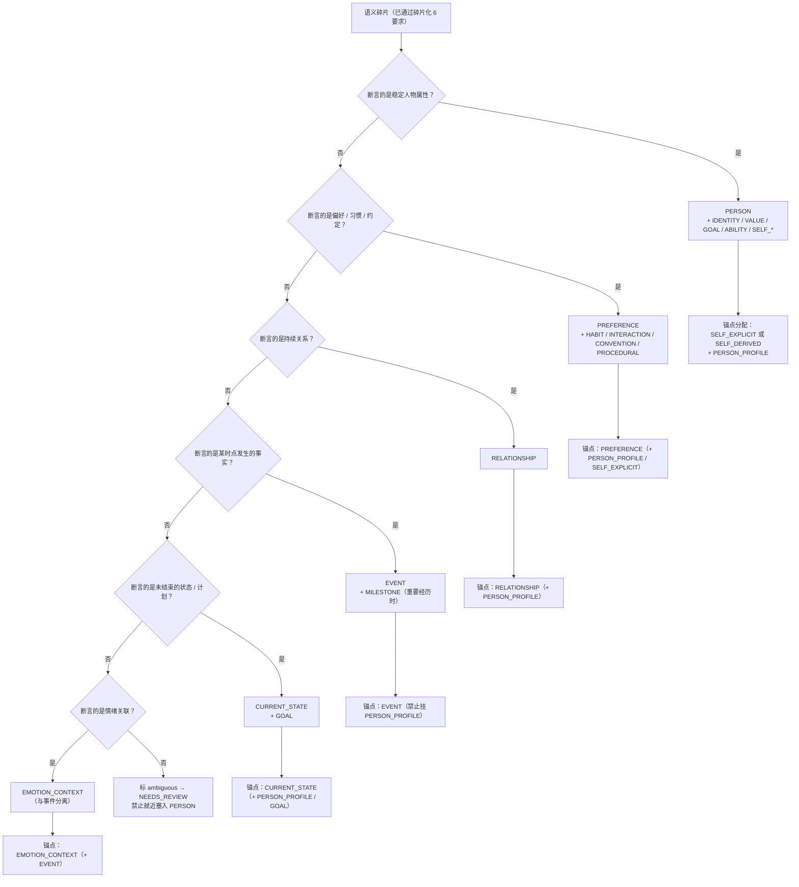
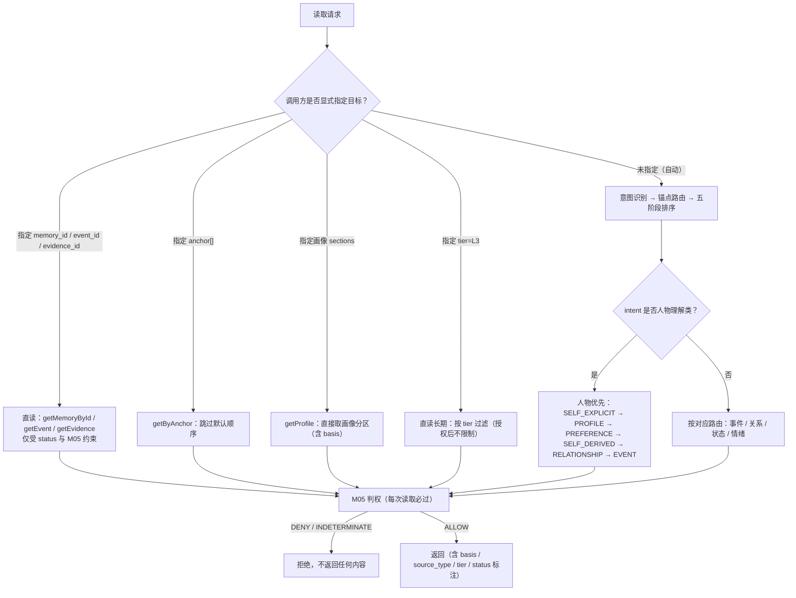

# 11 — Memory Anchor 与语义分类

> 文件代号：11 ｜ 所属交付：Memory Core R4.1 V1 架构升级（DD）｜ 设计 Agent 组：A 组（新增文档 09/10/11）
> 基准文件：`DD-AUTHORITY-V2.md` v2.0（**最高行为依据**）｜ 正式裁决台账：`08-adjudication-ledger.md`
> 语言/编码：中文 ／ UTF-8（无 BOM）

---

## 1. 文档状态

| 项目 | 内容 |
|---|---|
| 文件编号 | 11 |
| 文件名称 | Memory Anchor 与语义分类 |
| 当前版本 | 1.0 |
| 设计状态 | **PROPOSED**（设计成稿，未获用户逐条批准；已裁决部分见 §5） |
| 实施授权 | **无**（`DD-AUTHORITY-V2.md` §1：设计范围 P0–P6，实施按阶段授权） |
| 完成等级自评 | **F2 已达成**；F3 在"规格齐备 + 判定条件可执行"意义上达成；**F4 未达成** |
| 撰写依据 | `DD-AUTHORITY-V2.md` §2.1/§2.2/§2.3/§2.4/§2.5/§2.11/§8（检索五阶段与人物优先）、§3（对象字段）、§13；`DD-AUTHORITY.md` §8（15 节） |
| 关联未决项 | OI-026（CR-02）、OI-027（CR-03）、OI-031（CR-07）、本文件自有 OI-11-01~OI-11-08 |
| 目标阶段 | P2（M02 锚点路由与检索）、P3（M03 分类与锚点分配）、P4（M04 画像整合）；均**需阶段授权** |

**分节状态矩阵**

| 章节 | 状态 | 说明 |
|---|---|---|
| §2.1 语义 6 类 | **APPROVED 枚举**（V2 §2.1），逐类定义 PROPOSED | 枚举值 MUST 逐字一致 |
| §2.2 semantic_tags 12 值 | **APPROVED 枚举**（V2 §2.2） | 扩展须登记 |
| §2.3 anchor 8 值 | **APPROVED 枚举**（V2 §2.3） | MUST 逐字 |
| §2.4 subject_type 6 值 | **APPROVED 枚举**（V2 §2.4） | MUST 逐字 |
| §7.9 自述与推断分离 | PROPOSED，语义受 D-AP-05 与 V2 §3.5 约束 | 推断不得覆盖自述 |
| §7.12 tier × semantic_type 正交 | APPROVED 原则（V2 §2.5 铁律） | 矩阵本身 PROPOSED |
| §8 检索五阶段 | APPROVED（V2 §8） | 排序权重全部 EXP-DEFAULT |
| 情绪查询启用 | **默认关闭**（J6/CR-02） | 见 OI-026 |

---

## 2. 适用版本

| 维度 | 版本值 |
|---|---|
| 母本版本 | `R4.1-MASTER-01` |
| 基准裁决文件 | `DD-AUTHORITY-V2.md` v2.0（APPROVED，2026-11-04） |
| 正式裁决台账 | `08-adjudication-ledger.md`（第六轮后） |
| 枚举版本 | `enum_version = "v2"`（6 类 / 12 标签 / 8 锚点 / 6 主体 / 3 层 / 4 状态 / 6 候选态 / 5 来源 / 3 可见性 / 9 意图 / 4 读模式 / 4 时间位置 / 15 情绪） |
| 排序算法版本 | `anchor_rank_version = "1.0"`（写入响应 `meta.anchor_rank_version`） |
| Schema 版本 | `schema_version = "1.0"`；新增 `anchor-set.schema.json`、`read-request.schema.json`、`read-response.schema.json`（`contracts/schemas/`） |
| 参数版本 | 15 号参数注册表统一管理（本文不自行编号） |

**版本兼容（MUST）**：`enum_version` 变化 **MUST** 触发存量数据的锚点/分类重校验；**MUST NOT** 在 `enum_version` 混用下做跨版本排序比较。

---

## 3. 适用范围

### 3.1 覆盖范围

1. 语义类型 6 类的定义、包含内容、示例与反例、禁止事项。
2. 12 个 `semantic_tags` 的使用规则与扩展登记。
3. `SELF_EXPLICIT` 与 `SELF_DERIVED` 的强制分离（存储、推断不得覆盖自述、读取必须标明）。
4. 多标签原则与示例矩阵（一记忆可多类型）。
5. 主体维度 6 类与指代解析要求（不得因"我/你/他"直接认定主体）。
6. 生命周期（`L1`/`L2`/`L3`）与语义类型的解耦（3×6 矩阵与"事件 L3 不等于优先级最高"）。
7. `anchor` 8 个逐一定义（内容/典型查询/来源语义类型/是否可多选）。
8. 人物理解优先策略（6 步默认顺序 + 三条原则）与其他 4 类查询路由。
9. "优先≠强制读取"：7 种读取能力与"生命周期不限制授权后直读"。
10. Anchor 排序算法五阶段与"禁止单一固定权重全局排序"。
11. 人物理解 vs 事件回忆的差异化。
12. 查询意图 9 类 → 锚点默认映射表。
13. 测试要求（任务书 §18.1/§18.3）与验收标准。

### 3.2 明确不覆盖（边界声明）

| 对象 | 状态 | 边界说明 |
|---|---|---|
| 排序权重的最终数值 | EXP-DEFAULT | 全部需生活化测试集标定（D-AP-06） |
| Anchor Router 的实现代码 | P2 待授权（M02） | 本文只定义契约与算法规格 |
| 画像整合算法细节 | P4 待授权（M04、12 号文档） | 本文只定义画像与事件的关系与读取优先级 |
| 情绪查询能力启用 | **默认关闭**（J6/CR-02/OI-026） | 设计完整定义，实施关闭 |
| 情绪对当前状态的影响（ΔE） | **默认关闭**（CR-03/OI-027） | 见 13 号文档 |
| `public` 可见性启用 | **默认关闭**（CR-07/OI-031） | 定义但禁用 |
| 向量/Embedding 维度与模型 | 由 EmbeddingProfile 决定（R9） | 本文不写死 |
| 词表扩展（情绪/标签） | 配置管理（J4） | 扩展须登记，禁模型自创 |

### 3.3 读者对象

M02 实施 Agent（Anchor Router/排序）、M03 实施 Agent（分类与锚点分配）、M04 实施 Agent（画像）、L3 接入方（读取路径选择）、测试 Agent、审查 Agent。

---

## 4. 依赖文档

| 编号 | 文件 | 用途 | 权威层 |
|---|---|---|---|
| D1 | `DD-AUTHORITY-V2.md` | 枚举、§8 检索五阶段与人物优先、CR 清单 | **最高行为依据** |
| D2 | `DD-AUTHORITY.md` v1.0 | 15 节结构、R1（错误码）、R10（排序公式）、状态用语 | 第二层 |
| D3 | `08-adjudication-ledger.md` | D-AP-04/05、J2/J4/J6/J7、K-2/K-6、X-3、I-7、CR-09 | **第一层** |
| D4 | `00-总体架构与设计原则.md` | 三组件/五平面、模块边界 | 第三层 |
| D5 | `01-记忆本体与数据模型.md` | MemoryUnit/Evidence/Event/EmotionContext/PersonProfile 字段 | 第三层 |
| D6 | `02-核心算法规范.md` | ALG-02 检索、ALG-03 RRF、ALG-04 六特征排序、ALG-05 预算 | 第三层 |
| D7 | `04-权限与治理规范.md` | M05 判权与可见性 | 第三层 |
| D8 | `06-测试与评估规范.md` | TEL 层级、Benchmark、E2E | 第三层 |
| D9 | `09-记忆摄取Pipeline.md` | 阶段 6 分类 / 阶段 9 锚点分配 | 同级（互引） |
| D10 | `10-LLM调用体系.md` | L1/L2 分工与降级 | 同级（互引） |
| D11 | `12-人物画像整合.md`（待成稿） | 画像分区与 `basis` | 引用目标 |
| D12 | `15-参数注册表.md`（待成稿） | 参数 ID 与 11 属性 | 引用目标 |

**依赖约束**：D11/D12 未成稿条款 **MUST NOT** 作为已批准依据；引用附"（待成稿）"。

---

## 5. 正式裁决引用

| 台账编号 | 裁决要点 | 对本文档的约束 |
|---|---|---|
| D-AP-01 | 五模块边界；M03 提取 / M04 整合不可合并 | 分类与锚点分配归 M03；画像整合归 M04；本文 **MUST NOT** 让分类阶段产出画像结论 |
| D-AP-02 | M04 §6.2 唯一 LLM Gateway | §7.1 分类与锚点判定经 Gateway 调用，不自建 |
| D-AP-04 | 有摘要时索引主体="摘要+cue"；无摘要须回退 | 锚点路由不依赖正文全文；摘要缺失时回退策略见 01 §7.13 |
| D-AP-05 | `confirmed` 仅 M04 通道；`reinforce` 只预留禁写 | §7.9：推断不得写成已确认；读取不得触发 reinforce |
| D-AP-06 | 生活化测试集为主要验收；研究报告收益不得写成实测 | §12/§13：排序与分类指标全部待标定 |
| D-AP-07 | 五级可插拔；C40 不可插拔；`trusted_context_source: entry-only` | §7.15：读取路径的权限判定一律 M05 |
| I-3 | L0+L2 起步、五层 schema 预留 | 本文不涉及心理层 schema |
| I-5 | 心理状态机只改运行时、不产候选 | §7.7：`EMOTION_CONTEXT` 是记忆对象，不是心理状态 |
| I-7 | psy-model 暂不引入 | §3.2 |
| J2 | 写时情绪标注、检索期不调用 LLM | §7.15：读取期路由 **MUST NOT** 调用 LLM 做情绪推理 |
| J4 | 15 受控标签、配置管理 | §7.7：词表来自配置 |
| J6 | **首版关闭查询侧情绪感知** | §7.15/§7.19：`EMOTION_QUERY` 路由默认不启用（CR-02/OI-026） |
| J7 | 只预留接口与字段，不实现 LLM 标注与批量重放 | §7.7 DEFERRED 部分 |
| K-2 | 导出边界逐项确定；内部参数不默认导出 | §11：画像/锚点元数据不默认导出 |
| K-6 | openLoop 只由明确事件触发，永不由沉默触发 | §7.7：无明确事件即无情绪记忆 |
| X-3 | Recall 可参与推理；禁止直接改 PAD；持久变更走独立审核（③默认关闭） | §7.16：读取不写心理状态 |
| 优化-1 | Token 计量五分类 | §8.5：读取预算按记忆/证据/画像分列 |
| 优化-5 | 参数 ID 稳定唯一可追踪 | §8.6 |
| U-1/U-2 | cache 结构与校验暂缓 | 本文不定义锚点缓存表 |
| CR-08A | 域内答复授权（≠ 用户批准） | §14 |
| CR-09 | 伦理门禁框架已接受，未实施验证 | §11 |

**未列入本表的做法均为 PROPOSED/TBD**，不得写作"已裁决"。

---

## 6. 术语表

| 术语 | 定义 | 来源 |
|---|---|---|
| 语义主类（`semantic_type`） | 记忆的语义归属，**单选**，6 值 | V2 §2.1 |
| 语义标签（`semantic_tags`） | 语义的细分标签，**多选**，含 12 个受控值 | V2 §2.2 |
| 获取锚点（`anchor`） | 检索时可独立路由的入口，**多选**，8 值 | V2 §2.3 |
| 主体类型（`subject_type`） | 记忆归属主体的类别，6 值 | V2 §2.4 |
| `SELF_EXPLICIT` | 主人**明确自我描述**；标签 + 锚点双身份 | V2 §2.2/§2.3 |
| `SELF_DERIVED` | 系统**推断**的人物特征；标签 + 锚点双身份 | V2 §2.2/§2.3 |
| 画像（PersonProfile） | M04 维护的派生视图，按 `section` 分区，带 `basis` | V2 §3.5 |
| `basis` | 画像条目的依据：`SELF_EXPLICIT`/`SELF_DERIVED`/`MIXED` | V2 §3.5 |
| 生命周期层级（tier） | `L1`/`L2`/`L3`，**与语义类型正交** | V2 §2.5 |
| 查询意图（`intent`） | 9 类查询意图分类 | V2 §2.11 |
| 读取模式（`read_mode`） | `summary`/`memory`/`evidence`/`related_evidence` | V2 §2.12 |
| 锚点路由（Anchor Router） | 意图 → 锚点集合的映射与候选检索 | V2 §8 阶段 1–2 |
| 分区组装 | 按锚点分组装配上下文，避免单一权重全局排序 | V2 §8 阶段 3/5 |
| 人物理解优先 | 人物类查询默认先自述/画像，再偏好，再推断，最后关系与事件 | V2 §8 |
| 优先≠强制 | 优先级只影响默认注入顺序，不限制授权后直读 | 本文 §7.16 |
| EXP-DEFAULT | 实验初值，非裁决值 | sf §15 |
| PROPOSED / TBD / VERIFY / BLOCKED / FUTURE / DEFERRED | 设计状态用语 | D2 §6 |

---

## 7. 规范正文

### 7.1 语义类型 6 类总览

> 枚举值 **MUST** 逐字取自 `DD-AUTHORITY-V2.md` §2.1，**MUST NOT** 使用同义变体（禁止 `PERSON_INFO`、`PREF`、`EMOTION` 等）。

| # | `semantic_type` | 定义 | 主要承载 | 典型锚点 | 典型 tier |
|---|---|---|---|---|---|
| 1 | `PERSON` | 人物信息：身份/背景/自我描述/特征/能力/价值观/长期目标/自我认知 | 画像类事实 | `SELF_EXPLICIT`、`SELF_DERIVED`、`PERSON_PROFILE` | `L3` |
| 2 | `PREFERENCE` | 偏好与互动习惯 | 喜欢/不喜欢/习惯/约定 | `PREFERENCE`、`PERSON_PROFILE` | `L3`（短期偏好可 `L2`） |
| 3 | `RELATIONSHIP` | 关系信息 | 人与人/人与群体的关系及其变化 | `RELATIONSHIP`、`PERSON_PROFILE` | `L3` |
| 4 | `EVENT` | 事件信息（事实） | 何时何地何人做了什么、结果 | `EVENT` | `L2`（重要经历可 `L3`） |
| 5 | `CURRENT_STATE` | 当前状态：计划/进行中/阶段性目标/困难/进度/临时状态 | 进行中的事与阶段 | `CURRENT_STATE`、`PERSON_PROFILE` | `L1`/`L2`（长期目标可 `L3`） |
| 6 | `EMOTION_CONTEXT` | 情感关联 | 事件相关情绪，或持续情绪 | `EMOTION_CONTEXT`、`EVENT` | 随事件（`L1`/`L2`） |

**总则（MUST）**

1. `semantic_type` **单选**；一单元有多个语义面向时，**MUST** 用 `semantic_tags` 表达，**MUST NOT** 拆成多个 `semantic_type`。
2. 分类 **MUST** 依据"内容断言的是什么"，**MUST NOT** 依据"用户说话的语气"或"出现的词"。
3. 事件与情绪 **MUST** 分离：`EVENT` 单元正文 **MUST NOT** 包含情绪判断（V2 §3.3）。
4. 分类结果 **MUST** 带 `confidence`，并 **MUST NOT** 把 `confidence` 解释为事实真实性。
5. 无法归类 ⇒ **MUST NOT** 就近塞入 `PERSON`；**MUST** 标 `ambiguous` 并进入复核（`NEEDS_REVIEW`）。

### 7.2 `PERSON`（人物信息）

**定义**：关于某个人物**稳定属性**的断言——身份、背景、自我描述、性格特征、能力、价值观、长期目标、自我认知。判别关键是"是否描述这个人的长期属性"，而非"某个时刻发生了什么"。

**包含内容（MUST 覆盖）**

| 子域 | 对应 `semantic_tags` | 说明 |
|---|---|---|
| 身份与背景 | `IDENTITY` | 姓名、年龄、职业、教育、家庭背景、居住地 |
| 价值观 | `VALUE` | 看重什么、原则、底线、信念 |
| 长期目标 | `GOAL` | 想达成的事（不是本周计划，那是 `CURRENT_STATE`） |
| 能力与技能 | `ABILITY` | 会什么、擅长什么、学习进度（稳定的） |
| 自我描述 | `SELF_EXPLICIT` | 主人**明确说出**的关于自己的描述 |
| 系统推断特征 | `SELF_DERIVED` + `OBSERVATION` | 由多条记忆归纳出的特征，**不得**冒充自述 |

**示例（3 条）**

1. 原句"我是做后端开发的，主要写 Go" ⇒ `PERSON` + `[SELF_EXPLICIT, IDENTITY, ABILITY]`，`anchor=[SELF_EXPLICIT, PERSON_PROFILE]`，`subject_type=OWNER`。
2. 原句"我这个人比较看重承诺，答应的事一定会做" ⇒ `PERSON` + `[SELF_EXPLICIT, VALUE]`，`anchor=[SELF_EXPLICIT, PERSON_PROFILE]`。
3. 系统归纳：主人多次在深夜回复、并提到白天要上班 ⇒ `PERSON` + `[SELF_DERIVED, OBSERVATION, HABIT]`，`source_type=ASSISTANT_INFERRED`，`anchor=[SELF_DERIVED, PERSON_PROFILE]`，`basis`（画像侧）为 `SELF_DERIVED`。

**反例（2 条）**

1. 反例：把"主人昨天加班到 11 点"判为 `PERSON` ⇒ 错。**昨天加班**是 `EVENT`；只有"长期加班/作息习惯"才可能是 `PERSON`+`HABIT`。
2. 反例：把"主人喜欢喝美式"判为 `PERSON` ⇒ 错。这是 `PREFERENCE`（偏好），不是人物属性；虽然它也会进画像，但语义主类是 `PREFERENCE`。

**禁止事项（MUST NOT）**

1. **MUST NOT** 把单次行为上升为人物特征（"今天迟到"⇒ "不守时"）——推断需多条证据且标 `SELF_DERIVED`。
2. **MUST NOT** 把 `EVENT`/`CURRENT_STATE`/`PREFERENCE` 的内容硬塞进 `PERSON` 以免除分类责任。
3. **MUST NOT** 让 `PERSON` 单元同时承载"画像结论"和"具体事件"（见 §7.13 混单元禁令）。
4. **MUST NOT** 在没有证据时补全身份信息（"应该是 30 岁左右"）。
5. **MUST NOT** 把群成员的推断特征与主人自述混在同一单元。

### 7.3 `PREFERENCE`（偏好与互动习惯）

**定义**：关于"喜欢/不喜欢/习惯/约定"的稳定倾向断言，包括对事物、话题、交互方式、协作节奏的偏好。

**包含内容**

| 子域 | 对应 `semantic_tags` | 说明 |
|---|---|---|
| 喜好/厌恶 | `PREFERENCE`（主类自带） | 喜欢的食物、话题、工具、风格 |
| 习惯 | `HABIT` | 作息、工作方式、提示习惯 |
| 互动方式 | `INTERACTION` | 希望被如何回应（简洁/详细/先结论） |
| 长期约定 | `CONVENTION` | "以后都用中文回答"这类约定 |
| 流程/方法偏好 | `PROCEDURAL` | 喜欢某种流程（如"先给方案再执行"） |

**示例（3 条）**

1. 原句"我更喜欢先看结论，细节放后面" ⇒ `PREFERENCE` + `[SELF_EXPLICIT, INTERACTION, CONVENTION]`，`anchor=[PREFERENCE, SELF_EXPLICIT, PERSON_PROFILE]`。
2. 原句"以后别叫我老板，叫我名字就行" ⇒ `PREFERENCE` + `[SELF_EXPLICIT, INTERACTION, CONVENTION]`；这是称呼约定，**长期有效**，`lifecycle_candidate` 倾向 `L3`。
3. 原句"我不吃香菜" ⇒ `PREFERENCE` + `[SELF_EXPLICIT, HABIT]`（饮食限制，稳定）。

**反例（2 条）**

1. 反例：把"这次先不用总结"判为 `PREFERENCE` ⇒ 错。这是一次性指令（`CURRENT_STATE` 或临时约定 `L1`），不是稳定偏好。
2. 反例：把"主人不喜欢没有明确目标的长期任务"只判为 `PREFERENCE` 而丢掉 `PERSON`＋`SELF_EXPLICIT` ⇒ 错。该句是对自身工作倾向的自述，主类应为 `PERSON`，`PREFERENCE` 作为标签（见 09 §7.10 示例）。

**禁止事项（MUST NOT）**

1. **MUST NOT** 由一次表达推导稳定偏好；**MUST** 有"稳定/反复/明确"至少一项依据。
2. **MUST NOT** 把偏好写成"事实"（"主人喜欢 X"不是"X 是好的"）。
3. **MUST NOT** 跨主体套用偏好（"A 喜欢咖啡"≠"B 喜欢咖啡"）。
4. **MUST NOT** 把偏好用于推断能力或身份（"喜欢看球"⇒ "是球迷"这类弱推断须标 `SELF_DERIVED` 且低置信）。

### 7.4 `RELATIONSHIP`（关系信息）

**定义**：两个主体之间、或主体与群体之间**持续存在**的关系及其性质/变化。

**包含内容**

| 子域 | 说明 |
|---|---|
| 关系类型 | 家人、朋友、同事、上下级、伴侣、师生、合作方 |
| 关系强度/性质 | 亲近、疏远、紧张、依赖 |
| 关系变化 | 从同事变为前同事、从合作变为竞争 |
| 群体归属 | 属于哪个群/团队/组织（`subject_type=GROUP` 一端） |

**示例（3 条）**

1. 原句"老王是我大学室友，现在还在一个群里" ⇒ `RELATIONSHIP`（主人 ↔ 老王，类型=室友/朋友）+ 群体归属（群），`anchor=[RELATIONSHIP, PERSON_PROFILE]`。
2. 原句"我跟我姐关系挺好的，啥都能聊" ⇒ `RELATIONSHIP`（主人 ↔ 姐姐，性质=亲近），`subject_type=OWNER` 为归属方，对方为 `THIRD_PARTY`。
3. 原句"我上周从 A 公司离职了，现在不是同事了" ⇒ 关系变化：`RELATIONSHIP`（关系变更）+ `EVENT`（离职事件，`EVENT` 主类），两条分别建单元并后续由 M04 建 `SUPERSEDES`/`CONTRADICTS` 关系。

**反例（2 条）**

1. 反例：把"今天跟老王一起吃饭"判为 `RELATIONSHIP` ⇒ 错。这是 `EVENT`；只有"与老王是朋友/同事"才是关系。
2. 反例：把"主人回复了群里的消息"判为 `RELATIONSHIP` ⇒ 错。单次互动不构成关系（K-6 同源纪律：不得由单次/沉默推断关系或情绪）。

**禁止事项（MUST NOT）**

1. **MUST NOT** 由一次互动推断关系存在或关系强度。
2. **MUST NOT** 把关系写成对称而实际不对称（上下级、师生有方向）；方向 **MUST** 显式记录。
3. **MUST NOT** 在关系中泄露另一端主体的私密信息（读取时按 M05 判权，见 §7.16）。
4. **MUST NOT** 把 `RELATIONSHIP` 与 `ABOUT` 关系边混同：前者是记忆语义，后者是记忆间关系类型（V2 §2.15）。

### 7.5 `EVENT`（事件信息/事实）

**定义**：在某个时间（或时间区间）发生、有参与方、有（可选）地点与结果的**事实**。事件单元只写事实，**不写情绪判断**。

**包含内容**

| 子域 | 说明 |
|---|---|
| 时间 | `time_start`/`time_end` 或 `observed_at`；未知为 `null` |
| 参与方 | `participants[]`（`subject_id` 列表，可为群体） |
| 地点 | `location`（可选） |
| 结果 | `result`（可选，事实性结果） |
| 重要经历 | 加 `MILESTONE` 标签（如毕业、入职、项目上线） |

**示例（3 条）**

1. 原句"上周三我把论文初稿交了" ⇒ `EVENT` + `[MILESTONE]`（如确属重要节点），`anchor=[EVENT]`，`lifecycle_candidate=L2`（重要经历可 `L3`）。
2. 原句"昨天下午跟产品开了两小时评审会，最后定了 A 方案" ⇒ `EVENT`（时间/参与方/结果齐全），`anchor=[EVENT]`；"最后定了 A 方案"作为 `result`，**不是**情绪。
3. 原句"我三月入职了 B 公司" ⇒ `EVENT` + `[MILESTONE]`；同时可能衍生 `CURRENT_STATE`（在职）与 `RELATIONSHIP`（同事关系），**MUST** 拆为独立单元。

**反例（2 条）**

1. 反例：把"上周三交初稿，我特别紧张"写成一条 `EVENT` 且正文含"特别紧张" ⇒ 错。情绪 **MUST** 分离为 `EMOTION_CONTEXT`（`temporal_position=DURING`，`event_id` 指向该事件）。
2. 反例：把"下周要交初稿"（未来计划）写成 `EVENT` 且 `observed_at` 填未来时间 ⇒ 错。应为 `CURRENT_STATE`（计划/进行中），`temporal_kind=FUTURE_PLAN`。

**禁止事项（MUST NOT）**

1. **MUST NOT** 在事件正文写入情绪、评价、推测（"他肯定不高兴"）。
2. **MUST NOT** 把未来计划、假设、取消的事写成"已发生事件"。
3. **MUST NOT** 把不同时间的相似事件合并为一条（09 §7.16 禁令）；重复发生可归纳为 `HABIT` 类偏好/习惯单元，但原事件各保留。
4. **MUST NOT** 缺时间就编造时间；未知 `MUST` 为 `null`。
5. **MUST NOT** 把"重要经历"以外的普通事件无条件升为 `L3`。

### 7.6 `CURRENT_STATE`（当前状态）

**定义**：在某个时点有效、**尚未结束**的状态：正在推进的计划、阶段性目标、当前困难、进度、临时状态。

**包含内容**

| 子域 | 说明 |
|---|---|
| 进行中的计划 | 有起点、未结束、有阶段目标 |
| 阶段性任务 | 当前正在做的事（区别于长期目标 `PERSON`+`GOAL`） |
| 当前困难 | 卡点、阻塞、待解决 |
| 进度 | 完成度、阶段结论 |
| 临时状态 | 短期情绪性状态之外的临时处境（出差、休假、生病恢复中） |

**示例（3 条）**

1. 原句"我最近在准备考研，专业课已经过完一轮" ⇒ `CURRENT_STATE` + `[GOAL, MILESTONE]`（阶段性），`anchor=[CURRENT_STATE, PERSON_PROFILE]`，`lifecycle_candidate=L2`。
2. 原句"这个项目现在卡在等对方回数据" ⇒ `CURRENT_STATE`（困难/阻塞），`anchor=[CURRENT_STATE]`。
3. 原句"我这周在出差，回消息会慢" ⇒ `CURRENT_STATE`（临时状态），`lifecycle_candidate=L1`，**MUST** 记有效期（`valid_until` 可解析则填）。

**反例（2 条）**

1. 反例：把"我想成为架构师"判为 `CURRENT_STATE` ⇒ 错。这是长期目标（`PERSON`+`GOAL`，`L3`），不是当前阶段状态。
2. 反例：把"考研上岸了"判为 `CURRENT_STATE` ⇒ 错。计划已结束，应转为 `EVENT`（`ENDED`/已发生）并让旧状态 `SUPERSEDED`（由 M04 处理）。

**禁止事项（MUST NOT）**

1. **MUST NOT** 把已结束/已取消的计划继续标为 `CURRENT_STATE` 而不标记结束时间。
2. **MUST NOT** 把 `CURRENT_STATE` 当作情绪（"最近很焦虑"若指情绪应为 `EMOTION_CONTEXT`；若指处境"最近压力大"可 `CURRENT_STATE`，须给出判断依据）。
3. **MUST NOT** 让 `CURRENT_STATE` 无限期有效；`L1`/`L2` 状态 **MUST** 有过期/复核机制。
4. **MUST NOT** 把未来计划的完成情况写得像已发生。

### 7.7 `EMOTION_CONTEXT`（情感关联）

**定义**：与某事件相关、或独立存在的情绪状态记录；**与事件事实分离**，带强度、置信度、时间位置与来源性质。

**包含内容**

| 字段（V2 §3.4） | 说明 |
|---|---|
| `emotion_label` | 15 受控标签之一（配置管理） |
| `raw_label` | 原始表达（越界时保留） |
| `intensity` / `confidence` | 0–1 |
| `temporal_position` | `BEFORE`/`DURING`/`AFTER`/`UNKNOWN` |
| `source_type` | 仅 `USER_EXPLICIT` 或 `ASSISTANT_INFERRED` |
| `event_id` | 可 null（无具体事件的持续情绪） |

**受控词表（15 值，MUST 逐字，配置管理 J4）**：

```text
neutral, happy, excited, calm, relieved, grateful, affectionate,
sad, anxious, frustrated, angry, tired, lonely, guilty, confused
```

**MUST**：`emotion_label` 只能取上表值；**MUST NOT** 自创标签（如 `upset`、`stressed`、`bored`）；越界表达 **MUST** 映射为 `neutral` 并把原词写入 `raw_label`（原始表达不得丢弃）。

**示例（3 条）**

1. 原句"交完初稿那一刻我松了口气" ⇒ `EMOTION_CONTEXT`（`relieved`，`DURING`/`AFTER`，`USER_EXPLICIT`，`event_id`=交稿事件）。
2. 原句"最近总有点焦虑，说不上为什么" ⇒ `EMOTION_CONTEXT`（`anxious`，`event_id=null`，`source_type=USER_EXPLICIT`），**MUST NOT** 强行挂到某个事件上。
3. 系统从语气推断"用户此刻似乎很疲惫" ⇒ 仅当 `emotion.auto_infer=true`（默认关闭）才允许，`source_type=ASSISTANT_INFERRED`，低 `confidence`，且**不得**写成用户情绪事实。

**反例（2 条）**

1. 反例：把"我特别紧张"写进 `EVENT` 正文 ⇒ 错。事件只写事实，情绪 **MUST** 单独成 `EMOTION_CONTEXT`。
2. 反例：因"用户没回复"而推断"用户不开心/生气" ⇒ 错。无明确事件即无情绪（K-6/CR-09）；沉默 **MUST NOT** 触发任何情绪记忆。

**禁止事项（MUST NOT）**

1. **MUST NOT** 由沉默、延迟、无表情符号推断情绪。
2. **MUST NOT** 使用 15 标签之外的 `emotion_label`；越界 **MUST** 映射 `neutral` 且保留 `raw_label`。
3. **MUST NOT** 把 `ASSISTANT_INFERRED` 情绪写成 `USER_EXPLICIT`，也 **MUST NOT** 把两者合并为一条。
4. **MUST NOT** 把情绪写回事件事实、**MUST NOT** 改 `validation_state`、**MUST NOT** 直接改 PAD（X-3/CR-03）。
5. **MUST NOT** 在检索期由 LLM 现场推断情绪（J2/J6）。

### 7.8 `semantic_tags` 12 值使用规则

| 标签 | 可与哪些主类组合 | 使用条件 | 禁止 |
|---|---|---|---|
| `SELF_EXPLICIT` | `PERSON`（主）、`PREFERENCE`、`RELATIONSHIP`、`CURRENT_STATE` | 主人**明确说出**关于自身的内容 | 与 `SELF_DERIVED` 同挂 |
| `SELF_DERIVED` | `PERSON`（主）、`PREFERENCE` | 系统推断且 `source_type=ASSISTANT_INFERRED` | 冒充自述；无证据推断 |
| `PROCEDURAL` | `PERSON`、`PREFERENCE` | 流程/方法/能力的稳定描述 | 把一次性步骤当长期流程 |
| `OBSERVATION` | `PERSON`、`PREFERENCE`、`RELATIONSHIP` | 派生观察（来自多条记忆） | 当原始事实；不带来源 |
| `IDENTITY` | `PERSON` | 身份/背景 | 猜测身份 |
| `VALUE` | `PERSON` | 价值观 | 把偏好当价值观 |
| `GOAL` | `PERSON`、`CURRENT_STATE` | 长期目标（`PERSON`）/阶段目标（`CURRENT_STATE`） | 把计划完成写成目标达成 |
| `ABILITY` | `PERSON` | 稳定能力 | 由单次成功推断能力 |
| `HABIT` | `PREFERENCE`、`PERSON` | 重复性行为模式 | 由一次行为推断习惯 |
| `INTERACTION` | `PREFERENCE` | 互动方式偏好 | 把一次要求当长期方式 |
| `CONVENTION` | `PREFERENCE` | 长期约定（称呼/语言/格式） | 把一次指令当约定 |
| `MILESTONE` | `EVENT`、`CURRENT_STATE` | 重要节点 | 给普通事件滥用 `MILESTONE` |

**扩展规则（MUST）**：新增标签 **MUST**（1）登记到 15 号参数/枚举注册表；（2）声明可组合主类；（3）给出正反例；（4）走变更流程。**MUST NOT** 在 `tags_extra` 之外自创未登记标签参与检索。

### 7.9 `SELF_EXPLICIT` vs `SELF_DERIVED` 强制分离

**定义**

- `SELF_EXPLICIT`：主人**明确说出**的关于自身的内容（"我不吃香菜""我更喜欢先看结论"）。
- `SELF_DERIVED`：系统**推断**的人物特征（"主人可能偏内向"），必须可追溯到推断依据。

**三条强制规则（MUST）**

| 编号 | 规则 | 实现要求 | 可测判定 |
|---|---|---|---|
| R1 | **独立存储** | 二者 **MUST** 为不同 `MemoryUnit`（不同 `memory_id`），**MUST NOT** 同单元混挂 | 同单元同时含两标签 ⇒ Schema 拒绝 |
| R2 | **推断不得覆盖自述** | `SELF_DERIVED` **MUST NOT** 覆盖、改写、失效化任何 `SELF_EXPLICIT`；冲突时自述优先，推断让位（09 §7.17 冲突类型 3） | 注入冲突样例，自述记录零改写 |
| R3 | **读取时必须标明** | 任何返回给 L3/宿主的条目 **MUST** 携带 `basis`/`source_type` 与标签；**MUST NOT** 把推断呈现为"用户说过" | 响应字段缺失 ⇒ 视为不合格响应 |

**存储与画像映射（MUST）**

- `PersonProfile.basis` **MUST** 取 `SELF_EXPLICIT` / `SELF_DERIVED` / `MIXED`；`MIXED` **MUST** 同时列出双方来源 ID（`source_memory_ids`）。
- **MUST NOT** 在同一画像条目内把自述与推断合并成"无来源结论"（V2 §3.5 `basis` 说明）。
- 读取画像时 **MUST** 按分区返回 `basis`，让调用方自行决定是否采信。

**禁止事项（MUST NOT）**

1. **MUST NOT** 用推断修正自述（"用户说不讨厌，但推断其实讨厌"这类输出禁止）。
2. **MUST NOT** 在自述缺失时用推断"补全"自述分区（`self_explicit` 分区只能放自述）。
3. **MUST NOT** 因推断置信度高就把它标成 `SELF_EXPLICIT`。
4. **MUST NOT** 在摘要/上下文中省略 `basis` 标注（省略即误导）。

### 7.10 多标签原则与示例矩阵

**原则（MUST）**

1. **一条记忆可有多个语义面向**，但 `semantic_type` **MUST** 单选（V2 §2.1）；多面向 **MUST** 通过 `semantic_tags`（多选）+ `anchor`（多选）表达。
2. 当一条内容确实包含**两个不同主类断言**（例如"我入职了 B 公司，所以我同事是老王"）时，**MUST** 拆为多条单元（`EVENT` + `RELATIONSHIP`），**MUST NOT** 用标签硬凑一条。
3. 标签 **MUST** 与主类兼容（§7.8 表）；**MUST NOT** 出现"主类与标签互相矛盾"（如 `EVENT` + `VALUE`）。
4. 标签 **MUST NOT** 用于提升排序优先级；标签是语义描述，不是权重。
5. `tags_extra` 允许扩展，但 **MUST** 登记，且 **MUST NOT** 参与未登记的检索规则。

**5 组示例矩阵（MUST 逐字段给出）**

| # | 原句（脱敏示例） | `semantic_type` | `semantic_tags` | `anchor` | `lifecycle_candidate` / `source_type` | 说明 |
|---|---|---|---|---|---|---|
| M1 | "主人不太喜欢没有明确目标的长期任务" | `PERSON` | `[SELF_EXPLICIT, PREFERENCE, INTERACTION]` | `[SELF_EXPLICIT, PERSON_PROFILE, PREFERENCE]` | `L3` / `USER_EXPLICIT` | 自述 + 偏好 + 互动倾向；**非**事件 |
| M2 | "我三月入职了 B 公司，做数据平台" | `EVENT` + 另建 `PERSON`（身份） | 事件：`[MILESTONE]`；身份：`[SELF_EXPLICIT, IDENTITY, ABILITY]` | 事件：`[EVENT]`；身份：`[SELF_EXPLICIT, PERSON_PROFILE]` | 事件 `L2` / 身份 `L3`；均 `USER_EXPLICIT` | 两个主类断言 ⇒ **拆两条** |
| M3 | "我跟老王是大学室友" | `RELATIONSHIP` | `[SELF_EXPLICIT]` | `[RELATIONSHIP, PERSON_PROFILE]` | `L3` / `USER_EXPLICIT` | 关系不是事件 |
| M4 | "最近在准备考研，专业课过完一轮了" | `CURRENT_STATE` | `[GOAL, MILESTONE]` | `[CURRENT_STATE, PERSON_PROFILE]` | `L2` / `USER_EXPLICIT` | 阶段状态；`MILESTONE` 指阶段节点 |
| M5 | "交完初稿那一刻我松了口气" | `EMOTION_CONTEXT` + 另建 `EVENT`（交稿） | 情绪：`[]`（标签用于事实，不用于情绪） | 情绪：`[EMOTION_CONTEXT, EVENT]` | `L1`（情绪随事件）/ `USER_EXPLICIT` | 事实与情绪 **分离**，`event_id` 关联 |

**MUST**：上表 5 组 **MUST** 作为分类回归用例（§12 TS-11-04），任何一组分类错误即视为分类规则未达标。

### 7.11 主体维度 6 类与指代解析

**主体类型（MUST 逐字，V2 §2.4）**

| # | `subject_type` | 定义 | 示例 | 注意 |
|---|---|---|---|---|
| 1 | `OWNER` | 主人（系统服务的用户本人） | "我喜欢…" | 与 `ASSISTANT` 严格区分 |
| 2 | `ASSISTANT` | 聊天机器人 | "你上次说的…"（对机器人说话） | 不得把机器人当主人 |
| 3 | `MEMBER` | 其他群成员 | 群里的张三 | 群内身份 **MUST** 经宿主映射 |
| 4 | `THIRD_PARTY` | 其他人物（不在当前群/会话） | "我老板" | 关系指代需解析 |
| 5 | `GROUP` | 群体 | "我们组"、"大家" | 群体不逐个展开成员 |
| 6 | `SYSTEM` | 系统信息 | 系统事件、工具结果 | 无发言人时使用 |

**`subject_id` 解析要求（MUST）**

1. **MUST** 由 `EntityResolver`（09 §7.12）产出稳定 ID；**MUST NOT** 使用显示名作主键。
2. **MUST NOT** 因出现"我/你/他/她"直接认定主体；**MUST** 依据发言者、先行词、关系指代规则。
3. 解析不确定 ⇒ `subject_id=null` + `unresolved_reference`，并 **MUST** 被阶段 14 拒绝（不猜测、不合并）。
4. 跨群体/跨会话的同一人 **MUST** 映射到同一稳定 ID；映射失败 **MUST** 保留原文并标记，不得新建重复主体。
5. 主体与 `subject_type` **MUST** 同时给出；**MUST NOT** 只给 `subject_id` 而缺类型。

**指代解析四类（MUST 有明确依据字段）**

| 形态 | 依据 | 失败处置 |
|---|---|---|
| 第一/第二人称 | 发言者 ID + 会话参与者 | 发言者未知 ⇒ 不解析 |
| 第三人称 | 最近先行词 + 会话窗口 | 无先行词 ⇒ `null` |
| 昵称/别名 | 主体别名表 + 宿主映射 | 多候选 ⇒ 不合并 |
| 关系指代（"我老板"） | 关系表 + 上下文 | 关系不唯一 ⇒ 保留描述 |

### 7.12 生命周期与语义类型解耦（3×6 矩阵）

**铁律（MUST）**：`memory_tier` 与 `semantic_type` **正交**；`tier ≠ 重要程度`；**事件即使 `L3` 也不得在所有查询中优先于人物描述**（V2 §2.5）。

**3×6 矩阵（典型基准，非硬绑定；`●` 常见、`○` 可能、`—` 罕见/不适用）**

| `semantic_type` ＼ tier | `L1` | `L2` | `L3` |
|---|---|---|---|
| `PERSON` | ○（临时自述、未确认片段） | ○（阶段性人物状态） | ●（稳定人物描述/明确自述/长期目标） |
| `PREFERENCE` | ○（一次性口味反馈） | ○（短期偏好） | ●（长期偏好/长期约定） |
| `RELATIONSHIP` | ○（临时同行） | ○（关系变化观察期） | ●（长期关系） |
| `EVENT` | ○（当日琐事） | ●（近期重要事件） | ○（重要经历 `MILESTONE`） |
| `CURRENT_STATE` | ●（临时状态/短任务） | ●（推进中计划） | ○（长期目标型状态） |
| `EMOTION_CONTEXT` | ●（即时情绪） | ○（阶段性情绪） | —（情绪不作长期稳定属性） |

**矩阵使用规则（MUST）**

1. 矩阵只是**默认倾向**；最终 `tier` **MUST** 由 M04 整合裁决，M03 只给 `lifecycle_candidate`。
2. **MUST NOT** 以 `tier` 决定读取优先级：`L3` 事件在事件查询中优先，但在人物理解查询中仍排在画像之后（§7.14）。
3. **MUST NOT** 把 `L1` 等同于"可丢弃"；`L1` 只是"可快速过期"，仍受权限与证据约束。
4. **MUST NOT** 因内容"重要"就直接置 `L3`；**MUST** 有稳定/明确/多次/用户明确要求等依据。
5. `L1` 数据 **MUST NOT** 自动晋升 `L3`（X-2：Session 结束丢弃短期状态；`L1` 仅预留）。

**"事件 L3 不等于优先级最高"的明确说明（MUST 写入实现注释）**

> 一条 `EVENT` 记忆被标为 `L3`（例如"主人拿到了学位"），只表示它值得长期保留。在**人物理解**类查询中，它 **MUST NOT** 排在 `SELF_EXPLICIT` 与 `PERSON_PROFILE` 之前；只有在**事件回忆**类查询中，它才可以排前。优先级由**查询意图 + 锚点路由**决定，而不是由 `tier` 决定。

### 7.13 `anchor` 8 个逐一定义

> 单元级 `anchor` **多选，≥1**；`SELF_EXPLICIT` 与 `SELF_DERIVED` 在同一单元上互斥（§7.9 R1）。

| # | `anchor` | 内容含义 | 典型查询 | 来源语义类型 | 单元级可多选 |
|---|---|---|---|---|---|
| 1 | `SELF_EXPLICIT` | 主人明确自述的原文性内容 | "我说过我喜欢什么？""我怎么形容自己的？" | `PERSON`、`PREFERENCE`、`RELATIONSHIP`、`CURRENT_STATE` | 是（与 `SELF_DERIVED` 互斥） |
| 2 | `SELF_DERIVED` | 系统推断的人物特征 | "系统觉得我是什么样的人？""有什么观察？" | `PERSON`、`PREFERENCE` | 是（与 `SELF_EXPLICIT` 互斥） |
| 3 | `PERSON_PROFILE` | 画像条目（整合后的分区描述） | "介绍一下我""我的价值观是什么？" | `PERSON`、`PREFERENCE`、`RELATIONSHIP`、`CURRENT_STATE` | 是 |
| 4 | `PREFERENCE` | 偏好与互动习惯 | "我喜欢什么回应风格？""我讨厌什么？" | `PREFERENCE` | 是 |
| 5 | `RELATIONSHIP` | 关系与关系变化 | "我和老王什么关系？""我团队有谁？" | `RELATIONSHIP` | 是 |
| 6 | `EVENT` | 事件事实 | "上周三我做了什么？""那次评审结论是什么？" | `EVENT` | 是 |
| 7 | `CURRENT_STATE` | 当前状态/进行中计划 | "我现在在忙什么？""考研准备到哪了？" | `CURRENT_STATE` | 是 |
| 8 | `EMOTION_CONTEXT` | 情感关联 | "那次我什么感受？""最近我情绪怎样？" | `EMOTION_CONTEXT` | 是（默认不注入，见 §7.15） |

**分配规则（MUST）**

1. 明确自述 ⇒ **MUST** 挂 `SELF_EXPLICIT`；推断 ⇒ **MUST** 挂 `SELF_DERIVED`；二者 **MUST NOT** 同挂。
2. 事件 ⇒ **MUST** 挂 `EVENT`；**MUST NOT** 挂 `PERSON_PROFILE`（画像与事件不得混为一个单元，09 §7.13）。
3. 画像整合产物 ⇒ **MUST** 挂 `PERSON_PROFILE`；**MUST NOT** 把原始事件句直接挂 `PERSON_PROFILE`。
4. `anchor` **MUST NOT** 为空；无锚点的候选 **MUST** 被拒（`no_anchor`）。
5. 锚点 **MUST NOT** 用于扩权：`anchor` 不参与 `visibility`/`scope` 判定。

### 7.14 人物理解优先策略（默认顺序 6 步 + 三条原则）

**默认获取顺序（MUST，且仅适用于人物理解类查询）**

```text
第 1 步  SELF_EXPLICIT      主人明确自述（最高可信，先给）
第 2 步  PERSON_PROFILE     整合后的画像分区（含 basis 标注）
第 3 步  PREFERENCE         偏好与互动习惯
第 4 步  SELF_DERIVED       系统推断特征（明确标注为推断）
第 5 步  相关 RELATIONSHIP  与该人物相关的关系
第 6 步  相关 EVENT         只作补充，按需取用
```

**三条原则（MUST）**

| # | 原则 | 说明 | 反模式 |
|---|---|---|---|
| 1 | **自述优先于推断** | 同一属性自述与推断冲突时，自述在前且推断标 `disputed`/降权；不得并列混淆 | 把"推断我偏内向"放在"我说我挺外向"之前 |
| 2 | **画像优先于大量事件** | 人物理解任务 **MUST NOT** 用大量事件碎片挤占画像位置 | 把 20 条琐事事件排在画像前面 |
| 3 | **事件只补充不淹没** | 事件用于"举例/佐证"，**MUST** 限制条数（受 Token 预算与 `retrieval.profile.event_supplement_max` EXP-DEFAULT 约束） | 事件占满预算导致画像被裁掉 |

**适用边界（MUST）**：该顺序 **MUST NOT** 被当作所有查询的固定顺序；事件回忆、原句取证、状态查询各自按其路由（§7.15）。**MUST NOT** 在非人物查询中强行应用人物优先。

### 7.15 其他 4 类查询路由（各给顺序）

| 查询类别 | 默认顺序（MUST 保序） | 取用说明 | 禁止 |
|---|---|---|---|
| **事件查询** | `EVENT` → 证据（原句） → 关联人物（`ABOUT`/participants） →（按需）`EMOTION_CONTEXT` | 先给事实（时间/参与方/结果），再给原句，再给人物背景；情绪**仅在按需**时追加 | 先给情绪再给事实；把画像当事件结论；无事件时用画像"推测发生了什么" |
| **关系查询** | `RELATIONSHIP` → 关系变化事件 → 画像（相关分区） → 证据 | 先给当前关系，再给变化过程，再给画像描述，最后原句 | 把单次互动当关系；跨端泄露对方隐私 |
| **状态查询** | `CURRENT_STATE` → 近期事件 → 目标/偏好（`GOAL`、`PREFERENCE`） | 先给"现在怎样"，再给"最近发生了什么"，再给"想达成什么" | 把已结束状态当当前；用旧状态覆盖新状态 |
| **情绪查询** | `EMOTION_CONTEXT` → 事件 → Psychology 当前状态（**DEFERRED/BLOCKED**） | **默认不启用**（J6/CR-02/OI-026）；启用须重新裁决；情绪须标 `source_type` 与 `temporal_position` | 检索期由 LLM 现场推断情绪（J2）；由沉默推断（K-6）；把情绪写回事件 |

**通用约束（MUST）**

1. 四类路由 **MUST NOT** 套用人物优先顺序；人物优先只用于人物理解类查询（§7.14）。
2. 任何路由 **MUST** 经 M05 权限过滤（阶段 4），且 **MUST NOT** 用索引内容替代权威正文。
3. 情绪默认不注入：除非查询涉及情绪或对话与事件情绪关联足够，否则 **MUST NOT** 注入 `EMOTION_CONTEXT`（V2 §8 末段）。

### 7.16 优先 ≠ 强制读取：7 种读取能力

> 核心论点：锚点优先级只决定**默认路由与注入顺序**，**MUST NOT** 限制"授权后直读"。

| # | 读取能力 | 对应接口（V2 §7） | 是否受锚点优先级限制 | 说明 |
|---|---|---|---|---|
| 1 | 自动锚点路由 | `memory.search(query, opts)` | 是（默认路径） | 由意图识别决定锚点集合与顺序 |
| 2 | 指定锚点读取 | `memory.getByAnchor(anchor[], subject_id?)` | **否** | 调用方显式指定锚点，跳过默认顺序 |
| 3 | 指定记忆 ID 直读 | `memory.getMemoryById(memory_id, version?)` | **否** | 精确读取，不受排序影响 |
| 4 | 直读长期记忆 | `memory.search` + `tier=L3` 过滤（或 `getByAnchor` + tier 过滤） | **否** | 授权后可直接按 tier 取，不经过人物优先链 |
| 5 | 指定画像 | `memory.getProfile(subject_id, sections?)` | **否** | 直接取画像分区（含 `basis`） |
| 6 | 事件 + 证据 | `memory.getEvent(event_id)` + `memory.getEvidence(memory_id\|evidence_id, mode)` | **否** | 事实与原句分别可取 |
| 7 | 情绪关联 | `memory.getEmotionContext(event_id\|memory_id)` | **否**，但**默认关闭**（J6/CR-02） | 启用须重新裁决 |

**"生命周期不限制授权后直读"（MUST，精确定义）**

1. `memory_tier`（`L1`/`L2`/`L3`）**MUST NOT** 作为读取闸门：授权后 `L1` 亦可直读，`L3` 亦不可绕过权限。
2. `tier` 只影响：默认注入顺序、排序中的时间/稳定性特征、过期与复核策略。
3. `status=DELETED` **MUST** 始终屏蔽（不可直读，除审计通道）；`SUPERSEDED`/`ARCHIVED` **MAY** 在被显式指定 ID 时读取，但 **MUST** 标注历史状态且 **MUST NOT** 当作"当前事实"参与默认排序。
4. `visibility` 与 `scope` **MUST** 始终生效：`owner_private` 记忆不得因"直读能力"被其他主体读取。
5. **MUST NOT** 以"调用方要求"为理由跳过 M05 判权（V2 §7 末段：每次读取 MUST 经 M05）。

### 7.17 Anchor 排序算法五阶段

> 依据 V2 §8（检索五阶段）。**禁止单一固定权重全局排序**：不同锚点组使用不同特征与不同配额，组内排序后再按预算装配。

**阶段 1 意图识别与锚点路由（MUST）**

- 输入：`query`、可信身份、`subject_id`（可空）、会话上下文引用。
- 处理：Intent Resolver（9 类）→ Anchor Router（映射见 §7.19）；输出 `intent`、`anchor_plan[]`（有序锚点集合 + 每组配额）。
- 约束：**MUST NOT** 用 LLM 改写查询或扩权；**MUST** 保留 `raw_query`。

**阶段 2 锚点候选检索（MUST）**

- 按 `anchor_plan` 逐锚点取候选：画像/偏好/自述/推断/关系/事件/状态/情绪/证据。
- 每个候选 **MUST** 带：`anchor`、`channel`（`fts`/`vector`/`structured`）、`memory_id`、`version`、`index_version`、`retrieval_time`。
- 结构化通道 **MUST** 只用于过滤（`tier`、`status`、时间区间、`subject_id`），**MUST NOT** 计入 RRF 分数（与 02 §7.4 一致）。

**阶段 3 排序（MUST，分特征归一化 + 分组排序）**

| 子步 | 动作 | 要求 |
|---|---|---|
| 3.1 | 特征归一化 | 每个特征 **MUST** 先各自归一化到 [0,1]（min-max 或分位，按特征声明），**MUST NOT** 直接把原始分相加 |
| 3.2 | 组内打分 | 在**每个锚点组内**用该组特征集打分：语义相关性（`R`）、证据质量（`E`）、时间有效性（`T`），可选 `D`（重复惩罚）；组内权重 **MUST** 独立配置 |
| 3.3 | 组内排序 | 组内按分降序；并列打破：`observed_at` 降序 → `version` 降序 → `memory_id` 升序 |
| 3.4 | 跨组装配 | **MUST** 按 `anchor_plan` 顺序 + 每组配额装配，而 **MUST NOT** 用一个全局分对所有锚点统一排序 |
| 3.5 | 预算裁剪 | 装配时受 Token 预算（05 号/02 §7.6）约束；裁剪 **MUST** 从低优先锚点组开始，**MUST NOT** 裁掉画像组以塞入事件 |

**禁止（MUST NOT）**

1. **禁止单一固定权重全局排序**：**MUST NOT** 存在一套跨所有锚点的固定权重公式作为唯一排序依据；权重 **MUST** 按锚点组与意图分别配置，并全部标 EXP-DEFAULT。
2. **MUST NOT** 用 `tier` 作为排序主权重（见 §7.12）。
3. **MUST NOT** 用 `last_retrieved_at`/`reinforce_count` 作为正向权重（D-AP-05：`last_retrieved` 不得作衰减 v2 正向权重；`reinforce` 只预留禁写）。
4. **MUST NOT** 让未通过阶段 4 判权的候选参与装配（判权在前，装配在后）。
5. **MUST NOT** 在排序中调用 LLM（检索期不调用，J2）。

**阶段 4 权限过滤（MUST）**

- 每条候选 **MUST** 过 M05 `canRead`；`DENY`/`INDETERMINATE`（含 error/timeout/未知）一律排除。
- 派生对象 **MUST** 继承来源权限交集（多来源取最严格）。
- 过滤 **MUST** 在装配前完成；**MUST NOT** 先装配再补判权。

**阶段 5 证据扩展与上下文构建（MUST）**

- 按 `read_mode` 决定是否附证据（`evidence`/`related_evidence`）与情绪（默认不附）。
- Token 预算 **MUST** 分区记录（画像/事件/证据/情绪分别计入），**MUST NOT** 合并为单一"上下文 Token"。
- 组装 **MUST** 保留来源标注：`semantic_type`、`anchor`、`source_type`、`confidence`、`tier`+`status`、`basis`（画像条目）。
- 证据被 `revoked` 时 **MUST** 标注"证据缺失"，**MUST NOT** 继续声称有原句支持。

### 7.18 人物理解 vs 事件回忆的差异化

| 维度 | 人物理解（`PERSON_QUERY`/`PROFILE_QUERY`/`PREFERENCE_QUERY`） | 事件回忆（`EVENT_QUERY`/`ORIGINAL_QUOTE_QUERY`） |
|---|---|---|
| 默认锚点顺序 | `SELF_EXPLICIT` → `PERSON_PROFILE` → `PREFERENCE` → `SELF_DERIVED` → `RELATIONSHIP` → `EVENT` | `EVENT` → 证据 → 关联人物 →（按需）情绪 |
| 画像地位 | **优先**，且 `basis` 必须标注 | 仅作背景，**MUST NOT** 替代事实 |
| 事件地位 | 只作举例/佐证，条数受限 | **主体**，时间/参与方/结果为主 |
| 时间特征权重 | 低（稳定属性不因时间衰减） | 高（近期优先，但**不得**丢失重要旧事件） |
| 情绪注入 | 默认不注入 | 按需（且 J6 默认关闭） |
| Token 分配 | 画像组优先保障 | 事件 + 证据占主要预算 |
| 典型失败 | 用琐事淹没画像；把推断当自述 | 用画像"编造"事件；把情绪当事实 |

**互不干扰（MUST）**：人物优先策略 **MUST NOT** 改变事件查询的排序与配额；事件查询 **MUST NOT** 反向削弱人物查询的画像保障。两者由 `intent` 决定走哪条路由，**MUST NOT** 混用同一套权重。

### 7.19 查询意图 9 类 → 锚点默认映射

> 枚举 **MUST** 逐字取自 V2 §2.11；映射为**默认值**，调用方可显式覆盖（§7.16）。

| # | `intent` | 默认锚点顺序 | 默认 `read_mode` | tier 倾向 | 备注 |
|---|---|---|---|---|---|
| 1 | `PERSON_QUERY` | `SELF_EXPLICIT` → `PERSON_PROFILE` → `PREFERENCE` → `SELF_DERIVED` → `RELATIONSHIP` → `EVENT` | `summary` | 偏好 `L3` | 人物理解主路径 |
| 2 | `PROFILE_QUERY` | `PERSON_PROFILE` → `SELF_EXPLICIT` → `SELF_DERIVED` | `summary` | 画像分区 | 直接取画像，`basis` 必标 |
| 3 | `PREFERENCE_QUERY` | `PREFERENCE` → `SELF_EXPLICIT` → `PERSON_PROFILE` | `memory` | `L3` | 偏好优先，事件不参与 |
| 4 | `RELATIONSHIP_QUERY` | `RELATIONSHIP` → 变化事件 → `PERSON_PROFILE` → 证据 | `memory` | `L3` | 变化事件仅作过程说明 |
| 5 | `EVENT_QUERY` | `EVENT` → 证据 → 关联人物 →（按需）`EMOTION_CONTEXT` | `memory` | `L2`/`L3` | 事实优先 |
| 6 | `CURRENT_STATE_QUERY` | `CURRENT_STATE` → 近期事件 → `GOAL`/`PREFERENCE` | `memory` | `L1`/`L2` | 只取未结束状态 |
| 7 | `EMOTION_QUERY` | `EMOTION_CONTEXT` → `EVENT` →（Psychology 当前状态 **BLOCKED**） | `memory` | 随事件 | **默认关闭**（J6/CR-02/OI-026） |
| 8 | `ORIGINAL_QUOTE_QUERY` | 证据（`evidence`/`related_evidence`）→ 所属记忆 | `evidence` / `related_evidence` | 全部 | 直达原句，**MUST NOT** 由 LLM 复述 |
| 9 | `GENERAL_MEMORY_QUERY` | `PERSON_PROFILE` → `PREFERENCE` → `EVENT` → `CURRENT_STATE` | `summary` | 混合 | 无明确目标时的保守默认 |

**约束（MUST）**

1. 意图识别 **MUST** 产出单一 `intent`（9 值之一）；**MUST NOT** 返回多个意图让下游自行猜测。
2. 意图不确定 ⇒ `GENERAL_MEMORY_QUERY`（保守），并 **MUST** 记录 `intent_confidence`（低置信时不得扩张预算）。
3. 映射表变更 **MUST** 走变更流程并重跑 §12 的 `18.3` 锚点路由用例。
4. `EMOTION_QUERY` **MUST NOT** 在 `emotion.query_enabled=false` 时返回情绪内容（可返回"能力未启用"的明确状态）。

---

## 8. 接口或数据结构

> 契约草案（PROPOSED）；新增 `contracts/schemas/anchor-set.schema.json`、`read-request.schema.json`、`read-response.schema.json`。

### 8.1 `AnchorSet`

| 字段 | 类型 | 必填 | 说明 |
|---|---|---|---|
| `primary` | enum(8 值) | 是 | 主锚点（决定组顺序起点） |
| `ordered` | array\<enum(8 值)\> | 是 | 有序锚点集合（≥1，去重） |
| `quotas` | object\<anchor, integer\> | 是 | 每组 Token/条数配额 |
| `subject_id` | string\|null | 否 | 限定主体 |
| `anchor_set_version` | string | 是 | 与 `enum_version` 联动 |

### 8.2 `IntentResolution`

| 字段 | 类型 | 必填 | 说明 |
|---|---|---|---|
| `intent` | enum(9 值) | 是 | 单选 |
| `confidence` | number 0–1 | 是 | 低置信 ⇒ 保守路由 |
| `raw_query` | string | 是 | 原样保留 |
| `normalized_query` | string | 是 | 规范化（不删否定、不扩权） |
| `resolver_version` | string | 是 | 规则/模型版本 |

### 8.3 `ReadRequest`

| 字段 | 类型 | 必填 | 说明 |
|---|---|---|---|
| `request_id` / `trace_id` | string | 是 | 追踪 + 判权复用域 |
| `tenant_id` / `actor` | object | 是 | 可信身份 |
| `intent` | enum(9 值) | 否 | 可由服务侧识别 |
| `anchor` | `AnchorSet` | 否 | 显式指定锚点时给出 |
| `memory_id` / `event_id` / `evidence_id` | string\|null | 否 | 直读能力（§7.16） |
| `read_mode` | enum(4 值) | 是 | `summary`/`memory`/`evidence`/`related_evidence` |
| `tier_filter` | array\<enum(`L1`,`L2`,`L3`)\> | 否 | 只用于过滤，**MUST NOT** 用于授权 |
| `budget_tokens` | integer | 否 | 总预算；分区预算另给 |
| `include_emotion` | boolean | 否 | 默认 false（J6） |
| `version` | integer\|null | 否 | 指定记忆版本读取 |

### 8.4 `ReadResponse`（统一返回字段，V2 §7）

| 字段 | 类型 | 必填 | 说明 |
|---|---|---|---|
| `items[]` | array | 是 | 每项含：`memory_id`、`content`、`semantic_type`、`anchor`、`source_type`、`confidence`、`evidence_refs`、`lifecycle`（`tier`+`status`）、`visibility` |
| `profile_items[]` | array | 否 | 画像条目：`section`、`basis`、`content`、`source_memory_ids` |
| `evidence[]` | array | 否 | 按 `read_mode` 附：`evidence_id`、`original_text`、`source_locator`、`revoked` |
| `emotion[]` | array | 否 | 仅 `include_emotion=true` 且能力启用 |
| `permission_trace` | object | 是 | `decision_id`、`ALLOW/DENY/INDETERMINATE` 统计 |
| `budget_usage` | object | 是 | 分区 Token：画像/事件/证据/情绪 |
| `meta` | object | 是 | `anchor_rank_version`、`intent`、`intent_confidence`、`degraded` |

### 8.5 Token 预算分区（MUST，对齐优化-1）

| 分区 | 计入内容 | 约束 |
|---|---|---|
| 画像 | 画像条目 + `basis` | 人物查询优先保障 |
| 事件 | 事件事实条目 | 按需、可裁剪 |
| 证据 | 原句 + 上下文片段 | 仅 `evidence`/`related_evidence` 模式 |
| 情绪 | 情绪条目 | 默认 0（J6） |

**MUST NOT** 只报一个"总 Token"；**MUST NOT** 用字数换算 Token。

### 8.6 参数清单（全部 EXP-DEFAULT，指向 15 号参数注册表）

| 参数 ID | 用途 | 初值状态 |
|---|---|---|
| `retrieval.anchor.plan_version` | 锚点映射表版本 | EXP-DEFAULT |
| `retrieval.anchor.group_quota.profile` | 画像组配额 | EXP-DEFAULT |
| `retrieval.anchor.group_quota.event` | 事件组配额 | EXP-DEFAULT |
| `retrieval.anchor.group_quota.evidence` | 证据组配额 | EXP-DEFAULT |
| `retrieval.anchor.group_quota.emotion` | 情绪组配额（默认 0） | EXP-DEFAULT |
| `retrieval.profile.event_supplement_max` | 人物查询中事件补充条数上限 | EXP-DEFAULT |
| `retrieval.rank.weights.<anchor>.<feature>` | 各组特征权重（分组配置） | EXP-DEFAULT |
| `retrieval.rank.normalization` | 归一化方式（min-max/分位） | EXP-DEFAULT |
| `retrieval.budget.tokens` | 总预算 | EXP-DEFAULT |
| `retrieval.intent.confidence_floor` | 低于则走保守路由 | EXP-DEFAULT |
| `emotion.query_enabled` | 查询侧情绪能力 | **默认 false**（J6/CR-02） |
| `emotion.inferred_weight` | 推断情绪权重（< 1.0） | EXP-DEFAULT（因 CR-03 默认关闭而暂不生效） |
| `visibility.public_enabled` | `public` 可见性 | **默认 false**（CR-07） |

**硬性要求（MUST）**：**MUST NOT** 硬编码权重与配额；**MUST NOT** 用一套 `weights` 覆盖所有锚点组（违反 §7.17 禁令）。

---

## 9. 流程图（Mermaid）

### 9.1 图11-1 语义分类与锚点分配决策



### 9.2 图11-2 Anchor 排序算法五阶段

```mermaid
flowchart LR
    S1["阶段1 意图识别与锚点路由<br/>Intents 9 类 → AnchorSet（有序 + 分组配额）"] --> S2["阶段2 锚点候选检索<br/>画像 / 偏好 / 自述 / 推断 / 关系 / 事件 / 状态 / 情绪 / 证据"]
    S2 --> S3a["阶段3.1 分特征归一化<br/>R / E / T / D 各自归一"]
    S3a --> S3b["阶段3.2 组内打分<br/>每组独立权重"]
    S3b --> S3c["阶段3.3 组内排序<br/>并列打破：observed_at → version → memory_id"]
    S3c --> S4["阶段4 权限过滤（M05）<br/>DENY / INDETERMINATE 一律排除"]
    S4 --> S3d["阶段3.4 跨组装配<br/>按锚点顺序 + 配额（禁止全局单一权重）"]
    S3d --> S3e["阶段3.5 预算裁剪<br/>仅从低优先组裁剪"]
    S3e --> S5["阶段5 证据扩展与上下文构建<br/>read_mode 决定是否附证据 / 情绪"]
    S5 --> OUT["返回 items / profile_items / evidence / budget_usage / meta"]
```



### 9.3 图11-3 读取路径选择（优先 ≠ 强制）



---

## 10. 异常情况

| 编号 | 异常 | 表现 | 处置 | 禁止 |
|---|---|---|---|---|
| E-11-01 | 分类无法判定 | 六类均不匹配 | 标 `ambiguous` → `NEEDS_REVIEW` | 就近塞 `PERSON` 兜底 |
| E-11-02 | 主类与标签矛盾 | 如 `EVENT` + `VALUE` | Schema/校验拒绝 | 放行矛盾组合 |
| E-11-03 | `SELF_EXPLICIT` 与 `SELF_DERIVED` 同挂 | 单单元双标签 | 拒绝并拆为两条 | 合并存储 |
| E-11-04 | 推断覆盖自述 | 画像条目被改写 | 阻断写入；记录冲突；自述保留 | 用推断修正自述 |
| E-11-05 | 主体不可解析 | `subject_id=null` | 拒绝候选（`no_subject`），待解析 | 归到 `OWNER` |
| E-11-06 | 锚点为空 | `anchor=[]` | 拒绝（`no_anchor`） | 默认 `PERSON_PROFILE` |
| E-11-07 | 锚点含互斥值 | 同单元双自述/推断锚点 | 拒绝 | 保留两者 |
| E-11-08 | 意图低置信 | `intent_confidence` 低 | 走 `GENERAL_MEMORY_QUERY` 保守路由，不扩预算 | 强行归到人物查询 |
| E-11-09 | 情绪能力未启用 | `EMOTION_QUERY` 但 `query_enabled=false` | 返回明确状态"能力未启用" | 用 LLM 现编情绪 |
| E-11-10 | 证据已撤销 | `revoked=true` | 标注"证据缺失"；相关记忆降权 | 继续称"有原句支持" |
| E-11-11 | 画像 `basis` 缺失 | 响应无 `basis` | 视为不合格响应，补齐后返回 | 省略 `basis` |
| E-11-12 | 排序结果不可复现 | 两次不同 | 记 `rank_unstable`；以版本 + 并列打破规则修复 | 声称"结果稳定" |

---

## 11. 安全边界

1. **判权唯一（MUST）**：每次读取 **MUST** 经 M05；自动路由与直读 **MUST NOT** 绕过判权。
2. **不越权直读（MUST NOT）**：`memory_id` 直读 **MUST NOT** 返回调用方无权读取的对象（包括"部分字段"泄露）。
3. **关系不泄露（MUST）**：关系一端不可读时，**MUST** 只返回"存在不可见关联"，**MUST NOT** 返回对象内容（01 §7.10）。
4. **画像分区隔离（MUST）**：`self_explicit` 与 `derived` 分区 **MUST** 分开返回；**MUST NOT** 把推断混入自述分区。
5. **可见性（MUST）**：`owner_private` 默认；`group_shared` 需显式共享动作；`public` 默认禁用（`visibility.public_enabled=false`，CR-07/OI-031）。
6. **情绪边界（MUST）**：`emotion.query_enabled=false` 时 **MUST NOT** 返回情绪内容；**MUST NOT** 检索期调用 LLM 推断情绪（J2/J6）。
7. **无沉默推断（MUST NOT）**：**MUST NOT** 由沉默/延迟/缺失表达推断情绪、关系或冲突（K-6/CR-09）。
8. **不写状态（MUST NOT）**：读取过程 **MUST NOT** 改 `validation_state`、**MUST NOT** 改 `status`、**MUST NOT** 写 `reinforce_*`、**MUST NOT** 改 PAD（D-AP-05/X-3）。
9. **导出边界（MUST）**：画像/锚点/排序特征是内部结构，**MUST NOT** 默认纳入用户导出（K-2）；用户可获取与自身相关的关系性与互动状态内容。
10. **日志最小化（MUST）**：路由日志 **MUST NOT** 含记忆正文；只记 ID、锚点、分数与原因码。
11. **环境隔离（MUST NOT）**：不得访问 `D:\qq-bridge` 源码/配置/state/Persona；不得启动正式服务。

---

## 12. 测试要求

> 编号口径：任务书 §18.1（**语义分类与多标签验收**）、§18.3（**锚点路由与人物优先验收**）；测试层级与判定引用 `06` §7.2（TEL-1…10）、§7.3.1（五态）、§7.8.3（15 类测试类型）、§7.14（E2E）。若 §18.1/§18.3 的条目编号与 06 冲突，**以 06 为准**并登记 OI。

### 12.1 任务书 §18.1 语义分类与多标签测试（对应 06 §7.8.3 分类用例层）

| 编号 | 测试项 | 层级 | 判定要点 |
|---|---|---|---|
| TS-11-01 | 6 类判定正例 | TEL-1 | 每类 ≥10 条正例，主类准确率可统计（门槛 TBD） |
| TS-11-02 | 6 类判定反例 | TEL-1 | 每类 ≥5 条反例（§7.2–§7.7 的反例直接用例化），0 类间混淆 |
| TS-11-03 | 事件与情绪分离 | TEL-1 | 事件正文含情绪 = 0；`EMOTION_CONTEXT` 有 `event_id` 或显式 null |
| TS-11-04 | 多标签 5 组矩阵 | TEL-1 | §7.10 的 M1–M5 逐字段比对，0 字段错位 |
| TS-11-05 | 标签与主类兼容 | TEL-1 | §7.8 组合表违规 = 0 |
| TS-11-06 | `SELF_*` 互斥与分离 | TEL-1/TEL-2 | 同单元双挂 = 0；推断覆盖自述 = 0；响应缺 `basis` = 0 |
| TS-11-07 | 主体 6 类与指代 | TEL-1 | "我/你/他"直接定主体 = 0；无先行词 ⇒ `subject_id=null` 且被拒 |
| TS-11-08 | 未来计划不写成已发生 | TEL-1 | `FUTURE_PLAN` 有过去 `observed_at` = 0（零容忍） |
| TS-11-09 | 沉默推断禁令 | TEL-1 | 无输入/无表达时产生情绪/关系/冲突 = 0 |
| TS-11-10 | 分类不可判定不兜底 | TEL-1 | 歧义样例 100% 进 `NEEDS_REVIEW`，0 就近塞类 |

### 12.2 任务书 §18.3 锚点路由与人物优先测试

| 编号 | 测试项 | 层级 | 判定要点 |
|---|---|---|---|
| TS-11-11 | 9 类意图映射 | TEL-1 | 每意图命中默认锚点集合；0 多意图返回 |
| TS-11-12 | 人物优先 6 步顺序 | TEL-4/TEL-7 | 画像/自述在事件之前；事件补充条数 ≤ 配额 |
| TS-11-13 | 事件查询不受人物优先干扰 | TEL-4 | `EVENT_QUERY` 中事件排在画像前；画像不替代事实 |
| TS-11-14 | 其他 4 类路由顺序 | TEL-4 | 关系/状态/情绪/事件各自保序 |
| TS-11-15 | 分组排序与禁止全局权重 | TEL-4/审查 | 每组独立权重；0 个"全局单一权重"实现 |
| TS-11-16 | 判权在装配前 | TEL-5 | 未授权候选 0 进入装配；`DENY`/`INDETERMINATE` 100% 排除 |
| TS-11-17 | 直读能力（7 种） | TEL-2 | 7 种能力各自可用；直读不受锚点优先级限制 |
| TS-11-18 | 生命周期不限制直读 | TEL-2/TEL-5 | `L1` 授权后可读；`L3` 越权不可读；`DELETED` 始终屏蔽 |
| TS-11-19 | 情绪默认不注入 | TEL-10 | 未显式请求时情绪条目 = 0；`query_enabled=false` 时明确拒绝 |
| TS-11-20 | 预算分区与裁剪 | TEL-8 | 分区 Token 可对账；裁剪不越过画像组 |
| TS-11-21 | 排序可复现 | TEL-9 | 同输入同版本两次结果逐位一致 |
| TS-11-22 | 端到端人物理解 | TEL-7 | E2E 中人物查询取到 `SELF_EXPLICIT`+画像，**标注 `basis`** |

**禁止（MUST NOT）**

1. **MUST NOT** 用 `MOCKED` 结果声明"分类/路由能力已验证"（06 §7.3.1）。
2. **MUST NOT** 在无生活化测试集时给出准确率数字（D-AP-06）。
3. **MUST NOT** 只测正例不测反例（06 §7.1 第 2 条）。

---

## 13. 验收标准

| 编号 | 验收项 | 判定条件 | 当前状态 |
|---|---|---|---|
| V-11-01 | 6 类枚举逐字一致 | 与 V2 §2.1 逐字比对 0 差异 | 设计级通过 |
| V-11-02 | 12 标签 / 8 锚点 / 6 主体逐字一致 | 与 V2 §2.2/§2.3/§2.4 比对 0 差异 | 设计级通过 |
| V-11-03 | 每类有定义/包含/3 正例/2 反例/禁止事项 | 结构齐备（6 类 × 5 项） | 设计级通过 |
| V-11-04 | 自述与推断分离可测 | 三规则（R1/R2/R3）均有判定手段 | 设计级通过 |
| V-11-05 | 多标签 5 组矩阵落地为用例 | M1–M5 全部用例化 | NOT RUN（实施期） |
| V-11-06 | tier × type 正交且事件不优先 | 人物查询中事件 0 次越过画像 | NOT RUN |
| V-11-07 | 8 锚点定义齐备且可多选规则明确 | 8 × 4 字段（内容/查询/来源类/可多选） | 设计级通过 |
| V-11-08 | 人物优先 6 步 + 3 原则可测 | 顺序断言 + 配额断言 | NOT RUN |
| V-11-09 | 7 种读取能力可用且不绕过判权 | 越权 0；`DELETED` 0 泄露 | NOT RUN |
| V-11-10 | 五阶段排序且无全局单一权重 | 代码审查 + 配置检查 0 违规 | NOT RUN |
| V-11-11 | 9 类意图 → 锚点映射 100% 覆盖 | 9/9 有默认映射与 `read_mode` | 设计级通过 |
| V-11-12 | 参数全部 EXP-DEFAULT 且可追踪 | 15 号登记率 100% | NOT RUN |

**口径（MUST）**：分类准确率、路由命中率、排序质量指标的门槛 **TBD**（需生活化测试集标定，D-AP-06）；**MUST NOT** 在门槛未定时宣布"验收通过"。

---

## 14. 未决事项

> `OI-025`~`OI-031` 为 V2 §12 的 CR-01~CR-07 登记号；`OI-11-xx` 为本文件自有编号。冲突一律"保留原裁决 + 需重新裁决"。

| 编号 | 事项 | 类型 | 关联裁决 | 影响 | 建议路径 |
|---|---|---|---|---|---|
| **OI-026** | CR-02：情绪检索能力 vs "首版关闭查询侧情绪感知" | **需重新裁决** | CR-02 ↔ J6 | `EMOTION_QUERY` 与 `getEmotionContext` 与 J6 直接冲突 | 保留 J6；`emotion.query_enabled=false`；启用须重新裁决 |
| **OI-027** | CR-03：ΔE 影响当前状态 vs "禁止直接改 PAD、持久变更独立审核" | **需重新裁决** | CR-03 ↔ X-3/K-6 | 情绪影响可能绕过审核 | 保留 X-3/K-6；`emotion.influence_enabled=false`；ΔE 只作用运行时、不落库 |
| **OI-031** | CR-07：`public` 可见性 vs 最小权限 | **需重新裁决** | CR-07 ↔ 最小权限原则 | `public` 可能被误启用 | 保留最小权限；`visibility.public_enabled=false`；启用须裁决 |
| OI-11-01 | 分组权重与配额无标定数据 | TBD | D-AP-06 | 只能用 EXP-DEFAULT | 生活化测试集标定后登记 15 号 |
| OI-11-02 | 意图识别实现方式（规则 vs L1 模型）未定 | TBD | J2（检索期不调 LLM） | 若用 LLM 将违反 J2 | 首版用确定性规则；若需模型须重新裁决 |
| OI-11-03 | `anchor_plan` 与 `retrieval-request.schema.json` 字段对齐 | VERIFY | OI-016 | 契约不一致 | 契约冻结前完成 diff |
| OI-11-04 | `PersonProfile.basis` 在响应中的强制性与 12 号文档口径 | TBD | V2 §3.5 | `basis` 缺失风险 | 以 V2 §3.5 为准，12 号对齐 |
| OI-11-05 | "关系一端不可读"时的返回形态 | TBD | 01 §7.10 | 泄露风险 | 只返回"存在不可见关联"，写入契约 |
| OI-11-06 | `SUPERSEDED`/`ARCHIVED` 显式直读的标注字段 | TBD | 01 §7.7.2 | 历史状态被当当前事实 | 响应增 `historical=true`（PROPOSED） |
| OI-11-07 | 标签扩展登记流程落点 | TBD | V2 §2.2 | 未登记标签参与检索 | 登记到 15 号枚举/参数表 |
| OI-11-08 | 与 02 §7.5 六特征（N/T 定义争议 OI-019）的对齐 | VERIFY | OI-019 | 同一公式两套语义 | 以 02 为准（含权重重分配），本文只引用 |

**冲突声明**：OI-026/OI-027/OI-031 三项 **一律保留原裁决**（J6 / X-3+K-6 / 最小权限原则），本文 **MUST NOT** 静默取舍；已登记至 `OPEN-ISSUES.md` 与 `PENDING-USER-DECISIONS.md`（待总控合并）。

---

## 15. 变更记录

| 版本 | 日期 | 变更 | 依据 | 影响面 |
|---|---|---|---|---|
| 1.0 | 2026-11-04 | 首版：语义 6 类逐类定义（含正反例与禁止）、12 标签规则、自述/推断强制分离、多标签 5 组矩阵、主体 6 类、tier×type 正交、8 锚点、人物优先 6 步 + 3 原则、4 类路由、7 种读取能力、排序五阶段、意图映射 | V2 §2/§8/§3；DD v1 §8 | 新建文件，未修改同目录其他文件 |
| 1.0 | 2026-11-04 | 明确"事件 L3 不等于优先级最高"与"优先 ≠ 强制读取" | V2 §2.5 铁律、§8 末段 | 与 02 §7.5 排序章节互引 |
| 1.0 | 2026-11-04 | 情绪相关能力标默认关闭并登记 CR-02/CR-03 | 台账 J6/X-3/K-6；V2 §12 | 与 13 号文档互引 |

**保留旧依据说明（MUST）**：v1 的 `type` 七值与 `content_kind` 八值映射到 v2 `semantic_type` + `semantic_tags` 的路径（V2 §4.1/§4.2）**继续有效**；本文 **MUST NOT** 被解释为废除 v1 映射。`scope` 五值与 `visibility` 三值的映射（V2 §4.3）继续有效。

**修订规则**：任何修订 **MUST**（1）先备份；（2）§15 追加行；（3）枚举变更 **MUST** 先取得用户裁决；（4）与台账冲突 **MUST** 标"保留原裁决 + 需重新裁决"；（5）排序/权重变更 **MUST** 同步 `anchor_rank_version` 并重跑 §12 用例。