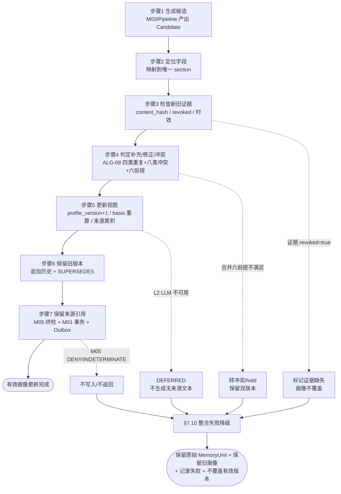
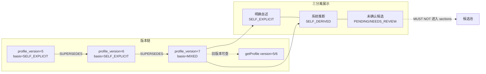
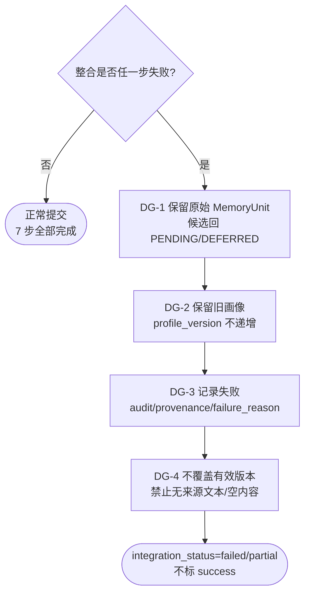

# 12 — 人物画像整合

> 文件代号：12 ｜ 所属交付：Memory Core R4.1 全量详细设计（DD）V1 架构升级 ｜ 设计 Agent 组：B 组（12/13/14）
> 最高行为依据：`DD-AUTHORITY-V2.md` v2.0（APPROVED，与 v1 冲突时以 V2 为准；台账冲突一律"保留原裁决 + 需重新裁决"）
> 结构依据：`DD-AUTHORITY.md` v1.0 §8「每份设计文档的强制结构（15 节）」
> 覆盖：DD-AUTHORITY-V2 §3.5（PersonProfile 字段表）+ 任务书 §9（人物画像系统、明确自述优先）

---

## 1. 文档状态

| 项目 | 内容 |
|---|---|
| 文件编号 | 12 |
| 文件名称 | 人物画像整合 |
| 当前版本 | 1.0 |
| 设计状态 | **PROPOSED**（字段级与流程级设计成稿；已裁决部分见 §5；与台账冲突处见 §14） |
| 实施授权 | **无**。本文件只定义 V1 范围内的系统能力，**不授予代码实施权限**；M04 画像整合属 P4（新增，需阶段授权），见 DD-AUTHORITY-V2 §10 |
| 完成等级自评 | **F2 达成**（字段、分区、流程、接口、测试规格齐备）；F3 部分（给出边界值与预期结果，**无执行记录**）；**F4 未达成** |
| 完成等级口径 | 沿用 `DD-AUTHORITY.md` v1.0 §6：F2/F3 **MUST NOT** 写成 F4；禁止把"设计已定义"写成"已授权实施" |
| 语言/编码 | 中文／UTF-8（无 BOM） |
| 配套契约 | `contracts/schemas/` 中 memory-unit / read-request / read-response / propose-request（由总控维护）；画像对象字段以本文 §8 为准 |
| 参数归属 | 全部参数标 **EXP-DEFAULT（实验初值）**，指向 **15 号参数注册表**（15 属性），业务代码禁止硬编码（台账 优化-5） |

**分节状态矩阵**

| 章节 | 状态 | 说明 |
|---|---|---|
| §7.1 画像定位 | APPROVED（DD-AUTHORITY-V2 §3.5 派生视图定义） | "可追溯派生视图、非独立记忆库"为 V2 基准原文语义 |
| §7.2 画像 11 分区 | APPROVED（§3.5 `section` 枚举逐字） | 11 值不得增删、不得同义变体 |
| §7.3 明确自述优先 / basis 三值 | APPROVED（§3.5 `basis` 枚举） | SELF_EXPLICIT / SELF_DERIVED / MIXED 三值逐字 |
| §7.4 画像更新 7 步流程 | **PROPOSED**（流程编排为设计结论） | 步骤名与判定口径为设计推断，非台账裁决 |
| §7.6 画像版本管理 | **PROPOSED**（profile_version 递增 + SUPERSEDES 关系） | 关系类型 SUPERSEDES 为 §2.15 APPROVED |
| §7.7 getProfile 返回结构 | APPROVED（§3.5 字段表 + V2 §7 接口名逐字） | 接口名 `memory.getProfile` 不得改写 |
| §7.9 A/B 层迁移 | APPROVED 方向（V2 §4.4）/ PROPOSED 字段映射 | memberImpression 保留推断性质 |
| §7.10 整合失败降级 | **PROPOSED** | 降级策略为设计结论 |
| §7.12 台账冲突 | APPROVED 处理口径（V2 §12） | "保留原裁决 + 需重新裁决"，禁止静默改写 |
| §12 测试要求（18.2 六项） | **NOT RUN** | 全部为测试规格，无实测结果 |
| §14 未决事项 | TBD / VERIFY / BLOCKED | 引 OI-025~OI-031，与 OPEN-ISSUES.md 对齐 |

---

## 2. 适用版本

| 维度 | 版本 | 说明 |
|---|---|---|
| 母本 | `R4.1-MASTER-01` | m.md（总则） |
| 规范基线 | `R4.1 Specification Baseline` | sf 后文 L3878–6731 |
| 任务书 | `MC-R41-DESIGN-FREEZE-01` | sf L6732–8081；本文对应任务书 §9 |
| 架构升级任务书 | 《Memory Core R4.1 V1 统一架构升级与设计文书迭代总任务书》（2026-11-04 指令） | V1 正式范围定义来源 |
| 最高行为依据 | `DD-AUTHORITY-V2.md` v2.0 | 唯一枚举/字段/接口定义来源（V2 序） |
| 结构基准 | `DD-AUTHORITY.md` v1.0 | 15 节结构与写作硬规则 |
| 权威顺序 | 第一层：正式裁决台账 `08-adjudication-ledger.md`；第二层：DD-AUTHORITY-V2；第三层：v1 基准与 01/02 设计；第四层：本组技术建议（PROPOSED） | v1 §2.2 + V2 序 |
| 对象版本 | `schema_version = "1.0"`（PROPOSED） | 与 15 号参数注册表的版本口径一致 |
| ID 格式 | `format: uuid`（UUIDv7 形态 **不锁版本**，裁决 R5 / PROPOSED） | 沿用 01 §2 |
| 时间格式 | RFC 3339 / UTC ISO 8601 带 `Z` | 裁决 R6；事实时间 ≠ 记录时间 |

---

## 3. 适用范围

### 3.1 覆盖

本文件定义 **PersonProfile（人物画像）** 的完整设计：

1. 画像定位（M04 维护的可追溯派生视图，不是无来源文本、不是独立记忆库）。
2. 画像 **11 分区**（`identity/self_explicit/preference/goal/value/ability/experience/habit/interaction/derived/current_state`）逐一定义与示例。
3. **明确自述优先** 机制：`basis` 三值语义、三分离展示、禁止合并成无来源结论、禁止推断覆盖自述。
4. 画像更新 **7 步流程**（生成候选 → 定位字段 → 检查新旧证据 → 判定补充/修正/冲突 → 更新视图 → 保留旧版本 → 保留来源引用）与流程图。
5. 禁止无证据重新生成整个画像。
6. 画像版本管理（`profile_version` 递增、旧版本可查、SUPERSEDES 关系）。
7. 画像检索接口 `memory.getProfile` 的返回结构。
8. 人物画像 vs 事件的关系（画像优先于大量事件；事件用于补充与举证）。
9. 画像与 **A/B 层迁移**（B 层 memberImpression → PERSON + SELF_DERIVED/OBSERVATION + `source_type=ASSISTANT_INFERRED`）。
10. 整合失败降级（保留原始 MemoryUnit + 保留旧画像 + 记录失败 + 不覆盖有效版本）。
11. 测试（任务书 18.2 六项）与验收标准（6 条）。

### 3.2 不覆盖（FUTURE / 不实施边界）

| 对象/能力 | 状态 | 说明 |
|---|---|---|
| M04 画像整合的**代码实现** | **FUTURE / 需阶段授权**（P4） | DD-AUTHORITY-V2 §10：P4 "新增，需阶段授权"；设计定义 ≠ 实施授权 |
| 画像的 LLM 自动生成提示词与模型选型 | **FUTURE** | 唯一 LLM Gateway 入口为 M04 §6.2（台账 D-AP-02） |
| 画像跨 `subject_id` 共享 / 群画像 | **FUTURE** | `group_shared` 与 `public` 边界见 §11 与 V2 §2.10；`public` V1 禁用（CR-07 / OI-031） |
| 画像自动删除 / 自动过期重写 | **FUTURE** | 不得因时间单一 TTL 重写画像（对齐 02 §7.11） |
| 画像中情绪字段的自动推断 | **FUTURE 预留、默认关闭** | 见 13 号文件；CR-04 / OI-028；禁止写成已启用 |
| `cache.sqlite` 画像缓存表结构 | **DEFERRED**（台账 U-1/U-2） | 本文 **MUST NOT** 给出任何缓存表结构 |
| 跨用户 / L0 作用域画像 | **FUTURE / VERIFY** | 台账 I-3 / PC-6、CR-09 |
| 画像作为独立权威库对外导出 | **BLOCKED** | 导出边界 BLOCKED（台账 K-2 / CR-06 / OI-030） |

### 3.3 与其他文档的界面

- **字段语义以本文 §8 为准**；与 01（MemoryUnit）同名字段 MUST 同名同义，不得自立定义（V2 §13.1 术语统一）。
- 算法口径（去重四分类、冲突八分类、合并六前提、Observation 十字段）以 **02 §7.9（ALG-08）** 为准，本文只引用不重定义。
- Pipeline 16 阶段名称以 **V2 §5** 逐字为准；画像更新触发 M04 整合，**MUST NOT** 绕过 Pipeline 的 M05 权限门禁。
- API 名称以 **V2 §7** 逐字为准；画像检索走 `memory.getProfile`，统一返回 9 字段以 V2 §7 为准。
- 权限以 **04 / M05** 为准；本文 **MUST NOT** 定义权限判定算法。
- 测试编号（18.2）以任务书为准；未决编号（OI-025~OI-031）以 OPEN-ISSUES.md 与 DOCUMENT-CONFLICT-REGISTER-V2.md 为准。

---

## 4. 依赖文档

| 编号 | 文件 | 用途 | 权威层 |
|---|---|---|---|
| D1 | `DD-AUTHORITY-V2.md` | **最高行为依据**：§2 枚举、§3.5 字段表、§4.4 A/B 迁移、§7 九接口、§8 检索五阶段、§12 台账冲突、§13 写作硬规则 | 第二层（与 v1 冲突时最优先） |
| D2 | `DD-AUTHORITY.md` v1.0 | 15 节结构（§8）、写作硬规则、F 等级、A/B 迁移方向、参数登记 | 第二层 |
| D3 | `01-记忆本体与数据模型.md` | MemoryUnit 字段（§7.6）、Evidence（§7.8）、Relation 八种（§7.10）、Observation（§7.11）、版本七要求（§7.15）、A/B 实测格式（§4） | 第三层 |
| D4 | `02-核心算法规范.md` | ALG-08 M04 整合（§7.9）、ALG-06 Context Builder（§7.7）、ALG-05 Token Budget（§7.6）、ALG-09 M05（§7.10）、五阶段区分（§7.13） | 第三层 |
| D5 | `08-adjudication-ledger.md`（`C:\Users\[USER]\Desktop\work\`） | 正式裁决唯一权威（D-AP-01/02/05/06/07/09、I-5、J4/J7、K-2、CR-09 等） | **第一层** |
| D6 | `DOCUMENT-CONFLICT-REGISTER-V2.md` | CR-01~CR-07 与 OI-025~OI-031 的映射 | 派生登记 |
| D7 | `OPEN-ISSUES.md`、`PENDING-USER-DECISIONS.md` | 未决事项编号对齐 | 派生登记 |
| D8 | `11-Memory Anchor 与语义分类.md`、`13-Evidence与EmotionContext.md`、`14-ChatLLM读写API.md` | 锚点语义、证据追溯、读写 API 一致性 | 同批交付（组 B + 组 A） |
| D9 | `15-参数注册表.md` | 全部 EXP-DEFAULT 参数的 15 属性登记 | 同批交付（组 A/总控） |

---

## 5. 正式裁决引用

> 引用格式 = 台账小节；逐条引台账编号，不改写原文语义。与 V2 任务书冲突时按 §12「保留原裁决 + 需重新裁决」。

| 台账编号 | 台账要点（原文语义） | 对本文件的约束 |
|---|---|---|
| **D-AP-01**（§3 第一轮） | 五模块边界维持；**M03 候选提取与 M04 整合裁决不可合并** | 画像整合归 M04；候选生成（V2 Pipeline 阶段 3/4）归 M03；两者 **MUST NOT** 合并为一步。画像更新 7 步中"生成候选"与"判定/更新"分属不同阶段 |
| **D-AP-02**（§3b 第二轮） | M04 §6.2 唯一 LLM Gateway 入口；Embedding Provider 归 M01 | 画像整合如需 L2 强语义（多条记忆整合、冲突分析），**MUST** 经 M04 §6.2 唯一入口；本文不定义其它模型入口 |
| **D-AP-05**（§3b 第二轮） | **confirmed 仅允许 M04 审核通道写入**；last_retrieved 按命中规则；reinforce 仅由 DSH 回传最终 prompt 中实际出现的记忆 ID 触发，E14/B04 未落地前只预留 schema 禁写；last_retrieved 不得作为衰减 v2 正向权重 | 画像条目的 `validation_state=confirmed` **MUST** 仅由 M04 审核通道写入；画像读取命中 **MUST NOT** 触发 reinforce 写入；画像 **MUST NOT** 写 `reinforced_*`（见 14 号文件 L3 事件语义） |
| **D-AP-06**（§3b 第二轮） | 生活化测试集为主要验收依据；研究报告收益不得写成实测结果 | §12 测试与 §13 验收 MUST 使用生活化测试集口径；**MUST NOT** 把设计规格写成实测结果 |
| **D-AP-07**（§3b 第二轮） | C40 权限引擎不可插拔；五级可插拔分类接受；trusted_context_source: entry-only | 画像读取 **MUST** 经 M05 权限终检；**MUST NOT** 用可插拔替身替代 C40；画像构建的输入来源受 entry-only 约束 |
| **D-AP-09**（§3b 第二轮） | 拒绝第三方托管记忆平台；**不得声称"记忆文本不出本机"**；本地持久化与云端推理传输分开评估 | 画像派生视图的持久化与云端 L2 推理传输 **MUST** 分开评估；本文 **MUST NOT** 出现"画像文本不出本机"表述（CR-06 / OI-030） |
| **I-5**（§3c 第三轮） | 心理状态机只改运行时状态，不直接产生记忆候选；值得长期记住的内容须经 M03/M04 正式记忆通道 | 画像 **MUST NOT** 由 Psychology 运行时状态直接改写；画像更新只能经 M03 候选 + M04 整合通道 |
| **I-7 / X-6**（§3c / §3g） | psy-model 暂缓；五方法/十二阶段接口形态暂缓 | 画像整合 **MUST NOT** 依赖 psy-model；相关接口标 DEFERRED（CR-05 / OI-029） |
| **J4**（§3e 第四轮） | 15 个受控标签起步，词表配置管理 | 画像 `derived` 分区若引用情绪标签，**MUST** 使用受控 15 标签（见 13 号文件）；不得自创标签 |
| **J7**（§3e 第四轮） | 只预留接口和字段，不实现 LLM 标注与批量重放 | 画像中的情绪/推断类字段的自动标注 **默认关闭**；启用须重新裁决（CR-04 / OI-028） |
| **K-2**（§3f 第五轮） | 内部计算参数/系数不默认导出；必须逐项确定导出边界；删除/删号/tombstone/缓存/备份语义一并考虑 | 画像 `source_memory_ids` / `source_evidence_ids` 的导出边界 **BLOCKED**；本文不得定义导出 DTO（CR-06 / OI-030） |
| **K-6 / CR-09**（§3f / §3g） | openLoop 只能由明确事件触发，永不由沉默触发；禁止催促、禁止与信任度联动；CR-09 门禁框架未经实施验证前 K-6 不闭环 | 画像 `current_state` 分区 **MUST NOT** 由沉默触发更新；不得把"用户未否认推断"当作画像确认 |
| **X-3**（§3g 第六轮） | Recall 可参与推理，禁止直接修改 PAD；持久状态变更必须经独立审核；第③层默认关闭 | 画像变更属持久状态变更，**MUST** 经 M04 审核通道；**MUST NOT** 由 Recall 结果隐式回流改写画像 |
| **优化-1**（§3e 第四轮） | Token 计量须区分系统提示词/聊天历史/记忆检索/实际注入/模块调用消耗 | §7.11 画像 Token 预算 **MUST** 分别计入 4 类单位与 5 类消耗，不得"1200 字 = 1200 Token" |
| **优化-5**（§3e 第四轮） | 稳定、唯一、可追踪的参数 ID；展示名可改、身份不丢 | 本文全部参数 **MUST** 带稳定参数 ID 并登记 15 号参数注册表 |
| **CR-09**（§3g 第六轮） | 接受 W2 §8 P0 测试化表述作为伦理门禁框架；未经实施验证不代表已通过 | 见 K-6 行；画像更新 **MUST NOT** 以回复率/留存率/愧疚感为优化目标 |

**未决事项（引 OI-025~OI-031）**：见 §14，逐条与 OPEN-ISSUES.md 对齐。

**台账冲突处处理口径（MUST 逐字使用）**：
- CR-02 / CR-03 / CR-04 / CR-06 涉及本文件的部分，一律 **"保留原裁决 + 需重新裁决"**：设计**完整定义**能力，实施默认关闭 / 保持 BLOCKED，启用须重新裁决。**禁止静默改写台账**。
- 具体：CR-06（原句长期保存 vs K-2/D-AP-09）→ 画像的 `source_evidence_ids` 仅作追溯引用，导出边界 BLOCKED；CR-01（AUTO_ACCEPT vs D-AP-05）→ 画像条目的 `confirmed` 仍只经 M04 通道；CR-07（public vs 最小权限）→ 画像 `visibility` 默认 `owner_private`，`public` V1 禁用。

---

## 6. 术语表

| 术语 | 定义（与 V2 §13.1 统一） |
|---|---|
| Memory Unit（MemoryUnit） | 独立记忆单元，权威对象；字段见 V2 §3.1 / 01 §7.6 |
| Evidence | 原始证据（原句）；字段见 V2 §3.2 / 13 号文件 |
| Event | 事件事实对象；字段见 V2 §3.3 |
| EmotionContext | 情感关联对象（与 Event 分离）；字段见 V2 §3.4 / 13 号文件 |
| Memory Anchor | 获取锚点；8 值枚举见 V2 §2.3 |
| Lifecycle(tier) | 生命周期层级 L1/L2/L3；与 semantic_type 正交（V2 §2.5） |
| Semantic Type | 语义主类 6 值（V2 §2.1） |
| Subject | 主体；`subject_type` 6 值 + `subject_id`（V2 §2.4） |
| Memory Ingestion Pipeline | 记忆摄取管线 16 阶段（V2 §5） |
| Memory Read API / Memory Write API | 聊天 LLM 读写唯一入口（V2 §7） |
| Psychology | 心理层（运行时状态）；实施 BLOCKED（CR-05 / OI-029） |
| PersonProfile（人物画像） | **M04 维护的可追溯派生视图**；不是独立记忆库、不是无来源文本（V2 §3.5） |
| 画像分区（section） | PersonProfile 的 11 个受控分区（V2 §3.5 `section` 枚举） |
| basis | 画像条目的来源性质三值：`SELF_EXPLICIT` / `SELF_DERIVED` / `MIXED`（V2 §3.5） |
| 明确自述 | 用户明确表达、可追溯到 `USER_EXPLICIT` / `USER_INSTRUCTION` 来源的自我描述 |
| 系统推断 | 由系统/模型派生、可追溯到 `ASSISTANT_INFERRED` / `SYSTEM_GENERATED` 来源的人物特征 |
| 三分离展示 | 明确自述 / 系统推断 / 未确认候选 三类内容分别展示、不得合并成无来源结论 |
| profile_version | 画像条目版本号，整数递增（V2 §3.5） |
| SUPERSEDES | 关系类型八种之一（V2 §2.15）；新画像版本指向被取代的旧版本 |
| 派生视图 | 由多个 MemoryUnit / Evidence 归纳得到的对象；**MUST NOT** 自动等同已确认事实（01 §7.11） |
| EXP-DEFAULT | 实验初值，非裁决值（v1 §6 / V2 §13.3）；一律登记 15 号参数注册表 |
| Token 单位四类 | 字符 / 汉字（字数）/ Token / 字节（V2 §13.4：字符、汉字、字数、Token MUST 分别标明） |
| MOCKED | Mock 结果标记（V2 §13.5）；测试桩全通过逻辑仅限隔离测试 |

---

## 7. 规范正文

### 7.1 画像定位：M04 维护的可追溯派生视图

**MUST（定位三原则）**：

1. PersonProfile **MUST** 是 **M04 维护的"可追溯派生视图"**。其每一条 `content` **MUST** 携带 `source_memory_ids`（追溯到的 MemoryUnit）与 `source_evidence_ids`（追溯到的 Evidence）；无来源引用的画像条目 **MUST NOT** 被写入、也不得被返回为有效画像内容。
2. PersonProfile **MUST NOT** 是"无来源文本"。禁止把 LLM 生成的一段通顺人物描述直接落库为画像内容；禁止用"综合判断得到"替代来源引用。
3. PersonProfile **MUST NOT** 是独立记忆库。画像 **MUST NOT** 拥有独立于 MemoryUnit 的权威写入路径：画像的每一次变化 **MUST** 由 M03 候选 → Pipeline → M04 整合 → M01 事务写库链路产生（V2 §5、§7、§10）；**任何模块 MUST NOT 绕过 M05 与 M01 直接改写画像**。

**SHOULD（定位推论）**：

- 画像 **SHOULD** 被理解为"人物理解任务的快速读取投影"，与 V2 §8「人物理解默认获取顺序」`SELF_EXPLICIT → PERSON_PROFILE → PREFERENCE → SELF_DERIVED → 相关 RELATIONSHIP → 相关 EVENT` 对齐。
- 画像的 `confidence` **SHOULD** 表示"整合/推断置信度"，**MUST NOT** 与"事实真实性"混同（V2 §3.1 confidence 说明；01 §7.6.3）。

**与独立记忆库的边界（MUST NOT 清单）**：

| # | 禁止行为 | 依据 |
|---|---|---|
| P-01 | 画像内容不经 MemoryUnit / Evidence 直接生成 | V2 §3.5 来源引用必填 |
| P-02 | 画像作为第三套权威存储，与 SQLite `memory_objects` 并列 | v1 §5 「SQLite 唯一权威业务存储」 |
| P-03 | 画像写入绕过 M01 事务与 Outbox | v1 §6 事务五步、架构不变量 12 条 |
| P-04 | 画像变更绕过 M04 审核通道写 `confirmed` | 台账 D-AP-05 |
| P-05 | 画像读取绕过 M05 权限终检 | V2 §7「每次读取 MUST 经 M05」 |
| P-06 | 画像自动成为 Fact / 自动 `validation_state=confirmed` | 01 §7.11 Observation 约束（同源） |

### 7.2 画像 11 分区（V2 §3.5 `section` 枚举，逐字使用）

> 枚举值（MUST 一字不差）：`identity` / `self_explicit` / `preference` / `goal` / `value` / `ability` / `experience` / `habit` / `interaction` / `derived` / `current_state`。
> **MUST NOT** 使用同义变体（如 `self` / `explicit` / `traits` / `status`）；**MUST NOT** 增减分区；扩展分区须走变更流程并同步 V2 基准（本文不改 V2）。

| # | 分区 | 定义 | 典型 `semantic_type` / `semantic_tags` | 示例 `content` | 默认 `basis` |
|---|---|---|---|---|---|
| 1 | `identity` | 身份背景类信息（姓名、年龄、职业、地域、身份角色等可识别背景） | `PERSON` + `IDENTITY` | "主人是一名在读研究生，研究方向为嵌入式系统" | `SELF_EXPLICIT` / `MIXED` |
| 2 | `self_explicit` | 主人**明确自我描述**的原文语义承载区（价值观自述、性格自述、自我定位），与 `identity` 区分：此区强调"由主人明确说出" | `PERSON` + `SELF_EXPLICIT` | "主人明确说自己是'慢热但认真的人'" | `SELF_EXPLICIT` |
| 3 | `preference` | 偏好与喜好（内容偏好、风格偏好、工具偏好） | `PREFERENCE` + `HABIT` / `CONVENTION` | "主人偏好逐步讲解而非一次性给出完整代码" | `SELF_EXPLICIT` / `MIXED` |
| 4 | `goal` | 长期目标与阶段性目标 | `PERSON` / `CURRENT_STATE` + `GOAL` | "主人长期目标是独立完成一个开源项目" | `SELF_EXPLICIT` / `MIXED` |
| 5 | `value` | 价值观、原则、取舍标准 | `PERSON` + `VALUE` | "主人明确表示更看重可维护性而非炫技" | `SELF_EXPLICIT` / `MIXED` |
| 6 | `ability` | 能力、技能、已掌握/正在学习的知识 | `PERSON` + `ABILITY` / `PROCEDURAL` | "主人熟悉 C 语言与 STM32，正在学习 Rust" | `SELF_EXPLICIT` / `MIXED` |
| 7 | `experience` | 重要经历（里程碑式事件的人物侧归纳） | `PERSON` + `MILESTONE` / `EVENT` 引用 | "主人去年参加过电子设计竞赛并获奖" | `SELF_EXPLICIT` / `MIXED` |
| 8 | `habit` | 习惯（作息、工作节奏、反复出现的行为模式） | `PREFERENCE` / `PERSON` + `HABIT` | "主人习惯在深夜集中处理代码问题" | `SELF_DERIVED` / `MIXED` |
| 9 | `interaction` | 互动方式（与助手/群成员的沟通偏好、称呼、反馈方式） | `PREFERENCE` + `INTERACTION` / `CONVENTION` | "主人希望回答先给结论再给推导" | `SELF_EXPLICIT` / `MIXED` |
| 10 | `derived` | **系统推断的人物特征**承载区（由多条证据归纳，非主人明确说出） | `PERSON` + `SELF_DERIVED` / `OBSERVATION` | "系统推断：主人对新技术持谨慎乐观态度（依据 3 条来源）" | `SELF_DERIVED` |
| 11 | `current_state` | 当前状态（计划/进行中/阶段性目标/困难/进度/临时状态） | `CURRENT_STATE` + `GOAL` | "主人当前正在准备期末项目答辩" | `MIXED` / `SELF_DERIVED` |

**MUST（分区使用规则）**：

1. 一条画像记录 **MUST** 且仅能归属一个 `section`；一条内容跨多区时 **MUST** 拆分为多条记录，**MUST NOT** 用多值 section 或"综合区"。
2. `derived` 分区 **MUST** 只承载 `SELF_DERIVED` / `MIXED`（推断属性）内容；`self_explicit` 分区 **MUST** 只承载 `SELF_EXPLICIT` 内容。二者 **MUST NOT** 混放。
3. `current_state` 分区的内容 **MUST** 带时间有效性语义（`valid_from` / `valid_until` 对齐 V2 §3.1 MemoryUnit）；**MUST NOT** 把已结束的临时状态长期固化。
4. 示例 `content` **MUST** 是"整合后描述"（可独立理解），**MUST NOT** 当作原句；原句一律存于 Evidence（V2 §3.1 `content` 说明；13 号文件原句保存纪律）。
5. 分区与 `anchor` 的关系：`PERSON_PROFILE` 锚点（V2 §2.3）用于画像整体读取；分区级过滤 **SHOULD** 由 `getProfile(subject_id, sections?)` 的 `sections?` 参数承担，**MUST NOT** 用 anchor 表达分区。

### 7.3 明确自述优先：basis 三值语义与三分离展示

> `basis` 枚举（V2 §3.5，逐字）：`SELF_EXPLICIT` / `SELF_DERIVED` / `MIXED`。

#### 7.3.1 basis 三值语义（MUST 逐值定义）

| basis | 语义 | 允许的 `source_type`（V2 §2.9） | 允许的 `semantic_tags`（V2 §2.2） | 对应分区 |
|---|---|---|---|---|
| `SELF_EXPLICIT` | 主人明确自我描述；内容可追溯到用户明确表达或明确记忆指令 | `USER_EXPLICIT` / `USER_INSTRUCTION` | `SELF_EXPLICIT` | `identity` / `self_explicit` / `preference` / `goal` / `value` / `ability` / `experience` / `interaction` |
| `SELF_DERIVED` | 系统推断的人物特征；由多条证据/记忆归纳得出，非主人原话 | `ASSISTANT_INFERRED` / `SYSTEM_GENERATED` | `SELF_DERIVED` / `OBSERVATION` | `derived` / `habit` / `current_state` |
| `MIXED` | 同一分区条目同时含明确自述与系统推断两部分；**必须**在结构上可拆分 | 上述两类并存 | 上述两类并存 | 任意分区（但标注必须保留） |

**MUST（basis 纪律）**：

1. `SELF_EXPLICIT` 条目 **MUST** 至少有一个 `source_evidence_ids` 指向 `source_type ∈ {chat, file, import}` 且发言者为 `OWNER` 的 Evidence；**MUST NOT** 由 `ASSISTANT_INFERRED` MemoryUnit 单独支撑。
2. `SELF_DERIVED` 条目 **MUST** 在 `content` 中显式带推断标记（如"系统推断："前缀或等价结构化标记），**MUST NOT** 伪装成主人原话（V2 §13.4；台账 J2/J7；01 §7.8 禁令）。
3. `MIXED` 条目 **MUST** 在返回结构中保留"哪部分来自自述、哪部分来自推断"的可分辨信息（见 §7.3.2 三分离）；**MUST NOT** 把 MIXED 当作"已合并的无来源结论"。
4. `basis` **MUST NOT** 被省略或用空值；缺省 **MUST** 取 `SELF_DERIVED`（保守：无明确自述证据即视为推断），并登记质量标记。

#### 7.3.2 三分离展示（明确自述 / 系统推断 / 未确认候选）

`getProfile` 与画像读取结果 **MUST** 按以下三类分别展示，**MUST NOT** 合并成无来源结论：

| 展示类 | 判定条件 | 展示标注 | 是否可作为回答依据 |
|---|---|---|---|
| **明确自述** | `basis=SELF_EXPLICIT` 且 `source_evidence_ids` 非空且未 `revoked` | "主人明确说过" + 来源引用 | 是（首要依据） |
| **系统推断** | `basis=SELF_DERIVED` 或含推断成分的 `MIXED` | "系统推断（未确认）" + 来源引用 + `confidence` | 否（须与明确自述分离呈现） |
| **未确认候选** | 已进入 M04 候选池但尚未整合进画像的 `PENDING` / `NEEDS_REVIEW` 候选（V2 §2.7） | "未确认候选" + 候选 ID | 否（**MUST NOT** 出现在正式画像 content 中） |

**MUST（三分离硬规则）**：

1. 同一 `section` 内，明确自述与系统推断 **MUST** 作为不同条目返回（不同 `profile_id`），**MUST NOT** 拼成一条 `content`。
2. 未确认候选 **MUST NOT** 被写入 PersonProfile；只能在候选池中等待 M04 整合（V2 §2.7 `candidate.status` 六值）。
3. 回答生成时若同时存在明确自述与系统推断，**MUST** 以明确自述为准；**MUST NOT** 用推断覆盖自述、也 **MUST NOT** 用推断"补全"自述。
4. 三分离的展示 **MUST** 与 02 §7.7（ALG-06 Context Builder）`uncertain` 分区对齐：推断与未确认项 **MUST** 标 `inferred` / `uncertain` / `disputed`，**MUST NOT** 被改写成确定事实。

#### 7.3.3 禁止推断覆盖自述（红线）

| # | 禁止行为 | 正确做法 |
|---|---|---|
| P-07 | 用 `SELF_DERIVED` 条目覆盖同 `section` 的 `SELF_EXPLICIT` 条目 | 并存 + 三分离展示；自述优先 |
| P-08 | 把推断结论写进 `self_explicit` 分区 | 写入 `derived` 分区并标 `SELF_DERIVED` |
| P-09 | 用户明确否认某推断后仍保留该推断为"有效画像" | 标 `disputed` / `rejected`（V2 §2.8 validation_state），保留证据与版本，不静默删除 |
| P-10 | 因"多次出现"把推断升级为明确自述 | 重复不等于证实（02 §7.14）；仍须有明确自述证据 |
| P-11 | 把 `MIXED` 当作"已确认事实"返回 | 拆分为自述段 + 推断段分别标注 |

**与台账 D-AP-05 的一致性**：明确自述类画像若需 `validation_state=confirmed`，**MUST** 仅由 M04 审核通道写入；AUTO_ACCEPT 候选（CR-01 / OI-025）**MUST NOT** 写 `confirmed`，**保留原裁决 + 需重新裁决**。

### 7.4 画像更新 7 步流程（任务书 §9）

> 每次画像更新 **MUST** 严格按以下 7 步顺序执行；步骤名固定，**MUST NOT** 合并、跳过、倒序。
> 触发源：M03 产生的候选（V2 §5 阶段 3/4）或 M04 周期整合；**MUST NOT** 由 L3 聊天模型直接触发画像重写。

| 步 | 名称 | 动作（MUST） | 输入 | 输出 | 失败处置 |
|---|---|---|---|---|---|
| 1 | **生成候选** | 由 M03 / Pipeline 产出 `Candidate`（`candidate.status ∈ 6 值`，V2 §2.7）；候选携带 `source_type`、`evidence_refs`、`subject_id`、建议 `section` | 已授权来源 + Evidence | Candidate（带 `profile_field` 建议，V2 §3.1） | 候选质量不通过 ⇒ 不入池，保留原始来源（见 §7.10） |
| 2 | **定位字段** | M04 依据候选语义把候选映射到唯一 `section`（11 分区之一）；跨区 **MUST** 拆分；无法确定 **MUST** 标 `needs_review` | Candidate + 现有画像 | `(subject_id, section)` 定位 | 定位失败 ⇒ `DEFERRED`（V2 §2.7），不强行归类 |
| 3 | **检查新旧证据** | 取该 `(subject_id, section)` 下现有条目的 `source_memory_ids` / `source_evidence_ids`；逐条核对 `revoked`（V2 §3.2）、`content_hash`（去重）、`valid_from/valid_until`（时效） | 旧画像条目 + 候选 Evidence | 证据核对表（新增/重复/失效/冲突） | 证据 `revoked=true` ⇒ 关联记忆标"证据缺失"（见 13 号文件），画像条目不覆盖 |
| 4 | **判定补充/修正/冲突** | 依 02 §7.9（ALG-08）四类重复 + 八类冲突 + 合并六前提，判定为 `补充` / `修正` / `冲突` 三者之一；冲突 **MUST** 保留双版本，不强合 | 证据核对表 | 决策 `{补充\|修正\|冲突}` + `reasons[]` | 合并六前提任一不满足 ⇒ **MUST NOT** 合并；转 `冲突` 或 `hold` |
| 5 | **更新视图** | 生成新画像条目（`profile_version` +1）；`basis` 按 §7.3 重算；`SELF_EXPLICIT` 优先；`source_memory_ids` / `source_evidence_ids` **MUST** 累积保留（不得丢弃旧引用） | 决策 + 旧条目 | 新 PersonProfile 条目 | LLM（L2）不可用 ⇒ `DEFERRED`，不生成无来源文本（§7.10） |
| 6 | **保留旧版本** | 旧条目 **MUST** 追加写入画像历史（追加不覆盖）；写入 `SUPERSEDES` 关系（V2 §2.15）指向旧 `profile_id`；旧版本仍可按 `profile_version` 查询 | 旧条目 + 新条目 | 历史版本 + SUPERSEDES 关系 | 版本写入失败 ⇒ 整体回滚，不产生"新版本无历史" |
| 7 | **保留来源引用** | 新条目 **MUST** 携带完整 `source_memory_ids` / `source_evidence_ids`；经 M01 事务写库 + Outbox；经 M05 终检后才可读 | 新条目 | 已提交画像 + `audit` / `provenance` | 权限 DENY / INDETERMINATE ⇒ 不写入、不返回（§10/§11） |

**MUST（流程级硬规则）**：

1. 7 步 **MUST** 全部完成才算一次有效更新；任一步失败 **MUST** 走 §7.10 降级，**MUST NOT** 产生"半个画像更新"。
2. 第 4 步的"冲突"判定 **MUST NOT** 强行合成单一结论（02 §7.9.2：冲突 ≠ 错误）。
3. 第 5 步 **MUST NOT** 重新生成整个画像（见 §7.5）；只允许按 `(subject_id, section)` 局部更新。
4. 第 7 步 **MUST** 经 M01 事务与 M05 终检；**MUST NOT** 由 M04 自行写库（D-AP-01 模块边界；v1 架构不变量）。
5. `source_type=SYSTEM_GENERATED` 的画像条目（V2 §2.9）**MUST** 显式标注"派生视图"，且 `evidence_refs` 非空（除非 V2 §3.1 允许的显式标注例外）。

**流程图**：见 §9.1（Mermaid，与本节 7 步一一对应）。

### 7.5 禁止无证据重新生成整个画像（红线）

**MUST NOT（逐条）**：

| # | 禁止行为 | 理由 |
|---|---|---|
| P-12 | 因"画像看起来过时"用 LLM 一次性重写全部 11 分区 | 画像为可追溯派生视图；整图重写必然丢来源引用（V2 §3.5） |
| P-13 | 在 `source_evidence_ids` 为空时生成新画像条目 | 无来源即无画像（§7.1） |
| P-14 | 把"系统对主人的总体印象"作为画像落库而不列来源 | 无来源文本禁令 |
| P-15 | 因一次新对话把未变化分区也重新生成 | 只允许按 `(subject_id, section)` 局部更新（§7.4 第 5 步） |
| P-16 | 用摘要/检索结果冒充 Evidence 生成画像 | 禁止把 Agent 总结伪装成原始证据（01 §7.8） |

**唯一允许的"整图"操作**：全量重建 **MUST** 由迁移作业（带 `operation=migrate` provenance）执行，且 **MUST** 逐条保留原 `source_memory_ids` / `source_evidence_ids` 并逐条审计；**MUST NOT** 称为"画像重新生成"。

### 7.6 画像版本管理（profile_version 递增 / 旧版本可查 / SUPERSEDES）

**MUST（版本规则）**：

1. `profile_version`（V2 §3.5）为整数 ≥1；同一 `(subject_id, section)` 每次有效更新 **MUST** +1，**MUST NOT** 复用或回退版本号。
2. 旧版本 **MUST** 追加保存、可查：`getProfile` **SHOULD** 支持 `version?` 参数（对齐 V2 §7 `getMemoryById(memory_id, version?)` 语义），按 `profile_version` 返回历史快照。
3. 新条目 **MUST** 写 `SUPERSEDES` 关系（V2 §2.15 八种之一）指向被取代的旧 `profile_id`；`SUPERSEDES` **MUST NOT** 自引用、**MUST NOT** 成环（01 §7.10 约束）。
4. 版本链 **MUST** 保留 `updated_at`（V2 §3.5）、`provenance`（operation ∈ `merge` / `supersede` / `observe` / `confirm`，01 §7.9 九种）与 `audit` 记录。
5. `profile_version` 递增 **MUST NOT** 表达"换了主题"：不同事实 **MUST** 新建 `profile_id`（不同分区或不同语义），**MUST NOT** 用版本号表达主题切换（01 §7.15「版本 vs 新记忆」同源）。
6. 旧版本 **MUST NOT** 被物理删除（除合规删除流程并留审计，01 §7.15 R7）；`status=SUPERSEDED`（V2 §2.6）的历史条目 **MUST NOT** 作为当前事实返回。

**SHOULD（版本可观察）**：版本变更 **SHOULD** 记录 `changed_fields`、`algorithm_version`、L2 模型标识（经 M04 §6.2 唯一 Gateway），便于复现（对齐 02 §7.1 第 4 条）。

**流程图**：见 §9.2（版本链 + SUPERSEDES）。

### 7.7 画像检索接口（getProfile）

> 接口名 **MUST** 逐字使用 V2 §7：`memory.getProfile(subject_id, sections?)`。
> **每次读取 MUST 经 M05**（V2 §7）；统一返回 **MUST** 含 V2 §7 九字段（详见 14 号文件）。

#### 7.7.1 返回结构（任务书 §9）

`getProfile` 返回 **MUST** 按"分区 + 每条记录"组织，每条记录 **MUST** 含以下 6 字段（V2 §3.5 字段表逐字）：

| 字段 | 类型 | 必填 | 说明 |
|---|---|---|---|
| `content` | string | ✓ | 整合后描述（**MUST NOT** 当作原句） |
| `basis` | enum(SELF_EXPLICIT/SELF_DERIVED/MIXED) | ✓ | 来源性质（§7.3） |
| `source_memory_ids` | array | ✓ | 追溯到的 MemoryUnit |
| `source_evidence_ids` | array | ✓ | 追溯到的 Evidence |
| `confidence` | number | ✓ | 整合置信度（≠事实真实性） |
| `profile_version` | integer | ✓ | 当前版本号 |

**返回结构（概念形态，PROPOSED）**：

```
{
  "profile_id": "uuid",
  "subject_id": "owner-[OWNER_QQ]",
  "profile_version": 7,
  "sections": {
    "identity":        [ {content, basis, source_memory_ids, source_evidence_ids, confidence, profile_version}, ... ],
    "self_explicit":   [ ... ],
    "preference":      [ ... ],
    "goal":            [ ... ],
    "value":           [ ... ],
    "ability":         [ ... ],
    "experience":      [ ... ],
    "habit":           [ ... ],
    "interaction":     [ ... ],
    "derived":         [ ... ],
    "current_state":   [ ... ]
  },
  "separation": {                     // 三分离展示（§7.3.2）
    "explicit":  [profile_id, ...],
    "inferred":  [profile_id, ...],
    "pending":   [candidate_id, ...] // 未确认候选，MUST NOT 出现在 sections 内
  },
  "evidence_missing": [profile_id, ...],  // 证据缺失标记（见 13 号文件）
  "read_mode": "summary",
  "decision_id": "uuid"               // M05 权限终检
}
```

**MUST（返回规则）**：

1. `sections?` 缺省时 **MUST** 返回全部 11 分区；指定时 **MUST** 只返回指定分区，**MUST NOT** 静默补全其它分区。
2. 三分离 `separation` **MUST** 与 `sections` 内容一致；`pending` **MUST NOT** 混入 `sections`。
3. 每条记录 **MUST** 携带 `source_evidence_ids`；若其证据 `revoked=true`，**MUST** 在 `evidence_missing` 中标记（V2 §3.2；13 号文件证据失效规则）。
4. 返回 **MUST** 经 M05 终检；DENY / INDETERMINATE 一律排除（02 §7.10 / 04）。
5. `read_mode` 画像读取默认 `summary`（V2 §2.12 四值）；**MUST NOT** 默认返回全部证据原句或全部聊天历史（13 号文件 4 种读取模式）。
6. 统一返回 9 字段（`memory_id, content, semantic_type, anchor, source_type, confidence, evidence_refs, lifecycle(tier+status), visibility`）以 V2 §7 为准；画像条目 **SHOULD** 映射：`memory_id ← profile_id`、`semantic_type ← PERSON`、`anchor ← [PERSON_PROFILE]`、`source_type ← 由 basis 推导`、`evidence_refs ← source_evidence_ids`、`lifecycle ← (L3, ACTIVE)`、`visibility ← owner_private`。映射为 **PROPOSED**，不得与各字段原义冲突。

### 7.8 人物画像 vs 事件的关系

**MUST（优先规则，V2 §8）**：

1. **人物画像优先于大量事件**：人物理解任务 **MUST NOT** 把大量事件碎片排在画像前面；默认获取顺序 `SELF_EXPLICIT → PERSON_PROFILE → PREFERENCE → SELF_DERIVED → 相关 RELATIONSHIP → 相关 EVENT`（V2 §8）。
2. 事件回忆任务不受此限（V2 §8）：事件查询路由 `EVENT → 证据 → 关联人物 →（按需）情绪`。
3. **事件用于补充与举证**：PersonProfile 的 `experience` / `current_state` 分区 **MUST** 通过 `event_refs`（V2 §3.1）与 Event 关联；Event **MUST** 作为画像条目的举证来源之一，**MUST NOT** 取代画像成为人物描述的主体。
4. Event 即使 `memory_tier=L3` 也 **MUST NOT** 在所有查询中优先于人物描述（V2 §2.5 铁律：tier ≠ 重要程度）。
5. 一个 Event **MUST NOT** 被拆成多条画像结论以"淹没"人物描述；画像条目数 **MUST** 受 §7.11 Token 预算约束。
6. 事件事实与情绪 **MUST** 分离（V2 §3.3/§3.4；13 号文件）：画像 **MUST NOT** 把情绪判断写入 `experience` / `current_state` 的事实描述。

**SHOULD**：当画像与事件证据冲突时，**MUST** 走 §7.4 第 4 步"冲突"判定，**MUST NOT** 用事件单方面覆盖画像明确自述。

### 7.9 画像与 A/B 层迁移（V2 §4.4）

> **MUST NOT** 编造缺失信息（m.md §2.1；v1 §8 写作硬规则「A/B 层迁移：缺失信息不得编造」）；B 层 memberImpression **MUST** 保留推断性质。

| A/B 层来源 | V2 路由 | `semantic_type` | `semantic_tags` | `source_type` | 画像落点 | `basis` |
|---|---|---|---|---|---|---|
| A 层向量语义记忆 | MemoryUnit（semantic_type 按 §4.1 路由；Evidence 缺失时标"无原始证据"） | 按内容（多为 `PERSON`） | `IDENTITY` / `VALUE` / `GOAL` / `ABILITY` 视内容 | `USER_EXPLICIT`（依 v1 映射）或 `EXTERNAL_SOURCE` | 对应分区，标"无原始证据" | `SELF_EXPLICIT` / `MIXED`（**MUST NOT** 编造 Evidence） |
| B 层 `activeTopic` | `CURRENT_STATE` | `CURRENT_STATE` | — | `SYSTEM_GENERATED`（派生） | `current_state` | `SELF_DERIVED` / `MIXED` |
| B 层 `pendingThought` | `CURRENT_STATE` + `GOAL` | `CURRENT_STATE` | `GOAL` | `SYSTEM_GENERATED` | `current_state` / `goal` | `SELF_DERIVED` / `MIXED` |
| **B 层 `memberImpression`** | **PERSON** | **`PERSON`** | **`SELF_DERIVED` / `OBSERVATION`** | **`ASSISTANT_INFERRED`** | **`derived` 分区** | **`SELF_DERIVED`** |
| B 层稳定偏好 | `PREFERENCE` | `PREFERENCE` | `HABIT` / `INTERACTION` / `CONVENTION` | 视来源 | `preference` / `habit` / `interaction` | 视来源 |
| B 层稳定关系 | `RELATIONSHIP` | `RELATIONSHIP` | — | 视来源 | 不入画像 11 分区（关系类走 RELATIONSHIP 锚点） | — |

**MUST（memberImpression 专项，任务书 §9）**：

1. B 层 `memberImpression` → **`PERSON` + `SELF_DERIVED` / `OBSERVATION` + `source_type=ASSISTANT_INFERRED`**（逐字使用 V2 §4.4 / §2.1 / §2.2 / §2.9）。
2. 迁移后 **MUST** 保留推断性质：`basis=SELF_DERIVED`，落 `derived` 分区，**MUST NOT** 写入 `self_explicit` 分区、**MUST NOT** 写成"主人明确说过"。
3. **禁止跨用户泄露**（V2 §4.4）：`memberImpression` 常指向 `MEMBER` 主体（V2 §2.4），其 `subject_id` **MUST** 经 EntityResolver 解析，**MUST NOT** 因出现"我/你/他"直接认定主体；**MUST NOT** 把成员印象并入 OWNER 画像。
4. 缺失信息（如 `confidence`、`valid_from`、`evidence_id`）**MUST NOT** 从 B 层原始字段推断（01 §4 实测数据事实）；缺失 **MUST** 留 null 并标质量标记。
5. A 层 Evidence 缺失时 **MUST** 标"无原始证据"，**MUST NOT** 编造原句（V2 §4.4；01 §7.8）；此类画像条目 **MUST** 在 `evidence_missing` 中标记，**MUST NOT** 写成 `SELF_EXPLICIT` 已确认结论。
6. 迁移产生的画像条目 **MUST** 写 `operation=migrate` provenance，且 **MUST** 单独授权（01 §7.9；v1 §8 迁移边界）。

### 7.10 整合失败降级（任务书 §9）

**MUST（降级四保留）**：画像整合任一步失败时，系统 **MUST** 同时满足：

| # | 降级动作 | 说明 |
|---|---|---|
| DG-1 | **保留原始 MemoryUnit** | 失败的候选所依据的 MemoryUnit / Evidence **MUST NOT** 被删除或改写；候选回到 `PENDING` / `DEFERRED`（V2 §2.7） |
| DG-2 | **保留旧画像** | 现有有效 `PersonProfile` 条目 **MUST** 保持不变（`profile_version` 不递增） |
| DG-3 | **记录失败** | **MUST** 写 `audit` / `provenance` / `failure_reason[]`，标 `retrieval_status` 或等价 `integration_status=failed|partial`；**MUST NOT** 静默吞掉失败 |
| DG-4 | **不覆盖有效版本** | **MUST NOT** 用无来源文本、半成品或空内容覆盖当前有效版本；**MUST NOT** 把部分结果描述为完整 |

**降级触发矩阵（PROPOSED）**：

| 失败点 | 对应 7 步 | 降级结果 | 错误/标记 |
|---|---|---|---|
| 候选质量不通过（无来源/主体/权限） | 第 1 步 | 候选不入池，原始来源保留 | `quality_flags` 十项（02 §7.8） |
| `section` 定位失败 | 第 2 步 | `DEFERRED`，待重解析 | `needs_review` |
| Evidence `revoked=true` | 第 3 步 | 关联记忆标"证据缺失"，画像不覆盖 | `evidence_missing` |
| 合并六前提不满足 / 冲突未裁决 | 第 4 步 | `hold` / `dispute`，保留双版本 | `merge_rejected` / `disputed` |
| L2 LLM 不可用 / 超时 | 第 5 步 | `DEFERRED`，不生成无来源文本 | `LLM_UNAVAILABLE` / `TIMEOUT` |
| 版本写入失败 | 第 6 步 | 整体回滚（无"新版本无历史"） | `STORAGE_ERROR` / `VERSION_CONFLICT` |
| M05 DENY / INDETERMINATE | 第 7 步 | 不写入、不返回 | `PERMISSION_DENIED` / `POLICY_ERROR` |
| Token 预算超限 | 第 5/7 步 | 截断候选、不重写整图、标 `truncated` | `BUDGET_EXCEEDED` |

**MUST NOT**：因单次失败清空画像；因 LLM 失败用规则模板"补写"画像；把降级结果标 `success`。

**流程图**：见 §9.3（降级分支）。

### 7.11 参数（EXP-DEFAULT）与 Token 单位四类区分

> V2 §13.3：全部参数进 **15 号参数注册表**（15 属性），业务代码禁止硬编码（台账 优化-5）。
> V2 §13.4：字符 / 汉字 / 字数 / Token **MUST** 分别标明；画像、事件、证据、情绪分别计入预算；**禁止"1200 字 = 1200 Token"**。

#### 7.11.1 Token 单位四类（MUST 分别标明）

| 单位 | 定义 | 在画像场景的用途 | 禁止混用 |
|---|---|---|---|
| **Token** | 目标模型真实 Tokenizer 计量的 token 数 | `getProfile` 返回注入 Prompt 的预算计量（对齐 02 §7.6 ALG-05） | **MUST NOT** 用字数/字符数代替 |
| **字符（character）** | Unicode 码点数（含标点、空格） | Evidence `original_text` 长度上限、`context_before/after` 受限长度 | **MUST NOT** 与汉字数互换 |
| **汉字（字数）** | 中文汉字个数（不含标点/拉丁字母/数字） | 画像 `content` 的展示长度描述、生活化测试集语料规模描述 | **MUST NOT** 当作 Token |
| **字节（byte）** | UTF-8 编码字节数 | `content_hash` 输入、存储容量估算、传输大小 | **MUST NOT** 当作 Token |

**MUST（四类分标）**：

1. 任何预算、上限、长度描述 **MUST** 显式带单位后缀（如 `_tokens` / `_chars` / `_hanzi` / `_bytes`），**MUST NOT** 出现无单位的"1200"。
2. 画像、事件、证据、情绪 **MUST** 分别计入 Token 预算（V2 §13.4）：`profile_tokens` / `event_tokens` / `evidence_tokens` / `emotion_tokens` **MUST** 分项统计。
3. Token 计量 **MUST** 使用目标模型真实 Tokenizer（02 §7.6）；Tokenizer 不可用 **MUST** 返回 `CONFIGURATION_ERROR` 或显式标 `estimated=true`（默认关闭估算）。
4. 五类消耗（优化-1）**MUST** 拆分：`system_prompt_tokens` / `chat_history_tokens` / `memory_retrieval_tokens` / `injected_content_tokens` / `module_calls_tokens`。

#### 7.11.2 画像相关 EXP-DEFAULT 参数（全部指向 15 号参数注册表）

| 参数 ID（稳定唯一，优化-5） | 含义 | 实验初值（EXP-DEFAULT） | 单位 | 状态 |
|---|---|---|---|---|
| `profile.max_sections` | `getProfile` 缺省返回分区数 | 11 | 个 | EXP-DEFAULT |
| `profile.max_items_per_section` | 单分区最大条目数 | 20 | 条 | EXP-DEFAULT |
| `profile.budget.tokens` | 画像注入 Token 预算 | 400 | **Token** | EXP-DEFAULT |
| `profile.content.max_chars` | 单条 `content` 字符上限 | 2000 | **字符** | EXP-DEFAULT |
| `profile.content.max_hanzi` | 单条 `content` 汉字上限（展示口径） | 1000 | **汉字（字数）** | EXP-DEFAULT |
| `profile.evidence.context_max_chars` | Evidence 上下文长度 | 512 | **字符** | EXP-DEFAULT |
| `profile.version.history_keep` | 可查历史版本数 | 50 | 版 | EXP-DEFAULT |
| `profile.integration.timeout_ms` | 画像整合软超时 | 3000 | 毫秒 | EXP-DEFAULT |
| `profile.integration.retry_max` | 整合失败重试上限 | 3 | 次 | EXP-DEFAULT |
| `profile.confidence.min` | 画像条目最低置信度 | 0.30 | number 0–1 | EXP-DEFAULT |
| `profile.infer_override_explicit` | 是否允许推断覆盖自述 | **false（MUST）** | boolean | **红线，非实验值** |
| `profile.regenerate_whole_without_evidence` | 是否允许无证据整图重写 | **false（MUST）** | boolean | **红线，非实验值** |
| `emotion.query_enabled` | 情绪检索开关（J6 / CR-02） | **false** | boolean | **保留原裁决 + 需重新裁决** |
| `emotion.influence_enabled` | ΔE 影响开关（X-3 / CR-03） | **false** | boolean | **保留原裁决 + 需重新裁决** |
| `emotion.auto_infer` | 自动情绪推断开关（J7 / CR-04） | **false** | boolean | **保留原裁决 + 需重新裁决** |
| `permission.public_enabled` | `public` 可见性开关（CR-07） | **false** | boolean | **保留原裁决 + 需重新裁决** |

> **MUST**：上表所有 EXP-DEFAULT **MUST** 在 15 号参数注册表登记 15 属性；**MUST NOT** 写成已裁决；**MUST NOT** 把红线参数当作可调实验值。

### 7.12 台账冲突处理（保留原裁决 + 需重新裁决）

> V2 §12：CR-01~CR-07 一律 **"保留原裁决 + 标记重新裁决"**，**禁止静默改写**。
> 本文件涉及 CR-01 / CR-05 / CR-06 / CR-07（及与情绪相关的 CR-02/03/04 的交叉引用，详见 13 号文件）。

| 冲突编号 | 双方 | 本文件处理（MUST 逐字口径） |
|---|---|---|
| **CR-01** | 任务书 §7.16 `AUTO_ACCEPT` ↔ 台账 D-AP-05（confirmed 仅 M04 通道） | 画像条目的 `confirmed` **仅** M04 审核通道写入；AUTO_ACCEPT **不等于** confirmed；**保留原裁决 + 需重新裁决**（OI-025） |
| **CR-02** | 情绪检索 ↔ 台账 J6（首版关闭查询侧情绪感知） | 画像 `getProfile` **MUST NOT** 默认注入 EMOTION_CONTEXT；`emotion.query_enabled=false`；**设计定义，默认关闭，启用须重新裁决**（OI-026） |
| **CR-03** | ΔE 影响 ↔ 台账 X-3 / CR-09 / K-6 | 画像 `current_state` **MUST NOT** 由 ΔE 隐式回流改写；`emotion.influence_enabled=false`；**设计定义，默认关闭，启用须重新裁决**（OI-027） |
| **CR-04** | L1/L2 自动情绪标注 ↔ 台账 J7（只预留接口） | 画像中的推断类字段自动标注 **默认关闭**；`emotion.auto_infer=false`；**设计定义，默认关闭，启用须重新裁决**（OI-028） |
| **CR-05** | Psychology 纳入架构 ↔ 台账 I-7 / X-6 | 画像整合 **MUST NOT** 依赖 psy-model；Psychology 实施仍 BLOCKED，接口标 DEFERRED（OI-029） |
| **CR-06** | 原句长期保存 ↔ 台账 K-2 / D-AP-09 | 画像 `source_evidence_ids` 仅作追溯引用，导出边界 **BLOCKED**；**MUST NOT** 声称"记忆文本不出本机"；**保留原裁决 + 需重新裁决**（OI-030） |
| **CR-07** | `public` 可见性 ↔ 最小权限 | 画像 `visibility` 默认 `owner_private`；`public` V1 禁用；**保留原裁决 + 需重新裁决**（OI-031） |

**禁止（MUST NOT）**：把上述任一"设计定义、默认关闭"写成已启用；把 BLOCKED 写成已解决；把"需重新裁决"写成"已裁决"。

---

## 8. 接口或数据结构

### 8.1 PersonProfile 权威字段表（V2 §3.5 逐字）

| 字段 | 类型 | 必填 | 说明 |
|---|---|---|---|
| `profile_id` | string | ✓ | 画像条目唯一 ID（`format: uuid`） |
| `subject_id` | string | ✓ | 通常 owner；**MUST** 经 EntityResolver 解析（V2 §2.4） |
| `section` | enum(identity/self_explicit/preference/goal/value/ability/experience/habit/interaction/derived/current_state) | ✓ | 画像分区（§7.2 11 值逐字） |
| `content` | string | ✓ | 整合后描述（**MUST NOT** 当作原句） |
| `basis` | enum(SELF_EXPLICIT / SELF_DERIVED / MIXED) | ✓ | **明确自述与推断不得合并成无来源结论** |
| `source_memory_ids` | array | ✓ | 追溯（MemoryUnit） |
| `source_evidence_ids` | array | ✓ | 追溯（Evidence） |
| `confidence` | number | ✓ | 整合置信度（0–1，≠事实真实性） |
| `profile_version` | integer | ✓ | 版本（§7.6 递增） |
| `updated_at` | datetime | ✓ | UTC RFC3339 |

**扩展字段（PROPOSED，与 V2 不冲突）**：`visibility`（默认 `owner_private`，V2 §2.10）、`scope`（v1 五值内部细分）、`status`（V2 §2.6 ACTIVE/SUPERSEDED/ARCHIVED/DELETED）、`validation_state`（V2 §2.8，默认 `unverified`）、`supersedes`（指向旧 profile_id）、`event_refs`、`relation_refs`、`tags_extra`。扩展字段 **MUST** 登记，**MUST NOT** 改变 V2 §3.5 九字段原义。

### 8.2 `memory.getProfile(subject_id, sections?)` 接口规格

| 项 | 规格 |
|---|---|
| 名称 | `memory.getProfile(subject_id, sections?)`（V2 §7 逐字） |
| 目的 | 人物画像快速读取（人物理解任务优先） |
| 输入 | `subject_id`（string，必填）；`sections?`（array<enum §7.2 11 分区>，可选，缺省=全部 11）；`version?`（integer，可选，历史版本）；`read_mode`（enum §2.12，默认 `summary`）；`request_id`（uuid，必填，追踪） |
| 输出 | §7.7.1 返回结构 + V2 §7 统一返回 9 字段 + `decision_id`（M05） + `evidence_missing[]` |
| 必填/可选/类型/默认值 | 见上；`read_mode` 默认 `summary`；`sections?` 默认全部 11 |
| 错误码 | `VALIDATION_ERROR`（非法 section / 缺 subject_id）、`PERMISSION_DENIED` / `POLICY_ERROR`（M05）、`NOT_FOUND`（无画像）、`STORAGE_ERROR`、`TIMEOUT`、`CONFIGURATION_ERROR`（Tokenizer 不可用） |
| 幂等 | 只读；同 `(subject_id, sections, version, profile_version, policy_version)` 同输出 |
| 权限 | **MUST** 经 M05 `canRead`；DENY / INDETERMINATE 一律排除（02 §7.10） |
| 超时 | `profile.integration.timeout_ms`（EXP-DEFAULT，见 §7.11.2） |
| 重试 | 只读不重试写；读超时按幂等重放，上限 `profile.integration.retry_max` |
| 版本 | `profile_version` 随结果返回；`schema_version="1.0"` |
| 是否当前实施范围 | **P5 / M05 接入阶段（新增，需阶段授权）**；画像对象本身 P4（M04）。**设计定义 ≠ 实施授权** |

### 8.3 统一返回 9 字段（V2 §7，逐字）

`memory_id, content, semantic_type, anchor, source_type, confidence, evidence_refs, lifecycle(tier+status), visibility` —— 9 字段映射见 §7.7.1 第 6 条；**MUST** 与 14 号文件一致。

### 8.4 画像更新决策对象（PROPOSED，`ConsolidationDecision` 对齐 02 §8.6）

| 字段 | 类型 | 说明 |
|---|---|---|
| `profile_id` | uuid | 目标画像条目 |
| `subject_id` / `section` | string / enum | 定位 |
| `decision` | enum(补充/修正/冲突/hold/dispute) | §7.4 第 4 步判定（与 02 §7.9 七值决策映射：merge/supersede/dispute/hold/create_new） |
| `new_profile_version` | integer | 旧版本 +1 |
| `source_memory_ids` / `source_evidence_ids` | array | 累积保留 |
| `supersedes` | uuid\|null | 指向旧 `profile_id` |
| `reasons[]` | array | 可解释判定理由 |
| `confidence` | number | 整合置信度 |

---

## 9. 流程图（Mermaid，与正文一致）

> 本章 3 张图与 §7.4 / §7.6 / §7.10 一一对应；**禁止图有正文无、正文有图无**。

### 9.1 画像更新 7 步流程图（对应 §7.4）



### 9.2 画像版本链与三分离展示（对应 §7.6 / §7.3.2）



### 9.3 整合失败降级分支（对应 §7.10）



---

## 10. 异常情况

| 编号 | 异常 | 触发条件 | 系统行为（MUST） | 对齐章节 |
|---|---|---|---|---|
| E-12-01 | 候选无来源 / 无主体 / 越权 | 第 1 步 `quality_flags` 命中 `no_source`/`no_subject`/`out_of_authorized_scope` | 候选不入池；原始来源保留；标 `rejected` | §7.4 / §7.10 |
| E-12-02 | `section` 定位失败 | 候选语义无法映射到 11 分区 | `DEFERRED` + `needs_review`，**MUST NOT** 强行归类 | §7.4 第 2 步 |
| E-12-03 | Evidence `revoked=true` | 证据失效（13 号文件） | 关联记忆标"证据缺失"；`evidence_missing[]`；画像 **MUST NOT** 覆盖 | §7.4 第 3 步 / §7.7.1 |
| E-12-04 | 新旧冲突 / 合并六前提不满足 | ALG-08 判定 | `hold` / `dispute`，保留双版本 + 双证据，**MUST NOT** 强合 | §7.4 第 4 步 |
| E-12-05 | L2 LLM 不可用 / 超时 | M04 §6.2 Gateway 故障 | `DEFERRED`，**MUST NOT** 生成无来源文本；单次失败不丢候选 | §7.4 第 5 步 / V2 §6 |
| E-12-06 | 版本写入失败 / 版本冲突 | 第 6 步 `VERSION_CONFLICT` / `STORAGE_ERROR` | 整体 ROLLBACK，不产生"新版本无历史" | §7.6 / 01 §7.15 |
| E-12-07 | M05 DENY / INDETERMINATE | 权限终检 deny/error/timeout/未知 | 不写入、不返回；**MUST NOT** 回退到允许 | §7.4 第 7 步 / 02 §7.10 |
| E-12-08 | Token 预算超限 | `profile.budget.tokens` 耗尽 | 截断候选、不重写整图、标 `truncated`；**MUST NOT** 硬切正文 | §7.11 / 02 §7.6 |
| E-12-09 | A/B 层 Evidence 缺失 | 迁移数据无原句 | 标"无原始证据" + `evidence_missing`；**MUST NOT** 编造原句 | §7.9 |
| E-12-10 | `getProfile` 无画像 / 非法 section | 查询无结果或 section 越界 | `NOT_FOUND` / `VALIDATION_ERROR`；**MUST NOT** 返回推测画像 | §7.7 |
| E-12-11 | 推断与明确自述冲突 | 用户否认系统推断 | 标 `disputed` / `rejected`，保留证据与版本；**MUST NOT** 静默删除或覆盖 | §7.3.3 |
| E-12-12 | 导出边界请求 | 画像来源引用导出 | **BLOCKED**（K-2 / CR-06 / OI-030）；**MUST NOT** 定义导出 DTO | §5 / §14 |

**MUST**：任何异常 **MUST** 有 `failure_reason[]` 与 `audit`；**MUST NOT** 把部分结果描述为完整；**MUST NOT** 因异常清空画像。

---

## 11. 安全边界

1. **模块边界（MUST）**：M01 存储 / M02 检索 / M03 提取 / M04 整合 / M05 权限（台账 D-AP-01）；画像整合归 M04，**MUST NOT** 与 M03 合并；画像写库 **MUST** 经 M01 事务；判权 **MUST** 经 M05。
2. **权限终检（MUST）**：`getProfile` 与画像写入 **MUST** 经 M05 `canRead` / `canWrite` / `canUpdate`；默认 DENY；error/timeout/未知一律拒绝（02 §7.10 十原则）。
3. **派生继承（MUST）**：画像为派生视图，其 `visibility` / `scope` **MUST** 取所有 `source_memory_ids` / `source_evidence_ids` 的**最严格交集**（02 §7.10.3）；任一来源不可判权 ⇒ 画像 **拒绝**返回。
4. **主体隔离（MUST）**：`subject_id` **MUST** 经 EntityResolver 解析；**MUST NOT** 因"我/你/他"直接认定主体（V2 §2.4）；B 层 memberImpression **禁止跨用户泄露**（V2 §4.4）。
5. **来源纪律（MUST）**：**MUST NOT** 把模型推断伪装成用户原话；**MUST NOT** 把"模型觉得值得记住"写成"用户要求记住"（14 号文件写入来源纪律）；`SELF_DERIVED` 必须显式标注。
6. **不越权扩大（MUST）**：画像 **MUST NOT** 自动提升 `scope` / `visibility`；`public` V1 禁用（CR-07 / OI-031）；`group_shared` 须显式共享动作（01 §7.5）。
7. **不声称隐私绝对化（MUST）**：**MUST NOT** 声称"记忆文本不出本机"（台账 D-AP-09 / CR-06 / OI-030）；本地持久化与云端 L2 推理传输 **MUST** 分开评估。
8. **审计与可追溯（MUST）**：每次画像更新 **MUST** 写 provenance + audit；`SUPERSEDES` 链 **MUST** 完整；旧版本 **MUST NOT** 物理删除（除合规流程）。
9. **不改写现网（MUST）**：不改台账、不改 qq-bridge / 配置 / state / Persona、不连真实机器人、不启正式服务（V2 §13.7）。
10. **Mock 纪律（MUST）**：Mock 结果 **MUST** 标 `MOCKED`；测试桩全通过仅限隔离测试，**MUST NOT** 用于真实私人数据正式群聊注入（V2 §13.5）。

---

## 12. 测试要求（任务书 §18.2 六项）

> 全部为**测试规格**，状态 **NOT RUN**；**MUST NOT** 写成实测结果（台账 D-AP-06；V2 §13.5）。
> 测试集以生活化测试集为主要验收依据；Mock 结果标 `MOCKED`。

| 编号 | 测试项（18.2 六项） | 输入 / 前置 | 预期结果（可判定） | 状态 |
|---|---|---|---|---|
| T-12-01 | **明确自述优先** | 同一 `section` 同时存在 `SELF_EXPLICIT` 条目与 `SELF_DERIVED` 条目；用户问"我是个怎样的人" | 回答 **MUST** 以 `SELF_EXPLICIT` 为准；推断单独标注；**MUST NOT** 出现推断覆盖自述 | NOT RUN |
| T-12-02 | **推断单独保存** | 注入 3 条 `ASSISTANT_INFERRED` 候选，无用户明确自述 | 3 条 **MUST** 全部落入 `derived` 分区、`basis=SELF_DERIVED`、带推断标记与来源引用；**MUST NOT** 进入 `self_explicit`；三分离 `separation.inferred` 与之一致 | NOT RUN |
| T-12-03 | **多次表达整合** | 同一明确自述在 3 个会话以不同措辞出现（Evidence `content_hash` 不同） | 去重（content_hash）后 **MUST** 整合为一条（或按时间保留版本），`source_evidence_ids` **MUST** 累积 ≥3；**MUST NOT** 产生 3 条重复结论；**MUST NOT** 因重复升级为"已确认" | NOT RUN |
| T-12-04 | **新旧冲突** | 既有 `SELF_EXPLICIT` 画像条目 vs 新候选矛盾（偏好变化 / 用户否认推断） | **MUST** 判 `冲突`，保留双版本 + 双证据，`SUPERSEDES` 链完整；**MUST NOT** 强行合成单一结论；**MUST NOT** 静默覆盖 | NOT RUN |
| T-12-05 | **版本维护** | 连续 3 次有效更新同一 `(subject_id, section)` | `profile_version` **MUST** 为 1→2→3→4 单调递增；旧版本按 `version?` 可查；`SUPERSEDES` 不成环、不自引用；`status=SUPERSEDED` 不参与当前返回 | NOT RUN |
| T-12-06 | **事件不淹没描述** | 构造 50 条 EVENT 碎片 + 1 条人物画像，执行人物理解查询 | 排序 **MUST** 画像优先（V2 §8 默认获取顺序）；事件碎片 **MUST NOT** 排在画像前；`profile.budget.tokens` **MUST NOT** 被事件占满；Token 四类单位分别计量 | NOT RUN |

**补充测试（与 §7.10 / §7.9 对齐，PROPOSED）**：

| 编号 | 测试项 | 预期结果 |
|---|---|---|
| T-12-07 | 整合失败降级 | 7 步任一步失败 ⇒ 四保留（DG-1~DG-4）全部满足；`integration_status=failed/partial` |
| T-12-08 | 无证据整图重写 | 任何路径 **MUST NOT** 在 `source_evidence_ids` 为空时重写全部 11 分区 |
| T-12-09 | B 层 memberImpression 迁移 | 迁移后 `semantic_type=PERSON` + `SELF_DERIVED`/`OBSERVATION` + `source_type=ASSISTANT_INFERRED` + `derived` 分区；跨用户泄露 = 0 |
| T-12-10 | 权限 DENY / INDETERMINATE | 画像读取越权召回率 = 0；所有拒绝带 `decision_id` 与 `reason_code` |
| T-12-11 | 证据失效 | Evidence `revoked=true` ⇒ 关联画像条目进 `evidence_missing[]`，**MUST NOT** 被覆盖 |
| T-12-12 | Mock 纪律 | 隔离测试 Mock 全通过 **MUST** 标 `MOCKED`；**MUST NOT** 计入真实验收 |

---

## 13. 验收标准

> 六条验收对应任务书 §9；**MUST** 可判定、**MUST NOT** 用"综合考虑"式描述。

| # | 验收项 | 判据（可测量） | 不通过处置 |
|---|---|---|---|
| AC-12-01 | **明确自述优先** | T-12-01 PASS；回答中推断覆盖自述次数 = 0；`self_explicit` 分区 `basis=SELF_EXPLICIT` 比例 = 100% | FAIL，回退整合决策 |
| AC-12-02 | **推断单独保存** | T-12-02 PASS；`derived` 分区推断标记覆盖率 = 100%；三分离 `separation` 与 `sections` 一致率 = 100% | FAIL，禁止上线 |
| AC-12-03 | **多次表达整合** | T-12-03 PASS；重复结论数 = 0（按 content_hash 去重口径）；`source_evidence_ids` 累积完整率 = 100% | FAIL，检查去重与证据绑定 |
| AC-12-04 | **新旧冲突** | T-12-04 PASS；强合次数 = 0；双证据保留率 = 100%；`SUPERSEDES` 链完整率 = 100% | FAIL，检查 ALG-08 冲突八分类 |
| AC-12-05 | **版本维护** | T-12-05 PASS；`profile_version` 单调递增；旧版本可查率 = 100%；无环/无自引用 | FAIL，检查 M01 事务与版本写入 |
| AC-12-06 | **事件不淹没描述** | T-12-06 PASS；人物理解查询中画像排在事件前的比例 = 100%；`profile_tokens` 四类单位分项齐备 | FAIL，检查 V2 §8 路由与 ALG-05 预算 |

**横切验收（MUST）**：

- 越权访问 = 0；所有拒绝有 `decision_id` / `reason_code`（02 §7.10）。
- 每条画像记录 100% 携带 `source_memory_ids` + `source_evidence_ids`（V2 §3.5）。
- 无"设计定义、默认关闭"被写成已启用（CR-02/03/04/06/07）。
- 无 `MOCKED` 结果冒充真实服务结果；F2/F3 **MUST NOT** 写成 F4。
- 结论 **MUST NOT** 超出生活化测试集覆盖范围（D-AP-06）。

---

## 14. 未决事项（OI-025~OI-031，与 OPEN-ISSUES.md 对齐）

> 依据 V2 §12 与 `DOCUMENT-CONFLICT-REGISTER-V2.md`：CR-01~CR-07 → OI-025~OI-031，**全部"保留原裁决 + 需重新裁决"**，**禁止静默改写**。

| 编号 | 对应 CR | 未决内容 | 本文件状态 | 阻塞 | 需用户裁决 |
|---|---|---|---|---|---|
| **OI-025** | CR-01 | `AUTO_ACCEPT` 是否允许任何形式的自动确认（vs D-AP-05 confirmed 仅 M04 通道） | 设计规定 AUTO_ACCEPT ≠ confirmed；**保留原裁决 + 需重新裁决** | 实施前是 | 是 |
| **OI-026** | CR-02 | 情绪检索（EMOTION_QUERY / `getEmotionContext`）首版关闭（J6）；`emotion.query_enabled=false` | **设计定义，默认关闭，启用须重新裁决** | 否（默认关闭） | 是（启用时） |
| **OI-027** | CR-03 | ΔE 影响当前状态（X-3 / CR-09 / K-6）；`emotion.influence_enabled=false` | **设计定义，默认关闭，启用须重新裁决** | 否（默认关闭） | 是（启用时） |
| **OI-028** | CR-04 | L1/L2 自动情绪标注（J7）；`emotion.auto_infer=false` | **设计定义，默认关闭，启用须重新裁决** | 否（默认关闭） | 是（启用时） |
| **OI-029** | CR-05 | Psychology 纳入架构 vs psy-model 暂缓（I-7 / X-6） | 设计允许、实施仍 **BLOCKED**，接口标 DEFERRED | 功能级 BLOCKED | 是 |
| **OI-030** | CR-06 | 原句长期保存范围与导出边界（K-2 / D-AP-09） | 画像 `source_evidence_ids` 仅追溯引用；导出边界 **BLOCKED**；**不得声称"记忆文本不出本机"**；**保留原裁决 + 需重新裁决** | 导出 BLOCKED | 是 |
| **OI-031** | CR-07 | `public` 可见性 vs 最小权限；`permission.public_enabled=false` | 画像默认 `owner_private`；`public` V1 禁用；**保留原裁决 + 需重新裁决** | 否（默认禁用） | 是（启用时） |

**本文件新增未决（PROPOSED，登记 OPEN-ISSUES.md 子项，不占 OI-025~031 号段）**：

| 编号 | 未决内容 | 状态 |
|---|---|---|
| OI-12-01 | `getProfile` 的 `version?` 历史版本查询是否纳入首版接口 | TBD（PROPOSED） |
| OI-12-02 | PersonProfile 扩展字段（`status` / `validation_state` / `supersedes`）与 V2 §3.5 九字段的契约落位 | VERIFY（跨文档一致性） |
| OI-12-03 | 画像 `profile.budget.tokens` 与 02 §7.6 `budget.tokens=1200` 的分配比例 | EXP-DEFAULT 待标定（15 号参数注册表） |
| OI-12-04 | B 层 memberImpression 跨用户隔离的可测试条款（关联 PC-6 / CR-09） | VERIFY / BLOCKED（CR-09 未验证） |

**裁决流程**：用户在 `PENDING-USER-DECISIONS.md` 的「编号 + 选项」上回复 → 总控更新 OPEN-ISSUES.md 与 DESIGN-DECISION-REGISTER.md（来源=用户裁决）→ 三处同步核验 → CHANGELOG 登记。未裁决项一律按保守路径（fail-closed / 不降级 / 不实现）。

---

## 15. 变更记录

| 版本 | 日期 | 变更内容 | 依据 |
|---|---|---|---|
| 1.0 | 2026-11-04 | **首版**：15 节结构；画像定位（M04 可追溯派生视图，非独立记忆库）；11 分区逐一定义+示例；basis 三值与三分离展示、禁止推断覆盖自述；画像更新 7 步流程；禁止无证据整图重写；`profile_version`/SUPERSEDES 版本管理；`getProfile` 返回结构（分区 + 6 字段）；画像优先于事件；A/B 层迁移（memberImpression→PERSON+SELF_DERIVED/OBSERVATION+ASSISTANT_INFERRED）；整合失败降级四保留；18.2 六项测试与 6 条验收；3 张 Mermaid；EXP-DEFAULT 参数指向 15 号注册表；Token 四类单位区分；CR-01~CR-07 → OI-025~031 交叉标注 | DD-AUTHORITY-V2 §2/§3.5/§4.4/§7/§8/§12/§13；DD-AUTHORITY §8；01/02 同名字段与算法；台账 D-AP-01/02/05/06/07/09、I-5/I-7、J4/J7、K-2、K-6/CR-09、X-3/X-6、优化-1/优化-5；任务书 §9、§18.2 |

**不删旧依据声明（V2 §13.6 / v1 §8）**：本文保留 v1 语义映射（A/B 层迁移方向、Scope 五值内部细分、F 等级口径），未删改 `DD-AUTHORITY.md` 与 01/02 的任何既有定义；新增对象（PersonProfile）以 V2 §3.5 为唯一来源。

**写作硬规则自检（V2 §13）**：① 术语统一（12 个统一术语）；② 未标 Future/可选（P4/P5 标"需阶段授权"）；③ 参数全进 15 号注册表且标 EXP-DEFAULT；④ Token 四类单位分别标明、画像/事件/证据/情绪分项预算；⑤ Mock 标 MOCKED、隔离测试限定；⑥ 保留 v1 映射；⑦ 未改台账/现网、未把建议写成批准、未把 Mock 写成真实验收。

---

> **文末声明**：本文件为设计文档，**不含代码**、**不授予实施授权**、**不修改同目录其他文件**。画像整合（M04 / P4）与读写 API 接入（M05 / P5）均为「V1 范围内、待阶段授权」。所有与正式裁决台账冲突处（CR-01~CR-07）一律 **"保留原裁决 + 需重新裁决"**，设计定义 ≠ 实施启用；情绪检索 / 情绪影响 / 自动情绪推断一律 **"设计定义，默认关闭，启用须重新裁决"**。
