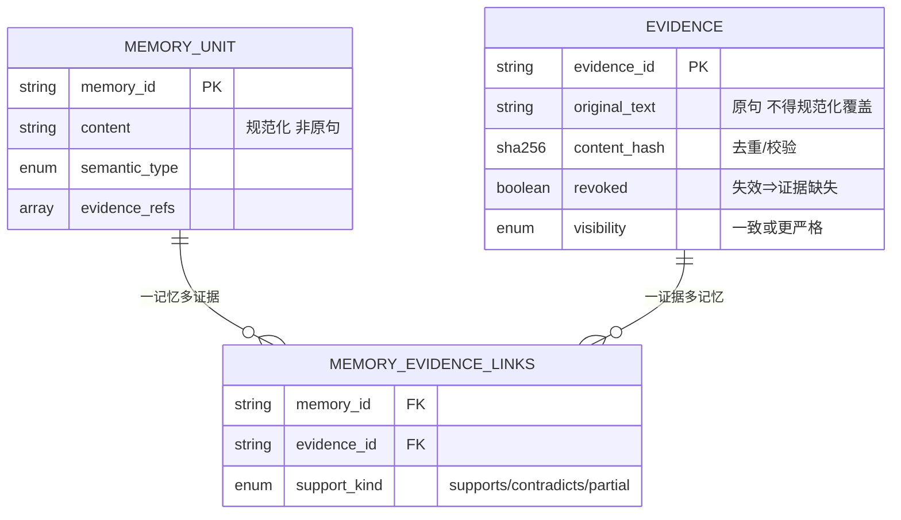
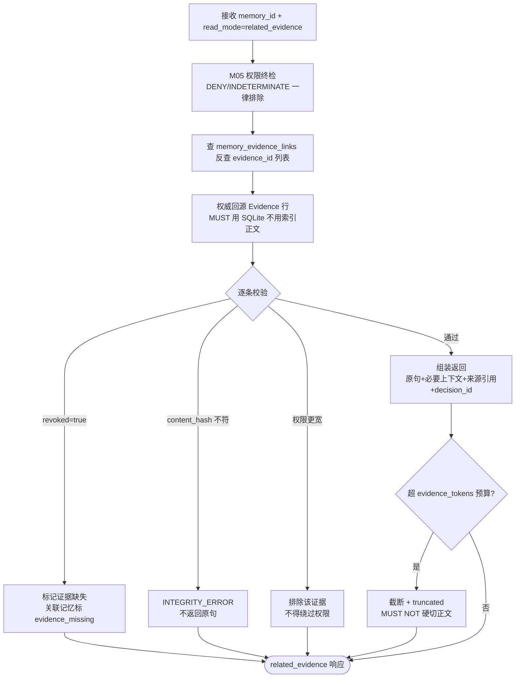
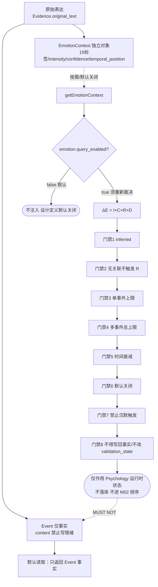

# 13 — Evidence 与 EmotionContext

> 文件代号：13 ｜ 所属交付：Memory Core R4.1 全量详细设计（DD）V1 架构升级 ｜ 设计 Agent 组：B 组（12/13/14）
> 最高行为依据：`DD-AUTHORITY-V2.md` v2.0（APPROVED，与 v1 冲突时以 V2 为准；台账冲突一律"保留原裁决 + 需重新裁决"）
> 结构依据：`DD-AUTHORITY.md` v1.0 §8「每份设计文档的强制结构（15 节）」
> 覆盖：DD-AUTHORITY-V2 §3.2（Evidence）/ §3.3（Event）/ §3.4（EmotionContext）/ §9（ΔE 与 8 门禁）+ 任务书 §8（原句追溯）/ §10（事实情绪分离与有限影响）

---

## 1. 文档状态

| 项目 | 内容 |
|---|---|
| 文件编号 | 13 |
| 文件名称 | Evidence 与 EmotionContext |
| 当前版本 | 1.0 |
| 设计状态 | **PROPOSED**（字段级与流程级设计成稿；已裁决部分见 §5；与台账冲突处见 §14） |
| 实施授权 | **无**。本文件只定义 V1 范围内的系统能力，**不授予代码实施权限**；证据与事件/情绪对象属 P1（M01），情绪能力接入属 P5/P6（新增，需阶段授权），见 DD-AUTHORITY-V2 §10 |
| 完成等级自评 | **F2 达成**（字段表、读取模式、追溯流程、ΔE 公式与门禁、测试规格齐备）；F3 部分（给出数值算例与预期结果，**无执行记录**）；**F4 未达成** |
| 完成等级口径 | 沿用 `DD-AUTHORITY.md` v1.0 §6：F2/F3 **MUST NOT** 写成 F4；禁止把"设计已定义"写成"已授权实施" |
| 语言/编码 | 中文／UTF-8（无 BOM） |
| 配套契约 | `contracts/schemas/` 中 evidence / event / emotion-context / read-request / read-response（由总控维护）；字段以本文 §8 与 V2 §3.2/§3.3/§3.4 为准 |
| 参数归属 | 全部参数标 **EXP-DEFAULT（实验初值）**，指向 **15 号参数注册表**（15 属性），业务代码禁止硬编码（台账 优化-5） |

**分节状态矩阵**

| 章节 | 状态 | 说明 |
|---|---|---|
| §7.1 双层结构与多对多关联 | APPROVED（V2 §3.1/§3.2 + 01 §7.16 关联表） | 关联表规则为 PROPOSED 落地 |
| §7.2 Evidence 字段表 | APPROVED（V2 §3.2 逐字段） | 13 字段不得增删、不得同义变体 |
| §7.3 原句保存纪律 | APPROVED（V2 §3.1 `content` / §3.2 `original_text`） | "原文不得被规范化覆盖"为 V2 原文语义 |
| §7.4 原句追溯与 related_evidence | APPROVED（V2 §2.12 read_mode 四值 + §7 接口） | 反向查询流程为 PROPOSED |
| §7.5 4 种读取模式 | APPROVED（V2 §2.12 枚举逐字） | summary/memory/evidence/related_evidence 不得变体 |
| §7.6 事实与推断标识 | APPROVED（V2 §2.9 source_type 5 值逐字） | 5 值不得增删 |
| §7.7 Event 与 EmotionContext 分离 | APPROVED（V2 §3.3/§3.4 字段表） | "禁止把情绪写入 event.content"为硬规则 |
| §7.8 15 受控标签 | APPROVED（V2 §2.14 逐字 + 台账 J4 配置管理） | 15 标签一字不差；越界映射 neutral + raw_label |
| §7.9 ΔE 公式 | APPROVED（V2 §9 公式形态） | 参数 EXP-DEFAULT；两组数值算例为设计演算，非实测 |
| §7.10 8 条影响门禁 | APPROVED（V2 §9 八条） | 逐条展开，逐字保留"默认关闭" |
| §7.11 CR-02/03/04 声明 | APPROVED 处理口径（V2 §12） | **设计定义，默认关闭，启用须重新裁决** |
| §7.12 情绪读取 | APPROVED（V2 §8「情绪默认不注入」） | 三种主动请求为 PROPOSED 编排 |
| §12 测试要求（18.4/18.5） | **NOT RUN** | 全部为测试规格，无实测结果 |
| §14 未决事项 | TBD / VERIFY / BLOCKED | 引 OI-025~OI-031，与 OPEN-ISSUES.md 对齐 |

---

## 2. 适用版本

| 维度 | 版本 | 说明 |
|---|---|---|
| 母本 | `R4.1-MASTER-01` | m.md（总则） |
| 规范基线 | `R4.1 Specification Baseline` | sf 后文 L3878–6731 |
| 任务书 | `MC-R41-DESIGN-FREEZE-01` | sf L6732–8081；本文对应任务书 §8 / §10 |
| 架构升级任务书 | 《Memory Core R4.1 V1 统一架构升级与设计文书迭代总任务书》（2026-11-04 指令） | V1 正式范围定义来源 |
| 最高行为依据 | `DD-AUTHORITY-V2.md` v2.0 | 唯一枚举/字段/接口定义来源（V2 序） |
| 结构基准 | `DD-AUTHORITY.md` v1.0 | 15 节结构与写作硬规则 |
| 权威顺序 | 第一层：正式裁决台账 `08-adjudication-ledger.md`；第二层：DD-AUTHORITY-V2；第三层：v1 基准与 01/02 设计；第四层：本组技术建议（PROPOSED） | v1 §2.2 + V2 序 |
| 对象版本 | `schema_version = "1.0"`（PROPOSED） | 与 15 号参数注册表的版本口径一致 |
| ID 格式 | `format: uuid`（UUIDv7 形态 **不锁版本**，裁决 R5 / PROPOSED） | 沿用 01 §2 |
| 时间格式 | RFC 3339 / UTC ISO 8601 带 `Z` | 裁决 R6；事实时间 ≠ 记录时间 |
| read_mode 版本 | V2 §2.12 四值（APPROVED） | `summary` / `memory` / `evidence` / `related_evidence` |

---

## 3. 适用范围

### 3.1 覆盖

本文件定义 **Evidence（原始证据）**、**Event（事件事实）**、**EmotionContext（情感关联）** 的完整设计：

1. 双层结构（MemoryUnit + Evidence）与多对多关联（一记忆多证据 / 一证据多记忆）+ 关联表规则。
2. Evidence 字段表（逐字段：类型 / 必填 / 说明）+ 原句保存纪律（原文不得被规范化覆盖；优先引用而非复制；`retention_policy`）。
3. **原句追溯**：`related_evidence` 反向查询流程；证据去重（`content_hash`）；证据版本；证据权限继承（记忆与证据权限一致或更严格，**通过 `related_evidence` 不得绕过权限**）；证据失效（`revoked=true` ⇒ 关联记忆必须标记"证据缺失"）；证据删除后的关联处理。
4. **4 种读取模式**（`summary` / `memory` / `evidence` / `related_evidence`）+ 每种返回结构与允许/禁止内容；禁止默认返回全部聊天历史。
5. 事实与推断标识（`source_type` 5 值）+ 读取时必须保留来源属性；禁止推断伪装成原话。
6. **Event 与 EmotionContext 彻底分离**：Event 只存事实（字段表）；EmotionContext 独立（字段表）；禁止把情绪写入 `event.content`。
7. EmotionContext：**15 个受控标签（逐字列出）** + `raw_label` 保留 + `intensity` / `confidence` 范围 + `temporal_position` 4 值 + `source_type` 仅 `USER_EXPLICIT` / `ASSISTANT_INFERRED`。
8. **ΔE 公式**：`ΔE = I × C × R × D`，逐变量定义与取值域、计算示例（两组数值算例并逐步算）。
9. **8 条影响门禁**逐条展开（`inferred<explicit`、无关联不触发、单事件上限、多事件总上限、时间衰减、默认关闭、禁止沉默触发、不得写回事实）。
10. **CR-02 / CR-03 / CR-04 声明**：检索期情绪（J6 关闭）、ΔE 默认关闭（X-3 / CR-09）、自动情绪推断默认关闭（J7）——**设计定义 ≠ 实施启用，启用须重新裁决**。
11. 情绪读取（默认读事件事实；扩展读情绪；三种主动请求；不得每次强制注入）。
12. 测试（任务书 18.4 / 18.5 全部子项）与验收标准。

### 3.2 不覆盖（FUTURE / 不实施边界）

| 对象/能力 | 状态 | 说明 |
|---|---|---|
| 情绪检索（`EMOTION_QUERY` / `getEmotionContext`）**实施启用** | **默认关闭 / 需重新裁决**（J6 / CR-02 / OI-026） | 本文只**完整定义**能力；`emotion.query_enabled=false` |
| ΔE 对 Psychology 运行时状态的**实际影响** | **默认关闭 / 需重新裁决**（X-3 / CR-03 / OI-027） | 本文只定义公式与门禁；`emotion.influence_enabled=false` |
| L1/L2 LLM **自动情绪推断** | **默认关闭 / 需重新裁决**（J7 / CR-04 / OI-028） | 本文只定义 EmotionExtractor 契约；`emotion.auto_infer=false` |
| M03/M04/M05 代码实现 | **FUTURE / 需阶段授权**（P3/P4/P5） | 设计定义 ≠ 实施授权 |
| Psychology 代码实现 | **BLOCKED / DEFERRED**（I-7 / X-6 / CR-05 / OI-029） | ΔE 的作用对象为运行时状态，接口标 DEFERRED |
| 原句长期保存范围与**导出边界** | **BLOCKED**（K-2 / D-AP-09 / CR-06 / OI-030） | `retention_policy` 定义但不等于导出已解禁 |
| `affect_source='external'` | **FUTURE 预留不启用**（J8） | 本文 **MUST NOT** 写成已启用 |
| `cache.sqlite` 表结构 | **DEFERRED**（U-1/U-2） | 本文 **MUST NOT** 给出任何缓存表结构 |
| 群 Session 归因 / L0 跨用户情绪 | **VERIFY / BLOCKED**（CR-09 / PC-6） | 不得预先定义跨用户情绪传播 |

### 3.3 与其他文档的界面

- **字段语义以 V2 §3.2/§3.3/§3.4 + 本文 §8 为准**；与 01（Evidence / Relation / Observation）同名字段 MUST 同名同义（V2 §13.1）。
- 算法口径（去重 `content_hash`、去重四分类、权限交集、Token 预算、五阶段区分）以 **02** 为准，本文只引用不重定义。
- Pipeline 阶段 10 `EvidenceBinder`、阶段 11 `EmotionExtractor` 名称以 **V2 §5** 逐字为准。
- API 名称以 **V2 §7** 逐字为准（`memory.getEvidence` / `memory.getEvent` / `memory.getEmotionContext` / `memory.getMemoryById` 等，详见 14 号文件）。
- 统一返回 9 字段以 V2 §7 为准；`read_mode` 四值以 V2 §2.12 为准。
- 权限以 **04 / M05** 为准；本文 **MUST NOT** 定义权限判定算法。
- 画像对证据缺失的处理见 **12 号文件 §7.7.1 `evidence_missing[]`**；本文与之对齐。
- 情绪标签 15 词表内容（OI-009）由 15 号参数注册表 / 配置管理（台账 J4）；本文只逐字列出 V2 §2.14 词表。

---

## 4. 依赖文档

| 编号 | 文件 | 用途 | 权威层 |
|---|---|---|---|
| D1 | `DD-AUTHORITY-V2.md` | **最高行为依据**：§2.2/§2.9/§2.12/§2.13/§2.14/§2.15 枚举、§3.2/§3.3/§3.4 字段表、§5 Pipeline、§7 九接口、§8 检索五阶段、§9 ΔE 与 8 门禁、§12 台账冲突、§13 写作硬规则 | 第二层（与 v1 冲突时最优先） |
| D2 | `DD-AUTHORITY.md` v1.0 | 15 节结构（§8）、写作硬规则、F 等级、参数登记、A/B 迁移方向 | 第二层 |
| D3 | `01-记忆本体与数据模型.md` | MemoryUnit（§7.6）、Evidence 字段与七问（§7.8）、Relation 八种（§7.10）、`memory_evidence_links` 关联表（§7.16）、版本七要求（§7.15）、删除传播 | 第三层 |
| D4 | `02-核心算法规范.md` | ALG-02 权威回源九步（§7.3）、ALG-05 Token Budget（§7.6）、ALG-06 Context Builder（§7.7）、ALG-09 M05 权限交集（§7.10）、五阶段区分（§7.13）、reinforce 红线（§7.14） | 第三层 |
| D5 | `08-adjudication-ledger.md`（`C:\Users\[USER]\Desktop\work\`） | 正式裁决唯一权威（D-AP-02/05/07/09、I-5/I-7、J2/J4/J5/J6/J7/J8、K-2/K-6、X-1/X-2/X-3/X-6、CR-09、优化-1/优化-5） | **第一层** |
| D6 | `DOCUMENT-CONFLICT-REGISTER-V2.md` | CR-01~CR-07 与 OI-025~OI-031 的映射 | 派生登记 |
| D7 | `OPEN-ISSUES.md`、`PENDING-USER-DECISIONS.md` | 未决事项编号对齐（含 OI-009 词表内容） | 派生登记 |
| D8 | `12-人物画像整合.md`、`14-ChatLLM读写API.md` | 画像 `evidence_missing`、读写 API 与 L3 事件语义一致性 | 同批交付（组 B） |
| D9 | `15-参数注册表.md` | 全部 EXP-DEFAULT 参数的 15 属性登记 | 同批交付（组 A/总控） |

---

## 5. 正式裁决引用

> 引用格式 = 台账小节；逐条引台账编号，不改写原文语义。与 V2 任务书冲突时按 §12「保留原裁决 + 需重新裁决」。

| 台账编号 | 台账要点（原文语义） | 对本文件的约束 |
|---|---|---|
| **D-AP-02**（§3b 第二轮） | M04 §6.2 唯一 LLM Gateway 入口；Embedding Provider 归 M01 | EmotionExtractor 若需 LLM（自动推断），**MUST** 经 M04 §6.2 唯一入口；且默认不启用（J7 / CR-04） |
| **D-AP-05**（§3b 第二轮） | confirmed 仅 M04 审核通道写入；**reinforce 仅由 DSH 回传最终 prompt 中实际出现的记忆 ID 触发**；E14/B04 未落地前只预留 schema 禁写；last_retrieved 不得作为衰减 v2 正向权重 | `getEvidence` / `related_evidence` 读取命中 **MUST NOT** 触发 reinforce 写入；证据读取 **MUST NOT** 写 `reinforced_*`；L3 事件只证明"进入 Prompt"（见 14 号文件） |
| **D-AP-07**（§3b 第二轮） | C40 权限引擎不可插拔；五级可插拔分类接受；trusted_context_source: entry-only | 证据读取 **MUST** 经 M05 权限终检；**MUST NOT** 用可插拔替身替代 C40；证据来源受 entry-only 约束 |
| **D-AP-09**（§3b 第二轮） | 拒绝第三方托管记忆平台；**不得声称"记忆文本不出本机"**；本地持久化与云端推理传输分开评估 | 原句（`original_text`）的持久化与云端推理传输 **MUST** 分开评估；本文 **MUST NOT** 出现"原句不出本机"表述（CR-06 / OI-030） |
| **D-AP-06**（§3b 第二轮） | 生活化测试集为主要验收依据；研究报告收益不得写成实测结果 | §12 测试与 §13 验收 **MUST** 使用生活化测试集口径；ΔE 数值算例 **MUST** 标"设计演算"、**MUST NOT** 写成实测 |
| **I-5**（§3c 第三轮） | 心理状态机只改运行时状态，不直接产生记忆候选；值得长期记住的内容须经 M03/M04 通道 | ΔE **MUST NOT** 产生记忆候选；EmotionContext **MUST** 经 M03 候选 + M04 整合通道，不得由 Psychology 直写 |
| **I-7 / X-6**（§3c / §3g） | psy-model 暂缓；五方法/十二阶段接口形态暂缓 | ΔE 的作用对象（Psychology）实施仍 **BLOCKED / DEFERRED**（CR-05 / OI-029） |
| **J2**（§3e 第四轮） | 接受 a，采用 M03 写时情绪标注；检索期不调用 LLM；标注结果 **MUST** 区分用户事实与模型推断，并保留来源与版本 | EmotionContext `source_type` **MUST** 区分 `USER_EXPLICIT` / `ASSISTANT_INFERRED`；**MUST** 保留 `evidence_refs` 与版本；检索期 **MUST NOT** 调用 LLM |
| **J4**（§3e 第四轮） | 接受 a，15 个受控标签起步；词表配置方式管理；具体标签内容留到实施设计阶段 | 15 标签 **MUST** 逐字使用 V2 §2.14；**MUST** 配置管理（15 号参数注册表 / OI-009）；越界标签映射 `neutral` + 记录 `raw_label`，**MUST NOT** 丢弃原始表达 |
| **J5**（§3e 第四轮） | 接受 a，提供情绪标注清除能力；走 M04 修订通道和审计；具体删除范围/缓存/备份服从 K-2 | 情绪标注清除 **MUST** 走 M04 修订通道 + 审计；删除范围 **MUST NOT** 绕过 K-2（CR-06 / OI-030） |
| **J6**（§3e 第四轮） | 接受 a，**首版关闭查询侧情绪感知**；未来开启必须有独立验证和重新裁决 | `emotion.query_enabled=false`；`getEmotionContext` / `EMOTION_QUERY` **设计定义，默认关闭，启用须重新裁决**（CR-02 / OI-026） |
| **J7**（§3e 第四轮） | 接受 b，**只预留接口和字段，不实现 LLM 标注与批量重放** | `emotion.auto_infer=false`；EmotionExtractor 只定义契约；**设计定义，默认关闭，启用须重新裁决**（CR-04 / OI-028） |
| **J8**（§3e 第四轮） | 接受 a，预留 `affect_source='external'` 字段，不代表立即启用外部来源 | `affect_source='external'` **MUST NOT** 写成已启用；本文仅登记预留 |
| **K-2**（§3f 第五轮） | 内部计算参数/系数不默认导出；必须逐项确定导出边界；删除/删号/tombstone/缓存/备份语义一并考虑 | `original_text` 的导出边界 **BLOCKED**；`retention_policy` **MUST NOT** 被解释为"已可导出"（CR-06 / OI-030） |
| **K-6**（§3f 第五轮） | 删除沉默触发项；openLoop 只能由明确事件触发，永不由沉默触发；受 CR-09 约束 | ΔE **MUST NOT** 由沉默触发；无明确事件即无 ΔE（V2 §9 门禁 7） |
| **X-1**（§3g 第六轮） | delta-only 影子验证，不改变 M02 最终排序；不允许心理层直接取得 M02 排序权 | ΔE **MUST NOT** 进入 M02 排序公式（02 §7.5 六特征）；**MUST NOT** 改变检索顺序 |
| **X-2**（§3g 第六轮） | Session 结束后丢弃短期情绪状态；L1 仅预留 | 短期情绪状态 **MUST NOT** 跨会话持久化；L1 情绪仅预留 |
| **X-3**（§3g 第六轮） | Recall 允许参与当前推理，禁止直接修改 PAD；持久状态变更必须经独立审核；第③层默认关闭 | ΔE **MUST** 只作用运行时状态、**MUST NOT** 直接改 PAD / 改持久状态；`emotion.influence_enabled=false`（CR-03 / OI-027） |
| **CR-09**（§3g 第六轮） | 接受 W2 §8 P0 测试化表述作为伦理门禁框架；未经实施验证不代表已通过；禁止把回复率/留存率/愧疚感作为优化目标 | ΔE 门禁 7「禁止沉默触发」**MUST** 受 CR-09 约束；**MUST NOT** 以互动指标作为情绪影响优化目标 |
| **优化-1**（§3e 第四轮） | Token 计量须区分系统提示词/聊天历史/记忆检索/实际注入/模块调用消耗 | §7.5 四种读取模式 **MUST** 分别计入 Token 预算（证据/情绪分项）；**MUST NOT** "1200 字 = 1200 Token" |
| **优化-5**（§3e 第四轮） | 稳定、唯一、可追踪的参数 ID；展示名可改、身份不丢 | 本文全部参数 **MUST** 带稳定参数 ID 并登记 15 号参数注册表 |

**未决事项（引 OI-025~OI-031）**：见 §14，逐条与 OPEN-ISSUES.md 对齐。

**台账冲突处处理口径（MUST 逐字使用）**：
- CR-02 / CR-03 / CR-04 / CR-06 涉及本文件的部分，一律 **"保留原裁决 + 需重新裁决"**：设计 **完整定义** 能力，实施 **默认关闭** / 保持 **BLOCKED**，启用须重新裁决。**禁止静默改写台账**。
- **MUST NOT** 把情绪检索 / 情绪影响 / 自动情绪推断写成已启用 —— 一律 **"设计定义，默认关闭，启用须重新裁决"**。

---

## 6. 术语表

| 术语 | 定义（与 V2 §13.1 统一） |
|---|---|
| Memory Unit（MemoryUnit） | 独立记忆单元，权威对象；`content` 为 **规范化后的独立记忆内容**，**MUST NOT** 当作原句（V2 §3.1） |
| Evidence | 原始证据（原句）；`original_text` **MUST NOT** 被规范化覆盖（V2 §3.2） |
| Event | 事件事实对象；`content` **仅事实**，禁止写入情绪判断（V2 §3.3） |
| EmotionContext | 情感关联对象（与 Event 分离）；字段见 V2 §3.4 / 本文 §7.7 |
| Memory Anchor | 获取锚点；8 值枚举见 V2 §2.3 |
| Lifecycle(tier) | 生命周期层级 L1/L2/L3；与 semantic_type 正交（V2 §2.5） |
| Semantic Type | 语义主类 6 值（V2 §2.1） |
| Subject | 主体；`subject_type` 6 值 + `subject_id`（V2 §2.4） |
| Memory Ingestion Pipeline | 记忆摄取管线 16 阶段（V2 §5），本文涉及阶段 10 `EvidenceBinder`、阶段 11 `EmotionExtractor` |
| Memory Read API / Memory Write API | 聊天 LLM 读写唯一入口（V2 §7） |
| Psychology | 心理层（运行时状态）；实施 BLOCKED（CR-05 / OI-029） |
| 双层结构 | `MemoryUnit`（规范化、可独立理解）+ `Evidence`（原句、原文）两层；二者通过关联表多对多绑定 |
| `related_evidence` | read_mode 四值之一；"指定记忆 → 相关原句"的反向证据读取（V2 §2.12） |
| `content_hash` | `original_text` 的 sha256；用于证据去重与校验（V2 §3.2） |
| `revoked` | Evidence 失效标记；`revoked=true` ⇒ 关联记忆 **MUST** 标记"证据缺失"（V2 §3.2） |
| `retention_policy` | Evidence 保留策略；**不等于**导出边界解禁（K-2 / CR-06） |
| `source_type`（V2 §2.9） | 来源性质 5 值：`USER_EXPLICIT` / `USER_INSTRUCTION` / `ASSISTANT_INFERRED` / `EXTERNAL_SOURCE` / `SYSTEM_GENERATED` |
| `emotion_label` | 受控 15 标签（V2 §2.14）；越界映射 `neutral` + `raw_label` |
| `temporal_position` | 情绪相对事件的时间位置 4 值：`BEFORE` / `DURING` / `AFTER` / `UNKNOWN`（V2 §2.13） |
| ΔE | 事件情绪对当前情绪的有限影响量：`ΔE = I × C × R × D`（V2 §9）；**默认关闭** |
| EXP-DEFAULT | 实验初值，非裁决值（v1 §6 / V2 §13.3）；一律登记 15 号参数注册表 |
| Token 单位四类 | 字符 / 汉字（字数）/ Token / 字节（V2 §13.4：字符、汉字、字数、Token MUST 分别标明） |
| MOCKED | Mock 结果标记（V2 §13.5）；测试桩全通过逻辑仅限隔离测试 |

---

## 7. 规范正文

### 7.1 双层结构（MemoryUnit + Evidence）与多对多关联

#### 7.1.1 双层结构（MUST）

1. 系统 **MUST** 区分两层：**MemoryUnit 层**（规范化后的独立记忆内容，可独立理解）与 **Evidence 层**（原始表达 / 原句）。
2. MemoryUnit 的 `content` **MUST NOT** 被当作原句；Evidence 的 `original_text` **MUST NOT** 被规范化覆盖（V2 §3.1 / §3.2）。
3. 一条正式记忆 **MUST** 有 `evidence_refs`（V2 §3.1：正式记忆 MUST 非空，除非 `source_type=SYSTEM_GENERATED` 且显式标注）；**MUST NOT** 在缺少来源时生成虚构引用（01 §7.8 禁令）。
4. 双层之间的绑定由 Pipeline 阶段 10 `EvidenceBinder` 完成（V2 §5 名称逐字）；绑定 **MUST** 支持反向取原句。

#### 7.1.2 多对多关联（MUST）

| 关系 | 说明 | 示例 |
|---|---|---|
| **一记忆多证据** | 一条 MemoryUnit 可由多条 Evidence 支撑（多次表达、多个来源） | 主人 3 次不同措辞说"偏好逐步讲解" → 1 条 PREFERENCE 记忆 + 3 条 Evidence |
| **一证据多记忆** | 一条 Evidence（一段原话）可支撑多条 MemoryUnit（语义碎片化后） | 一句"我去年在准备考研，平时喜欢深夜写代码" → 1 条 Evidence + 2 条 MemoryUnit（CURRENT_STATE / HABIT） |

**MUST**：多对多 **MUST NOT** 用"把证据 ID 塞进 MemoryUnit 单字段"的隐式方式替代；**MUST** 通过独立关联表显式记录。

#### 7.1.3 关联表规则（PROPOSED，对齐 01 §7.16 表 5）

> 表名沿用 01 §7.16：`memory_evidence_links`（记忆 ↔ 证据多对多）。本文 **不新建冲突表名**。

| 列 | 类型 | 约束 |
|---|---|---|
| `memory_id` | uuid | FK → `memory_objects`；NOT NULL |
| `evidence_id` | uuid | FK → `evidence`；NOT NULL |
| `support_kind` | enum(`supports`/`contradicts`/`partial`) | 证据对记忆的支持性质（01 §7.16） |
| `created_at` | datetime | UTC RFC3339 |

**关联表规则（MUST）**：

1. 主键 **MUST** 为 `(memory_id, evidence_id, support_kind)`；**MUST** 建 `INDEX(evidence_id)` 以支撑 **反向查询**（`related_evidence`）与删除传播（01 §7.16）。
2. 一条 `(memory_id, evidence_id)` 组合 **MUST NOT** 出现冲突的多种 `support_kind` 而无裁决记录；冲突 **MUST** 走 M04 冲突判定（02 §7.9）。
3. 关联写入 **MUST** 与 MemoryUnit / Evidence 写入处于 **同一 M01 事务**（v1 §6 事务五步）；**MUST NOT** 出现"记忆已提交但关联未写"或反向。
4. 删除传播 **MUST** 按 01 §7.16「删除传播 7 步」执行；关联行 **MUST NOT** 悬空（FK 双向约束）。
5. 关联表 **MUST NOT** 承载权限、版本、生命周期（v1 §7.16 通用约定：这些 **MUST NOT** 仅存于 JSON / 关联表）。
6. `support_kind=contradicts` 的证据 **MUST NOT** 被当作该记忆的正面来源；读取时 **MUST** 保留矛盾标注。

### 7.2 Evidence 字段表（V2 §3.2 逐字段，逐字）

| 字段 | 类型 | 必填 | 说明 |
|---|---|---|---|
| `evidence_id` | string | ✓ | uuid |
| `source_type` | enum(chat/file/import/tool/system) | ✓ | 证据来源形态（**注意**：此处是证据形态 5 值，与 V2 §2.9 的 `source_type` 5 值 **是两个不同字段的两个枚举**，见 §7.6.3 辨析） |
| `source_id` | string | ✓ | 会话/文件/工具调用 ID |
| `source_locator` | string\|null | | 定位（`session:msg:seq`） |
| `speaker_id` | string | ✓ | 发言者主体 ID |
| `timestamp` | datetime\|null | | 原始时间（未知 null） |
| `original_text` | string | ✓ | **原始表达（原句）**；MUST NOT 被规范化覆盖 |
| `context_before` / `context_after` | string\|null | | 必要上下文（受限长度） |
| `visibility` | enum §2.10 | ✓ | 证据自身可见性 |
| `scope` | enum(v1 五值) | ✓ | 内部细分 |
| `content_hash` | sha256 | ✓ | `original_text` 哈希（去重/校验） |
| `retention_policy` | string\|null | | 保留策略 |
| `revoked` | boolean | ✓ | 失效标记（失效后关联记忆 MUST 标记证据缺失） |

**MUST（字段纪律）**：

1. `original_text` **MUST** 原样保存；**MUST NOT** 做去停用词、去否定词、改写时态、替换代词等"规范化"处理（02 §7.3 查询规范化禁令同源）。
2. `timestamp` 未知 **MUST** 为 null，**MUST NOT** 填推测时间（V2 §3.2；01 §7.14 事实时间 ≠ 记录时间）。
3. `speaker_id` **MUST** 是可信身份映射结果，**MUST NOT** 由 LLM 自述（02 §7.10）。
4. `content_hash` **MUST** 为 `original_text` 的 sha256（64 位十六进制），用于去重与校验；**MUST NOT** 用规范化后文本计算。
5. `visibility` / `scope` **MUST** 与关联记忆一致或**更严格**（见 §7.4.4）；`system_internal`（v1 五值之一）**MUST NOT** 对聊天 LLM 输出正文。
6. `retention_policy` **MUST** 与 K-2 导出边界分离：它只描述**保留**，**MUST NOT** 被解释为导出已解禁（CR-06 / OI-030）。
7. `revoked` 默认 `false`；置 `true` **MUST** 记录 provenance / audit（01 §7.8 Q6）。

**Evidence 七问（01 §7.8，MUST 全答）**：Q1 来自哪里 / Q2 谁提供 / Q3 何时出现 / Q4 原文是否仍可用 / Q5 支持哪条记忆 / Q6 是否撤销 / Q7 属于哪个权限范围。无法回答 Q1/Q7 ⇒ **拒绝**建立正式记忆证据链。

### 7.3 原句保存纪律

**MUST（三条核心纪律）**：

| # | 纪律 | 落地 |
|---|---|---|
| D-01 | **原文不得被规范化覆盖** | `original_text` 独立存储；MemoryUnit `content` 的规范化结果 **MUST NOT** 回写 `original_text`；两者 **MUST** 可分别读取 |
| D-02 | **优先引用而非复制** | 读取 / 注入时 **MUST** 优先返回 `evidence_id` 引用 + 按需原句；**MUST NOT** 把整段聊天历史复制到每个记忆条目；Context 组装 **MUST NOT** 重复嵌入同一原句（02 §7.7） |
| D-03 | **`retention_policy` 受控** | `retention_policy` **MUST** 为受控词表（实施期确定，登记 15 号参数注册表）；**MUST NOT** 由 LLM 自由生成；导出边界仍 **BLOCKED**（K-2 / CR-06） |

**MUST NOT（原句禁令）**：

| # | 禁止行为 | 依据 |
|---|---|---|
| P-01 | 把模型推断伪装成用户原话 | V2 §13.4；台账 J2/J7；01 §7.8 |
| P-02 | 把 Agent 总结 / 检索结果伪装成原始证据 | 01 §7.8 |
| P-03 | 缺少来源时构造虚构 `source_ref` | 01 §7.8 |
| P-04 | 把来源丢失的记忆标记为已验证 | 01 §7.8 |
| P-05 | 因"节省 Token"删除原句中的否定词 / 时间条件 | 02 §7.6 / §7.7 |
| P-06 | 默认返回全部聊天历史 | §7.5 / 任务书 §8 |
| P-07 | 声称"记忆文本不出本机" | 台账 D-AP-09 / CR-06 |

**上下文长度（EXP-DEFAULT）**：`context_before` / `context_after` 受 `evidence.context_max_chars`（字符）约束；**MUST** 用真实长度计量，**MUST NOT** 用汉字数或 Token 数代替（V2 §13.4）。

### 7.4 原句追溯：`related_evidence` 反向查询流程

> `related_evidence` 是 V2 §2.12 四值 read_mode 之一，语义为"指定记忆 → 相关原句"（V2 §7 `memory.getEvidence(memory_id | evidence_id, mode)`）。

#### 7.4.1 反向查询流程（PROPOSED，6 步）

| 步 | 动作 | 输入 | 输出 | 失败处置 |
|---|---|---|---|---|
| 1 | 接收 `memory_id` + `read_mode=related_evidence` + `request_id` | Read API 请求 | 待判权请求 | 缺参 ⇒ `VALIDATION_ERROR` |
| 2 | **M05 权限终检**（先判权，防时序泄露） | `actor` / `subject_id` / `scope` | `decision_id` + `allowed` | DENY / INDETERMINATE ⇒ 排除，不返回正文（02 §7.10） |
| 3 | 查 `memory_evidence_links` 反查 `evidence_id[]` | `memory_id` | 证据 ID 列表 | 空 ⇒ 返回 `evidence_missing` 标记 |
| 4 | 权威回源 Evidence 行（**MUST** 用 SQLite 权威，不用索引正文） | `evidence_id[]` | Evidence 记录 | `STORAGE_ERROR` ⇒ 整体失败，不输出 |
| 5 | 逐条校验 `revoked` / `visibility` / `scope` / `content_hash` | Evidence 记录 | 可返回证据集 | `revoked=true` ⇒ 标"证据缺失"，**MUST NOT** 返回原句正文 |
| 6 | 组装返回（原句 + 必要上下文 + 来源引用 + `decision_id`） | 可返回证据集 | `related_evidence` 响应 | 超预算 ⇒ 截断 + `truncated`，**MUST NOT** 硬切正文 |

**MUST**：第 2 步权限 **MUST** 在第 3 步反查之前；**MUST NOT** 通过 `related_evidence` 绕过权限（见 §7.4.4）。

#### 7.4.2 证据去重（`content_hash`）

1. 新 Evidence 写入前 **MUST** 计算 `content_hash = sha256(original_text)`；命中既有未撤销且 `source_id` + `source_locator` 可对齐的哈希 ⇒ **MUST** 复用既有 `evidence_id`，**MUST NOT** 重复存原句。
2. 去重 **MUST NOT** 仅凭哈希跨主体 / 跨 `scope` 合并：不同 `speaker_id` / `visibility` / `scope` 的相同文本 **MUST** 保留为不同证据（权限继承最严格交集，02 §7.10.3）。
3. 去重命中 **MUST** 仍建立 `memory_evidence_links` 关联（一证据多记忆），**MUST NOT** 因复用证据而丢失关联。
4. `content_hash` **MUST** 用于校验：读取时 `original_text` 重算哈希与 `content_hash` 不一致 ⇒ 标 `integrity_error`，**MUST NOT** 当作有效原句返回。

#### 7.4.3 证据版本

1. Evidence **MUST** 支持版本：原句内容不变的元信息修正（如 `source_locator` 纠正、`retention_policy` 调整）**SHOULD** 通过追加版本 + 审计完成，**MUST NOT** 静默覆盖 `original_text`。
2. `original_text` **MUST NOT** 被"修正"：如确需订正，**MUST** 新建 Evidence（`evidence_id` 新、`content_hash` 新、旧条 `revoked=true` 且保留），**MUST NOT** 改写历史原句（V2 §3.2 原句保存纪律；01 §7.15 R7）。
3. 证据版本变更 **MUST** 写 provenance / audit；版本链 **MUST** 可查、不成环。

#### 7.4.4 证据权限继承（红线）

**MUST（权限四规则）**：

| # | 规则 |
|---|---|
| PERM-1 | 记忆与证据权限 **MUST** 一致或证据 **更严格**：`visibility(evidence) ≤ visibility(memory)`（可访问面 ≤ 记忆），`scope(evidence)` **MUST** 取所有来源的最严格交集（02 §7.10.3） |
| PERM-2 | **通过 `related_evidence` 不得绕过权限**：反向查询 **MUST** 先经 M05 `canRead`，且每条证据 **MUST** 单独再判权；**MUST NOT** 因"记忆已授权"自动放行其证据 |
| PERM-3 | `revoked=true` / `suspended` / 未知状态 / 超时 ⇒ **MUST** 排除（DENY / INDETERMINATE 一律排除） |
| PERM-4 | 错误消息 **MUST NOT** 回显 `original_text` 或 `content`（02 §7.10 禁止行为） |

**MUST NOT**：用 `related_evidence` 读取比记忆更宽范围的聊天历史；用证据正文侧信道推断无权内容；把 `system_internal` 证据正文注入聊天 LLM。

#### 7.4.5 证据失效（`revoked=true` ⇒ 关联记忆标记"证据缺失"）

1. `revoked=true` **MUST** 触发：所有通过 `memory_evidence_links` 关联到该证据的 MemoryUnit **MUST** 标记"证据缺失"（`evidence_missing`，对齐 12 号文件 §7.7.1 `evidence_missing[]` 与 01 §7.8 Q6）。
2. 标记 **MUST** 是显式的、可读取的；**MUST NOT** 静默把"证据缺失"写成"已验证"或删除关联。
3. 若一条 MemoryUnit 的 **全部** 证据均 `revoked=true`：**MUST NOT** 作为已验证事实返回；**SHOULD** 降为 `unverified` / `disputed`（V2 §2.8），并保留来源链与审计。
4. 证据失效 **MUST NOT** 自动删除 MemoryUnit（v1 架构不变量：不静默删除权威数据）；删除须走 M04 + M05 通道。
5. 证据失效 **MUST** 同步使依赖的派生视图（PersonProfile / Observation）失效或重算（02 §7.9.5；12 号文件 §7.10）。

#### 7.4.6 证据删除后的关联处理

| # | 规则 |
|---|---|
| DEL-1 | 逻辑删除优先：Evidence **SHOULD** 先置 `revoked=true` + `status` 收敛，**MUST NOT** 直接物理删除并留下悬空关联 |
| DEL-2 | 物理删除（合规流程）**MUST** 与 `memory_evidence_links` 关联行在同一 M01 事务内清理，FK 双向 **MUST NOT** 悬空 |
| DEL-3 | 删除传播 **MUST** 按 01 §7.16「删除传播 7 步」；**MUST** 写 tombstone（01 §7.6.5）阻止复活 |
| DEL-4 | 删除 **MUST** 写 provenance（`operation=delete`）+ audit；**MUST NOT** 因"维护"批量删证据（02 §7.12 Dream 约束） |
| DEL-5 | 删除后 `related_evidence` 查询 **MUST** 返回"证据缺失"标记，**MUST NOT** 编造原句 |
| DEL-6 | 删除范围 / 缓存 / 备份 / tombstone 语义 **MUST** 服从 K-2（台账 J5 / CR-06 / OI-030）；导出边界仍 BLOCKED |
| DEL-7 | 删除 **MUST NOT** 触发 reinforce 或任何记忆强化写入（D-AP-05） |

### 7.5 4 种读取模式（V2 §2.12 逐字）

> 枚举（MUST 一字不差）：`summary`（整合后的摘要）/ `memory`（独立记忆单元）/ `evidence`（原始句子 + 必要上下文）/ `related_evidence`（指定记忆 → 相关原句）。
> **禁止默认返回全部聊天历史**（任务书 §8）。

| read_mode | 返回结构 | 允许内容 | 禁止内容 |
|---|---|---|---|
| `summary` | 整合后的摘要 + V2 §7 统一返回 9 字段 + `decision_id` | 规范化摘要、来源类型标记、时间标记、不确定性标记（02 §7.7 分区标注） | **MUST NOT** 返回 `original_text` 全文；**MUST NOT** 默认返回全部聊天历史；**MUST NOT** 返回 `EMOTION_CONTEXT`（§7.12 / V2 §8） |
| `memory` | 独立 MemoryUnit（V2 §3.1 全字段）+ 9 字段 | `content`（规范化）、`evidence_refs` 引用、`anchor`、`source_type`、`lifecycle(tier+status)`、`visibility` | **MUST NOT** 把 `content` 当作原句；**MUST NOT** 内嵌全部证据正文；**MUST NOT** 省略 `source_type`；**MUST NOT** 返回未判权记忆 |
| `evidence` | 原始句子（`original_text`）+ `context_before/after`（必要、受限）+ 来源定位 + `content_hash` + 9 字段 | 指定 `evidence_id` 或指定记忆关联的原句；必要上下文；来源属性 | **MUST NOT** 返回无关聊天历史；**MUST NOT** 返回 `revoked=true` 的原句正文；**MUST NOT** 绕过 M05；**MUST NOT** 把推断伪装成原话 |
| `related_evidence` | 指定 `memory_id` → 相关原句集（§7.4.1 六步）+ 关联表 `support_kind` + `decision_id` | 该记忆关联的证据原句 + 必要上下文 + 支持/矛盾标注 | **MUST NOT** 绕过权限（PERM-2）；**MUST NOT** 返回比记忆更宽范围的历史；**MUST NOT** 返回全部聊天历史；**MUST NOT** 把 `contradicts` 当正面来源 |

**MUST（读取模式通用规则）**：

1. `read_mode` **MUST** 显式指定；缺省 **MUST** 取 `summary`（最保守），**MUST NOT** 缺省为 `evidence` 或 `related_evidence`。
2. 四种模式 **MUST** 都携带 V2 §7 统一返回 9 字段：`memory_id, content, semantic_type, anchor, source_type, confidence, evidence_refs, lifecycle(tier+status), visibility`。
3. 每次读取 **MUST** 经 M05（V2 §7）；DENY / INDETERMINATE 一律排除。
4. 证据类模式（`evidence` / `related_evidence`）**MUST** 单独计入 `evidence_tokens`；情绪 **MUST** 单独计入 `emotion_tokens`（V2 §13.4 分项预算）。
5. **禁止默认返回全部聊天历史**：任何模式 **MUST NOT** 把整个会话 `recentMessages[]` 作为返回体；上下文 **MUST** 受 `evidence.context_max_chars` 限制。
6. 读取命中 **MUST NOT** 写 `reinforced_*`（D-AP-05）；L3 注入事件只证明"进入 Prompt"（02 §7.13 五阶段）。

### 7.6 事实与推断标识（source_type 5 值）

> V2 §2.9 逐字（**MUST NOT** 增删、不得同义变体）：

```
USER_EXPLICIT       用户明确表达
USER_INSTRUCTION    用户明确记忆指令（要求保存）
ASSISTANT_INFERRED  模型推断
EXTERNAL_SOURCE     外部来源（文件投喂/导入/工具结果）
SYSTEM_GENERATED    系统生成（派生视图/整合结果）
```

#### 7.6.1 读取时必须保留来源属性（MUST）

1. 任何读取结果 **MUST** 携带 `source_type`；**MUST NOT** 省略、合并、或统一写成 `USER_EXPLICIT`。
2. `ASSISTANT_INFERRED` / `SYSTEM_GENERATED` 内容 **MUST** 带推断/派生标记，**MUST NOT** 被改写成确定事实（02 §7.7 禁令 1）。
3. `USER_INSTRUCTION` **MUST NOT** 被写成 "模型觉得值得记住"；反之，模型自主发现 **MUST** 标 `ASSISTANT_INFERRED`，**MUST NOT** 写成 "用户要求记住"（14 号文件写入来源纪律）。
4. Context 组装 **MUST** 把推断项归入 `uncertain` 分区并标 `inferred` / `uncertain` / `disputed`（02 §7.7）。
5. 来源属性 **MUST** 随版本保留；版本演进 **MUST NOT** 丢失 `source_type`。

#### 7.6.2 禁止推断伪装成原话（红线）

| # | 禁止行为 |
|---|---|
| P-08 | 把 `ASSISTANT_INFERRED` 的 MemoryUnit 作为 `original_text` 返回 |
| P-09 | 把 `SYSTEM_GENERATED` 的画像/摘要当作用户明确表达 |
| P-10 | 把 `EmotionContext.source_type=ASSISTANT_INFERRED` 的情绪写成"主人明确说过" |
| P-11 | 因措辞通顺而删除"系统推断"前缀 |

#### 7.6.3 辨析：两个 `source_type` 字段（MUST NOT 混淆）

| 字段 | 所属对象 | 枚举 | 语义 |
|---|---|---|---|
| `MemoryUnit.source_type` / `Evidence`（V2 §2.9 语境）/ `EmotionContext.source_type` | 记忆 / 来源性质 / 情绪 | **5 值**：`USER_EXPLICIT` / `USER_INSTRUCTION` / `ASSISTANT_INFERRED` / `EXTERNAL_SOURCE` / `SYSTEM_GENERATED` | 来源**性质**（谁/怎么产生） |
| `Evidence.source_type`（V2 §3.2 字段表） | Evidence 自身 | **5 值**：`chat` / `file` / `import` / `tool` / `system` | 证据**形态**（从哪种载体来） |

**MUST**：二者是**不同字段、不同枚举**；文档与契约 **MUST NOT** 混用、互相覆盖或用同一参数 ID；分别登记 15 号参数注册表。

### 7.7 Event 与 EmotionContext 彻底分离

> V2 §3.3：`content` = string（**仅事实**，禁止写入情绪判断）。
> V2 §3.4：EmotionContext 为独立对象。
> **禁止把情绪写入 `event.content`**（任务书 §10）。

#### 7.7.1 Event 字段表（V2 §3.3 逐字段，逐字）

| 字段 | 类型 | 必填 | 说明 |
|---|---|---|---|
| `event_id` | string uuid | ✓ | 事件 ID |
| `content` | string（**仅事实**，禁止写入情绪判断） | ✓ | 事实描述；**MUST NOT** 出现"开心/焦虑/生气"等情绪判断 |
| `time_start` / `time_end` | datetime\|null | ✓ | 事实时间（未知 null，**MUST NOT** 推测） |
| `participants` | array<subject_id> | ✓ | 参与者（**MUST** 经 EntityResolver 解析） |
| `location` | string\|null | ✓ | 地点 |
| `result` | string\|null | ✓ | 结果（仅事实） |
| `related_memory_ids` | array<memory_id> | ✓ | 关联记忆 |
| `evidence_refs` | array<evidence_id> | ✓ | 证据引用 |
| `status` | enum(ACTIVE/SUPERSEDED/ARCHIVED/DELETED) | ✓ | V2 §2.6 四值 |
| `visibility` / `scope` | enum | ✓ | 权限 |
| `version` / `created_at` / `updated_at` | | ✓ | 版本与时间 |

#### 7.7.2 EmotionContext 字段表（V2 §3.4 逐字段，逐字）

| 字段 | 类型 | 必填 | 说明 |
|---|---|---|---|
| `emotion_id` | string uuid | ✓ | 情绪关联 ID |
| `event_id` | string uuid\|null（可无具体事件） | ✓ | 关联事件；`null` 时**MUST NOT** 由沉默触发 ΔE（门禁 7） |
| `subject_id` | string | ✓ | 主体 |
| `emotion_label` | enum §2.14 | ✓ | 受控 15 标签 |
| `raw_label` | string\|null | ✓ | 原始表达保留（越界标签必填） |
| `intensity` | number 0–1 | ✓ | 情绪强度 |
| `confidence` | number 0–1 | ✓ | 情绪判断可信度（≠事实真实性） |
| `temporal_position` | enum §2.13 | ✓ | `BEFORE` / `DURING` / `AFTER` / `UNKNOWN` |
| `source_type` | enum(USER_EXPLICIT/ASSISTANT_INFERRED) | ✓ | **仅** 两值（V2 §3.4） |
| `evidence_refs` | array | ✓ | 证据引用 |
| `related_memory_ids` | array | ✓ | 关联记忆 |
| `visibility` / `scope` | enum | ✓ | 权限 |
| `created_at` | datetime | ✓ | UTC RFC3339 |

#### 7.7.3 分离硬规则（MUST / MUST NOT）

| # | 规则 |
|---|---|
| SEP-1 | Event **MUST** 只存事实；`content` **MUST NOT** 写入情绪判断、情绪标签、强度、推断结论 |
| SEP-2 | EmotionContext **MUST** 是独立对象，**MUST NOT** 作为 Event 的内嵌字段；两者通过 `event_id` / `emotion_refs` 关联 |
| SEP-3 | 情绪 **MUST** 写在 EmotionContext；读取事件默认 **MUST** 只返回 Event 事实（§7.12） |
| SEP-4 | EmotionContext `source_type` **MUST** 仅取 `USER_EXPLICIT` / `ASSISTANT_INFERRED`；**MUST NOT** 出现 `USER_INSTRUCTION` / `EXTERNAL_SOURCE` / `SYSTEM_GENERATED` |
| SEP-5 | `emotion_label` **MUST** 用受控 15 标签；**MUST NOT** 自创标签（台账 J4） |
| SEP-6 | Event 与 EmotionContext 的权限 **MUST** 分别判定；**MUST NOT** 因事件可读自动放行其情绪 |
| SEP-7 | 事件事实 **MUST NOT** 因情绪影响被改写（V2 §9 门禁 8） |
| SEP-8 | `event_id=null` 的 EmotionContext **MUST NOT** 触发 ΔE（无明确事件即无 ΔE，K-6 / CR-09） |

**示例（对照）**：

| 场景 | Event.content（正确） | EmotionContext（正确） | 错误写法 |
|---|---|---|---|
| 主人说"项目答辩通过了，我当时特别紧张，现在松了口气" | "主人完成项目答辩并通过"（事实） | `emotion_label=anxious`（DURING, USER_EXPLICIT, evidence_refs 指向原句）+ `relieved`（AFTER, USER_EXPLICIT） | 把"特别紧张/松了口气"写进 `event.content` |

### 7.8 EmotionContext：15 受控标签与字段取值域

#### 7.8.1 15 个受控标签（V2 §2.14 逐字列出）

```
neutral, happy, excited, calm, relieved, grateful, affectionate,
sad, anxious, frustrated, angry, tired, lonely, guilty, confused
```

| # | 标签 | # | 标签 | # | 标签 |
|---|---|---|---|---|---|
| 1 | `neutral` | 6 | `grateful` | 11 | `angry` |
| 2 | `happy` | 7 | `affectionate` | 12 | `tired` |
| 3 | `excited` | 8 | `sad` | 13 | `lonely` |
| 4 | `calm` | 9 | `anxious` | 14 | `guilty` |
| 5 | `relieved` | 10 | `frustrated` | 15 | `confused` |

**MUST（词表纪律，台账 J4）**：

1. 词表 **MUST** 由配置管理（15 号参数注册表 / OI-009）；**MUST NOT** 在业务代码硬编码。
2. **MUST NOT** 由模型自创标签；越界标签 **MUST** 映射为 `neutral` + 记录 `raw_label`（**MUST NOT** 丢弃原始表达）。
3. `raw_label` **MUST** 保留用户原始情绪词（如"有点破防"）；`emotion_label` 取受控映射值。
4. 具体标签内容（词表扩充）属实施设计阶段（J4）；本文 **MUST NOT** 预先增删 15 值。

#### 7.8.2 字段取值域（MUST）

| 字段 | 取值域 | 缺失/边界处理 |
|---|---|---|
| `intensity` | number **0–1** | 越界 ⇒ `VALIDATION_ERROR`；未知 **MUST NOT** 默认 0.5 冒充，须留空/标 `uncertain` |
| `confidence` | number **0–1** | 同上；**MUST NOT** 与事实真实性混同（V2 §3.1） |
| `temporal_position` | **4 值逐字**：`BEFORE` / `DURING` / `AFTER` / `UNKNOWN`（V2 §2.13） | 无法确定 ⇒ `UNKNOWN`，**MUST NOT** 猜 |
| `source_type` | **仅 2 值**：`USER_EXPLICIT` / `ASSISTANT_INFERRED`（V2 §3.4） | 其它值 ⇒ `VALIDATION_ERROR` |
| `emotion_label` | 15 受控标签 | 越界 ⇒ `neutral` + `raw_label` |
| `raw_label` | string\|null | 越界标签时 **MUST** 非 null |
| `event_id` | uuid\|null | `null` 允许（可无具体事件），但 **MUST NOT** 触发 ΔE |

**MUST**：`source_type=ASSISTANT_INFERRED` 的情绪 **MUST** 显式标"推断"，**MUST NOT** 伪装成 `USER_EXPLICIT`（J2 / J7 / V2 §13.4）。

#### 7.8.3 自动情绪推断默认关闭（CR-04 / J7）

- Pipeline 阶段 11 `EmotionExtractor`（V2 §5）**只定义契约**；`emotion.auto_infer=false`（默认）。
- 实施默认 **只接受 `USER_EXPLICIT` 情绪**；`ASSISTANT_INFERRED` 情绪的自动生成 **MUST NOT** 启用。
- **设计定义，默认关闭，启用须重新裁决**（CR-04 / OI-028）；**MUST NOT** 写成已启用。

### 7.9 ΔE 公式（V2 §9）

> 公式形态（APPROVED）：`ΔE = I × C × R × D`。
> **参数化待标定，全部 EXP-DEFAULT**；**`emotion.influence_enabled=false` 默认关闭，启用须重新裁决**（CR-03 / OI-027）。

#### 7.9.1 逐变量定义与取值域

| 变量 | 定义（V2 §9 逐字） | 取值域 | 缺失值处理 | 归一化 |
|---|---|---|---|---|
| `I` | 事件情绪强度（0–1） | `[0,1]` | 无明确事件 ⇒ `I=0`（**MUST NOT** 由沉默补值） | 直接取 `EmotionContext.intensity`（已在 [0,1]） |
| `C` | 情绪判断可信度（0–1） | `[0,1]` | 无 EmotionContext ⇒ `C=0` | 直接取 `EmotionContext.confidence`；`source_type=ASSISTANT_INFERRED` 时 **MUST** 乘 `emotion.inferred_weight`（门禁 1） |
| `R` | 当前话题与该事件的关联程度（0–1） | `[0,1]` | 无关联话题 ⇒ `R=0` | 由关联度计算得出（PROPOSED，参数化待标定）；低于 `emotion.relevance_threshold` ⇒ `ΔE=0`（门禁 2） |
| `D` | 时间衰减系数（0–1，随时间单调递减） | `[0,1]`，单调递减 | 无时间信息 ⇒ `D=0`（保守） | `D = exp(−emotion.decay_rate · Δt)`，`Δt` 为事件距今时长；`decay_rate` EXP-DEFAULT |

**数学表达（MUST 给全）**：

```
ΔE_raw = I × C × R × D
ΔE = min( ΔE_raw , emotion.max_influence )          // 单事件上限（门禁 3）
ΔE_total = min( Σ_i ΔE_i , emotion.max_influence )   // 多事件总上限（门禁 4）
其中：
  C_effective = C × ( source_type=ASSISTANT_INFERRED ? emotion.inferred_weight : 1.0 )
  emotion.inferred_weight < 1.0                       // 门禁 1：inferred < explicit
  R < emotion.relevance_threshold ⇒ ΔE = 0           // 门禁 2：无关联不触发
  D = exp(−emotion.decay_rate · Δt_days)              // 门禁 5：时间衰减
  emotion.influence_enabled = false                   // 门禁 6：默认关闭
  无明确事件 ⇒ ΔE = 0                                 // 门禁 7：禁止沉默触发
```

- **数值范围**：`ΔE ∈ [0, emotion.max_influence]`，`emotion.max_influence ∈ (0,1]`（EXP-DEFAULT）。
- **缺失值处理**：任一变量不可计算 ⇒ 该变量取 **0**（保守归零），**MUST NOT** 用 0.5 中性填充、**MUST NOT** 产生 NaN。
- **归一化**：`I/C/R/D` 均已在 `[0,1]`，无需再归一；乘积后按门禁 3/4 裁剪。
- **计算版本**：`emotion.delta_version`（EXP-DEFAULT 版本号）**MUST** 随结果记录，便于复现（02 §7.1 第 4 条）。

#### 7.9.2 计算示例一（明确表达 + 高关联 + 近期，逐步算）

**给定**（全部为**设计演算数值，非实测**）：

- EmotionContext：`emotion_label=excited`，`source_type=USER_EXPLICIT`，`intensity=0.8`，`confidence=0.9`，`temporal_position=DURING`，`event_id=E-001`（明确事件存在）。
- 当前话题与该事件关联度 `R=0.7`；事件距今 `Δt=2` 天。
- 参数（EXP-DEFAULT）：`emotion.relevance_threshold=0.30`、`emotion.decay_rate=0.05`、`emotion.inferred_weight=0.6`、`emotion.max_influence=0.20`、`emotion.influence_enabled=false`（默认关闭，本例仅演示公式在**假设启用**下的算术）。

**逐步计算**：

```
步骤1  I = intensity = 0.8
步骤2  source_type=USER_EXPLICIT ⇒ 不乘 inferred_weight
       C_effective = C = 0.9
步骤3  R = 0.7；R(0.7) ≥ relevance_threshold(0.30) ⇒ 不触发门禁 2 归零
步骤4  D = exp(−0.05 × 2) = exp(−0.10) ≈ 0.904837
步骤5  ΔE_raw = I × C × R × D
              = 0.8 × 0.9 × 0.7 × 0.904837
              = 0.72 × 0.7 × 0.904837
              = 0.504 × 0.904837
              ≈ 0.456038
步骤6  单事件上限（门禁 3）：ΔE = min(0.456038, 0.20) = 0.20
步骤7  多事件总上限（门禁 4）：本例单事件 ⇒ ΔE_total = min(0.20, 0.20) = 0.20
——————————————————————————————————————————————
结果：ΔE = 0.20（被 max_influence 裁剪；原始乘积 0.456038 记录于审计）
注意：默认 emotion.influence_enabled=false ⇒ 实际运行中 ΔE 不作用于任何状态，本例仅为公式演算。
```

#### 7.9.3 计算示例二（推断情绪 + 低关联 + 久远，逐步算）

**给定**：

- EmotionContext：`emotion_label=anxious`，`source_type=ASSISTANT_INFERRED`，`intensity=0.6`，`confidence=0.5`，`event_id=E-002`（明确事件存在）。
- 当前话题关联度 `R=0.20`；事件距今 `Δt=30` 天。
- 参数同上（EXP-DEFAULT）。

**逐步计算**：

```
步骤1  I = intensity = 0.6
步骤2  source_type=ASSISTANT_INFERRED ⇒ C_effective = C × inferred_weight
                                        = 0.5 × 0.6 = 0.30          // 门禁 1：inferred < explicit
步骤3  R = 0.20；R(0.20) < relevance_threshold(0.30) ⇒ 触发门禁 2
       ⇒ ΔE = 0（无关联话题不触发）
——————————————————————————————————————————————
结果：ΔE = 0（门禁 2 提前归零，后续 D / 上限计算不再进行，但须记录"因 R 低于阈值归零"）
```

**对照演算（假设 R=0.5 以展示剩余步骤，仅为公式演示）**：

```
步骤3'  R = 0.5 ≥ 0.30 ⇒ 不归零
步骤4'  D = exp(−0.05 × 30) = exp(−1.5) ≈ 0.223130              // 门禁 5：时间衰减
步骤5'  ΔE_raw = 0.6 × 0.30 × 0.5 × 0.223130
                = 0.18 × 0.5 × 0.223130
                = 0.09 × 0.223130
                ≈ 0.020082
步骤6'  ΔE = min(0.020082, 0.20) = 0.020082
步骤7'  多事件示例：若另有事件 ΔE_2=0.15，则 Σ=0.170082 < 0.20 ⇒ ΔE_total=0.170082
        若另有事件 ΔE_2=0.19，则 Σ=0.210082 > 0.20 ⇒ 裁剪为 ΔE_total=0.20（门禁 4）
```

**MUST**：两组算例 **MUST** 标注"设计演算、非实测"；**MUST NOT** 写成实测结果（D-AP-06）；**MUST NOT** 因算例存在而声称 `emotion.influence_enabled=true`。

### 7.10 8 条影响门禁（V2 §9 逐条展开）

| # | 门禁（V2 §9 原文） | 展开规则（MUST） | 参数（EXP-DEFAULT → 15 号注册表） | 违反后果 |
|---|---|---|---|---|
| 1 | `inferred` 权重 < `explicit` 权重（`emotion.inferred_weight` < 1.0） | `source_type=ASSISTANT_INFERRED` 的 `C` **MUST** 乘 `inferred_weight`；`USER_EXPLICIT` 乘 1.0；**MUST NOT** 让推断情绪与明确情绪等权 | `emotion.inferred_weight`（< 1.0） | 推断伪装成明确，违反 J2/J7 |
| 2 | 无关联话题不触发（`R` 低于 `emotion.relevance_threshold` ⇒ ΔE=0） | 计算前 **MUST** 先判 `R`；低于阈值 **MUST** 直接归零，跳过后续步骤并记录原因 | `emotion.relevance_threshold` | 情绪"串场"污染无关话题 |
| 3 | 单事件不得持续主导（单事件 ΔE 受 `emotion.max_influence` 上限） | 每个事件 **MUST** 独立裁剪：`ΔE_i = min(ΔE_raw_i, max_influence)`；**MUST NOT** 让单事件长期主导状态 | `emotion.max_influence` | 单事件霸占运行时状态 |
| 4 | 多事件影响有总上限（求和后裁剪到 `emotion.max_influence`） | `ΔE_total = min(Σ_i ΔE_i, max_influence)`；**MUST** 先求和后裁剪，**MUST NOT** 逐条裁剪后再无上限累加 | `emotion.max_influence` | 多事件叠加失控 |
| 5 | 时间衰减（`emotion.decay_rate`） | `D = exp(−decay_rate · Δt_days)`，**MUST** 随时间单调递减；无时间信息 ⇒ `D=0`；**MUST NOT** 用固定系数 | `emotion.decay_rate` | 久远事件持续影响 |
| 6 | **默认关闭**（`emotion.influence_enabled=false`），启用须经台账重新裁决（CR-03） | 实施 **MUST** 默认 `false`；启用 **MUST** 走用户裁决；**MUST NOT** 把设计定义写成已启用 | `emotion.influence_enabled=false` | 绕过 X-3 独立审核 |
| 7 | 禁止由"沉默"触发（台账 K-6 / CR-09）：无明确事件即无 ΔE | `event_id=null` / 无明确事件 ⇒ **MUST** `ΔE=0`；**MUST NOT** 由"用户未否认""回复率低""沉默"补值；**MUST NOT** 与信任度联动、不催促 | `emotion.silence_trigger=false`（红线） | 违反 CR-09 伦理门禁 |
| 8 | ΔE 只作用于 Psychology 运行时状态，**不得写回 Event 事实、不得改记忆 `validation_state`** | ΔE **MUST NOT** 写 `event.content`、**MUST NOT** 改 `validation_state`、**MUST NOT** 产生记忆候选（I-5）、**MUST NOT** 进入 M02 排序公式（X-1）、**MUST NOT** 直接改 PAD / 落库（X-3） | `emotion.writeback_enabled=false`（红线） | 事实被情绪污染 / 绕过审核 |

**MUST（门禁总纪律）**：8 条 **MUST** 全部满足才允许（在重新裁决启用后）计算 ΔE；任一不满足 ⇒ `ΔE=0`；门禁 6/7/8 为**红线**，**MUST NOT** 作为可调实验值开放。

### 7.11 CR-02 / CR-03 / CR-04 声明（设计定义 ≠ 实施启用）

> **MUST 逐字口径**：**"设计定义，默认关闭，启用须重新裁决"**。
> 三项冲突一律 **"保留原裁决 + 需重新裁决"**（V2 §12），**禁止静默改写台账**。

| 冲突 | 冲突双方 | 台账原裁决（保留） | 本设计处理 | 开关（默认） | 未决 |
|---|---|---|---|---|---|
| **CR-02** | 任务书 §10.6/§14 情绪检索 ↔ **台账 J6**（首版关闭查询侧情绪感知） | J6：**首版关闭查询侧情绪感知**；未来开启须独立验证和重新裁决 | **完整定义** `EMOTION_QUERY` / `getEmotionContext` / `evidence` 读取中的情绪扩展；实施 **默认关闭** | `emotion.query_enabled=false` | **OI-026** |
| **CR-03** | 任务书 §10.5 ΔE 影响 ↔ **台账 X-3 / CR-09 / K-6** | X-3：Recall 可参与推理、**禁止直接改 PAD**、持久变更走独立审核、第③层**默认关闭**；CR-09/K-6 沉默门禁 | **定义** ΔE 公式与 8 门禁；实施 **默认关闭**；ΔE 仅作用运行时状态、不落库、不由沉默触发 | `emotion.influence_enabled=false` | **OI-027** |
| **CR-04** | 任务书 §6.2/§7.12 L1/L2 自动情绪标注 ↔ **台账 J7** | J7：**只预留接口和字段，不实现 LLM 标注与批量重放** | **定义** `EmotionExtractor` 契约与 EmotionContext 字段；实施 **默认只接受 `USER_EXPLICIT` 情绪**；自动推断 **默认关闭** | `emotion.auto_infer=false` | **OI-028** |

**MUST NOT（逐条）**：

1. **MUST NOT** 把情绪检索写成已启用；**MUST NOT** 把 `getEmotionContext` 写成"首版可用"。
2. **MUST NOT** 把 ΔE 影响写成"已作用于当前状态"；**MUST NOT** 把算例写成实测。
3. **MUST NOT** 把自动情绪推断写成"已实现 LLM 标注"；**MUST NOT** 把 `ASSISTANT_INFERRED` 情绪写成用户确认事实。
4. **MUST NOT** 把"设计定义"写成"已授权实施"；启用 **MUST** 经用户重新裁决并登记 `PENDING-USER-DECISIONS.md`。

### 7.12 情绪读取规则

> V2 §8：**情绪默认不注入**——除非查询涉及情绪或当前对话与事件情绪关联足够，否则默认不注入 `EMOTION_CONTEXT`。

#### 7.12.1 默认读事件事实（MUST）

1. 事件查询路由（V2 §8）：`EVENT → 证据 → 关联人物 →（按需）情绪`。默认 **MUST** 只返回 **Event 事实**（`content` 仅事实）与证据。
2. `getEvent` / `memory.search` 默认 **MUST NOT** 附带 EmotionContext；**MUST NOT** 每次强制注入情绪。
3. 情绪读取 **MUST** 走独立接口 `memory.getEmotionContext(event_id | memory_id)`（V2 §7 逐字），且受 `emotion.query_enabled` 开关约束（默认关闭）。

#### 7.12.2 扩展读情绪（受 CR-02 约束）

- 仅当 `emotion.query_enabled=true`（**须重新裁决**）且查询涉及情绪时，才 **MAY** 扩展读取 EmotionContext。
- 扩展读取 **MUST** 经 M05 单独判权；**MUST** 保留 `source_type` 与推断标记；**MUST** 单独计入 `emotion_tokens`。

#### 7.12.3 三种主动请求（PROPOSED，均受默认关闭约束）

| # | 主动请求场景 | 触发意图（V2 §2.11） | 读取路径 | 默认状态 |
|---|---|---|---|---|
| 1 | 用户明确问"我当时什么感受 / 那天心情怎样" | `EMOTION_QUERY` | `getEmotionContext(event_id)` | **关闭**（CR-02 / OI-026） |
| 2 | 用户要求回忆某事件并附带当时情绪背景 | `EVENT_QUERY` + 情绪扩展 | `getEvent` + 按需 `getEmotionContext` | **关闭** |
| 3 | 当前对话与某明确事件的情绪关联足够（R 高） | `EMOTION_QUERY`（关联触发） | 关联事件 → `getEmotionContext` | **关闭**；且 **MUST NOT** 由沉默触发（K-6 / CR-09） |

**MUST NOT**：

- **不得每次强制注入**情绪（V2 §8）；每轮聊天 **MUST NOT** 自动读全量情绪。
- 三种主动请求 **MUST NOT** 在 `emotion.query_enabled=false` 时执行。
- **MUST NOT** 把"当前对话看起来相关"当作用户明确请求（禁止推测意图，02 §7.3 规范化禁令）。

### 7.13 参数（EXP-DEFAULT）与 Token 单位四类区分

> V2 §13.3：全部参数进 **15 号参数注册表**（15 属性），业务代码禁止硬编码（台账 优化-5）。
> V2 §13.4：字符 / 汉字 / 字数 / Token **MUST** 分别标明；画像、事件、证据、情绪分别计入预算；**禁止"1200 字 = 1200 Token"**。

#### 7.13.1 Token 单位四类（MUST 分别标明）

| 单位 | 定义 | 在本文件的用途 | 禁止混用 |
|---|---|---|---|
| **Token** | 目标模型真实 Tokenizer 计量的 token 数 | 4 种 read_mode 注入 Prompt 的预算计量（02 §7.6 ALG-05） | **MUST NOT** 用字数/字符数代替 |
| **字符（character）** | Unicode 码点数（含标点、空格） | `original_text` 长度、`context_before/after` 受限长度、`evidence.context_max_chars` | **MUST NOT** 与汉字数互换 |
| **汉字（字数）** | 中文汉字个数（不含标点/拉丁字母/数字） | 生活化测试集语料规模、原句展示长度描述 | **MUST NOT** 当作 Token |
| **字节（byte）** | UTF-8 编码字节数 | `content_hash` 输入、存储容量、传输大小 | **MUST NOT** 当作 Token |

**MUST（四类分标）**：

1. 任何预算、上限、长度 **MUST** 带单位后缀（`_tokens` / `_chars` / `_hanzi` / `_bytes`），**MUST NOT** 出现无单位的"1200"。
2. 画像 / 事件 / 证据 / 情绪 **MUST** 分别计入 Token 预算：`profile_tokens` / `event_tokens` / `evidence_tokens` / `emotion_tokens` 分项统计（V2 §13.4）。
3. 五类消耗（优化-1）**MUST** 拆分：`system_prompt_tokens` / `chat_history_tokens` / `memory_retrieval_tokens` / `injected_content_tokens` / `module_calls_tokens`。
4. Token 计量 **MUST** 用真实 Tokenizer；不可用 ⇒ `CONFIGURATION_ERROR` 或显式 `estimated=true`（默认关闭估算）。

#### 7.13.2 本文件相关 EXP-DEFAULT 参数（全部指向 15 号参数注册表）

| 参数 ID（稳定唯一，优化-5） | 含义 | 实验初值（EXP-DEFAULT） | 单位 | 状态 |
|---|---|---|---|---|
| `evidence.context_max_chars` | 证据上下文单侧上限 | 512 | **字符** | EXP-DEFAULT |
| `evidence.original_text.max_bytes` | 原句字节上限 | 8192 | **字节** | EXP-DEFAULT |
| `evidence.read.max_items` | 单次 evidence 读取条数 | 20 | 条 | EXP-DEFAULT |
| `evidence.dedup.hash_algorithm` | `content_hash` 算法 | sha256 | — | APPROVED（V2 §3.2） |
| `emotion.relevance_threshold` | R 归零阈值（门禁 2） | 0.30 | number 0–1 | EXP-DEFAULT |
| `emotion.inferred_weight` | 推断情绪权重（门禁 1，< 1.0） | 0.60 | number < 1.0 | EXP-DEFAULT |
| `emotion.max_influence` | 单事件/多事件总上限（门禁 3/4） | 0.20 | number 0–1 | EXP-DEFAULT |
| `emotion.decay_rate` | 时间衰减系数（门禁 5） | 0.05 | 每天 | EXP-DEFAULT |
| `emotion.delta_version` | ΔE 计算版本 | "1.0" | 版本串 | EXP-DEFAULT |
| `emotion.query_enabled` | 情绪检索开关（J6 / CR-02） | **false** | boolean | **设计定义，默认关闭，启用须重新裁决** |
| `emotion.influence_enabled` | ΔE 影响开关（X-3 / CR-03） | **false** | boolean | **设计定义，默认关闭，启用须重新裁决** |
| `emotion.auto_infer` | 自动情绪推断开关（J7 / CR-04） | **false** | boolean | **设计定义，默认关闭，启用须重新裁决** |
| `emotion.silence_trigger` | 沉默触发（门禁 7 红线） | **false（MUST）** | boolean | **红线，非实验值** |
| `emotion.writeback_enabled` | 情绪回写事实（门禁 8 红线） | **false（MUST）** | boolean | **红线，非实验值** |
| `emotion.label_set_id` | 15 标签词表配置 ID（J4 / OI-009） | "emotion-15-v1" | 配置 ID | EXP-DEFAULT / 配置管理 |
| `affect_source.external_enabled` | J8 外部来源开关 | **false** | boolean | FUTURE 预留不启用 |
| `permission.public_enabled` | `public` 可见性（CR-07） | **false** | boolean | **保留原裁决 + 需重新裁决** |

> **MUST**：上表所有 EXP-DEFAULT **MUST** 在 15 号参数注册表登记 15 属性；**MUST NOT** 写成已裁决；**MUST NOT** 把红线参数与三个默认关闭开关当作可调实验值随意开启。

### 7.14 台账冲突处理（保留原裁决 + 需重新裁决）

| 冲突编号 | 双方 | 本文件处理（MUST 逐字口径） |
|---|---|---|
| **CR-01** | 任务书 §7.16 `AUTO_ACCEPT` ↔ 台账 D-AP-05 | 证据/情绪条目的 `confirmed` **仅** M04 审核通道写入；**保留原裁决 + 需重新裁决**（OI-025） |
| **CR-02** | 情绪检索 ↔ 台账 J6 | **设计定义，默认关闭，启用须重新裁决**；`emotion.query_enabled=false`（OI-026） |
| **CR-03** | ΔE 影响 ↔ 台账 X-3 / CR-09 / K-6 | **设计定义，默认关闭，启用须重新裁决**；`emotion.influence_enabled=false`；仅运行时、不落库、不由沉默触发（OI-027） |
| **CR-04** | L1/L2 自动情绪标注 ↔ 台账 J7 | **设计定义，默认关闭，启用须重新裁决**；`emotion.auto_infer=false`（OI-028） |
| **CR-05** | Psychology 纳入架构 ↔ 台账 I-7 / X-6 | ΔE 作用对象实施仍 **BLOCKED / DEFERRED**（OI-029） |
| **CR-06** | 原句长期保存 ↔ 台账 K-2 / D-AP-09 | `retention_policy` 定义但导出边界 **BLOCKED**；**MUST NOT** 声称"记忆文本不出本机"；**保留原裁决 + 需重新裁决**（OI-030） |
| **CR-07** | `public` 可见性 ↔ 最小权限 | 证据/事件/情绪 `visibility` 默认 `owner_private`；`public` V1 禁用（OI-031） |

---

## 8. 接口或数据结构

### 8.1 Evidence 权威字段表（V2 §3.2 逐字）

见 §7.2（13 字段逐字段：类型 / 必填 / 说明）。**MUST NOT** 与 01 §7.8 的 v1 Evidence 字段混用：01 §7.8 为 v1 基线（`excerpt` / `actor_id` / `observed_at` 等），V2 §3.2 为 V1 升级后的权威字段表；冲突时 **以 V2 §3.2 为准**，v1 语义通过映射保留（V2 §4.2）。

### 8.2 Event 权威字段表（V2 §3.3 逐字）

见 §7.7.1（11 组字段）。`content` **MUST** 仅事实。

### 8.3 EmotionContext 权威字段表（V2 §3.4 逐字）

见 §7.7.2（13 组字段）。`source_type` **仅** `USER_EXPLICIT` / `ASSISTANT_INFERRED`。

### 8.4 `memory.getEvidence(memory_id | evidence_id, mode)` 接口规格

| 项 | 规格 |
|---|---|
| 名称 | `memory.getEvidence(memory_id | evidence_id, mode)`（V2 §7 逐字） |
| 目的 | 原句证据（`related_evidence` 反向） |
| 输入 | `memory_id`（uuid，二选一）/ `evidence_id`（uuid，二选一）；`mode`（enum §2.12，必填）；`read_mode` 关联；`request_id`（uuid，必填） |
| 输出 | 按 `mode` 返回（§7.5 四模式）+ V2 §7 统一返回 9 字段 + `decision_id` + `evidence_missing[]` |
| 必填/可选/类型/默认值 | 见上；`mode` 缺省 **MUST NOT** 默认 `evidence`，缺省取 `summary`（§7.5 规则 1） |
| 错误码 | `VALIDATION_ERROR`（参数非法/两 ID 同给或都不给）、`PERMISSION_DENIED` / `POLICY_ERROR`（M05）、`NOT_FOUND`、`STORAGE_ERROR`、`TIMEOUT`、`INTEGRITY_ERROR`（`content_hash` 不符） |
| 幂等 | 只读；同 `(id, mode, policy_version, index_version)` 同输出 |
| 权限 | **MUST** 经 M05；`related_evidence` **MUST** 先判权再反查（PERM-2） |
| 超时 | `retrieval.timeout_ms`（EXP-DEFAULT，02 §7.3） |
| 重试 | 只读幂等重放；上限按 15 号注册表 |
| 版本 | `schema_version="1.0"`；`content_hash` 随结果返回 |
| 是否当前实施范围 | **P2（M02 证据读取）已含原 P0–P3 范围**；情绪扩展部分 **P5/P6 需阶段授权** |

### 8.5 `memory.getEvent(event_id)` / `memory.getEmotionContext(event_id | memory_id)` 规格

| 项 | `getEvent` | `getEmotionContext` |
|---|---|---|
| 名称 | `memory.getEvent(event_id)`（V2 §7 逐字） | `memory.getEmotionContext(event_id | memory_id)`（V2 §7 逐字） |
| 目的 | 事件（事实） | 情绪关联（按需，默认不注入） |
| 输出 | Event 字段表 + 9 字段 | EmotionContext 字段表 + 9 字段（`source_type` 必带） |
| 默认 | 只返回事实，**MUST NOT** 附情绪 | **默认关闭**（`emotion.query_enabled=false`，CR-02 / OI-026） |
| 权限 | M05 `canRead` | M05 `canRead` 单独判权 |
| 实施范围 | P1/P2 对象已定义；读取接入 P5 | **设计定义，默认关闭，启用须重新裁决** |

### 8.6 统一返回 9 字段（V2 §7，逐字）

`memory_id, content, semantic_type, anchor, source_type, confidence, evidence_refs, lifecycle(tier+status), visibility` —— 四种 read_mode **MUST** 全带；证据类模式额外带 `original_text` / `context_before` / `context_after` / `content_hash` / `support_kind`。

### 8.7 `memory_evidence_links` 关联表（PROPOSED，对齐 01 §7.16 表 5）

见 §7.1.3（列、主键、索引、六条规则）。

---

## 9. 流程图（Mermaid，与正文一致）

> 本章 3 张图与 §7.1 / §7.4 / §7.7/§7.10 一一对应；**禁止图有正文无、正文有图无**。

### 9.1 双层结构与多对多关联（对应 §7.1）



### 9.2 `related_evidence` 反向查询流程（对应 §7.4.1）



### 9.3 Event / EmotionContext 分离与 ΔE 门禁（对应 §7.7 / §7.10）



---

## 10. 异常情况

| 编号 | 异常 | 触发条件 | 系统行为（MUST） | 对齐章节 |
|---|---|---|---|---|
| E-13-01 | 证据缺失 | 记忆 `evidence_refs` 为空 / 关联表无行 | 标 `evidence_missing`；**MUST NOT** 编造原句；**MUST NOT** 标已验证 | §7.4.5 |
| E-13-02 | 证据失效 | `revoked=true` | 关联记忆标"证据缺失"；**MUST NOT** 返回原句正文；派生视图失效/重算 | §7.4.5 |
| E-13-03 | 完整性错误 | `sha256(original_text) ≠ content_hash` | `INTEGRITY_ERROR`；**MUST NOT** 当有效原句返回 | §7.4.2 |
| E-13-04 | 权限 DENY / INDETERMINATE | M05 终检 deny/error/timeout/未知 | 排除；**MUST NOT** 通过 `related_evidence` 绕过；错误消息 **MUST NOT** 回显正文 | §7.4.4 |
| E-13-05 | 证据删除后悬空关联 | 物理删除未清理关联行 | 整体事务回滚；FK 双向约束；tombstone 阻止复活 | §7.4.6 |
| E-13-06 | 去重冲突 | 相同 `content_hash` 但跨主体/跨 scope | **MUST NOT** 跨权限合并；保留为不同证据 | §7.4.2 |
| E-13-07 | 情绪标签越界 | 模型输出非 15 标签词 | 映射 `neutral` + `raw_label` 保留；**MUST NOT** 丢弃、`MUST NOT` 自创标签 | §7.8.1 |
| E-13-08 | 情绪写入 Event | `event.content` 出现情绪判断 | `VALIDATION_ERROR`；情绪 **MUST** 改写为独立 EmotionContext | §7.7.3 |
| E-13-09 | `source_type` 非法 | EmotionContext 出现非 2 值 | `VALIDATION_ERROR` | §7.7.2 |
| E-13-10 | ΔE 变量缺失 | `I/C/R/D` 任一不可计算 | 该变量取 0；**MUST NOT** 中性填充 / NaN | §7.9.1 |
| E-13-11 | 沉默触发 ΔE | `event_id=null` / 无明确事件 | `ΔE=0`；**MUST NOT** 由沉默/未否认/回复率补值 | §7.10 门禁 7 |
| E-13-12 | 情绪开关默认关闭 | 请求 `getEmotionContext` 但 `query_enabled=false` | 不注入 / 返回"能力默认关闭"；**MUST NOT** 写成已启用 | §7.11 / §7.12 |
| E-13-13 | Token 预算超限 | `evidence_tokens` / `emotion_tokens` 耗尽 | 截断 + `truncated`；**MUST NOT** 硬切正文 / 删否定词 | §7.13 / 02 §7.6 |
| E-13-14 | 导出边界请求 | 请求导出 `original_text` | **BLOCKED**（K-2 / CR-06 / OI-030） | §5 / §14 |
| E-13-15 | LLM 不可用（自动推断） | EmotionExtractor 依赖的 LLM 故障 | 不产生情绪候选项；`DEFERRED`；**MUST NOT** 编造情绪 | §7.8.3 / V2 §6 |

**MUST**：任何异常 **MUST** 有 `failure_reason[]` 与 `audit`；**MUST NOT** 把部分结果描述为完整；**MUST NOT** 把降级写成"已启用"。

---

## 11. 安全边界

1. **模块边界（MUST）**：M01 存储 / M02 检索 / M03 提取 / M04 整合 / M05 权限（D-AP-01）；Evidence 绑定归 Pipeline 阶段 10 `EvidenceBinder`；情绪候选归阶段 11 `EmotionExtractor`（默认关闭）。
2. **权限继承（MUST）**：证据权限 **MUST** 与记忆一致或更严格；多来源取**最严格交集**（02 §7.10.3）；`related_evidence` **MUST NOT** 绕过权限（PERM-2）。
3. **原句保护（MUST）**：`original_text` **MUST NOT** 被规范化覆盖、被推断伪装、被删除否定词；错误消息 **MUST NOT** 回显正文。
4. **来源属性（MUST）**：5 值 `source_type` **MUST** 随每次读取保留；推断 **MUST NOT** 伪装成原话（V2 §13.4）。
5. **事实情绪分离（MUST）**：情绪 **MUST NOT** 写入 `event.content`；ΔE **MUST NOT** 写回事实 / 改 `validation_state` / 产生候选 / 进排序（门禁 8 / X-1 / I-5）。
6. **默认关闭（MUST）**：情绪检索 / 影响 / 自动推断一律 **"设计定义，默认关闭，启用须重新裁决"**（CR-02/03/04）。
7. **沉默门禁（MUST）**：**MUST NOT** 由沉默触发 ΔE；**MUST NOT** 以回复率/留存率/愧疚感为优化目标（K-6 / CR-09）。
8. **不声称隐私绝对化（MUST）**：**MUST NOT** 声称"记忆文本不出本机"（D-AP-09 / CR-06 / OI-030）；原句持久化与云端推理传输 **MUST** 分开评估。
9. **审计与可追溯（MUST）**：`content_hash` / `revoked` / `retention_policy` / 版本 / 删除传播 **MUST** 全部留痕；`reinforced_*` **MUST NOT** 由读取命中写入（D-AP-05）。
10. **不改写现网（MUST）**：不改台账、不改 qq-bridge / 配置 / state / Persona、不连真实机器人、不启正式服务（V2 §13.7）。
11. **Mock 纪律（MUST）**：Mock 结果 **MUST** 标 `MOCKED`；测试桩全通过仅限隔离测试（V2 §13.5）。

---

## 12. 测试要求（任务书 §18.4 / §18.5 全部子项）

> 全部为**测试规格**，状态 **NOT RUN**；**MUST NOT** 写成实测结果（D-AP-06；V2 §13.5）。
> 测试集以生活化测试集为主要验收依据；ΔE 算例 **MUST** 标"设计演算、非实测"。

### 12.1 §18.4 Evidence / 原句追溯测试（全部子项）

| 编号 | 测试项 | 输入 / 前置 | 预期结果（可判定） | 状态 |
|---|---|---|---|---|
| T-13-01 | 双层结构分离 | 同一段原话生成 MemoryUnit + Evidence | `content`（规范化）与 `original_text`（原句）**MUST** 不同且分别可读；**MUST NOT** 互相覆盖 | NOT RUN |
| T-13-02 | 一记忆多证据 | 主人 3 次不同措辞表达同一偏好 | 1 条 MemoryUnit + 3 条 Evidence；关联表 3 行；`evidence_refs` 累积 ≥3 | NOT RUN |
| T-13-03 | 一证据多记忆 | 一句含"准备考研 + 深夜写代码" | 1 条 Evidence + 2 条 MemoryUnit；关联表 2 行，`support_kind=supports` | NOT RUN |
| T-13-04 | 关联表规则 | 检查 `memory_evidence_links` 结构 | 主键 `(memory_id, evidence_id, support_kind)`；`INDEX(evidence_id)` 存在；无悬空 FK | NOT RUN |
| T-13-05 | 原句不被规范化 | 含否定词 / 时间条件的原句 | `original_text` 原样；**MUST NOT** 去否定 / 改时态 / 替换代词 | NOT RUN |
| T-13-06 | 优先引用而非复制 | 一次读取 10 条记忆 | 同一原句 **MUST NOT** 重复嵌入；返回以 `evidence_id` 引用为主 | NOT RUN |
| T-13-07 | `retention_policy` 受控 | 写入非法策略值 | `VALIDATION_ERROR`；**MUST NOT** 由 LLM 自由生成；导出边界仍 BLOCKED | NOT RUN |
| T-13-08 | `related_evidence` 反向查询 | `memory_id` + `mode=related_evidence` | 6 步流程全通过；先 M05 后反查；返回原句 + 必要上下文 + `decision_id` | NOT RUN |
| T-13-09 | 证据去重 `content_hash` | 重复原句写入 | 复用既有 `evidence_id`，**MUST NOT** 重复存原句；仍建关联 | NOT RUN |
| T-13-10 | 去重不跨权限 | 相同文本但不同 `speaker_id` / `scope` | **MUST** 保留为不同证据；**MUST NOT** 跨权限合并 | NOT RUN |
| T-13-11 | `content_hash` 校验 | 篡改 `original_text` 后读取 | `INTEGRITY_ERROR`；**MUST NOT** 当有效原句返回 | NOT RUN |
| T-13-12 | 证据版本 | 订正 `source_locator` / `retention_policy` | 追加版本 + 审计；**MUST NOT** 改写 `original_text` | NOT RUN |
| T-13-13 | 证据权限继承 | 证据 `visibility` 比记忆更宽 | 判为非法 / 取最严格交集；读取 **MUST NOT** 绕过 | NOT RUN |
| T-13-14 | `related_evidence` 不得绕过权限 | 记忆已授权、证据未授权 | 未授权证据 **MUST** 排除；越权召回率 = 0 | NOT RUN |
| T-13-15 | 证据失效 `revoked=true` | 置某 Evidence `revoked=true` | 所有关联 MemoryUnit **MUST** 标"证据缺失"；**MUST NOT** 返回原句正文 | NOT RUN |
| T-13-16 | 全证据失效 | 一条记忆全部证据 revoked | **MUST NOT** 作为已验证事实返回；降 `unverified`/`disputed`；**MUST NOT** 自动删除记忆 | NOT RUN |
| T-13-17 | 证据删除后关联处理 | 合规删除 Evidence | 关联行同事务清理；tombstone；删除传播 7 步；**MUST NOT** 悬空 / 编造原句 | NOT RUN |
| T-13-18 | 4 种读取模式 | 分别以 4 个 `read_mode` 读同一记忆 | 返回结构与允许/禁止内容 **MUST** 符合 §7.5 表；缺省 `summary` | NOT RUN |
| T-13-19 | 禁止默认返回全部聊天历史 | 构造 200 条 `recentMessages` | 任何模式 **MUST NOT** 返回全部历史；上下文 **MUST** 受 `context_max_chars` 限制 | NOT RUN |
| T-13-20 | `source_type` 5 值保留 | 5 类来源各造一条记忆 | 读取结果 **MUST** 各自带正确 `source_type`；**MUST NOT** 统一写成 `USER_EXPLICIT` | NOT RUN |
| T-13-21 | 禁止推断伪装成原话 | `ASSISTANT_INFERRED` 记忆 + `evidence` 模式 | **MUST NOT** 作为 `original_text` 返回；推断标记保留 | NOT RUN |
| T-13-22 | 两个 `source_type` 字段辨析 | 检查契约与文档 | 5 值（性质）与 5 值（形态）**MUST NOT** 混用 / 同参数 ID | NOT RUN |
| T-13-23 | Token 四类单位 | 含中文/英文/数字的原句 | `_tokens` / `_chars` / `_hanzi` / `_bytes` **MUST** 分别计量；**MUST NOT** "字=Token" | NOT RUN |

### 12.2 §18.5 Event / EmotionContext / ΔE 测试（全部子项）

| 编号 | 测试项 | 输入 / 前置 | 预期结果（可判定） | 状态 |
|---|---|---|---|---|
| T-13-24 | Event 只存事实 | 含情绪的原话 | `event.content` **MUST** 仅事实；**MUST NOT** 出现情绪判断 | NOT RUN |
| T-13-25 | EmotionContext 独立 | 同一事件有情绪 | 情绪 **MUST** 在独立 EmotionContext；通过 `event_id` 关联 | NOT RUN |
| T-13-26 | `emotion_label` 15 标签 | 逐一注入 15 标签 | 15 值全部合法且逐字一致；**MUST NOT** 自创 | NOT RUN |
| T-13-27 | 越界标签 + `raw_label` | 注入"有点破防" | 映射 `neutral` + `raw_label="有点破防"`；**MUST NOT** 丢弃原始表达 | NOT RUN |
| T-13-28 | `intensity` / `confidence` 范围 | 注入 -0.1 / 1.2 / null | 越界 `VALIDATION_ERROR`；未知 **MUST NOT** 默认 0.5 | NOT RUN |
| T-13-29 | `temporal_position` 4 值 | 4 值逐一 + 无法确定 | 4 值合法；无法确定 ⇒ `UNKNOWN`，**MUST NOT** 猜 | NOT RUN |
| T-13-30 | EmotionContext `source_type` 仅 2 值 | 注入 `EXTERNAL_SOURCE` | `VALIDATION_ERROR`；仅 `USER_EXPLICIT`/`ASSISTANT_INFERRED` 合法 | NOT RUN |
| T-13-31 | 推断情绪标注 | `ASSISTANT_INFERRED` 情绪 | **MUST** 标"推断"；**MUST NOT** 伪装成 `USER_EXPLICIT` | NOT RUN |
| T-13-32 | ΔE 公式算例一 | §7.9.2 数值 | 逐步算结果 `ΔE=0.20`（被上限裁剪）；原始乘积 0.456038 留痕；标"设计演算" | NOT RUN |
| T-13-33 | ΔE 公式算例二 | §7.9.3 数值 | `R<threshold` ⇒ `ΔE=0`；对照演算 0.020082 / 总上限裁剪 0.20 | NOT RUN |
| T-13-34 | 门禁 1 inferred<explicit | 同强度两情绪（一推断一明确） | 推断侧 `C` **MUST** 乘 `inferred_weight` 后严格小于明确侧 | NOT RUN |
| T-13-35 | 门禁 2 无关联不触发 | `R=0.20 < 0.30` | `ΔE=0`；记录"因 R 低于阈值归零" | NOT RUN |
| T-13-36 | 门禁 3 单事件上限 | `ΔE_raw=0.456` | `ΔE=min(0.456, 0.20)=0.20` | NOT RUN |
| T-13-37 | 门禁 4 多事件总上限 | `ΣΔE=0.210082` | 裁剪为 `0.20` | NOT RUN |
| T-13-38 | 门禁 5 时间衰减 | `Δt=2/30/90` 天 | `D` **MUST** 单调递减；无时间 ⇒ `D=0` | NOT RUN |
| T-13-39 | 门禁 6 默认关闭 | 请求计算 ΔE | `emotion.influence_enabled=false` ⇒ **MUST NOT** 作用任何状态 | NOT RUN |
| T-13-40 | 门禁 7 禁止沉默触发 | `event_id=null` / 用户沉默 | `ΔE=0`；**MUST NOT** 由未否认/回复率补值 | NOT RUN |
| T-13-41 | 门禁 8 不得写回事实 | ΔE 计算后检查 Event / `validation_state` | `event.content` 不变、`validation_state` 不变、无记忆候选、排序不变 | NOT RUN |
| T-13-42 | CR-02/03/04 声明 | 检查配置与文档 | 三开关 **false**；**MUST NOT** 出现"已启用"表述 | NOT RUN |
| T-13-43 | 情绪读取默认不注入 | 普通事件查询 | **MUST** 只返回 Event 事实；**MUST NOT** 每次强制注入情绪 | NOT RUN |
| T-13-44 | 三种主动请求 | 3 类场景逐一 | `query_enabled=false` ⇒ **MUST NOT** 执行；不推测用户意图 | NOT RUN |
| T-13-45 | 情绪权限单独判定 | 事件可读、情绪未授权 | 情绪 **MUST** 排除；越权召回率 = 0 | NOT RUN |
| T-13-46 | J8 external 不启用 | 检查 `affect_source` | `external_enabled=false`；**MUST NOT** 写成已启用 | NOT RUN |
| T-13-47 | Mock 纪律 | 隔离测试 Mock 全通过 | **MUST** 标 `MOCKED`；**MUST NOT** 计入真实验收 | NOT RUN |

---

## 13. 验收标准

> **MUST** 可判定、**MUST NOT** 用"综合考虑"式描述；结论 **MUST NOT** 超出生活化测试集覆盖范围（D-AP-06）。

| # | 验收项 | 判据（可测量） | 不通过处置 |
|---|---|---|---|
| AC-13-01 | 原句追溯完整性 | T-13-01~T-13-06 全 PASS；`original_text` 与 `content` 分离率 = 100%；重复原句嵌入次数 = 0 | FAIL，检查 EvidenceBinder 绑定 |
| AC-13-02 | 多对多关联 | T-13-02/03/04 全 PASS；关联表无悬空 FK；一记忆/一证据双向查询一致率 = 100% | FAIL，检查关联表事务 |
| AC-13-03 | 证据去重与完整性 | T-13-09~T-13-11 全 PASS；`content_hash` 校验覆盖率 = 100%；跨权限误合并 = 0 | FAIL，检查 sha256 口径 |
| AC-13-04 | 权限不绕过 | T-13-13/14/45 全 PASS；`related_evidence` 越权召回率 = 0；所有拒绝带 `decision_id`/`reason_code` | FAIL，禁止上线 |
| AC-13-05 | 证据失效与删除 | T-13-15~T-13-17 全 PASS；`revoked=true` ⇒ 关联记忆"证据缺失"标记率 = 100%；编造原句 = 0 | FAIL，检查删除传播 |
| AC-13-06 | 4 种读取模式 | T-13-18/19 全 PASS；默认返回全部聊天历史次数 = 0；9 字段齐备率 = 100% | FAIL，检查 read_mode 契约 |
| AC-13-07 | 事实与推断标识 | T-13-20~T-13-22 全 PASS；`source_type` 保留率 = 100%；推断伪装原话 = 0 | FAIL，检查来源属性 |
| AC-13-08 | Event/EmotionContext 分离 | T-13-24/25 全 PASS；`event.content` 含情绪判断 = 0 | FAIL，检查 SEP-1 |
| AC-13-09 | EmotionContext 字段域 | T-13-26~T-13-31 全 PASS；15 标签逐字一致；越界映射 `neutral`+`raw_label` 率 = 100% | FAIL，检查词表配置 |
| AC-13-10 | ΔE 公式与算例 | T-13-32/33 全 PASS；两组逐步算结果与 §7.9 一致；**MUST** 标"设计演算、非实测" | FAIL，检查公式实现 |
| AC-13-11 | 8 条门禁 | T-13-34~T-13-41 全 PASS；门禁 6/7/8 红线 0 违反；`ΔE` 上限裁剪正确率 = 100% | FAIL，禁止启用 |
| AC-13-12 | 默认关闭声明 | T-13-39/42/43/44 全 PASS；三开关 `false`；"已启用"表述 = 0 | FAIL，检查配置与文档 |
| AC-13-13 | 情绪读取不强制注入 | T-13-43 全 PASS；普通事件查询情绪注入次数 = 0 | FAIL，检查 V2 §8 路由 |
| AC-13-14 | Token 四类单位 | T-13-23 全 PASS；`_tokens/_chars/_hanzi/_bytes` 分项齐备；画像/事件/证据/情绪分项预算齐备 | FAIL，检查 ALG-05 |

**横切验收（MUST）**：

- 越权访问 = 0；无"设计定义、默认关闭"被写成已启用（CR-02/03/04/06/07）。
- 无 `MOCKED` 结果冒充真实服务结果；F2/F3 **MUST NOT** 写成 F4。
- ΔE **MUST NOT** 写回 Event 事实 / 改 `validation_state` / 进 M02 排序 / 触发 reinforce（D-AP-05 / X-1 / X-3 / I-5）。
- **MUST NOT** 声称"记忆文本不出本机"（D-AP-09 / CR-06）。

---

## 14. 未决事项（OI-025~OI-031，与 OPEN-ISSUES.md 对齐）

> 依据 V2 §12 与 `DOCUMENT-CONFLICT-REGISTER-V2.md`：CR-01~CR-07 → OI-025~OI-031，**全部"保留原裁决 + 需重新裁决"**，**禁止静默改写**。

| 编号 | 对应 CR | 未决内容 | 本文件状态 | 阻塞 | 需用户裁决 |
|---|---|---|---|---|---|
| **OI-025** | CR-01 | `AUTO_ACCEPT` vs D-AP-05（confirmed 仅 M04 通道） | 证据/情绪条目 `confirmed` 仅 M04 通道；**保留原裁决 + 需重新裁决** | 实施前是 | 是 |
| **OI-026** | CR-02 | 情绪检索首版关闭（J6）；`emotion.query_enabled=false` | **设计定义，默认关闭，启用须重新裁决** | 否（默认关闭） | 是（启用时） |
| **OI-027** | CR-03 | ΔE 影响当前状态（X-3 / CR-09 / K-6）；`emotion.influence_enabled=false` | **设计定义，默认关闭，启用须重新裁决** | 否（默认关闭） | 是（启用时） |
| **OI-028** | CR-04 | L1/L2 自动情绪标注（J7）；`emotion.auto_infer=false` | **设计定义，默认关闭，启用须重新裁决** | 否（默认关闭） | 是（启用时） |
| **OI-029** | CR-05 | Psychology 纳入架构 vs psy-model 暂缓（I-7 / X-6） | ΔE 作用对象实施仍 **BLOCKED / DEFERRED** | 功能级 BLOCKED | 是 |
| **OI-030** | CR-06 | 原句长期保存范围与导出边界（K-2 / D-AP-09） | `retention_policy` 定义但导出边界 **BLOCKED**；**不得声称"记忆文本不出本机"**；**保留原裁决 + 需重新裁决** | 导出 BLOCKED | 是 |
| **OI-031** | CR-07 | `public` 可见性 vs 最小权限；`permission.public_enabled=false` | 证据/事件/情绪默认 `owner_private`；`public` V1 禁用 | 否（默认禁用） | 是（启用时） |

**关联既有未决（不占 OI-025~031 号段）**：

| 编号 | 未决内容 | 状态 |
|---|---|---|
| OI-009 | J4 情绪标签 15 词表内容（配置管理，实施期定） | TBD（本文逐字列出 V2 §2.14，不预先增删） |
| OI-005 | revoke 语义二义（撤销授权 vs 撤销可用性） | TBD；本文 `revoked` 仅指**证据失效/不可靠**（V2 §3.2），与 OI-005 区分 |
| OI-006 / K-1 | 运行时 KV 落位（BLOCKED） | 不涉及本文件 |
| OI-13-01 | `Evidence.source_type`（形态 5 值）与 `MemoryUnit.source_type`（性质 5 值）的契约参数 ID 分离 | VERIFY（跨文档一致性，登记 OPEN-ISSUES.md 子项） |
| OI-13-02 | `emotion.max_influence` / `decay_rate` / `relevance_threshold` 的标定值 | EXP-DEFAULT 待标定（15 号参数注册表） |
| OI-13-03 | `related_evidence` 的关联度 `R` 计算口径（PROPOSED，参数化待标定） | TBD |
| OI-13-04 | 群 Session 归因 / L0 跨用户情绪（CR-09 / PC-6） | VERIFY / BLOCKED |

**裁决流程**：用户在 `PENDING-USER-DECISIONS.md` 的「编号 + 选项」上回复 → 总控更新 OPEN-ISSUES.md 与 DESIGN-DECISION-REGISTER.md（来源=用户裁决）→ 三处同步核验 → CHANGELOG 登记。未裁决项一律按保守路径（fail-closed / 不降级 / 不实现）。

---

## 15. 变更记录

| 版本 | 日期 | 变更内容 | 依据 |
|---|---|---|---|
| 1.0 | 2026-11-04 | **首版**：15 节结构；双层结构与多对多关联表规则；Evidence 13 字段逐字段 + 原句保存纪律；`related_evidence` 六步反向查询、去重/版本/权限继承/失效/删除处理；4 种读取模式允许与禁止内容；`source_type` 5 值与两个字段辨析；Event 与 EmotionContext 彻底分离（两字段表）；15 受控标签逐字 + `raw_label` + 取值域；ΔE = I×C×R×D 变量定义与两组逐步数值算例；8 条影响门禁逐条展开；CR-02/03/04 设计定义≠实施启用声明；情绪读取默认不注入 + 三种主动请求；18.4/18.5 全子项测试与 14 条验收；3 张 Mermaid；EXP-DEFAULT 参数指向 15 号注册表；Token 四类单位区分；CR-01~CR-07 → OI-025~OI-031 交叉标注 | DD-AUTHORITY-V2 §2.2/§2.9/§2.12/§2.13/§2.14/§3.2/§3.3/§3.4/§5/§7/§8/§9/§12/§13；DD-AUTHORITY §8；01/02 同名字段与算法；台账 D-AP-02/05/06/07/09、I-5/I-7、J2/J4/J5/J6/J7/J8、K-2/K-6、X-1/X-2/X-3/X-6、CR-09、优化-1/优化-5；任务书 §8/§10/§18.4/§18.5 |

**不删旧依据声明（V2 §13.6 / v1 §8）**：本文保留 v1 Evidence 语义（01 §7.8 七问、六类来源形态、删除传播、Scope 五值）；与 V2 §3.2 冲突时以 V2 为准，v1 语义通过 V2 §4.2 映射保留，未删改 01/02 任何既有定义。

**写作硬规则自检（V2 §13）**：① 术语统一（12 个统一术语）；② 未标 Future/可选（P5/P6 标"需阶段授权"）；③ 参数全进 15 号注册表且标 EXP-DEFAULT；④ Token 四类单位分别标明、画像/事件/证据/情绪分项预算；⑤ Mock 标 MOCKED、算例标"设计演算非实测"；⑥ 保留 v1 映射；⑦ 未改台账/现网、未把建议写成批准、未把默认关闭写成已启用。

---

> **文末声明**：本文件为设计文档，**不含代码**、**不授予实施授权**、**不修改同目录其他文件**。证据/事件/情绪对象属 V1 范围内待阶段授权内容。**情绪检索 / 情绪影响 / 自动情绪推断一律"设计定义，默认关闭，启用须重新裁决"**（CR-02 / CR-03 / CR-04）；所有与正式裁决台账冲突处（CR-01~CR-07）一律 **"保留原裁决 + 需重新裁决"**，**禁止静默改写**。
