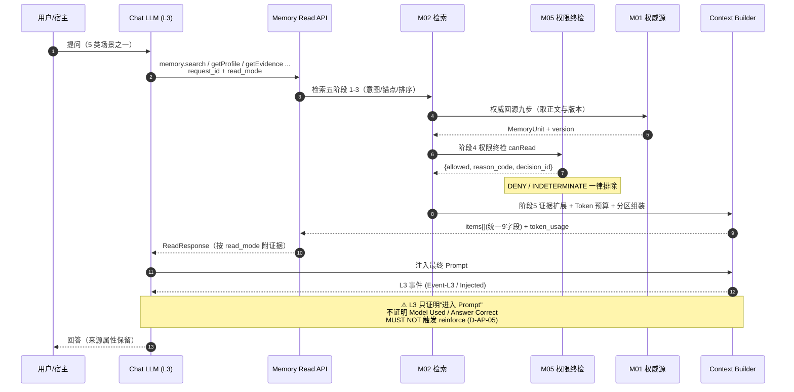
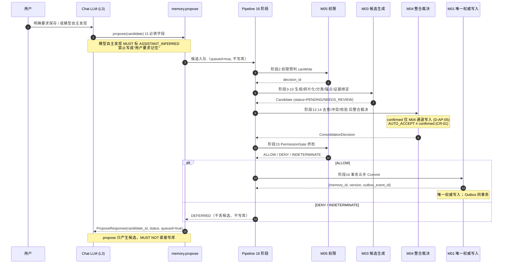
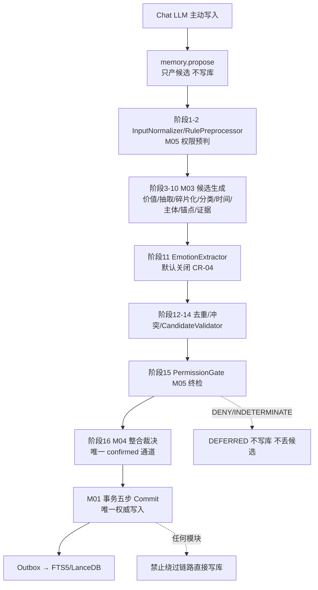
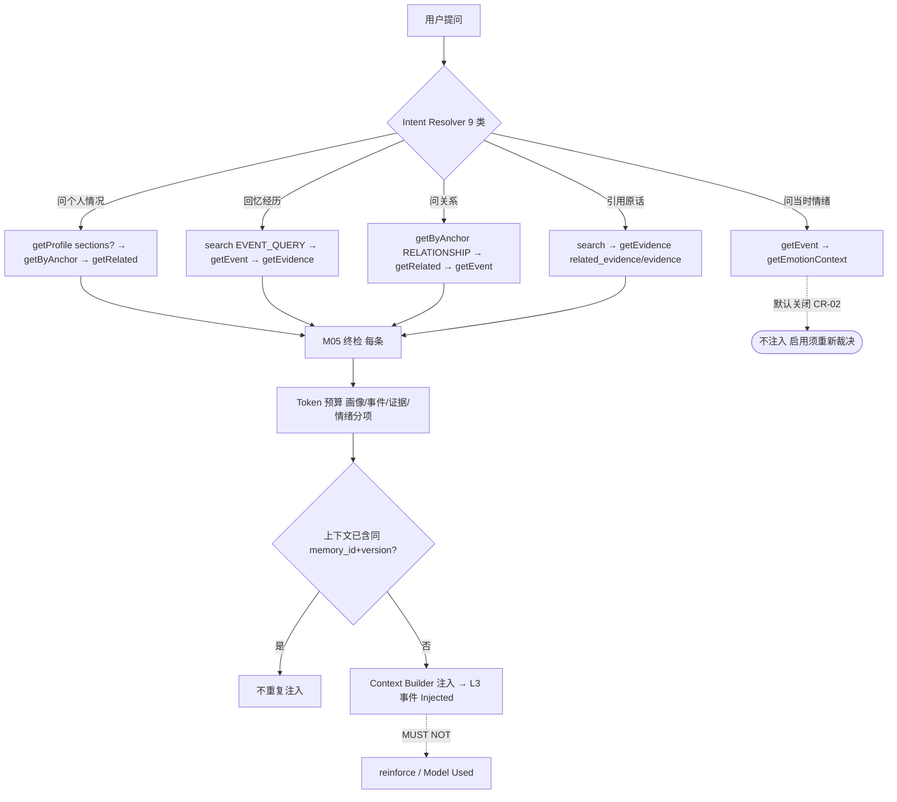

# 14 — Chat LLM 读写 API

> 文件代号：14 ｜ 所属交付：Memory Core R4.1 全量详细设计（DD）V1 架构升级 ｜ 设计 Agent 组：B 组（12/13/14）
> 最高行为依据：`DD-AUTHORITY-V2.md` v2.0（APPROVED，与 v1 冲突时以 V2 为准；台账冲突一律"保留原裁决 + 需重新裁决"）
> 结构依据：`DD-AUTHORITY.md` v1.0 §8「每份设计文档的强制结构（15 节）」
> 覆盖：DD-AUTHORITY-V2 §7（Read/Write API 九个接口，名称逐字）+ 任务书 §11（主动读取 / 主动写入 propose / 读写时序 / L3 事件）

---

## 1. 文档状态

| 项目 | 内容 |
|---|---|
| 文件编号 | 14 |
| 文件名称 | Chat LLM 读写 API |
| 当前版本 | 1.0 |
| 设计状态 | **PROPOSED**（接口级与时序级设计成稿；已裁决部分见 §5；与台账冲突处见 §14） |
| 实施授权 | **无**。本文件只定义 V1 范围内的系统能力，**不授予代码实施权限**；聊天 LLM 读写接入属 **P5（M05 + 聊天 LLM 接入，新增，需阶段授权）**，检索原语属 **P2（M02，原 P0–P3 范围）**，见 DD-AUTHORITY-V2 §10 |
| 完成等级自评 | **F2 达成**（9 接口逐项规格、统一返回、主动读写规则、propose 链路、时序图、错误降级、测试规格齐备）；F3 部分（给出边界值与预期结果，**无执行记录**）；**F4 未达成** |
| 完成等级口径 | 沿用 `DD-AUTHORITY.md` v1.0 §6：F2/F3 **MUST NOT** 写成 F4；禁止把"设计已定义"写成"已授权实施" |
| 语言/编码 | 中文／UTF-8（无 BOM） |
| 配套契约 | `contracts/schemas/` 中 read-request / read-response / propose-request / memory-unit / api（由总控维护）；接口名以 V2 §7 逐字为准 |
| 参数归属 | 全部参数标 **EXP-DEFAULT（实验初值）**，指向 **15 号参数注册表**（15 属性），业务代码禁止硬编码（台账 优化-5） |

**分节状态矩阵**

| 章节 | 状态 | 说明 |
|---|---|---|
| §7.1 九个接口总表 | APPROVED（V2 §7 名称逐字） | 9 个接口名不得改写、不得增删 |
| §7.2 九接口逐一详述 | **PROPOSED**（输入/输出/错误码/超时/幂等为设计结论） | 接口名 APPROVED；字段表与属性 PROPOSED |
| §7.3 统一返回 9 字段 | APPROVED（V2 §7 逐字） | 9 字段不得增删、不得同义变体 |
| §7.4 主动读取规则（5 场景） | **PROPOSED**（编排为设计结论） | 与 V2 §8 意图路由 / 人物画像优先对齐 |
| §7.5 propose 11 必填字段 | **PROPOSED**（按 V2 对象落位任务书 §11「11 必填」） | 字段落位为设计结论，见 §7.5.1 说明 |
| §7.6 写入链路（M01/M03/M04/M05） | APPROVED 边界（V2 §7 + 台账 D-AP-01/05） | 链路图 PROPOSED |
| §7.7 写入来源纪律 | APPROVED（V2 §2.9 / §13.4） | "禁止把模型觉得值得记住写成用户要求记住"为硬规则 |
| §7.8 读写时序图（2 张） | **PROPOSED** | Mermaid 与正文一致 |
| §7.9 L3 事件语义 | APPROVED（台账 D-AP-05 / 02 §7.14） | reinforce 禁写为红线 |
| §7.10 错误与降级 | **PROPOSED** | 降级策略为设计结论 |
| §7.11 幂等 / 重复 / 限流 | **PROPOSED** | 参数 EXP-DEFAULT |
| §7.12 参数与 Token 四类 | APPROVED 口径（V2 §13.3/§13.4） | 全部指向 15 号参数注册表 |
| §12 测试要求（18.6 八项） | **NOT RUN** | 全部为测试规格，无实测结果 |
| §14 未决事项 | TBD / VERIFY / BLOCKED | 引 OI-025~OI-031，与 OPEN-ISSUES.md 对齐 |

---

## 2. 适用版本

| 维度 | 版本 | 说明 |
|---|---|---|
| 母本 | `R4.1-MASTER-01` | m.md（总则） |
| 规范基线 | `R4.1 Specification Baseline` | sf 后文 L3878–6731 |
| 任务书 | `MC-R41-DESIGN-FREEZE-01` | sf L6732–8081；本文对应任务书 §11 / §14 |
| 架构升级任务书 | 《Memory Core R4.1 V1 统一架构升级与设计文书迭代总任务书》（2026-11-04 指令） | V1 正式范围定义来源 |
| 最高行为依据 | `DD-AUTHORITY-V2.md` v2.0 | 唯一枚举/字段/接口定义来源（V2 序） |
| 结构基准 | `DD-AUTHORITY.md` v1.0 | 15 节结构与写作硬规则 |
| 权威顺序 | 第一层：正式裁决台账 `08-adjudication-ledger.md`；第二层：DD-AUTHORITY-V2；第三层：v1 基准与 01/02 设计；第四层：本组技术建议（PROPOSED） | v1 §2.2 + V2 序 |
| 接口版本 | `api_version = "1.0"`（PROPOSED） | 与 15 号参数注册表的版本口径一致 |
| ID 格式 | `format: uuid`（UUIDv7 形态 **不锁版本**，裁决 R5 / PROPOSED） | 沿用 01 §2 |
| 时间格式 | RFC 3339 / UTC ISO 8601 带 `Z` | 裁决 R6；事实时间 ≠ 记录时间 |
| read_mode 版本 | V2 §2.12 四值（APPROVED） | `summary` / `memory` / `evidence` / `related_evidence` |
| intent 版本 | V2 §2.11 九类（APPROVED） | 意图路由依据 |

---

## 3. 适用范围

### 3.1 覆盖

本文件定义 **Chat LLM 读写 API** 的完整设计：

1. **9 个接口逐一详述**（V2 §7 名称逐字）：`memory.search` / `getProfile` / `getByAnchor` / `getEvent` / `getEvidence` / `getRelated` / `getEmotionContext` / `getMemoryById` / `propose`；每个给：目的 / 输入字段表（类型·必填·默认）/ 输出字段表 / `read_mode` 支持 / 权限要求 / 幂等 / 超时 / 错误码 / 是否当前实施范围（P2 或 P5）。
2. **统一返回必备 9 字段**（V2 §7 逐字）：`memory_id, content, semantic_type, anchor, source_type, confidence, evidence_refs, lifecycle(tier+status), visibility`。
3. **主动读取规则**：5 类典型场景（问个人情况 / 回忆经历 / 问关系 / 引用原话 / 问当时情绪）；禁止每轮读全画像；上下文足够时不重复注入。
4. **主动写入 `propose`**：11 个必填候选字段；候选进入 Pipeline（不直接写库）；M01 唯一权威写入、M05 权限、M03 生成、M04 整合，任何模块不得绕过链路（链路图）。
5. **写入来源纪律**：明确要求保存优先；模型自主发现必须标 `ASSISTANT_INFERRED`；**禁止把"模型觉得值得记住"写成"用户要求记住"**。
6. **读写时序图 2 张**（Mermaid：读取时序、写入候选时序），含 M05 终检与 L3 事件（只证明进入 Prompt，不证明被使用）。
7. **L3 事件语义重申**（引用台账 D-AP-05：reinforce 禁写）。
8. **错误与降级**：权限 DENY / INDETERMINATE、证据缺失、LLM 不可用、预算超限。
9. **幂等与重复请求；限流**。
10. **测试**（任务书 18.6 八项）与验收标准。

### 3.2 不覆盖（FUTURE / 不实施边界）

| 对象/能力 | 状态 | 说明 |
|---|---|---|
| 聊天 LLM 读写 API 的**代码实现与宿主接入** | **FUTURE / 需阶段授权（P5）** | 设计定义 ≠ 实施授权；V2 §10 P5「新增，需阶段授权」 |
| M03 候选提取 / M04 整合 / M05 权限引擎实现 | **FUTURE / 需阶段授权（P3/P4/P5）** | 本文只定义接口与链路，不定义其内部实现 |
| `getEmotionContext` 的**实际启用** | **默认关闭 / 需重新裁决**（J6 / CR-02 / OI-026） | 本文只**完整定义**能力 |
| ΔE 情绪影响 / 自动情绪推断 | **默认关闭 / 需重新裁决**（CR-03 / CR-04） | 见 13 号文件 |
| Psychology 集成 | **BLOCKED / DEFERRED**（I-7 / X-6 / CR-05 / OI-029） | L3 事件只证明注入，不证明模型使用 |
| `public` 可见性 | **V1 禁用**（CR-07 / OI-031） | `permission.public_enabled=false` |
| 原句导出 / 数据导出边界 | **BLOCKED**（K-2 / CR-06 / OI-030） | 不得声称"记忆文本不出本机"（D-AP-09） |
| `cache.sqlite` 表结构 | **DEFERRED**（U-1/U-2） | 本文 **MUST NOT** 给出任何缓存表结构 |
| 宿主真实接口（QQ Bridge / DSH） | **VERIFY**（OI-08-01…12） | 本文 **MUST NOT** 编造宿主 API |

### 3.3 与其他文档的界面

- **接口名以 V2 §7 逐字为准**；统一返回 9 字段以 V2 §7 为准；`read_mode` 四值以 V2 §2.12 为准；`intent` 九类以 V2 §2.11 为准。
- **字段语义以 01（MemoryUnit）/ V2 §3.1 为准**；同名字段 MUST 同名同义（V2 §13.1）。
- 检索五阶段（意图识别/锚点候选/排序/权限过滤/证据扩展）以 **V2 §8** 为准；算法口径以 **02** 为准（ALG-02 回源九步、ALG-05 Token、ALG-06 Context、ALG-09 M05、ALG-08 整合、五阶段区分）。
- Pipeline 16 阶段名称以 **V2 §5** 逐字为准；`propose` 产出的候选 **MUST** 进入 Pipeline。
- 画像读取以 **12 号文件 `getProfile`** 为准；证据/事件/情绪读取以 **13 号文件** 为准；本文与之对齐，不重定义。
- 权限以 **04 / M05** 为准；本文 **MUST NOT** 定义权限判定算法。
- 错误码规范名以 v1 裁决 R1（sf 后文 §4.5）为准；别名映射由 `contracts/error-codes.md` 维护。

---

## 4. 依赖文档

| 编号 | 文件 | 用途 | 权威层 |
|---|---|---|---|
| D1 | `DD-AUTHORITY-V2.md` | **最高行为依据**：§2 全部枚举、§3.1/§3.2/§3.3/§3.4/§3.5 字段表、§5 Pipeline 16 阶段、§6 LLM 三层、§7 九接口与统一返回、§8 检索五阶段、§9 ΔE、§10 路线图、§12 台账冲突、§13 写作硬规则 | 第二层（与 v1 冲突时最优先） |
| D2 | `DD-AUTHORITY.md` v1.0 | 15 节结构（§8）、写作硬规则、F 等级、裁决 R1（错误码）/R2（Outbox）/R5（ID）/R6（时间） | 第二层 |
| D3 | `01-记忆本体与数据模型.md` | MemoryUnit 字段（§7.6）、Candidate（§7.12）、Evidence（§7.8）、Relation 八种（§7.10）、事务五步与 Outbox（§7.16）、时间六字段（§7.14） | 第三层 |
| D4 | `02-核心算法规范.md` | ALG-02 检索（§7.3）、ALG-05 Token Budget（§7.6）、ALG-06 Context Builder（§7.7）、ALG-07 M03（§7.8）、ALG-08 M04（§7.9）、ALG-09 M05（§7.10）、五阶段区分（§7.13）、reinforce 红线（§7.14）、接口结构（§8） | 第三层 |
| D5 | `08-adjudication-ledger.md`（`C:\Users\[USER]\Desktop\work\`） | 正式裁决唯一权威（D-AP-01/02/05/06/07/09、I-5/I-7、J6/J7、K-2/K-6、X-3、CR-09、优化-1/优化-5、CR-08A） | **第一层** |
| D6 | `DOCUMENT-CONFLICT-REGISTER-V2.md` | CR-01~CR-07 与 OI-025~OI-031 的映射 | 派生登记 |
| D7 | `OPEN-ISSUES.md`、`PENDING-USER-DECISIONS.md` | 未决事项编号对齐（含 OI-008 契约、OI-016~018 契约冲突） | 派生登记 |
| D8 | `12-人物画像整合.md`、`13-Evidence与EmotionContext.md` | `getProfile` 返回结构、4 种读取模式、证据失效、情绪默认关闭 | 同批交付（组 B） |
| D9 | `15-参数注册表.md` | 全部 EXP-DEFAULT 参数的 15 属性登记 | 同批交付（组 A/总控） |
| D10 | `08-DSH与QQBridge集成规范.md` | L3 事件 / 注入边界 / 返回八字段 / 宿主身份五标识 | 第三层 |

---

## 5. 正式裁决引用

> 引用格式 = 台账小节；逐条引台账编号，不改写原文语义。与 V2 任务书冲突时按 §12「保留原裁决 + 需重新裁决」。

| 台账编号 | 台账要点（原文语义） | 对本文件的约束 |
|---|---|---|
| **D-AP-01**（§3 第一轮） | 五模块边界维持；**M03 候选提取与 M04 整合裁决不可合并** | `propose` 产出候选归 M03，整合裁决归 M04；**MUST NOT** 合并为一步；链路图 **MUST** 体现两阶段分离 |
| **D-AP-02**（§3b 第二轮） | M04 §6.2 唯一 LLM Gateway 入口；Embedding Provider 归 M01 | 候选生成/整合如需 LLM，**MUST** 经 M04 §6.2 唯一入口；`propose` **MUST NOT** 另开模型入口 |
| **D-AP-05**（§3b 第二轮） | **confirmed 仅允许 M04 审核通道写入**；**reinforce 仅由 DSH 回传最终 prompt 中实际出现的记忆 ID 触发**；E14 未落地、B04 回传链路未确认前 reinforce 只预留 schema **禁止写入**；last_retrieved 按命中规则写入且不得作为衰减 v2 正向权重 | ① `propose` **MUST NOT** 写 `validation_state=confirmed`；② 读取命中 / L3 注入事件 **MUST NOT** 触发 reinforce 写入；③ **L3 事件只证明"进入 Prompt"，不证明"被使用"**（§7.9）；④ `reinforced_*` 写入路径 = 0 |
| **D-AP-06**（§3b 第二轮） | 生活化测试集为主要验收依据；研究报告收益不得写成实测结果 | §12 测试与 §13 验收 **MUST** 使用生活化测试集口径；**MUST NOT** 把设计规格写成实测结果 |
| **D-AP-07**（§3b 第二轮） | C40 权限引擎不可插拔；五级可插拔分类接受；trusted_context_source: entry-only | 每次读取 **MUST** 经 M05 权限终检；**MUST NOT** 用可插拔替身替代 C40；`propose` 输入来源受 entry-only 约束 |
| **D-AP-09**（§3b 第二轮） | 拒绝第三方托管记忆平台；**不得声称"记忆文本不出本机"**；本地持久化与云端推理传输分开评估 | 本文 **MUST NOT** 出现"记忆文本不出本机"表述；云端 L3/推理传输 **MUST** 分开评估（CR-06 / OI-030） |
| **I-5**（§3c 第三轮） | 心理状态机只改运行时状态，不直接产生记忆候选；值得长期记住的内容须经 M03/M04 正式记忆通道 | `propose` 候选 **MUST NOT** 由 Psychology 运行时状态直接产生；**MUST** 经 M03 候选 + M04 整合 |
| **I-7 / X-6**（§3c / §3g） | psy-model 暂缓；五方法/十二阶段接口形态暂缓 | 读写 API **MUST NOT** 依赖 psy-model（CR-05 / OI-029） |
| **J6**（§3e 第四轮） | 接受 a，**首版关闭查询侧情绪感知**；未来开启须独立验证和重新裁决 | `getEmotionContext` / `EMOTION_QUERY` **设计定义，默认关闭，启用须重新裁决**（CR-02 / OI-026）；`emotion.query_enabled=false` |
| **J7**（§3e 第四轮） | 接受 b，**只预留接口和字段，不实现 LLM 标注与批量重放** | `propose` 中的自动情绪推断 **默认关闭**；`emotion.auto_infer=false`（CR-04 / OI-028） |
| **J4**（§3e 第四轮） | 15 个受控标签起步，词表配置方式管理 | 情绪相关读取 **MUST** 使用受控 15 标签（13 号文件），不得自创 |
| **K-2**（§3f 第五轮） | 内部计算参数/系数不默认导出；必须逐项确定导出边界 | `propose` / 读取的原句导出边界 **BLOCKED**；**MUST NOT** 定义导出 DTO（CR-06 / OI-030） |
| **K-6 / CR-09**（§3f / §3g） | openLoop 只能由明确事件触发，永不由沉默触发；禁止催促、禁止与信任度联动；CR-09 门禁未验证前 K-6 不闭环 | 主动读取 **MUST NOT** 因沉默触发；**MUST NOT** 以回复率/留存率/愧疚感为优化目标 |
| **X-3**（§3g 第六轮） | Recall 允许参与推理，禁止直接修改 PAD；持久状态变更必须经独立审核；第③层默认关闭 | 读取结果 **MUST NOT** 隐式回流改写持久状态；`propose` 写入 **MUST** 经 M04 审核通道（CR-03 / OI-027） |
| **优化-1**（§3e 第四轮） | Token 计量须区分系统提示词/聊天历史/记忆检索/实际注入/模块调用消耗 | 主动读取 **MUST** 拆分五类消耗；Token 四类单位分别标明（§7.12） |
| **优化-5**（§3e 第四轮） | 稳定、唯一、可追踪的参数 ID；展示名可改、身份不丢 | 本文全部参数 **MUST** 带稳定参数 ID 并登记 15 号参数注册表 |
| **CR-08A**（§3g 第六轮） | 仅授权 Agent3 域内答复 B01–B05/E14；**答复 ≠ 用户批准，不授权实施** | E14/B04 回传链路 **未确认**；reinforce **MUST NOT** 启用（D-AP-05 / OI-007） |
| **CR-09**（§3g 第六轮） | 接受 W2 §8 P0 测试化表述作为伦理门禁框架；未经实施验证不代表已通过 | 见 K-6 行 |

**未决事项（引 OI-025~OI-031）**：见 §14，逐条与 OPEN-ISSUES.md 对齐。

**台账冲突处处理口径（MUST 逐字使用）**：
- CR-02 / CR-03 / CR-04 / CR-06 涉及本文件的部分，一律 **"保留原裁决 + 需重新裁决"**：设计 **完整定义** 能力，实施 **默认关闭** / 保持 **BLOCKED**，启用须重新裁决。**禁止静默改写台账**。
- **MUST NOT** 把情绪检索 / 情绪影响 / 自动情绪推断写成已启用 —— 一律 **"设计定义，默认关闭，启用须重新裁决"**。

---

## 6. 术语表

| 术语 | 定义（与 V2 §13.1 统一） |
|---|---|
| Memory Unit（MemoryUnit） | 独立记忆单元，权威对象；字段见 V2 §3.1 / 01 §7.6 |
| Evidence | 原始证据（原句）；字段见 V2 §3.2 / 13 号文件 |
| Event | 事件事实对象；字段见 V2 §3.3 |
| EmotionContext | 情感关联对象（与 Event 分离）；字段见 V2 §3.4 / 13 号文件 |
| Memory Anchor | 获取锚点；8 值枚举见 V2 §2.3 |
| Lifecycle(tier) | 生命周期层级 L1/L2/L3；与 semantic_type 正交（V2 §2.5） |
| Semantic Type | 语义主类 6 值（V2 §2.1） |
| Subject | 主体；`subject_type` 6 值 + `subject_id`（V2 §2.4） |
| Memory Ingestion Pipeline | 记忆摄取管线 16 阶段（V2 §5） |
| **Memory Read API** | 聊天 LLM 读取记忆唯一入口（V2 §7 九接口中的 8 个读接口） |
| **Memory Write API** | 聊天 LLM 写入记忆唯一入口（V2 §7 `memory.propose`） |
| Psychology | 心理层（运行时状态）；实施 BLOCKED（CR-05 / OI-029） |
| PersonProfile | 人物画像（M04 维护的可追溯派生视图，V2 §3.5 / 12 号文件） |
| read_mode | 读取模式 4 值（V2 §2.12）：`summary` / `memory` / `evidence` / `related_evidence` |
| intent | 查询意图 9 类（V2 §2.11） |
| propose | 主动写入提议：只产生**候选**，**不直接写库**（V2 §7） |
| Candidate（候选） | M03 产出、未成为正式记忆的对象；`candidate.status` 6 值（V2 §2.7） |
| L3 事件 | 记忆进入最终 Prompt 的注入事件（Event-L3）；**只证明 Injected，不证明 Model Used**（02 §7.13 五阶段） |
| reinforce | 记忆强化；**只预留 schema，禁止写入**（台账 D-AP-05） |
| M05 终检 | 每条候选/返回 **MUST** 经 M05 `canRead`/`canWrite`；DENY / INDETERMINATE 一律排除 |
| 五阶段 | Retrieved / Authorized / Injected / Model Used / Answer Correct（02 §7.13）；**MUST NOT** 把 Injected 当 Used |
| EXP-DEFAULT | 实验初值，非裁决值（v1 §6 / V2 §13.3）；一律登记 15 号参数注册表 |
| Token 单位四类 | 字符 / 汉字（字数）/ Token / 字节（V2 §13.4：字符、汉字、字数、Token MUST 分别标明） |
| MOCKED | Mock 结果标记（V2 §13.5）；测试桩全通过逻辑仅限隔离测试 |

---

## 7. 规范正文

### 7.1 九个接口总表（V2 §7 名称逐字，MUST NOT 改写）

> V2 §7 原文（逐字）：
> ```
> memory.search(query, opts)                 混合检索（Anchor 路由 + FTS5/LanceDB + RRF）
> memory.getProfile(subject_id, sections?)   人物画像快速读取（人物理解任务优先）
> memory.getByAnchor(anchor[], subject_id?)  指定锚点读取
> memory.getEvent(event_id)                  事件（事实）
> memory.getEvidence(memory_id | evidence_id, mode)   原句证据（related_evidence 反向）
> memory.getRelated(memory_id)               关联记忆/关系/事件
> memory.getEmotionContext(event_id | memory_id)      情绪关联（按需，默认不注入）
> memory.getMemoryById(memory_id, version?)  指定记忆直读
> memory.propose(candidate)                  提议写入（候选，不直接写库）
> ```
> **统一返回 MUST 含**：`memory_id, content, semantic_type, anchor, source_type, confidence, evidence_refs, lifecycle(tier+status), visibility`；按 `read_mode` 决定是否附证据与情绪。
> **每次读取 MUST 经 M05**；`memory.propose` 只产生候选，M01 为唯一权威写入执行者，任何模块不得绕过链路。

| # | 接口（逐字） | 类别 | 主要 `read_mode` | 实施范围（主分类） |
|---|---|---|---|---|
| 1 | `memory.search(query, opts)` | 读·混合检索 | 4 值全支持 | **P2**（检索原语，M02 原 P0–P3 范围） |
| 2 | `memory.getProfile(subject_id, sections?)` | 读·画像 | `summary` | **P5**（读写 API 接入；画像对象 P4） |
| 3 | `memory.getByAnchor(anchor[], subject_id?)` | 读·锚点 | 4 值全支持 | **P2**（Anchor Router，M02） |
| 4 | `memory.getEvent(event_id)` | 读·事件事实 | `summary` / `memory` | **P5**（读取接入；Event 对象 P1） |
| 5 | `memory.getEvidence(memory_id \| evidence_id, mode)` | 读·原句证据 | `evidence` / `related_evidence` | **P2**（证据读取，M02 原范围） |
| 6 | `memory.getRelated(memory_id)` | 读·关联 | `summary` / `memory` | **P2**（关联检索，M02） |
| 7 | `memory.getEmotionContext(event_id \| memory_id)` | 读·情绪关联 | `summary` / `memory` | **P5**（且 **默认关闭**，CR-02 / OI-026） |
| 8 | `memory.getMemoryById(memory_id, version?)` | 读·权威直读 | 4 值全支持 | **P2**（权威回源，M01/M02） |
| 9 | `memory.propose(candidate)` | **写·候选提议** | 不适用（写接口） | **P5**（主动写入接入；候选生成 M03=P3，整合 M04=P4） |

**实施范围说明（MUST）**：

1. **P2 = 原 P0–P3 范围（M01+M02）**：检索/证据/锚点/权威直读原语，属 V2 §10「原 P0–P3 范围」，但 **本文件定义的"聊天 LLM 主动调用"面仍属 P5**；即 P2 提供能力底座，P5 提供 Chat LLM 接入。
2. **P5 = M05 + 聊天 LLM 接入（新增，需阶段授权）**：主动读写、原句按请求读取、情绪关联接入属 P5；**设计定义 ≠ 实施授权**。
3. `memory.propose` 的候选生成（M03）属 **P3**、整合（M04）属 **P4**，其 Chat LLM 入口属 **P5**；本文统一标 **P5（写入接入）** 并在 §7.2 逐接口注明底层阶段。
4. **MUST NOT** 把 P5 写成"已实施"；**MUST NOT** 把 P3/P4/P5 写成"已授权"。

### 7.2 九接口逐一详述

> 每个接口 **MUST** 给出：目的 / 输入字段表（类型·必填·默认）/ 输出字段表 / `read_mode` 支持 / 权限要求 / 幂等 / 超时 / 错误码 / 是否当前实施范围（P2 或 P5）。
> 公共约定：所有读接口 **MUST** 经 M05；统一返回 9 字段见 §7.3；错误码规范名以 v1 裁决 R1 为准（别名映射见 `contracts/error-codes.md`）；超时/限流参数见 §7.11/§7.12（EXP-DEFAULT → 15 号参数注册表）。

#### 7.2.1 `memory.search(query, opts)`

| 项 | 规格 |
|---|---|
| **目的** | 混合检索（Anchor 路由 + FTS5/LanceDB + RRF）；聊天 LLM 主动读取的主入口 |
| **输入字段表** | 见下表 |
| **输出字段表** | 见下表 |
| **read_mode 支持** | `summary` / `memory` / `evidence` / `related_evidence`（4 值全支持；缺省 `summary`） |
| **权限要求** | **MUST** 经 M05 `canRead`；阶段 4 权限过滤（V2 §8）；DENY / INDETERMINATE 一律排除；先判权再排序（02 §7.5） |
| **幂等** | 只读；同 `(query, opts, policy_version, index_version)` 同候选序列 |
| **超时** | `api.read.timeout_ms`（EXP-DEFAULT，见 §7.11） |
| **错误码** | `VALIDATION_ERROR` / `PERMISSION_DENIED` / `POLICY_ERROR` / `STORAGE_ERROR` / `INDEX_ERROR` / `EMBEDDING_ERROR` / `TIMEOUT` / `BUDGET_EXCEEDED` |
| **是否当前实施范围** | **P2**（检索原语）；Chat LLM 主动调用面 **P5** |

**输入字段表**

| 字段 | 类型 | 必填 | 默认值 | 说明 |
|---|---|---|---|---|
| `query` | string | ✓ | 无 | 原始查询，**MUST** 原样保留（02 §7.3 S1） |
| `opts.intent` | enum §2.11（9 类） | 否 | `GENERAL_MEMORY_QUERY` | 意图；缺省由 Intent Resolver 判定，**MUST NOT** 推测补全 |
| `opts.read_mode` | enum §2.12 | 否 | `summary` | 读取模式 |
| `opts.anchor[]` | array<enum §2.3> | 否 | 由 Anchor Router 生成 | 锚点过滤（只排除，**MUST NOT** 授予） |
| `opts.subject_id` | string | 否 | 可信身份 | **MUST** 由 EntityResolver 解析 |
| `opts.channel_top_k` | integer | 否 | 50（EXP-DEFAULT，=`recall.channel_top_k_fts`/`_vector`） | **每通道**候选上限（≠最终注入条数） |
| `opts.budget_tokens` | integer | 否 | 1200（EXP-DEFAULT，02 §7.6） | **Token** 预算，**MUST NOT** 用字数 |
| `opts.time_range` | object\|null | 否 | null | 结构化时间过滤 |
| `opts.request_id` | uuid | ✓ | 无 | 追踪与判权复用域 |

**输出字段表**

| 字段 | 类型 | 说明 |
|---|---|---|
| `items[]` | array | 每条 **MUST** 含统一返回 9 字段（§7.3）+ `decision_id` |
| `trace.raw_query` / `trace.normalized_query` | string | 原样 / 规范化留痕 |
| `channel_evidence[]` | array | `{channel, channel_rank, channel_score, index_version, retrieval_time}` |
| `retrieval_status` | enum | `complete` / `partial` / `failed` |
| `token_usage` | object | 五类消耗（优化-1）+ 四类单位（§7.12） |
| `permission_status` | enum | `all_allowed` / `partial_denied` / `denied` |
| `algorithm_version` / `feature_version` / `scoring_version` | string | 复现用 |

#### 7.2.2 `memory.getProfile(subject_id, sections?)`

| 项 | 规格 |
|---|---|
| **目的** | 人物画像快速读取（人物理解任务优先）；返回结构见 12 号文件 §7.7.1 |
| **输入字段表** | 见下表 |
| **输出字段表** | 见下表 |
| **read_mode 支持** | 默认 `summary`；**MUST NOT** 默认返回证据原句/情绪（13 号文件） |
| **权限要求** | **MUST** 经 M05 `canRead`；画像为派生视图，权限取来源**最严格交集**（02 §7.10.3） |
| **幂等** | 只读；同 `(subject_id, sections, version, profile_version, policy_version)` 同输出 |
| **超时** | `api.read.timeout_ms`（EXP-DEFAULT） |
| **错误码** | `VALIDATION_ERROR`（非法 section）/ `PERMISSION_DENIED` / `POLICY_ERROR` / `NOT_FOUND` / `STORAGE_ERROR` / `TIMEOUT` / `CONFIGURATION_ERROR` |
| **是否当前实施范围** | **P5**（读写 API 接入）；PersonProfile 对象 **P4（M04）** |

**输入字段表**

| 字段 | 类型 | 必填 | 默认值 | 说明 |
|---|---|---|---|---|
| `subject_id` | string | ✓ | 无 | **MUST** 经 EntityResolver 解析 |
| `sections?` | array<enum 11 分区> | 否 | 全部 11 分区 | V2 §3.5 逐字；指定时 **MUST NOT** 静默补全 |
| `version?` | integer | 否 | 当前版本 | 历史版本查询（12 号文件 OI-12-01，PROPOSED） |
| `read_mode` | enum §2.12 | 否 | `summary` | 读取模式 |
| `request_id` | uuid | ✓ | 无 | 追踪 |

**输出字段表**

| 字段 | 类型 | 说明 |
|---|---|---|
| `profile_id` / `subject_id` / `profile_version` | string/string/integer | 画像标识与版本 |
| `sections{}` | object | 11 分区；每条 **MUST** 含 `content` / `basis` / `source_memory_ids` / `source_evidence_ids` / `confidence` / `profile_version`（12 号文件 §7.7.1 六字段） |
| `separation{}` | object | 三分离：`explicit` / `inferred` / `pending`（**MUST NOT** 混入 sections） |
| `evidence_missing[]` | array | 证据缺失标记（13 号文件 `revoked=true`） |
| `items[]`（统一 9 字段） | array | 见 §7.3 |
| `decision_id` | uuid | M05 终检 |

#### 7.2.3 `memory.getByAnchor(anchor[], subject_id?)`

| 项 | 规格 |
|---|---|
| **目的** | 指定锚点读取（8 锚点，V2 §2.3）；供意图路由后的精确候选获取 |
| **输入字段表** | 见下表 |
| **输出字段表** | 见下表 |
| **read_mode 支持** | `summary` / `memory` / `evidence` / `related_evidence`（4 值；缺省 `summary`） |
| **权限要求** | **MUST** 经 M05 `canRead`；锚点 **MUST NOT** 用于扩大权限 |
| **幂等** | 只读；同 `(anchor[], subject_id, read_mode, policy_version)` 同输出 |
| **超时** | `api.read.timeout_ms`（EXP-DEFAULT） |
| **错误码** | `VALIDATION_ERROR`（非法 anchor）/ `PERMISSION_DENIED` / `POLICY_ERROR` / `STORAGE_ERROR` / `TIMEOUT` |
| **是否当前实施范围** | **P2**（Anchor Router，M02 原 P0–P3 范围） |

**输入字段表**

| 字段 | 类型 | 必填 | 默认值 | 说明 |
|---|---|---|---|---|
| `anchor[]` | array<enum §2.3 8 值> | ✓ | 无 | 逐字：`SELF_EXPLICIT` / `SELF_DERIVED` / `PERSON_PROFILE` / `PREFERENCE` / `RELATIONSHIP` / `EVENT` / `CURRENT_STATE` / `EMOTION_CONTEXT` |
| `subject_id?` | string | 否 | 可信身份 | 经 EntityResolver 解析 |
| `read_mode` | enum §2.12 | 否 | `summary` | 读取模式 |
| `top_k` | integer | 否 | 20（EXP-DEFAULT，=`recall.top_k`） | **最终注入条数**；每通道候选上限另用 `channel_top_k`（默认 50，=`recall.channel_top_k_*`）。二者不同参数，**MUST NOT 混用** |
| `request_id` | uuid | ✓ | 无 | 追踪 |

**输出字段表**

| 字段 | 类型 | 说明 |
|---|---|---|
| `items[]` | array | 统一返回 9 字段 + `decision_id` |
| `anchor_matched[]` | array | 实际命中锚点 |
| `retrieval_status` / `permission_status` | enum | 状态 |
| `token_usage` | object | 五类消耗 |

> **注意**：`EMOTION_CONTEXT` 锚点命中 **MUST NOT** 在 `emotion.query_enabled=false`（默认）时注入情绪（CR-02 / OI-026）。

#### 7.2.4 `memory.getEvent(event_id)`

| 项 | 规格 |
|---|---|
| **目的** | 事件（事实）读取；默认 **只返回 Event 事实**，**MUST NOT** 附带情绪（13 号文件 §7.12 / V2 §8） |
| **输入字段表** | 见下表 |
| **输出字段表** | 见下表 |
| **read_mode 支持** | `summary` / `memory`（**MUST NOT** 默认 `evidence`；证据按 `getEvidence` 单独读） |
| **权限要求** | **MUST** 经 M05 `canRead`；Event 与 EmotionContext 权限 **MUST** 分别判定（13 号文件 SEP-6） |
| **幂等** | 只读；同 `(event_id, version, policy_version)` 同输出 |
| **超时** | `api.read.timeout_ms`（EXP-DEFAULT） |
| **错误码** | `VALIDATION_ERROR` / `PERMISSION_DENIED` / `POLICY_ERROR` / `NOT_FOUND` / `STORAGE_ERROR` / `TIMEOUT` |
| **是否当前实施范围** | **P5**（读取接入）；Event 对象 **P1（M01）** |

**输入字段表**

| 字段 | 类型 | 必填 | 默认值 | 说明 |
|---|---|---|---|---|
| `event_id` | uuid | ✓ | 无 | 事件 ID |
| `read_mode` | enum §2.12 | 否 | `summary` | 读取模式 |
| `include_emotion` | boolean | 否 | **false** | **默认关闭**；`true` 须 `emotion.query_enabled=true`（须重新裁决） |
| `request_id` | uuid | ✓ | 无 | 追踪 |

**输出字段表**

| 字段 | 类型 | 说明 |
|---|---|---|
| `event{}` | object | V2 §3.3 字段表（**`content` 仅事实**） |
| `items[]`（统一 9 字段） | array | 见 §7.3 |
| `evidence_refs[]` | array | 证据引用（不内嵌原句全文） |
| `emotion_included` | boolean | 默认 `false` |
| `decision_id` | uuid | M05 终检 |

#### 7.2.5 `memory.getEvidence(memory_id | evidence_id, mode)`

| 项 | 规格 |
|---|---|
| **目的** | 原句证据（`related_evidence` 反向）；返回原句与必要上下文（13 号文件 §7.4/§7.5） |
| **输入字段表** | 见下表 |
| **输出字段表** | 见下表 |
| **read_mode 支持** | `evidence` / `related_evidence`（`summary` / `memory` 不返回原句正文）；缺省 **MUST** 取 `summary`，**MUST NOT** 缺省为 `evidence` |
| **权限要求** | **MUST** 经 M05；`related_evidence` **MUST** 先判权再反查（13 号文件 PERM-2）；**通过 related_evidence 不得绕过权限** |
| **幂等** | 只读；同 `(id, mode, policy_version, content_hash)` 同输出 |
| **超时** | `api.read.timeout_ms`（EXP-DEFAULT） |
| **错误码** | `VALIDATION_ERROR`（两 ID 同给/都不给）/ `PERMISSION_DENIED` / `POLICY_ERROR` / `NOT_FOUND` / `STORAGE_ERROR` / `INTEGRITY_ERROR`（content_hash 不符）/ `TIMEOUT` |
| **是否当前实施范围** | **P2**（证据读取，M02 原 P0–P3 范围） |

**输入字段表**

| 字段 | 类型 | 必填 | 默认值 | 说明 |
|---|---|---|---|---|
| `memory_id` | uuid | 二选一 | 无 | 与 `evidence_id` 二选一 |
| `evidence_id` | uuid | 二选一 | 无 | 与 `memory_id` 二选一 |
| `mode` | enum §2.12 | ✓ | 无 | `evidence` / `related_evidence`；缺省取 `summary`（保守） |
| `request_id` | uuid | ✓ | 无 | 追踪 |

**输出字段表**

| 字段 | 类型 | 说明 |
|---|---|---|
| `evidence[]` | array | `original_text` / `context_before` / `context_after`（受限字符）/ `content_hash` / `source_locator` / `revoked` |
| `support_kind[]` | array | `supports` / `contradicts` / `partial` |
| `items[]`（统一 9 字段） | array | 见 §7.3 |
| `evidence_missing[]` | array | `revoked=true` ⇒ 标"证据缺失"，**MUST NOT** 返回原句正文 |
| `decision_id` | uuid | M05 终检 |

#### 7.2.6 `memory.getRelated(memory_id)`

| 项 | 规格 |
|---|---|
| **目的** | 关联记忆 / 关系 / 事件读取（8 种关系类型，V2 §2.15） |
| **输入字段表** | 见下表 |
| **输出字段表** | 见下表 |
| **read_mode 支持** | `summary` / `memory`（**MUST NOT** 默认返回证据全文） |
| **权限要求** | **MUST** 经 M05；关系任一端不可访问时 **MUST NOT** 通过关系边泄露受限对象（01 §7.10） |
| **幂等** | 只读；同 `(memory_id, policy_version, relation_version)` 同输出 |
| **超时** | `api.read.timeout_ms`（EXP-DEFAULT） |
| **错误码** | `VALIDATION_ERROR` / `PERMISSION_DENIED` / `POLICY_ERROR` / `NOT_FOUND` / `STORAGE_ERROR` / `TIMEOUT` |
| **是否当前实施范围** | **P2**（关联检索，M02 原 P0–P3 范围） |

**输入字段表**

| 字段 | 类型 | 必填 | 默认值 | 说明 |
|---|---|---|---|---|
| `memory_id` | uuid | ✓ | 无 | 起点记忆 |
| `relation_types[]` | array<enum §2.15 8 值> | 否 | 全部 8 种 | `RELATED_TO` / `DERIVED_FROM` / `CONFIRMS` / `CONTRADICTS` / `SUPERSEDES` / `BUILDS_ON` / `PART_OF` / `ABOUT` |
| `read_mode` | enum §2.12 | 否 | `summary` | 读取模式 |
| `request_id` | uuid | ✓ | 无 | 追踪 |

**输出字段表**

| 字段 | 类型 | 说明 |
|---|---|---|
| `related[]` | array | 每条含统一 9 字段 + `relation_type` + `decision_id` |
| `hidden_relations[]` | array | 仅返回"存在不可见关联"事实，**MUST NOT** 返回对象内容 |
| `permission_status` | enum | 状态 |

#### 7.2.7 `memory.getEmotionContext(event_id | memory_id)`

| 项 | 规格 |
|---|---|
| **目的** | 情绪关联（按需，**默认不注入**）；**设计定义，默认关闭，启用须重新裁决**（CR-02 / OI-026 / 台账 J6） |
| **输入字段表** | 见下表 |
| **输出字段表** | 见下表 |
| **read_mode 支持** | `summary` / `memory`；**MUST NOT** 默认注入；情绪 **MUST** 单独计入 `emotion_tokens` |
| **权限要求** | **MUST** 经 M05 `canRead` **单独判权**；**MUST NOT** 因事件可读自动放行其情绪（13 号文件 SEP-6） |
| **幂等** | 只读；同 `(id, policy_version, emotion_version)` 同输出 |
| **超时** | `api.read.timeout_ms`（EXP-DEFAULT） |
| **错误码** | `VALIDATION_ERROR` / `PERMISSION_DENIED` / `POLICY_ERROR` / `NOT_FOUND` / `STORAGE_ERROR` / `TIMEOUT` / `FEATURE_DISABLED`（`emotion.query_enabled=false`） |
| **是否当前实施范围** | **P5**；且 **默认关闭**（CR-02 / OI-026）—— **启用须重新裁决** |

**输入字段表**

| 字段 | 类型 | 必填 | 默认值 | 说明 |
|---|---|---|---|---|
| `event_id` | uuid | 二选一 | 无 | 与 `memory_id` 二选一 |
| `memory_id` | uuid | 二选一 | 无 | 与 `event_id` 二选一 |
| `request_id` | uuid | ✓ | 无 | 追踪 |

**输出字段表**

| 字段 | 类型 | 说明 |
|---|---|---|
| `emotion_contexts[]` | array | V2 §3.4 字段表；`source_type` **仅** `USER_EXPLICIT` / `ASSISTANT_INFERRED`；**MUST** 带推断标记 |
| `emotion_enabled` | boolean | 默认 `false` |
| `items[]`（统一 9 字段） | array | 见 §7.3 |
| `emotion_tokens` | integer | **Token** 单独计量 |
| `decision_id` | uuid | M05 终检 |

> **MUST NOT**：把 `getEmotionContext` 写成"首版可用"；把 `ASSISTANT_INFERRED` 情绪写成用户确认事实；由沉默触发（K-6 / CR-09）。

#### 7.2.8 `memory.getMemoryById(memory_id, version?)`

| 项 | 规格 |
|---|---|
| **目的** | 指定记忆直读（权威回源；可查历史版本） |
| **输入字段表** | 见下表 |
| **输出字段表** | 见下表 |
| **read_mode 支持** | 4 值全支持；缺省 `summary` |
| **权限要求** | **MUST** 经 M05 `canRead`；**MUST** 用 SQLite 权威正文，**MUST NOT** 用索引正文（v1 架构不变量 / 02 §7.3 回源九步） |
| **幂等** | 只读；同 `(memory_id, version, policy_version)` 同输出 |
| **超时** | `api.read.timeout_ms`（EXP-DEFAULT） |
| **错误码** | `VALIDATION_ERROR` / `PERMISSION_DENIED` / `POLICY_ERROR` / `NOT_FOUND` / `VERSION_CONFLICT` / `STORAGE_ERROR` / `TIMEOUT` |
| **是否当前实施范围** | **P2**（权威回源，M01/M02 原 P0–P3 范围） |

**输入字段表**

| 字段 | 类型 | 必填 | 默认值 | 说明 |
|---|---|---|---|---|
| `memory_id` | uuid | ✓ | 无 | 记忆 ID |
| `version?` | integer | 否 | 当前版本 | 历史版本（**MUST NOT** 物理删除旧版本，01 §7.15 R7） |
| `read_mode` | enum §2.12 | 否 | `summary` | 读取模式 |
| `request_id` | uuid | ✓ | 无 | 追踪 |

**输出字段表**

| 字段 | 类型 | 说明 |
|---|---|---|
| `memory` | object | V2 §3.1 MemoryUnit 全字段 |
| `items[]`（统一 9 字段） | array | 见 §7.3 |
| `version` / `created_at` / `updated_at` | integer/datetime | 版本与时间 |
| `decision_id` | uuid | M05 终检 |

#### 7.2.9 `memory.propose(candidate)`

| 项 | 规格 |
|---|---|
| **目的** | 提议写入（**候选，不直接写库**）；产出 Candidate 进入 Pipeline，经 M03/M04/M05/M01 链路（§7.6） |
| **输入字段表** | 见 §7.5（11 必填候选字段 + 可选字段） |
| **输出字段表** | 见下表 |
| **read_mode 支持** | **不适用**（写接口） |
| **权限要求** | **MUST** 经 M05 `canWrite`（写前预判，V2 §5 阶段 2 `RulePreprocessor` 权限预判 + 阶段 15 `PermissionGate` 终检）；**MUST NOT** 绕过 |
| **幂等** | `idempotency_key` 唯一；重复请求 **MUST** 返回首次 `candidate_id`，**MUST NOT** 产生第二候选（§7.11） |
| **超时** | `api.write.timeout_ms`（EXP-DEFAULT） |
| **错误码** | `VALIDATION_ERROR`（11 必填缺项/越权来源）/ `PERMISSION_DENIED` / `POLICY_ERROR` / `DUPLICATE_REQUEST` / `DEFERRED`（LLM 不可用）/ `STORAGE_ERROR` / `TIMEOUT` / `RATE_LIMITED` / `BUDGET_EXCEEDED` |
| **是否当前实施范围** | **P5**（主动写入接入）；候选生成 **M03=P3**、整合 **M04=P4**、写库 **M01=P1** |

**输出字段表**

| 字段 | 类型 | 说明 |
|---|---|---|
| `candidate_id` | uuid | 候选 ID |
| `candidate.status` | enum §2.7（6 值） | `PENDING` / `AUTO_ACCEPT` / `NEEDS_REVIEW` / `REJECTED` / `DEFERRED` / `COMMITTED` |
| `pipeline_stage` | string | 当前所处 Pipeline 阶段（V2 §5 名称逐字） |
| `queued` | boolean | **MUST** 为 `true`（进入候选池），**MUST NOT** 直接写库 |
| `decision_id` | uuid | M05 写前判权 |
| `idempotency_key` | string | 幂等键 |

> **红线（D-AP-05 / CR-01）**：`propose` **MUST NOT** 写 `validation_state=confirmed`；`AUTO_ACCEPT` **不等于** confirmed，**保留原裁决 + 需重新裁决**（OI-025）。

### 7.3 统一返回必备 9 字段（V2 §7 逐字）

> 原文：`memory_id, content, semantic_type, anchor, source_type, confidence, evidence_refs, lifecycle(tier+status), visibility`。
> **MUST** 一字不差；**MUST NOT** 增删、**MUST NOT** 使用同义变体。

| # | 字段 | 类型 | 必填 | 说明 |
|---|---|---|---|---|
| 1 | `memory_id` | string(uuid) | ✓ | 稳定唯一 ID |
| 2 | `content` | string | ✓ | **规范化后的独立记忆内容**（**MUST NOT** 当作原句） |
| 3 | `semantic_type` | enum §2.1（6 值） | ✓ | `PERSON` / `PREFERENCE` / `RELATIONSHIP` / `EVENT` / `CURRENT_STATE` / `EMOTION_CONTEXT` |
| 4 | `anchor` | array<enum §2.3>（≥1） | ✓ | 8 锚点 |
| 5 | `source_type` | enum §2.9（5 值） | ✓ | `USER_EXPLICIT` / `USER_INSTRUCTION` / `ASSISTANT_INFERRED` / `EXTERNAL_SOURCE` / `SYSTEM_GENERATED`；**MUST** 保留来源属性 |
| 6 | `confidence` | number 0–1 | ✓ | 提取/推断置信度（**≠事实真实性**） |
| 7 | `evidence_refs` | array<id> | ✓ | 正式记忆 **MUST** 非空（除非 `SYSTEM_GENERATED` 且显式标注） |
| 8 | `lifecycle(tier+status)` | object | ✓ | `tier` = L1/L2/L3（§2.5）+ `status` = ACTIVE/SUPERSEDED/ARCHIVED/DELETED（§2.6）；**MUST** 两者齐备 |
| 9 | `visibility` | enum §2.10（3 值） | ✓ | `owner_private`（默认）/ `group_shared` / `public`（V1 禁用） |

**MUST（统一返回规则）**：

1. 所有读接口 **MUST** 携带全部 9 字段；**MUST NOT** 因 `read_mode` 省略 9 字段（按 `read_mode` 决定是否**附**证据与情绪，见 V2 §7）。
2. `source_type` **MUST** 保留来源属性；**MUST NOT** 把推断伪装成原话（V2 §13.4）。
3. `lifecycle` **MUST** 含 `tier` 与 `status` 两个子字段；**tier ≠ 重要程度**（V2 §2.5 铁律）。
4. 每条返回 **MUST** 带 `decision_id`（M05 终检）；DENY / INDETERMINATE 一律排除。
5. 画像类返回 **SHOULD** 按 §7.2.2 映射 9 字段（12 号文件 §7.7.1 第 6 条），映射为 PROPOSED，不得冲突原义。

### 7.4 主动读取规则（5 类典型场景）

> V2 §8：人物理解默认获取顺序 `SELF_EXPLICIT → PERSON_PROFILE → PREFERENCE → SELF_DERIVED → 相关 RELATIONSHIP → 相关 EVENT`；情绪默认不注入。
> **禁止每轮读全画像**；**上下文足够时不重复注入**（任务书 §11）。

| # | 典型场景 | 意图（V2 §2.11） | 推荐接口链（MUST 按序） | 默认 `read_mode` | 禁止 |
|---|---|---|---|---|---|
| 1 | **问个人情况**（"我是个怎样的人 / 我叫什么 / 我做什么"） | `PERSON_QUERY` / `PROFILE_QUERY` | `getProfile(subject_id, sections?)` →（不足时）`getByAnchor([SELF_EXPLICIT, PERSON_PROFILE])` →（仍不足）`getRelated` | `summary` | **MUST NOT** 每轮读全 11 分区；**MUST NOT** 把大量事件排在画像前 |
| 2 | **回忆经历**（"去年我参加过什么 / 那次答辩"） | `EVENT_QUERY` | `search(query, intent=EVENT_QUERY)` → `getEvent(event_id)` → `getEvidence(..., related_evidence)` | `summary` → `evidence` | **MUST NOT** 默认附带情绪；**MUST NOT** 返回全部聊天历史 |
| 3 | **问关系**（"我和小 A 什么关系 / 群里谁…"） | `RELATIONSHIP_QUERY` | `getByAnchor([RELATIONSHIP])` → `getRelated(memory_id)` →（变化事件）`getEvent` | `summary` | **MUST NOT** 跨用户泄露；`subject_id` **MUST** 经 EntityResolver |
| 4 | **引用原话**（"我原话怎么说的 / 你记一下那句"） | `ORIGINAL_QUOTE_QUERY` | `search` 定位 → `getEvidence(memory_id, related_evidence)` 或 `getEvidence(evidence_id, evidence)` | `related_evidence` / `evidence` | **MUST NOT** 把 `content`（规范化）当原句；**MUST NOT** 绕过 M05；**MUST NOT** 返回 `revoked=true` 原句 |
| 5 | **问当时情绪**（"我当时什么感受"） | `EMOTION_QUERY` | `getEvent` → `getEmotionContext(event_id)` | `summary` | **默认关闭**（CR-02 / OI-026）；**MUST NOT** 每次强制注入；**MUST NOT** 由沉默触发 |

**MUST（主动读取硬规则）**：

1. **禁止每轮读全画像**：普通聊天 **MUST NOT** 触发完整 `getProfile`（全 11 分区）；仅在人物理解意图命中时按 `sections?` 精确读取（V2 §6「普通聊天不触发完整抽取」同源）。
2. **上下文足够时不重复注入**：若当前上下文已包含同一 `memory_id` + `version` 的授权内容，**MUST NOT** 重复注入；Context Builder **MUST** 去已注入重复项（02 §7.7 第 1 步）。
3. **先判权后读取**：任何读取 **MUST** 经 M05；**MUST NOT** 对未判权候选做 Token 计量或注入（02 §7.6 / §7.7）。
4. **情绪默认不注入**：除非查询涉及情绪且开关已重新裁决，否则 **MUST NOT** 注入 `EMOTION_CONTEXT`（V2 §8）。
5. **不推测意图**：**MUST NOT** 把推测意图当成用户明确意图、擅自补全用户未提及的个人信息（02 §7.3 规范化禁令）。
6. **Token 预算**：主动读取 **MUST** 受 `budget_tokens` 约束；画像/事件/证据/情绪 **MUST** 分项计入（§7.12）。
7. **L3 语义**：注入事件只证明"进入 Prompt"（§7.9），**MUST NOT** 视为"模型已使用"。

### 7.5 主动写入 `propose`：11 个必填候选字段

> 任务书 §11 要求 11 个必填候选字段。**本文件按 V2 §3.1 MemoryUnit 与 V2 §2.7 candidate 落位**这 11 字段（§7.5.1）；字段落位为 **PROPOSED** 设计结论，接口名与枚举值以 V2 为准。
> `propose` **只产生候选、不直接写库**（V2 §7）；候选 **MUST** 进入 Pipeline（§7.6）。

#### 7.5.1 11 个必填候选字段（MUST 全部携带）

| # | 字段 | 类型 | 必填 | 默认 | 落位依据 / 说明 |
|---|---|---|---|---|---|
| 1 | `proposed_content` | string | ✓ | 无 | 候选内容（可独立理解）；**MUST NOT** 当作原句；原句由 `evidence_refs` 指向 |
| 2 | `semantic_type` | enum §2.1（6 值） | ✓ | 无 | 语义主类，逐字使用 |
| 3 | `semantic_tags` | array<enum §2.2> | ✓ | `[]`（可为空数组，但字段必填） | 多标签；含 11 受控标签 + 扩展须登记 |
| 4 | `anchor` | array<enum §2.3>（≥1） | ✓ | 无 | 获取锚点（≥1） |
| 5 | `subject_id` | string | ✓ | 无 | **MUST** 经 EntityResolver 解析；**MUST NOT** 因"我/你/他"直接认定主体（V2 §2.4） |
| 6 | `subject_type` | enum §2.4（6 值） | ✓ | 无 | `OWNER` / `ASSISTANT` / `MEMBER` / `THIRD_PARTY` / `GROUP` / `SYSTEM` |
| 7 | `source_type` | enum §2.9（5 值） | ✓ | 无 | 来源性质；模型自主发现 **MUST** 为 `ASSISTANT_INFERRED`（§7.7） |
| 8 | `evidence_refs` | array<uuid>（**非空**） | ✓ | 无 | 证据引用；**MUST NOT** 编造 `source_ref`（01 §7.8） |
| 9 | `confidence` | number 0–1 | ✓ | 无 | 提取/推断置信度（≠事实真实性） |
| 10 | `visibility` | enum §2.10（3 值） | ✓ | `owner_private` | 默认 `owner_private`；`public` V1 禁用（CR-07 / OI-031） |
| 11 | `idempotency_key` | string | ✓ | 无 | 幂等键；重复请求 **MUST** 返回首次 `candidate_id`（§7.11） |

**可选字段（PROPOSED）**：`profile_field`（归属画像字段，V2 §3.1）、`memory_tier`（L1/L2/L3 建议）、`valid_from` / `valid_until`、`event_refs`、`relation_refs`、`emotion_refs`、`tags_extra`、`extraction_method`（`explicit_save` / `automatic_extraction` / `llm_proposed` / `human_owner_review`）、`request_id`、`scope`（v1 五值内部细分）。

**MUST（候选纪律）**：

1. 11 必填字段 **MUST** 全部通过 Schema 校验；缺任一项 ⇒ `VALIDATION_ERROR`，**MUST NOT** 用空壳候选占位（02 §7.8）。
2. `evidence_refs` **MUST** 非空且指向未 `revoked` 的 Evidence；证据缺失 ⇒ `DEFERRED` / `NEEDS_REVIEW`，**MUST NOT** 编造。
3. `source_type=ASSISTANT_INFERRED` 的候选 **MUST** 带推断标记；**MUST NOT** 写 `validation_state=confirmed`（D-AP-05）。
4. `candidate.status` **MUST** 使用 V2 §2.7 六值逐字；`AUTO_ACCEPT` **不等于** confirmed（CR-01 / OI-025）。
5. `visibility` **MUST NOT** 自动提升；`public` **MUST NOT** 出现（CR-07）。

#### 7.5.2 候选进入 Pipeline（不直接写库）

**MUST（写入路径）**：

1. `propose` **MUST** 只产出 Candidate（`candidate.status` 初始 `PENDING`），**MUST NOT** 直接写 `memory_objects`、**MUST NOT** 直接写 SQLite、**MUST NOT** 产生 Outbox 事件。
2. 候选 **MUST** 进入 **V2 §5 Ingestion Pipeline 16 阶段**（名称逐字），由 Pipeline 协调（Pipeline **不直接写 SQLite、不取代 M03、不绕过 M05**）。
3. 单次失败 **MUST NOT** 丢弃候选 ⇒ 进入 `DEFERRED` / 重试（V2 §6「单次失败不得丢弃候选」）。
4. 后台抽取 **MUST NOT** 阻塞聊天（V2 §6）；普通候选批量异步。
5. **明确记忆指令优先**（V2 §6）：`USER_INSTRUCTION` 候选 **MUST** 优先处理，**MUST NOT** 被普通异步批排队淹没。

**MUST NOT**：`propose` 直接 `COMMITTED`；候选跳过 `CandidateValidator` / `PermissionGate`；候选绕过 M04 整合直接 `active`。

### 7.6 写入链路（M01 / M03 / M04 / M05，任何模块不得绕过）

> V2 §7：**M01 为唯一权威写入执行者，任何模块不得绕过链路**。
> 台账 D-AP-01：M03 候选提取与 M04 整合裁决 **不可合并**。
> 台账 D-AP-05：`confirmed` 仅 M04 审核通道写入；reinforce 禁写。

| 模块 | 职责（MUST） | 禁止（MUST NOT） |
|---|---|---|
| **M05** | 权限门禁：写前 `canWrite` 预判（阶段 2）+ 终检（阶段 15 `PermissionGate`）；DENY / INDETERMINATE 一律拒绝 | **MUST NOT** 被绕过；**MUST NOT** allow-all 进生产 |
| **M03** | 候选生成（阶段 3/4）：价值判定、LLM 抽取、碎片化、分类、时间/主体识别、锚点、证据绑定 | **MUST NOT** 与 M04 合并；**MUST NOT** 直接写 `active` / `confirmed` |
| **M04** | 整合裁决（阶段 16 前）：去重四分类、冲突八分类、合并六前提、`confirmed` 唯一写入通道、画像整合 | **MUST NOT** 自行写库；**MUST NOT** 无依据确认事实 |
| **M01** | **唯一权威写入执行者**：事务五步（Validate → Check expectedVersion → Write memory → Write memory version → Write outbox → Commit）+ Outbox | **MUST NOT** 被任何模块旁路；**MUST NOT** 出现"Memory 已提交但 Outbox 未写"或反向 |
| **Pipeline** | 协调 16 阶段，**不直接写 SQLite、不取代 M03、不绕过 M05** | **MUST NOT** 取代任一模块职责 |

**链路（MUST 顺序）**：

```
Chat LLM → memory.propose(candidate)                    [候选，不写库]
   → 阶段1 InputNormalizer（保留来源与时间）
   → 阶段2 RulePreprocessor（权限预判 + 明确记忆指令识别）  [M05 预判]
   → 阶段3 MemoryValueEvaluator → 阶段4 LLMExtractor      [M03 生成]
   → 阶段5 SemanticSplitter → 阶段6 MemoryClassifier
   → 阶段7 TemporalResolver → 阶段8 EntityResolver
   → 阶段9 AnchorAssigner → 阶段10 EvidenceBinder
   → 阶段11 EmotionExtractor（默认关闭，CR-04）
   → 阶段12 DuplicateDetector → 阶段13 ConflictDetector
   → 阶段14 CandidateValidator（Schema/11 必填/证据/权限/置信度）
   → 阶段15 PermissionGate（M05 终检）
   → 阶段16 M03/M04 → M01 Commit → Outbox → FTS5/LanceDB
                        ↑ M04 整合（唯一 confirmed 通道）
                        ↑ M01 唯一权威写入
```

**MUST**：任何模块 **MUST NOT** 绕过上述链路直接写库；`getEvidence` / `search` / L3 注入事件 **MUST NOT** 触发写入（`reinforced_*` 禁写，D-AP-05）。

**链路图**：见 §9.3（Mermaid）。

### 7.7 写入来源纪律（红线）

> V2 §2.9 `source_type` 5 值 + V2 §13.4；任务书 §11。

| # | 规则（MUST） |
|---|---|
| SRC-1 | **明确要求保存优先**：用户明确记忆指令（`USER_INSTRUCTION`）候选 **MUST** 优先处理（V2 §6）；`source_type` **MUST** 标 `USER_INSTRUCTION`，**MUST NOT** 降级为 `ASSISTANT_INFERRED` |
| SRC-2 | **模型自主发现必须标 `ASSISTANT_INFERRED`**：L3 聊天模型"觉得值得记住"而主动提议的候选，`source_type` **MUST** 为 `ASSISTANT_INFERRED`，并带推断标记 |
| SRC-3 | **禁止把"模型觉得值得记住"写成"用户要求记住"**：**MUST NOT** 把 `ASSISTANT_INFERRED` 候选的 `source_type` 写成 `USER_INSTRUCTION` / `USER_EXPLICIT`；**MUST NOT** 在回答中表述为"你让我记住" |
| SRC-4 | **读取结果保留来源属性**：统一返回 9 字段中的 `source_type` **MUST** 随每次读取保留（§7.3） |
| SRC-5 | **推断不伪装成原话**：`ASSISTANT_INFERRED` 内容 **MUST NOT** 作为 `original_text` 返回（13 号文件 P-08） |
| SRC-6 | **不因重复升级**：重复出现 **MUST NOT** 把推断升级为明确自述（02 §7.14：重复不等于证实） |
| SRC-7 | **不写 confirmed**：`propose` 及其链路中，`validation_state=confirmed` **MUST** 仅由 M04 审核通道写入（D-AP-05） |

**正误对照**：

| 场景 | 正确 | 错误（MUST NOT） |
|---|---|---|
| 用户说"帮我记住我喜欢深夜写代码" | `source_type=USER_INSTRUCTION` + Evidence 原句 | 写成 `ASSISTANT_INFERRED` |
| 模型自行判断"这条信息以后可能有用" | `source_type=ASSISTANT_INFERRED` + 推断标记 | 写成 `USER_INSTRUCTION` / 回答"你让我记住了" |
| 用户明确陈述"我是研究生" | `source_type=USER_EXPLICIT` | 写成 `ASSISTANT_INFERRED` 或 `USER_INSTRUCTION` |

### 7.8 读写时序图（2 张，Mermaid）

> 见 §9.1（读取时序）/ §9.2（写入候选时序）。两张图 **MUST** 含 **M05 终检** 与 **L3 事件**（只证明进入 Prompt，不证明被使用）。

### 7.9 L3 事件语义重申（台账 D-AP-05）

> 依据：台账 **D-AP-05**（J1/K-4 去重）、02 §7.13 五阶段、02 §7.14 reinforce 红线、08 号文件 L3 专节。

| # | 语义（MUST） |
|---|---|
| L3-1 | **L3 事件（Event-L3 / Injected）只证明记忆"进入最终 Prompt"**，**MUST NOT** 证明"模型已关注/理解/使用/引用正确"（02 §7.13 五阶段：Retrieved / Authorized / **Injected** / Model Used / Answer Correct） |
| L3-2 | **MUST NOT** 把 `Injected` 直接当作 `Model Used`（m.md §16.4；sf §3.2.14） |
| L3-3 | **reinforce 唯一合法触发条件**：仅由 **DSH 回传"最终 prompt 中实际出现的记忆 ID"** 触发（D-AP-05）；E14 未落地、B04 回传链路未确认前 **只预留 schema，禁止写入** |
| L3-4 | **L3 注入事件 MUST NOT 触发 reinforce**（02 §7.14.3 第 2 条）；检索命中 **MUST NOT** 触发 reinforce；用户未否定 / 重复出现 / 模型"看起来用到了" / 情绪加成 **MUST NOT** 触发 |
| L3-5 | `reinforced_at` / `reinforce_count` 字段 **只预留、禁止写入**；代码扫描 **MUST** 证明 0 条写入路径 |
| L3-6 | 检索命中只能按命中规则写 `last_retrieved_at`；`last_retrieved` **MUST NOT** 作为衰减 v2 正向权重（D-AP-05） |
| L3-7 | L3 事件 **MUST NOT** 写回记忆 / 改 `validation_state` / 改 lifecycle（X-3 / I-5） |

**MUST NOT**：把"记忆已注入"写成"记忆已被使用"；把 L3 事件当作写入触发；把 Mock 的 L3 事件写成真实验收（V2 §13.5）。

### 7.10 错误与降级

| 编号 | 异常 / 降级场景 | 触发条件 | 系统行为（MUST） | 错误码 |
|---|---|---|---|---|
| E-14-01 | **权限 DENY** | M05 `canRead`/`canWrite` 返回 `allowed=false` + 非错误码 | 排除该项 / 拒绝写入；**MUST NOT** 回退到允许；带 `decision_id` + `reason_code` | `PERMISSION_DENIED` |
| E-14-02 | **权限 INDETERMINATE** | POLICY_ERROR / TIMEOUT / UNKNOWN_STATE / 未知状态 | 一律 **拒绝**（error 语义归入拒绝）；**MUST NOT** 缓存跨请求结果；**MUST NOT** 回显正文 | `POLICY_ERROR` / `TIMEOUT` |
| E-14-03 | **证据缺失** | `evidence_refs` 为空 / `revoked=true` / `content_hash` 不符 | 标 `evidence_missing`；**MUST NOT** 编造原句、**MUST NOT** 标已验证；候选 `DEFERRED` / `NEEDS_REVIEW` | `VALIDATION_ERROR` / `INTEGRITY_ERROR` |
| E-14-04 | **LLM 不可用** | M04 §6.2 Gateway 故障 / 超时 | 单次失败 **MUST NOT** 丢候选 ⇒ `DEFERRED` / 重试；**MUST NOT** 编造记忆或情绪；后台抽取 **MUST NOT** 阻塞聊天 | `DEFERRED` / `TIMEOUT` / `INTERNAL_ERROR` |
| E-14-05 | **预算超限** | `budget_tokens` / `profile_tokens` / `evidence_tokens` / `emotion_tokens` 耗尽 | 截断候选 + `truncated`；**MUST NOT** 硬切正文 / 删否定词 / 删时间条件；**MUST NOT** 因预算放弃权限检查 | `BUDGET_EXCEEDED` |
| E-14-06 | 单通道检索失败 | FTS5 / LanceDB 故障 | 其余通道继续 + `retrieval_status=partial`；**MUST NOT** 把部分结果描述为完整 | `INDEX_ERROR` / `EMBEDDING_ERROR` |
| E-14-07 | 双通道失败 | 检索整体不可用 | `failed` + 空结果；**MUST NOT** 编造记忆 | `INDEX_ERROR` |
| E-14-08 | 版本冲突 | `getMemoryById(version?)` / 写入 `expected_version` 不匹配 | `VERSION_CONFLICT`；**MUST NOT** 静默覆盖 | `VERSION_CONFLICT` |
| E-14-09 | 情绪能力默认关闭 | 请求 `getEmotionContext` 但 `emotion.query_enabled=false` | 不注入 / 返回能力默认关闭；**MUST NOT** 写成已启用；**MUST NOT** 返回空数组冒充"无情绪" | `FEATURE_DISABLED`（别名 `EMOTION_DISABLED`，二者等价，实现取一即可；语义=`{status:"EMOTION_DISABLED", reason_code:"J6_FIRST_RELEASE_DISABLED", items:[]}`） |
| E-14-10 | 限流 | 超 `api.rate_limit` | `RATE_LIMITED` + 退避；**MUST NOT** 丢弃已受理候选 | `RATE_LIMITED` |
| E-14-11 | 重复请求 | `idempotency_key` 命中 | 返回首次结果；**MUST NOT** 产生第二候选/第二版本 | `DUPLICATE_REQUEST`（或幂等返回首次） |
| E-14-12 | 导出边界请求 | 请求导出原句 | **BLOCKED**（K-2 / CR-06 / OI-030） | `FEATURE_DISABLED` |

**MUST（降级总纪律）**：任何降级 **MUST** 标 `retrieval_status` / `integration_status` = `partial|failed`；**MUST NOT** 静默降级（02 §7.1 第 6 条）；**MUST NOT** 把部分成功写成全部通过；**MUST NOT** 编造记忆。

### 7.11 幂等与重复请求；限流

#### 7.11.1 幂等（MUST）

| 对象 | 幂等键 | 规则 |
|---|---|---|
| 读接口（8 个） | `(接口名, 参数集, policy_version, index_version/version)` | 只读；同输入同输出；排序稳定并列打破规则沿用 02 §7.3 |
| `propose` | `idempotency_key`（11 必填之一） | 唯一索引 + 结果表；重复 **MUST** 返回首次 `candidate_id` / `candidate.status`，**MUST NOT** 产生第二候选 |
| M01 写入 | `idempotency_key`（02 §7.2） | 同键重放返回首次 `{memory_id, version}`，**MUST NOT** 产生第二版本 |

**MUST**：幂等键 TTL 由 `api.idempotency_ttl_s`（EXP-DEFAULT）控制；重试 **MUST** 复用同一键；**MUST NOT** 用"用户未否定"或"重复出现"当作新候选去重依据之外的确认（02 §7.14）。

#### 7.11.2 重复请求（MUST）

1. 同一 `request_id` 的重复读请求 **MUST** 返回相同结果或幂等标记，**MUST NOT** 重复注入 Context。
2. 同一 `idempotency_key` 的 `propose` **MUST** 命中候选去重（按 `dedupe_key` 对齐 02 §7.8），**MUST NOT** 重复入池。
3. 上下文已含同 `memory_id`+`version` 授权内容时 **MUST NOT** 重复注入（§7.4 规则 2）。

#### 7.11.3 限流（PROPOSED，EXP-DEFAULT）

| 参数 ID | 含义 | 实验初值 | 单位 |
|---|---|---|---|
| `api.rate_limit.read_per_min` | 单会话读请求上限 | 60 | 次/分钟 |
| `api.rate_limit.write_per_min` | 单会话 `propose` 上限 | 10 | 次/分钟 |
| `api.rate_limit.burst` | 突发令牌 | 5 | 个 |
| `api.read.timeout_ms` | 读接口软超时 | 3000 | 毫秒 |
| `api.write.timeout_ms` | 写接口软超时 | 5000 | 毫秒 |
| `api.idempotency_ttl_s` | 幂等键 TTL | 86400 | 秒 |
| `api.retry_max` | 重试上限 | 3 | 次 |
| `api.max_concurrent_reads` | 并发读上限 | 8 | 个 |

**MUST**：限流命中 **MUST** 返回 `RATE_LIMITED` + 退避；**MUST NOT** 丢弃已受理候选；**MUST NOT** 因限流绕过 M05；后台抽取 **MUST NOT** 阻塞聊天（V2 §6）。

### 7.12 参数（EXP-DEFAULT）与 Token 单位四类区分

> V2 §13.3：全部参数进 **15 号参数注册表**（15 属性），业务代码禁止硬编码（台账 优化-5）。
> V2 §13.4：字符 / 汉字 / 字数 / Token **MUST** 分别标明；画像、事件、证据、情绪分别计入预算；**禁止"1200 字 = 1200 Token"**。

#### 7.12.1 Token 单位四类（MUST 分别标明）

| 单位 | 定义 | 在读写 API 的用途 | 禁止混用 |
|---|---|---|---|
| **Token** | 目标模型真实 Tokenizer 计量的 token 数 | `budget_tokens` / `injected_content_tokens` / 五类消耗（02 §7.6） | **MUST NOT** 用字数/字符数代替 |
| **字符（character）** | Unicode 码点数（含标点、空格） | `query` 长度、`context_before/after` 上限、`evidence.context_max_chars` | **MUST NOT** 与汉字数互换 |
| **汉字（字数）** | 中文汉字个数（不含标点/拉丁字母/数字） | 生活化测试集语料规模、`proposed_content` 展示长度描述 | **MUST NOT** 当作 Token |
| **字节（byte）** | UTF-8 编码字节数 | `content_hash` 输入、传输大小、存储容量 | **MUST NOT** 当作 Token |

**MUST（四类分标）**：

1. 任何预算、上限、长度 **MUST** 带单位后缀（`_tokens` / `_chars` / `_hanzi` / `_bytes`），**MUST NOT** 出现无单位的"1200"。
2. 画像 / 事件 / 证据 / 情绪 **MUST** 分别计入 Token 预算：`profile_tokens` / `event_tokens` / `evidence_tokens` / `emotion_tokens`（V2 §13.4）。
3. 五类消耗（优化-1）**MUST** 拆分：`system_prompt_tokens` / `chat_history_tokens` / `memory_retrieval_tokens` / `injected_content_tokens` / `module_calls_tokens`。
4. Token 计量 **MUST** 用真实 Tokenizer；不可用 ⇒ `CONFIGURATION_ERROR` 或显式 `estimated=true`（默认关闭估算，02 §7.6）。

#### 7.12.2 读写 API 相关 EXP-DEFAULT 参数（全部指向 15 号参数注册表）

| 参数 ID（稳定唯一，优化-5） | 含义 | 实验初值（EXP-DEFAULT） | 单位 |
|---|---|---|---|
| `api.read.timeout_ms` | 读接口软超时 | 3000 | 毫秒 |
| `api.write.timeout_ms` | 写接口软超时 | 5000 | 毫秒 |
| `api.idempotency_ttl_s` | 幂等键 TTL | 86400 | 秒 |
| `api.retry_max` | 重试上限 | 3 | 次 |
| `api.rate_limit.read_per_min` | 读限流 | 60 | 次/分钟 |
| `api.rate_limit.write_per_min` | 写限流 | 10 | 次/分钟 |
| `api.rate_limit.burst` | 突发令牌 | 5 | 个 |
| `api.max_concurrent_reads` | 并发读上限 | 8 | 个 |
| `api.budget.tokens` | 单次读取注入 Token 预算（对齐 02 §7.6 1200） | 1200 | **Token** |
| `api.budget.max_tokens_hard_cap` | 硬上限 | 2000 | **Token** |
| `api.propose.max_candidates_per_batch` | 单批候选上限 | 20 | 条 |
| `api.propose.content.max_chars` | 候选内容字符上限 | 10000 | **字符** |
| `emotion.query_enabled` | 情绪检索开关（J6 / CR-02） | **false** | boolean |
| `emotion.influence_enabled` | ΔE 影响开关（X-3 / CR-03） | **false** | boolean |
| `emotion.auto_infer` | 自动情绪推断开关（J7 / CR-04） | **false** | boolean |
| `permission.public_enabled` | `public` 可见性（CR-07） | **false** | boolean |
| `reinforce.write_enabled` | reinforce 写入（D-AP-05 红线） | **false（MUST）** | boolean |

> **MUST**：上表所有 EXP-DEFAULT **MUST** 在 15 号参数注册表登记 15 属性；**MUST NOT** 写成已裁决；三个 `emotion.*` 与 `reinforce.write_enabled` 为 **红线 / 默认关闭**，**MUST NOT** 作为可调实验值随意开启。

### 7.13 台账冲突处理（保留原裁决 + 需重新裁决）

| 冲突编号 | 双方 | 本文件处理（MUST 逐字口径） |
|---|---|---|
| **CR-01** | 任务书 §7.16 `AUTO_ACCEPT` ↔ 台账 D-AP-05 | `propose` / 候选 **MUST NOT** 写 `confirmed`；AUTO_ACCEPT ≠ confirmed；**保留原裁决 + 需重新裁决**（OI-025） |
| **CR-02** | 情绪检索 ↔ 台账 J6 | `getEmotionContext` **设计定义，默认关闭，启用须重新裁决**；`emotion.query_enabled=false`（OI-026） |
| **CR-03** | ΔE 影响 ↔ 台账 X-3 / CR-09 / K-6 | 读取结果 **MUST NOT** 隐式回流改持久状态；`emotion.influence_enabled=false`；**设计定义，默认关闭，启用须重新裁决**（OI-027） |
| **CR-04** | L1/L2 自动情绪标注 ↔ 台账 J7 | `propose` 自动情绪推断 **默认关闭**；`emotion.auto_infer=false`；**设计定义，默认关闭，启用须重新裁决**（OI-028） |
| **CR-05** | Psychology 纳入架构 ↔ 台账 I-7 / X-6 | 读写 API **MUST NOT** 依赖 psy-model；实施 BLOCKED / DEFERRED（OI-029） |
| **CR-06** | 原句长期保存 ↔ 台账 K-2 / D-AP-09 | 原句导出边界 **BLOCKED**；**MUST NOT** 声称"记忆文本不出本机"；**保留原裁决 + 需重新裁决**（OI-030） |
| **CR-07** | `public` 可见性 ↔ 最小权限 | `visibility` 默认 `owner_private`；`public` V1 禁用（OI-031） |

---

## 8. 接口或数据结构

### 8.1 ReadRequest（统一读请求信封，PROPOSED）

| 字段 | 类型 | 必填 | 默认 | 说明 |
|---|---|---|---|---|
| `api_version` | string | ✓ | `"1.0"` | 接口版本 |
| `request_id` | uuid | ✓ | 无 | 追踪与判权复用域 |
| `interface` | enum(9 接口名) | ✓ | 无 | V2 §7 逐字 |
| `identity` | object | ✓ | 无 | 可信身份（Host Adapter 构造；**MUST NOT** 采信 LLM 自述，02 §7.10） |
| `intent` | enum §2.11 | 否 | 由 Resolver 判定 | 9 类 |
| `read_mode` | enum §2.12 | 否 | `summary` | 4 值 |
| `budget_tokens` | integer | 否 | 1200（EXP-DEFAULT） | **Token** |
| `idempotency_key` | string | 否 | 无 | 读幂等（可选） |

### 8.2 ReadResponse（统一读响应信封，PROPOSED）

| 字段 | 类型 | 说明 |
|---|---|---|
| `request_id` / `api_version` | uuid/string | 追踪与版本 |
| `items[]` | array | **MUST** 每条含统一返回 9 字段（§7.3）+ `decision_id` |
| `retrieval_status` | enum | `complete` / `partial` / `failed` |
| `permission_status` | enum | `all_allowed` / `partial_denied` / `denied` |
| `token_usage` | object | 五类消耗 + 四类单位（§7.12） |
| `trace` | object | `raw_query` / `normalized_query` / `algorithm_version` / `feature_version` / `scoring_version` |
| `l3_event` | object\|null | 注入事件（**只证明 Injected**，§7.9）；**MUST NOT** 视为 Model Used |

### 8.3 ProposeRequest（11 必填候选字段，PROPOSED）

见 §7.5.1（11 字段表 + 可选字段）。**MUST** 经 `CandidateValidator`（阶段 14）校验。

### 8.4 ProposeResponse（PROPOSED）

见 §7.2.9 输出字段表（`candidate_id` / `candidate.status` / `pipeline_stage` / `queued=true` / `decision_id` / `idempotency_key`）。

### 8.5 统一返回 9 字段（V2 §7 逐字）

见 §7.3（9 字段表 + 5 条 MUST 规则）。

### 8.6 错误码集（v1 裁决 R1 规范名）

`VALIDATION_ERROR` / `PERMISSION_DENIED` / `POLICY_ERROR` / `STORAGE_ERROR` / `INDEX_ERROR` / `EMBEDDING_ERROR` / `INTEGRITY_ERROR` / `VERSION_CONFLICT` / `NOT_FOUND` / `TIMEOUT` / `INTERNAL_ERROR` / `BUDGET_EXCEEDED` / `RATE_LIMITED` / `DUPLICATE_REQUEST` / `DEFERRED` / `FEATURE_DISABLED` / `CONFIGURATION_ERROR`。
**MUST**：m.md 旧 14 码名称登记为兼容别名（`contracts/error-codes.md`）；**MUST NOT** 在错误信息回显 `content` / `original_text`。

---

## 9. 流程图（Mermaid，与正文一致）

> 本章 4 张图：§9.1 读取时序、§9.2 写入候选时序（任务书要求的 2 张时序图）+ §9.3 写入链路、§9.4 主动读取 5 场景路由。
> **禁止图有正文无、正文有图无**。

### 9.1 读取时序图（对应 §7.4 / §7.8 / §7.9，含 M05 终检与 L3 事件）



### 9.2 写入候选时序图（对应 §7.5 / §7.6 / §7.7，含 M05 终检与"不写库"）



### 9.3 写入链路图（对应 §7.6：任何模块不得绕过）



### 9.4 主动读取 5 场景路由（对应 §7.4）



---

## 10. 异常情况

见 §7.10（E-14-01~E-14-12 全表）。补充本节与 §7.10 对齐的异常索引：

| 类别 | 编号 | 系统行为（MUST） | 对齐 |
|---|---|---|---|
| 权限 | E-14-01/02 | DENY / INDETERMINATE 一律排除；带 `decision_id`；**MUST NOT** 回显正文 | §7.10 / 02 §7.10 |
| 证据 | E-14-03 | `evidence_missing`；**MUST NOT** 编造原句 / 标已验证 | §7.10 / 13 号文件 |
| LLM | E-14-04 | `DEFERRED` / 重试；**MUST NOT** 阻塞聊天 / 编造 | §7.10 / V2 §6 |
| 预算 | E-14-05 | 截断 + `truncated`；**MUST NOT** 硬切正文 / 放弃判权 | §7.10 / 02 §7.6 |
| 检索 | E-14-06/07 | `partial` / `failed` + 空结果；**MUST NOT** 编造记忆 | §7.10 / 02 §7.3 |
| 写入 | E-14-08/11 | `VERSION_CONFLICT` / 幂等返回首次；**MUST NOT** 第二候选 / 第二版本 | §7.11 |
| 情绪 | E-14-09 | `FEATURE_DISABLED`；**MUST NOT** 写成已启用 | §7.11 / CR-02 |
| 限流 | E-14-10 | `RATE_LIMITED` + 退避；**MUST NOT** 丢已受理候选 | §7.11 |
| 导出 | E-14-12 | **BLOCKED**（K-2 / CR-06 / OI-030） | §5 / §14 |

**MUST**：任何异常 **MUST** 有 `failure_reason[]` 与 `audit`；**MUST NOT** 静默降级；**MUST NOT** 把部分结果描述为完整；**MUST NOT** 把降级写成"已启用"。

---

## 11. 安全边界

1. **模块边界（MUST）**：M01 存储 / M02 检索 / M03 提取 / M04 整合 / M05 权限（D-AP-01）；`propose` 链路 **MUST NOT** 合并 M03/M04；M01 **唯一权威写入**。
2. **每次读取 MUST 经 M05**（V2 §7）；DENY / INDETERMINATE 一律排除；默认 DENY；生产 **MUST NOT** allow-all（02 §7.10）。
3. **写入链路不可绕过（MUST）**：`propose` **MUST NOT** 直接写库；候选 **MUST** 经 Pipeline 16 阶段 + M05 终检 + M04 整合 + M01 事务。
4. **来源纪律（MUST）**：明确要求保存优先；模型自主发现 **MUST** 标 `ASSISTANT_INFERRED`；**禁止把"模型觉得值得记住"写成"用户要求记住"**（§7.7）。
5. **L3 语义（MUST）**：注入事件只证明 Injected；**MUST NOT** 当 Model Used；**MUST NOT** 触发 reinforce（`reinforced_*` 禁写，D-AP-05）。
6. **confirmed 红线（MUST）**：`validation_state=confirmed` **仅** M04 审核通道写入；AUTO_ACCEPT ≠ confirmed（CR-01 / OI-025）。
7. **不推测意图 / 不扩权（MUST）**：查询规范化 **MUST NOT** 删否定词 / 补个人信息 / 扩权限（02 §7.3）；`subject_id` **MUST** 经 EntityResolver。
8. **默认关闭（MUST）**：情绪检索 / 影响 / 自动推断一律 **"设计定义，默认关闭，启用须重新裁决"**（CR-02/03/04）。
9. **不声称隐私绝对化（MUST）**：**MUST NOT** 声称"记忆文本不出本机"（D-AP-09 / CR-06 / OI-030）；云端 L3/推理传输 **MUST** 分开评估。
10. **导出 BLOCKED（MUST）**：原句导出边界 **BLOCKED**；**MUST NOT** 定义导出 DTO（K-2）。
11. **不改写现网（MUST）**：不改台账、不改 qq-bridge / 配置 / state / Persona、不连真实机器人、不启正式服务（V2 §13.7）。
12. **Mock 纪律（MUST）**：Mock 结果 **MUST** 标 `MOCKED`；测试桩全通过仅限隔离测试，**MUST NOT** 用于真实私人数据正式群聊注入（V2 §13.5）。

---

## 12. 测试要求（任务书 §18.6 八项）

> 全部为**测试规格**，状态 **NOT RUN**；**MUST NOT** 写成实测结果（D-AP-06；V2 §13.5）。
> 测试集以生活化测试集为主要验收依据；Mock 结果标 `MOCKED`。

| 编号 | 测试项（18.6 八项） | 输入 / 前置 | 预期结果（可判定） | 状态 |
|---|---|---|---|---|
| T-14-01 | **9 接口逐字与统一返回 9 字段** | 逐一调用 9 个接口 | 接口名与 V2 §7 **逐字一致**；每个读接口返回 **MUST** 含全部 9 字段（§7.3）；`lifecycle` 含 `tier+status`；`source_type` 保留 | NOT RUN |
| T-14-02 | **主动读取 5 场景** | 5 类场景各造 10 条生活化查询 | 路由与 §7.4 表一致；人物理解查询画像排在事件前的比例 = 100%；**每轮读全画像次数 = 0** | NOT RUN |
| T-14-03 | **上下文足够不重复注入** | 同一 `memory_id`+`version` 已注入后再问 | 重复注入次数 = 0；`token_usage.injected_content_tokens` 不重复累加 | NOT RUN |
| T-14-04 | **`propose` 11 必填字段与不写库** | 缺 1 项 / 全齐两种请求；检查 SQLite | 缺项 ⇒ `VALIDATION_ERROR`；全齐 ⇒ `queued=true`、`candidate.status=PENDING`；**`memory_objects` 新增行数 = 0**、Outbox 新增 = 0 | NOT RUN |
| T-14-05 | **写入链路与来源纪律** | 用户明确保存 / 模型自主发现各 1 例 | 明确保存 `source_type=USER_INSTRUCTION` 优先；自主发现 `source_type=ASSISTANT_INFERRED` + 推断标记；**"模型觉得值得记住"写成"用户要求记住"次数 = 0**；`confirmed` 非 M04 写入 = 0 | NOT RUN |
| T-14-06 | **M05 终检与 L3 事件语义** | 构造 DENY / INDETERMINATE / 正常三例 + 注入事件 | DENY/INDETERMINATE 越权通过 = 0；L3 事件 **MUST NOT** 写 `reinforced_*`；`Injected` 当 `Model Used` 次数 = 0；代码扫描 reinforce 写入路径 = 0 | NOT RUN |
| T-14-07 | **错误与降级 / 幂等 / 限流** | 证据缺失 / LLM 不可用 / 预算超限 / 重复 `idempotency_key` / 超限流 | 四类降级符合 §7.10；重复请求返回首次 `candidate_id` 且无第二候选；`RATE_LIMITED` 不丢已受理候选 | NOT RUN |
| T-14-08 | **默认关闭与 Token 四类** | 请求 `getEmotionContext`；含中英数字的原句 | `emotion.query_enabled=false` ⇒ `FEATURE_DISABLED`，**"已启用"表述 = 0**；`_tokens/_chars/_hanzi/_bytes` 分项齐备，画像/事件/证据/情绪分项预算齐备；**"字=Token" = 0** | NOT RUN |

**补充测试（与 §7.9 / §7.11 对齐，PROPOSED）**：

| 编号 | 测试项 | 预期结果 |
|---|---|---|
| T-14-09 | `getEvidence` 权限不绕过 | 记忆已授权、证据未授权 ⇒ 证据排除；越权召回率 = 0 |
| T-14-10 | `getMemoryById(version?)` 历史版本 | 旧版本可查；**MUST NOT** 用索引正文代替权威正文；`VERSION_CONFLICT` 不静默覆盖 |
| T-14-11 | `AUTO_ACCEPT` ≠ confirmed | 候选 `AUTO_ACCEPT` 时 `validation_state` **MUST NOT** 为 `confirmed`（CR-01 / OI-025） |
| T-14-12 | Mock 纪律 | 隔离测试 Mock 全通过 **MUST** 标 `MOCKED`；**MUST NOT** 计入真实验收 |

---

## 13. 验收标准

> **MUST** 可判定、**MUST NOT** 用"综合考虑"式描述；结论 **MUST NOT** 超出生活化测试集覆盖范围（D-AP-06）。

| # | 验收项 | 判据（可测量） | 不通过处置 |
|---|---|---|---|
| AC-14-01 | 9 接口与统一返回 | T-14-01 PASS；接口名逐字一致率 = 100%；9 字段齐备率 = 100%；`source_type` 保留率 = 100% | FAIL，检查契约 |
| AC-14-02 | 主动读取规则 | T-14-02/03 PASS；画像优先比例 = 100%；每轮读全画像 = 0；重复注入 = 0 | FAIL，检查意图路由与 Context Builder |
| AC-14-03 | `propose` 不写库 | T-14-04 PASS；`queued=true` 率 = 100%；`propose` 直接写库路径 = 0（代码扫描） | FAIL，禁止上线 |
| AC-14-04 | 写入链路与来源纪律 | T-14-05 PASS；`ASSISTANT_INFERRED` 标记率 = 100%；"模型觉得值得记住→用户要求记住" = 0；非 M04 写 `confirmed` = 0 | FAIL，检查链路 |
| AC-14-05 | M05 终检与 L3 语义 | T-14-06 PASS；越权通过 = 0；reinforce 写入路径 = 0；`Injected` 当 `Used` = 0 | FAIL，禁止上线 |
| AC-14-06 | 错误降级 / 幂等 / 限流 | T-14-07 PASS；重复请求无第二候选；限流不丢候选；静默降级 = 0 | FAIL，检查降级与幂等表 |
| AC-14-07 | 默认关闭与 Token 四类 | T-14-08 PASS；三开关 `false`；"已启用"表述 = 0；四类单位分项齐备 | FAIL，检查配置与计量 |
| AC-14-08 | 引用原话与权限 | T-14-09/10 PASS；`related_evidence` 越权 = 0；权威正文回源率 = 100% | FAIL，检查 EvidenceBinder |

**横切验收（MUST）**：

- 越权访问 = 0；所有拒绝有 `decision_id` / `reason_code`（02 §7.10）。
- 无"设计定义、默认关闭"被写成已启用（CR-02/03/04/06/07）。
- `propose` **MUST NOT** 直接写库；M01 **唯一权威写入**；Outbox 与 Memory 同事务（v1 架构不变量）。
- 无 `MOCKED` 结果冒充真实服务结果；F2/F3 **MUST NOT** 写成 F4。
- L3 **MUST NOT** 触发 reinforce（D-AP-05）；**MUST NOT** 声称"记忆文本不出本机"（D-AP-09）。

---

## 14. 未决事项（OI-025~OI-031，与 OPEN-ISSUES.md 对齐）

> 依据 V2 §12 与 `DOCUMENT-CONFLICT-REGISTER-V2.md`：CR-01~CR-07 → OI-025~OI-031，**全部"保留原裁决 + 需重新裁决"**，**禁止静默改写**。

| 编号 | 对应 CR | 未决内容 | 本文件状态 | 阻塞 | 需用户裁决 |
|---|---|---|---|---|---|
| **OI-025** | CR-01 | `AUTO_ACCEPT` vs D-AP-05（confirmed 仅 M04 通道） | `propose` **MUST NOT** 写 `confirmed`；AUTO_ACCEPT ≠ confirmed；**保留原裁决 + 需重新裁决** | 实施前是 | 是 |
| **OI-026** | CR-02 | 情绪检索首版关闭（J6）；`emotion.query_enabled=false` | `getEmotionContext` **设计定义，默认关闭，启用须重新裁决** | 否（默认关闭） | 是（启用时） |
| **OI-027** | CR-03 | ΔE 影响当前状态（X-3 / CR-09 / K-6）；`emotion.influence_enabled=false` | 读取结果 **MUST NOT** 隐式回流改持久状态；**设计定义，默认关闭，启用须重新裁决** | 否（默认关闭） | 是（启用时） |
| **OI-028** | CR-04 | L1/L2 自动情绪标注（J7）；`emotion.auto_infer=false` | `propose` 自动情绪推断 **默认关闭**；**设计定义，默认关闭，启用须重新裁决** | 否（默认关闭） | 是（启用时） |
| **OI-029** | CR-05 | Psychology 纳入架构 vs psy-model 暂缓（I-7 / X-6） | 读写 API **MUST NOT** 依赖 psy-model；实施 BLOCKED / DEFERRED | 功能级 BLOCKED | 是 |
| **OI-030** | CR-06 | 原句长期保存范围与导出边界（K-2 / D-AP-09） | 原句导出边界 **BLOCKED**；**不得声称"记忆文本不出本机"**；**保留原裁决 + 需重新裁决** | 导出 BLOCKED | 是 |
| **OI-031** | CR-07 | `public` 可见性 vs 最小权限；`permission.public_enabled=false` | `visibility` 默认 `owner_private`；`public` V1 禁用 | 否（默认禁用） | 是（启用时） |

**关联既有未决（不占 OI-025~031 号段）**：

| 编号 | 未决内容 | 状态 |
|---|---|---|
| OI-007 / OI-008-06 | reinforce 回传链路（E14/B04）未落地 / 未确认 | **BLOCKED**（D-AP-05 / CR-08A）；`reinforced_*` 禁写 |
| OI-016 | M02 检索请求字段三套命名（02 / 08 / schema） | 待裁决（契约冻结前）；本文输入表以 V2 为准并标 PROPOSED |
| OI-017 | `ContextResponse` 响应结构两套 | 待裁决；本文 §8.2 信封标 PROPOSED |
| OI-018 | 检索/权限状态枚举四套 | 待裁决；本文沿用 02 §7.3 / 04 口径 |
| OI-023 | EXP-DEFAULT 参数 ID 命名三套 | 待裁决；本文参数 ID 指向 15 号注册表 |
| OI-14-01 | 任务书 §11「11 必填候选字段」的原文枚举名与本文件 §7.5.1 落位名的逐字对齐 | VERIFY（本文按 V2 对象落位，标 PROPOSED） |
| OI-14-02 | `getProfile(version?)` 历史版本查询是否纳入首版 | TBD（= 12 号文件 OI-12-01） |
| OI-14-03 | 宿主真实接口（QQ Bridge / DSH）与 L3 端点 / 传输 | VERIFY（OI-08-01…12）；**MUST NOT** 编造宿主 API |
| OI-14-04 | 读写 API 限流 / 超时 / 幂等 TTL 标定值 | EXP-DEFAULT 待标定（15 号参数注册表） |

**裁决流程**：用户在 `PENDING-USER-DECISIONS.md` 的「编号 + 选项」上回复 → 总控更新 OPEN-ISSUES.md 与 DESIGN-DECISION-REGISTER.md（来源=用户裁决）→ 三处同步核验 → CHANGELOG 登记。未裁决项一律按保守路径（fail-closed / 不降级 / 不实现）。

---

## 15. 变更记录

| 版本 | 日期 | 变更内容 | 依据 |
|---|---|---|---|
| 1.0 | 2026-11-04 | **首版**：15 节结构；V2 §7 九接口总表 + 逐一详述（目的/输入表/输出表/read_mode/权限/幂等/超时/错误码/P2 或 P5）；统一返回 9 字段逐字；主动读取 5 场景 + 禁止每轮读全画像 + 上下文足够不重复注入；`propose` 11 必填候选字段与「只产候选不写库」；M01/M03/M04/M05 写入链路（任何模块不得绕过）；写入来源纪律（明确保存优先 / 自主发现标 ASSISTANT_INFERRED / 禁止把"模型觉得值得记住"写成"用户要求记住"）；2 张读写时序图（含 M05 终检与 L3 事件）+ 链路图 + 5 场景路由图；L3 事件语义重申（D-AP-05 reinforce 禁写）；错误与降级 12 项；幂等/重复/限流；18.6 八项测试与 8 条验收；EXP-DEFAULT 参数指向 15 号注册表；Token 四类单位区分；CR-01~CR-07 → OI-025~OI-031 交叉标注 | DD-AUTHORITY-V2 §2 全部枚举/§3.1/§5/§6/§7/§8/§9/§10/§12/§13；DD-AUTHORITY §8（含 R1/R2/R5/R6）；01/02 同名字段与算法；08 号文件 L3 专节；台账 D-AP-01/02/05/06/07/09、I-5/I-7、J4/J6/J7、K-2/K-6、X-3、CR-08A/CR-09、优化-1/优化-5；任务书 §11/§14/§18.6 |

**不删旧依据声明（V2 §13.6 / v1 §8）**：本文保留 v1 语义（错误码 R1 规范名、Outbox R2 规范名、ID 格式 R5、时间六字段 R6、Scope 五值内部细分、F 等级口径、返回八字段 / 注入边界 08 号文件），未删改 `DD-AUTHORITY.md` 与 01/02/08 的任何既有定义；新增接口面以 V2 §7 为唯一来源。

**写作硬规则自检（V2 §13）**：① 术语统一（12 个统一术语）；② 未标 Future/可选（P3/P4/P5 标"需阶段授权"）；③ 参数全进 15 号注册表且标 EXP-DEFAULT；④ Token 四类单位分别标明、画像/事件/证据/情绪分项预算；⑤ Mock 标 MOCKED、隔离测试限定；⑥ 保留 v1 映射；⑦ 未改台账/现网、未把建议写成批准、未把默认关闭写成已启用、未把 L3 注入写成已使用。

---

> **文末声明**：本文件为设计文档，**不含代码**、**不授予实施授权**、**不修改同目录其他文件**。Chat LLM 读写 API 接入属 **P5（新增，需阶段授权）**，检索原语属 **P2（原 P0–P3 范围）**。`memory.propose` **只产生候选、不直接写库**；**M01 为唯一权威写入执行者，任何模块不得绕过链路**。**情绪检索 / 情绪影响 / 自动情绪推断一律"设计定义，默认关闭，启用须重新裁决"**（CR-02 / CR-03 / CR-04）；所有与正式裁决台账冲突处（CR-01~CR-07）一律 **"保留原裁决 + 需重新裁决"**，**禁止静默改写**。

> **参数二义修正（2026-11-04，组 C 上报）**：`top_k` 曾出现两义 —— ①`recall.top_k`=**最终注入条数（默认 20）**；②每通道候选上限（默认 50，已归入 `recall.channel_top_k_fts` / `recall.channel_top_k_vector`，见 15 号 §7.17 待登记）。本文件已按此区分（`opts.channel_top_k` 与 `top_k`），代码实现 **MUST NOT** 复用同一字段名。登记 OI-14-06。