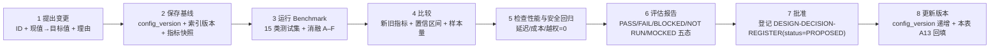
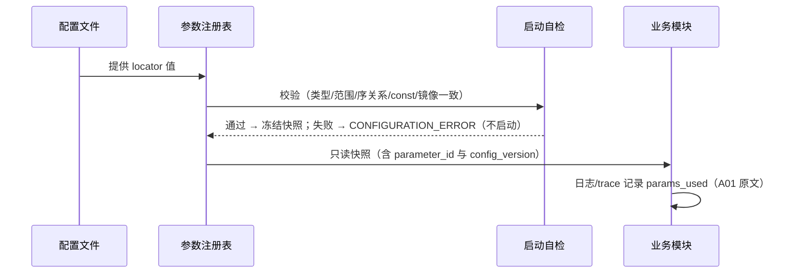

# 15 — 参数注册表

> 文件代号：15-参数注册表 ｜ 归属：组 C（参数注册表 + 新增契约） ｜ 状态：详细设计（F2 达成；F3 部分）
> 唯一依据：`DD-AUTHORITY-V2.md`（最高效力）§2 枚举、§3 五对象字段、§7 九 API、§9 ΔE 参数、§11 文档编号、§12 CR-01~07、§13 写作硬规则。
> 本文件落实任务书 §17（可观察、可配置、可验证的运行体系）与台账 **优化-5**（稳定、唯一、可追踪的参数 ID 规范；展示名可改、参数身份不丢）。
> **本文件不授予任何实施授权**；表中所有 `EXP-DEFAULT` 均为实验初值，**MUST NOT** 读作已裁决参数。

---

## 1. 文档状态

| 项 | 值 |
|---|---|
| 文档编号 | 15 |
| 标题 | 参数注册表 |
| 设计基线 | R4.1-MASTER-01 / DD-AUTHORITY-V2 |
| 完成等级自评 | **F2 达到**（15 属性 × 42 参数齐备、ID 规范唯一、变更流程与验证方法可执行）；F3 部分（运行时值待 P0–P3 落地后回填实测） |
| 实施范围 | 参数体系为横切能力；各参数按所属模块的 P0–P6 阶段授权生效 |
| 状态用语 | APPROVED（已裁决）/ EXP-DEFAULT（实验初值）/ LOCKED（const 不可改）/ DISABLED（默认关闭，启用须重新裁决）/ TBD（未定值，不得进入正式实现） |

---

## 2. 适用版本

- 适用目标版本：**R4.1-V1**（`core.algorithm_version = "R4.1-V1"`）。
- 权威顺序：`DD-AUTHORITY-V2.md` > 用户裁决台账（`08-adjudication-ledger.md`）> 已批准设计（00–14）> `contracts/config/*.schema.json` > 本文件默认值。
- 与 `DD-AUTHORITY v1` 冲突时，以 V2 为准；本文件**不推翻**任何正式裁决，冲突项一律"保留原裁决 + 标记重新裁决"（见 §7.13）。

---

## 3. 适用范围

覆盖：参数身份规范（ID 唯一性）、三层次管理模型（可观察/可配置/可验证）、15 属性台账、九个参数组（LLM / 记忆抽取 / 锚点 / 检索 / 情感 / 向量 / 权限 / 索引 / 画像）共 **42 个参数**、默认关闭清单、参数变更流程、Token 单位纪律、待登记参数。

**不覆盖（明确边界）**：

- 不定义 SQLite 表结构（→ 01）、不定义算法公式（→ 02）、不定义 API 语义（→ 03/14）、不定义权限判据（→ 04）。
- 不为 `cache.sqlite` 相关参数给值（U-1/U-2 暂缓至实施阶段，本阶段不得预先冻结）。
- 不为 `eval.*`、`dream.*`、`storage.busy_timeout_ms` 等既有参数重新裁决；它们沿用 02 号文档登记，待 P2/P3 增补时按本文件同一规范补入（见 §7.17）。

---

## 4. 依赖文档

| 依赖 | 用途 |
|---|---|
| `DD-AUTHORITY-V2.md` | 枚举（§2）、对象字段（§3）、API（§7）、ΔE 参数（§9）、CR-01~07（§12）、写作硬规则（§13） |
| `08-adjudication-ledger.md` | 优化-5（参数 ID 规范）、J4（情绪词表配置化）、J6/J7（情绪侧默认关闭）、X-1（禁止影子自动晋升） |
| `contracts/config/*.schema.json` | 参数物理位点（locator）与 `const` 锁定项 |
| `contracts/schemas/*.schema.json` | 参数在契约中的落点（如 `read-request` 的 `top_k`/`budget_tokens`） |
| `00-总体架构与设计原则.md` §7.8 | 技术选型表（本文件默认值的第一来源） |
| `02-核心算法规范.md` §7.13 | 参数更新七步、15 类 Benchmark、消融 A–F |
| `06-测试与评估规范.md` | 各参数的验证用例编号 |
| `OPEN-ISSUES.md` OI-023 | 参数 ID 三套命名问题（本文件 §7.1 给出唯一 canonical ID；第二轮裁决已确认） |

---

## 5. 正式裁决引用

| 裁决/台账编号 | 内容 | 本文件落点 |
|---|---|---|
| 优化-5（第四轮） | 必须提前建立**稳定、唯一、可追踪**的参数 ID 规范；展示名可改，**身份不能因改名而丢失** | §7.1、§7.2 |
| A16（§3d/§3e） | 参数可观测规范（11 属性/三层次）+ 稳定唯一可追踪 ID | §7.2、§6 |
| 任务书 §17 | 15 属性 × 全参数注册表 | §6、§7.4–§7.12 |
| J4（第四轮） | 情绪 15 标签**词表配置化**；标签内容留实施设计 | §7.8（`emotion.*` 与词表参数的关系）、§7.17 |
| J6（第四轮） | 首版关闭**查询侧**情绪感知；开启须独立验证与重新裁决 | §7.8 `emotion.query_enabled`、§7.13 CR-02 |
| J7（第四轮） | 只预留接口与字段，**不实现 LLM 标注** | §7.8 `emotion.auto_infer`、§7.13 CR-04 |
| X-3（第六轮） | Recall 可参与推理、**禁止直接改 PAD**、持久变更走独立审核、第③层默认关闭 | §7.8 `emotion.influence_enabled`、§7.13 CR-03 |
| X-1（第六轮） | delta-only 影子验证；**不允许影子结果自动晋升** | §7.14 变更流程第 7 步 |
| D-AP-05（第二轮） | `confirmed` 仅 M04 通道；`last_retrieved` 不得作衰减正向权重；E14/B04 未落地前 reinforce 只预留 | §7.5 `memory.auto_accept_threshold`、§7.14 禁令 |
| R9 / R10（v1 裁决） | 向量维度不得写死；规则排序为已批准算法、Cross-Encoder 禁用 | §7.9、§7.7 |
| 任务书 §13.7 | 字符/汉字/字数/Token **分别标单位**，禁止"1200 字=1200 Token" | §7.15 |
| CR-01~07（V2 §12） | 七项冲突一律保留原裁决 + 标记重新裁决 | §7.13 |

---

## 6. 术语：15 属性定义（MUST 逐项填写，禁止留空）

每个参数 **MUST** 具备以下 15 个属性；缺任一属性者 **MUST NOT** 进入生产配置。属性编号 `A01–A15` 为本文件引用标签。

| 编号 | 属性 | 定义 | 填写硬规则 |
|---|---|---|---|
| A01 | `parameter_id` | 参数**身份**（稳定唯一） | 点号式 `<域>.<参数名>`（§7.1）；**一经登记永不复用、永不因改名而变更** |
| A02 | `name` | 展示名（中文可读名） | **可改**；改名 **MUST NOT** 改变 A01；改名须记入 §15 变更记录 |
| A03 | `description` | 语义说明（含边界、禁止、与其他参数的序关系） | 必须能独立回答"这个参数改大了会发生什么" |
| A04 | `module` | 所属模块/组件（M01–M05、Pipeline、LLM Gateway、AnchorRouter 等） | 一个参数 **MUST** 有唯一 owner 模块（对应 D-AP-03"横切能力须明确唯一 owner"） |
| A05 | `default_value` | 默认值（配置缺失时的取值） | 未定者填 `TBD`，且生效状态只能是 EXP-DEFAULT |
| A06 | `min_value` | 合法下界（含） | 枚举/布尔类型填"—（枚举封闭）" |
| A07 | `max_value` | 合法上界（含） | 同上 |
| A08 | `unit` | 计量单位 | **MUST** 从 §7.15 单位词表选取；`token`/`char`/`hanzi`/`word` 四者互不换算 |
| A09 | `read_by` | 读取方（运行时消费者） | 至少一个；无消费者 ⇒ 该参数不得存在（死参数禁止） |
| A10 | `write_by` | 写入方（谁能改，含权限等级） | 区分"配置文件写入者"与"审批者"两种角色 |
| A11 | `change_condition` | 变更前置条件 | 引用 §7.14 流程步骤或 CR 编号；LOCKED 参数填"禁止变更" |
| A12 | `side_effects` | 变更副作用（影响面） | 必须写明对**质量/延迟/成本/安全**四类中至少一类的影响方向 |
| A13 | `runtime_value` | 运行时值（当前生效值的来源与加载方式） | 必须写明：来源文件 + 加载时机 + 是否可热更 |
| A14 | `effective_status` | 生效状态 | 四值封闭：`EXP-DEFAULT` / `APPROVED` / `LOCKED` / `DISABLED`（§7.3） |
| A15 | `validation_method` | 验证方法（可执行的判定手段） | 必须可落到测试用例编号、基准项或审计证据；禁止写"人工确认" |

> **注**：`00-总体架构与设计原则.md` §7.8 早期登记的 11 属性（A16 口径）为本表 15 属性的子集；差额 4 项（`min_value`/`max_value` 拆分、`unit`、`read_by`/`write_by` 拆分）为任务书 §17 的加严要求，**以本表为准，旧 11 属性口径作废**（不改变任何已裁决数值）。

---

## 7. 规范正文

### 7.1 参数 ID 规范（OI-023 处置：三套命名合一）

#### 7.1.1 选定方案

**本文件统一采用"模块域 + 参数名"两段式点号 ID（`recall.*` 风格）**，全表贯彻。

```
<domain>.<parameter_name>                  两段（常态）
<domain>.<subdomain>.<parameter_name>      三段（仅当确有必要分子域，如 indexing.outbox.poll_ms）
```

- 字符集：`[a-z0-9_.]`，全小写，段间单点，段内 `snake_case`。
- `domain` **MUST** 为稳定业务域，取值为封闭集合：`ingest` / `memory` / `anchor` / `recall` / `emotion` / `vector` / `permission` / `indexing` / `profile`。
- 域**不随**配置文件目录、文档编号、界面分组变化（这是与 config 路径式 ID 的关键差别）。

#### 7.1.2 该选择取代旧的三套命名（OI-023 处置）

OI-023 记录了三套并行命名，本文件以 **`recall.*` 风格为唯一参数身份**，其余两套降级、不再作为 ID：

| 旧套 | 旧形态实例 | 旧性质 | 本文件处置 |
|---|---|---|---|
| ① 算法文档点号式（02 号 §7） | `retrieval.rrf.k`、`retrieval.budget.tokens`、`retrieval.rank.alpha` | 类似 ID，但域名为**文档章节路径**，随文档改版漂移 | **作废为 ID**；语义并入 `recall.*`（映射见 §7.1.3） |
| ② config schema 路径式 | `fusion.k`、`context.token_budget`、`reranking.weights.rrf` | 是**存储定位符**，随 schema 重构而变 | **降级为 `locator`（物理位点）**，不再当作 ID；重构 schema 时 **MUST** 同步本表 locator，A01 不变 |
| ③ 06/08 号字面名 | `memory_context_budget`、`search_algorithm_version`、`top_k_per_channel` | 散文/字段名混用，无层级 | **作废**；对外契约字段名以 `contracts/schemas/*` 为准，参数身份一律回本表 |

**MUST**：

1. **同一参数不得有第二个 ID**。日志、指标、trace、审计、报告、配置注释中的参数标识 **MUST** 使用本表 A01 原文，**MUST NOT** 使用 locator 或展示名代替。
2. locator 允许"一对多"（同一参数在一处以上出现，如 `anchor.routing_enabled` 同时出现在 `anchor.schema.json` 与 `retrieval.schema.json`），此时 **MUST** 指定唯一权威位点，其余为**只读镜像**，且镜像 **MUST NOT** 独立取值（见 §7.6 A13）。
3. ID 永不复用：参数下线时状态置 `DEPRECATED`（本文件附加标记），ID 保留在册；**MUST NOT** 把旧 ID 分配给新参数。
4. 展示名（A02）可自由调整；**改名不得丢身份**——改名只改 A02 与 §15 变更记录行，A01 与历史数据中的 ID 保持字节一致（台账 优化-5 原文要求）。
5. 新增参数 **MUST** 先在本表登记 ID（可先填 `TBD` 默认值），再进入配置与代码；**MUST NOT** 先写死常量后补登记（禁止硬编码，V2 §13.3）。

#### 7.1.3 旧 → 新 ID 映射表（迁移用，MUST 全表替换引用）

| 旧 ID（任一套） | 新 ID（唯一身份） | 说明 |
|---|---|---|
| `retrieval.rrf.k` / `fusion.k` | `recall.rrf_k` | RRF 常数 k |
| `retrieval.budget.tokens` / `context.token_budget` / `memory_context_budget` | `recall.budget_tokens` | 记忆上下文 Token 预算 |
| `retrieval.rrf.weights.fts5` / `fusion.weights.fts` | `recall.channel_weight_fts`（**待登记**，§7.17） | FTS 通道权重 |
| `retrieval.rrf.weights.vector` / `fusion.weights.vector` | `recall.channel_weight_vector`（**待登记**） | 向量通道权重 |
| `retrieval.rank.alpha` / `reranking.weights.rrf` | `recall.rerank_weight_rrf`（**待登记**） | 排序 α |
| `retrieval.rank.beta` / `reranking.weights.exact_match` | `recall.rerank_weight_exact`（**待登记**） | 排序 β |
| `retrieval.rank.gamma` / `reranking.weights.type_relevance` | `recall.rerank_weight_type`（**待登记**） | 排序 γ |
| `retrieval.rank.delta` / `reranking.weights.time_relevance` | `recall.rerank_weight_time`（**待登记**） | 排序 δ |
| `retrieval.rank.epsilon` / `reranking.weights.source_quality` | `recall.rerank_weight_source`（**待登记**） | 排序 ε |
| `retrieval.rank.zeta` / `reranking.duplicate_penalty` | `recall.rerank_penalty_duplicate`（**待登记**） | 重复惩罚 ζ |
| `retrieval.fts.top_k` | `recall.channel_top_k_fts`（**待登记**） | FTS 召回深度 |
| `retrieval.vector.top_k` | `recall.channel_top_k_vector`（**待登记**） | 向量召回深度 |
| `retrieval.reranking.top_k` | `recall.rerank_top_k`（**待登记**） | 重排后保留条数 |
| `retrieval.context.max_items` / `top_k_per_channel` | `recall.top_k` | 最终 Top-K（A05=20） |
| `retrieval.fts.query_timeout_ms` | `recall.fts_timeout_ms`（**待登记**） | FTS 查询超时 |
| `storage.outbox.poll_interval_ms` / `outbox_poll_ms` | `indexing.outbox.poll_ms` | Outbox 轮询间隔 |
| `storage.outbox.retry_max` | `indexing.outbox.retry_max` | Outbox 重试上限 |
| `security.default_policy` | `permission.default` | 默认判权 |
| `security.m05_mode` | `permission.m05_mode` | M05 实现模式 |
| `embedding.*`（provider/model/dimension/metric） | `vector.*` | 向量/嵌入参数组 |
| `storage.lancedb.search_mode` | `vector.index_mode` | 索引模式（flat） |

> 标记"**待登记**"者：本轮不展开 15 属性行（避免把未标定的权重写成有值参数，V2 §13.7 与 X-1 纪律），ID 已预留，实施期按 §7.14 流程补入。**MUST NOT** 因未展开而继续沿用旧 ID。

### 7.2 三个管理层次（可观察 / 可配置 / 可验证）

| 层次 | 定义 | 对参数的硬要求 | 判定证据 |
|---|---|---|---|
| **可观察（Observable）** | 参数的当前值、来源、变更历史可被外部读取 | 每个参数 **MUST** 出现在以下三处之一以上：①启动配置快照日志（含 ID=A01 与值）②变更审计事件 ③检索/摄取 trace 的 `params_used` 字段 | 日志字段名含 A01 原文；可回放"某次回答用了哪套参数" |
| **可配置（Configurable）** | 取值由配置文件/注册表提供，业务代码无硬编码 | 除 `LOCKED` 外 **MUST** 可由 config 覆盖；`LOCKED` 参数以 `const` 表达（不可覆盖） | 静态扫描：代码中无该数值字面量；配置缺失时取 A05 且有告警 |
| **可验证（Verifiable）** | 取值合理性有可执行判定 | 每个参数 **MUST** 有 A15 指向具体测试/基准/审计；无验证方法的参数 **MUST NOT** 进入 APPROVED | 06 号测试用例编号、Benchmark 报告、审计日志查询 |

**三层次覆盖矩阵（按组）**

| 参数组 | 可观察 | 可配置 | 可验证 | 缺口 |
|---|---|---|---|---|
| ingest.* | 摄取 trace（stage 4/5） | `config/llm.schema.json`（P3 待建） | 抽取质量测试集（10 号 11 项能力） | 配置文件未落地 ⇒ 现阶段仅注册表默认值 |
| memory.* | 候选 trace（stage 14） | `config/memory.schema.json` | 候选分流测试（CR-01 专项） | AUTO_ACCEPT 通道未裁决（CR-01） |
| anchor.* | 检索 trace 阶段 1 | `config/anchor.schema.json` + `retrieval` 镜像 | 锚点命中率基准（11 号） | 加权默认值未标定 |
| recall.* | 检索 trace 阶段 3–5 | `config/retrieval.schema.json` | TS-2 / Benchmark 15 类 | 权重类参数待登记 |
| emotion.* | ΔE 计算 trace（禁用时为空） | `config/emotion.schema.json` | 门禁 8 条单测 + 反向用例 | **三项默认关闭**，启用须裁决 |
| vector.* | 启动校验日志 | `config/embedding.schema.json` + `storage` | FLAT 精确性比对（TC-M02-002） | FLAT 执行路径 P0 VERIFY |
| permission.* | 判权审计（decision_id） | `config/security.schema.json` | TC-PM-001~012 | M05 未实现（contract_deny） |
| indexing.* | Outbox 指标 + 对账报告 | `config/storage.schema.json` + `worker` | TC-M01-006/007、TC-FR-* | 无 |
| profile.* | 画像版本日志 | `config/profile.schema.json` | 画像一致性测试（12 号） | M04 未实施（P4 需授权） |

### 7.3 生效状态词表（四值封闭）

| 状态 | 含义 | 允许的取值来源 | 允许进入生产 |
|---|---|---|---|
| `APPROVED` | 已由用户裁决/已批准设计固定（含"已批准为唯一允许值"） | 裁决台账或 V2 §12 明示 | 是 |
| `EXP-DEFAULT` | 实验初值，**未裁决**；正式化前 MUST 保持可配置 | 00 §7.8 / 02 §7 / 本文件推定 | 是（但 MUST 标注未裁决） |
| `LOCKED` | `const` 锁定，任何配置覆盖 **MUST** 被拒绝（`CONFIGURATION_ERROR`） | 不变量/裁决明示 | 是（值不可改） |
| `DISABLED` | 能力默认关闭；**启用等价于重新裁决** | V2 §12 CR 项 | 否（保持关闭） |

**MUST NOT**：把 `EXP-DEFAULT` 写成 `APPROVED`；把 `DISABLED` 写成启用；把 `TBD` 默认值写成已确定值。

### 7.4 LLM 组（`ingest.*`，6 参数）

| A01 参数 ID | A02 名称 | A03 说明 | A04 模块 | A05 默认 | A06 最小 | A07 最大 | A08 单位 | A09 读方 | A10 写方 | A11 变更条件 | A12 副作用 | A13 运行时值 | A14 状态 | A15 验证方法 |
|---|---|---|---|---|---|---|---|---|---|---|---|---|---|---|
| `ingest.model` | 摄取模型 | 执行 L1 抽取的模型标识。**MUST NOT 写死模型名**，须经统一测试集选型（V2 §6）；空值表示未选型，摄取 **MUST** 进入 DEFERRED 而非降级猜语义 | Pipeline / LLM Gateway | `TBD`（未选型） | — | — | `enum-id` | LLMExtractor、SemanticSplitter、MemoryClassifier | 配置管理员 + 用户裁决（模型选型属能力裁决） | 10 号文档 11 项能力测试通过 + 用户裁决 | 换模型改变抽取质量、结构化输出稳定性、成本；不改契约 | 未落地（无 `config/llm.json`；取注册表默认 `TBD`，source=registry-default） | EXP-DEFAULT | 10 号能力测试矩阵；同输入抽取结果一致性抽检 |
| `ingest.model_tier` | 摄取模型档位 | 该次调用使用的 LLM 层级（L1 轻量 / L2 强语义 / L3 聊天模型兼任）。冲突处理与画像整合 **MUST** 为 L2；普通候选批量异步 **MUST** 为 L1 | Pipeline / LLM Gateway | `L1` | — | — | `enum` | LLM Gateway、Pipeline 调度器 | 配置管理员（受 §7.14 约束） | 阶段授权到位 + 消融显示档位收益 | 升档提升质量、显著提高延迟与成本；降档可能降低冲突检测准确率 | 未落地 | EXP-DEFAULT | 分层调用测试：L2 专属任务不得走 L1（路由断言） |
| `ingest.batch_size` | 抽取批大小 | 单次 LLM 请求聚合的候选条数上限。批越大单位成本越低、超时与截断风险越高；**MUST NOT** 因批处理丢弃候选（失败进 DEFERRED） | Pipeline（stage 4） | `8` | `1` | `64` | `条` | LLMExtractor | 配置管理员 | Benchmark 延迟与成本基线建立后 | 增大：吞吐↑、单请求延迟↑、截断风险↑；减小：请求数↑、成本↑ | 未落地 | EXP-DEFAULT | 批处理失败不丢候选测试（注入超时，断言候选全部 DEFERRED） |
| `ingest.timeout` | 单次调用超时 | 单次 LLM 调用墙钟上限。超时 **MUST** 记 `TIMEOUT` 并重试/延后，**MUST NOT** 用规则猜复杂语义（05 号故障矩阵①） | LLM Gateway | `30000` | `1000` | `600000` | `ms` | 所有 L1/L2 调用点 | 配置管理员 | P0 实测延迟基线后 | 过小：误超时、候选积压；过大：后台任务占用连接、聊天不受影响但积压 | 未落地 | EXP-DEFAULT | 故障注入：超时后聊天仍可用、候选进 DEFERRED（05 号 TC-FR） |
| `ingest.retry` | 重试次数 | 单次抽取失败后的重试上限（指数退避）。超过上限进 DEFERRED，**MUST NOT** 静默丢弃 | Pipeline / LLM Gateway | `2` | `0` | `10` | `次` | LLMExtractor、Outbox 重试器 | 配置管理员 | 失败率基线建立后 | 增大：成功率↑、重复计费↑、延迟↑；0：一次失败即延后 | 未落地 | EXP-DEFAULT | 重试幂等测试：同候选重复提交只产生一份（幂等键） |
| `ingest.max_input_tokens` | 单次输入 Token 上限 | 送 LLM 的输入 Token 硬上限（**token 计量，非字符**）。超限 **MUST** 切分或拒绝，**MUST NOT** 静默截断成语义不完整片段 | Pipeline（stage 1/4） | `6000` | `256` | `128000` | `token` | InputNormalizer、LLMExtractor | 配置管理员 | Tokenizer 与模型上下文窗口确认后 | 过大：超上下文窗口 ⇒ 400/截断；过小：碎片化过度、跨句语义丢失 | 未落地 | EXP-DEFAULT | Token 计数与真实 Tokenizer 对齐误差测试（≤1e-6 复现）；超限切分用例 |

### 7.5 记忆抽取组（`memory.*`，4 参数）

| A01 参数 ID | A02 名称 | A03 说明 | A04 模块 | A05 默认 | A06 最小 | A07 最大 | A08 单位 | A09 读方 | A10 写方 | A11 变更条件 | A12 副作用 | A13 运行时值 | A14 状态 | A15 验证方法 |
|---|---|---|---|---|---|---|---|---|---|---|---|---|---|---|
| `memory.min_confidence` | 最低入库置信度 | 候选低于该值 **MUST** 直接 `REJECTED`（不进候选池）。置信度是**系统内部评估**，**MUST NOT** 等同于事实真实性，也 **MUST NOT** 由 LLM 自报直接赋值 | M03 / CandidateValidator | `0.55` | `0` | `1` | `无量纲(0–1)` | CandidateValidator、DuplicateDetector | 配置管理员 | 标注集上精确率/召回率基线建立后 | 提高：噪声↓、漏抽↑；降低：召回↑、候选池膨胀 | 未落地（`config/memory.json` 未建） | EXP-DEFAULT | 候选分流矩阵测试：对同一标注集扫描该值，报告 Precision/Recall 曲线 |
| `memory.auto_accept_threshold` | 自动接受阈值 | 候选 ≥ 该值时状态可为 `AUTO_ACCEPT`。**AUTO_ACCEPT ≠ confirmed**（CR-01）：仅表示"免人工复核进入 M04 整合流程"，**MUST NOT** 写 `validation_state=confirmed`；当前仅允许 L1/L2 且 `visibility=owner_private` 的候选使用 | M03 / CandidateValidator | `0.9` | `0` | `1` | `无量纲(0–1)` | CandidateValidator、M04 整合入口 | 配置管理员；**通道本身须用户裁决** | CR-01 重新裁决通过 + 误接受率实测 | 降低：吞吐↑、错误自动整合风险↑（**安全负向**） | 未落地；且 AUTO_ACCEPT 通道当前**未获授权**，实际行为 = 全量转 NEEDS_REVIEW | EXP-DEFAULT | CR-01 专项：断言 AUTO_ACCEPT 候选的 `validation_state != confirmed`；误接受率抽样审计 |
| `memory.review_threshold` | 复核阈值 | 候选 ≥ 该值且 < `auto_accept_threshold` 时置 `NEEDS_REVIEW`；介于 `min_confidence` 与该值之间置 `PENDING`。**序关系 MUST 成立**：`min_confidence ≤ review_threshold ≤ auto_accept_threshold`（违反 ⇒ `CONFIGURATION_ERROR`）。`max_units_per_input` 与之无关 | M03 / CandidateValidator | `0.7` | `0` | `1` | `无量纲(0–1)` | CandidateValidator | 配置管理员 | 与另两个阈值联合标定（禁止单独扫参） | 提高：人工队列↑；降低：低质候选进入 PENDING 堆积 | 未落地 | EXP-DEFAULT | 序关系校验单测（越界配置必须启动失败）；三阈值联合扫描报告 |
| `memory.max_units_per_input` | 单输入碎片上限 | 单条输入消息最多产生的 MemoryUnit 数。超限 **MUST** 按核心语义优先级截断并记 `TRUNCATED`，**MUST NOT** 机械切句凑数（V2 §5 stage 5） | SemanticSplitter | `20` | `1` | `200` | `条` | SemanticSplitter、CandidateValidator | 配置管理员 | 碎片化质量抽检后 | 提高：覆盖↑、单条记忆粒度变粗、噪声↑；降低：粒度细、跨句语义断裂 | 未落地 | EXP-DEFAULT | 碎片化质量用例：一条一核心语义、指代可独立理解、原句可追溯（09 号验收） |

### 7.6 锚点组（`anchor.*`，4 参数）

| A01 参数 ID | A02 名称 | A03 说明 | A04 模块 | A05 默认 | A06 最小 | A07 最大 | A08 单位 | A09 读方 | A10 写方 | A11 变更条件 | A12 副作用 | A13 运行时值 | A14 状态 | A15 验证方法 |
|---|---|---|---|---|---|---|---|---|---|---|---|---|---|---|
| `anchor.routing_enabled` | 锚点路由开关 | 检索阶段 1 是否启用 Anchor Router（8 锚点）。关闭时退化为纯 FTS+向量混合检索（v1 行为），**属降级不是默认**。**权威位点** = `config/anchor.schema.json`；`config/retrieval.schema.json` 的 `anchor_routing_enabled` 为**只读镜像**，二者 **MUST** 相等，镜像独立取值 ⇒ `CONFIGURATION_ERROR` | M02 / AnchorRouter | `true` | — | — | `boolean` | IntentResolver、AnchorRouter、ContextBuilder | 配置管理员 | 仅故障降级场景可临时关闭，且 MUST 记 `degraded=true` | 关闭：召回结构变平、人物优先失效、事件碎片可能压过画像 | 未落地（`config/anchor.json` 未建）；镜像位点亦未建 | EXP-DEFAULT | 镜像一致性单测（两处不等 ⇒ 启动失败）；开关对比基准（人物查询 Top-5 中画像占比） |
| `anchor.profile_priority` | 画像锚点优先级 | `PERSON_PROFILE` / `SELF_EXPLICIT` 在人物理解任务中的排序加权。**MUST NOT** 在事件回忆任务中生效（V2 §8"人物画像优先"仅约束人物理解） | M02 / AnchorRouter | `0.35` | `0` | `1` | `无量纲(0–1)` | Ranker、ContextBuilder | 配置管理员 | Benchmark 人物类用例基线后 | 提高：画像排前、事件碎片后移；过高会压掉近期关键事件 | 未落地 | EXP-DEFAULT | 人物查询 vs 事件查询分组评估（NDCG 分组报告，禁止只报总体） |
| `anchor.event_priority` | 事件锚点优先级 | `EVENT` 在事件回忆任务中的排序加权。与 `anchor.profile_priority` **MUST NOT** 同时用于同一查询的同一分区（互斥路由） | M02 / AnchorRouter | `0.30` | `0` | `1` | `无量纲(0–1)` | Ranker | 配置管理员 | 同上 | 提高：事件回忆更准、人物理解被稀释 | 未落地 | EXP-DEFAULT | 同 `anchor.profile_priority`（互斥路由断言） |
| `anchor.max_candidates` | 单锚点候选上限 | 每个锚点在阶段 2 的最大召回数。总候选数 ≈ 锚点数 × 该值，**MUST** 受 `recall.top_k` 与预算二次裁剪 | M02 / AnchorRouter | `30` | `1` | `200` | `条` | AnchorRouter、Retriever | 配置管理员 | 延迟基线建立后 | 提高：召回↑、融合成本与延迟↑；降低：长尾画像/事件被截断 | 未落地 | EXP-DEFAULT | 召回率-延迟曲线；断言阶段 3 输入规模不超预算保护阈值 |

### 7.7 检索组（`recall.*`，6 参数）

| A01 参数 ID | A02 名称 | A03 说明 | A04 模块 | A05 默认 | A06 最小 | A07 最大 | A08 单位 | A09 读方 | A10 写方 | A11 变更条件 | A12 副作用 | A13 运行时值 | A14 状态 | A15 验证方法 |
|---|---|---|---|---|---|---|---|---|---|---|---|---|---|---|
| `recall.top_k` | 最终 Top-K | 经权限终检与预算裁剪后，最终注入上下文的记忆条数上限。locator = `retrieval.context.max_items`（旧称 `top_k_per_channel` 作废）。**语义边界**：本参数是"最终注入条数"；14 号文档 `memory.search` 的 `opts.top_k`（默认 50，每通道候选上限）是**另一个参数**，ID 为 `recall.channel_top_k_fts`/`recall.channel_top_k_vector`（§7.17 待登记）。两者 MUST NOT 共用 ID、MUST NOT 互相覆盖 | M02 / ContextBuilder | `20` | `1` | `100` | `条` | ContextBuilder、GreedySelect | 配置管理员 | Benchmark K∈{5,10,20} 对比后 | 提高：覆盖↑、Token 消耗↑、噪声↑；降低：漏召回↑ | `20`（`config/retrieval.json` → `context.max_items`，启动快照） | EXP-DEFAULT | TS-2/TC-M02-010（预算内条数）、Recall@K 报告（K=5/10/20 分列） |
| `recall.budget_tokens` | Token 预算 | 单次注入的记忆上下文 Token 上限（**token 计量，用真实 Tokenizer**）。估算值 **MUST** 标 `estimated`；**MUST NOT** 与字符预算等价换算（§7.15） | M02 / ContextBuilder | `1200` | `64` | `8192` | `token` | ContextBuilder、TokenBudget | 配置管理员 | Tokenizer 版本确认 + 成本基线 | 提高：上下文更全、宿主剩余上下文被挤占、成本↑；降低：被迫丢弃相关记忆 | `1200`（`config/retrieval.json` → `context.token_budget`） | EXP-DEFAULT | TS-2/TC-M02-010；`token_usage` 五类加总核对（优化-1） |
| `recall.rerank_enabled` | 规则排序开关 | 阶段 3 是否应用六特征规则排序。**派生参数**：由 `retrieval.reranking.algorithm` 决定（`rule_based` ⇒ true）。Cross-Encoder **MUST** 保持禁用（裁决 R10，`cross_encoder_enabled=false`） | M02 / Ranker | `true` | — | — | `boolean` | Ranker、ContextBuilder | 仅通过修改 `reranking.algorithm` 改变 | 算法变更须用户裁决 | 关闭：退化为纯 RRF 顺序，Exact/Time/Source 特征失效 | `true`（派生自 `retrieval.reranking.algorithm="rule_based"`） | APPROVED | 消融实验 E（去掉规则排序）指标对比；断言 Cross-Encoder 恒禁用 |
| `recall.rrf_k` | RRF 常数 k | RRF 平滑常数：`RRF(d)=Σ w_r/(k+rank_r(d))`，`rank_start=1`，缺失通道贡献 0。k 越大排名差异越平缓。通道标识统一 `fts`/`vector`（structured 只过滤不计分，OI-022 结论） | M02 / Fusion | `60` | `1` | `1000` | `无量纲` | Fusion、Ranker | 配置管理员 | 消融 A–F + 参数扫描后经用户裁决 | 提高：两通道更"平等"、区分度下降；降低：单通道主导 | `60`（`config/retrieval.json` → `fusion.k`） | EXP-DEFAULT | TS-2/TC-M02-004（可复现）、TC-M02-005（缺失通道）；k∈{10,60,120} 扫描报告 |
| `recall.evidence_expansion_limit` | 证据扩展上限 | 阶段 5 单条记忆最多回溯的原句（Evidence）条数；`0` 表示不扩展。**MUST** 受 M05 逐条判权（related_evidence 不得绕过），且 **MUST** 计入 `recall.budget_tokens` | M02 / EvidenceExpander | `3` | `0` | `20` | `条` | EvidenceExpander、ContextBuilder | 配置管理员 | 原句追溯准确率与 Token 成本基线后 | 提高：可追溯性↑、Token 消耗显著↑；0：无法回答"原话是什么" | 未落地（`config/retrieval.json` 新字段，P2 增量） | EXP-DEFAULT | 证据越权用例（扩展出的 evidence 逐条有 ALLOW）；预算超限用例 |
| `recall.budget_chars` | 字符预算 | 单次注入的记忆上下文**字符**上限（unit=char）。与 `recall.budget_tokens` **并列独立生效**，先到者裁决；`0` = 不启用字符预算。**MUST NOT** 用 `chars×N=token` 反推（§7.15） | M02 / ContextBuilder | `2400` | `0` | `20000` | `char` | ContextBuilder、TokenBudget | 配置管理员 | 中文场景字符/Token 比率实测后 | 提高：允许更长记忆、宿主上下文压力↑；为 0 时仅 Token 约束 | 未落地（`config/retrieval.json` 新字段，P2 增量） | EXP-DEFAULT | 双预算用例：两值不同时以先到者裁剪，报告 `budget_status=truncated_by` 字段 |

### 7.8 情感组（`emotion.*`，7 参数；前三项 DISABLED）

| A01 参数 ID | A02 名称 | A03 说明 | A04 模块 | A05 默认 | A06 最小 | A07 最大 | A08 单位 | A09 读方 | A10 写方 | A11 变更条件 | A12 副作用 | A13 运行时值 | A14 状态 | A15 验证方法 |
|---|---|---|---|---|---|---|---|---|---|---|---|---|---|---|
| `emotion.influence_enabled` | ΔE 影响开关 | 是否允许事件情绪对 Psychology 运行时状态产生 ΔE 影响。**默认关闭**（V2 §9 门禁 6）。启用后 ΔE **只作用运行时**，**MUST NOT** 写回 Event 事实、**MUST NOT** 改 `validation_state`、**MUST NOT** 由"沉默"触发 | Psychology 接口 / M02 | `false` | — | — | `boolean` | EmotionInfluence、Psychology Adapter | **无人可写**（`const: false`）；启用须改 schema，等价重新裁决 | **CR-03 重新裁决** + X-3 审核链 + 影子验证（I-4） | 启用即引入"记忆影响当前情绪"的伦理与安全面；错误情绪会污染对话基调 | `false`（`config/emotion.json` → `influence_enabled`，const 锁定） | DISABLED | 关闭态用例：任何 `getEmotionContext` 调用后 PAD 不变；启用前须提交门禁 8 条全绿证据 |
| `emotion.query_enabled` | 情绪查询开关 | 是否允许查询侧情绪感知（`EMOTION_QUERY` 意图路由、`memory.getEmotionContext` 实际返回情绪）。**默认关闭**（遵 J6 首版关闭查询侧情绪感知） | M02 / M05 | `false` | — | — | `boolean` | IntentResolver、MemoryAPI | **无人可写**（`const: false`） | **CR-02 重新裁决** + 独立验证（J6 要求） | 启用后情绪词/情绪上下文进入回答，可能被读作"机器人有情绪" | `false`（`config/emotion.json` → `query_enabled`） | DISABLED | 关闭态断言：`EMOTION_QUERY` 走空结果且 `status=empty`，不注入替代内容 |
| `emotion.auto_infer` | 自动情绪推断开关 | 是否允许 L1/L2 在摄取期自动推断事件情绪（EmotionExtractor 自动生成）。**默认关闭**（遵 J7：只预留接口与字段）。关闭时仅接受 `source_type=USER_EXPLICIT` 的显式情绪 | M03 / EmotionExtractor | `false` | — | — | `boolean` | EmotionExtractor、CandidateValidator | **无人可写**（`const: false`） | **CR-04 重新裁决** + 标注一致性（κ≥0.6，I-8 口径） | 启用后模型推断可能被当成用户事实（禁止）；须保持 `ASSISTANT_INFERRED` 标记 | `false`（`config/emotion.json` → `auto_infer`） | DISABLED | 关闭态断言：合成推断路径产出的 `source_type` 只可能是 USER_EXPLICIT；越界标签映射为 `neutral` + 保留 `raw_label` |
| `emotion.max_influence` | 单事件/总影响上限 | ΔE 的上限裁剪：单事件 ΔE ≤ 该值；多事件求和后 **MUST** 再裁剪到该值（V2 §9 门禁 3/4）。与 `emotion.influence_enabled` 联动：开关关闭时本参数不生效 | Psychology 接口 | `0.15` | `0` | `1` | `无量纲(0–1)` | EmotionInfluence | 配置管理员（受 CR-03 前置约束） | CR-03 裁决通过 + 标定报告 | 提高：情绪影响显著、可能压过当前对话情绪；降低：影响趋近无效 | `0.15`（`config/emotion.json`） | EXP-DEFAULT | 上限裁剪单测：构造 5 个高 ΔE 事件，断言求和后 ≤ 上限 |
| `emotion.decay_rate` | 时间衰减率 | 衰减系数 D 的每日衰减率：`D = exp(-decay_rate × Δdays)`，取值 (0,1]，随时间单调递减（门禁 5） | Psychology 接口 | `0.1` | `0` | `1` | `1/天` | EmotionInfluence | 配置管理员 | CR-03 裁决通过 + 衰减曲线评审 | 提高：旧事件迅速失效；降低：久远事件仍影响当前状态 | `0.1`（`config/emotion.json`） | EXP-DEFAULT | 衰减单调性单测（时间↑ ⇒ D 单调↓、D∈[0,1]）；30/90/365 天曲线报告 |
| `emotion.inferred_weight` | 推断情绪权重 | 推断来源情绪的折扣系数，**MUST < 1.0**（门禁 1：inferred 权重 < explicit 权重）。explicit 权重固定 1.0，不在本表另设参数 | Psychology 接口 | `0.5` | `0` | `0.99` | `无量纲(0–1)` | EmotionInfluence | 配置管理员 | CR-03 裁决通过 | 提高：推断几乎等同显式（**越界即违规**）；降低：推断情绪无实质作用 | `0.5`（`config/emotion.json`） | EXP-DEFAULT | 门禁 1 单测：断言 `inferred_weight < 1.0`，配置 1.0 ⇒ `CONFIGURATION_ERROR` |
| `emotion.relevance_threshold` | 关联度阈值 | 当前话题与事件的关联度 R 低于该值时 **ΔE=0**（门禁 2：无关联话题不触发） | Psychology 接口 | `0.6` | `0` | `1` | `无量纲(0–1)` | EmotionInfluence | 配置管理员 | CR-03 裁决通过 + 相关性标注集 | 提高：几乎不触发（保守）；降低：无关事件也能影响情绪（风险） | `0.6`（`config/emotion.json`） | EXP-DEFAULT | 门禁 2 单测：R=threshold−ε ⇒ ΔE 恒 0；误触发率审计 |

> **词表说明（J4）**：15 个受控情绪标签词表本身是**配置项而非本表数值参数**，落 `config/emotion.json` 的 `label_dict`（见 `emotion.schema.json`），受 CR-04/词表变更审计约束；标签越界 **MUST** 映射为 `neutral` 并保留 `raw_label`（V2 §2.14）。

### 7.9 向量组（`vector.*`，6 参数）

| A01 参数 ID | A02 名称 | A03 说明 | A04 模块 | A05 默认 | A06 最小 | A07 最大 | A08 单位 | A09 读方 | A10 写方 | A11 变更条件 | A12 副作用 | A13 运行时值 | A14 状态 | A15 验证方法 |
|---|---|---|---|---|---|---|---|---|---|---|---|---|---|---|
| `vector.provider` | 嵌入提供方 | Embedding Provider 类型（Provider 归 M01，D-AP-02）。`mock` **仅限隔离测试并标 MOCKED**，**MUST NOT** 出现在生产部署 | M01 / Embedding Adapter | `ollama` | — | — | `enum` | Embedding Adapter | 配置管理员 | P0 连通性与维度校验通过 | 换 provider ⇒ 必须新建 `embedding_space_id`，否则禁止混合检索 | 未落地（`config/embedding.json` → `provider`） | EXP-DEFAULT | 启动连通性探针；空间隔离用例 TC-M02-003 |
| `vector.model` | 嵌入模型 | 模型标识（现网参考 `bge-m3`，**不得写死**）。模型变更 **MUST** 新建空间并全量重建，旧空间退役前保留 | M01 / Embedding Adapter | `TBD`（随部署确认） | — | — | `enum-id` | Embedding Adapter | 配置管理员 + 用户裁决（模型选型） | 维度/归一化元数据实测 + 空间注册 | 换模型：全量重嵌入成本、检索排序漂移 | 未落地 | EXP-DEFAULT | 维度元数据读取校验（`dimension` 与模型不一致 ⇒ 启动失败） |
| `vector.dimension` | 向量维度 | 实际模型输出维度。**MUST 从模型元数据读取并校验，禁止写死**（裁决 R9；1024 仅为现网参考值） | M01 / Embedding Adapter | `TBD`（读元数据） | `1` | `65536` | `维` | Embedding Adapter、LanceDB Adapter | 由模型元数据写入，人工 **不得**覆写 | 与 `embedding_space` 定义不一致 ⇒ `CONFIGURATION_ERROR` | 提高：误配导致写入拒绝或检索报错；**无正向收益** | 未落地 | EXP-DEFAULT | 启动校验单测：维度不匹配必须拒绝启动（TC-M02-002 前置） |
| `vector.store` | 向量存储 | 向量库实现。**MUST 恒为 `lancedb`**；LanceDB 不是权威存储，删除后可从 SQLite 重建（INV-03） | M01 / LanceDB Adapter | `lancedb` | — | — | `enum(const)` | VectorRetriever | **无人可写**（const） | 禁止变更；更换须重新裁决不变量 | 改即破坏 INV-03/INV-04 与既有验收 | `lancedb`（`config/retrieval.json` → `vector.store`，const） | LOCKED | 配置覆盖必须被拒（`CONFIGURATION_ERROR`）；重建对账测试 |
| `vector.metric` | 距离度量 | 向量距离/相似度度量。**MUST** 与索引写入时一致；与 `embedding_space.normalized` 组合才定义空间（同维度不等于同空间） | M01 / LanceDB Adapter | `cosine` | — | — | `enum` | VectorRetriever | 配置管理员 | 与模型归一化状态一并变更 + 全量重建 | 度量不一致 ⇒ 排序无意义，**MUST** 拒绝而非静默降级（INV-11） | 未落地（`config/embedding.json` → `metric`） | EXP-DEFAULT | 度量一致性校验；混用用例必须报 `CONFIGURATION_ERROR` |
| `vector.index_mode` | 索引模式 | 向量索引模式。**MUST 恒为 `flat`**（精确检索）；ANN **禁止**（未授权，`ann_enabled=false`）。P0 **VERIFY**：SDK 实际执行路径必须被证明 | M01 / LanceDB Adapter | `flat` | — | — | `enum(const)` | VectorRetriever | **无人可写**（const） | 禁止变更；ANN 须重新裁决 | 改即失去"精确检索"验收前提，FLAT 基准比对失效 | `flat`（`config/storage.json` → `lancedb.search_mode`，const） | LOCKED | FLAT vs 暴力余弦基准顺序一致（TC-M02-002，不一致 ⇒ BLOCKED） |

### 7.10 权限组（`permission.*`，3 参数）

| A01 参数 ID | A02 名称 | A03 说明 | A04 模块 | A05 默认 | A06 最小 | A07 最大 | A08 单位 | A09 读方 | A10 写方 | A11 变更条件 | A12 副作用 | A13 运行时值 | A14 状态 | A15 验证方法 |
|---|---|---|---|---|---|---|---|---|---|---|---|---|---|---|
| `permission.default` | 默认判权 | 无匹配策略时的默认判定。**MUST 恒为 `deny`**（fail-closed）；**MUST NOT** 配置为 allow。超时/异常/未知 **MUST** 归入 DENY 或 INDETERMINATE 并排除（V2 §8 阶段 4） | M05 | `deny` | — | — | `enum(const)` | 所有读写路径、ContextBuilder | **无人可写**（const） | 禁止变更 | 改为 allow 等于取消最小权限，属安全红线 | `deny`（`config/security.json` → `default_policy`，const） | LOCKED | TC-PM-008/009（超时/异常 ⇒ 排除）；配置覆盖必须被拒 |
| `permission.m05_mode` | M05 实现模式 | `contract_deny` = M05 未实现的契约默认拒绝模式（P0–P3 唯一允许值）；`implemented` = P6 后经授权切换。**MUST NOT** 因"代码写了"而切换 | M05 | `contract_deny` | — | — | `enum` | 全部 Memory API、Pipeline stage 15 | 配置管理员 + 阶段授权裁决 | P5/P6 阶段授权 + M05 验收证据 | 切 `implemented` 前若实现不完整 ⇒ 越权读取风险 | `contract_deny`（`config/security.json` → `m05_mode`） | APPROVED | 越权用例全 DENY（TC-PM-001~012）；切换前须提交 10 环节覆盖证据 |
| `permission.public_enabled` | public 可见性开关 | 是否允许 `visibility=public`。**默认关闭**（V1 禁用，CR-07）。关闭时任何写入 `visibility=public` **MUST** 被拒绝（`VALIDATION_ERROR`），读取侧 **MUST** 视为不可达 | M05 + 01 对象层 | `false` | — | — | `boolean` | 写入校验、读取过滤 | **无人可写**（const: false） | **CR-07 重新裁决** + 最小权限评审 | 启用即把私人记忆暴露面扩到"未来任意主体"，与默认 deny 冲突 | `false`（`config/security.json` → `visibility.public_enabled`，const） | DISABLED | 关闭态断言：public 写入被拒 + public 读取被过滤；审计无 public 条目 |

### 7.11 索引组（`indexing.*`，3 参数）

| A01 参数 ID | A02 名称 | A03 说明 | A04 模块 | A05 默认 | A06 最小 | A07 最大 | A08 单位 | A09 读方 | A10 写方 | A11 变更条件 | A12 副作用 | A13 运行时值 | A14 状态 | A15 验证方法 |
|---|---|---|---|---|---|---|---|---|---|---|---|---|---|---|
| `indexing.outbox.poll_ms` | Outbox 轮询间隔 | Worker 拉取 Outbox 事件的间隔。过大 ⇒ 索引延迟（检索读到旧索引但权威回源兜底）；过小 ⇒ 空转与 SQLite 压力。**MUST NOT** 因轮询加快而改变"权威优先"顺序 | M01 / Worker | `1000` | `100` | `60000` | `ms` | Outbox Consumer | 配置管理员 | 索引延迟 P95 基线后 | 增大：索引新鲜度↓（召回缺新记忆）；减小：CPU/IO 压力↑ | `1000`（`config/storage.json` → `outbox.poll_interval_ms`） | EXP-DEFAULT | 端到端时效用例（写入→可检索的最大延迟）；负载测试 |
| `indexing.outbox.retry_max` | Outbox 重试上限 | 单个事件处理失败的最大重试次数；超过后进 `dead_letter` 并 **MUST** 告警人工修复（**MUST NOT** 静默丢弃） | M01 / Worker | `8` | `1` | `100` | `次` | Outbox Consumer | 配置管理员 | 故障注入基线后 | 增大：恢复概率↑、坏事件长期占用槽位；减小：过早 dead_letter | `8`（`config/storage.json` → `outbox.retry_max`） | EXP-DEFAULT | TC-M01-006（旧事件晚到 SkipOrSupersede）、TC-M01-007（删除幂等）；dead_letter 告警用例 |
| `indexing.consistency_check` | 只读一致性对账 | 是否启用 SQLite ↔ FTS5 ↔ LanceDB 只读对账（P0–P3 唯一允许的维护任务；**不改数据、不自动修**）。写操作型维护（duplicate_scan/auto_delete 等）**MUST** 保持关闭 | M01 / Worker 维护 | `true` | — | — | `boolean` | ConsistencyChecker | 配置管理员 | 无需裁决（只读能力，已批准） | 开启仅增加周期 IO；关闭 ⇒ 索引漂移不可发现 | `true`（`config/worker.json` → `maintenance_tasks.consistency_check`） | APPROVED | 对账报告 0 差异（INV-04）；注入篡改后必须报告差异（TC-M01-011） |

### 7.12 画像组（`profile.*`，3 参数）

| A01 参数 ID | A02 名称 | A03 说明 | A04 模块 | A05 默认 | A06 最小 | A07 最大 | A08 单位 | A09 读方 | A10 写方 | A11 变更条件 | A12 副作用 | A13 运行时值 | A14 状态 | A15 验证方法 |
|---|---|---|---|---|---|---|---|---|---|---|---|---|---|---|
| `profile.auto_update` | 画像自动整合开关 | 是否允许 M04 在无人工触发时自动整合 PersonProfile。**默认关闭**：M04 属 P4，需阶段授权；开启后仍 **MUST** 经 M04 整合通道并保留 `profile_version` 与追溯（**MUST NOT** 直接改 MemoryUnit 或跳过 `basis`） | M04 | `false` | — | — | `boolean` | ProfileIntegrator | 配置管理员 + 阶段授权 | P4 阶段授权 + 画像一致性测试通过 | 开启：画像新鲜度↑、错误整合扩散风险↑（**安全负向**） | 未落地（`config/profile.json` 未建） | EXP-DEFAULT | 关闭态：无自动版本新增；开启后：每次更新有 `source_memory_ids` 追溯且 `basis` 正确（§3.5） |
| `profile.max_sections` | 画像分区上限 | 单个画像允许的分区数上限，取值受 §3.5 的 11 个 section 枚举约束（枚举外分区 **MUST** 被拒） | M04 / 01 对象层 | `11` | `1` | `11` | `个` | ProfileIntegrator、ProfileReader | 配置管理员 | 分区枚举变更（须改 schema） | 降低：部分分区的画像不生成（如 `derived`），人物理解缺面 | 未落地 | EXP-DEFAULT | 分区枚举校验单测：越界 section ⇒ `VALIDATION_ERROR` |
| `profile.version_retention` | 画像版本保留数 | 每个 `(subject_id, section)` 保留的历史版本数；超出 **MUST** 归档而非删除（保留可追溯性），且删除范围最终服从 K-2 数据权利裁决 | M04 / M01 | `10` | `1` | `100` | `版本` | VersionStore、ProfileReader | 配置管理员 | K-2 导出/删除边界裁决后复核 | 减小：历史追溯能力下降（不可恢复）；增大：存储增长 | 未落地 | EXP-DEFAULT | 版本保留用例：连续 15 次更新后保留数符合配置且旧版本仍可审计读取 |

### 7.13 默认关闭清单与 CR 映射（MUST 逐项成立）

以下 **4 个参数**默认关闭，**启用等价于重新裁决**（不是配置调优）：

| 参数 ID | 默认 | 状态 | 对应 CR | 关闭时的强制行为 | 启用前置 |
|---|---|---|---|---|---|
| `emotion.influence_enabled` | `false` | DISABLED | **CR-03**（ΔE 影响当前状态 ↔ X-3/CR-09/K-6） | 不计算 ΔE、不改 PAD、`getEmotionContext` 无副作用 | 重新裁决 + 门禁 8 条全绿 + 影子验证（I-4）+ 单事件/总上限标定 |
| `emotion.query_enabled` | `false` | DISABLED | **CR-02**（情绪检索 ↔ J6 首版关闭查询侧感知） | `EMOTION_QUERY` 返回空、不注入情绪上下文 | 重新裁决 + J6 要求的独立验证 |
| `emotion.auto_infer` | `false` | DISABLED | **CR-04**（L1/L2 自动标注 ↔ J7 只预留接口） | 仅接受 `USER_EXPLICIT` 情绪；推断路径不产出 | 重新裁决 + 标注一致性 κ≥0.6（I-8 口径）+ 第二标注者流程 |
| `permission.public_enabled` | `false` | DISABLED | **CR-07**（public 可见性 ↔ 最小权限） | 写入 public 被拒；读取 public 不可达 | 重新裁决 + 最小权限与导出边界（K-2）评审 |

**其余 CR 关联（非"默认关闭"类，但同样不得静默改写）**

| CR | 关联参数 | 本表处理 |
|---|---|---|
| **CR-01** | `memory.auto_accept_threshold` | `AUTO_ACCEPT` **≠** `confirmed`；仅免人工复核进入 M04，且当前限 L1/L2 + `owner_private`；**是否允许任何自动确认须重新裁决**；本表默认行为 = 全量转 `NEEDS_REVIEW` |
| **CR-05** | 无（Psychology 接口层） | 设计允许、实施 BLOCKED；ΔE 相关参数不得据此视为可启用 |
| **CR-06** | `recall.evidence_expansion_limit`、Evidence `retention_policy` | 原句保存范围与导出边界未定；**不得**声称"记忆文本不出本机"（D-AP-09） |

### 7.14 参数变更流程（八步，MUST 严格顺序）



| 步骤 | MUST 产出 | 缺失后果 |
|---|---|---|
| 1 提出 | 参数 ID（A01）、现值、目标值、变更理由、影响面自评（质量/延迟/成本/安全） | 无 ID 的变更请求 **MUST** 被拒（不得口述"调一下权重"） |
| 2 保存基线 | `config_version`、索引版本、测试集版本、指标快照哈希 | 无基线 ⇒ 变更不可比较 ⇒ `BLOCKED` |
| 3 运行 Benchmark | 15 类测试集结果 + 相关消融项（A–F） | 只跑单一类别 ⇒ 报告 **MUST** 标 `INSUFFICIENT` |
| 4 比较 | 新旧差值、置信区间、样本量 | 无统计判定 ⇒ 不得进入第 7 步 |
| 5 回归检查 | 延迟 P50/P95/P99、Token 成本、越权召回率=0、安全用例全绿 | 任一安全用例失败 ⇒ **一票否决** |
| 6 评估报告 | 五态结论 + 失败项证据保留 | **MUST NOT** 只报最优切片 |
| 7 批准 | 用户裁决记录；AI/Agent 建议 **MUST NOT** 写成批准 | 未裁决即改值 ⇒ 违规 |
| 8 更新版本 | `config_version` 递增、A13 回填、§15 变更记录追加 | 改值不升版本 ⇒ 审计断链 |

**禁令（MUST NOT，逐条独立成立）**

1. **禁止单次对话自动改权重**：任何权重/阈值 **MUST NOT** 依据单次对话的成功、失败、用户夸奖或抱怨即时调整。依据：①台账 **D-AP-05**（`last_retrieved` 不得作衰减 v2 正向权重；reinforce 仅由 DSH 回传最终 prompt 中实际出现的 memory ID 触发，E14/B04 未落地前只预留 schema、**禁止写入**）；②**X-1**（影子结果**不允许自动晋升**，心理层不得取得 M02 最终排序权）；③02 号 §7.13 **参数更新七步**（冻结测试集 → 基线 → 扫描 → 消融 → 统计判定 → 登记 → 用户裁决）。以上为 v1 已批准裁决与既有规范的直接推论，**本文件不新增用户裁决**。
2. 禁止运行时热改 `LOCKED` 参数；禁止以环境变量覆盖 `const`（覆盖 ⇒ `CONFIGURATION_ERROR`，启动失败而非降级）。
3. 禁止"影子结果直接生效"；影子只产出 diff 报告（X-1 / ME-6）。
4. 禁止把参数值写进业务代码常量（V2 §13.3）；禁止在文档正文另立数值而不回本表。
5. 禁止一次变更同时改多个耦合参数（如三阈值、α..ζ 全体）——**MUST** 单参数扫描，其余固定。
6. 禁止用 Mock 或 `estimated` 计量结果作为参数定标证据（V2 §13.5）。

### 7.15 Token 单位纪律（任务书 §13.7）

**单位词表（A08 封闭取值）**

| unit | 含义 | 计量方式 | 典型参数 |
|---|---|---|---|
| `token` | 真实 Tokenizer 切分后的 token 数 | 指定 tokenizer + version；估算值 **MUST** 标 `estimated` | `recall.budget_tokens`、`ingest.max_input_tokens` |
| `char` | Unicode 码点数（含标点/空格） | 直接计数，与模型无关 | `recall.budget_chars` |
| `hanzi` | 汉字个数（不含标点/数字/拉丁字母） | 需说明"汉字"定义与统计库版本 | 画像/摘要长度类（待登记） |
| `word` | 词数（中文分词后或拉丁词） | **MUST** 声明分词器；中文不得默认按空格切 | 待登记 |

**对照说明（禁止等价换算）**

| 项 | `recall.budget_tokens` | `recall.budget_chars` |
|---|---|---|
| 单位 | `token` | `char` |
| 默认 | `1200` | `2400` |
| 语义 | 注入记忆上下文的 Token 上限，占宿主模型上下文预算 | 注入记忆上下文的字符上限，防单条超长记忆挤占 |
| 生效方式 | 由 Tokenizer 精确计数（不可用则 `estimated`） | 直接计数 |
| 关系 | **两预算并列独立生效，先到者裁决**（`budget_status` 记录 `truncated_by=token|char`） | 同左 |
| 换算 | **禁止** | **禁止** |

**MUST**：

1. 字符/汉字/字数/Token **MUST** 分别标 A08，**MUST NOT** 混合使用同一列。
2. **禁止"1200 字 = 1200 Token"** 及任何固定系数换算（如 ×1.5、÷0.75）；中英混排、代码、数字串的比率差异极大。
3. 报告与日志中每个预算字段 **MUST** 带单位后缀（`_tokens` / `_chars`）与计数模式（`exact` / `estimated`）。
4. 画像、事件、证据、情绪四类内容 **MUST** 分别计入预算并可加总核对（V2 §13.4；优化-1 五类计量）。
5. `char` 预算 **MUST NOT** 用于替代 Token 预算做安全边界（Token 才是模型真实成本）。

### 7.16 参数总数与分组统计

| 组 | 域 | 参数数 | 其中 DISABLED | 其中 LOCKED | 其中 APPROVED | 其余 EXP-DEFAULT |
|---|---|---:|---:|---:|---:|---:|
| LLM | `ingest` | 6 | 0 | 0 | 0 | 6 |
| 记忆抽取 | `memory` | 4 | 0 | 0 | 0 | 4 |
| 锚点 | `anchor` | 4 | 0 | 0 | 0 | 4 |
| 检索 | `recall` | 6 | 0 | 0 | 1 | 5 |
| 情感 | `emotion` | 7 | 3 | 0 | 0 | 4 |
| 向量 | `vector` | 6 | 0 | 2 | 0 | 4 |
| 权限 | `permission` | 3 | 1 | 1 | 1 | 0 |
| 索引 | `indexing` | 3 | 0 | 0 | 1 | 2 |
| 画像 | `profile` | 3 | 0 | 0 | 0 | 3 |
| **合计** | — | **42** | **4** | **3** | **3** | **32** |

- **LOCKED（3）**：`vector.store`、`vector.index_mode`、`permission.default`。
- **APPROVED（3）**：`recall.rerank_enabled`（裁决 R10）、`permission.m05_mode`（P0–P3 唯一允许值）、`indexing.consistency_check`（P0–P3 唯一允许维护任务）。
- **DISABLED（4）**：§7.13 清单。
- **EXP-DEFAULT（32）**：全部实验初值，**MUST NOT** 读作已裁决。

### 7.17 待登记参数（ID 预留，本轮不给值）

| 预留 ID | 原 locator | 归属组 | 补登记时点 |
|---|---|---|---|
| `recall.channel_weight_fts` / `recall.channel_weight_vector` | `fusion.weights.fts` / `.vector` | 检索 | P2 融合标定（消融 A–F） |
| `recall.rerank_weight_rrf` / `_exact` / `_type` / `_time` / `_source` | `reranking.weights.*` | 检索 | P2 排序标定 |
| `recall.rerank_penalty_duplicate` | `reranking.duplicate_penalty` | 检索 | P2 排序标定 |
| `recall.channel_top_k_fts` / `_vector` / `recall.rerank_top_k` | `fts.top_k` / `vector.top_k` / `reranking.top_k` | 检索 | P2 |
| `recall.fts_timeout_ms` / `recall.redundancy_lambda` | `fts.query_timeout_ms` / `context.redundancy_lambda` | 检索 | P2 |
| `memory.label_dict_version` | —（J4 词表版本） | 记忆抽取 | 实施设计阶段（J4 明示标签内容留待实施） |
| `eval.k` / `eval.confidence_level` / `eval.testset_version` | 02 §7.13 | 评估 | P3（Benchmark 冻结时） |
| `storage.busy_timeout_ms` / `storage.retry_max` / `storage.idempotency_ttl_s` / `storage.tx_timeout_ms` | 02 §7.2 | 存储 | P1 |
| `permission.timeout_ms` / `permission.policy_version` | 02 §7.10 | 权限 | P5 |
| `cache.*`（全部） | — | 缓存 | **禁止**（U-1/U-2 暂缓至实施阶段，本阶段不得冻结） |

**MUST**：上述参数在被正式登记前，**MUST NOT** 出现在生产配置中被静默使用；如需临时取值，**MUST** 以本表注入并在日志标 `UNREGISTERED_PARAM`。

---

## 8. 接口与数据结构（注册表记录结构，文档级定义）

注册表以只读资源形式对外暴露（不写代码，仅约定字段）：

```json
{
  "parameter_id": "recall.rrf_k",
  "name": "RRF 常数 k",
  "description": "RRF 平滑常数；rank_start=1，缺失通道贡献 0",
  "module": "M02/Fusion",
  "default_value": 60,
  "min_value": 1,
  "max_value": 1000,
  "unit": "dimensionless",
  "read_by": ["M02/Fusion", "M02/Ranker"],
  "write_by": ["config_admin"],
  "change_condition": "消融 A-F + 参数扫描 + 用户裁决",
  "side_effects": "提高：通道更平等、区分度下降",
  "runtime_value": { "value": 60, "locator": "config/retrieval.json#/fusion/k", "loaded_at": "startup", "hot_reload": false },
  "effective_status": "EXP-DEFAULT",
  "validation_method": "TS-2/TC-M02-004, TC-M02-005"
}
```

**字段约束**

| 字段 | 约束 |
|---|---|
| `parameter_id` | 匹配 `^[a-z][a-z0-9_]*(\.[a-z0-9_]+){1,2}$`；全局唯一；不可变 |
| `effective_status` | 枚举 `EXP-DEFAULT` / `APPROVED` / `LOCKED` / `DISABLED` |
| `unit` | 枚举 `token` / `char` / `hanzi` / `word` / `ms` / `s` / `条` / `次` / `个` / `版本` / `维` / `1/天` / `无量纲(0–1)` / `无量纲` / `boolean` / `enum` / `enum-id` / `enum(const)` |
| `runtime_value.locator` | JSON Pointer 形式 `<config 文件>#/<路径>`；同一参数 **MUST** 仅一个权威 locator，镜像位点写入 `mirrors[]` 并标 `read_only: true` |
| 变更审计 | 每次写入产生一条 `ParamChangeEvent`：`parameter_id`、`from`、`to`、`actor`、`approval_ref`、`config_version`、`timestamp`（UTC RFC3339） |

---

## 9. 流程图

见 §7.14（参数变更八步）。补充**参数读取时序**（运行时不得绕过注册表）：



---

## 10. 异常情况

| 异常 | 判定 | 处置 |
|---|---|---|
| 配置字段未知（不在本表） | `CONFIGURATION_ERROR` | 启动失败；**MUST NOT** 静默忽略未知键 |
| 参数 ID 拼写不在册 | `UNREGISTERED_PARAM` | 启动失败并列出最近似 ID |
| 值越界（A06/A07） | `CONFIGURATION_ERROR` | 启动失败，给出合法区间 |
| 序关系破坏（`memory.*` 三阈值） | `CONFIGURATION_ERROR` | 启动失败 |
| `const` 被覆盖（LOCKED） | `CONFIGURATION_ERROR` | 启动失败；**MUST NOT** 降级运行 |
| 镜像位点不一致（`anchor.routing_enabled` ↔ `anchor_routing_enabled`） | `CONFIGURATION_ERROR` | 启动失败，指出两处路径 |
| `DISABLED` 参数被置 true | `CONFIGURATION_ERROR` + 审计告警 | 启动失败；并记录"疑似越权启用"事件 |
| 同一参数出现两个不同值 | `CONFIGURATION_ERROR` | 以权威 locator 为准 **不自动**，直接拒绝启动（避免静默择一） |
| 参数在运行时被并发改写 | 禁止热更 | 忽略并告警；生效 **MUST** 经重启 + 版本递增 |

---

## 11. 安全边界

1. **参数不是权限**：修改参数 **MUST NOT** 改变任何主体的可见范围；`permission.*` 与 `visibility` 相关参数只能收紧，放宽须裁决。
2. **默认关闭不可被配置绕过**：4 个 DISABLED 参数以 `const: false` 表达；任何绕过（环境变量、启动参数、代码常量）**MUST** 视为安全缺陷（P0 级）。
3. **权重不承载隐私**：参数值可导出、可审计；**MUST NOT** 把用户内容写入参数（如以用户 ID 命名的阈值）。
4. **参数日志不含私人正文**：`params_used` 只记 ID + 值 + 版本。
5. **锁定量不可运维修改**：`LOCKED` 的变更 **MUST** 走 schema 变更 + 重新裁决，不得用运维权限热修。
6. 参数注册表文件属**配置资产**，纳入备份范围；恢复后 **MUST** 与 `config_version` 一致，否则视为配置漂移告警。

---

## 12. 测试要求

| 编号 | 测试 | 判定 |
|---|---|---|
| TP-01 | 注册表完整性 | 42 个参数 × 15 属性无空缺；`TBD` 仅出现在允许字段 |
| TP-02 | ID 唯一性与格式 | 全表 ID 唯一且匹配正则；无 locator 冒充 ID |
| TP-03 | 旧 ID 归零 | 代码/文档/日志中不出现 §7.1.3 旧 ID（CI 文本扫描） |
| TP-04 | 状态一致性 | DISABLED 参数在 schema 中为 `const`；LOCKED 覆盖必须启动失败 |
| TP-05 | 序关系 | `memory.*` 三阈值、`emotion.inferred_weight < 1`、`budget` 上下界 |
| TP-06 | 单位纪律 | 所有预算类参数 A08 正确；无 chars↔token 换算代码 |
| TP-07 | 可观察性 | 启动快照含全部参数 ID；trace 含 `params_used` |
| TP-08 | 变更审计 | 每次变更产生 `ParamChangeEvent` 且 `config_version` 递增 |
| TP-09 | 默认关闭 | 4 个 DISABLED 参数在关闭态下无任何功能副作用 |
| TP-10 | 镜像一致性 | `anchor.routing_enabled` 两处不等 ⇒ 启动失败 |

---

## 13. 验收标准

1. 42 个参数、15 属性、四个状态值、九个域全部可机械校验（TP-01/02/04）。
2. 参数 ID 唯一且与 §7.1.3 映射表一致，本轮裁决采用参数注册表唯一 canonical_id；Schema locator 仅为存储路径。
3. 4 个默认关闭参数在 schema 中为 `const: false`，并提供关闭态行为断言。
4. 变更流程八步可执行，且每步有产物；缺任一产物不得批准。
5. Token/字符单位分离，双预算对照说明可被测试验证（TP-06）。
6. 本文件不含任何"已裁决"暗示：EXP-DEFAULT 32 项在报告中 **MUST** 标注未裁决。

---

## 14. 未决事项

| 编号 | 事项 | 状态 | 影响 |
|---|---|---|---|
| OI-023 已按本轮裁决关闭；参数身份以注册表为唯一目录** | 若否决，需全表重写 ID 与映射 |
| OI-025~OI-031 | CR-01~07 对应的重新裁决 | 未决 | 影响 CR-01（AUTO_ACCEPT）、CR-02/03/04（emotion）、CR-07（public） |
| — | `ingest.model` / `vector.model` / `vector.dimension` 取值 | **TBD**（未选型） | 摄取与向量链无法定标，P3/P2 标定前只能用占位值 |
| — | 排序权重 6 项、通道权重 2 项、通道 Top-K 3 项 | **待登记**（§7.17） | 消融 A–F 完成后补入 15 属性行 |
| — | `emotion.*` 四个数值参数的标定值 | **未标定**（CR-03 未通过前不得标定） | ΔE 门禁无法实测 |
| — | `profile.*` 与 M04 阶段授权 | P4 待授权 | 参数值为占位 |

---

## 15. 变更记录

| 版本 | 日期 | 变更 | 作者/依据 |
|---|---|---|---|
| 1.0 | 2026-11-04 | 首版：15 属性定义（A01–A15）、ID 规范（`<domain>.<name>` 两段式，取代 OI-023 三套命名）、三层次管理模型、九组 42 参数全表、4 项默认关闭清单与 CR 映射、变更八步与六条禁令、Token 单位纪律与双预算对照、22 条旧→新 ID 映射、10 项待登记预留 ID | 组 C（参数注册表 + 新增契约）；依据 `DD-AUTHORITY-V2.md` §2/§3/§7/§9/§11/§12/§13、台账 优化-5/A16/J4/J6/J7/X-1/X-3/D-AP-05、任务书 §13.7/§17 |

