# Memory Core R4.1 — 图集（Diagrams）

> 文件：`diagrams/diagrams.md` ｜ 版本 1.0 ｜ 共 15 张，均为 Mermaid，与 00–08 正文一致。禁止出现图中有、正文无的接口或状态。

## D-01 系统总体架构图

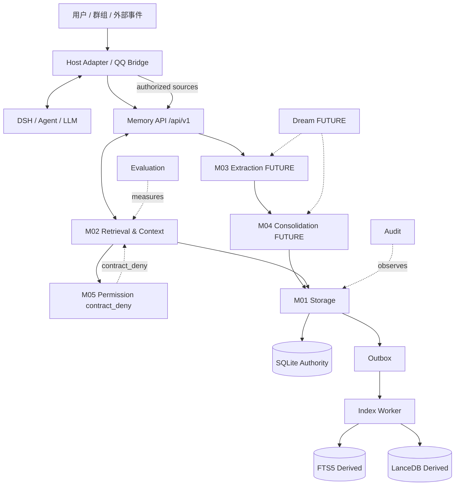

## D-02 M01 数据写入流程（算法：事务五步）

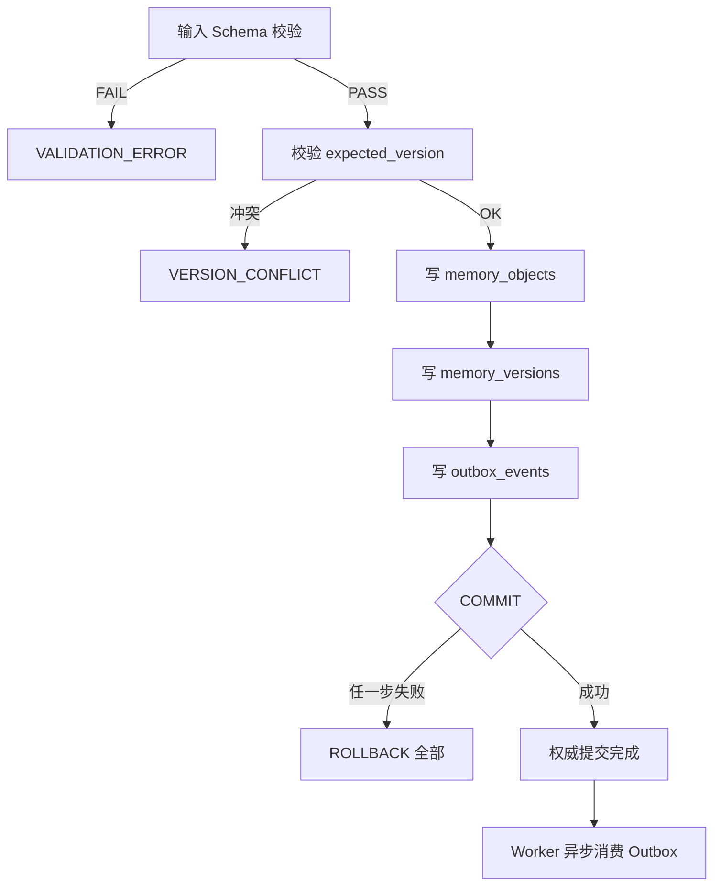

## D-03 M01 事务与 Outbox 一致性

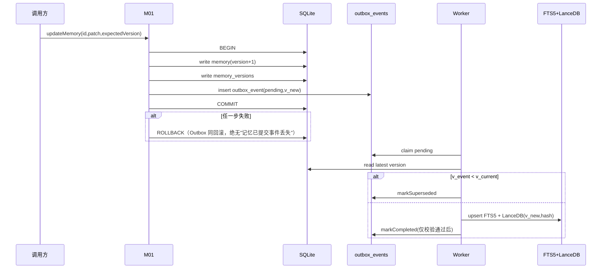

## D-04 Worker 索引同步流程

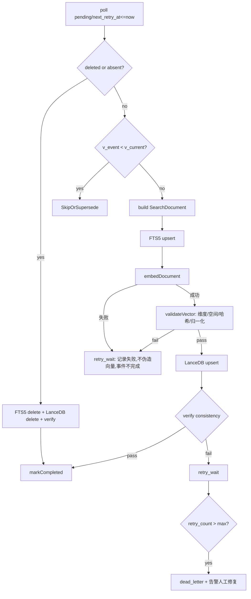

## D-05 M02 多路检索流程

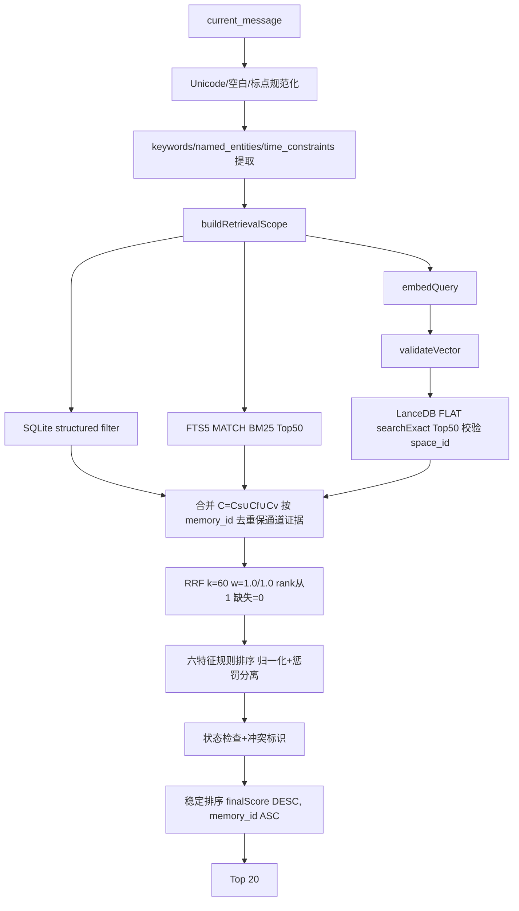

## D-06 M02 权限终检流程

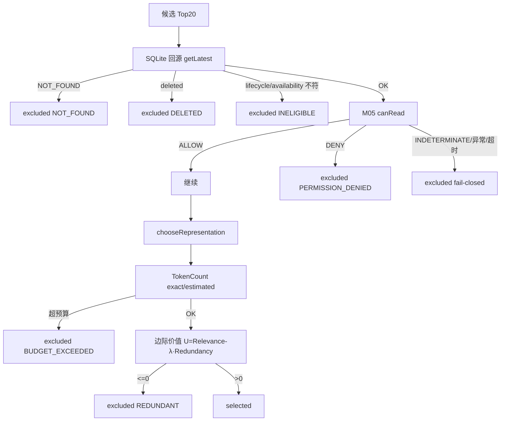

## D-07 M02 Context Builder 流程

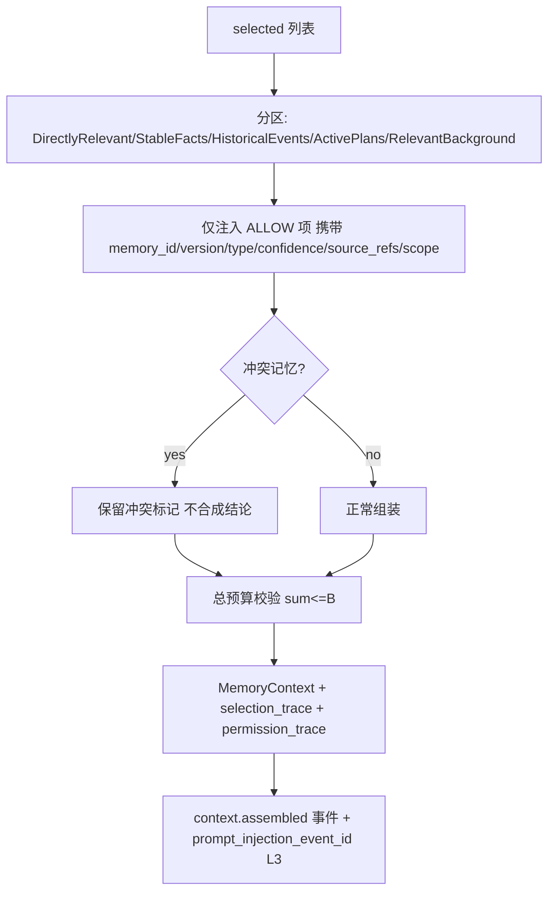

## D-08 M03 候选生成流程（FUTURE）

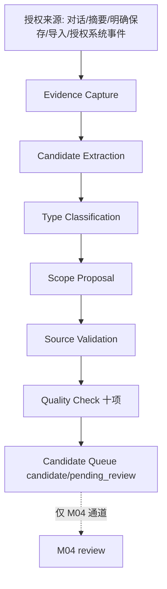

## D-09 M04 合并与冲突处理流程（FUTURE）

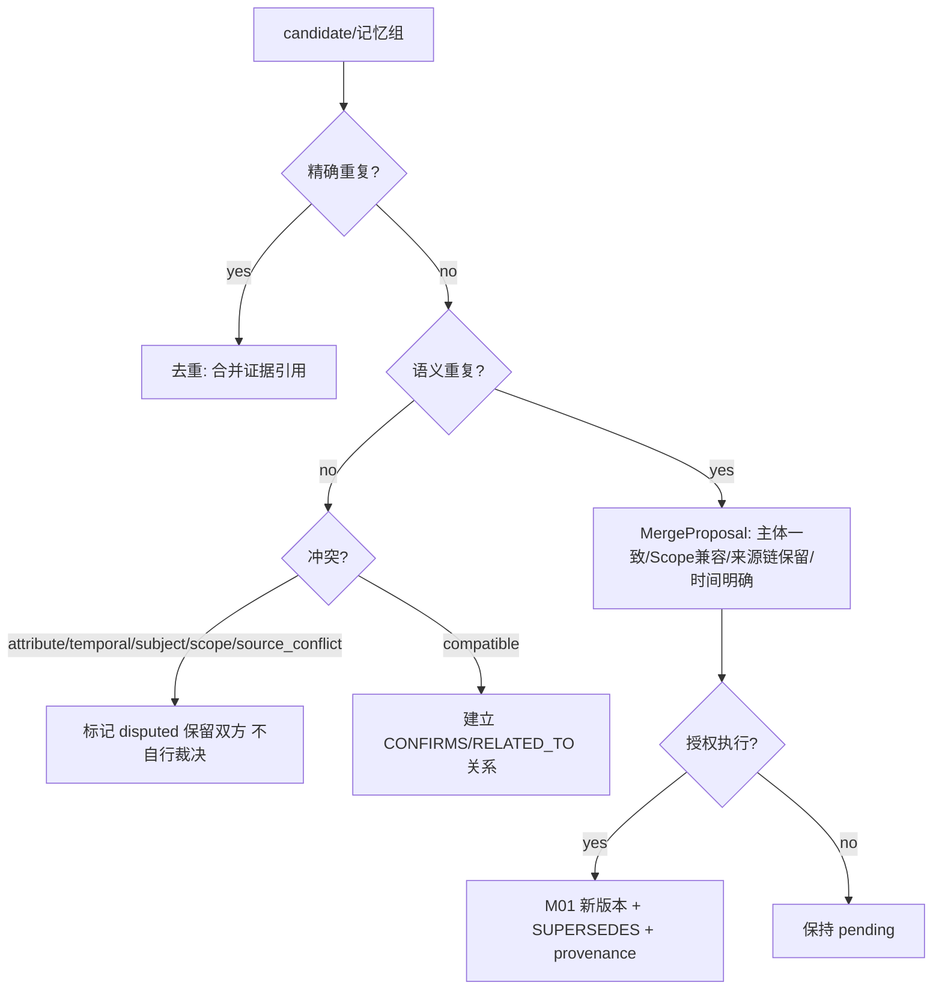

## D-10 M05 权限判断流程（契约期恒 DENY）

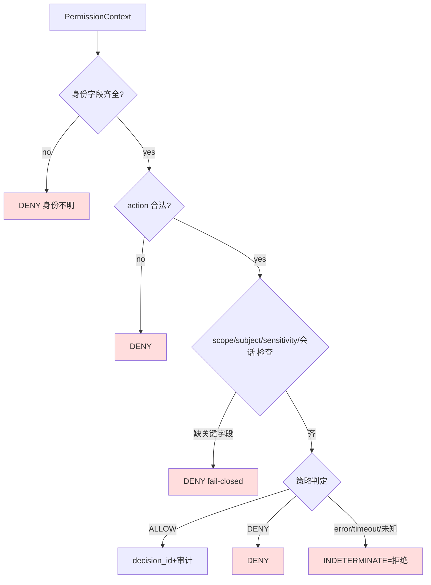

## D-11 Dream 维护流程（FUTURE）

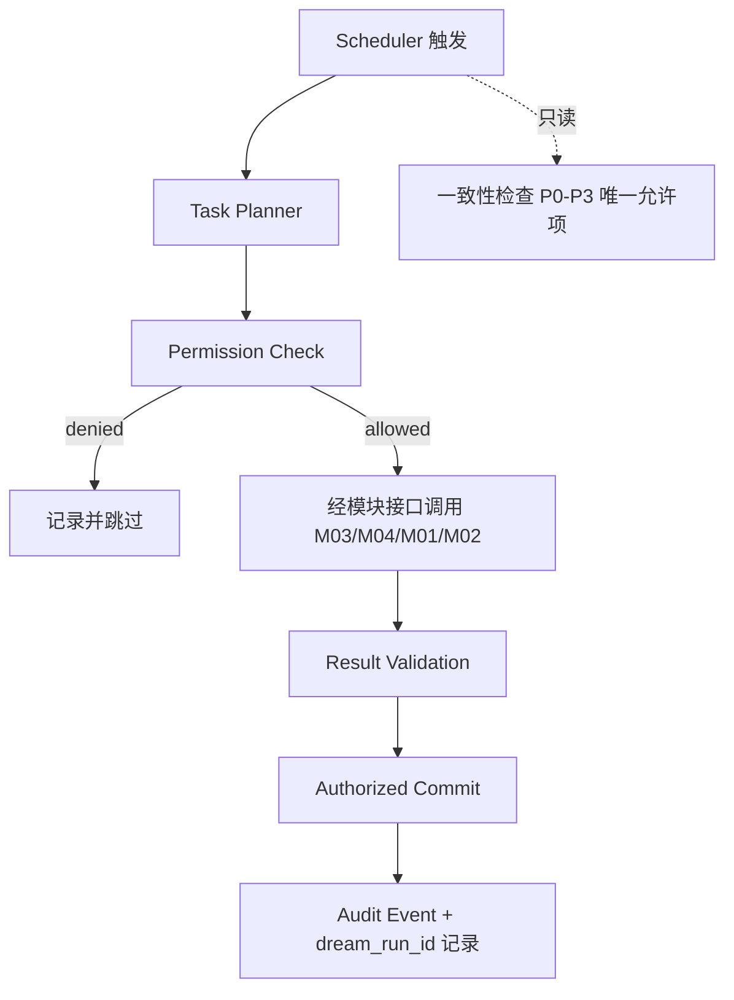

## D-12 数据删除传播流程

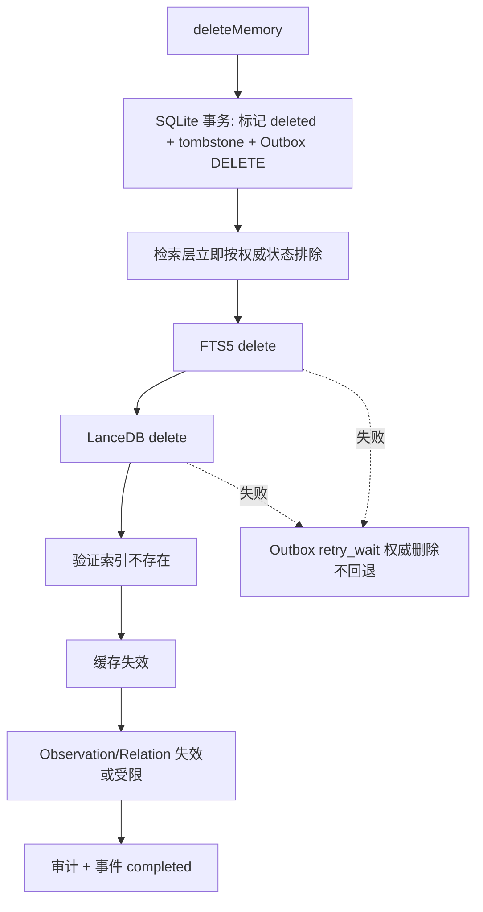

## D-13 SQLite 与索引恢复流程

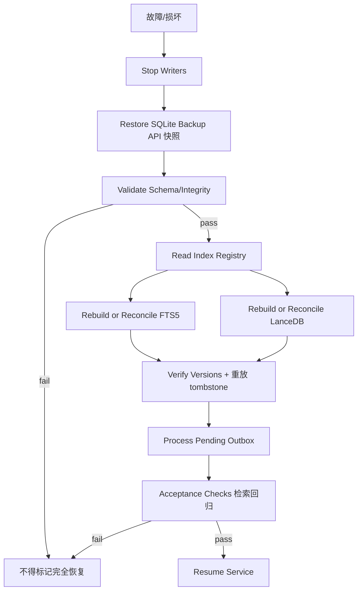

## D-14 Embedding 模型迁移流程（B-011）

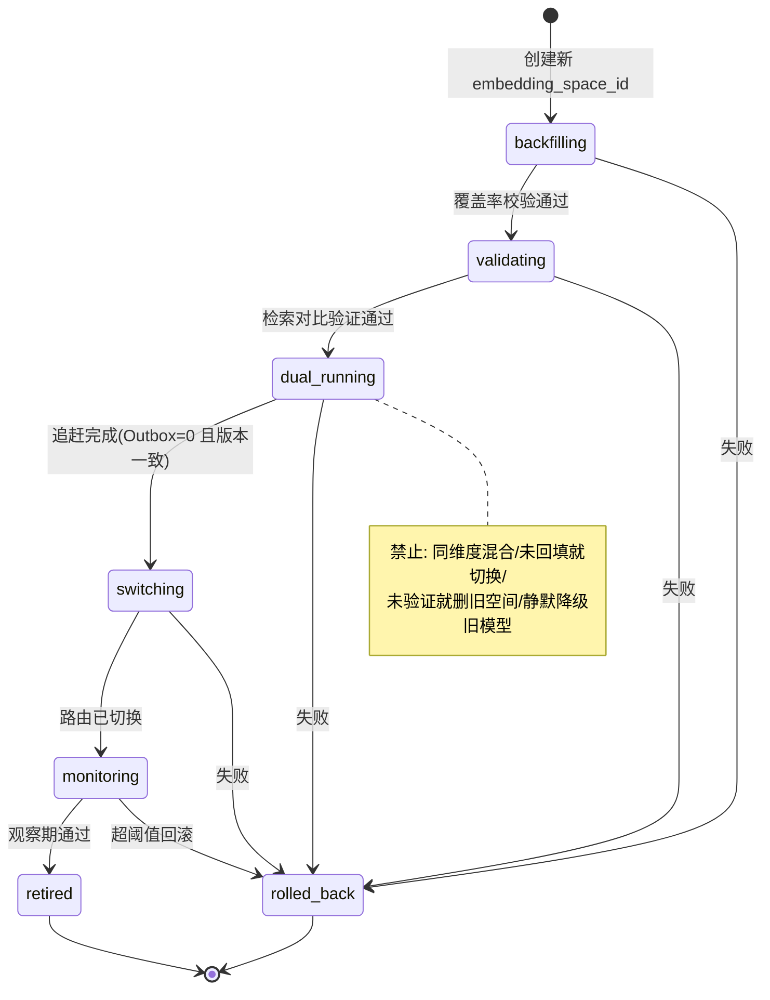

## D-15 DSH Context Adapter 调用时序图

```mermaid
sequenceDiagram
    participant U as 用户消息
    participant HB as QQ Bridge(Host Adapter)
    participant DSH as DSH/LLM
    participant API as Memory API
    participant M02 as M02
    participant M05 as M05(contract_deny)
    participant M01 as M01/SQLite
    U->>HB: 消息
    HB->>HB: 解析身份 user/group/session/bot/tenant
    HB->>API: POST /memories/recall (retrieval-request)
    API->>M02: retrieve+rank+buildContext
    M02->>M01: 回源 getLatest
    M02->>M05: canRead 逐条
    M05-->>M02: contract_deny=false时按策略; 恒不 allow-all
    M02-->>API: MemoryContext(授权上下文+trace)
    API-->>HB: 响应(八字段)
    HB->>DSH: 注入上下文(携带 memory_id/version/type/confidence/source_refs/scope)
    DSH-->>HB: 回复
    HB->>API: POST /memories/retain(授权来源候选)
    API-->>HB: task_id / candidate_ids
    HB->>API: context.assembled → prompt_injection_event_id (L3 仅证明进入 Prompt)
```
