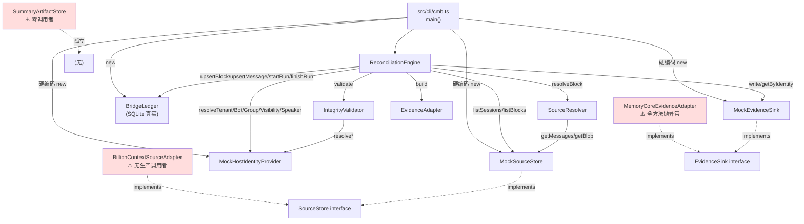

# CMB v0.1 全量源码审查（01-CMB-SOURCE-AUDIT）
> 📋 **独立复核结果**：`01a-CMB-SOURCE-AUDIT-CROSSCHECK.md`（Agent A，源码覆盖 100%）
> 主张准确率 **85%（44/52）**，发现主代理 **6 条错误 / 8 条不精确 / 10 条补充**。
> 重要更正：
> - **R-A5（counts.skipped 语义重叠）判定错误** —— 两者量纲不同（块 vs 消息），实为 MINOR 可读性问题，非 MAJOR 缺陷
> - **R-A7（HostIdentity.level 丢失）理解偏差** —— `HostIdentity` 类型从未被实例化，不是"字段丢失"
> - 遗漏：N-5 `isSubset` O(n×m)、N-10 SHA256 同步阻塞、P-3 `user_version` 检查
> 详见 `evidence/LEAD-SELF-CORRECTIONS.md` 第二批更正。

> ⚠️ **本文已有后续更正（2026-11-06，Agent G 交叉审查 + 主代理复核）**
> 本文部分结论已被 `evidence/LEAD-CROSS-VERIFICATION-LOG-3.md` 与 `19-ADVERSARIAL-REVIEW.md §4` 推翻或细化，
> 尤其是：
> - 「COMMITTED 被幂等跳过 = 设计意图」→ 实际 payload 变化时会 `STATE_RESET_FAIL` 永久锁死（LOG-3 §2，BLOCKER）
> - 「payload 变（covered_hash 变）→ 新 key」→ 只覆盖安全的一半，漏掉致死的另一半
> **请以 LOG-3/LOG-4 与 19 号的稳定编号 D-01…D-16 为准。**

采集：2026-11-06 ｜ 执行：主代理直接阅读（Agent A 未产出，主代理接管）
范围：`E:\[PROJECT]\CMB-v0.1-prototype\src` 全部 16 个 TS 文件，2,014 行

---

## 1. 模块完整性（M01–M12）

| 模块 | 文件 | 行数 | 主要导出 | 实际调用者 | 未实现能力 |
|---|---|---|---|---|---|
| **M01** Domain Model | `src/core/domain.ts` | 163 | `SourceSession`、`SourceMessage`、`CompressionBlock`、`EvidenceDTO`、`BridgeStatus`、`ALLOWED_TRANSITIONS`、`ValidatorErrorCode` | 几乎所有模块 | 无（纯类型） |
| **M01b** Errors | `src/core/errors.ts` | 39 | `CmbError`、`BridgeStateError`、`transition()`、`locatorOf()` | engine、adapters、ledger | `locatorOf` 未被任何模块使用（死代码） |
| **M02** SourceStore 接口 | `src/source/source-store.ts` | 35 | `SourceStore` interface | `bc-source`、`mock-source` | — |
| **M02a** Mock 实现 | `src/adapters/mock-source.ts` | 79 | `MockSourceStore`、`MockFixture` | CLI、全部测试 | `getBlockHistory` 恒返回 `[]`（不编造，但也不可用） |
| **M02b** 真实适配器 | `src/adapters/bc-source.ts` | 203 | `BillionContextSourceAdapter` | **无生产调用者**（CLI 不装配它） | `getBlockHistory`/`getSupersededBlocks` 抛 UNSUPPORTED；`session_type` 硬编码 `"unknown"` |
| **M03** Source Resolver | `src/engine/source-resolver.ts` | 153 | `SourceResolver`、`resolveBlock()` | engine | 无全局面重去重；区间恢复为启发式 |
| **M04** Integrity Validator | `src/engine/integrity-validator.ts` | 83 | `IntegrityValidator`、`validate()` | engine | 身份解析重复调用（engine 已解析过） |
| **M05** Evidence Adapter | `src/evidence/evidence-adapter.ts` | 72 | `EvidenceAdapter`、`EvidenceDTO` 构造、`SOURCE_TYPE_FUTURE_MAP` | engine | 不写 `scope`/`recorded_at`（schema 要求） |
| **M06** Evidence Sink | `src/evidence/evidence-sink.ts` | 99 | `EvidenceSink` interface、`MockEvidenceSink`、`MemoryCoreEvidenceAdapter` | engine | `MemoryCoreEvidenceAdapter` 全方法抛 `SINK_UNSUPPORTED` |
| **M07** Bridge Ledger | `src/ledger/bridge-ledger.ts` | 258 | `BridgeLedger`、`blockBridgeKey`、`LedgerKeys` | engine、CLI | 无 run 列表 API、无清理/归档 |
| **M08** Reconciliation Engine | `src/engine/reconciliation-engine.ts` | 357 | `ReconciliationEngine`、`run()` | CLI | `batch_size`/`concurrency`/`retry` 均未接线 |
| **M09** Summary Artifact | `src/summary/summary-artifact.ts` | 89 | `SummaryArtifactStore`、`summaryHash` | **无任何调用者**（孤立模块） | 完全未接入引擎 |
| **M10** Host Identity | `src/identity/host-identity.ts` | 124 | `HostIdentityProvider`、`MockHostIdentityProvider`、`DeploymentConstantIdentityProvider` | engine、测试 | `HostIdentity.level` 未进 EvidenceDTO |
| **M11** Observability | `src/observability/observability.ts` | 86 | `StructuredLogger`、`ReconciliationReport`、`reportToHuman` | engine、CLI | `events[]` 无上限；`toJsonl` 无落盘 |
| **M12** Configuration | `src/config/config.ts` | 114 | `CmbConfig`、`DEFAULT_CONFIG`、`validateConfig` | engine、CLI | 无 `--config` 文件加载；`retry` 等字段未生效 |

### 关键观察

**1. M09 Summary Artifact 是孤岛**
`grep SummaryArtifactStore` 全项目仅命中定义处。任务书 W 节要求"Evidence 与 Summary 完全分离"——现状是**分离到互不相干**：Summary 既未从 block 读取，也未写入任何地方。ADR 中声称的"六不原则"因无实现而无法验证。

**2. M02b 真实适配器在正式入口不可达**
`src/cli/cmb.ts:45` 硬编码 `new MockSourceStore(fixture)`。`BillionContextSourceAdapter` 只能被代码直接 import 使用，CLI 无法选择。任务书 §14 要求"CLI 能否明确选择 Adapter" → **否**。

**3. M06 真实 Sink 是空壳**
`MemoryCoreEvidenceAdapter` 的 5 个方法全部立即抛 `CmbError("SINK_UNSUPPORTED")`。这是**有意的诚实设计**（不假装可用），但也意味着零真实写入能力。

---

## 2. 完整调用链



**图例**：实线 = 实际执行路径；虚线 = 仅接口实现关系；红色 = 不可达/空壳/孤岛。

### 断言
- **可执行路径**：仅 Mock 一条。`CLI → MockSourceStore → Engine → MockSink + 真实 Ledger`。
- **接口存在但功能未接通**：`BillionContextSourceAdapter`（真实数据源）、`MemoryCoreEvidenceAdapter`（真实记忆库）。
- **完全孤立**：`SummaryArtifactStore`。

---

## 3. 关键实现风险（主代理实测）

### R-A1（BLOCKER）：`source_locator.split(":")` 解析脆弱

**位置**：`src/engine/reconciliation-engine.ts:258-262`

```ts
source_message_key: LedgerKeys.messageKey(ev.source_locator.split(":")[0], ev.source_id),
session_id: ev.source_locator.split(":")[0],
ledger_seq: Number(ev.source_locator.split(":")[1]),
```

**实测**：`session_id = "group:123456"`（QQ Bridge 的 convKey 格式 `bridge.js:1220`）时：
```
ledger 写入：session_id="group"  ledger_seq=123456   （应为 "group:123456" / 0）
listMessagesBySession("group:123456") → 0 行
revokeScan → revoked=0（撤销完全失效）
```

**等级**：BLOCKER（详见 `evidence/LEAD-CROSS-VERIFICATION-LOG.md` L-3）

### R-A2（MAJOR）：M-2 未修复 —— 部分覆盖判 COMMITTED

**位置**：`reconciliation-engine.ts:224-226`

```ts
const declaredCount = block.direct_message_ids?.length ?? block.effective_message_ids?.length ?? 0;
```

**实测**：direct=[m1]（子集）、effective=[m1,m2,m3]（m2/m3 已 tombstone）→ `missing=0`、块 `COMMITTED`，实际 2/3 覆盖丢失。
应改 `Math.max(direct?.length ?? 0, effective?.length ?? 0)`，且 `missing>0 && validated>0` 应落 `PARTIAL`。

### R-A3（MAJOR）：UNSUPPORTED 状态永久卡死

**位置**：`reconciliation-engine.ts:130`

复位条件排除了 FAILED/MISSING/CORRUPTED，但**未排除 UNSUPPORTED**。
而 `domain.ts:166` 定义 `UNSUPPORTED: ["DISCOVERED"]` —— 不含 FAILED。
→ `transition(UNSUPPORTED, "FAILED")` 抛错 → catch → `STATE_RESET_FAIL` → 块永久停在 UNSUPPORTED。

**实测**：RUN1 unsupported=1 → RUN2 failed=1 status=UNSUPPORTED → RUN3 同样。永不恢复。

### R-A4（MAJOR）：`evidence_id` 撞键

**位置**：`evidence-adapter.ts`（`evidence_id = ${session_id}:${ledger_seq}`）

**实测**：同一 `session_id` 重建后 seq 从 0 开始，两条不同消息产生**相同 evidence_id** `SESS-fi-private:0`，sink 中出现两条同 id Evidence。

### R-A5（MAJOR）：`counts.evidence_written` 与 `counts.skipped` 语义重叠

`reconciliation-engine.ts:283` `counts.skipped += duplicates`。
但 `skipped` 在 `:113` 也用于「COMMITTED 幂等跳过」的块计数。
→ 同一字段承载两种语义（跳过的块数 vs 重复的消息数），报告读者无法区分。

### R-A6（MINOR）：`locatorOf()` 死代码

`src/core/errors.ts` 导出 `locatorOf()`，全项目零调用。

### R-A7（MINOR）：`HostIdentity.level` 丢失

`host-identity.ts` 定义 `level: "DEPLOYMENT_CONSTANT" | "VERIFIED_RUNTIME"`，
但 `EvidenceDTO` 无此字段 → 部署常量注入的 tenant/bot 与真实查询的 tenant/bot 在证据中**无法区分**。

### R-A8（MINOR）：身份解析重复

`engine.ts:178-183` 解析 tenant/bot/group/visibility，
`validator.ts:53-57` 又解析一遍（每条消息都调 4 次 provider）。
真实宿主下是 4N 次 RPC。

### R-A9（MINOR）：日志 `events[]` 无上限

`observability.ts:18` `private events: LogEvent[] = []`，长跑内存单调增长。

---

## 4. 源码与文档差异

| 文档位置 | 文档说法 | 代码实际 | 判定 |
|---|---|---|---|
| `README.md` | "M01–M12 全模块" | M09 无线程接入、M02b/M06 不可达 | **夸大** |
| `ARCHITECTURE.md` | 七步流全部实现 | Step 6 "Verify" 只是 `getByIdentity` 非空检查 | **弱化** |
| `ADR-003` | 三层幂等键 | 三层键存在但 Evidence 层会撞键（R-A4） | **失效** |
| `ADR-005` | "缺失即拒绝" | M-2 缺陷下缺失被静默吸收（R-A2） | **部分失效** |
| `ADR-006` | "Mock/真实边界清晰" | 清晰，但真实端零可用能力 | 属实 |
| `PHASE6-CHANGES.md` | M-2 列为"裁决不修" | 风险登记未充分反映数据完整性后果 | **记录不足** |
| `cli/cmb.ts` 头注释 | 例子 `--config` | 已被主代理修正为真实可用参数 | 已修正 |
| `TEST-REPORT.md` | 78 条含崩溃恢复 | 全部 `:memory:` ledger，跨进程未验证 | **高估** |
| `ARCHITECTURE.md` | "batch_size/concurrency 可配" | 引擎未读取这两个字段 | **未实现** |

---

## 5. 结论

| 项 | 判定 |
|---|---|
| 模块骨架完整性 | **PASS_WITH_LIMITATION**（12 模块均有文件，但 3 个不可达/孤立） |
| 核心数据流可运行 | **PASS**（Mock 链路 78 测试验证） |
| 真实数据源可达 | **UNVERIFIED**（适配器存在，CLI 不装配，从未读过真实库） |
| 真实 Sink 可达 | **UPSTREAM_CHANGE_REQUIRED**（Memory Core 无实现，schema 冲突） |
| 代码与文档一致性 | **FAIL**（9 处差异，含 3 处夸大） |
| 新发现的 BLOCKER | **1 个**（R-A1 locator 解析） |
| 新发现的 MAJOR | **4 个**（R-A2/A3/A4/A5） |
