# CMB v0.1 完整数据流（02-CMB-DATAFLOW）

> ⚠️ **本文已有后续更正（2026-11-06，Agent G 交叉审查 + 主代理复核）**
> 本文部分结论已被 `evidence/LEAD-CROSS-VERIFICATION-LOG-3.md` 与 `19-ADVERSARIAL-REVIEW.md §4` 推翻或细化，
> 尤其是：
> - 「COMMITTED 被幂等跳过 = 设计意图」→ 实际 payload 变化时会 `STATE_RESET_FAIL` 永久锁死（LOG-3 §2，BLOCKER）
> - 「payload 变（covered_hash 变）→ 新 key」→ 只覆盖安全的一半，漏掉致死的另一半
> **请以 LOG-3/LOG-4 与 19 号的稳定编号 D-01…D-16 为准。**

采集：2026-11-06 ｜ 执行：主代理直接追踪代码
方法：从 `src/cli/cmb.ts` 入口逐步跟到 `EvidenceSink`，每步核对实际代码而非文档描述

---

## 1. 主流程图

```mermaid
flowchart TD
    Start["CLI: node src/cli/cmb.ts demo"] --> ParseArgs["parseArgs()<br/>cmb.ts:22-32"]
    ParseArgs --> Cfg["cfg = {...DEFAULT_CONFIG, mode}<br/>cmb.ts:38"]
    Cfg --> Validate["validateConfig(cfg)<br/>config.ts:validateConfig"]
    Validate -->|"非法"| Fatal1["抛 CmbError<br/>进程退出 2"]
    Validate -->|"ok"| Assemble["装配组件<br/>cmb.ts:44-55"]
    Assemble --> Fix1["buildDemoFixture()<br/>tests/fixtures/demo-fixture.ts"]
    Fix1 --> Assemble

    Assemble --> Engine["new ReconciliationEngine(...)<br/>构造时再 validateConfig (m-3修复)"]
    Engine --> Run["engine.run()<br/>reconciliation-engine.ts:70"]

    Run --> StartRun["ledger.startRun(runId, now)<br/>:73"]
    StartRun --> ListSessions["store.listSessions()<br/>:66"]
    ListSessions -->|"抛错"| Fatal2["⚠️ 无 try 包裹<br/>run() 整体崩溃<br/>run_ledger 半开"]
    ListSessions --> LoopSession["遍历 session<br/>:88"]

    LoopSession --> ListBlocks["store.listBlocks(session_id)<br/>:90"]
    ListBlocks --> FilterBlk["recoveryOnly / blockId 过滤<br/>:91-101"]

    FilterBlk --> LoopBlock["遍历 block<br/>:103"]
    LoopBlock --> GetLedger["ledger.getBlock(bridge_key)<br/>:107"]
    GetLedger --> IdemSkip{"COMMITTED 且<br/>block_version 未变?"}
    IdemSkip -->|"是"| Skip1["counts.skipped++<br/>continue :112-116"]
    IdemSkip -->|"否"| TermSkip{"REVOKED 或<br/>SUPERSEDED?"}
    TermSkip -->|"是"| Skip2["log + continue<br/>:117-122"]
    TermSkip -->|"否"| Reset["复位到 DISCOVERED<br/>:128-144<br/>⚠️ UNSUPPORTED 会抛错"]

    Reset -->|"复位失败"| ResetFail["STATE_RESET_FAIL<br/>counts.failed++<br/>continue"]
    Reset -->|"ok"| Try1["try {<br/>:146"]

    Try1 --> Resolving["transition→RESOLVING<br/>:148"]
    Resolving --> Resolve["resolver.resolveBlock()<br/>:149"]
    Resolve --> CheckUnsup{"outcome.status<br/>== UNSUPPORTED?"}
    CheckUnsup -->|"是"| Unsup["transition→UNSUPPORTED<br/>counts.unsupported++<br/>continue :156-161"]
    CheckUnsup -->|"否"| Validating["transition→VALIDATING<br/>:164"]

    Validating --> ResolveIdent["identity.resolveTenant/Bot/Group/Visibility<br/>:177-183"]
    ResolveIdent -->|"抛错"| IdentFail["IDENTITY_MISSING<br/>missing = messages.length<br/>:184-189"]
    ResolveIdent -->|"ok"| LoopMsg["遍历 resolved message<br/>:191"]

    LoopMsg --> GetBlob["store.getBlob(content_hash)<br/>:195"]
    GetBlob --> ValidateMsg["validator.validate(session, m, blobText)<br/>:196"]
    ValidateMsg -->|"!ok"| ValFail["记 failure_reasons<br/>corrupted++ / missing++<br/>continue :197-210"]
    ValidateMsg -->|"ok"| ResolveSpeaker["identity.resolveSpeaker<br/>:212"]
    ResolveSpeaker --> BuildEv["adapter.build({message, identity,<br/>produced_by_run, produced_by_blocks})<br/>:213-220"]

    BuildEv --> CountMissing["declaredCount = direct ?? effective<br/>⚠️ M-2 缺陷 :224-226"]
    CountMissing --> HasValid{"validated.length == 0?"}
    HasValid -->|"是"| FinalBad["CORRUPTED / MISSING / FAILED<br/>:228-236"]
    HasValid -->|"否"| Ready["transition→READY<br/>:239"]

    Ready --> LoopWrite["遍历 validated<br/>:244"]
    LoopWrite --> SinkWrite["sink.write(ev)<br/>:246"]
    SinkWrite -->|"duplicate"| Dup["duplicates++<br/>counts.duplicate_hits++"]
    SinkWrite -->|"new"| NewWrite["written++<br/>（暂不计 evidence_written）"]
    Dup --> Verify["sink.getByIdentity()<br/>:254"]
    NewWrite --> Verify
    Verify -->|"null"| VerifyFail["throw VERIFY_FAIL<br/>→ catch"]
    Verify --> UpsertMsg["ledger.upsertMessage(...)<br/>:257-267<br/>⚠️ locator.split(':') 缺陷"]
    UpsertMsg --> Count["if(!duplicate) counts.evidence_written++<br/>:270-272<br/>(m-5修复：成功后计数)"]
    Count -->|"任一步抛错"| WriteFail["writeFailures++<br/>failure_reasons[code]<br/>:273-278"]

    WriteFail --> AfterLoop["判断块终态<br/>:281-292"]
    Count --> AfterLoop
    AfterLoop --> Persist["persistBlockRow(...)<br/>:292-296"]
    Persist --> LoopBlock

    LoopBlock -->|"块遍历结束"| RevokeScan{"opts.revokeScan?"}
    RevokeScan -->|"是"| DoRevoke["revokeScan(targetSessions)<br/>:307-309"]
    RevokeScan -->|"否"| Finish
    DoRevoke --> Finish["ledger.finishRun(...)<br/>:296-307"]
    Finish --> Report["返回 ReconciliationReport"]

    style Fatal2 fill:#f99
    style ResetFail fill:#fcc
    style CountMissing fill:#fcc
    style UpsertMsg fill:#f99
    style Skip1 fill:#cfc
    style Skip2 fill:#cfc
```

---

## 2. 逐步分析表

| 步骤 | 实际读取 | 实际生成 | 副作用 | 失败处理 | 可重试 | 可能重复 | 可能静默跳过 |
|---|---|---|---|---|---|---|---|
| **S1 配置校验** | `DEFAULT_CONFIG` + CLI args | `CmbConfig` | 无 | 抛 `CmbError`，进程退出 | 是（改配置重跑） | 否 | 否 |
| **S2 装配** | fixture / provider / sink / ledger 路径 | 组件实例 | `mkdirSync("data/test-only")` | 无 try | — | 否 | 否 |
| **S3 引擎构造** | `cfg` | `ReconciliationEngine` | 无 | `validateConfig` 抛错 | 是 | 否 | 否 |
| **S4 startRun** | — | `run_ledger` 一行（`end_time=NULL`） | **写 ledger** | 无 | — | 否（runId 为 uuid） | 否 |
| **S5 listSessions** | 源库 sessions 表 / fixture | `SourceSession[]` | 无（只读） | **❌ 无 try，异常击穿 run()** | 是 | 否 | 否 |
| **S6 listBlocks** | 源库 blocks 表 | `CompressionBlock[]` | 无 | 无 try（在外层 try 之前）| 是 | 否 | 否 |
| **S7 getBlock(ledger)** | ledger 库 | `BlockLedgerRow \| null` | 无 | 无 | — | 否 | 否 |
| **S8 幂等跳过** | 内存比较 | `counts.skipped++` | **无**（不写 ledger） | — | — | 否 | **是**：若 `block_version` 因任何原因恒等，块永不重扫 |
| **S9 终态跳过** | 内存比较 | log | 无 | — | — | — | **是（设计意图）**：REVOKED/SUPERSEDED 永不再处理 |
| **S10 复位** | 内存状态 | 新 status | 无 | `STATE_RESET_FAIL` + `counts.failed++` | 下一轮 | 否 | **是**：UNSUPPORTED 永久卡死（R-A3） |
| **S11 resolveBlock** | `store.listBlocks`（再查一次！）+ `getMessages` | `ResolveOutcome` | 无 | 无 try（在外层） | 是 | 否 | **是**：reasoning 被过滤；无 direct/effective 时返回 UNSUPPORTED |
| **S12 身份解析** | provider | identity 对象 | 无 | catch → `missing = messages.length` | 下一轮 | 否 | **是**：整个块判 MISSING |
| **S13 blob 读取** | `store.getBlob` | `string \| null` | 无 | 无 | 是 | 否 | **是**：blob 缺失 → `original_text=null` → CONTENT_MISSING |
| **S14 校验** | 消息 + blob | `ValidationResult` | 无 | 记诊断，`continue` | 下一轮 | 否 | **是**：单条失败被跳过，块可能仍 COMMITTED |
| **S15 Evidence 构造** | 消息 + identity | `EvidenceDTO` | 无 | 抛错 → 上层 catch | — | 否 | 否 |
| **S16 declaredCount** | block payload | `missing` 增量 | 无 | — | — | — | **是**：M-2 缺陷导致漏计（R-A2） |
| **S17 sink.write** | — | sink 内一条 | **写 sink** | catch → `writeFailures++` | **是**（幂等键） | **是**（若键不稳） | 否 |
| **S18 verify** | sink 回查 | 断言非 null | 无 | throw → catch | 是 | 否 | 否 |
| **S19 upsertMessage** | — | `message_ledger` 一行 | **写 ledger** | catch → `writeFailures++` | 是 | 否 | **是**：locator 解析错 → 写到错误位置（R-A1） |
| **S20 persistBlockRow** | 内存 + ledger | `block_ledger` upsert | **写 ledger** | 内层 catch → `LEDGER_PERSIST_FAIL` | 下一轮 | 否 | 否 |
| **S21 revokeScan** | `listMessagesBySession` + `getMessage` | `counts.revoked` | 写 sink（revoke）+ ledger | 无 try | 下一轮 | 否 | **是**：locator 错误下完全失效（R-A1） |
| **S22 finishRun** | — | `run_ledger` 更新 | **写 ledger** | 无 try | — | 否 | 否 |

---

## 3. 三个致命的结构性问题

### P-1：`run()` 不是原子的，也没有外层保护

`listSessions()`（S5）、`listBlocks()`（S6）都在 `try` **之外**。
若源库查询抛错（SQLITE_BUSY、文件损坏、权限问题），`run()` 直接 reject：
- 不返回 `ReconciliationReport`
- `run_ledger` 行 `end_time` 永久为 NULL（半开）
- CLI `main().catch` → `process.exit(2)`，用户只看到 "FATAL"

这是 B-1 修复未覆盖的同类问题域。

### P-2：每个块都会重复查询 `listBlocks`

`SourceResolver.resolveBlock()` 第一行就是 `await this.store.listBlocks(sessionId)`（`source-resolver.ts:49`），而引擎在 `:90` 已经查过一次。
→ **每个块多一次全表查询**。在 Large 基准（1000 会话 × ~21 块）下，这是显著的 N×M 放大。

实测印证：Medium 基准 avg_block_ms=64ms，Large=133ms，而非线性增长部分主因在此。

### P-3：`evidence_written` 的最终语义

经过 m-5 修复后，`counts.evidence_written++` 只在 write+verify+ledger 全成功后执行（`:270-272`）。
但 `written` 变量在 `:251` 就已经 `++`，用于块终态判断（`:282`）。
→ 若 ledger 在 verify 之后、计数之前抛错，`written` 已计但 `evidence_written` 未计，块判 `COMMITTED`（因为 writeFailures>0？不——writeFailures 会 ++）。逻辑自洽但复杂，易错。

---

## 4. 数据流的真实边界

| 能力 | 状态 |
|---|---|
| Mock 源 → Evidence | ✅ 完整可运行（78 测试） |
| 真实 index.db → Evidence | ⚠️ 适配器已写，**从未运行**；且 session_type 硬编码 unknown（`bc-source.ts:42`）会导致所有会话判 MISSING |
| Evidence → 真实 Memory Core | ❌ 完全不可用（全方法抛异常） |
| Summary 参与流程 | ❌ 零接入 |
| 崩溃后从 ledger 恢复 | ⚠️ 逻辑存在，但测试全用 `:memory:`（L-7），跨进程未验证 |

---

## 5. 结论

1. **数据流在 Mock 环境下自洽**，22 个步骤的失败路径多数有处理。
2. **但两处结构性缺口**：`run()` 非原子（P-1）、重复查块（P-2）。
3. **三条静默路径**：幂等跳过（S8）、终态跳过（S9）、单条校验失败跳过（S14）—— 都可能让"看起来成功"掩盖"实际遗漏"。
4. **数据流无法触及真实上游**：S5/S6 的 store 永远是 Mock，S17 的 sink 永远是 Mock。
