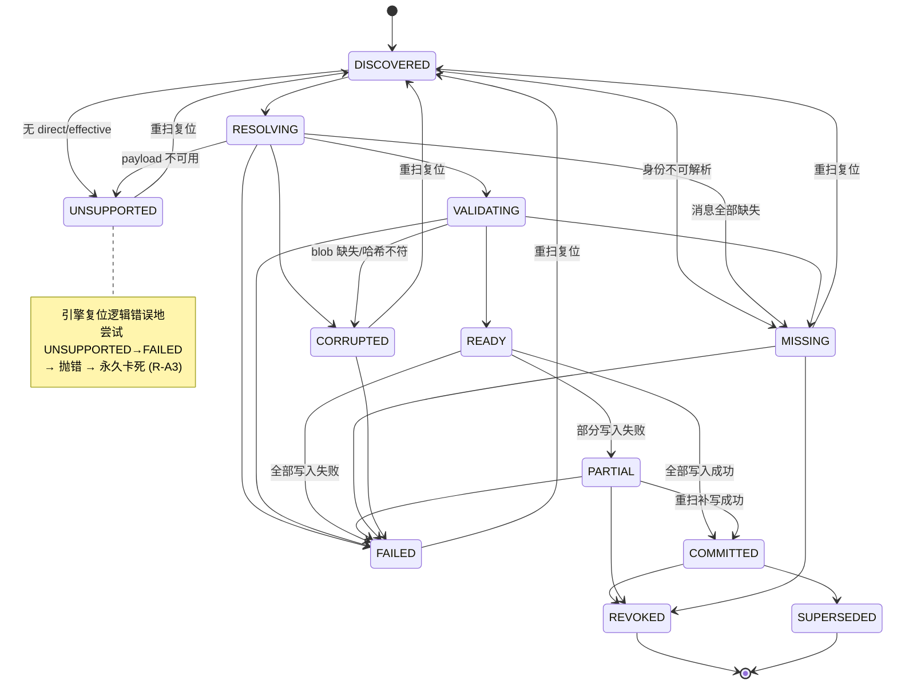
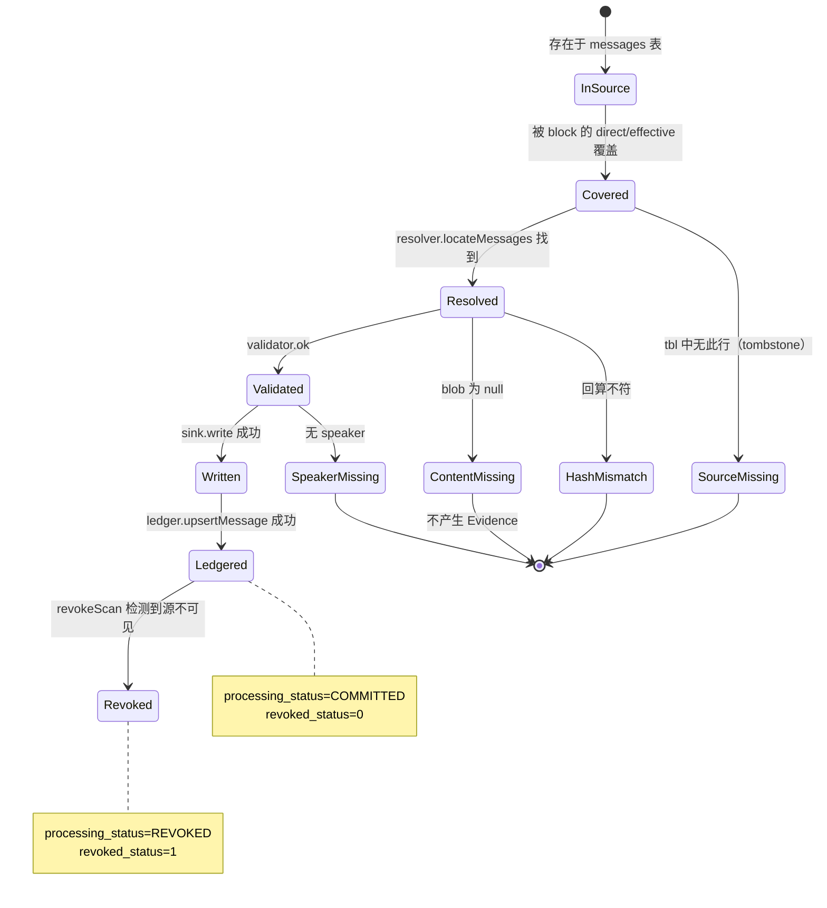
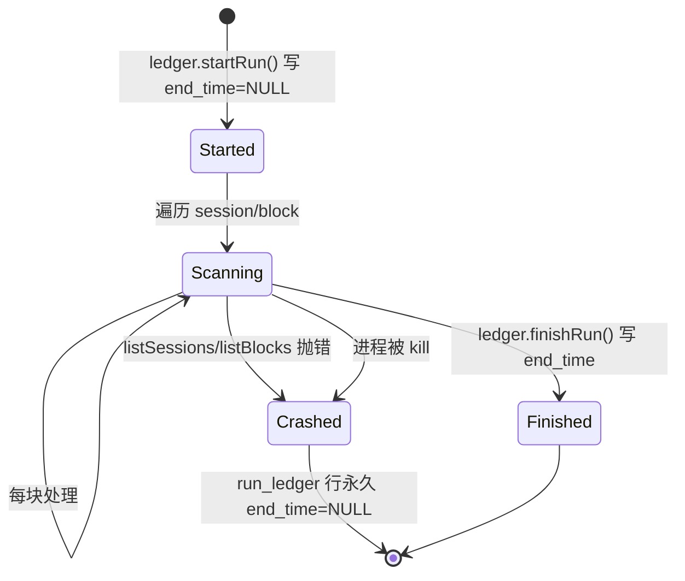

# CMB v0.1 状态机审查（03-CMB-STATE-MACHINES）

> ⚠️ **本文已有后续更正（2026-11-06，Agent G 交叉审查 + 主代理复核）**
> 本文部分结论已被 `evidence/LEAD-CROSS-VERIFICATION-LOG-3.md` 与 `19-ADVERSARIAL-REVIEW.md §4` 推翻或细化，
> 尤其是：
> - 「COMMITTED 被幂等跳过 = 设计意图」→ 实际 payload 变化时会 `STATE_RESET_FAIL` 永久锁死（LOG-3 §2，BLOCKER）
> - 「payload 变（covered_hash 变）→ 新 key」→ 只覆盖安全的一半，漏掉致死的另一半
> **请以 LOG-3/LOG-4 与 19 号的稳定编号 D-01…D-16 为准。**

采集：2026-11-06 ｜ 执行：主代理直接读取 `src/core/domain.ts:142-170` 与引擎实现，并用探针实测

---

## 1. Block（对账单元）状态机

### 1.1 声明式转移表（`domain.ts:157-170`，权威）

| 状态 | 允许转移至 |
|---|---|
| `DISCOVERED` | RESOLVING, UNSUPPORTED, MISSING |
| `RESOLVING` | VALIDATING, MISSING, CORRUPTED, UNSUPPORTED, FAILED |
| `VALIDATING` | READY, MISSING, CORRUPTED, FAILED |
| `READY` | COMMITTED, PARTIAL, FAILED |
| `COMMITTED` | REVOKED, SUPERSEDED |
| `PARTIAL` | COMMITTED, FAILED, REVOKED |
| `MISSING` | DISCOVERED, FAILED, REVOKED |
| `CORRUPTED` | DISCOVERED, FAILED |
| `UNSUPPORTED` | **DISCOVERED**（仅此一个） |
| `FAILED` | DISCOVERED |
| `REVOKED` | **（终态，无出边）** |
| `SUPERSEDED` | **（终态，无出边）** |

### 1.2 状态图



### 1.3 实测验证：12 状态复位可达性

主代理用探针脚本逐一验证引擎复位逻辑（`reconciliation-engine.ts:128-144`）：

| 状态 | 复位路径 | 结果 |
|---|---|---|
| DISCOVERED | （已是） | ✅ |
| RESOLVING | RESOLVING→FAILED→DISCOVERED | ✅ |
| VALIDATING | VALIDATING→FAILED→DISCOVERED | ✅ |
| READY | READY→FAILED→DISCOVERED | ✅ |
| COMMITTED | 被幂等跳过（不复位） | 设计意图 |
| PARTIAL | PARTIAL→FAILED→DISCOVERED | ✅ |
| MISSING | MISSING→DISCOVERED（直接） | ✅ |
| CORRUPTED | CORRUPTED→DISCOVERED（直接） | ✅ |
| **UNSUPPORTED** | **UNSUPPORTED→FAILED 非法** | **❌ 缺陷** |
| FAILED | FAILED→DISCOVERED | ✅ |
| REVOKED | 终态跳过 | 设计意图 |
| SUPERSEDED | 终态跳过 | 设计意图 |

### 1.4 缺陷详述

**引擎代码**（`:130`）：
```ts
if (status !== "FAILED" && status !== "MISSING" && status !== "CORRUPTED") {
  status = transition(status, "FAILED", ...);
}
status = transition(status, "DISCOVERED", ...);
```

`UNSUPPORTED` 落入了 `if` 分支 → `transition("UNSUPPORTED","FAILED")` → 检查 `ALLOWED_TRANSITIONS.UNSUPPORTED = ["DISCOVERED"]` → **不含 FAILED** → 抛 `BridgeStateError`。

**实测**：
```
RUN1: unsupported=1 failed=0 status=UNSUPPORTED
RUN2: unsupported=0 failed=1 status=UNSUPPORTED   ← STATE_RESET_FAIL
RUN3: unsupported=0 failed=1 status=UNSUPPORTED   ← 永久
```

**影响**：
1. 一次性 `UNSUPPORTED` 判定的块**永不重评**，即使上游后来补全 payload。
2. `counts.unsupported` 在第二轮变 0，`counts.failed` 变 1 —— 统计口径污染。
3. 12 条 Phase6 回归测试未覆盖 UNSUPPORTED（RG-B1 只覆盖 4 种）。

### 1.5 不可达状态

| 状态 | 是否可达 | 说明 |
|---|---|---|
| `REVOKED` | **仅在外部直接写 ledger 时可达** | 引擎无 `transition(→REVOKED)` 调用；`revokeScan` 只改 message_ledger 不改 block_ledger |
| `SUPERSEDED` | **完全不可达** | 引擎无任何写入路径；`supersedes_block_id` 上游恒 null |

→ 两个终态是**死状态**：引擎永不产生，但一旦外部写入就永久跳过（`:118-122`）。

---

## 2. Message 状态机（隐式）

CMB **没有显式 Message 状态机**，状态隐含在 `message_ledger.processing_status` 与 `revoked_status` 的组合中。

### 2.1 实际状态推断



### 2.2 隐式状态表

| 状态 | 存储位置 | 可观察？ | 可恢复？ |
|---|---|---|---|
| 未发现 | （无记录） | 否 | — |
| 已发现/已解析 | （仅内存） | 否 | 每轮重算 |
| 已验证 | （仅内存） | 否 | 每轮重算 |
| 已写 Evidence | `sink`（Mock） | 是 | 幂等键查重 |
| 已入 ledger | `message_ledger.processing_status="COMMITTED"` | 是 | COALESCE 保留 |
| 已撤销 | `message_ledger.revoked_status=1` + `sink.evidence.revoked=true` | 是 | **不可逆**（见 §2.3） |
| 已缺失/tombstone | 无 ledger 行 | 部分（`failure_reasons` 计数） | 每轮重试 |

### 2.3 撤销不可逆问题

`MockEvidenceSink.write()`（`evidence-sink.ts:50-58`）：
```ts
const existing = this.store.get(key);
if (existing) {
  if (existing.original_text !== ev.original_text || existing.revoked !== ev.revoked) {
    throw new CmbError("SINK_CONFLICT", ...);
  }
  return { duplicate: true };
}
```

上游 `retired_at` 可复活（`billion-context store.ts:925` `UPDATE messages SET retired_at=NULL`）。
复活后 CMB 尝试写入 `revoked=false` 的 Evidence，但 sink 里已有 `revoked=true` 的同身份记录
→ `existing.revoked(true) !== ev.revoked(false)` → **抛 SINK_CONFLICT**。

**结果**：消息复活后，CMB **既不能重写也不能 un-revoke**。该块永久 PARTIAL/FAILED。

---

## 3. Run 状态机

### 3.1 实际状态



### 3.2 三个已知缺口

| 缺口 | 证据 | 后果 |
|---|---|---|
| **崩溃留下半开 run 行** | `:73` startRun 后 `:296` finishRun 之间无 finally | `run_ledger` 中 `end_time=NULL` 的行永久存在，无法区分"运行中"与"已崩溃" |
| **`listSessions` 无 try** | `:66` | 源库异常直接击穿 `run()`，无报告 |
| **无取消/超时机制** | 全文件 | 长跑无法中断，只能 kill 进程 |

### 3.3 并发 Run 分析

**结论：不支持并发 Run。**

引擎无任何锁或运行 ID 隔离：
- 两个引擎实例同时扫同一 session 会各自 `upsertBlock`，后者覆盖前者
- `counts.*` 是实例局部变量，互不感知
- `MockEvidenceSink` 的 `writeCount`（用于 partial 故障注入）是实例私有，多实例下故障注入行为不可预测
- `BridgeLedger` 使用 SQLite，多进程写入依赖 WAL，但 `upsertBlock` 的 `ON CONFLICT` 是 last-write-wins，无版本检查

**任务书 §5.4「并发 Run 是否会互相干扰」→ 会，且无检测机制。**

---

## 4. 状态机与上游的同步问题

| 上游事件 | CMB 是否感知 | 如何感知 | 滞后 |
|---|---|---|---|
| 新 block 出现 | 是 | 下一轮 `listBlocks` | 一个扫描周期 |
| block payload 变化（covered_hash 变） | 是 | bridge_key 变 → 新 key → 全新块 | 一个周期 |
| block 被物理删除 | **否** | 旧 ledger 行仍在，永久 COMMITTED | **永不** |
| block 从 active→inactive | 部分 | `block_status` 字段更新，但无状态转移 | 一个周期 |
| 消息 tombstone | 是 | `getMessages` 过滤掉 → SOURCE_MISSING | 一个周期 |
| 消息复活 | **否（会冲突）** | sink SINK_CONFLICT | 永久失败 |
| Blob 被 releaseContent 删除 | 部分 | `getBlob` 返 null → CONTENT_MISSING/CORRUPTED | 一个周期 |
| Session 被删除 | 否 | ledger 行残留 | 永不 |
| 数据库整体重建 | **否** | 全部 bridge_key 重算 → 大量"新块" | 一次性重复 Evidence 风险 |

---

## 5. 结论

| 状态机 | 完整性 | 主要问题 |
|---|---|---|
| **Block** | 10/12 状态可复位 | UNSUPPORTED 永久卡死（R-A3）；REVOKED/SUPERSEDED 死状态 |
| **Message** | 隐式，无显式机 | 撤销不可逆（复活即冲突）；无"已过期"概念 |
| **Run** | 无显式机 | 崩溃留半开行；无并发保护；无超时 |
| **上游同步** | 单向、有滞后 | block 删除/会话删除/库重建**永不可感知** |
