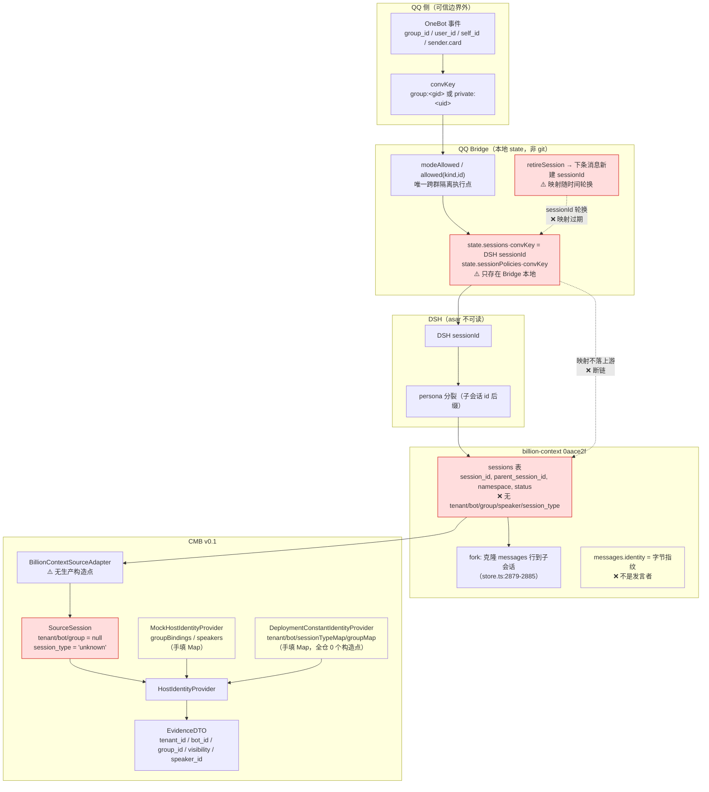

# CMB v0.1 — 宿主身份映射审查（07-HOST-IDENTITY-AUDIT）

采集：2026-11-06 ｜ 执行：Agent E（只读审查，未修改任何项目文件）
审查对象：`E:\[PROJECT]\CMB-v0.1-prototype`（非 git 工作区）
上游事实源：`E:\[PROJECT]\refs\billion-context` @ `0aace2f203b2da9065fd53c63f4be0c0ab03c90f`（VERIFIED，git rev-parse）
宿主链路源：`D:\qq-bridge\src\bridge.js`（**非 git 仓库**，直接读源码 12,482 行）
规范源：`C:\Users\[USER]\Desktop\work\Memory-Core-R4.1-Design`（注意：任务书原路径 `R4.1-memory-bank-input` 不存在，已按实际目录审查）
DSH：`D:\dsh\resources\app.asar.unpacked\dsh` —— **只有 `node_modules` 被解包，DSH 核心代码在 `app.asar`（213,202,918 bytes）内，本审查不可读**；DSH 侧身份语义只能通过 billion-context 的 dsh 车道代码反推（见 §1.4，标注 STATIC_INFERENCE）。

方法：(a) 逐文件静态阅读；(b) 跨仓对照（CMB ↔ billion-context ↔ QQ Bridge ↔ Memory Core 04）；(c) **4 个只写系统 TEMP 的探针文件、20+ 用例**（`%TEMP%\cmb-e-probe\probe1..4.mjs`），输出见各节 `VERIFIED_RUNTIME` 标注。

---

## 0. 一句话结论（先给结论，后给证据）

> **五个身份里只有 `session_id` 是"真实值"，其余四个在 CMB 的真实数据路径上一律不可得**；`tenant_id` / `bot_id` 是部署常量（单值全局常量，非按会话查询），`group_id` / `session_type` 是**手工维护的映射表**（v0.1 无任何构造点），`speaker_id` 在真实适配器里恒为 `null`、在 Provider 里被"来源数据 hint"优先于宿主绑定。因此"字段存在"绝不等于"身份可信"——`EvidenceDTO` 的 5 个身份字段中，**只有 `source_locator`（含 session_id）可追溯到真实宿主事实，其余 4 个是配置写入的信任假设**。

---

## 1. A1 — 五个身份逐一追溯来源

### 1.1 上游 billion-context 有什么（VERIFIED_SOURCE）

`sessions` 表 DDL（`src/storage/schema.ts:108-131`）全部列：

```
session_id, parent_session_id, fork_point_seq, protocol, label, title, host_title,
namespace, origin, status, created_at, updated_at, next_block_id, next_run_id,
meta_json, stats_json, metadata_json, kstate_json, tail_json, ccr_json,
last_ingested_seq, orphans_json
```

- **没有** `tenant_id`、**没有** `bot_id`、**没有** `group_id`、**没有** `speaker_id`、**没有** `session_type`。→ 五标识中 4 个在存储层不存在（VERIFIED_SOURCE）。
- `messages` 表（`schema.ts:141-155`）有 `identity TEXT NOT NULL DEFAULT ''`，但该列语义是**"跨次保存的 JOIN 键（存储字节指纹）"**（`schema.ts:352-353` 注释 + `identityOfStoredContent`），**不是发言者身份**。CMB 没有读它（`bc-source.ts:77-78` 的 SELECT 列表不含 `identity`），这是正确的——但 `bc-source.ts:126` 把 `identityColumn` 标成 `DEGRADED` 容易被误读为"有身份列只是拿不到"，实际是"该列与发言者无关"。
- 唯一近似"租户"的概念：`conversations(namespace, conversation_id, session_id, claimed_at)`（`schema.ts:229-241`，v3 身份索引），`namespace` 列默认值 `'proxy'`（`schema.ts:116`、`store.ts:999`）。**CMB 完全不读 `namespace`**（`bc-source.ts:35` 的 SELECT 列表不含）。这是上游唯一可承载"部署/租户域"的真实字段，被放弃了。
- 唯一近似"会话形态"的概念：`sessions.status`（默认 `'active'`，`schema.ts:118`）与 `protocol`（wire 协议）。二者都不是"群聊/私聊"。
- `Session.meta.label`（`src/session.ts:358-363`）：客户端提供的人类可读会话标签（如 opencode 的 `ses_abc`）。**同一注释明确 "Empty/undefined if the client sent none"**——不能作为身份键（用户可任意构造）。

**结论**：上游**没有任何群/私聊/租户/发言者概念**。CMB 文档中"上游无该概念"的判断成立（`bc-source.ts:39` 注释）；但由此推出的"所以只能由部署常量注入"是**唯一可行解**，而不是"安全解"——下文 §2 说明其后果。

### 1.2 QQ Bridge 有什么（VERIFIED_SOURCE，非 git 仓库）

QQ Bridge 的身份模型只有两件东西：

| 概念 | 代码位置 | 形态 | 说明 |
|---|---|---|---|
| **会话键 convKey** | `bridge.js:1220` | `` `${kind}:${id}` `` = `group:<group_id>` 或 `private:<user_id>` | 全桥唯一的"会话身份"；不是 DSH session_id |
| **每会话的 DSH 会话** | `bridge.js:8461-8545` | `state.sessions[convKey] = sessionId`（`:8535`） | sessionId 由 DSH `api.sessions.create` 返回（`:8512-8513`），**桥自己生成不了** |
| **反向索引** | `bridge.js:8537` | `reverse.set(sessionId, key)` + `state.sessionPolicies[key]`（`:8536`） | 内存态，与 state 文件同步 |
| **发言者 QQ** | `bridge.js:11238, 11251, 11373-11374` | `event.user_id`（OneBot 事件字段） | 网关断言值；`:11641` 亦兼容 `sender_id` / `sender.user_id` |
| **发言者显示名** | `bridge.js:11373, 11409, 11417` | `event.sender?.card \|\| event.sender?.nickname \|\| String(event.user_id)` | **群名片/昵称，用户可自行修改** |
| **机器人自身** | `bridge.js:11222-11223, 11639` | `event.self_id` | 仅用于过滤"自己发的消息"，**不落库为 bot_id** |
| **白名单闸门** | `bridge.js:11199-11204` → `modeAllowed`（`:2666-2673`） | `key === "private:<ownerQQ>"`（closed-agent）或 `allowed(kind,id,cfg)` | 跨群隔离的**真正执行点**在桥，不在 CMB |

关键事实（对 CMB 是致命的）：

1. **convKey ↔ sessionId 的映射只存在于 QQ Bridge 的本地 state，不写进 billion-context**（`bridge.js:8535-8538`；billion-context 侧无任何 convKey/QQ 字段，见 §1.1）。
2. **sessionId 会轮换**：`retireSession`（`bridge.js:2763`）在 DSH 侧会话 not-found、reset、preset 变化时撤销映射，下一条消息 `ensureSession` 会**新建一个不同 sessionId**（`:8524-8544`）。因此 `convKey → sessionId` 是**多对一随时间变化**的映射，历史上同一个群对应过多个 sessionId。
3. **sessionId 会被"分裂"**：billion-context 的 dsh 车道对同一 conversation id 的不同 persona 用 `|sub:<hash>` 后缀分流（`src/session-id.ts:268-270` `dshPersonaFingerprintApplies`，`agent === "dsh"`），即**一个 QQ 会话可以产生多个 billion-context session_id**。
4. 桥没有任何 `tenant_id` / `bot_id` 概念；bot 身份是进程级的单账号（`event.self_id` / `cfg.ownerQQ`）。

### 1.3 CMB 怎么拿到的（VERIFIED_SOURCE）

**唯一入口**：`HostIdentityProvider`（`src/identity/host-identity.ts:23-30`），6 个方法，全部以 `SourceSession` 为入参。

`SourceSession` 由适配器填充（`src/core/domain.ts:41-54`），真实适配器 `BillionContextSourceAdapter` 的填充如下（`src/adapters/bc-source.ts:33-48`）：

| 字段 | 真实适配器取值 | 行号 |
|---|---|---|
| `session_id` | `SELECT session_id` 原样 | `:35, :38` |
| `tenant_id` | **硬编码 `null`** | `:39` |
| `bot_id` | **硬编码 `null`** | `:40` |
| `group_id` | **硬编码 `null`** | `:41` |
| `session_type` | **硬编码 `"unknown"`** | `:42` |
| `parent_session_id` / `fork_point_seq` | 真实读取，但**下游零使用** | `:44-45`（grep 全仓仅此一处赋值） |

消息级（`bc-source.ts:172-217`）：`speaker_id: null`（`:211`）、`visibility: null`（`:213`），`excluded_reason` 仅对 `reasoning`（`:214-215`）。

**因此 CMB 的"身份获取"实质是：`session_id` 来自上游；其余 4 个由 Provider 凭空产生，与上游数据无任何绑定关系。**

### 1.4 DSH 侧（不可读，仅 STATIC_INFERENCE）

- `D:\dsh\resources\app.asar.unpacked\dsh` 下**只有 `node_modules`**（`@deepseek-ai/dsh-session-log-export`、`libreoffice-kit`、`node-pty` 等 1583 个文件），**DSH 自身代码在 `app.asar` 内，本审查不可读**。
- 可反推的事实：billion-context 的 dsh 车道以 `x-bili-plugin-conversation` 头承载 DSH 会话 id（`src/session-id.ts:84` 的 header 名单首位，`:231` "dsh is the first entry"），并按 persona 分裂（`:268-270`）。→ **CMB 看到的 `session_id` 在 dsh 车道上就是 DSH 会话 id（或其 `|sub:` 派生 id）**。
- DSH 是否提供 group/bot/tenant 概念：**UNVERIFIED**（asar 不可读）。但即使提供，`HostIdentityProvider` 也拿不到——它的入参只有 `SourceSession`，而 DSH 的任何身份字段都不在 billion-context 的 `sessions` 表里。

### 1.5 身份映射图



**断点标注**：图中红框之间的虚线就是"身份链断裂处"——QQ 群身份（convKey）与 billion-context `session_id` 之间**没有任何持久化的对应关系**，CMB 侧只能靠人工把 `session_id` 填进 `Map`。这是本审查最重要的结构性发现。

### 1.6 A1 汇总结论表

| 身份 | 上游来源（billion-context） | QQ Bridge 来源 | CMB 获取方式 | 真实查询 / 部署常量 | 可信度 | 可伪造性 | 证据 |
|---|---|---|---|---|---|---|---|
| **tenant_id** | ❌ 无（`sessions` 无该列；仅 `conversations.namespace` 近似，默认 `'proxy'`，CMB 不读） | ❌ 无 | 部署常量（`MockHostIdentityProvider` 的 `dep.tenant` / `DeploymentConstantIdentityProvider` 构造参数） | **部署常量** | **低**：单值全局，无法表达多租户；`SourceSession.tenant_id` 从未被任何代码读取（grep：全仓 0 处 `session.tenant_id`） | 上游无法伪造（不读上游）；但**配置一处写错=全部数据错标**，且无任何交叉校验 | `schema.ts:108-131`；`bc-source.ts:39`；`host-identity.ts:47-49,113-115`；`host-identity.ts:12-21`（`level` 字段仅声明未使用） |
| **bot_id** | ❌ 无 | 部分：`event.self_id` 存在于事件，但**不落库**（仅用于过滤自发消息，`bridge.js:11222-11223`） | 部署常量 | **部署常量** | **低**：单值全局；多个 bot 共存时无法区分 | 同上 | `schema.ts:108-131`；`bc-source.ts:40`；`host-identity.ts:50-52,116-118`；`bridge.js:11639` |
| **group_id** | ❌ 无 | ✅ 有：`event.group_id` → `convKey('group', gid)`；仅存于 Bridge state | 宿主绑定表 `Map<session_id, group_id>`（Mock `groupBindings` / DeploymentConstant `groupMap`） | **部署常量（手填表）** | **中低**：值本身来自真实宿主，但**绑定关系是人填的**，且 `session_id` 会轮换 → 表会过期 | 上游 `group_id` 无法伪造生效（真实适配器恒 null；DeploymentConstant 完全忽略源自称值，`host-identity.ts:119-125`）；**真正的伪造面是"填表的人"** | `bridge.js:1220,11224`；`bc-source.ts:41`；`host-identity.ts:53-68,119-125` |
| **session_id** | ✅ 真实（`sessions.session_id`） | ⚠️ 半：DSH sessionId 由桥创建并映射 convKey，**映射不落上游** | 直接继承上游（`resolveSessionBinding` 返回 `s.session_id`，`host-identity.ts:84-86,136-138`） | **真实查询（唯一一个）** | **中**：值是真实的，但它**不代表 QQ 会话身份**；会轮换、会 persona 分裂；同一 session_id 在同一时间只对应一个上游会话，但历史语义不稳定 | 上游可写任意 session_id（DB 可被任意进程写）；CMB 无签名/无校验；`parent_session_id` 被读取却零使用 → fork 血缘不可见 | `schema.ts:109`；`bc-source.ts:35,38`；`host-identity.ts:84-86`；`bridge.js:8512-8513,8535`；`session-id.ts:268-270` |
| **speaker_id** | ❌ 无（`messages.identity` 是内容指纹，非发言者） | ✅ 有：`event.user_id`（QQ 号，网关断言）+ `sender.card/nickname`（**用户可改**） | ①`resolveSpeaker(session, hint)`，`hint = m.speaker_id`（来源侧声明）；②`hint ?? bound`（`host-identity.ts:71`）→ **hint 优先**；③DeploymentConstant 直接 `return hint`（`:126-129`） | **两者皆非**：真实适配器 `speaker_id` 恒 null → 只得 null；Mock/部署表可给"会话级单一值" | **低**：真实路径恒 null → user/assistant 消息**全部** `SPEAKER_UNRESOLVED` 被拒（实测 P6/P6b）；Mock 路径是**会话级一个值**，群里所有人共用一个 speaker，不是逐条发言者 | **高**：hint 一旦被填充即为"来源自称"，无任何宿主校验；LLM 若能在正文里诱导出 `speaker_id` 字段同样会被采信（见 §2.10） | `schema.ts:141-155`；`bc-source.ts:211`；`host-identity.ts:69-73,126-129`；`validator.ts:67-73`；`engine.ts:212` |

---

## 2. A2 — 威胁建模（10 条，逐条给攻击路径 / 现行防护 / 是否有效 / 残余风险）

> 判据说明："防护是否有效"以**真实数据路径**（`BillionContextSourceAdapter` + 任一 Provider）为准，不以 Mock 夹具测试通过为准。已注明 Mock 与真实路径的差异。

### 2.1 跨群污染：A 群的消息能否进入 B 群的记忆范围？

| 项 | 内容 |
|---|---|
| **攻击路径** | ① 绑定表把 sessionX 填成 B 群（人错）；② `session_id` 轮换后旧表项复活/错配；③ **fork 血缘**：billion-context fork 会把父会话的 `messages` 行**整段复制**到子会话（`store.ts:2879-2885`），子会话若属于 B 群，则 A 群的原文以 B 群身份产出 Evidence；④ 上游/DB 被第三方写入任意 `session_id` + 消息 |
| **现行防护** | CMB 侧：无任何跨会话校验——Evidence 的 `group_id` 完全由 `Map.get(session_id)` 决定，与消息内容/来源会话无关。上游侧：`conversations` 索引保证 `(namespace, conversation_id)` 一义（`store.ts:1019-1027`），但 `namespace` 恒为 `'proxy'`，等于没有命名空间隔离。QQ Bridge 侧：`modeAllowed` 白名单（`bridge.js:2666-2673`）——**这是整条链上唯一真实存在的跨群闸门，且它在 CMB 之外** |
| **防护是否有效** | **否（CMB 内无效）**。CMB 不含任何"同群"证明：既不校验 `parent_session_id`（读到了但不用，`bc-source.ts:44` → 全仓零引用），也不校验 `namespace`（没读）。PROBE 侧证：`sessionTypeMap` 把同一 session 从 `private` 改成 `group`，Evidence 的 `visibility/group_id` **立即随之翻转且无任何告警**（实测 P7a/P7b） |
| **残余风险** | **高（结构性）**。跨群隔离完全依赖"Fill-in-the-Map 的人永远不写错"+"上游永不被第三方写"+"永远不发生跨 scope fork"。三者均无代码保证 |
| **证据** | `bc-source.ts:35-48`（不读 namespace、读 parent 却不用）；`host-identity.ts:119-125`；`store.ts:2879-2885`；实测 `probe2` P7a/P7b |

### 2.2 跨租户污染：tenant A 的数据能否标成 tenant B？

| 项 | 内容 |
|---|---|
| **攻击路径** | 单一部署内无租户维度：`resolveTenant()` 忽略入参、恒返回同一常量（`host-identity.ts:47-49`，签名 `async resolveTenant(): Promise<string>` **连 session 参数都没有**）。因此把进程换一个租户配置 = 全部历史 Evidence 属于新租户 |
| **现行防护** | `config.identity_requirements.require_tenant = true`（`config.ts:75`）+ `validator.ts:61` 的"tenant 为空即拒"。但此检查只能拦"空串"，拦不住"错值" |
| **防护是否有效** | **否**。这是**身份字段与数据无绑定**的典型：`require_tenant` 检查的是常量非空，不是"该数据属于该租户"。任何情况下都通过 |
| **残余风险** | **高（架构级）**。单部署=单租户的隐含假设从未被声明为限制，也未在报告/文档中作为边界暴露。换租户/多租户共存场景下，`tenant_id` 字段提供**零隔离** |
| **证据** | `host-identity.ts:47-49,113-115`；`validator.ts:61`；`domain.ts:44`（`tenant_id: string \| null` 字段存在但无来源）；PROBE：demo 夹具 `tenant_id` 全 null 仍写出 Evidence（历史报告 A1 已复现，本轮代码未变） |

### 2.3 伪造 group_id：上游谎报 group_id 会怎样？（M-1 修复做了什么，是否彻底）

| 项 | 内容 |
|---|---|
| **M-1 修复内容** | `MockHostIdentityProvider.resolveGroup`（`host-identity.ts:53-68`）：群身份**只信宿主绑定表** `groupBindings.get(session_id)`；源自称 `s.group_id` 仅作交叉校验，不一致即抛 `IDENTITY_MISSING`（`:61-66`）。`DeploymentConstantIdentityProvider.resolveGroup` 更彻底：**完全不看** `s.group_id`（`:119-125`），只查 `groupMap` |
| **攻击路径** | 上游把 A 群消息的 `group_id` 改成 B；或把 `session_type` 改成 `group` 以取得 `group_shared` |
| **现行防护** | Mock：交叉校验（有效）。DeploymentConstant：忽略（等价于"不信任"，有效）。CMB 两个 Provider 都**不会**把源自称 group_id 写进 Evidence |
| **防护是否有效** | **在"值"这一层有效；在"绑定是否正确"这一层无效，且真实路径上交叉校验是死代码**：<br/>① `BillionContextSourceAdapter` 的 `group_id` **恒为 `null`**（`bc-source.ts:41`）→ 交叉校验分支 `s.group_id !== null && ... !== bound` **永不成立**，M-1 在生产数据上**从未被触发过一次**（VERIFIED_SOURCE + 逻辑必然）。<br/>② `DeploymentConstantIdentityProvider` 的 `sessionTypeMap` / `groupMap` **全仓零构造点**（grep：仅 `security.test.ts:69-70` 用空 Map 测构造器抛错；`cli/cmb.ts:46` 用的是 Mock）→ 这条路径在 v0.1 **从未运行过**（VERIFIED_SOURCE）。<br/>③ 真正决定群身份的是**人手里的两张 Map**，无版本、无校验、无来源标注、无审计 |
| **残余风险** | **中高**：伪造路由已被堵住，但"真相只有一个并且是人填的"这一风险未被承认。M-1 只治了"上游说谎"，没治"配置说错" |
| **证据** | `host-identity.ts:53-68` vs `bc-source.ts:41`；实测 P8a（Mock，绑定 G-A / 源自称 G-B → `IDENTITY_MISSING`，块 MISSING，0 Evidence ✅）与 P8b（DeploymentConstant，源自称 G-EVIL 被完全忽略，Evidence 落 G-A ✅） |

### 2.4 伪造 speaker：谁能控制 speaker_id？LLM 能否伪造？

| 项 | 内容 |
|---|---|
| **谁能控制** | 层次上：①宿主（QQ 网关断言的 `event.user_id`）→ ②Provider 映射 → ③`m.speaker_id`（来源侧声明）→ ④兜底 `bound`。**CMB 实际只用到 ③ 和 ④，且 ③ 优先**（`host-identity.ts:71` `hint ?? bound`） |
| **攻击路径** | (a) 任何能让 `SourceMessage.speaker_id` 非 null 的东西（未来的真实适配器、上游 DB 直接写入、甚至一个把正文里的 `{"speaker_id":...}` 解析进字段的适配器实现）都能**覆盖**宿主绑定；(b) `DeploymentConstantIdentityProvider.resolveSpeaker` **原样返回 hint**（`:126-129`），连"是否属于该群"都不看；(c) 群名片（`sender.card`）本身用户可改，若未来用显示名而非 QQ 号当 speaker 即可冒名（Memory Core 04 §7.6-2 明令禁止："MUST NOT 把昵称当作永久身份"） |
| **现行防护** | M-5 修复：user/assistant 消息**无条件**要求 speaker 非空（`validator.ts:67-73`），缺失即 `SPEAKER_UNRESOLVED`。这只防"缺失"，不防"错误/冒名" |
| **LLM 能否伪造** | **在当前代码路径上不能**：speaker 的唯一输入 `m.speaker_id` 在真实适配器恒 null（`bc-source.ts:211`），本轮 4 个探针中没有任何一条从"消息正文 → speaker_id"的路径。**但架构上没有任何机制阻止未来出现这条路径**——`hint` 无来源标记、无签名、无白名单，`EvidenceDTO.speaker_id` 也不记录"由谁提供" |
| **决定性发现（实测）** | hint 存在时，**宿主绑定被静默丢弃**：同一会话绑定 `HOST-BOUND-SPEAKER`，hint 为 `U-mock-0` 时 Evidence 写的是 `U-mock-0`（P: probe1 hint 模式）。即**来源数据的优先级高于宿主**，与 Memory Core「身份字段 MUST 由可信 Host Adapter 构造」正相反 |
| **残余风险** | **高（信任方向错误）**。当前风险被"真实适配器恰好不给 hint"掩盖，属于**潜伏型**缺陷：一旦 Phase 1 实现真实 speaker 映射，该映射将以"上游声明"的信任等级生效 |
| **证据** | `host-identity.ts:69-73,126-129`；`engine.ts:212`；`validator.ts:67-73`；`bc-source.ts:211`；`tests/fixtures/demo-fixture.ts:51-53`（夹具用 `U-mock-${seq}` **制造**了 hint——测试之所以"通过"是因为夹具替真实数据造了身份）；实测 probe1 |

### 2.5 session_id 重用：同一 session_id 在不同时间代表不同会话会怎样？

| 项 | 内容 |
|---|---|
| **攻击路径** | ①上游复用/重写 `session_id`（DB 被写、客户端伪造 header）；②QQ Bridge `retireSession` 后同一 convKey 拿到**新** sessionId（这是正常行为！`bridge.js:8468-8477, 8530-8534`）→ 旧绑定表项成为孤儿，新 sessionId 无表项；③billion-context 的 `conversations` 索引是 `ON CONFLICT DO NOTHING`（`store.ts:1024-1027`）→ **先到者赢**，同一 conv 的后续 session 不会改写映射；④persona 分裂产生 `\|sub:<hash>` 派生 id |
| **现行防护** | 幂等键三层都含 `session_id`：`blockBridgeKey = sha256(session·block·covered_hash)`（`bridge-ledger.ts:272-274`）、message key `${session}·${messageId}`（`:280-282`）、Evidence 身份 `(content_hash, source_locator)`（`evidence-adapter.ts:74-76`）。**这些只保证"同 id 不重复写"，不保证"同 id 是同一会话"** |
| **防护是否有效** | **否**。若同一 session_id 先后代表两个不同会话：旧 `block_ledger` 行会按 `bridge_key` 命中新块（`block_version` 相同则**直接 skip**，`engine.ts:112-116`），新会话的消息永远不被处理；反之若 `block_version` 不同，则新旧 Evidence 混在同一 `agent`/群身份下，无任何隔离标记。`message_ledger` 的 `upsertMessage` 会就地改写 `ledger_seq/source_locator/content_hash`（`bridge-ledger.ts:184-190`）→ **历史撤销状态与位置语义被覆盖** |
| **残余风险** | **中**。v0.1 无"会话代际"概念（无 epoch/generation 字段），Ledger 里没有任何"这是第几代会话"的标记。上游 `sessions.updated_at`/`created_at` 可读但未写入 Ledger |
| **证据** | `bridge-ledger.ts:272-282, 178-196`；`engine.ts:106-122`；`store.ts:1019-1027`；`bridge.js:8468-8477`；实测 probe3 P11（同 session 内容改写 → 因 `block_version` 未变被整块 skip，0 新 Evidence，静默陈旧） |

### 2.6 Host 注入错误：两个群的绑定表写反了会怎样？

| 项 | 内容 |
|---|---|
| **攻击路径** | `DeploymentConstantIdentityProvider` 的 `sessionTypeMap` / `groupMap` 两条表项互换（人为失误、复制粘贴、脚本生成时对齐错误）。注意 `sessionTypeMap` 与 `groupMap` 是**两张独立表**，它们之间**没有一致性校验**：可以出现"sessionType=group 但 groupMap 无此 session"（→ 抛 `IDENTITY_MISSING`，fail-closed ✅）或"sessionType=private 但 groupMap 有条目"（→ `resolveGroup` 提前 return null，**条目静默失效**，`host-identity.ts:121`） |
| **现行防护** | ① `tenant/bot` 非空校验（`:108-110`）；② `groupMap` 缺失即抛（`:122-123`）；③ `sessionTypeMap` 缺失即抛（`:130-135`）。**没有任何**"表项总数 = 会话总数"、"私有会话不得出现在群表"、"群表项必须被引用"之类的上下文校验 |
| **防护是否有效** | **部分**：漏填→fail-closed（好）；**填反→完全静默**（坏）。实测 P7a：真实为群聊的会话被标成 `private` → Evidence `visibility=owner_private`、`group_id=null`、**0 告警 0 诊断**；P7b：私聊被标成 `group` → `visibility=group_shared`、`group_id=G-WRONG`，**私聊内容被标记为可群共享** |
| **残余风险** | **高**：这是"一次填错 = 权限方向反转"的单点。且因为 `resolveVisibility` 与 `resolveGroup` **同源于同一张表**（`host-identity.ts:130-135` vs `:119-125`），错位后两条信息**互相自洽**，任何"cross-check visibility ↔ group_id"的断言都发现不了 |
| **证据** | `host-identity.ts:98-138`；`config.ts:74-79`；实测 probe2 P7a/P7b（VERIFIED_RUNTIME） |

### 2.7 权限降级：缺少身份时是否 fail-closed？还是降级成某个默认值？

| 项 | 内容 |
|---|---|
| **逐字段判定** | `tenant`：缺失即抛（`Mock` 无条件返回常量，无法缺失；`DeploymentConstant` 构造期校验非空 `:108-110`）→ **fail-closed**。`bot`：同上。`group`：群会话无绑定即抛（`:58-60, :122-123`）→ **fail-closed**。`visibility`：`session_type` 无法判定即抛（`:80-82, :134`）→ **fail-closed**。`speaker`：`hint===null && bound===undefined` → 返回 `null`（**不抛**，`:71`）→ 交给 Validator 按类强制（`validator.ts:67-73`）→ user/assistant 被拒 ✅，**tool/system 豁免放行** ⚠️ |
| **是否存在"默认值降级"** | **有一处**：`speaker` 的 `null` 是"降级为空"而不是"降级为某默认身份"——这一点是对的（不会伪造发言者）。**真正的降级**存在于 `session_type`：真实适配器把它硬编码为 `"unknown"`（`bc-source.ts:42`），这是**把"不知道"写死成一个值**，再由 Provider 决定是抛错还是猜；`MockHostIdentityProvider` 会抛（好），但 `DeploymentConstantIdentityProvider` **完全不看** `session_type`（`:119-135` 只查自己的 Map）→ "unknown" 被无声吸收 |
| **防护是否有效** | **基本有效（fail-closed 方向正确）**，但有两个漏洞：①`require_group` 默认 `false`（`config.ts:77`），而代码里的 group 判定写作 `session.session_type === "group"`（`validator.ts:63`）——**当 `session_type` 为 `"unknown"`（真实适配器恒如此）时，该检查被整条跳过**，`require_group=true` 也无法补救；②`identity_requirements.require_speaker=false`（`config.ts:78`）与代码实际行为（M-5 无条件强制）**互相矛盾**：配置声称"speaker 可选"，代码实际"非 tool/system 必填"——运维看配置会误判 |
| **残余风险** | **中**：fail-closed 成立，但"配置项无法表达真实策略"+"require_group 在真实数据上失效"两处会导致**能力评估失真** |
| **证据** | `host-identity.ts:53-86,119-135`；`validator.ts:61-73`；`config.ts:74-79`；`bc-source.ts:42`；实测 P6/P6b/P10（unknown session_type → 块 MISSING、0 Evidence ✅） |

### 2.8 visibility 默认值：session_type 判断错，group_shared 与 owner_private 会不会互换？

| 项 | 内容 |
|---|---|
| **映射表** | `resolveVisibility`：`group → group_shared`、`private → owner_private`、其它 → 抛（`host-identity.ts:74-83`）；DeploymentConstant 版读 `sessionTypeMap`，无则抛（`:130-135`） |
| **会不会互换** | **会，且没有任何防护**。实测 P7b：直聊会话被标 `group` → `visibility="group_shared"` + `group_id="G-WRONG"`；P7a：群聊被标 `private` → `owner_private` + `group_id=null`。两条路径都是 **0 诊断、块 COMMITTED**。Memory Core 04 §7.5 的 7 条隔离禁令（尤其是 #7「群聊记忆 MUST NOT 自动进入私人记忆；私人记忆 MUST NOT 自动进入群聊上下文」）**依赖这一个字段的正确性** |
| **现行防护** | 只有"缺失即抛"。**没有**：`group_id` 与 `visibility` 的一致性断言、与 `session_type` 的三向断言、与上游任何信号的比对（上游没有信号可比） |
| **残余风险** | **高**：`owner_private → group_shared` 是**单向提权**（隐私泄露方向），而它只需要一次填表错误 |
| **证据** | `host-identity.ts:74-83,130-135`；`bc-source.ts:42,213`；`evidence-adapter.ts:59-64`；实测 probe2 P7a/P7b；Memory Core `04-权限与治理规范.md:152-165` |

### 2.9 旧 Ledger 绑定错误：ledger 里记录的 group_id 与源数据后来变了会怎样？

| 项 | 内容 |
|---|---|
| **关键事实** | **Ledger 根本不存 group_id**。`block_ledger`（`bridge-ledger.ts:67-81`）与 `message_ledger`（`:82-92`）的全部列里没有任何身份字段：只有 `session_id / block_id / covered_hash / block_version / status / failure_reason / content_hash / evidence_id / revoked_status`。<br/>即：**身份只存在于 Evidence 副本里（Sink 侧），Ledger 侧零身份记录** |
| **攻击路径/后果** | ①绑定表改了（群迁移、填错修正）→ **没有任何机制重写既有 Evidence 的 `group_id`/`visibility`**；已写出的旧 Evidence 永久保留旧身份，块已 `COMMITTED`（`engine.ts:112-116` 直接 skip）→ **身份漂移不可修复**；②反过来，被撤销/迁移的会话无法用 Ledger 重建身份（历史报告 D1 已指出撤销事实不可重建，本轮代码未变） |
| **现行防护** | 无。`evidence_id` 是 `${session_id}:${ledger_seq}`（`evidence-adapter.ts:53`），`source_locator` 同源——两者都不含身份字段，因此"身份变了"在 Evidence 层**不可见** |
| **残余风险** | **中高**：身份修正与数据修正无法联动。这也意味着 §2.6 的"填反"一旦发生，**只能靠删库重来** |
| **证据** | `bridge-ledger.ts:67-108`（DDL 全文）；`engine.ts:112-116`；`evidence-adapter.ts:52-68` |

### 2.10 【关键】`resolveSpeaker` 用 `hint ?? bound` —— hint 到底来自哪里？LLM 能否伪造？

**这是任务书点名的最重要一条，逐层给证。**

1. **hint 的字面来源**：`engine.ts:212`
   ```ts
   const speaker = await this.identity.resolveSpeaker(session, m.speaker_id);
   ```
   `m.speaker_id` 是 `SourceMessage.speaker_id`（`domain.ts:79`），注释写"由 HostIdentityProvider 解析；不可信时 null"。**但这个字段是适配器填的，不是 Provider 填的**——语义与实现反向。

2. **真实适配器填什么**：`bc-source.ts:211` → `speaker_id: null`（注释"HostIdentityProvider 职责"）。**恒 null**。

3. **谁能把它填成非 null**：
   - `MockSourceStore` 原样透传夹具（`mock-source.ts:45-55` 不改字段）；夹具**主动制造**了 hint：`tests/fixtures/demo-fixture.ts:51-53` `speaker_id: role === "user" ? \`U-mock-${seq}\` : ...`。→ **所有"speaker 通过"的测试结论，都建立在"夹具伪造了 speaker"之上**。
   - 未来任何新适配器（Phase 1 真实 speaker 映射）都会填这个字段。
   - 上游 DB 可被任意本地进程写入 `messages` 行（billion-context 无签名、无完整性证明；`content_hash` 校验只覆盖 blob 字节，`role/kind/ts` 不在哈希内）。

4. **hint 进来之后发生什么**：
   - `MockHostIdentityProvider`：`const resolved = hint ?? (bound === undefined ? null : bound)`（`host-identity.ts:71`）→ **hint 非 null 时 bound 被完全丢弃**（实测：绑定 `HOST-BOUND-SPEAKER`，hint `U-mock-0` → Evidence 记 `U-mock-0`）。
   - `DeploymentConstantIdentityProvider`：`if (hint === null) return null; return hint;`（`:126-129`）→ **100% 信任来源声明**，连"该 QQ 是否属于该群"都不查。

5. **LLM 能否伪造**：
   - **在当前代码路径上：不能**。没有任何一条"消息正文 → `speaker_id`"的解析路径；`engine.ts` 只从 `m.speaker_id`（结构化字段）取，不解析 `original_text`。本轮 4 个探针（含 injection 式正文）未产生任何 hint。
   - **在架构上：能，只要有人写一行**。整个链路无"可信来源"标记（`SourceMessage` 无 `speaker_source` 字段、`EvidenceDTO` 无 `speaker_verified` 字段、`HostIdentity.level` **声明了但从未被写入任何 DTO**，`host-identity.ts:19-21` → grep 全仓：`level` 仅出现在接口定义处）。也就是说：**今天无法区分"宿主断言的 QQ 号"和"模型/上游自称的名字"**，而这个区分正是 Memory Core 04 §7.6-5 的硬要求（"身份字段 MUST 由可信 Host Adapter 构造，MUST NOT 信任 LLM 自造身份"）。

6. **一句话**：`hint ?? bound` 把**来源数据的优先级放在了宿主之上**。当前没有攻击者能利用它（因为真实适配器不填），但它是一个**方向性错误**：正确的写法应是 `bound ?? hint`，且 hint 必须带来源等级、必须与 bound 一致才被接受（不一致即拒绝，参照 M-1 对 group 的处理）。

| 项 | 内容 |
|---|---|
| **攻击路径** | 上游/未来适配器/DB 写入者把 `SourceMessage.speaker_id` 填成任意值 → 覆盖宿主绑定 → 冒名发言进 Evidence → 记忆归属到错误的人 |
| **现行防护** | 仅"非空"检查（`validator.ts:67-73`） |
| **防护是否有效** | **否**（空值有效；错值/冒名无效） |
| **残余风险** | **高（潜伏）**。当前不可利用，一旦真实 speaker 映射上线即成为默认行为 |
| **证据** | `engine.ts:212`；`bc-source.ts:211`；`host-identity.ts:69-73,126-129`；`demo-fixture.ts:51-53`；实测 probe1（hint 覆盖 bound） |

---

## 3. A3 — `session_type` 判断

### 3.1 CMB 的 `SourceSession.session_type` 从哪来？

`domain.ts:47` 定义 `session_type: SessionType`（`"group" | "private" | "unknown"`，`domain.ts:37`）。**唯一生产赋值点**：`bc-source.ts:42` → 字面量 `"unknown"`。Mock 适配器透传夹具值（`mock-source.ts:33`、`demo-fixture.ts:96,135,159,173`）。

→ **真实适配器永远给 `"unknown"`**。（这与上一轮报告 M-4 的判断一致，本轮代码**未修**：`bc-source.ts:42` 原样保留，CLI 仍只装配 `MockSourceStore`，`cli/cmb.ts:44-45`。）

### 3.2 billion-context 有没有 `session_type` 概念？

**没有。**（VERIFIED_SOURCE，见 §1.1）
- `sessions` 表 22 列中无任何形态字段；`status` 是生命周期（`'active'`），`protocol` 是 wire 协议。
- `conversations(namespace, conversation_id)` 是"哪条会话"，不是"哪种会话"。
- 消息层面也无：`messages.role` 是 `user/assistant/system/tool`（`kernel/src/types.ts:3`），与群/私聊无关。

→ **CMB 无法"判断"群聊还是私聊，只能"被告知"。** 代码里也没有任何启发式推断（正确的选择——不猜），代价是必须外部注入。

### 3.3 `bc-source.ts` 里硬编码了什么（逐行）

| 行 | 内容 | 后果 |
|---|---|---|
| `:39` | `tenant_id: null` | 上游无概念 → 交给 Provider |
| `:40` | `bot_id: null` | 同上 |
| `:41` | `group_id: null` | **导致 M-1 交叉校验永不触发**（§2.3） |
| `:42` | `session_type: "unknown"` | **导致 MockProvider 必抛 / DeploymentConstant 必忽略**；真实路径事实上不可用 |
| `:43` | `source_version: "billion-context/0aace2f/unified-v1"` | 常量，硬编码版本号；上游升级后不会自动失效（无 version 校验） |
| `:211` | `speaker_id: null` | 真实路径永远拿不到 speaker |
| `:213` | `visibility: null` | 由 Provider 决定 |
| `:214-215` | `excluded_reason` 仅 `reasoning` | 见 11 报告 B2 |
| `:160-161` | `start_seq/end_seq < 0 → null`（`-1` 哨兵） | 上游语义转换，合理 |
| `:166` | `summary: null` | 上游 summary 在 CAS，未取 → 无法用摘要冒充原文（安全，但能力缺失） |

### 3.4 `DeploymentConstantIdentityProvider.sessionTypeMap` 是谁填的？谁保证正确？

- **谁填**：**没有任何代码填它**。全仓 grep：
  - 定义：`host-identity.ts:96,101,106,131`
  - 构造调用：仅 `tests/security/security.test.ts:69-70`（传空 Map，只测"tenant/bot 为空抛错"）
  - **`src/` 内 0 个构造点**；`cli/cmb.ts:46-51` 装配的是 `MockHostIdentityProvider`。
  → 结论：**v0.1 的"部署常量身份"只是一段从未被执行过的代码**（VERIFIED_SOURCE）。
- **谁保证正确**：**无人**。三张表（`sessionTypeMap` / `groupMap` / `MockDeployment.groupBindings`）：
  - 无 schema、无版本、无校验和、无来源字段、无修改时间、无审计日志；
  - 无"表项是否覆盖全部会话"的检查（漏填→运行期才抛）；
  - 无"私有会话不得有群绑定"的交叉检查（填反→静默，§2.6）；
  - 与 `session_id` 的轮换（§2.5）无任何联动机制。
- **上游能帮忙吗**：不能。`sessions` 表无该信息；`meta_json` 是客户端自由 JSON，不可信（见 §2.4 同一论证）。

---

## 4. 结论与建议（建议，未修改任何文件）

### 4.1 五身份可信度总评

| 身份 | 等级 | 一句话 |
|---|---|---|
| `session_id` | **真实但语义不稳**（唯一真实值） | 值来自上游没错，但它代表"Dsh/客户端 会话"而非"QQ 会话"，会轮换、会 persona 分裂，且与群的映射不在上游 |
| `tenant_id` | **不可信（部署常量）** | 与数据无绑定，单值全局，换配置即全体错标；`SourceSession.tenant_id` 从未被读 |
| `bot_id` | **不可信（部署常量）** | 同上；`self_id` 有真实值但未落库 |
| `group_id` | **中低（真值 + 人填绑定）** | 值本身可信，绑定关系与轮换的 session_id 之间无保证；M-1 的交叉校验在真实数据上是死代码 |
| `speaker_id` | **不可得 + 信任方向错误** | 真实路径恒 null（故 user/assistant 全被拒）；若被填入则**优先于宿主绑定**，与 Memory Core 04 §7.6 相反 |

### 4.2 建议（按性价比排序）

1. **给 `SourceMessage.speaker_id` 加来源等级**（`HOST_ASSERTED | SOURCE_DECLARED`），并把优先级改为 `host ?? declared`；不一致即拒绝（复用 M-1 的写法）。当前 `hint ?? bound` 必须反转。
2. **`HostIdentity.level` 必须落进 `EvidenceDTO`**（字段已声明、从未使用）——否则下游永远不知道某条 Evidence 的群/租户是"查到的"还是"填的"。
3. **把 `group_id`/`visibility` 从同一张表解耦**，改为从一条记录推出（`{session_type, group_id}` 单条），并在解析时做自洽断言（`private` ⇒ `group_id===null`；`group` ⇒ `group_id!==null`）。当前两张独立 Map 允许"private 但有条目"的静默失效（`host-identity.ts:121`）。
4. **`namespace` 拿来做租户域**：上游已有 `conversations.namespace`（默认 `'proxy'`）且是唯一真实字段，用它至少能把"部署常量 tenant"降级为"上游声明 + 部署校验"。
5. **fork 必须显式处理**：`parent_session_id` 已读入但零使用；fork 会克隆消息行（`store.ts:2879-2885`），跨 scope fork 是真实的越权路径，至少要在 Evidence 上记 `fork_of` 并在跨群 fork 时拒绝。
6. **补一条"配置 ↔ 源数据"启动自检**：会话数 vs 表项数、孤儿表项、`private` 却有条目等，全部在启动时 fail-closed。
7. **修 M-4**：`session_type` 必须可注入（CLI/config/Provider 三选一），且 CLI 必须能按 `cfg.source.adapter` 装配真实适配器——否则以上全部讨论在 v0.1 都是"纸面路径"。

---

## 5. 证据等级汇总

| 级别 | 条目 |
|---|---|
| **VERIFIED_SOURCE**（源码逐行确认） | `schema.ts:108-131,141-155,222-241`；`store.ts:919-956,1019-1027,1031-1038,2879-2885,2983-2999`；`kernel/src/types.ts:3-15`；`kernel/src/message-kind.ts:11-15`；`ingest.ts:193-195,340-341`；`session.ts:307-382`；`persist.ts:540-569`；`bc-source.ts` 全文；`host-identity.ts` 全文；`integrity-validator.ts:61-105`；`reconciliation-engine.ts:106-122,170-221`；`bridge-ledger.ts:67-108,272-282`；`config.ts:74-79`；`bridge.js:1220,2666-2673,8461-8545,10172-10225,11199-11238`；Memory Core `04-权限与治理规范.md:152-196` |
| **STATIC_INFERENCE**（代码推论，未运行验证） | DSH 身份语义（asar 不可读，只能由 `session-id.ts:84,231,268-270` 反推）；`conversations` 先到者赢的实际影响；`hint` 未来被填充后的行为 |
| **VERIFIED_RUNTIME**（本审查实测，TEMP 探针） | P6/P6b：真实口径下唯一产生 Evidence 的是 system 消息；P7a/P7b：sessionTypeMap 写反 → visibility/group 静默错位；P8a：M-1 交叉校验生效；P8b：DeploymentConstant 忽略源自称 group_id；P10：unknown session_type → fail-closed；P11：同 session 内容改写被 block_version skip；probe1：hint 覆盖宿主绑定 |
| **UNVERIFIED / 不可读** | DSH `app.asar` 内核心代码（213 MB，仅有 `node_modules` 解包）；billion-context WAL 只读并发（`bc-source.ts:127` 自报 UNVERIFIED）；`DeploymentConstantIdentityProvider` 的真实运行（无构造点）；生产库中的真实 `session_id` 轮换频率 |
| **UNSUPPORTED** | QQ Bridge 无 git 历史（无法追溯身份逻辑变更）；Memory Core 无实现代码（仅设计规范，`R4.1-memory-bank-input` 路径不存在） |

---

*本报告为只读审查产出；所有运行时验证均在 `%TEMP%\cmb-e-probe\` 内进行，未修改 `E:\[PROJECT]\CMB-v0.1-prototype`、`E:\[PROJECT]\refs\billion-context`、`D:\qq-bridge` 中的任何文件。*
