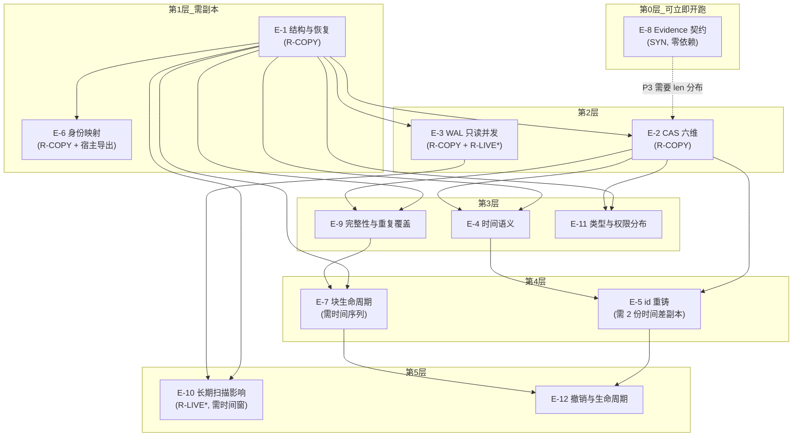

# 15 · 真实数据实验计划（CMB v0.1 技术尽调 · Agent F）

> 文件编号：CMB-EXP-0.1
> 状态：**设计完成，零执行**。本文件描述"该怎么做"，不包含任何实验结果。
> 编制：Agent F（真实接入实验与路线设计）
> 代码基线：`E:\[PROJECT]\refs\billion-context` @ `0aace2f`（下称"上游"）；`E:\[PROJECT]\CMB-v0.1-prototype`（下称"原型"）
> 依据输入：第三轮专项技术审查报告 §11/§12.4、原型 `docs/ARCHITECTURE.md`、`docs/reports/INTEGRATION-READINESS.md`、`docs/reports/RISK-REGISTER.md`
> 边界声明：本文件**不执行**任何实验、**不连接**任何真实数据库、**不修改**任何被审查对象。文内所有"预期结果"均为待验假设（HYPOTHESIS），一律不得当作结论引用。

---

## 0. 阅读须知与编号变更声明

### 0.1 本文件的三个"不是"

| 声明 | 含义 |
|---|---|
| **不是**对第三轮 §11 的复述 | 第三轮 §11 只有 10 条一行式实验（`第三轮…报告.md:515-531`），无假设、无通过/失败标准、无只读保证、无产物。本文件是**重写**，编号沿用但多数含义已变（见 §0.2） |
| **不是**执行计划书 | 只定义"卡"，不排期、不分配人。执行需要用户签字（§4） |
| **不是**结论 | 全部 12 张卡片的"预期结果"都是待验假设，卡片失败是正常结果，不是事故 |

### 0.2 编号变更表（**旧 §11 的 E-N 与新 E-N 不是同一件事**）

第三轮 §11 定义（原文见 `第三轮专项技术审查报告.md:519-530`）与本文件定义的差异，逐条列明。凡"含义已变"的编号，**不得**在任何后续文档中把本文件的实验结论挂到旧编号名下。

| 编号 | 第三轮 §11 原义 | 本文件新义 | 关系 |
|---|---|---|---|
| **E-1** | 用 `?mode=ro` 打开 index.db **副本**，同时让原进程继续写，验证只读并发 | **真实 index.db 结构与原始消息恢复**（DDL/列/类型/CAS→JSON→text 全链路） | **含义已变**。原 E-1 的"只读并发"迁移至新 **E-3** |
| **E-2** | 触发一次压缩，在 debounce 窗口内 `kill -9`，重启查 blocks（验证内存提交 vs 持久化非原子） | **CAS Blob 实际恢复**（寻址/编码/哈希/缺失/损坏/加密/版本 六维） | **含义已变，且原义被降级**：原 E-2 需**主动触发压缩 + 杀进程**，属破坏性写操作，本文件将其降级为 E-7 的场景 **SC-7.5**，默认**禁止执行**，需用户书面授权 + 隔离沙盒 |
| **E-3** | 抽样 ≥30 条 `messages` 行，`JSON.parse(content)` 核对字段完整性 | **SQLite WAL 只读并发与快照一致性** | **含义已变**。原 E-3 的内容并入新 **E-1**（结构）与新 **E-2**（编码） |
| **E-4** | 比对 `messages.ts` 与 DSH 侧真实消息时间，偏差 >1s 即确认批采样 | **消息与 Block 时间语义**（扩展：三分类占比 + 跨表偏差 + 单位核对） | **含义兼容并扩展**。原判定阈值（>1s）被本文件替换为分布量化（单点阈值不足以支撑 D-7 裁决） |
| **E-5** | 客户端编辑历史后重发，观察同一消息 `content_hash` 是否变化 | **Message ID 与 Block ID 重铸**（含 `identity` 列稳定性对比） | **含义兼容并扩展**。新增块级 id 与 `identity` 列（上游 v8 引入，`schema.ts:360-368`）作为候选键 |
| **E-6** | 开启 `BILI_ENCRYPTION_KEY` 启动，验证 M-8 自检 | **宿主身份映射**（session_id → session_type/group_id/speaker） | **含义已变**。原 E-6 的加密维度并入新 **E-2** 的"加密"一格，且**结论方向相反**（见 §0.5 F-02） |
| **E-7** | 同一群 `retireSession` 前后比对 `state.sessions[key]` 与库中 `session_id` | **Block 生命周期与删除窗口** | **含义已变**。原 E-7 的会话 id 对齐问题并入新 **E-6** |
| **E-8** | 构造嵌套块（父覆盖子），导 `payload_json` 检查 direct/effective 集合关系 | **真实 Evidence 契约兼容性**（隔离环境，绝不写真实库） | **含义已变**。原 E-8 的集合关系并入新 **E-9** |
| **E-9** | 检查是否存在 `start_seq = -1` 的行 | **真实数据完整性与重复覆盖**（扩展：direct 交集、covered_hash 复算、-1 哨兵） | **含义兼容并扩展** |
| **E-10** | 检查是否有 `blocks` 行消失但消息仍在 | **真实源数据库长期扫描影响**（性能/IO/WAL 增长） | **含义已变**。原 E-10 的窗口观测并入新 **E-7**；新 E-10 完全换题（原 §11 **没有**任何性能实验） |
| **E-11** | —（不存在） | **真实数据中的消息类型和权限分布** | **新增** |
| **E-12** | —（不存在） | **Evidence 撤销和上游生命周期变化** | **新增**（第三轮 M-2 已证伪"`retired_at` 驱动撤销"，但无实验量化替代语义） |

**一句话**：旧 §11 的 10 条实验，被本文件重新分配到 12 条里，其中只有 **E-9** 与原义基本同题；**E-11 / E-12 是全新题目**；**旧 E-2 是唯一一条被主动禁用的实验**。

### 0.3 "Q1–Q10" 的指代

`experiment-matrix.json` 中的 `answers_questions` 使用 **Q1–Q10**，指代原型 `docs/reports/INTEGRATION-READINESS.md:24-305` 的十问：

| Q | 问题 | 主要相关实验 |
|---|---|---|
| Q1 | 本原型能否独立运行 | —（v0.1 已答，VERIFIED_RUNTIME） |
| Q2 | 数据流是否真的跑通 | —（v0.1 已答，仅 Mock） |
| Q3 | 哪些接口只经 Mock 验证 | E-1、E-2 |
| Q4 | 哪些结论源码级已验证 | 全部（实验=把 STATIC 升为 RUNTIME） |
| Q5 | 哪些结论运行时已验证 | 全部 |
| Q6 | 能否接入真实 billion-context | E-1、E-2、E-3、E-5、E-6、E-7、E-9、E-10、E-11 |
| Q7 | 能否接入真实 Memory Core | E-8、E-12 |
| Q8 | 阻塞项有哪些 | 全部（每卡"后续决策"） |
| Q9 | 正式接入前必须完成哪些工作 | 全部 |
| Q10 | 是否建议进入下一阶段 | 全部（结论汇入 `17-VERSION-ROADMAP.md` 的 v0.2 准入） |

### 0.4 数据来源三分类（每张卡必填）

| 代号 | 定义 | 风险 | 授权 |
|---|---|---|---|
| **R-COPY** | 真实库的**一致性只读副本**（文件在 `E:\[PROJECT]\_exp\snap\`，与源物理隔离） | 源库零风险；副本含真实用户内容需按 §4 脱敏 | 需用户提供/授权获取副本 |
| **R-LIVE** | 真实库**只读直连**（`readOnly:true`，上游进程活跃） | 与上游争锁/争 IO；Windows 文件共享语义未验 | **需用户书面授权**（D-10） |
| **SYN** | 合成数据（原型 fixtures 扩展 / 一次性 scratch 库） | 低 | 无需 |

**禁止的第四类**：`R-WRITE`（对真实库任何写操作，含 `VACUUM INTO`、`PRAGMA journal_mode` 变更、`wal_checkpoint`、`migrateSchema`）。本计划**不存在**任何 R-WRITE 步骤。

### 0.5 本文件在阅读上游代码时新发现的 3 条事实（F-01…F-03，均为 VERIFIED_STATIC，需实验确认影响面）

> 纪律：以下三条是**新增发现**，不是对第三轮结论的复述。它们改变了两张卡片的设计前提，故置顶声明。

**F-01 —— 原型适配器隐含 `user_version ≥ 10` 硬门槛，任何文档均未登记。**
适配器 SQL 直接 SELECT `m.ts`（`bc-source.ts:77`）与 `m.retired_at`（同处）。上游这两列分别由 v10 迁移（`schema.ts:391-400`）与 v8 迁移（`schema.ts:360-367`）添加。若目标库 `PRAGMA user_version < 10`，`bc-source.ts:75-84` 的 SQL 会直接抛 `no such column: ts`，整轮 run 以 `FATAL` 退出（`src/cli/cmb.ts` 未捕获 → exit 2，见 `ARCHITECTURE.md:90`）。
→ **影响**：E-1 的第一条 SQL 必须是 `PRAGMA user_version`，且在 E-1 通过之前，任何"适配器已就绪"的表述都不成立。RISK-REGISTER 未收录此项（R-01 只说"SQL 未在真实库执行过"，未说"SQL 依赖特定 schema 版本"）。

**F-02 —— "加密的 index.db"这个分支不存在，原型的加密假设方向错了。**
上游在 `BILI_ENCRYPTION_KEY` 生效时**不创建 unified sidecar**，即根本没有 index.db：`persist.ts:562-569`（`unifiedBlockedByEncryption` → 只跑 legacy），`export.ts:405-406`（加密时不读 index.db）。而原型的自检把它建模成"库存在但读不了"：`config.ts:100-108` 抛 `ENCRYPTION_MODE_UNSUPPORTED`。
→ **影响**：E-2 的"加密"一格不是"解密/兼容"问题，而是**"存在性"检查**（`Test-Path index.db` + `$env:BILI_ENCRYPTION_KEY`）。原型这条错误假设会让运维在"文件不存在"时报出"加密不兼容"，误诊方向。

**F-03 —— 原型的 `content_hash` 校验方向正确，但只对 text 有效，`algo`/`byte_len` 两层从未被检查。**
上游 CAS 的哈希是 `sha256(Buffer.from(content,'utf8'))`（`store.ts:76-78`、`735-753`），写入时同时落 `byte_len` 与 `algo='sha256'`（`schema.ts:133-139`、`store.ts:749-750`）。原型只回算哈希（`integrity-validator.ts` 的 blob 哈希回算），**不校验 `byte_len` 与 `algo`**——而这两列是"CAS 自洽"的免费证据，且 `algo` 一旦出现非 sha256 值，全部 Evidence 的 `content_hash` 语义即失效。
→ **影响**：E-2 必须把 `algo` 值域与 `byte_len == length(bytes)` 作为独立验收项。

---

## 1. 只读保证总纲

> 12 张卡片的"只读保证"字段一律引用本节定义（RO-0…RO-5），不再逐卡重述机制。

### 1.1 只读等级定义

| 等级 | 机制 | 防的是什么 | 不防什么 |
|---|---|---|---|
| RO-0 | 无 | — | 一切 |
| RO-1 | **只读副本**（物理隔离：源库不在写路径上） | 一切写回源的可能 | 副本自身被误写 |
| RO-2 | `new DatabaseSync(path, { readOnly: true })`（`bc-source.ts:30`；上游自身同样用法见 `integrity-check.ts:161-167`） | 库级写事务 | 连接级 PRAGMA 变更（部分 PRAGMA 在 ro 连接上仍会写入 header） |
| RO-3 | RO-2 + `PRAGMA query_only = 1` | 误写语句（`INSERT/UPDATE/DELETE/DDL` 直接 `SQLITE_READONLY`） | 绕过（`VACUUM INTO` 写的是目标文件，不受 query_only 拦） |
| RO-4 | RO-3 + 每次读取包在 `BEGIN DEFERRED` 读事务内（上游范式：`store.ts:606-621` 的 `PRAGMA query_only = ON; BEGIN DEFERRED`） | 跨语句快照漂移（读到"半个事务"） | 逻辑一致性（需卡内自洽性断言） |
| RO-5 | RO-4 + **事后审计三件套**（见 1.2） | 全部已知误写路径 + 未知误写 | 内核/驱动级 bug |

**全局规定**：
- **R-COPY 实验一律 RO-5**。副本是唯一允许"被消耗"的输入；即使写坏也只损失副本。
- **R-LIVE 实验一律 RO-5（去文件哈希项）+ 操作系统级只读 ACL**。理由：在活库上做 RO-5 的文件哈希会与上游 WAL 抖动冲突（每秒都在变），只能用 `data_version` 审计。
- **SYN 实验用 RO-3 即可**（合成库可随意丢弃）。

### 1.2 RO-5 事后审计三件套（每次实验运行前后各一次，产物必须落盘）

| # | 审计项 | 命令/断言 | 判据 |
|---|---|---|---|
| A1 | 连接写计数 | `SELECT total_changes()` 在 run 结束前读取（node:sqlite `DatabaseSync` 支持 `prepare('SELECT total_changes()')`） | 必须恒为 **0** |
| A2 | 源库文件指纹 | 对 `<dir>\index.db`、`index.db-wal`、`index.db-shm`、`index.db.lock` 取 `Length + LastWriteTimeUtc`（R-COPY 实验额外取 64KiB 头部区 sha256） | R-COPY 上必须**完全不变**；R-LIVE 上只允许 `index.db-wal` 变化（上游自己在写），且**`index.db.lock` 的 mtime 不得因我们而变化** |
| A3 | 连接参数回读 | `PRAGMA query_only`、`PRAGMA journal_mode`、`PRAGMA data_version`、`PRAGMA database_list` | `query_only=1`；`journal_mode` 回读值不作断言（ro 连接改不了）；`data_version` 记录用于变化检测 |

**A2 的 `.lock` 项是本计划的关键防线**：上游每次 open 都用自身 pid 覆盖写 `<db>.lock`（`store.ts:645-683`），且 `gc({vacuum:"full"})` 在检测到"另一进程正在写"时**拒绝执行**（`store.ts:2139-2155`）。若 CMB 误用可写连接打开源库，会 (a) 覆盖上游的 pid 记录，(b) 可能触发上游的自愈/刷盘逻辑走异常分支。**因此：绝不允许 `UnifiedStore.open()` 或任何上游模块被 CMB 引用**——`open()` 会执行 `mkdirSync`、`PRAGMA quick_check`（14 GiB 库约 260 s，`store.ts:455`）、`migrateSchema`（`schema.ts:283-405`，含 `ALTER TABLE`）、以及 `PRAGMA wal_checkpoint(TRUNCATE)`（`store.ts:582-586`）。**这四件事全部是写操作**。

### 1.3 "一致性快照"怎么做（本计划的核心技术决定）

**结论：首选 `node:sqlite` 的 `backup()`（在线备份 API），次选"停写窗口冷拷贝"，明确禁止把 `VACUUM INTO` 当作 CMB 的快照手段。**

| 方案 | 机制 | 是否写源库 | 一致性 | 可行性判定 |
|---|---|---|---|---|
| **B-1 `sqlite.backup(srcDb, destPath)`** | Node 24 内置 `node:sqlite` 导出 `backup`（本机 v24.21.0 实测 `typeof backup === "function"`，**已核**）；底层是 SQLite Online Backup API，源端只持读锁 | **否** | 强一致（备份过程由 SQLite 保证帧级一致） | **推荐**。唯一不确定项：`backup()` 是否接受 `{readOnly:true}` 的源连接（SQLite 备份 API 只读源是标准用法，但需 E-3 的 5 分钟预检确认） |
| **B-2 停写窗口冷拷贝** | 停上游 → `Copy-Item index.db,index.db-wal,index.db-shm` → 启上游 | 否（但要停服务） | 中（窗口内一致；B-2 的**全部前提是"没有活跃写者"**） | 兜底方案。用于"用户可接受一次停服"的场景；或作为 B-1 的交叉验证 |
| **B-3 `VACUUM INTO`** | 上游自己的 `backupInto()`（`store.ts:694-709`） | **是**（在 writer 连接上执行 `db.exec`，`store.ts:706`） | 强一致 | **禁止由 CMB 自行触发**。它必须跑在上游进程的写连接上；CMB 自行执行等于对源库发写语句。若要使用，只能由**用户在上游侧**用 `bili` 自带能力产出副本，CMB 只读结果文件 |
| **B-4 裸 copy 三件套（不停写）** | 直接拷 `db`+`-wal`+`-shm` | 否 | **无保证**（拷贝顺序与 WAL 提交点无原子关系，可能得到 torn 快照） | **禁止**。这是最容易被误认为"简单可靠"的错误做法 |
| **B-5 `immutable=1` / 只读挂载** | 声明文件不再变化 | 否 | 危险：假定不变 | **禁止**。库在变时会读到撕裂页 |

**WAL 的物理前提（必须在 E-3 里验证，不得假设）**：
- 上游对每一个 index.db opener 都设 `PRAGMA journal_mode = WAL`（`schema.ts:88-101`），因此真实库**必然**是 WAL 模式；`-wal` 可能非空（上游把 `journal_size_limit` 限在 8 MiB，`schema.ts:73-83`）。
- SQLite 的只读客户端读取 WAL 库时，**通常需要能创建/写 `-shm`**（WAL 索引）。若 `-shm` 已由上游进程创建且可共享打开，只读连接可以工作；若 `-shm` 不存在且连接不可写，标准行为是 `SQLITE_CANTOPEN`。
- 已知反证/支撑：上游自己就在**同一台机器、同一个 live 库**上开第二条 `readOnly` 连接跑 `PRAGMA quick_check`（`integrity-check.ts:161-167` + `store.ts:588-594`），说明"活库 + 只读连接"在上游自己的拓扑里是被使用且被信任的。但**注意差别**：那个连接跑在**已持有 writer 的同一进程**里，`-shm` 由本进程创建。
- → 因此 E-3 的 T2（跨进程只读直连）是**真正的未验证区**，不得因"上游这么用"而当作已证。

### 1.4 五条绝不触发的上游动作（每条附行号，用于 code review 断言）

| # | 绝不触发 | 触发点 | 为什么危险 |
|---|---|---|---|
| N-1 | `UnifiedStore.open()` / `migrateSchema()` | `schema.ts:283-405` | 会在打开时 `ALTER TABLE` 并写 `PRAGMA user_version`，直接改源库 |
| N-2 | `PRAGMA wal_checkpoint(*)` | `store.ts:583,629,1308,2228` | 需要写权限；会移动 WAL 帧，改变上游崩溃恢复窗口 |
| N-3 | `PRAGMA quick_check` / `integrity_check` | `store.ts:474`、`integrity-check.ts:166` | 全库页扫描（14 GiB ≈ 260 s，`store.ts:455`），与上游争 IO；对 CMB 的结论**无增量价值**（上游已在自己的 cadence 上做） |
| N-4 | `VACUUM` / `VACUUM INTO` | `store.ts:706,1830,2182` | 全库重写；`full VACUUM` 还要求独占写锁并会与上游互斥（`store.ts:2142-2155`） |
| N-5 | 写 `<db>.lock` | `store.ts:645-683` | 覆盖上游 pid 记录，破坏其多实例互斥判据 |

**实现层断言**：E-1…E-10 的脚本必须以"白名单 SQL"方式实现——脚本里只允许出现 `SELECT` / `PRAGMA <只读项>` 两类语句，且 `PRAGMA` 白名单固定为 `query_only / data_version / table_info / user_version / journal_mode(只读回读) / database_list / total_changes`。审查方式是**对脚本做 grep 黑名单断言**（`INSERT|UPDATE|DELETE|ALTER|CREATE|DROP|VACUUM|checkpoint|ATTACH`），命中即脚本不可运行。

### 1.5 环境基线

| 项 | 值 | 证据 |
|---|---|---|
| Node | v24.21.0（本机实测） | `node --version` |
| `node:sqlite` 导出 | `DatabaseSync, StatementSync, Session, constants, backup`（实测） | 本机 probe |
| 第三方依赖 | 0（脚本一律 `.mjs` + `node:` 内置） | 与原型同策略（`ADR-008`） |
| 写盘范围 | 仅 `E:\[PROJECT]\_exp\**` 与 `E:\[PROJECT]\CMB-v0.1-review-pack\scripts|evidence|data\**` | 本会话 workspace = `E:\[PROJECT]` |
| 网络 | 不需要 | — |
| 是否可含真实用户内容 | 副本可能含；产物一律只落"哈希/计数/结构"，**不落正文**（与原型日志纪律一致：错误消息只带 locator/hash 前缀） | `ARCHITECTURE.md:380` |

---

## 2. 实验卡

> 通用约定：
> - 所有脚本落在 `E:\[PROJECT]\CMB-v0.1-review-pack\scripts\eN-*.mjs`，产物落 `E:\[PROJECT]\CMB-v0.1-review-pack\evidence\eN\`，副本落 `E:\[PROJECT]\_exp\snap\`。
> - 每张卡的"步骤"是可复现的命令级序列；`$SNAP` 指副本路径，`$SRC` 指真实 index.db 路径。
> - 每张卡开跑前必须先过 §1.4 的 SQL 白名单断言。
> - **本文件不提供真实路径**：`$SRC` 由用户在执行阶段提供，本计划不假设其存在。

### E-1 真实 index.db 结构与原始消息恢复

| 字段 | 内容 |
|---|---|
| **实验编号** | E-1 |
| **目标** | 确认真实库的 DDL/列/类型与静态推导一致；确认 `messages → content(CAS) → JSON.parse → text` 链路在真实数据上逐字可恢复；确认**适配器隐含的 `user_version≥10` 门槛**（F-01）是否成立 |
| **假设** | H1-1：`PRAGMA user_version = 10`（`schema.ts:71`）。H1-2：13 张表与 `schema.ts:108-280` 的 DDL 完全一致（列名/主键/唯一约束零差异）。H1-3：抽样 n≥30 的 `messages` 行，其 `content.bytes` 均可 `JSON.parse` 且含 `text` 字段，成功率 100%。H1-4：若 `user_version < 10`，则 `SELECT ts FROM messages` 必抛错（F-01 的判据） |
| **所需数据** | 一份一致性副本（`index.db`，含 `-wal` 已合并或由 backup API 产出）；覆盖 ≥3 个会话：1 个大会话（≥1000 条消息）、1 个小会话、1 个含 `blocks` 的会话 |
| **数据来源** | **R-COPY**（禁止 R-LIVE：本卡不产生需要活库的结论，用活库纯属增加风险） |
| **执行环境** | 离线；Node v24.21.0；只读脚本 `e1-structure.mjs`；workdir `E:\[PROJECT]\CMB-v0.1-review-pack`；副本在 `E:\[PROJECT]\_exp\snap\e1-<日期>\` |
| **操作步骤** | 见下方代码块（S1–S6） |
| **只读保证** | **RO-5**：副本 + `readOnly:true` + `query_only=1` + 每批读包 `BEGIN DEFERRED` + A1/A2/A3 审计。副本本身在 A2 中同样要求"运行前后字节不变"，以证明脚本没有偷写 |
| **预期结果** | `user_version` ∈ {7,8,9,10}（视库龄）；表集合差异 = 0；抽样 JSON.parse 成功率 100%；`text` 字段存在率 95–100%（tool/system 类可能无 text）；若 v<10 则 `SELECT ts` 报错，F-01 成立 |
| **通过标准** | P1：`user_version` 记录成功且落在 1..10。P2：表/列差异计数 = 0（若有差异，必须逐项写明"该差异对应 vN 迁移，`schema.ts:<行>"）。P3：`messages`/`content`/`blocks`/`sessions` 行数均落盘。P4：抽样 JSON.parse 成功率 = 100%，`text` 存在率 ≥95%。P5：CAS 孤儿率（`messages.content_hash` 无对应 `content` 行）已量化（可为 0）。P6：F-01 的成立/不成立有明确判据记录 |
| **失败标准** | X1：任一必需列（`session_id,seq,msg_id,role,kind,content_hash,retired_at,ts`）缺失 → 适配器 SQL 必须改，本卡 FAIL。X2：JSON.parse 失败率 >1%。X3：CAS 孤儿率 >5%（说明 CAS 已被大面积清理，原话可恢复的前提崩塌）。X4：`user_version < 10` 且原型仍宣称"适配器就绪" → 文档级 FAIL（不是实验失败，是结论不成立） |
| **风险** | ①副本含真实用户正文，脚本若把 `text` 打进日志即造成泄漏 → 断言：所有产物只允许 `sha256(text)[0:12]` 与 `length`。②`user_version` 可能是 7/8/9，导致"结构一致"结论被误读为"可用" → 通过标准 P2/P6 强制分列。③大库全表 `COUNT(*)` 在 10 GiB 级可能耗时数分钟 → 优先 `SELECT COUNT(*) FROM messages WHERE session_id=?`，或接受一次全扫（副本上无风险） |
| **回滚方案** | 无副作用可回滚：全程只读副本。若脚本写坏副本 → 删除 `E:\[PROJECT]\_exp\snap\e1-*` 重新从源产出；源库不受影响（A2 审计证明）。若发现脚本含写语句 → 立即停跑，按 §1.4 断言修脚本后重跑 |
| **产物** | `evidence/e1/e1-schema-dump.json`（`sqlite_master` + 每表 `PRAGMA table_info`）、`e1-counts.json`、`e1-sample-recovery.csv`（seq/msg_id/hash12/text_len/parse_ok/has_text，**无正文**）、`e1-audit.json`（A1/A2/A3 前后快照）、`e1-F01-verdict.md` |
| **依赖** | 无前置实验；**依赖用户提供副本**（§4 A-1） |
| **后续决策** | D-10（是否允许活库只读直连——本卡不需要，但 E-3 需要）；若 F-01 成立，则新增 D-15（适配器是否强制 `user_version>=10` 门禁并给出可读错误码）；汇入 `17-VERSION-ROADMAP.md` v0.2 准入门槛 |

```powershell
# S0 前置：SQL 白名单断言（脚本必须先通过）
Select-String -Path scripts\e1-structure.mjs -Pattern 'INSERT|UPDATE|DELETE|ALTER|CREATE|DROP|VACUUM|checkpoint|ATTACH' -CaseSensitive:$false
# 期望：无输出。有输出即停止。

# S1 产出副本（首选 backup API；见 §1.3 B-1）
node scripts\e1-snapshot.mjs --src "$SRC" --out "E:\[PROJECT]\_exp\snap\e1-20261106"
# 若 backup() 在 readOnly 源上不可用（E-3 预检结论），降级 B-2：停上游 → Copy-Item → 启上游

# S2 审计前置（A2）：记录副本与源的三件套指纹
node scripts\ro-audit.mjs before --db "$SNAP" --out evidence\e1\e1-audit.json

# S3 结构普查（脚本内 SQL，逐条执行）
#   PRAGMA user_version;
#   SELECT type,name,sql FROM sqlite_master WHERE type IN ('table','index') ORDER BY name;
#   PRAGMA table_info(messages);   -- 另对 blocks/content/sessions/dead_refs/refs/checkpoints
#   SELECT COUNT(*) FROM sessions; / messages; / blocks; / content;

# S4 F-01 判据（仅当 user_version < 10 时执行，预期抛错并捕获）
#   SELECT ts FROM messages LIMIT 1;          -- 预期：no such column: ts
#   SELECT retired_at FROM messages LIMIT 1;  -- 预期：v<8 抛错

# S5 恢复链抽样（分层：最大会话 20 条 + 随机 10 条 + 含 blocks 的会话 10 条）
#   SELECT m.seq,m.msg_id,m.role,m.kind,m.content_hash,c.bytes
#     FROM messages m LEFT JOIN content c ON c.hash=m.content_hash
#    WHERE m.session_id=? ORDER BY m.seq LIMIT ?;
#   → JSON.parse(bytes 的 utf8) → 记录 parse_ok / 键集 / text 长度

# S6 审计后置（A1/A2/A3）+ 生成报告
node scripts\ro-audit.mjs after --db "$SNAP" --out evidence\e1\e1-audit.json --expect-total-changes 0
```

### E-2 CAS Blob 实际恢复（寻址/编码/哈希/缺失/损坏/加密/版本）

| 字段 | 内容 |
|---|---|
| **实验编号** | E-2 |
| **目标** | 在真实 CAS 上逐维验证：①寻址（`hash → bytes` 唯一命中）②编码（UTF-8、JSON）③哈希（`sha256(bytes) == hash`）④缺失（孤儿行）⑤损坏（hash 不符/JSON 坏）⑥加密（`BILI_ENCRYPTION_KEY` 下 index.db 是否存在，F-02）⑦版本（`algo` 值域、`user_version`） |
| **假设** | H2-1：`content.algo` 全库唯一值 = `'sha256'`（`schema.ts:137` 默认值、`store.ts:749` 写入常量）。H2-2：`byte_len == length(bytes)` 对 100% 行成立（`store.ts:750` 写入 `bytes.byteLength`；SQLite `length(blob)` 返回字节数）。H2-3：`sha256(bytes) == hash` 对抽样 100% 成立（`store.ts:76-78,741`）。H2-4：**不存在加密的 index.db**（`persist.ts:562-569`），故"加密兼容"问题是伪问题（F-02）。H2-5：`byte_len ≤ 2000` 的行占比 ≥95%（用于 E-8 的 `excerpt.maxLength` 判定） |
| **所需数据** | 同 E-1 的副本；额外要求副本包含 ≥1 个 `blocks` 行（否则 `summary_hash` 维度无样本）与 ≥1 个 `message_media` 行（可选） |
| **数据来源** | **R-COPY** + **SYN**（损坏维度中的"人为破坏"只在合成库上做，绝不在真实副本上制造损坏后当作真实结论） |
| **执行环境** | 离线；`e2-cas.mjs`（普查）+ `e2-corrupt-syn.mjs`（合成损坏注入，SYN） |
| **操作步骤** | 见下方代码块（S1–S6） |
| **只读保证** | 真实侧 **RO-5**；合成侧 **RO-3**（合成库允许被破坏，因为它就是用来被破坏的）。真实副本上**禁止**任何"注入损坏"动作——那会污染后续所有实验的输入 |
| **预期结果** | `algo` 唯一值 = sha256（否则 H2-1 证伪，影响面巨大）；`byte_len` 一致率 100%；抽样哈希一致率 100%；孤儿率 0 或很小（需量化）；坏 JSON 率 0；加密维度结论为"存在性检查" |
| **通过标准** | P1：`algo` 值域枚举落盘，非 sha256 值计数 = 0。P2：`byte_len` 不一致行数 = 0。P3：分层抽样（按 `byte_len` 四分位，每层 ≥200 行）哈希一致率 = 100%。P4：`messages`/`blocks.summary_hash`/`blocks.one_hash`/`message_media.media_hash` 四类引用的孤儿率全部量化。P5：抽样 JSON.parse 失败 = 0。P6：`byte_len` 分布 p50/p95/p99/max 落盘（供 E-8 使用） |
| **失败标准** | X1：非 sha256 的 `algo` 出现 >0 行 → 全部 Evidence 的 `content_hash` 语义失效，必须重议 D-9。X2：哈希一致率 <100%（抽样内出现不符）→ CAS 已损坏或被第三方改写，原话可恢复前提崩塌。X3：`byte_len` 不一致 >0 → 上游写入路径或库被外部工具改过，需立即上报。X4：`messages` 孤儿率 >1% → 触发 D-8/用户裁决（历史数据缺口不可恢复） |
| **风险** | ①全量哈希重算在 10 GiB 库上代价高（但只读副本无风险，只是慢）→ 用分层抽样 + 一次全量可选。②`bytes` 可能是 `Uint8Array`（`node:sqlite` 行为，见上游 `schema.ts:467-475` 的注释：BLOB 以 `Uint8Array` 返回），若脚本按 `string` 处理会静默算错哈希 → 断言：先 `Buffer.from(bytes)` 再 hash。③"加密"维度的错误假设（F-02）若不先在文档里纠正，实验会被带偏成"研究解密" |
| **回滚方案** | 无源侧副作用。合成损坏实验只动 `E:\[PROJECT]\_exp\syn\`。若真实副本被误写 → 丢弃副本重产（源不受影响，A2 审计为证） |
| **产物** | `evidence/e2/e2-algo.csv`、`e2-byte-len-diff.csv`（只记 hash 前缀与两侧长度）、`e2-hash-sample.csv`、`e2-orphans.json`、`e2-len-distribution.json`、`e2-encryption-verdict.md`、`e2-audit.json` |
| **依赖** | E-1（需要先确认列存在；若 F-01 成立，`ts` 列缺失不影响本卡，因为本卡不 SELECT ts） |
| **后续决策** | D-8（孤儿/缺口是否可接受）；D-9（`content_hash` 是 blob 哈希还是原文哈希——E-2 只能给"事实"，不能给"裁决"）；F-02 建议在 v0.2 修正原型的加密语义 |

```powershell
# S1 版本与算法维度
#   SELECT algo, COUNT(*) n, MIN(byte_len) lo, MAX(byte_len) hi FROM content GROUP BY algo;
# S2 自洽维度（byte_len）
#   SELECT COUNT(*) FROM content WHERE byte_len <> length(bytes);
#   SELECT hash,byte_len,length(bytes) FROM content WHERE byte_len <> length(bytes) LIMIT 50;
# S3 哈希维度（分层抽样，脚本内 Buffer 处理）
node scripts\e2-cas.mjs hash-sample --db "$SNAP" --strata 4 --per-stratum 200 --out evidence\e2\e2-hash-sample.csv
# S4 缺失维度（四类引用）
#   messages.content_hash / blocks.summary_hash / blocks.one_hash / message_media.media_hash
node scripts\e2-cas.mjs orphans --db "$SNAP" --out evidence\e2\e2-orphans.json
# S5 编码维度
node scripts\e2-cas.mjs encode --db "$SNAP" --out evidence\e2\e2-encode.json   # JSON.parse 率、键集分布、text 长度分布
# S6 加密维度（不做任何连接，只做存在性 + 环境变量）
Test-Path "$SRC"; [bool]$env:BILI_ENCRYPTION_KEY
# 判据：BILI_ENCRYPTION_KEY 存在 ⇔ 无 index.db（persist.ts:562-569）。若"有 key 且有库"，则 F-02 被证伪，需回退本卡结论
```

### E-3 SQLite WAL 只读并发与快照一致性

| 字段 | 内容 |
|---|---|
| **实验编号** | E-3 |
| **目标** | 回答 R-18：`new DatabaseSync(path,{readOnly:true})` 能否在 WAL + 上游活跃写 的条件下打开并读到一致快照；量化 `SQLITE_BUSY` / `SQLITE_CANTOPEN`；验证 `backup()` 在只读源上可用（§1.3 B-1 的前提） |
| **假设** | H3-1：冷副本（无 `-wal`）只读打开成功率 100%。H3-2：热副本（有 `-wal` 但无写者）只读打开成功率 100%。H3-3：活库跨进程只读直连（`-shm` 由上游进程持有）成功率 ≥99%，`SQLITE_CANTOPEN` = 0。H3-4：连续 30 min × 每 5 s 一次读，`SQLITE_BUSY` 率 <1%，读 p95 <50 ms。H3-5：单事务内读取的 `(sessions.last_ingested_seq, MAX(messages.seq), blocks 行数)` 自洽率 100%，而**逐语句单独读**的自洽率 <100%（证明 RO-4 的必要性）。H3-6：`sqlite.backup(readOnlyConn, dest)` 可用 |
| **所需数据** | ①冷副本 ②热副本（含 `-wal`，用 B-2 停写窗口拷贝可得）③活库（仅 T2，需 D-10 授权）④合成写压测库（SYN） |
| **数据来源** | **R-COPY**（T1/T2）+ **R-LIVE**（T3，需授权）+ **SYN**（T4 写压测） |
| **执行环境** | `e3-open-matrix.mjs`（拓扑矩阵）+ `e3-watch.mjs`（30 min 观测）+ `e3-backup-probe.mjs`（backup API 探针，5 秒级） |
| **操作步骤** | 见下方代码块（T1–T4） |
| **只读保证** | **RO-5（R-COPY）/ RO-5 去文件哈希项（R-LIVE）**。R-LIVE 段额外要求：①先对 `index.db` 文件 ACL 加 `DENY Write`（Windows `icacls`）——我们连自己也写不了，物理保证；②`PRAGMA busy_timeout=5000` 在只读连接上是**连接级**设置，不写库（可放心设）；③**禁止**在活库上执行 `PRAGMA quick_check`/`integrity_check`（§1.4 N-3） |
| **预期结果** | T1/T2 100% 成功；T3 结果未知（这是本卡的核心未知）；T4 在合成库上应出现 BUSY（证明 BUSY 可被观测到，避免"结论为空"）；backup 探针给出可行性 |
| **通过标准** | P1：三种拓扑的打开成功率与错误码分布全部落盘。P2：T3 若成功，`CANTOPEN=0`、`BUSY 率 <1%`、读 p95 `<50 ms`、30 min 无中断。P3：事务自洽率 100% 且逐语句自洽率被实测（<100% 才证明 RO-4 有效；若同为 100%，说明"快照漂移"在本负载下观测不到，结论应写"未观测到"而非"不存在"）。P4：backup 探针结论（可用/不可用）明确 |
| **失败标准** | X1：T3 `CANTOPEN > 0` → **路线 D 强制**（禁活库直连），`16-INTEGRATION-ARCHITECTURE-OPTIONS.md` 中路线 A 降级为"仅副本"。X2：T3 `BUSY 率 >5%` → 同上。X3：T2 热副本打不开 → 说明 `-shm` 依赖是硬约束，必须走 backup API 产副本。X4：backup 在只读源上不可用 → §1.3 降级为 B-2 停写窗口 |
| **风险** | ①在 Windows 上，只读打开失败**更可能**是文件共享模式（`CreateFile` share flags）而非 ACL 问题 → 错误码必须原样记录（`ERR_SQLITE_ERROR` + message），不得归纳为"权限不足"。上游 `sqlite-errors.ts:23-28` 明确区分：BUSY/LOCKED/IOERR/CANTOPEN 是**瞬时**形状，不得当作损坏。②T4 在合成库上必须做，否则"零 BUSY"可能只是"没写者"。③30 min 观测若上游空闲，结论为"未观测到争用"，**不得**外推为"永不争用" |
| **回滚方案** | T3 若造成上游异常：立即关闭只读连接（`db.close()` 回滚读事务），撤销 ACL（`icacls /remove:d`），并在报告中记录时间点与上游日志片段。**唯一真实风险事件**是"只读连接持有长读事务导致 WAL 无法 checkpoint（上游 `journal_size_limit` 顶到 8 MiB 后 WAL 增长）" → 因此 T3 必须限制单次读事务时长 ≤2 s、总并发连接 = 1，且**禁止**在事务里做逐条 blob 读取（E-3 只做计数与指针读取，不做正文读取） |
| **产物** | `evidence/e3/e3-open-matrix.json`、`e3-watch-timeline.csv`（时间/延迟/错误码/data_version）、`e3-consistency.json`、`e3-backup-probe.json`、`e3-audit.json`、`e3-verdict.md`（含"是否允许 R-LIVE"的建议） |
| **依赖** | E-1（需已知 `user_version` 决定 select 列）；**依赖用户授权 D-10**（T3 段） |
| **后续决策** | **D-10（核心）**：是否允许 CMB 在活库上开只读连接长期运行。`16-INTEGRATION-ARCHITECTURE-OPTIONS.md` 的路线 A/D 之选，全部押在本卡上 |

```powershell
# T1 冷副本（无 -wal）
node scripts\e3-open-matrix.mjs --db "$SNAP_COLD" --mode cold --iters 20 --out evidence\e3\e3-open-matrix.json

# T2 热副本（有 -wal，无活跃写者）
node scripts\e3-open-matrix.mjs --db "$SNAP_HOT" --mode hot --iters 20 --out evidence\e3\e3-open-matrix.json

# T2b backup API 探针（只读源 + 目标写入 _exp）
node scripts\e3-backup-probe.mjs --src "$SNAP_HOT" --dst "E:\[PROJECT]\_exp\snap\probe.bak" --out evidence\e3\e3-backup-probe.json

# T3 活库直连（**仅 D-10 授权后**；限单连接、限事务时长、禁读正文）
icacls "$SRC" /deny "$env:USERNAME:(W)"        # 先自锁（物理只读）
node scripts\e3-watch.mjs --db "$SRC" --minutes 30 --interval-sec 5 --max-txn-ms 2000 --no-blob --out evidence\e3\e3-watch-timeline.csv
icacls "$SRC" /remove:d "$env:USERNAME"        # 事后解除（务必执行）

# T4 合成写压测（SYN，证明 BUSY 可观测）
node scripts\e3-writer-syn.mjs --db "E:\[PROJECT]\_exp\syn\e3.db" --minutes 5 &
node scripts\e3-watch.mjs --db "E:\[PROJECT]\_exp\syn\e3.db" --minutes 5 --interval-sec 1 --out evidence\e3\e3-watch-syn.csv
```

### E-4 消息与 Block 时间语义

| 字段 | 内容 |
|---|---|
| **实验编号** | E-4 |
| **目标** | 把 `messages.ts` 的二义性（`store.ts:1029-1038`）量化为**四类占比**，并给出 `blocks.created_at` 与之的跨表偏差；据此判断 D-7（timestamp 可否非 null）是否有量化依据 |
| **假设** | H4-1：`ts` 存在三类值——(a) NULL（v10 前的存量行，`schema.ts:391-400` 明确"no backfill"）、(b) 同一批次共享同一毫秒（`batchTs`）、(c) 宿主显式提供的每消息时间戳（`typeof m.ts === "number"` 分支）。H4-2：(a) 类占存量数据多数。H4-3：同一会话内 (b) 类的"批大小"分布可测（即同一 `ts` 值上挂了多少行）。H4-4：`blocks.created_at` 恒 ≥ 其覆盖消息的 `ts`（块总是在消息之后产生）。H4-5：`ts` 单位是毫秒（`Date.now()`） |
| **所需数据** | E-1 的副本（需含 ≥2 个"近期活跃"会话，即 v10 之后仍有写入，否则 (c) 类样本为 0） |
| **数据来源** | **R-COPY** |
| **执行环境** | `e4-time.mjs`；纯 SELECT |
| **操作步骤** | 见下方代码块（S1–S5） |
| **只读保证** | **RO-5** |
| **预期结果** | 得到三类占比与批大小分布；(a) 类可能接近 100%（若库龄早于 v10）；`blocks.created_at ≥ max(ts)` 违反率低 |
| **通过标准** | P1：四类计数（NULL / 批共享 / 独立 / 异常）落盘且和为总数。P2：批共享的"批大小"直方图（p50/p95/max）。P3：单位核对（`MIN(ts) > 1e12` 判毫秒、`> 1e9` 且 `<1e12` 判秒）有明确结论。P4：`blocks.created_at` 与覆盖集 `ts` 的差值分布落盘。P5：给出 D-7 的量化建议（例如"可提供可信时间戳的消息占比 = X%，故 timestamp 仍应写 null / 可部分填充"） |
| **失败标准** | X1：`ts` 出现未来时间（> 当前时间 + 60 s）→ 时钟污染，全部时间结论作废。X2：`ts` 单位混杂（同库内既有秒又有毫秒）→ 无法给 D-7 依据，本卡结论只能是"不可用"。X3：P5 无法给出（数据不足以区分 (b)/(c)）→ 诚实结论是"无法区分"，**不得**用"约等于"糊过去 |
| **风险** | ①(b) 与 (c) 在**单条消息**上不可区分（这是上游设计缺陷，不是本实验能解决的）→ 本卡只能给**统计**判据，不能给逐条判据。②若库很老（全部 NULL），实验无法产出 (c) 样本 → 结论必须限定"在本次样本范围内"。③`blocks.created_at` 也可能是批量时间 → 交叉验证只能是"弱证据" |
| **回滚方案** | 只读，无副作用 |
| **产物** | `evidence/e4/e4-ts-classes.json`、`e4-batch-histogram.csv`、`e4-block-vs-msg-delta.csv`、`e4-unit-check.md`、`e4-D7-input.md` |
| **依赖** | E-1（列存在性）、E-2（`text` 可用性不必要，本卡只看元数据；但若 E-2 判 CAS 大面积损坏，时间结论的价值下降） |
| **后续决策** | **D-7**（timestamp 是否可接受 null / 是否可部分填充）；若 (c) 类占比可观，可提议 v0.3 增加 `timestamp_source` 标注字段（不许静默填值） |

```powershell
# S1 三类基础计数
#   SELECT COUNT(*) total,
#          SUM(ts IS NULL) null_cnt,
#          SUM(ts IS NOT NULL) nonnull_cnt,
#          MIN(ts) min_ts, MAX(ts) max_ts
#     FROM messages;
# S2 批共享检测：同一 ts 上的行数
#   SELECT ts, COUNT(*) c FROM messages WHERE ts IS NOT NULL GROUP BY ts ORDER BY c DESC LIMIT 50;
#   并算：SUM(仅当 c>1 的行数) / nonnull_cnt = 批共享率
# S3 单位核对
#   SELECT MIN(ts), MAX(ts) FROM messages WHERE ts IS NOT NULL;
#   -- 判据：max<1e11 → 秒；1e12..2e12 → 毫秒；>1e15 → 微秒
# S4 跨表偏差（块 created_at vs 覆盖消息 ts）
#   SELECT b.block_id,b.created_at,MAX(m.ts) max_ts,MIN(m.ts) min_ts
#     FROM blocks b JOIN messages m ON m.session_id=b.session_id
#    WHERE m.seq BETWEEN b.start_seq AND b.end_seq GROUP BY b.block_id LIMIT 200;
# S5 结论生成
node scripts\e4-time.mjs report --out evidence\e4\e4-D7-input.md
```

### E-5 Message ID 与 Block ID 重铸

| 字段 | 内容 |
|---|---|
| **实验编号** | E-5 |
| **目标** | 量化 `msg_id` / `content_hash` / `identity` / `block_id` 四者的稳定性，为 RB-4（幂等键未冻结）与 M-1（换键）提供实测依据 |
| **假设** | H5-1：同一 `(session_id, seq)` 上的 `msg_id` 在观测窗口内**会**变化（重铸），变化率 >0。H5-2：`identity`（v8，`schema.ts:352-368`：`存储字节序列化减去 id/wireIndex`）比 `msg_id` 更稳，也比 `content_hash` 更稳（因为 `content_hash` 含 id）。H5-3：`block_id` 由 `sessions.next_block_id` 单调分配（`schema.ts:121`），**不复用**；但 refold 会新建 block 且旧块被物理删除（`store.ts:1077-1087`）。H5-4：编辑会以"同 id、新 seq"追加（`store.ts:1552-1556` 注释"edits append；callers keep the latest per id"） |
| **所需数据** | ①同一副本在 ≥2 个不同时刻的版本（D-2 快照，间隔 ≥1 h 或跨 ≥20 个真实对话轮次）②或：一份副本 + 一份更新的副本（自然形成的时间差分） |
| **数据来源** | **R-COPY**（两份不同时刻的副本，做差分）；可选 **R-LIVE**（同一连接重复读，仅当 D-10 授权） |
| **执行环境** | `e5-idstab.mjs`（差分）+ `e5-identity-probe.mjs`（`identity` 列可用性） |
| **操作步骤** | 见下方代码块（S1–S5） |
| **只读保证** | **RO-5**（两份副本分别 RO-5；差分在内存/我们的 ledger 里做） |
| **预期结果** | 观测到 ≥1 次 id 重铸即证伪 H5-1 的反面；`identity` 稳定性显著高于 `msg_id`/`content_hash`；`block_id` 在观测窗口内不复用但会"消失" |
| **通过标准** | P1：两版副本的公共 `(session_id,seq)` 集合大小落盘。P2：四类变更率（msg_id / content_hash / identity / role+kind）逐一量化。P3：`block_id` 集合差分（新增 / 消失 / 恒在）落盘。P4：给出"桥接键应用哪一列"的建议，且**带反例**（若 `identity` 在 v<8 库不存在，则必须回退 scheme） |
| **失败标准** | X1：两版副本公共集为空（session_id 全换了）→ 无法差分，需延长窗口。X2：观测窗口内零变更 → 结论只能是"窗口内未观测到重铸"，**不得**宣称"id 稳定"。X3：`identity` 列存在但全为 `''` 或 `absent:` 前缀（`schema.ts:413-422` 的迁移标记）→ 该列不可用作键 |
| **风险** | ①`schema.ts:352-368` 的 v8 迁移在**首次打开时**会重算 `identity` 并**删除重复行**（`migrateV8Identities`，`store.ts` 无此逻辑，在 `schema.ts:425-514`）→ 若 CMB 在副本上"顺手打开"触发迁移就等于改写副本数据 → 因此 E-5 脚本**必须禁止**任何 `UPDATE`，并断言 `identity` 列只读；②重铸可能只在特定客户端（编辑历史）发生时出现，观测窗口可能正好没发生；③两份副本的 `-wal` 状态不同（一份已 checkpoint、一份未）→ 必须都经 backup API 产出，否则"消失的行"可能只是"还在 WAL 里" |
| **回滚方案** | 副本可丢弃重产。若发现差分方向反了（新版行数<旧版）→ 不是 bug，是上游的 retire/删除（`store.ts:916-957`、`1077-1087`），必须在报告中区分"缺少"与"重铸" |
| **产物** | `evidence/e5/e5-id-delta.json`、`e5-key-candidates.csv`（每候选键的稳定性得分）、`e5-block-id-delta.json`、`e5-M1-input.md` |
| **依赖** | E-1、E-2（需先证明 `content_hash` 语义）；需要**两次**副本产出（时间成本） |
| **后续决策** | **D-11（桥接键最终定义）**：候选 = `sha256(session|seq|content_hash)`（第三轮 M-1 建议）vs `session|identity`（v8 起可行）vs `session|msg_id`（现方案，已被判不稳）。本卡给数据，裁决属用户 |

```powershell
# S1 两版副本身份差分（脚本内建索引）
node scripts\e5-idstab.mjs --old "$SNAP_T0" --new "$SNAP_T1" --out evidence\e5\e5-id-delta.json

# S2 identity 列可用性（注意：仅 SELECT，绝不 UPDATE）
#   SELECT COUNT(*) FROM messages;
#   SELECT COUNT(*) FROM messages WHERE identity = '';
#   SELECT COUNT(*) FROM messages WHERE identity LIKE 'absent:%';
# S3 同 seq 不同 id 的实例（重铸证据）
node scripts\e5-idstab.mjs --old "$SNAP_T0" --new "$SNAP_T1" --emit-samples --limit 20 --out evidence\e5\e5-samples.jsonl
# S4 块集合差分
node scripts\e5-idstab.mjs --only-blocks --old "$SNAP_T0" --new "$SNAP_T1" --out evidence\e5\e5-block-id-delta.json
# S5 键候选评分 → 建议（不裁决）
node scripts\e5-idstab.mjs report --in evidence\e5\e5-id-delta.json --out evidence\e5\e5-M1-input.md
```

### E-6 宿主身份映射

| 字段 | 内容 |
|---|---|
| **实验编号** | E-6 |
| **目标** | 量化 R-05（真实库 `session_type` 恒 `unknown` ⇒ 全量拒绝，`bc-source.ts:42`）的可解性：`session_id → (session_type, group_id, speaker_id)` 的第三方映射能覆盖多少活跃会话 |
| **假设** | H6-1：`sessions` 表里的 `namespace`（`schema.ts:116`）与 `metadata_json.pluginAgent` 足以区分 **lane**（proxy / plugin，对应上游 KDD #7）。H6-2：`label` / `host_title` 有可能被用户/宿主写成含群号的字符串——但**不得**用它推导群身份（那是猜）。H6-3：`sessions.parent_session_id`（fork，`schema.ts:110`）与 `origin`（`schema.ts:117`）不携带群信息。H6-4：宿主侧（QQ Bridge / DSH）存在可导出的 `convKey → group_id` 映射，覆盖率 ≥95% 的"有 blocks 的活跃会话" |
| **所需数据** | ①E-1 副本的 `sessions` 行（`session_id,namespace,origin,label,protocol,metadata_json,parent_session_id,status`）②**宿主侧只读导出**：QQ Bridge 的会话/群绑定表（CSV/JSON）；**由用户提供**，本计划不直接扫描宿主机 ③（可选）宿主侧消息 `event.user_id` 样本，用于 speaker |
| **数据来源** | **R-COPY** + **宿主侧导出物**（新数据源，需授权 D-12） |
| **执行环境** | `e6-identity-map.mjs`；宿主导出物只读解析，不做任何写回 |
| **操作步骤** | 见下方代码块（S1–S5） |
| **只读保证** | **RO-5**（副本侧）+ 导出物"只读打开 + 不落正文"（只落 `session_id → {type, group_id}` 的映射与哈希） |
| **预期结果** | `namespace` 值域只有少数几个（`proxy` / `dsh` / ...）；`session_type` 无法从 index.db 得出（H6-2 反向证实）；映射覆盖率取决于宿主导出物的完整性 |
| **通过标准** | P1：`namespace` / `origin` / `protocol` 三列的值域与计数落盘。P2：映射覆盖率 = 有群绑定的会话数 / 有 blocks 的活跃会话数，落盘并给出**未覆盖清单**。P3：未覆盖的会话 100% 显式标 `UNKNOWN` 并进入"拒绝集"（**不得**用启发式填补）。P4：映射文件带 `version` + `generated_at` + `sha256` + 生成命令。P5：给出"若覆盖率 <X% 则 v0.2 只能白名单灰度"的量化门槛判定 |
| **失败标准** | X1：宿主导出物缺失或不可对齐（`session_id` 空间不同）→ 本卡只能产出"不可解"结论，R-05 保持 P0。X2：覆盖率 <80% → v0.2 必须白名单而非全量。X3：出现"同一 session_id 被映射到两个 group"→ 映射表不可信，必须停用并要求宿主侧重出 |
| **风险** | ①**跨群仿冒**风险：原型 `DeploymentConstantIdentityProvider` 只信宿主映射、不校验源自称（`host-identity.ts:119-125` 的 M-1 修复），且**不校验映射表与 `session.session_type` 的一致性**（`R-05` 备注原文）→ 映射表必须由宿主侧权威生成，本实验必须把"映射表来源"当作验收项而非背景。②`session_id` 空间对齐（第三轮 §5.3/§5.4 的公开问题）→ 若宿主 fork 会生成新 `session_id`，映射覆盖率会天然偏低。③宿主侧数据可能含更多敏感信息 → 只接受"已脱敏的导出物" |
| **回滚方案** | 无源侧副作用。若发现映射错误，删除映射文件（它是产物，不是输入）并重出；不得把错误映射写入任何 CMB 配置 |
| **产物** | `evidence/e6/e6-session-namespace.csv`、`e6-identity-map.json`（含版本/校验和）、`e6-identity-map.meta.json`、`e6-uncovered.csv`、`e6-coverage.md` |
| **依赖** | E-1；**依赖用户提供宿主导出物**（§4 A-2） |
| **后续决策** | **D-12（身份映射表的权威来源与更新机制）**；D-6（`tenant_id`/`bot_id` 如何定义）的输入；R-05 能否降级 |

```powershell
# S1 会话元数据普查
#   SELECT session_id, namespace, origin, protocol, status,
#          parent_session_id, length(metadata_json) meta_len, label IS NOT NULL has_label
#     FROM sessions;
# S2 活跃集定义（有 blocks 或近 N 天有写的会话）
#   SELECT DISTINCT session_id FROM blocks;
#   SELECT session_id FROM sessions ORDER BY updated_at DESC LIMIT 200;
# S3 映射对齐（脚本读宿主导出物 + 副本，做 join；只输出映射与哈希）
node scripts\e6-identity-map.mjs --db "$SNAP" --host-export "$HOST_MAP_JSON" --out evidence\e6\e6-identity-map.json
# S4 覆盖率与未覆盖清单
node scripts\e6-identity-map.mjs coverage --in evidence\e6\e6-identity-map.json --out evidence\e6\e6-coverage.md
# S5 校验和（冻结映射版本）
Get-FileHash evidence\e6\e6-identity-map.json -Algorithm SHA256
```

### E-7 Block 生命周期与删除窗口

| 字段 | 内容 |
|---|---|
| **实验编号** | E-7 |
| **目标** | 量化 R-06/D-8：块被物理删除（`store.ts:1077-1087`）的时间窗口有多长；块消失后其覆盖的消息是否仍可读；`active` 语义是否可作判据（第三轮 M-6 说不可）；`sessions.orphans_json`（reap journal，`schema.ts:117-119`）能否救回被 reap 的块正文 |
| **假设** | H7-1：观测窗口内 `blocks` 行**会**消失（否则"未观测到"）。H7-2：块消失时其覆盖消息**仍存在**（`store.ts:1077-1087` 只删 blocks，不删 messages）→ 证实 ADR-004 的"截止窗口"。H7-3：`active=0` 的块仍可被读到（`bc-source.ts:53` 不过滤 active；第三轮 M-6）。H7-4：`retired_at` 只作用于 messages（`store.ts:949`），与 blocks 的删除是两条独立路径。H7-5：`orphans_json` 覆盖被 reap 块的比例 <100%（reap journal 只记 `#2695` 类 reap，不记全部删除） |
| **所需数据** | ①同一库的 ≥N 个时间点快照（间隔 5 min，持续 ≥2 h；若上游在空闲期则延长）②可选 R-LIVE 直连（仅当 D-10 授权）③SYN：Kill-9 复现旧 E-2（默认禁止，见 SC-7.5） |
| **数据来源** | **R-COPY**（时间序列）+ **R-LIVE**（可选，需授权）+ **SYN**（SC-7.5，需授权） |
| **执行环境** | `e7-blocks-watch.mjs`（时间序列采样）；SC-7.5 单独脚本 `e7-kill9-syn.mjs`，只能对合成库运行 |
| **操作步骤** | 见下方代码块（S1–S5） |
| **只读保证** | **RO-5**。SC-7.5 只对 `E:\[PROJECT]\_exp\syn\` 下的合成库运行，**禁止**对真实库或真实副本运行（kill-9 不写库，但需要"触发压缩"这个写动作，超出只读边界） |
| **预期结果** | 得到"块消失"的实测次数与间隔；块消失后消息存活率 = 100%（预期）；`active=0` 可读；`orphans_json` 覆盖率低 |
| **通过标准** | P1：采样点数量与时间跨度落盘。P2：消失块列表（`block_id` 前缀 + `covered_hash` 前缀 + 首次见到时间 + 最后见到时间 = **窗口的实测下界**）。P3：对每个消失块，其覆盖消息的存活计数（应当 = 全部覆盖 id）。P4：`active` 分布与"active=0 是否仍可读"的实测。P5：`orphans_json` 非空会话数 / 总会话数，与其中可解析的块数 |
| **失败标准** | X1：观测窗口内零块消失 → 结论必须是"窗口 ≥N 小时未观测到删除"，**不得**宣称"块不会消失"（这是本文件最容易被误用的失败模式）。X2：块消失且**其覆盖消息也消失** → ADR-004 的前提被推翻，整个桥接的可用窗口变成"与块同寿"，项目价值大幅下降，必须立即上报。X3：`active=0` 的块读不出来 → M-6 需要重写 |
| **风险** | ①时间序列采样需要"两次/多次产出副本"，成本高（每次 backup 可能数 GiB）→ 建议对**同一份**副本用 R-LIVE 直连采样（若有 D-10），否则用"每日一次副本"的粗粒度，并接受"窗口只有下界"。②上游 GC/archive 的触发是低频事件（默认 365 天保留，`store.ts:944` 注释）→ **块消失可能根本不在观测窗口内发生**，因此本卡很可能只能给出"窗口下界"，这是正常结果。③SC-7.5 若被误执行在真实库上 → 灾难。防护：脚本第一行断言 `--db` 路径必须匹配 `_exp\syn\`，否则 `process.exit(2)` |
| **回滚方案** | 只读采样无副作用。SC-7.5 在合成库上，直接删库重造。若 R-LIVE 采样导致上游异常 → 立即停采、撤 ACL、记录时间线 |
| **产物** | `evidence/e7/e7-blocks-timeline.csv`、`e7-vanished-blocks.json`、`e7-window-lower-bound.md`、`e7-orphans-json-coverage.json`、`e7-active-semantics.md`、（可选）`e7-kill9-syn.md` |
| **依赖** | E-1、E-9（需要先知道 direct/effective 集合怎么解析，才能算"消失块覆盖了谁"） |
| **后续决策** | **D-8（截止窗口能否接受）**；D-14（历史缺口是否允许"不可恢复"结论）；v0.3 是否需要"墓碑扫描"（对比台账里存在但源里消失的块） |

```powershell
# S1 时间序列采样（每 5 min 一次，2 h = 24 个点；每点只在单个短事务内读）
node scripts\e7-blocks-watch.mjs --db "$SNAP" --minutes 120 --interval-sec 300 --out evidence\e7\e7-blocks-timeline.csv
# 采样内容（单事务内）：SELECT session_id,block_id,covered_hash,active,created_at,start_seq,end_seq FROM blocks;

# S2 消失块识别（在原表上不存在于新快照）
node scripts\e7-blocks-watch.mjs diff --in evidence\e7\e7-blocks-timeline.csv --out evidence\e7\e7-vanished-blocks.json

# S3 对消失块，查其 payload 覆盖 id 的消息存活（需从旧快照的 payload_json 解析）
#   SELECT COUNT(*) FROM messages WHERE session_id=? AND msg_id IN (...);
#   SELECT COUNT(*) FROM messages WHERE session_id=? AND msg_id IN (...) AND retired_at IS NOT NULL;
# S4 reap journal 覆盖
#   SELECT COUNT(*) FROM sessions WHERE orphans_json IS NOT NULL;
#   SELECT session_id, length(orphans_json) FROM sessions WHERE orphans_json IS NOT NULL LIMIT 20;

# S5（默认禁止，仅 SYN）旧 E-2 复现：在隔离合成库上触发压缩后 kill -9
node scripts\e7-kill9-syn.mjs --db "E:\[PROJECT]\_exp\syn\e7.db" --confirm-syn-only
```

### E-8 真实 Evidence 契约兼容性（隔离环境，绝不写真实库）

| 字段 | 内容 |
|---|---|
| **实验编号** | E-8 |
| **目标** | 用**真实形态**的 `EvidenceDTO`（`domain.ts:116-134`）逐字段对 `evidence.schema.json`（`contracts/schemas/evidence.schema.json`）做校验，产出**可定位的违规清单**；并量化"投影到合规形状"的代价（丢哪些字段） |
| **假设** | H8-1：当前 DTO 违规项 ≥8 条。H8-2：违规的**根源**是契约与权威 §3.2 的冲突（B-1/RN-9），不是实现 bug。H8-3：任何"合规投影"都必须丢弃 `original_text`（因为 `additionalProperties:false` + schema 无该字段），而丢掉原句即违背项目唯一价值命题。H8-4：`evidence_id` 的 `format:uuid` 与原型 `"<session>:<seq>"`（`evidence-adapter.ts:53`）冲突 |
| **所需数据** | 不需要真实库。用 3 类合成样本：①普通 user 消息 Evidence ②tool 消息 Evidence ③超长正文（>2000 字符）Evidence。样本由 `EvidenceAdapter.build()` 在内存中产出（**不落任何数据库**） |
| **数据来源** | **SYN**（隔离环境；零真实库连接） |
| **执行环境** | `E:\[PROJECT]\_exp\e8\`；`e8-validate.mjs`（零依赖 draft-07 子集校验器，只实现该 schema 用到的关键字：`type/required/enum/pattern/maxLength/minLength/additionalProperties/format`） |
| **操作步骤** | 见下方代码块（S1–S4） |
| **只读保证** | **天然只读**：本卡**不打开任何数据库**，不 import 上游，不 import 原型 sink。断言：脚本启动时 `require('node:sqlite')` 不得被调用（可用 `--no-sqlite` 断言 + 代码审查） |
| **预期结果** | 违规清单（下表为**预期清单**，属假设）：<br>① `additionalProperties` 违规 ×8：`original_text`、`speaker_id`、`timestamp`、`bot_id`、`group_id`、`visibility`、`produced_by_run`、`produced_by_blocks`<br>② 缺 required ×2：`scope`（DTO 用 `visibility`，名字和语义都不同）、`recorded_at`（DTO 无此概念，`evidence-adapter.ts:60` 只有恒 null 的 `timestamp`）<br>③ `enum` 违规 ×1：`source_type:"chat"`（schema `:13` 的合法值里只有 `conversation`）<br>④ `format` 违规 ×1：`evidence_id` 非 uuid<br>⑤ 潜在 `maxLength` 违规 ×1：若把 `original_text` 投影到 `excerpt`，`maxLength:2000`（schema `:22`）会截断超长消息 |
| **通过标准** | P1：违规清单条数 ≥8 且每条带 `字段名 + schema 关键字 + 行号`。P2：每条违规标注"可通过改 CMB 解决 / 只能通过裁决 schema 解决"，并**对照**同批交付 `08-EVIDENCE-SCHEMA-DIFF.md` 的"12 项 blocking"断言逐条独立复核（同僚结论只能当作待验清单，不得直接采信；复核差异即本卡的最高价值产出）。P3：`excerpt` 投影方案下的超长消息占比（用 E-2 的 `byte_len` 分布作输入）量化。P4：产出一份"若 schema 升版为 V2 §3.2 形态"的**字段映射草案**（不裁决，只列候选映射） |
| **失败标准** | X1：违规项 = 0 → 说明契约已在本轮被改过，本卡假设被证伪，必须重读 schema 并重跑（不是事故，是前提变了）。X2：校验器自身对 schema 语义实现错误（例如把 `format:uuid` 当硬失败而上游校验器当软失败）→ 必须先做**校验器自测**（用 3 个已知合法/非法样本自校），否则整卡结论不可信。X3：任何一步连了真实库 → 本卡作废并追责 |
| **风险** | ①**零依赖校验器的实现风险**（npm 不可用，见 `README.md:75`）：draft-07 关键字众多，自写子集可能漏关键字 → 缓解：先列出 schema 实际用到的关键字（本文件已列全：`type/required/enum/pattern/maxLength/minLength/additionalProperties/format/default/description`），只实现这些，并对每个关键字写正反用例。②`format` 在不同校验器默认行为不同（annotational vs assertion）→ 必须在报告中同时给出"严格模式"与"宽松模式"两份结论。③B-1 是**裁决问题**，本卡**不得**输出"应该改 schema"的结论，只能输出事实与代价 |
| **回滚方案** | 无副作用（不连库、不写库）。删除 `_exp\e8\` 即可 |
| **产物** | `evidence/e8/e8-violations.csv`、`e8-violations.md`（带 schema 行号）、`e8-validator-selftest.json`、`e8-projection-cost.md`、`e8-v2-mapping-draft.md` |
| **依赖** | 无前置（**可与 E-1 并行，是本计划唯一"零依赖、可立即开跑"的卡**）；但 P3 需要 E-2 的 `byte_len` 分布作为输入 |
| **后续决策** | **D-9（B-1 裁决）**——本卡只提供裁决所需的代价表；v0.3 的 `MemoryCoreEvidenceAdapter` 实现方式完全取决于 D-9 |

```powershell
# S1 校验器自测（先证工具，再证结论）
node scripts\e8-validate.mjs selftest --schema "C:\Users\[USER]\Desktop\work\Memory-Core-R4.1-Design\contracts\schemas\evidence.schema.json" --out evidence\e8\e8-validator-selftest.json

# S2 生成三份样本（内存内，不落库）
node scripts\e8-samples.mjs --out E:\[PROJECT]\_exp\e8\samples.jsonl
#   样本构造依据：domain.ts:116-134 的 15 字段 + evidence-adapter.ts:52-68 的赋值

# S3 校验（严格 / 宽松两种 format 语义）
node scripts\e8-validate.mjs run --schema "<上文 schema 路径>" --input E:\[PROJECT]\_exp\e8\samples.jsonl --format-mode strict  --out evidence\e8\e8-violations-strict.csv
node scripts\e8-validate.mjs run --schema "<上文 schema 路径>" --input E:\[PROJECT]\_exp\e8\samples.jsonl --format-mode lenient --out evidence\e8\e8-violations-lenient.csv

# S4 投影代价（丢弃哪些字段 / 超长截断率）
node scripts\e8-validate.mjs projection-cost --in evidence\e8\e8-violations-strict.csv --len-dist "<E-2 的 e2-len-distribution.json>" --out evidence\e8\e8-projection-cost.md
```

### E-9 真实数据完整性与重复覆盖

| 字段 | 内容 |
|---|---|
| **实验编号** | E-9 |
| **目标** | 用真实数据检验覆盖关系的四条静态推断：①`payload_json` 里的 `directMessageIds`/`effectiveMessageIds` 是否真能逐字解析（`ingest.ts:402-429`）②`covered_hash` 能否复算 ③`-1` 哨兵的真实占比（N-4）④"同消息同属两块 direct"是否真的互斥（R-11） |
| **假设** | H9-1：`payload_json` 解析成功率 100%，且键名恒为 `directMessageIds`/`effectiveMessageIds`（若是别的键名，ADR-002 的解析器全错）。H9-2：`covered_hash = sha256(JSON.stringify({effectiveMessageIds, directMessageIds}))` —— 但**键序敏感**，naive `JSON.stringify` 可能复算失败；`canonical.ts:88-177` 说明上游有 canonical 序列化工具，若上游用 canonical 则 naive 复算命中率会是 0。H9-3：`start_seq=-1` 或 `end_seq=-1` 的行占比 >0（N-4）。H9-4：任两块 `direct` 集合交集 = ∅（第三轮称"理论互斥、未实测"）。H9-5：原型用的 `block_version = sha256(payload_json)`（`bc-source.ts:168`）在真实库上稳定（同块两次读取同值） |
| **所需数据** | E-1 副本（需含 blocks；若 blocks 为空则本卡无样本，必须换库） |
| **数据来源** | **R-COPY** |
| **执行环境** | `e9-coverage.mjs`；纯 SELECT + 本地解析 |
| **操作步骤** | 见下方代码块（S1–S5） |
| **只读保证** | **RO-5** |
| **预期结果** | 解析成功率 100%（若键名不符则全崩，是本卡最大"意外"来源）；`-1` 哨兵率量化；`direct` 交集大概率 = 0（与第三轮"理论互斥"一致）；`covered_hash` 复算命中率 **两种算法各测一次**，很可能只有 canonical 算法命中 |
| **通过标准** | P1：`payload_json` 解析成功率、键名集合（`Object.keys` 的并集）、`direct`/`effective` 类型检查（必须都是 string[]）。P2：`-1` 哨兵行数/占比、`start_seq>end_seq` 行数（应为 0，否则 `BLOCK_RELATION_INVALID`，`source-resolver.ts:104-110`）。P3：`direct` 交集非空的块对数量与样例（`block_id` 前缀 + 交集大小）。P4：`covered_hash` 在两种算法下的命中率（`naive` vs `canonical`）。P5：`block_version` 在同副本重复计算的稳定性（必然 100%，用于确认脚本无随机性） |
| **失败标准** | X1：`payload_json` 解析失败 >0 → `BLOCK_PAYLOAD_CORRUPT` 会在真实库触发（原型已改为抛错，`bc-source.ts:147-152`），需量化影响面。X2：键名不符（例如 `direct` / `effective` 短名）→ ADR-002 的整条解析链需重写，**E-1 的结论不足以覆盖此项，必须在 E-9 里定案**。X3：`covered_hash` 两算法命中率均为 0 → `covered_hash` 语义未明，**不得**把它放进桥接键（RB-4 的直接否决条件） |
| **风险** | ①键序敏感是本卡最容易出错的地方：必须把两种算法都跑，并给出"为什么另一种失败"的解释（JSON 键序、空白、数字格式）。②`blocks` 可能为空（新库/纯 proxy lane）→ 必须先跑 `SELECT COUNT(*) FROM blocks`，为 0 则本卡 BLOCKED，需换数据。③大 blocks 表的 `payload_json` 可能很大（每块覆盖几百条 id）→ 解析要流式/分批，避免 OOM |
| **回滚方案** | 只读，无副作用 |
| **产物** | `evidence/e9/e9-payload-shape.json`、`e9-sentinel.csv`、`e9-direct-intersection.json`、`e9-covered-hash-recompute.json`（两算法对比）、`e9-block-version-stability.json` |
| **依赖** | E-1 |
| **后续决策** | **D-11（桥接键）的关键输入**；若 `covered_hash` 可复算且稳定，则 `bridge_key` 可继续含它；否则必须换键。同时回答 R-11（是否加跨块 direct 冲突诊断） |

```powershell
# S1 payload 形状普查（分批，每批 200 块）
node scripts\e9-coverage.mjs shape --db "$SNAP" --batch 200 --out evidence\e9\e9-payload-shape.json
#   SELECT session_id,block_id,covered_hash,payload_json FROM blocks LIMIT ? OFFSET ?;
#   → JSON.parse → 记录 keys 并集 / 类型 / 长度

# S2 哨兵与区间合法性
#   SELECT COUNT(*) FROM blocks WHERE start_seq < 0 OR end_seq < 0;
#   SELECT COUNT(*) FROM blocks WHERE end_seq < start_seq;
#   SELECT COUNT(*) FROM blocks WHERE supersedes_block_id IS NOT NULL;
# S3 direct 交集
node scripts\e9-coverage.mjs intersect --db "$SNAP" --out evidence\e9\e9-direct-intersection.json
# S4 covered_hash 两种算法复算
node scripts\e9-coverage.mjs recompute --db "$SNAP" --algo naive,canonical --out evidence\e9\e9-covered-hash-recompute.json
# S5 block_version 稳定性
node scripts\e9-coverage.mjs version --db "$SNAP" --repeat 3 --out evidence\e9\e9-block-version-stability.json
```

### E-10 真实源数据库长期扫描影响

| 字段 | 内容 |
|---|---|
| **实验编号** | E-10 |
| **目标** | 量化"CMB 对账是否会拖慢上游压缩热路径"：扫描期 vs 基线期，上游写延迟、CPU、IO、WAL 峰值、`SQLITE_BUSY` 的差异 |
| **假设** | H10-1：全量扫描（`batch_size=200` + 每批 sleep）期间，上游 save 的 p95 增幅 <10%。H10-2：CMB 进程 CPU <5% 单核。H10-3：源库 `-wal` 峰值不超过基线 2×（上游 `journal_size_limit=8 MiB`，`schema.ts:73-83`，理论上界 8 MiB + 未 checkpoint 段）。H10-4：零 `SQLITE_BUSY`。H10-5：CMB 若误跑 `quick_check`，会与上游争 IO 且无增量价值（14 GiB ≈ 260 s，`store.ts:455`） |
| **所需数据** | ①基线期 30 min 观测（不扫描）②扫描期 30 min（CMB 全量对账）③上游状态面：`/__bili/status`（`runtime-status.ts` 暴露的字段）、上游日志文件、Windows 性能计数器 |
| **数据来源** | **R-LIVE**（需要真实运行中的上游，否则测不到"影响"）+ **R-COPY**（对照：副本上跑同样扫描，得到"纯 CMB 成本"） |
| **执行环境** | `e10-baseline.mjs`（只读观测）+ `e10-scan.mjs`（跑 CMB 全量对账，sink=mock，ledger 落 `_exp`）+ `e10-compare.mjs` |
| **操作步骤** | 见下方代码块（B1–B5） |
| **只读保证** | **RO-5 去文件哈希项**（源库在动）。另外三条额外约束：①CMB 必须指向 `BillionContextSourceAdapter`（`readOnly:true`）②sink 必须是 `mock`（`config.ts:109-114` 已硬拒 memory-core）③ledger 路径必须在 `E:\[PROJECT]\_exp\e10\ledger.db`，**绝不能**落在上游目录 |
| **预期结果** | 差异很小（WAL 读不阻塞写是本卡的核心乐观假设）；但**上游进程的 fsync/CPU 竞争**可能让 p95 上升 5–20%，属未知 |
| **通过标准** | P1：基线期与扫描期各 ≥30 min、各 ≥100 个采样点。P2：五组指标（上游 save p50/p95/p99、CMB CPU、CMB 读 IOPS、`-wal` 文件大小峰值、BUSY 计数）全部落盘并可对比。P3：给出"是否允许长期开启"的量化结论（阈值：p95 增幅 <10% 且 BUSY=0 → 可开；10–20% → 只能低峰/低频；>20% → 只能离线副本）。P4：控制组（副本上跑同扫描）证明"CMB 自身成本"与"对上游的干扰"是两件可分离的事 |
| **失败标准** | X1：扫描期出现任何 `SQLITE_BUSY` 且导致上游日志出现写失败/重试 → 立即停扫，结论"禁止活库扫描"。X2：`-wal` 峰值 >5× 基线 → 说明我们的长读事务阻塞了 checkpoint（§1.3 回滚方案的同一风险），结论同上。X3：无法取得上游延迟指标（无日志/无状态面）→ 本卡只能给"CPU/IO/WAL"三个代理指标，**必须**在结论里写明"延迟影响未测"，不得用 CPU 代填 |
| **风险** | ①**这是唯一会真实影响生产的实验**，必须在用户明确批准的时间窗内做（建议低峰），且随时可停。②上游延迟指标可得性未知：`runtime-status.ts` 暴露的是存储/完整性状态，未必有 save 延迟直方图 → 若拿不到，退化为"用 `sessions.updated_at` 的时间戳间隔序列近似 save 频率"（弱证据，须标注）。③CMB 的 `perf-run.ts` 性能脚本是 Mock 基线的（`README.md:99-101`），不能替代本卡。④若上游在扫描期正好做 GC/VACUUM（`store.ts:2141-2189`，full VACUUM 持独占写锁），会与本实验互相污染 → 必须记录上游日志中的 gc 事件时间点并在分析时剔除 |
| **回滚方案** | 三级：L1 停扫（kill CMB 进程，无副作用）；L2 若上游出现写失败 → 立即停扫 + 上报 + 保留证据（日志片段 + 我们的时间线）；L3 若 WAL 异常增长 → 等上游自己 checkpoint（**我们绝不代跑 checkpoint**，§1.4 N-2），并记录恢复耗时 |
| **产物** | `evidence/e10/e10-baseline.csv`、`e10-scan.csv`、`e10-wal-size.csv`、`e10-compare.md`、`e10-verdict.md`（含"是否允许长期开启"的定量建议与保守缓冲） |
| **依赖** | E-1、E-3（必须先证明只读连接能打开）、**D-10 授权**、用户批准时间窗 |
| **后续决策** | **D-10** 的定量输入；v0.4 影子运行期的调度策略（频率/低峰窗口/batch 与 sleep 参数）；`16-INTEGRATION-ARCHITECTURE-OPTIONS.md` 推荐路线的最终形态 |

```powershell
# B1 基线期（不跑 CMB，只观测上游）
node scripts\e10-baseline.mjs --minutes 30 --interval-sec 10 --status-url "http://127.0.0.1:<bili端口>/__bili/status" --db "$SRC" --out evidence\e10\e10-baseline.csv
#   观测项：/__bili/status 关键字段、index.db-wal 大小、Get-Counter 的 CPU/磁盘队列、上游日志增量

# B2 扫描期（CMB 全量对账，sink=mock，ledger 落 _exp）
node src\cli\cmb.ts run --config "E:\[PROJECT]\_exp\e10\e10-config.json"
#   e10-config.json 关键项（当前 --config 未实现，见 R-17；执行阶段需先补该能力或改用环境变量）
#     source.adapter = "billion-context-readonly"
#     source.index_db_path = "$SRC"
#     evidence_sink.adapter = "mock"
#     ledger.db_path = "E:\[PROJECT]\_exp\e10\ledger.db"
#   ★ 注：README §6.4 明确 --config 未实现（R-17）。因此本卡执行前必须先决定：
#     (a) 先补 --config（属代码改动，需授权），或 (b) 用临时脚本直接 new BillionContextSourceAdapter + ReconciliationEngine
#     该二选一必须写进 v0.2 的开工前置，不得在执行时临时决定。

# B3 扫描期同步观测
node scripts\e10-baseline.mjs --minutes 30 --interval-sec 10 --status-url "http://127.0.0.1:<bili端口>/__bili/status" --db "$SRC" --out evidence\e10\e10-scan.csv

# B4 控制组：同一份副本上跑同样扫描（测"纯 CMB 成本"）
node scripts\e10-scan.mjs --source "$SNAP" --ledger "E:\[PROJECT]\_exp\e10\ledger-copy.db" --out evidence\e10\e10-copy-run.json

# B5 对比与结论
node scripts\e10-compare.mjs --base evidence\e10\e10-baseline.csv --scan evidence\e10\e10-scan.csv --out evidence\e10\e10-compare.md
```

### E-11 真实数据中的消息类型和权限分布

| 字段 | 内容 |
|---|---|
| **实验编号** | E-11 |
| **目标** | 摸清真实数据的 `kind` / `role` 值域与占比、`retired_at` 比例、非聊天内容（reasoning/system）比例、空正文比例、tool 消息比例、多模态（`$media`）比例；判定原型的排除规则（只有 `reasoning`/`system` 两类，`integrity-validator.ts:88-89`）是否覆盖真实值域 |
| **假设** | H11-1：`kind` 的真实值域 ⊄ `{message, reasoning, system}`（存在未知值）。H11-2：`role` 值域 ⊂ `{user, assistant, tool, system}`。H11-3：`retired_at IS NOT NULL` 的行占比 <5%。H11-4：存在空/极短正文行（`text == ""` 或 null），比例 >0（`RN-2` 的 `?? ""` 静默路径会被触发）。H11-5：`message_media` 非空（多模态）占比 >0 |
| **所需数据** | E-1 副本 |
| **数据来源** | **R-COPY** |
| **执行环境** | `e11-types.mjs`；纯 SELECT + 抽样解析 |
| **操作步骤** | 见下方代码块（S1–S5） |
| **只读保证** | **RO-5** |
| **预期结果** | `kind` 值域比原型假设宽；`retired` 比例可能高于预期（rewind/undo 历史）；空 text 存在 |
| **通过标准** | P1：`kind × role` 交叉表（全量）落盘。P2：每个 `kind` 给出处置决定：纳入 Evidence / 排除 / 待用户裁决（**不得**默认"未见过就纳入"）。P3：`retired_at` 比例、空 text 比例、`toolName` 非空比例、`$media` 比例。P4：正文长度分布（p50/p95/p99/max，供 E-8 与存储估算）。P5：若存在未知 `kind`，给出"占全部消息的比例"，并标注为 v0.2 的规则增量 |
| **失败标准** | X1：未知 `kind` 占比 >1% 且无法分类 → 需用户裁决，本卡 BLOCKED 在裁决上。X2：`role` 出现未知值（例如 `developer`）→ 与上游 KDD #7 的 system/developer 处理相关，需重读上游后再定。X3：空 text 比例 >1% → `RN-2` 的静默失败是真实威胁，E-2 的"损坏"维度需要重跑（因为空串 ≠ 缺失，但 Evidence 层都表现为 `CONTENT_MISSING`） |
| **风险** | ①"排除规则"是**产品语义**决定（reasoning 该不该进记忆库），不是纯技术判定 → 本卡只能给分布，不能给规则。②解析全部正文做长度分布代价高 → 用抽样（n≥2000 行）+ 全量只算 `byte_len`（CAS 层已有，E-2 可复用）。③`retired_at` 比例可能被 `store.ts:911` 的 lane 排除逻辑（`hasLaneExt`）影响 → 必须分 lane 统计，否则结论混淆 |
| **回滚方案** | 只读，无副作用 |
| **产物** | `evidence/e11/e11-kind-role.csv`、`e11-disposition.md`（每个 kind 的处置）、`e11-retired.csv`、`e11-text-len.json`、`e11-media.json` |
| **依赖** | E-1、E-2（正文可解析性） |
| **后续决策** | v0.2/v0.3 的 Validator 规则增量；D-7 的旁证（若大量 reasoning 行无 text，则时间/正文两个维度都要单独建模） |

```powershell
# S1 交叉表
#   SELECT kind, role, COUNT(*) n FROM messages GROUP BY kind, role ORDER BY n DESC;
# S2 状态分布
#   SELECT COUNT(*) total, SUM(retired_at IS NOT NULL) retired FROM messages;
# S3 正文抽样（n=2000，只输出长度与键集，不输出正文）
node scripts\e11-types.mjs text-stats --db "$SNAP" --sample 2000 --out evidence\e11\e11-text-len.json
# S4 多模态
#   SELECT COUNT(*) FROM message_media;
#   SELECT COUNT(DISTINCT session_id) FROM message_media;
# S5 披露：哪些 kind 原型不认识
node scripts\e11-types.mjs disposition --in evidence\e11\e11-kind-role.csv --known message,reasoning,system --out evidence\e11\e11-disposition.md
```

### E-12 Evidence 撤销和上游生命周期变化

| 字段 | 内容 |
|---|---|
| **实验编号** | E-12 |
| **目标** | 把"撤销 / 复活 / 覆盖收缩 / 块删除"四条上游生命周期变化，与原型当前的处置逐条对齐，产出**语义矩阵**与差异清单；验证 R-12（撤销不可逆）、R-13（覆盖收缩不撤销）的现状 |
| **假设** | H12-1：`retired_at` 可被置回 NULL（`store.ts:919-927` 的 rewind-redo 复活路径存在）→ 撤销必须是**可逆标记**而非删除（原型已是布尔标记，`evidence-sink.ts:71-79`）。H12-2：块删除（`store.ts:1077-1087`）**不**触发消息撤销，原型的 `revokeScan` 只在"源里读不到消息"时撤销（`ARCHITECTURE.md:319-336`）→ 二者不冲突但也互补不全。H12-3：覆盖收缩（`block_version` 变）时原型只重跑、不撤销差集（R-13）。H12-4：原型的 `REVOKED` 是终态（`domain.ts:168-170`，`REVOKED: []`）→ **复活后无法回退**，这是设计层缺陷 |
| **所需数据** | ①SYN：扩展 `tests/fixtures/demo-fixture.ts` 构造四场景（retire→reactivate / 覆盖收缩 / 块删除但消息在 / deleteSession）②R-COPY：观察真实库中已发生的 `retired_at` 变化（只读，不改） |
| **数据来源** | **SYN**（主体）+ **R-COPY**（真实样本旁证） |
| **执行环境** | `e12-lifecycle-syn.mjs`（合成场景，跑原型引擎，sink=mock，ledger 落 `_exp`）+ `e12-retired-observe.mjs`（真实副本只读观察） |
| **操作步骤** | 见下方代码块（S1–S4） |
| **只读保证** | 合成侧 **RO-3**（合成库可写，因为要构造场景）；真实侧 **RO-5** |
| **预期结果** | 四场景 × 原型处置的矩阵中，至少 2 处"上游有变化但原型无动作"（覆盖收缩差集、块删除）；以及 1 处"原型有动作但不可逆"（复活无法解撤销） |
| **通过标准** | P1：四场景 × 四列（上游行为 / 数据可见性变化 / 原型当前动作 / 差异）的矩阵完整。P2：每个差异标注严重度（数据错误 / 能力缺失 / 可接受）与建议版本（v0.3/v0.4）。P3：真实副本上若观察到 `retired_at` 由非空变空（复活），记录**次数与时间**（不记录正文）。P4：给出"撤销契约"的建议草案（何时撤销、撤销是否可逆、复活如何表达），**不裁决** |
| **失败标准** | X1：合成库上无法构造某场景（说明原型的 mock 源抽象不足以表达真实语义）→ 这本身是结论（Mock 抽象与真实语义脱节），必须写明。X2：真实副本观察期零变化 → 结论仅"未观测到"。X3：任何场景下原型产生"错误的证据"（例如块删除后仍写新 Evidence）→ 需立即升级为 P0 缺陷登记 |
| **风险** | ①`domain.ts:168-170` 的终态设计意味着"复活"需要引入新状态或改状态机 → 这是**契约变更**（需 ADR），本卡不得擅自改。②合成场景可能与真实触发条件不符（真实 rewind 需要宿主侧 undo，我们只有上游后的结果）→ 结论必须标注"合成复现，真实触发未验"。③第三轮 M-2 已明确"`retired_at` 不得驱动撤销"（`第三轮…报告.md:489`），本卡的 `revokeScan` 语义**恰好符合**该结论（只在读不到时撤销），必须在报告中明确指出这一点，避免被误读为"又在用 retired_at 驱动撤销" |
| **回滚方案** | 合成库可删重建；真实副本只读。若发现原型的撤销逻辑会删数据（当前是布尔标记，不会）→ 立即停跑并审查 `evidence-sink.ts:71-79` |
| **产物** | `evidence/e12/e12-lifecycle-matrix.md`、`e12-syn-runs.json`、`e12-retired-observe.csv`、`e12-revoke-contract-draft.md` |
| **依赖** | E-5（撤销键依赖 id/seq 稳定性）、E-7（块生命周期语义） |
| **后续决策** | D-14（撤销/复活的对外承诺）；v0.3 的撤销契约；`REVOKED` 终态是否需要引入"解撤销"转换（需 ADR） |

```powershell
# S1 合成场景构造（在 _exp 下新建一次性库，绝不碰 data/test-only 之外的既有文件）
node scripts\e12-lifecycle-syn.mjs build --out "E:\[PROJECT]\_exp\syn\e12" --scenarios retire-reactivate,coverage-shrink,block-delete,session-delete

# S2 跑原型引擎（mock sink，ledger 落 _exp）
node src\cli\cmb.ts demo --ledgerPath "E:\[PROJECT]\_exp\syn\e12\ledger.db"
#   注：demo 用 buildDemoFixture() 内存源（README §6.4）。E-12 需要的是"可改写的合成源"，
#   因此执行阶段需新增一个 fixture（属测试代码增量，需在 v0.2 开工时登记）

# S3 真实副本只读观察（仅元数据）
#   SELECT session_id, COUNT(*) n, SUM(retired_at IS NOT NULL) retired FROM messages GROUP BY session_id;
#   两次快照差分：retired 由 1 变 0 的计数 = 复活实证
node scripts\e12-lifecycle-syn.mjs observe --old "$SNAP_T0" --new "$SNAP_T1" --out evidence\e12\e12-retired-observe.csv

# S4 语义矩阵
node scripts\e12-lifecycle-syn.mjs matrix --runs evidence\e12\e12-syn-runs.json --out evidence\e12\e12-lifecycle-matrix.md
```

---

## 3. 执行顺序、依赖与并行

### 3.1 依赖关系（Mermaid）



`*` = 需 D-10 授权（活库只读直连）。

### 3.2 并行分组（同一组内可同时跑，共享同一份副本，互不写同一产物目录）

| 组 | 实验 | 前置 | 说明 |
|---|---|---|---|
| G0 | E-8 | 无 | 唯一零依赖卡，**建议第一天就跑**，因为它能把"契约问题"从"待讨论"变成"清单" |
| G1 | E-1、E-6 | 副本 + 宿主导出 | E-1 是全部卡片的地基 |
| G2 | E-2、E-3 | E-1 | 两条独立线：E-2 看数据，E-3 看并发 |
| G3 | E-4、E-9、E-11 | E-1、E-2 | 三条纯 SELECT 卡，可在同一副本上并发跑 |
| G4 | E-5、E-7 | G3 完成 + 第二份副本 | 时间差分卡，受副本产出节奏限制 |
| G5 | E-10、E-12 | E-3（E-10）/ E-5+E-7（E-12） | E-10 需授权与时间窗；E-12 主体在合成库 |

### 3.3 必须先做（"地基三卡"）

1. **E-8**：零成本、零风险、结论最硬（契约违规清单）。
2. **E-1**：所有真实数据结论的前提；且它的第一条 SQL 会顺便判定 F-01（`user_version` 门槛）。
3. **E-2**：决定整个项目命题（"原话能否逐字恢复"）是否成立。

**若 E-1 或 E-2 失败**，后续 10 张卡全部失去意义 —— 顺序不可调。

### 3.4 需用户授权（见 §4 详表）

| 实验 | 授权对象 | 为什么 |
|---|---|---|
| E-3（T2 活库段） | D-10 | 在活库上开只读连接 |
| E-7（R-LIVE 采样 + SC-7.5） | D-10 + SC-7.5 单独授权 | 活库采样；kill-9 破坏性复现 |
| E-10 | D-10 + 时间窗批准 + 生产影响知情 | 唯一会影响生产的实验 |
| E-6 | D-12 | 需要宿主侧身份数据导出 |
| E-1/E-2/E-4/E-5/E-9/E-11 | 仅需"副本获取"授权（一次性） | 副本含真实用户内容 |

---

## 4. 授权与数据清单（执行前必须逐项签字）

> 本表是"开工许可证"。任一项未签，对应实验不得启动。本文件**不代替**授权。

| 编号 | 需要用户提供/批准 | 服务哪些实验 | 不提供的后果 |
|---|---|---|---|
| **A-1** | 一份 `index.db` 一致性只读副本（脱敏亦可；须说明来源与获取方式） | E-1、E-2、E-4、E-5、E-9、E-11、E-12（旁证） | 8 张卡无法开工（只剩 E-3 冷副本段、E-8、E-12 合成段） |
| **A-2** | 宿主侧 `session_id → (session_type, group_id)` 导出物 + 生成方式说明 | E-6 | R-05 保持 P0，真实库接入必然全量拒绝 |
| **A-3（D-10）** | 是否允许在**活库**上开只读连接（含 E-10 的扫描窗口与低峰时段） | E-3 T3、E-7 采样、E-10 | 只能走"离线副本"路线；路线 A 被排除 |
| **A-4** | 是否允许对**合成库**做破坏性复现（kill-9 / 触发压缩） | E-7 SC-7.5 | 旧 E-2 的"内存提交非原子"问题保持未验（可接受，风险有限） |
| **A-5** | 副本与产物的存放位置与保留期限（默认 `E:\[PROJECT]\_exp\`，实验后 30 天删除） | 全部 | 数据治理无法闭环 |
| **A-6** | 真实库 `$SRC` 的确切路径与所属 `bili` 版本（`bili --version` / `package.json`） | E-1…E-7、E-9、E-10、E-11 | **无法保证实验对象与代码基线 `0aace2f` 一致**（上游 AGENTS.md §4 的"先定版本"纪律：版本不同则代码不同，静态推导可能整段作废） |

**A-6 是本次设计最容易漏的一条**：上游在 `0aace2f` 上 `STORAGE_SCHEMA_VERSION = 10`（`schema.ts:71`），但用户机器上的 `bili` 可能是旧版（对应 v7/v8/v9），此时 F-01 直接命中。**没有版本号，任何"结构一致"的结论都不可采信。**

### 4.1 决策编号对照（避免跨文档串号）

本文件**不重新编号**历史裁决项，沿用第三轮 §12.4 的 `D-6…D-9`；本文件新增项从 `D-10` 起。与本批交付的 `14-USER-DECISIONS.md`（该文件把四项重编为 `D-1…D-4`）的对应关系如下：

| 本文件编号 | 14-USER-DECISIONS.md | 第三轮 §12.4 | 主题 |
|---|---|---|---|
| `D-9` | `D-1` | `D-9`（= 第二轮 D-1 / B-1） | `evidence.schema.json` 冲突（Schema 权威） |
| `D-6` | `D-2` | `D-6` | `tenant_id` / `bot_id` 如何定义 |
| `D-7` | `D-3` | `D-7` | Evidence 时间戳可否为 null |
| `D-8` | `D-4` | `D-8` | 块删除窗口能否接受 |
| `D-10`…`D-15` | （无对应，14 号未含） | （新增） | 活库只读授权 / 桥接键 / 身份映射 / ledger 保留 / GAP 口径 / schema 版本门禁 |

**引用纪律**：任何文档引用本文件的 D 编号时，必须同时写出主题（例如"`D-11` 桥接键"），不得只写编号——本批交付里已经出现两套 D 编号，只写编号会产生歧义。

---

## 5. 全局风险与回滚

### 5.1 五类全局风险

| # | 风险 | 触发条件 | 缓解 |
|---|---|---|---|
| GR-1 | **实验污染生产** | 误用可写连接 / 误跑 checkpoint / 误跑 VACUUM | §1.4 五条禁止 + SQL 白名单断言 + 活库段 `icacls DENY Write` |
| GR-2 | **真实用户正文泄漏** | 脚本把 `text` 打进日志/产物 | 产物只允许 hash 前缀 + 长度；日志级别固定 warn；review 断言 |
| GR-3 | **结论被外推** | "窗口内未观测到"被写成"不存在" | 每张卡的失败标准里显式要求"未观测到 ≠ 不存在"（E-3/E-5/E-7/E-12 均有） |
| GR-4 | **实验对象漂移** | 副本产出于不同时刻，被当作同一状态比较 | 每份副本带 `produced_at` + `backup_method` + `sha256` + `user_version`；差分卡必须用同一产出方法 |
| GR-5 | **零依赖工具自身有 bug** | E-8 自写校验器 / E-9 canonical 复算 | 每张卡先跑"工具自测"（E-8 的 selftest、E-9 的 block_version 稳定性），工具自测失败则整卡作废 |

### 5.2 回滚矩阵（按实验类型）

| 类型 | 实验 | 回滚动作 |
|---|---|---|
| 纯只读副本 | E-1、E-2、E-4、E-5、E-6、E-9、E-11 | 无副作用可回滚；删副本与产物目录即可 |
| 合成库 | E-12、E-7（SC-7.5）、E-3（T4） | 删 `_exp\syn\` 重建 |
| 活库只读 | E-3（T3）、E-7（采样）、E-10 | ①关连接 ②撤 ACL ③记录时间线 ④若上游异常，等上游自愈（**不代跑 checkpoint**）⑤上报 |
| 契约类 | E-8 | 无副作用 |

---

## 6. 产物与命名规范

```
E:\[PROJECT]\CMB-v0.1-review-pack\
├─ evidence\
│  ├─ e1\ ... e12\             # 每卡一个目录
│  │  ├─ <卡>-audit.json       # §1.2 的 A1/A2/A3
│  │  ├─ <卡>-*.csv|json       # 数据产物
│  │  └─ <卡>-verdict.md       # 结论（必须含"未观测到≠不存在"声明）
│  └─ README.md                # 产物索引 + 副本元数据表
├─ scripts\
│  ├─ ro-audit.mjs             # 通用 RO-5 审计
│  ├─ e1-*.mjs … e12-*.mjs
│  └─ selftest\                # 工具自测
└─ data\                       # 若需中间数据（不得含正文）
E:\[PROJECT]\_exp\                # 副本、合成库、ledger（可整删）
└─ snap\; syn\                 # 副本 / 合成
```

**产物纪律**：
1. 任何产物**不得包含消息正文**（只允许 `sha256(text)[0:12]` 与 `length`）。
2. 每份产物头部必须含 `{experiment, produced_at, db_fingerprint, tool_version, user_version}`。
3. 结论文件必须含"本卡未验证的部分"一节。
4. 副本与 `_exp` 的保留期限默认 30 天，到期删除（A-5）。

---

## 7. 禁止清单（红线）

| # | 禁止 | 理由 |
|---|---|---|
| 1 | 对真实 `index.db` 执行任何写语句（含 `PRAGMA user_version`、`ALTER TABLE`、`VACUUM`、`wal_checkpoint`） | 违反只读承诺；`migrateSchema` 会改结构 |
| 2 | 引用或启动上游的 `UnifiedStore.open()` / `SessionStore` / `bili` CLI 的读写子命令 | 副作用不可控（quick_check 260 s、migrations、checkpoint） |
| 3 | 把 `VACUUM INTO` 当作 CMB 自己的快照手段 | 它是写操作（`store.ts:706`），必须由用户侧产出 |
| 4 | 用裸 `Copy-Item` 拷三件套（db+wal+shm）当"一致性快照" | 会得到 torn 快照（§1.3 B-4） |
| 5 | 在真实副本上"制造损坏"来测损坏路径 | 副本是后续所有实验的输入，不可污染（损坏测试只能在 SYN 上做） |
| 6 | 对真实库或真实副本触发压缩 / kill -9 / retireSession | 旧 E-2 的破坏性前提，已降级为 SC-7.5（仅 SYN + 授权） |
| 7 | 把本文件的"预期结果"当结论引用 | 见 §0.1 |
| 8 | 用 `label`/`host_title`/正文内容**推断**群身份或租户 | 违反"推断不得冒充事实"（`04 §7.7`、ADR-005） |
| 9 | 向真实 Memory Core 写任何东西（含"一次性测试库"若它挂在生产路径上） | E-8 不连接任何记忆库；v0.3 才谈写入 |
| 10 | 在没有 `$SRC` 版本号（A-6）的情况下宣称"结构一致" | 版本不同则代码不同，结论无效 |

---

## 8. 与第三轮 §11 的逐条对账

| 第三轮条目 | 本文件处置 | 是否执行（设计层面） |
|---|---|---|
| E-1 只读并发 | 拆为 E-3（并发）+ E-1（结构） | 设计为可执行（E-3 T3 需授权） |
| E-2 kill -9 压缩窗口 | 降级为 E-7 的 SC-7.5，**默认禁止** | 设计为**默认不执行**，需 A-4 授权 |
| E-3 抽样 30 条 JSON.parse | 并入 E-1（P4）+ E-2（编码维度），并把 30 条提升为"分层抽样 ≥200/层" | 设计为可执行 |
| E-4 ts vs DSH 时间 | E-4，但**放弃"与 DSH 侧比对"**（需要宿主侧数据 A-2，且 DSH 时间本身不可靠）；改为库内三分类 + 跨表偏差 | 设计为可执行（缩窄了原范围，理由见卡内说明） |
| E-5 编辑后重发看 content_hash | E-5，扩展为四列稳定性（msg_id/content_hash/identity/block_id），且用**两份副本差分**而非"让用户去编辑"（后者需要用户操作，不可复现） | 设计为可执行（成本：两次副本） |
| E-6 加密启动 | 并入 E-2 的加密维度，且**结论方向反转**（F-02：加密时根本没有 index.db） | 设计为"存在性检查" |
| E-7 retireSession 前后比对 | 并入 E-6（会话 id 对齐） | 设计为可执行（需 A-2 旁证） |
| E-8 嵌套块 payload 关系 | 并入 E-9（P3/P4） | 设计为可执行 |
| E-9 -1 哨兵 | 并入 E-9（S2），并扩展 covered_hash 复算 | 设计为可执行 |
| E-10 块消失 | 并入 E-7（时间序列） | 设计为可执行（成本：时间序列） |
| — | E-11、E-12 为新增 | 设计为可执行 |

**一句话**：第三轮 §11 是"10 条想法"，本文件是"12 张可签字的卡"；其中**旧 E-2 被禁用**、**旧 E-4 被缩窄**、**旧 E-6 被反转**——这三处若不说明就是"把新设计冒充旧实验"。

---

## 9. 本文件的 UNVERIFIED 台账（执行前不得当作已知）

| # | 未验证项 | 依赖实验 | 若为假的影响 |
|---|---|---|---|
| U-1 | `sqlite.backup()` 能否接受 `{readOnly:true}` 的源连接 | E-3 T2b | §1.3 降级为停写窗口冷拷贝 |
| U-2 | 跨进程只读直连 WAL 库是否需要写 `-shm` | E-3 T3 | 路线 A 被排除，只剩副本路线 |
| U-3 | 真实库 `user_version` 是否 = 10 | E-1 P1 | F-01 命中，适配器 SQL 必改（`bc-source.ts:77` 的 `m.ts`） |
| U-4 | `payload_json` 的键名是否恒为 `directMessageIds/effectiveMessageIds` | E-9 P1 | ADR-002 解析链重写 |
| U-5 | `covered_hash` 的复算算法（naive JSON vs canonical） | E-9 P4 | `bridge_key` 不能含 covered_hash（RB-4 否决） |
| U-6 | `kind` 真实值域 | E-11 P1 | 排除规则不足，可能写入不该写的类型 |
| U-7 | 上游是否暴露可用的 save 延迟指标 | E-10 P1 | 只能给代理指标，"延迟影响未测" |
| U-8 | `identity` 列在真实库是否可用（非空、非 `absent:`） | E-5 P3 | 换键候选收窄到 `session|seq|content_hash` |
| U-9 | 宿主侧是否存在可对齐的 `session_id` 空间 | E-6 P2 | R-05 无解，真实接入不可行 |
| U-10 | 原型 `--config` 未实现（R-17）对 E-10 的阻塞 | E-10 B2 | E-10 需要先补配置入口或改用临时脚本 |

---

## 10. 与其它交付物的衔接

| 交付物 | 本文件向其输送什么 |
|---|---|
| `experiment-matrix.json` | 12 卡的 id/优先级/依赖/并行/授权/数据源（机读版） |
| `16-INTEGRATION-ARCHITECTURE-OPTIONS.md` | E-3（能否活库直连）、E-10（扫描影响）、E-7（截止窗口）三条定路线选择 |
| `17-VERSION-ROADMAP.md` | v0.2 准入条件、v0.3 开工前置（D-6…D-12）、v0.4 影子运行指标 |
| Agent B（上游审查） | F-01（schema 版本门槛）、F-02（加密语义反转）、F-03（algo/byte_len 未校验） |
| Agent C（Memory Core 契约） | E-8 的违规清单与投影代价表 |
| Agent E（安全身份） | E-6 的映射表权威性要求、E-2/E-11 的正文不落盘纪律 |

---

> 本文件结束。**未执行任何实验，未连接任何真实数据库，未修改任何被审查对象。**
