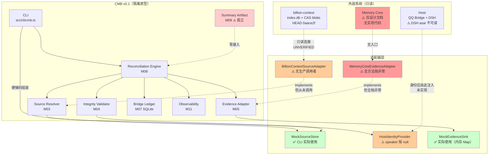
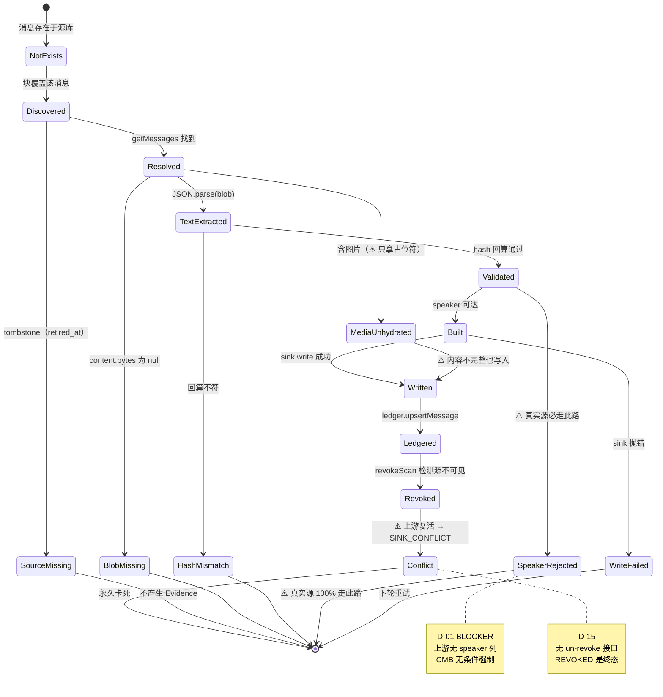
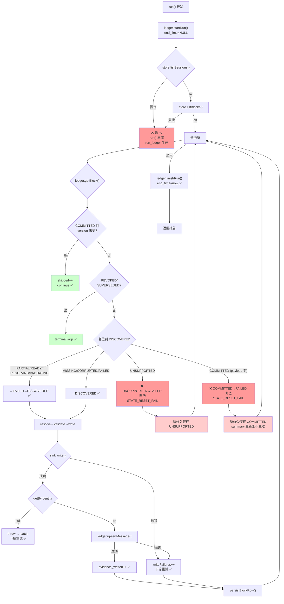
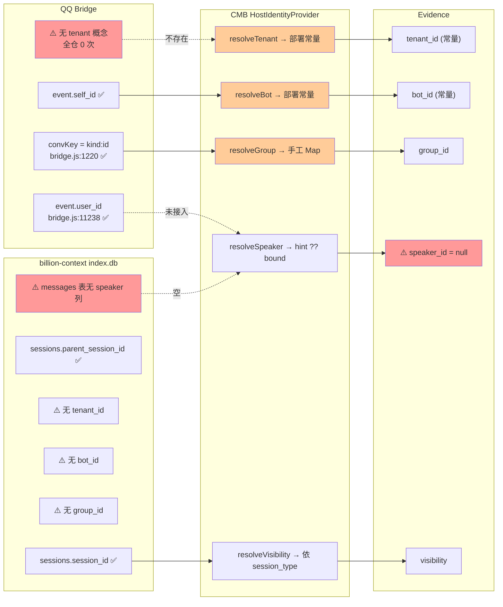
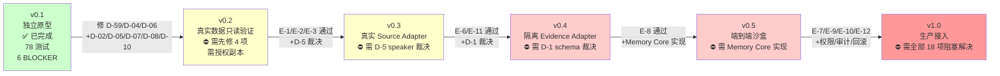
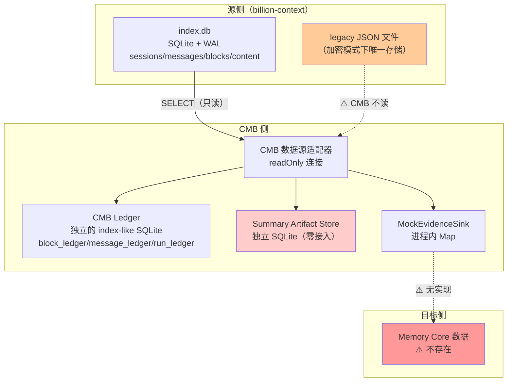

# 图表集（diagrams/）

采集：2026-11-06 ｜ 主代理绘制
**说明**：本文集中任务书 §26.8 要求但其他报告未涵盖的图表。已存在的图在对应报告中。

---

## 1. 系统总体架构图（含可达性标注）

**图例**：绿=实际可用；橙=存在但不可达；红=空壳/孤立。

---

## 2. Evidence 生命周期图

---

## 3. 故障恢复流程图

---

## 4. 身份映射图（五标识来源与断链）

---

## 5. v0.1 → v1.0 演进图

---

## 6. 数据流与三种数据存储的关系

