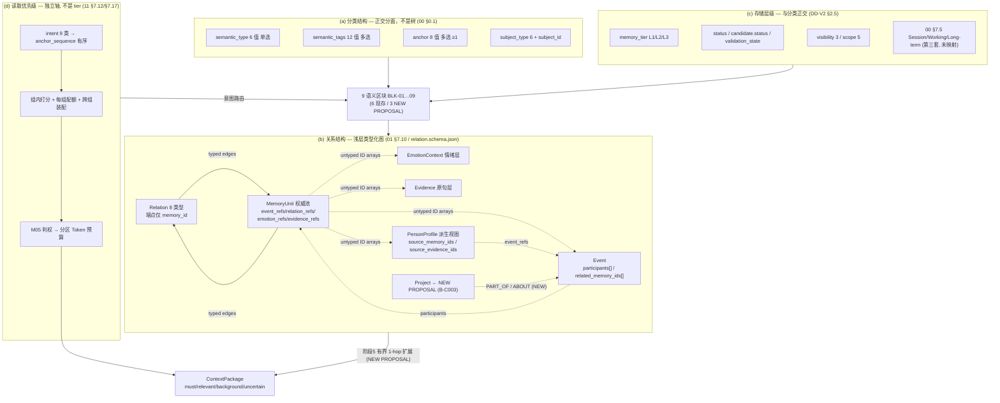
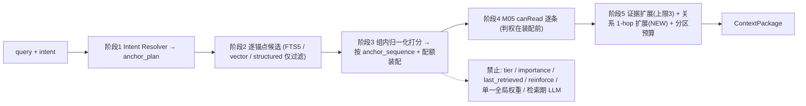

# 02 — Long-Term Memory Internal Structure (Agent B)

> Round: MC-CORE-CAPABILITY-REVIEW-01 · Agent B
> Question: **Is long-term memory internally organised, or one flat list?**
> Baseline: `C:\Users\[USER]\Desktop\work\Memory-Core-R4.1-Design\`
> Navigation: `E:\[PROJECT]\AUDIT-FORENSIC-2026\`
> Standards: `E:\[PROJECT]\CORE-CAPABILITY-REVIEW-2026\_shared\STANDARDS.md` (read fully, STEP 1)
> Deliverable companion: `E:\[PROJECT]\CORE-CAPABILITY-REVIEW-2026\SUBAGENT-REPORTS\B-REPORT.md`

## STATUS: COMPLETE

(Created per STEP 0 with the initial in-progress status **before any file was read**, so partial progress would survive; §§0–3 filled first, §§4–7 in the second pass. Flipped to COMPLETE only after all sections were written. See also `## FINAL STATUS: COMPLETE` at the end of this file.)

---

## 0. Scope / what I read / what I did NOT examine

**What I read (originals, not the forensic scratch copies):**
- `_shared\STANDARDS.md` (full, 149 lines) — binding labels, priority, vocabulary, writing rules.
- Baseline: `00-总体架构与设计原则.md` (§0.1, §0.4, §7.5, §7.6), `01-记忆本体与数据模型.md` (§7.1, §7.2, §7.10, §7.16, §7.18, §9.1), `02-核心算法规范.md` (§3, §7.3 ALG-02, §7.4 ALG-03, §7.5 ALG-04, §7.7 ALG-06, §7.9 ALG-08), `11-MemoryAnchor与语义分类.md` (§7.1–§7.19), `12-人物画像整合.md` (§7.1–§7.8), `13-Evidence与EmotionContext.md` (§7.1–§7.7), `14-ChatLLM读写API.md` (§7.2.6, §7.4), `15-参数注册表.md` (§7.17), `DD-AUTHORITY-V2.md` (full), `contracts\schemas\` — `relation`, `memory-unit`, `anchor-set`, `person-profile`, `event`, `read-request`; `contracts\api\api-contracts.md` (§2, §3); `OPEN-ISSUES.md` (OI-020).
- Forensic navigation: `03-ARCHITECTURE-FACTS.md` (§H, §I, §J), `04-CONTRACT-AND-SCHEMA-AUDIT.md` (§5.3), `05-LIFECYCLE-AND-STATE-MACHINE-AUDIT.md` (§D-F003, §4.3, §6), `09-CONFLICT-REGISTER.md` (§FC-040), `00-FINAL-FORENSIC-AUDIT.md` (§9.3), `14-SUBAGENT-REPORTS\D-REPORT.md` (D-F015).

**What I did NOT examine / did NOT do:**
- Did **not** re-audit the 49 conflicts; extracted only FC-040, D-F003, D-F015, FC-035, C-F017/X-D-03, OI-020 because they change a core-capability answer.
- Ignored formatting/naming/wording nits and low-priority ops, per STANDARDS §0.
- Did **not** read the whole of 03/04/05/06/07/08/09/10/15, diagrams/, evidence/, reviews/ or test-specs/ beyond the targeted greps above.
- **Read-only**: no design, schema, API, DDL or test edits. No npm. No PowerShell `-Encoding utf8`. Only writes were into `E:\[PROJECT]\CORE-CAPABILITY-REVIEW-2026\`.
- **Evidence caveat (STANDARDS §2)**: a schema file is **not** proof of a working subsystem, and a module split is **not** proof of module independence. All verdicts below are about **design-level structure**. Doc `02` §3 marks M03/M04/M05/Dream as FUTURE and `DD-AUTHORITY-V2 §10` keeps P3–P6 "需阶段授权"; no claim is made that the relation/profile subsystem runs.
- Corruption note: baseline `02-核心算法规范.md` carries a UTF-8 BOM and one NUL byte (byte 673), and `01` carries a BOM. Pre-existing; the read tool refuses it as binary. I did **not** modify the baseline; a NUL-stripped, BOM-stripped working copy was written to `EVIDENCE\B\02-clean.md` for citation only (`EVIDENCE\B\` is permitted by STANDARDS §7).

---

## 1. Headline (capability verdict in 3 lines)

1. **NOT a flat list, and NOT a tree.** The corpus explicitly mandates **multi-dimensional organisation with nine independent dimensions, "不采用单一分类树"** (`00 §0.1` line 16), realised as 6 `semantic_type` + 12 `semantic_tags` + 8 `anchor` + `subject_id` + `memory_tier` + `status` + `visibility/scope` + time validity + emotion association.
2. **But the organisation is faceted classification + shallow typed relations, not a joined block structure.** Long-term memory is one authoritative `MemoryUnit` pool with orthogonal facets, plus a `Relation` object and denormalised ID arrays; there is **no first-class cross-block relation layer** and **no project/entity node**, so person↔event, project↔event and "one memory in several blocks" cannot be expressed as typed relations.
3. **Retrieval priority is a separate, intent-routed axis** (9 intents → ordered `anchor_sequence` → group quotas → per-zone token budget), explicitly **not** `memory_tier`, `importance`, `last_retrieved` or a global fixed weight (`11 §7.12`, `§7.17`, `02 §7.5 §3.5`). The critical gap: **nothing automatically co-retrieves related blocks**, so a chat LLM can recall one block and miss related info.

### 1.1 Direct answer to the question
**Internally organised — multi-dimensional and faceted — but the "blocks" exist as retrieval facets and derived views, not as independently addressable, relationally joined partitions.** It is neither a single flat list nor a folder tree. The nearest accurate description is: **a flat authoritative `MemoryUnit` table with orthogonal classification facets, a separate tier/status axis, an intent-driven priority axis, and a shallow typed relation graph whose edges only connect memories to memories.** See §3.3 for the Tree/Graph/Hybrid verdict.

---

## 2. Findings (EXISTING DESIGN / DESIGN COMPLETENESS / RECOMMENDED ADDITION)

> Every EXISTING DESIGN claim carries file + section. `COMPLETENESS` uses STANDARDS §5 vocabulary. Recommendations are labelled **NEW PROPOSAL** and are not described as approved.

### B-C001 · P0 · Cross-block relation structure is not first-class
- **EXISTING DESIGN**: `Relation` has exactly two endpoints `source_memory_id` / `target_memory_id` (both `format: uuid`, `contracts/schemas/relation.schema.json` lines 11–12) with 8 controlled `relation_type` values (`DD-AUTHORITY-V2 §2.15`; `01 §7.10`). `MemoryUnit` carries `event_refs` / `relation_refs` / `emotion_refs` / `evidence_refs` / `merged_from` / `profile_field` as **arrays of IDs** (`DD-AUTHORITY-V2 §3.1`; `memory-unit.schema.json` lines 158–186). `Event` carries `participants[]` and `related_memory_ids[]` (`DD-AUTHORITY-V2 §3.3`; `event.schema.json` lines 49–68); `PersonProfile` carries `source_memory_ids` / `source_evidence_ids` (`DD-AUTHORITY-V2 §3.5`). `01 §9.1` ER diagram shows `MEMORY_RELATIONS` as an adjacency table between `MEMORY_OBJECTS` rows.
- **DESIGN COMPLETENESS**: **PARTIAL**. Typed, directed, versioned, permission-scoped relations exist **only between MemoryUnits**. The five core objects (`MemoryUnit`, `Evidence`, `Event`, `EmotionContext`, `PersonProfile`) live in **separate ID spaces** — `event.schema.json` §$comment explicitly warns "用 related_memory_ids 指向 event_id —— 两者 ID 空间不同". Cross-object links are therefore untyped denormalised arrays, not relations: no `relation_type`, no `confidence`, no `provenance_id`, no `version`, no `availability_state` on a person↔event or project↔event link. `ABOUT` and `PART_OF` exist as relation enums but their endpoints are still `memory_id` (`relation.schema.json`), so they cannot point at a project or a subject entity. Consequence: the long-term structure **cannot express the relations the brief requires** (person↔event, one project with many events, one memory in several blocks) as relations — which is STANDARDS §4 **P0** ("long-term structure cannot express relations").
- **RECOMMENDED ADDITION (NEW PROPOSAL)**: a typed cross-block edge contract (`Edge{source_ref, source_type, target_ref, target_type, relation_type, ...}`) generalising `Relation` to heterogeneous endpoints, plus a first-class `Project` entity. **CONTRACT_CHANGE + SCHEMA_MIGRATION**. Requires amendment of `DD-AUTHORITY-V2 §2.15/§3`, `01 §7.10/§7.16/§9.1`, `relation.schema.json`, `14 §7.2.6`. Blocks V0.9 for the relation-dependent capabilities; can be settled inside V0.9 experiments only as a design decision, not as an implemented subsystem.

### B-C002 · P1 · No automatic cross-block joint retrieval — recalling one block can miss related info
- **EXISTING DESIGN**: retrieval is `阶段1 意图识别 → 阶段2 锚点候选 → 阶段3 排序 → 阶段4 权限过滤 → 阶段5 证据扩展与上下文构建` (`DD-AUTHORITY-V2 §8`; `11 §7.17`). Stage 5 expands **Evidence only**, bounded by `recall.evidence_expansion_limit` default 3 (`15 §7.17`; `read-request.schema.json` line 112). `memory.getRelated(memory_id)` is a **caller-initiated, one-hop** read (`14 §7.2.6`), with input `relation_types[]` but **no depth/hop/node/visited/expansion-budget parameter** (input table lines 424–429). `14 §7.4` uses it only as a **manual third fallback** for person/relationship queries. `hidden_relations[]` returns only "存在不可见关联" as a fact (`14 §7.2.6` output table). `02 §3` line 68: "Cross-Encoder / ANN / **图检索 — REJECTED（当前范围）**／FUTURE" (also `09-CONFLICT-REGISTER §FC-040`).
- **DESIGN COMPLETENESS**: **PARTIAL / MISSING (co-retrieval algorithm = MISSING)**. `memory.search` returns a ranked flat candidate set; no stage guarantees that hitting a `PERSON_PROFILE` item also brings its supporting `SELF_EXPLICIT` sources, related `RELATIONSHIP`, or the `EVENT` behind a `MILESTONE`. `getRelated` has no `relation_max_hops`, no visited-set cycle guard, no per-expanded-node M05 re-judgement, no related-block token quota, and is not invoked automatically. There is **no `recall.relation_expansion_limit` parameter** in `15-参数注册表.md` (grep over the design package: 0 hits for relation-expansion parameters). This is exactly STANDARDS §4 **P1** ("no cross-block joint retrieval").
- **RECOMMENDED ADDITION (NEW PROPOSAL)**: add a bounded **1-hop typed expansion** inside stage 5, with new EXP-DEFAULT parameters `recall.relation_expansion_limit`, `recall.relation_max_hops=1`, `recall.related_block_quota`; a visited-set cycle guard; per-node M05 re-judgement; relation-type whitelist; and `related_missing[]` in the response when a related block was hidden/denied. Keep it shallow deliberately — see §3.3.

### B-C003 · P1 · 项目 (project) is not a block or an entity; 情境记忆 has no block
- **EXISTING DESIGN**: "project" appears only as `scope=project_scoped` (`01 §7.5`; `DD-AUTHORITY-V2 §2.10/§4.3`) with `scope_id` carrying the project ID as **PROPOSED** (`01 §7.5` line 240, `OI-01-02`); `OPEN-ISSUES.md` **OI-020** records that `scope_id` is **absent from `memory-object.schema.json`** (`additionalProperties:false`), so `project_scoped` cannot be located to a concrete project. `subjects.subject_type` enumerates `user/group/bot/agent/system/service` — **no project** (`01 §7.16` table 1). The 8-value `anchor` enum has **no project anchor** (`DD-AUTHORITY-V2 §2.3`). `00 §7.5` lists "Long-term Memory" contents but no project block. 情境/情景 memory appears only as `Session Context` in the **v1** three-layer table (`00 §7.5` lines 370–372), which forensic `05 §D-F003` shows is **never mapped to L1/L2/L3**.
- **DESIGN COMPLETENESS**: **MISSING**. "One project with many events" has no grouping object, no `project_id` field, no `PART_OF` target, no dedicated anchor, and no query intent. 情境记忆 has no object; it is split across `CURRENT_STATE` (L1/L2), `session_only` scope, and the unmapped `Session Context` layer. STANDARDS §9 forbids inventing synonyms — the corpus has no term for either, so both are reported as gaps, not renamed.
- **RECOMMENDED ADDITION (NEW PROPOSAL)**: a `BLK-05 项目` with a `Project` entity (`project_id`, participants, state, event set) and a `BLK-09 情境记忆` scoped to `CURRENT_STATE` + `session_only` + explicit `valid_until`, **without** adding a `semantic_type` value (a 7th value would violate `DD-AUTHORITY-V2 §13.1` terminology rule and needs adjudication). **CONTRACT_CHANGE**. Docs: `DD-AUTHORITY-V2 §2.3/§2.4/§3`, `01 §7.5/§7.16`, `11 §7.13`, `OPEN-ISSUES OI-020`.

### B-C004 · P1 · One global weight table stands in for retrieval priority and conflicts with the ordered route
- **EXISTING DESIGN**: `anchor-set.schema.json` `default_routes[]` gives each intent an ordered `anchor_sequence` described as "该意图的锚点检索顺序（有序，代表默认获取优先级）" (line 99), with `PERSON_QUERY` = `SELF_EXPLICIT → PERSON_PROFILE → PREFERENCE → SELF_DERIVED → RELATIONSHIP → EVENT` (example line 215), matching `11 §7.14`/`DD-AUTHORITY-V2 §8`. The **same schema** also ships a single global `weights` object for all 8 anchors (lines 128–141) where `PERSON_PROFILE=0.35 > SELF_EXPLICIT=0.2`, described as "8 个锚点的排序加权默认值" and "权重之和 MUST NOT 被读作概率分布". `11 §7.17 §3.4` requires "**MUST** 按 `anchor_plan` 顺序 + 每组配额装配，而 **MUST NOT** 用一个全局分对所有锚点统一排序", and §"禁止 1" states "权重 **MUST** 按锚点组与意图分别配置".
- **DESIGN COMPLETENESS**: **CONFLICTED**. Two competing priority representations coexist: an ordered per-intent sequence and one global per-anchor weight table whose values invert the mandated person-understanding order (profile 0.35 > self-explicit 0.2, while `11 §7.14` puts `SELF_EXPLICIT` at step 1 "最高可信，先给" and `12 §7.3.2` requires 自述优先). A single global weight table also cannot express the per-intent/per-group weighting that `11 §7.17` mandates. This is precisely the brief's warning: **one field / one sort order must not stand for classification, relation, tier and priority at once**.
- **RECOMMENDED ADDITION (NEW PROPOSAL)**: keep `anchor_sequence` as the **sole** ordering authority; demote `weights` to per-(intent, anchor-group) scoring features with an explicit `scope` field, or delete it. Add a schema-level uniqueness/consistency test that `weights` can never override `anchor_sequence`. **CONTRACT_CHANGE** (`anchor-set.schema.json`, `11 §7.17`).

### B-C005 · P1 · `getProfile` default returns all 11 sections, contradicting the "do not read all sections every turn" rule
- **EXISTING DESIGN**: `read-request.schema.json` `sections`: "空数组或缺省 = 全部启用分区" (line 188); `12 §7.7.1` rule 1 "`sections?` 缺省时 **MUST** 返回全部 11 分区". `14 §7.4` row 1 says for "问个人情况": "**MUST NOT** 每轮读全 11 分区；**MUST NOT** 把大量事件排在画像前". `12 §7.2` rule 1: one profile record belongs to exactly one `section`; cross-section content **MUST** be split.
- **DESIGN COMPLETENESS**: **CONFLICTED / PARTIAL**. The profile block is a derived view spanning 11 heterogeneous sections — stable (`identity`, `value`), inferred (`derived`), and volatile (`current_state`, which `12 §7.2` rule 3 says MUST carry `valid_from/valid_until`). That is a **large block mixing responsibilities**; the default full-read contradicts the per-turn budget discipline and can flood context with stale `current_state` entries.
- **RECOMMENDED ADDITION (NEW PROPOSAL)**: default `sections` to the intent's minimal section set; make full-11 an explicit opt-in; split `current_state` into its own time-bounded view so a stable-person query cannot pull volatile state. **CONTRACT_CHANGE**. Docs: `read-request.schema.json`, `12 §7.2/§7.7.1`, `14 §7.4`, `person-profile.schema.json`.

### B-C006 · P1 · `PERSON` is overloaded; 稳定事实 (non-person stable facts) has no legal home
- **EXISTING DESIGN**: `semantic_type` is exactly 6 values and `PERSON` = "身份/背景/自述/特征/能力/价值观/长期目标/自我认知" (`DD-AUTHORITY-V2 §2.1`; `11 §7.2` — all person attributes). Yet `DD-AUTHORITY-V2 §4.1` maps v1 `procedural` → **`PERSON` + `PROCEDURAL`** ("能力/流程") and v1 `semantic` ("稳定事实与知识", `01 §7.2` line 183) → routed by content, **default `PERSON`**. `11 §7.1` 总则 5: "无法归类 ⇒ **MUST NOT** 就近塞入 `PERSON`；**MUST** 标 `ambiguous` 并进入复核".
- **DESIGN COMPLETENESS**: **CONFLICTED**. A "project uses Go / the team's deploy procedure / a stable domain fact" is not a person attribute, but the only non-`CURRENT_STATE` landing spots are `PERSON` (overloaded) or `PREFERENCE` (wrong). The mapping table and the "don't dump into PERSON" rule contradict each other. This is the "block too large / mixing responsibilities" flag for the classification axis.
- **RECOMMENDED ADDITION (NEW PROPOSAL)**: a `BLK-07 稳定事实` with `semantic_tags`-based sub-typing under a clearly-scoped host (or an adjudicated 7th `semantic_type`), and a rewrite of `DD-AUTHORITY-V2 §4.1` so `procedural`/non-person `semantic` no longer default to `PERSON`. **CONTRACT_CHANGE + adjudication** (`DD-AUTHORITY-V2 §2.1/§4.1`, `11 §7.1/§7.2`, `01 §7.2`).

### B-C007 · P1 · Relation-change propagation and deletion associations are only partial for cross-object ID arrays
- **EXISTING DESIGN**: `02 §7.9 §5.5` — source memory deleted/modified/permission-tightened/evidence-revoked ⇒ dependent `Observation` → `needs_recompute`/`invalidated`/`restricted`, and `Relation` → `availability_state` downgrade. `13 §7.4.5` — `revoked=true` ⇒ all linked MemoryUnits marked "证据缺失"; derived `PersonProfile`/`Observation` invalidated; **MUST NOT** auto-delete the MemoryUnit. `13 §7.4.6` DEL-1…DEL-7 — logical delete first, FK non-dangling, tombstone, provenance, no `reinforce`. `12 §7.4` step 3 — evidence re-check on profile update; `12 §7.6` — `SUPERSEDES` version chain. `01 §7.10` — relation scope = strictest intersection of both ends; no leakage through a relation edge. `00-FINAL-FORENSIC-AUDIT §9.3` — "observations / relations: yes / **partial** / no [end-to-end]"; `FC-035` — backup restore resurrects deleted memory, no replay mechanism.
- **DESIGN COMPLETENESS**: **MOSTLY_COMPLETE for Observation / PersonProfile / Relation availability; MISSING for the denormalised cross-object arrays.** No rule rewrites `Event.related_memory_ids`, `MemoryUnit.event_refs` / `relation_refs` / `emotion_refs` / `evidence_refs` when the referenced object is deleted or `SUPERSEDED`. Forensic `14-SUBAGENT-REPORTS\D-REPORT.md` **D-F015** confirms exactly this for `evidence_refs`: "Deleting an Evidence row leaves `memory_objects.evidence_refs` dangling; no rule rewrites the array". `05-LIFECYCLE-AND-STATE-MACHINE-AUDIT §6` (line 550) says "no rule at all". So the graph is left with dangling edges — directly damaging "associations on deletion".
- **RECOMMENDED ADDITION (NEW PROPOSAL)**: a single **referential-integrity propagation algorithm** over all six ID arrays plus `memory_evidence_links` / `memory_relations` / `Event.participants`, with input/output/module/steps/failure handling per STANDARDS §5, run inside the same M01 transaction as the delete; plus tombstone replay on restore. **MULTI_MODULE_CHANGE**. Docs: `01 §7.16/§7.18`, `02 §7.9`, `13 §7.4.6`, `14 §7.2.6`, `05-可靠性与运维规范.md`.

### B-C008 · P1 · Cycle avoidance is a constraint, not an algorithm; recursion blow-up is unguarded
- **EXISTING DESIGN**: `01 §7.10` "**MUST NOT** 成环（`DERIVED_FROM`/`SUPERSEDES`/`BUILDS_ON` 必须无环）"; `01 §7.18` C-07 "`supersedes` 不成环、不自引用 | 应用校验（**递归检查**）| 拒绝"; `12 §7.6` "`SUPERSEDES` **MUST NOT** 自引用、**MUST NOT** 成环"; `relation.schema.json` requires `version`, `availability_state`, and forbids self-referential endpoints implicitly via `01 §7.16` CHECK "两端不等". `14 §7.2.6` `getRelated` input has **no** `max_hops`, `max_nodes`, `visited` or `depth` field.
- **DESIGN COMPLETENESS**: **CONCEPT_ONLY for the cycle-check algorithm; MISSING for recursion bounds.** "递归检查" is a name, not an algorithm: no input, output, executing module, steps, failure handling, determinism or test criterion is defined (STANDARDS §5 requires all of these). With `RELATED_TO`/`ABOUT` edges (which `01 §7.10` marks as bidirectional-semantics and auto-generatable by M04) and no hop limit, a graph walk can cycle or explode. `02 §3` rejecting 图检索 removes the walker but also removes the guard.
- **RECOMMENDED ADDITION (NEW PROPOSAL)**: define `ALG-13 RelationIntegrityCheck` (acyclicity for the three ordered types, self-loop rejection, visited-set traversal) with full 17-element spec, and hard-bind `getRelated` to `max_hops=1` by default. **MODULE_LOCAL_CHANGE + CONTRACT_CHANGE**. Docs: `01 §7.10/§7.18`, `02 §7.9`, `14 §7.2.6`, `15-参数注册表.md`.

### B-C009 · P1 · Two coexisting object models make "one flat list vs organised" ambiguous at the storage layer
- **EXISTING DESIGN**: `01 §7.1` declares 9 authoritative objects (+2 FUTURE) stored in `SQLite memory_objects` (`01 §7.16` table 2) with `lifecycle_state` six values and `type` seven values; `DD-AUTHORITY-V2 §4.2` maps those into `status` four values + `candidate.status` six values + `semantic_type` six values, and `memory-unit.schema.json` declares `schema_version="2.0"`. `04-CONTRACT-AND-SCHEMA-AUDIT §C-F017` / `05-LIFECYCLE-AND-STATE-MACHINE-AUDIT §X-D-03` record that `memory-object.schema.json` (v1) and `memory-unit.schema.json` (v2) **coexist with different state vocabularies and both are `required`-valid**; nothing says which one M01 writes. `05 §4.3` also records `retrieval-request.schema.json` has 0 occurrences of `tier`/`status`/`lifecycle` while `11 §7.17`/`§8.3` mandate them as structured filters.
- **DESIGN COMPLETENESS**: **CONFLICTED**. There is no single authoritative MemoryUnit store contract; the "flat list" question has two answers depending on which schema is read. This is a cross-scope handoff (Agent C owns contracts), but it changes the capability answer and is recorded here as a finding.
- **RECOMMENDED ADDITION (NEW PROPOSAL)**: freeze one object model, retire the other with an explicit migration mapping, and add `tier`/`status` filters to `retrieval-request.schema.json`. **CONTRACT_CHANGE + SCHEMA_MIGRATION**. Docs: `01 §7.1/§7.16`, `DD-AUTHORITY-V2 §4`, `contracts/schemas/memory-object.schema.json`, `retrieval-request.schema.json`.

### P2 (archived briefly, not led with)
`emotion.query_enabled=false` / `emotion.influence_enabled=false` / `emotion.auto_infer=false` (CR-02/03/04, `DD-AUTHORITY-V2 §12`), `图检索 REJECTED（当前范围）` (`02 §3`, FC-040), and unvalidated EXP-DEFAULT weights (`anchor-set.schema.json` line 131, `02 §7.5 §14`) are tunable/authorisation items for later. They are **not** treated as "architecturally impossible" (STANDARDS §0).

---

## 3. The required matrix / tables for this brief

### 3.1 MANDATORY MATRIX

> Vocabulary is taken verbatim from `DD-AUTHORITY-V2` (STANDARDS §9). `当前完整性` uses STANDARDS §5. Blocks marked **NEW PROPOSAL** are not in the corpus; they are proposed in §5, never described as approved. `BLK-10/11` are supporting layers, **not** semantic blocks.

| 区块 ID | 区块名称 | 内容范围 | 主要 Anchor | 关联区块 | 数据对象 | 读取优先级 | 典型查询 | 不应包含的内容 | 当前完整性 |
|---|---|---|---|---|---|---|---|---|---|
| BLK-01 | 人物画像 `PERSON_PROFILE` | M04 维护的**派生视图**：11 `section` 整合结论（`identity/self_explicit/preference/goal/value/ability/experience/habit/interaction/derived/current_state`），带 `basis` 三值与双向来源追溯 | `PERSON_PROFILE` | BLK-02, 03, 04, 08, 09；Evidence（追溯） | `PersonProfile` + 源 `MemoryUnit` | 人物理解第 2 步（`11 §7.14`）；`PROFILE_QUERY` 第 1；**事件查询不受画像优先**（`11 §7.18`） | "介绍一下我"/"我的价值观是什么" | 事件流水、情绪判断、原句、无来源结论、未确认候选（12 §7.1/§7.3.2；`person-profile.schema.json` §$comment） | **MOSTLY_COMPLETE**（`12 §7.1–§7.8`, `person-profile.schema.json`）— 但全 11 分区缺省全读与 14 §7.4 冲突 → B-C005 |
| BLK-02 | 自我描述 `SELF_EXPLICIT` / `SELF_DERIVED` | 主人明确自述（最高可信）与系统推断特征，**强制分离** | `SELF_EXPLICIT` / `SELF_DERIVED`（互斥，`11 §7.9`） | BLK-01（`source_memory_ids`）、Evidence | `MemoryUnit` (`PERSON` + `IDENTITY/VALUE/GOAL/ABILITY/OBSERVATION`) | 人物理解第 1 步 / 第 4 步（`11 §7.14`）；自述 > 推断 | "我说过我是什么样的人"/"系统觉得我是什么样的人" | 推断冒充自述、两者合并成一条、把群成员推断与主人自述混单元（11 §7.2/§7.9；12 §7.3.3） | **COMPLETE**（11 §7.2/§7.9, 12 §7.3, `memory-unit.schema.json` §allOf） |
| BLK-03 | 偏好 `PREFERENCE` | 喜好/厌恶、习惯、互动方式、长期约定、流程/方法偏好 | `PREFERENCE` | BLK-01, BLK-02, BLK-09 | `MemoryUnit` (`PREFERENCE` + `HABIT/INTERACTION/CONVENTION/PROCEDURAL`) | 人物理解第 3 步；`PREFERENCE_QUERY` 第 1 | "我喜欢什么回应风格"/"我讨厌什么" | 一次性指令（"这次先不用总结"）、跨主体套用、由一次表达推导稳定偏好（11 §7.3） | **COMPLETE**（11 §7.3, `DD-AUTHORITY-V2 §2.1/§2.2`） |
| BLK-04 | 关系 `RELATIONSHIP` | 人与人/人与群体持续关系及**关系变化**（含方向、强度、群体归属） | `RELATIONSHIP` | BLK-01, BLK-06（变化事件）, BLK-05（新提案） | `MemoryUnit` (`RELATIONSHIP`) + `Relation` (8 类型) | 人物理解第 5 步；`RELATIONSHIP_QUERY` 第 1 → 变化事件 → 画像 → 证据 | "我和老王什么关系"/"我团队有谁" | 单次互动当关系、对称化不对称关系、跨端泄露对方隐私、与 `ABOUT` 关系边混同（11 §7.4） | **MOSTLY_COMPLETE** — 语义主类完整，但关系边只连 MemoryUnit → B-C001 |
| BLK-05 | 项目 `PROJECT` | **NEW PROPOSAL**：项目实体（参与人、状态、事件集合、阶段结论）及其与事件/人物/状态的类型化关联 | 无（8 锚点无 PROJECT）→ 提案用 `CURRENT_STATE`+`EVENT` 复用或新增受控锚点 | BLK-06, BLK-04, BLK-09 | **NEW PROPOSAL** `Project` 实体 | 提案：`EVENT_QUERY` / `CURRENT_STATE_QUERY` 内按项目上下文召回 | "这个项目有哪些里程碑"/"谁参与了 PJ1" | 把 `project_scoped` 权限值当项目对象；编造 `scope_id`（OI-020） | **MISSING**（仅 `scope=project_scoped`；`subjects.subject_type` 无 project；`scope_id` 缺字段）→ B-C003 |
| BLK-06 | 事件 `EVENT` | 客观事件事实：`time_start/end`、`participants[]`、`location`、`result`，`MILESTONE` 标签 | `EVENT` | BLK-01(`experience`), 02, 04, 05, 08, 11；Evidence | `Event` + `MemoryUnit` (`EVENT`) | `EVENT_QUERY` 第 1 → 证据 → 关联人物 →（按需）情绪（11 §7.15） | "上周三我做了什么"/"那次评审结论是什么" | 情绪判断/评价/推测、未来计划、不同时间相似事件合并、缺时间编造时间（`event.schema.json`, 11 §7.5, 13 §7.7） | **MOSTLY_COMPLETE**（`event.schema.json`, 13 §7.7）— 反向"某人的所有事件"查询未定义 → B-C001/§3.5 |
| BLK-07 | 稳定事实 `STABLE_FACT` | **NEW PROPOSAL**：非人物的稳定事实/领域知识/流程（"项目用 Go"、"部署流程是…"），与人物属性分离 | 无专门锚点 → 提案挂 `PERSON_PROFILE` 之外的新受控标签/锚点（需裁决） | BLK-05, 06, 01 | **NEW PROPOSAL**（在 6 值枚举内用 `semantic_tags` 子类型，或经裁决增第 7 值） | 提案：`GENERAL_MEMORY_QUERY` 稳定层 | "这个项目的部署流程是什么" | 依 `DD-AUTHORITY-V2 §4.1` 默认塞进 `PERSON`；无法归类就近塞 `PERSON`（11 §7.1 总则 5 禁止） | **MISSING / CONFLICTED** → B-C006 |
| BLK-08 | 经历 `MILESTONE` / `experience` | 重要经历（里程碑式事件）的人物侧归纳，经 `event_refs` 举证 | `EVENT` + `PERSON_PROFILE`(`experience` 分区) | BLK-01, 06, 02 | `MemoryUnit` (`EVENT`/`MILESTONE`) + `PersonProfile.section=experience` + `Event` | 人物理解第 6 步（补充，条数受限 `11 §7.14` 原则 3）；事件查询按 `EVENT` | "去年我参加过什么"/"我拿到学位那次" | 情绪判断、把一个 Event 拆成多条画像结论淹没人物描述、无条件升 L3（12 §7.8, 11 §7.5） | **MOSTLY_COMPLETE**（11 §7.5, 12 §7.2/§7.8） |
| BLK-09 | 情境记忆 `CURRENT_STATE` | 进行中计划、阶段性目标、困难、进度、临时状态、会话内情境；`valid_from/valid_until` 必带时效 | `CURRENT_STATE` | BLK-01(`current_state`), 03, 05, 06 | `MemoryUnit` (`CURRENT_STATE` + `GOAL`) | `CURRENT_STATE_QUERY` 第 1 → 近期事件 → 目标/偏好（11 §7.15） | "我现在在忙什么"/"考研准备到哪了" | 已结束/已取消状态不标结束、长期目标、情绪、无限期有效（11 §7.6, 12 §7.2 规则 3） | **PARTIAL** — 无"情境记忆"对象；`00 §7.5` Session Context 未映射到 L1/L2/L3（05 §D-F003）→ B-C003 |
| BLK-10 | （支撑层，非区块）原句证据 | Evidence 原始表达、`content_hash`、`revoked`、`source_locator`，多对多绑定 | `ORIGINAL_QUOTE_QUERY` 走 `evidence`/`related_evidence` | 全部区块（追溯） | `Evidence` + `memory_evidence_links` | `ORIGINAL_QUOTE_QUERY` 直取；阶段 5 证据扩展上限 3 | "我原话怎么说的" | 把 `content`（规范化）当原句、返回全部聊天历史、绕过 M05（13 §7.3/§7.4.4/§7.5） | **MOSTLY_COMPLETE**（13 §7.1–§7.5）— 证据删除后 `evidence_refs` 悬空 → B-C007/D-F015 |
| BLK-11 | （支撑层，非区块）情绪关联 | `EmotionContext` 15 标签、强度、置信度、`temporal_position`、`event_id` | `EMOTION_CONTEXT`（默认不注入） | BLK-06, 01 | `EmotionContext` | 默认**不注入**；`EMOTION_QUERY` 受 `emotion.query_enabled=false` 门禁 | "那次我什么感受" | 写进 `Event.content`、由沉默触发、写回事实、检索期 LLM 现场推断（13 §7.7, DD-V2 §9） | **COMPLETE as design / disabled by CR-02–04**（P2） |

**Block count: 9 semantic blocks (BLK-01…BLK-09) + 2 non-semantic supporting layers (BLK-10/11).** Of the 9, **6 are present in the corpus** (BLK-01/02/03/04/06/08 — with 01/04/08 partial), **3 require NEW PROPOSAL** (BLK-05 项目, BLK-07 稳定事实, BLK-09 情境记忆 as a first-class block).

### 3.2 Tree vs Graph vs Hybrid — comparison

| 维度 | Tree (单亲层级) | Graph (任意类型化边) | Hybrid (分面索引 + 浅层类型化关系图) |
|---|---|---|---|
| **结构** | 每节点恰好一个父节点，路径唯一 | 节点 + 任意有向/无向类型化边，允许多父、环 | 正交分面（`semantic_type`/`semantic_tags`/`anchor`/`subject_id`/`tier`）+ 独立 `Relation` 层 + 有界 1-hop 扩展 |
| **关系表达上限** | 只能表达 containment / is-a；**无法**表达"一条记忆属于多个语义区块"、"一个事件关联多个人"、"人与项目与事件互相交叉"；`ABOUT`/`PART_OF` 会强制单亲 | 能表达全部交叉关系、多身份、多对多；但需端点类型化、环检测、逐跳判权 | 能表达分类多维（分面）+ 交叉关系（边），且把"关系"与"分类/层级/优先级"分属四套独立结构 |
| **查询成本** | 祖先/子树遍历 `O(depth)`，最便宜；但跨分支 join 需多次回溯根，**N 个交叉关系 → O(N·depth)** | 多跳 BFS `O(V+E)`；无界时指数级膨胀；每跳都要 M05 判权与版本回源（`02 §7.3` 九步回源），聊天延迟不可控 | 主查询 = FTS5 `O(log N + K)` +向量 `O(N·d)` + RRF + 分组装配（`02 §7.3 §12`, `11 §7.17`），**有界**；扩展 = 1-hop、受 `top_k` 与预算硬裁剪，成本=`O(K·deg)` 且 deg 受限 |
| **维护成本** | 移动节点=改父指针+全子树路径；合并/冲突（`02 §7.9` 八类冲突）会破坏单亲约束 | 边增删改需级联传播、环检测、派生视图重算；`02 §3` 已把图检索列为 REJECTED/FUTURE | 分面只改标签（MODULE_LOCAL_CHANGE）；边只改 `memory_relations` 一行；传播走既有 `02 §7.9.5` / `13 §7.4.5`（但需补 B-C007 的数组清理） |
| **与现有语料相容性** | **冲突**：`00 §0.1` 明确 "**不采用单一分类树**"、九维度相互独立；`00 §7.5` 的 Session→Working→Long-term 是**晋升层级**不是包含树（05 §D-F003 未映射到 L1/L2/L3） | **部分相容**：`01 §9.1` 的 `MEMORY_RELATIONS` 已是邻接表（图），8 类型 + 无环约束（`01 §7.10`）；但 `02 §3` 明确 REJECTED 图检索，且 `Relation` 端点仅 `memory_id` | **最相容**：`00 §0.1` + `DD-AUTHORITY-V2 §2` 已是正交分面；`01 §7.10`/`relation.schema.json` 已是浅层类型化边；`11 §7.17` 已是"分组排序 + 配额装配"而非全局图遍历 |
| **对聊天 LLM 的实际适配** | 差：LLM 要的是"按意图给 Top-K 相关片段"，不是"沿路径下钻"；人物优先顺序（`11 §7.14`）是**有序列表**不是树路径 | 差：LLM 每轮只有固定 Token 预算（`read-request.schema.json` `budget_tokens` 默认 1200），多跳图遍历不可预测且易越权泄露（`01 §7.10` 关系边不得泄露受限对象） | 好：意图路由给有序锚点组 → 组内打分 → 权限过滤 → 有界关系/证据扩展 → 分区 Token 预算（`02 §7.7`, `11 §7.17`），输出确定、可解释、可预算 |
| **主要风险** | 强制单一分类轴 → 违反 `00 §0.1`；"一条记忆多个区块"无解 | 环与递归爆炸（B-C008）、逐跳判权成本、跨对象端点缺失（B-C001） | 若扩展仍靠调用方手动 `getRelated`，仍会漏召回（B-C002）→ 必须把 1-hop 扩展**内建进阶段 5** |

### 3.3 Direct answer: Tree, Graph, or Hybrid — and why

> **HYBRID.** Specifically: **orthogonal faceted classification + separate lifecycle tiers + separate intent-driven retrieval priority + a shallow, bounded, typed relation graph** — not a tree, not a full graph traversal, not a flat list.

Grounded in what the chat LLM actually needs to retrieve (all EXISTING DESIGN):
1. It needs **ranked Top-K by intent**, not a path walk: `memory.search` = FTS5 + LanceDB + structured filter → RRF → group-wise ranking (`02 §7.3/§7.4`, `11 §7.17`), with `budget_tokens` default 1200 and `top_k` default 20 (`read-request.schema.json`). A tree gives a path, a graph gives a neighbourhood; neither gives a bounded ranked list on its own.
2. It needs **person-understanding priority that is not a storage tier**: `SELF_EXPLICIT → PERSON_PROFILE → PREFERENCE → SELF_DERIVED → RELATIONSHIP → EVENT` (`DD-AUTHORITY-V2 §8`, `11 §7.14`), with `MUST NOT 以 tier 决定读取优先级` (`11 §7.12`) and `MUST NOT 用单一固定权重全局排序` (`11 §7.17`). Priority must be its own axis — a hybrid keeps it separate.
3. It needs **cross-block joins** ("that event with those people, that project, that emotion") which a pure flat list or pure tree cannot give — hence the typed relation layer (`01 §7.10`, `relation.schema.json`, 8 types incl. `ABOUT`/`PART_OF`/`SUPERSEDES`). But `02 §3` REJECTED graph retrieval in current scope, and `01 §7.10` forbids cycles — so the graph must stay **shallow (1-hop, visited-set, budget-bounded)**.
4. It needs **traceability and separation**: `MemoryUnit` ↔ `Evidence` many-to-many (`13 §7.1`), `Event` ⊥ `EmotionContext` (`13 §7.7`), `PersonProfile` as a derived view with `source_memory_ids` (`12 §7.1`). These are master-detail/star links, not tree children.

**Therefore**: tree is ruled out by `00 §0.1` (explicit) and by the multi-parent reality; full graph is ruled out by `02 §3` (REJECTED), by token/latency bounds, by permission-per-hop, and by cycle risk; flat list is ruled out by the corpus itself. Hybrid is the only description consistent with all four axes and with `DD-AUTHORITY-V2 §8`'s five-stage retrieval. **The corpus already contains the four mechanisms separately; the missing piece is that nothing binds them into one cross-block co-retrieval contract (B-C001/B-C002).**

### 3.4 CRITICAL — four things kept separate (do not let one field or one sort order stand for all four)

| | (a) 分类结构 classification | (b) 关系结构 relation | (c) 存储层级 storage tiers | (d) 读取优先级 retrieval priority |
|---|---|---|---|---|
| **是什么** | 记忆"是什么"的正交分面 | 记忆"与什么相连" | 记忆"保留多久/处于什么状态" | 一次查询"先给什么、给多少" |
| **EXISTING DESIGN** | `semantic_type` 6 值单选 + `semantic_tags` 12 值多选 + `anchor` 8 值多选(≥1) + `subject_type` 6 值 + `subject_id`（`DD-AUTHORITY-V2 §2.1–§2.4`）；九维度相互独立、**不采用单一分类树**（`00 §0.1`） | `Relation` 8 类型、有向、最严格 scope 交集、无环约束（`01 §7.10`, `DD-AUTHORITY-V2 §2.15`, `relation.schema.json`）+ `MemoryUnit` 六个 ID 数组 + `Event.participants/related_memory_ids` + `PersonProfile.source_*` + `memory_evidence_links`（`13 §7.1.3`, `01 §9.1`） | `memory_tier` L1/L2/L3 与 `semantic_type` **正交**；`status` 4 值；`candidate.status` 6 值；`validation_state` 4 值；`visibility` 3 / `scope` 5（`DD-AUTHORITY-V2 §2.5–§2.10`）；另有 `00 §7.5` Session/Working/Long-term **第三套未映射层级**（05 §D-F003） | `intent` 9 类 → `anchor_sequence` 有序 + 每组配额（`11 §7.19`, `anchor-set.schema.json`）+ `read_mode` 4 值 + `profile_first` + 分区 Token 预算（`DD-AUTHORITY-V2 §8`, `11 §7.17`, `02 §7.7`） |
| **不是什么** | 不是文件夹树；不是层级；不是优先级 | 不是分类标签；不是 tier；不是排序 | **不是重要程度、不是读取闸门**（`DD-AUTHORITY-V2 §2.5 铁律`, `11 §7.12`, `11 §7.16`）；不是排序权重 | **不是 `tier`**（`11 §7.12` MUST NOT）、**不是 `importance`**（`02 §7.5 §3.5` 只用于过滤/并列打破）、**不是 `last_retrieved`/`reinforce`**（`11 §7.17`, D-AP-05）、不是全局固定权重（`11 §7.17`） |
| **当前风险** | `DD-AUTHORITY-V2 §4.1` 把 `procedural`/`semantic` 默认塞进 `PERSON`（B-C006） | 边只连 `memory_id`（B-C001）；单全局 `weights` 同时想当排序与相关度（B-C004） | `00 §7.5` 第三套层级无映射到 L1/L2/L3；`retrieval-request.schema.json` 无 `tier/status` 过滤（05 §4.3, B-C009） | `anchor-set.schema.json` 全局 `weights`（PERSON_PROFILE 0.35 > SELF_EXPLICIT 0.2）与 `anchor_sequence` 顺序冲突（B-C004） |

**Explicit statement**: `memory_tier` must **not** be used as the retrieval sort key, `anchor` must **not** be used for permission (`11 §7.13` 规则 5 "锚点 MUST NOT 用于扩权"), `semantic_type` must **not** be split into multiple values (`11 §7.1` 总则 1), and `Relation.relation_type` must **not** be conflated with `semantic_type=RELATIONSHIP` (`11 §7.4` 禁止 4: "MUST NOT 把 RELATIONSHIP 与 ABOUT 关系边混同"). These are four contracts, not one.

### 3.5 Linkage & hard cases (one by one)

| # | Hard case | EXISTING DESIGN | 完整性 | 结论 / RECOMMENDED ADDITION |
|---|---|---|---|---|
| 1 | **person↔event linkage** | `MemoryUnit.event_refs`→`Event.event_id` (`DD-AUTHORITY-V2 §3.1`); `Event.participants[]` = `subject_id` 列表、`Event.related_memory_ids[]` (`event.schema.json`); `PersonProfile.experience/current_state` **MUST** 经 `event_refs` 与 Event 关联, Event 只作举证来源 (`12 §7.8` 规则 3) | **PARTIAL** | 双向指针存在但**无类型化边**：无 `relation_type`/`confidence`/`version`/`availability_state`；`ABOUT` 边端点仍为 `memory_id`。**NEW PROPOSAL**: 跨对象 `ABOUT`/`PARTICIPATED_IN` 类型化边 (B-C001) |
| 2 | **one event with several people** | `Event.participants` 为 `array<subject_id>` + `uniqueItems:true`，MUST 经 EntityResolver 解析、不确定者保留待解析 (`event.schema.json` lines 49–53; `DD-AUTHORITY-V2 §2.4`)；`01 §7.16` 有 `subjects` 表 | **PARTIAL** | 写入侧**支持**；但**无反向索引/连接表**（`01 §7.16` 13 张表无 event-participant join，`participants` 是 JSON 数组无 FK），"某人参与过的所有事件"未定义查询与判权路径。**NEW PROPOSAL**: `event_participants` 连接表 + 反查索引 |
| 3 | **one project with many events** | 仅 `scope=project_scoped` (`01 §7.5`) 与 PROPOSED `scope_id`（`OI-020`: schema 缺该字段）；无 `Project` 对象、无 project 锚点、无 `subjects.subject_type=project` | **MISSING** | 无法表达；`PART_OF` 无可指向的项目节点。**NEW PROPOSAL**: `BLK-05` + `Project` 实体 + `PART_OF`/`ABOUT` 跨对象边 (B-C003) |
| 4 | **one person with multiple identities / relations** | `EntityResolver` 处理别名/代词/昵称/关系指代，"不确定保留待解析，禁止强行合并" (`DD-AUTHORITY-V2 §5` stage 8, §2.4; `event.schema.json` §$comment)；`subjects.mapping_ref` (`01 §7.16` table 1)；`PersonProfile` 以单个 `subject_id` 为键 (`12 §7.2`) | **PARTIAL** | 解析层有纪律，但**无 first-class identity-set/alias 对象**，画像与关系都按单 `subject_id` 组织；多身份/多关系无显式表达。**NEW PROPOSAL**: `subject_alias` 表 + `PersonProfile` 允许 `(subject_id, section)` 下多身份来源标注（不合并） |
| 5 | **one memory in several semantic blocks** | `semantic_type` **单选**，"一单元有多个语义面向时 MUST 用 `semantic_tags` 表达，MUST NOT 拆成多个 `semantic_type`" (`11 §7.1` 总则 1)；`anchor` 多选 ≥1 (`DD-AUTHORITY-V2 §2.3`, `memory-unit.schema.json`)；`semantic_tags` 12 值可多选 (`§2.2`)。对照：`PersonProfile` 一条记录 **MUST 且仅能**属于一个 `section`，跨区 MUST 拆 (`12 §7.2` 规则 1) | **COMPLETE (分类) / CONFLICTED (画像视图)** | 正确机制是**一条 MemoryUnit + 多 anchor + 多 tag**，不是复制记忆；画像视图用拆分。两者规则不同但都被写明，属设计选择；需在实现注释中明确，避免把画像拆分规则误用于 MemoryUnit |
| 6 | **relation-change propagation** | `02 §7.9 §5.5` 来源删除/修改/权限收紧/证据撤销 ⇒ Observation `needs_recompute`/`invalidated`/`restricted`，Relation `availability_state` 降级；`13 §7.4.5` 证据失效 ⇒ 派生 PersonProfile/Observation 失效；`12 §7.4` step 3 证据重核；`12 §7.6` `SUPERSEDES` 版本链 | **MOSTLY_COMPLETE** | Observation/画像/关系**有**传播；`Event.related_memory_ids` 与 `MemoryUnit.*_refs` 数组**无**传播规则（D-F015 实证 `evidence_refs` 悬空）→ B-C007 |
| 7 | **associations on deletion** | `13 §7.4.6` DEL-1…7 逻辑删除优先、FK 不悬空、tombstone、provenance、不触发 reinforce；`01 §7.16` 双向 FK + INDEX(`evidence_id`)；`02 §7.9.5` 派生降级；`00-FINAL-FORENSIC-AUDIT §9.3` "observations/relations: yes/partial/no end-to-end"；FC-035 备份恢复复活删除记忆、无 replay 机制 | **MOSTLY_COMPLETE (设计) / MISSING (数组 + restore)** | 关系表/证据连接表有传播，ID 数组没有 → B-C007；需 tombstone replay 机制 |
| 8 | **cycle avoidance** | `01 §7.10` "MUST NOT 成环（DERIVED_FROM/SUPERSEDES/BUILDS_ON 必须无环）"；`01 §7.18` C-07 "应用校验（递归检查）"；`12 §7.6` "SUPERSEDES MUST NOT 自引用、MUST NOT 成环"；`01 §7.16` CHECK 两端不等 | **CONCEPT_ONLY (算法)** | 约束完整、**算法缺失**（无 input/output/module/steps/failure/test）→ B-C008。**NEW PROPOSAL**: `ALG-13 RelationIntegrityCheck` 全 17 要素规格 |
| 9 | **recursion blow-up** | `14 §7.2.6` `getRelated` 输入仅 `memory_id` / `relation_types[]` / `read_mode` / `request_id` — **无 depth/hops/max_nodes/visited**；`15-参数注册表.md` 无关系扩展参数（仅 `recall.evidence_expansion_limit`）；`02 §3` 图检索 REJECTED；`11 §7.17` 阶段 5 只做证据扩展 | **MISSING** | 无界则环/爆炸不可控。**NEW PROPOSAL**: `max_hops=1` 默认 + `recall.relation_expansion_limit` + visited-set + 逐节点 M05 复判 + `related_block_quota` (B-C002/B-C008) |

### 3.6 Anchor rules / cross-block rules / retrieval priority / cooperation / "don't miss related info"

**Anchor rules (EXISTING DESIGN, `11 §7.13`, `DD-AUTHORITY-V2 §2.3`, `anchor-set.schema.json`)**
1. `anchor` 多选、≥1；`anchor=[]` 或缺失 MUST 被拒（`memory-unit.schema.json` line 105）。
2. `SELF_EXPLICIT` 与 `SELF_DERIVED` 同单元互斥；明确自述 MUST 挂前者，推断 MUST 挂后者 (`11 §7.13` 规则 1, `§7.9`)。
3. 事件 MUST 挂 `EVENT`，**MUST NOT** 挂 `PERSON_PROFILE`（画像与事件不得混为一个单元，`11 §7.13` 规则 2, `DD-AUTHORITY-V2 §5` stage 9）。
4. 画像整合产物挂 `PERSON_PROFILE`；原始事件句 MUST NOT 直接挂 `PERSON_PROFILE` (`11 §7.13` 规则 3)。
5. `anchor` MUST NOT 用于扩权，不参与 `visibility`/`scope` 判定 (`11 §7.13` 规则 5)。
6. `EMOTION_CONTEXT` 在锚点集合内但查询侧受 `emotion.query_enabled=false` 门禁，"集合登记 ≠ 读取已启用" (`anchor-set.schema.json` line 35)。
7. `anchor` 是**分类/获取锚点**，不是层级、不是排序权重本身；优先级由 `anchor_sequence` 表达 (`11 §7.17`)。

**Cross-block rules (EXISTING DESIGN + gaps)**
- 关联区块的合法边只有 8 类型：`RELATED_TO / DERIVED_FROM / CONFIRMS / CONTRADICTS / SUPERSEDES / BUILDS_ON / PART_OF / ABOUT` (`DD-AUTHORITY-V2 §2.15`)，且 **`RELATED_TO` 与 `PART_OF` 不可自动生成，须 M04 显式** (`01 §7.10` 表)；"MUST NOT 让任意 LLM 输出直接创建高权限关系" (`01 §7.10`, `relation.schema.json` §description)。
- 边权限 MUST 取两端最严格交集；任一端不可访问时只可返回"存在不可见关联"这一事实，**MUST NOT** 通过关系边泄露受限对象内容 (`01 §7.10`, `relation.schema.json`, `14 §7.2.6` `hidden_relations[]`)。
- 派生对象 MUST 继承来源权限最严格交集 (`11 §7.17` 阶段 4)；证据权限 ≤ 记忆权限，且 `related_evidence` MUST 先判权再反查 (`13 §7.4.4` PERM-1/2)。
- 跨块**不重复存储**：`MemoryUnit.content` 是规范化独立记忆，`Evidence.original_text` 是原句，二者禁止互相覆盖 (`13 §7.1.1`)；"优先引用而非复制" (`13 §7.3` D-02)；Context 组装 MUST NOT 重复嵌入同一原句 (`02 §7.7`)。
- **GAP**: 无跨块类型化边（B-C001）、无自动联合检索（B-C002）、无项目节点（B-C003）、无数组级删除传播（B-C007）、无扩展深度上限（B-C008）。

**Retrieval priority (EXISTING DESIGN — its own axis, never `tier`)**
- `阶段1` 单一 `intent`（9 类，`11 §7.19` 约束 1）→ `anchor_plan[]`（有序锚点集合 + 每组配额）。
- `阶段2` 逐锚点取候选，每候选带 `anchor/channel/memory_id/version/index_version/retrieval_time`；`structured` 通道**只用于过滤** (`tier/status/时间/subject_id`)，MUST NOT 计入 RRF (`11 §7.17` 阶段 2, `02 §7.3 §5.2`)。
- `阶段3` **组内**打分（R/E/T/D 特征各自归一化、组内权重独立配置）→ 组内排序 → **按 `anchor_plan` 顺序 + 配额跨组装配**，MUST NOT 用全局分统一排序；裁剪从低优先锚点组开始，**MUST NOT 裁掉画像组以塞入事件** (`11 §7.17` 阶段 3)。人物理解 6 步顺序 + 三原则：`自述优先于推断`、`画像优先于大量事件`、`事件只补充不淹没` (`11 §7.14`)。
- `阶段4` 每条候选过 M05 `canRead`，DENY/INDETERMINATE 一律排除，**判权在装配前** (`11 §7.17`, `DD-AUTHORITY-V2 §8`)。
- `阶段5` 按 `read_mode` 附证据/情绪（情绪默认不注入）；画像/事件/证据/情绪**分别计入 Token 预算**，MUST NOT 合并为单一"上下文 Token" (`11 §7.17`, `DD-AUTHORITY-V2 §13.4`)。
- **优先 ≠ 强制读取**：7 种读取能力中 6 种不受锚点优先级限制（指定锚点、ID 直读、tier 过滤直读、`getProfile`、`getEvent`+`getEvidence`、情绪关联）(`11 §7.16`)；`memory_tier` MUST NOT 作为读取闸门；`status=DELETED` 始终屏蔽，`SUPERSEDED/ARCHIVED` 可显式 ID 读但须标历史状态 (`11 §7.16`)。
- **不得作为排序依据**：`importance`（只用于过滤/并列打破，`02 §7.5 §3.5`）、`last_retrieved_at`/`reinforce_count`（D-AP-05, `11 §7.17` 禁止 3）、检索期 LLM 打分（`11 §7.17` 禁止 5, J2）、心理层加成（`02 §7.5 §17`, X-1）。

**How blocks cooperate (EXISTING DESIGN)**
Intent Router → Anchor Router picks an ordered subset of blocks → each block's candidates are ranked **within its own group** → permission filter → Context Builder assembles `must / relevant / background / uncertain` zones with per-zone budget (`02 §7.7`, `11 §7.17`). Person-understanding and event-recall routes are **互不干扰 (MUST)**: "人物优先策略 MUST NOT 改变事件查询的排序与配额；事件查询 MUST NOT 反向削弱人物查询的画像保障" (`11 §7.18`). `14 §7.4` gives manual cross-block recipes: person → `getProfile` → `getByAnchor` → `getRelated`; event → `search` → `getEvent` → `getEvidence`; relationship → `getByAnchor` → `getRelated` → `getEvent`.

**How to avoid recalling one block and missing related info**
- *What exists*: `getRelated(memory_id)` (manual, 1-hop, 8 relation types, `hidden_relations[]`) (`14 §7.2.6`); evidence expansion in stage 5 bounded by `recall.evidence_expansion_limit=3` (`15 §7.17`); `PersonProfile.source_memory_ids/source_evidence_ids` 双向追溯 (`12 §7.1`); `Event.related_memory_ids` / `MemoryUnit.event_refs` back-pointers (`DD-AUTHORITY-V2 §3.1/§3.3`).
- *What is missing (B-C002)*: no automatic co-retrieval from `memory.search`; no relation-expansion budget/hop/cycle/permission spec; no "related block" Token quota; no `related_missing[]` marker in the response; no guarantee that an injected `PERSON_PROFILE` item arrives with its `SELF_EXPLICIT` sources and related `RELATIONSHIP`/`EVENT`.
- **RECOMMENDED ADDITION (NEW PROPOSAL)**: make stage 5 do a **bounded 1-hop typed expansion** on every injected item — follow `relation_refs`/`event_refs`/`source_memory_ids`/`participants` edges, whitelist relation types, visited-set cycle guard, per-node M05 re-judgement, `recall.relation_expansion_limit` (EXP-DEFAULT) + `recall.related_block_quota`, and emit `related_missing[]` when a related block was denied or hidden. This is a **shallow graph join on top of a faceted ranked list** — the hybrid answer — not a graph traversal engine (which `02 §3` rejects).

### 3.7 Diagram

Retrieval priority flow (separate axis, kept apart from tier):

### 3.8 Blocks too large / mixing responsibilities (flagged)

| Block | Flag | Evidence | Recommendation |
|---|---|---|---|
| `PERSON` (`semantic_type`) | **Too large / mixing**: absorbs identity, values, goals, abilities, self-description, inferred traits **and** procedural/world knowledge via `DD-AUTHORITY-V2 §4.1` (`procedural → PERSON + PROCEDURAL`, v1 `semantic` 默认 `PERSON`) while `11 §7.1` 总则 5 forbids dumping unclassifiable content into `PERSON` | `DD-AUTHORITY-V2 §2.1/§4.1`, `11 §7.2`, `01 §7.2` | B-C006 — separate `BLK-07 稳定事实`; rewrite §4.1 mapping |
| `PersonProfile` (`PERSON_PROFILE`, 11 sections) | **Mixing stable + volatile**: `identity`/`value` (stable) alongside `current_state` (time-bounded) and `derived` (inferred) in one view; default returns **all 11** (`12 §7.7.1`), contradicting `14 §7.4` "MUST NOT 每轮读全 11 分区" | `12 §7.2/§7.7.1`, `read-request.schema.json §sections`, `14 §7.4` | B-C005 — intent-minimal default sections; split `current_state` view |
| `anchor-set.schema.json` `weights` | One global table trying to stand for both **retrieval priority** and **relevance scoring**, with values inverting the mandated ordered route | `anchor-set.schema.json §weights` vs `11 §7.14/§7.17` | B-C004 — `anchor_sequence` sole ordering authority |
| `MemoryUnit` (28 fields) | Carries classification, tier, status, permission **and six cross-object ID arrays**; the arrays are the *only* cross-block links yet have no integrity/propagation rules | `DD-AUTHORITY-V2 §3.1`, `memory-unit.schema.json`, D-F015 | B-C007 — explicit propagation algorithm |
| `00 §7.5` 三层 (Session/Working/Long-term) | A **third, unmapped** hierarchy ("组织位置") alongside `memory_tier`, with promotion conditions that belong to a different axis | `00 §7.5`, `05-LIFECYCLE-AND-STATE-MACHINE-AUDIT §D-F003` | Map or retire; do not let it become a second tier system |

---

## 4. What is missing to make this implementable (concrete)

Concrete, ordered list of what must exist before Agent B's answer is implementable. Each item is a **NEW PROPOSAL** unless it says "existing".

1. **A cross-block relation contract that accepts heterogeneous endpoints** (B-C001). Today `Relation` has only `source_memory_id`/`target_memory_id` (`relation.schema.json`). Needed: `source_ref{source_type, id}` / `target_ref{target_type, id}` where `source_type/target_type ∈ {MemoryUnit, Event, PersonProfile, Evidence, EmotionContext, Project, Subject}`, plus `relation_type` (reuse the 8 existing values + optional `PARTICIPATED_IN` / `PART_OF` / `ABOUT` as adjudicated), `confidence`, `provenance_id`, `version`, `availability_state`, strictest-intersection `scope`. Without this, person↔event, project↔event and "one event with several people" cannot be typed relations.
2. **A first-class `Project` object and a `subject_alias` / identity-set table** (B-C003, hard case #3/#4). `project_id`, `participants[]`, `state`, `event_set[]`, `scope_id` resolution — also settles `OPEN-ISSUES OI-020` (schema currently has no `scope_id`). `subject_alias` carries aliases/nicknames/relation references that `EntityResolver` already resolves but that no object stores.
3. **An explicit `BLK-07 稳定事实` and `BLK-09 情境记忆` definition** (B-C003, B-C006). Either as adjudicated `semantic_type`/`anchor` additions or as `semantic_tags` sub-typing inside the existing 6/8 enums. Must not silently add a 7th `semantic_type` (violates `DD-AUTHORITY-V2 §13.1` terminology rule). Must resolve the `PERSON` overloading of `DD-AUTHORITY-V2 §4.1` and map `00 §7.5` Session Context → `L1/L2` (forensic `05 §D-F003`).
4. **`ALG-13 RelationIntegrityCheck` with full 17-element spec** (STANDARDS §5) (B-C008): input = relation graph + proposed edge; output = accept/reject + reason; module = M01 write path + M04 audit; steps = self-loop reject → DFS with visited set for `DERIVED_FROM`/`SUPERSEDES`/`BUILDS_ON` → scope-intersection check → endpoint existence check; formula = none (deterministic graph check); parameters = `relation.max_depth`; boundary = empty graph / duplicate edge / both endpoints DELETED; failure handling = reject edge + audit + no partial write; determinism = same graph + same edge ⇒ same verdict; LLM dependency = none; test criterion = injected cycle MUST be rejected, 10k-edge chain completes under timeout; dependency = `memory_relations` table, no dependency on M02 ranking.
5. **Bounded cross-block expansion inside stage 5** (B-C002): new EXP-DEFAULT parameters `recall.relation_expansion_limit` (e.g. 5), `recall.relation_max_hops=1`, `recall.related_block_quota`; a visited-set guard; per-expanded-node M05 re-judgement; a relation-type whitelist; `related_missing[]` in `read-response`/`context-response`. Algorithm spec must state input/output/module/steps/failure handling/determinism (currently **MISSING**).
6. **A referential-integrity propagation algorithm for all denormalised ID arrays** (B-C007): covers `MemoryUnit.event_refs / relation_refs / emotion_refs / evidence_refs / merged_from`, `Event.related_memory_ids / participants`, `PersonProfile.source_memory_ids / source_evidence_ids`, `EmotionContext.related_memory_ids`, plus `memory_evidence_links` and `memory_relations`; runs in the same M01 transaction as delete/supersede/revoke; tombstone replay on restore (fixes FC-035). Forensic D-F015 already proves the `evidence_refs` dangling case.
7. **Priority single-source-of-truth** (B-C004, B-C005): make `anchor_sequence` the sole ordering authority; rewrite or delete `anchor-set.schema.json §weights`; default `sections` to the intent's minimal set; split `current_state` out of the stable profile view. Add a schema-level test that `weights` cannot override `anchor_sequence`.
8. **Single frozen object model** (B-C009): resolve `memory-object.schema.json` (v1) vs `memory-unit.schema.json` (v2) coexistence; add `tier`/`status` filters to `retrieval-request.schema.json` (forensic `05 §4.3`, X-D-03). Cross-scope handoff to Agent C.

**Nine-question check (STANDARDS §3) for the core problem "long-term structure cannot express / co-retrieve cross-block relations"**: ① exists = faceted classification + shallow typed memory-to-memory relations (`00 §0.1`, `01 §7.10`); ② missing = items 1–6 above; ③ damage = a chat LLM recalls a profile item but not the self-explicit source, the related person, the event behind a milestone or the project — i.e. "recall one block and miss related info" (STANDARDS §4 P1), and the structure cannot express the required relations (P0); ④ module conflict = M02 owns ranking/expansion but `02 §3` REJECTED 图检索, while `14 §7.2.6` gives `getRelated` to M02 as P2 — no single owner for cross-block expansion; ⑤ algorithm missing = `ALG-13` + co-retrieval + array propagation (items 4/5/6); ⑥ recommendation = items 1–8; ⑦ docs to amend = `DD-AUTHORITY-V2 §2/§3/§8/§13`, `01 §7.5/§7.10/§7.16/§7.18/§9.1`, `02 §3/§7.3/§7.9`, `11 §7.13/§7.17/§7.19`, `12 §7.2/§7.7`, `13 §7.4.6`, `14 §7.2.6/§7.4`, `15 §7.17`, `relation.schema.json`, `anchor-set.schema.json`, `read-request.schema.json`, `retrieval-request.schema.json`, `event.schema.json`, `person-profile.schema.json`, `OPEN-ISSUES OI-020`; ⑧ **blocks V0.9** — B-C001 is P0 (long-term structure cannot express relations); B-C002/B-C007 prevent correct cross-block recall; note P3–P6 are "需阶段授权" (`DD-AUTHORITY-V2 §10`), so design ≠ implementation authority; ⑨ **can be settled inside V0.9 experiments** as design decisions + small contract experiments (1-hop expansion ablation, cycle-check unit tests, propagation transaction tests) — but not as a newly authorised graph-retrieval subsystem, which `02 §3` keeps REJECTED.

---

## 5. Recommended design (NEW PROPOSAL)

> **Everything in this section is `NEW PROPOSAL`. None of it is approved, and it is not written as if already in the corpus.** STANDARDS §2 forbids presenting a proposal as an approved design.

### 5.1 Recommended structure — 5-line rationale (as required by the brief)

1. **Keep the faceted, non-tree organisation** — the corpus already mandates nine independent dimensions and "不采用单一分类树" (`00 §0.1`); a tree would break "one memory in several semantic blocks" and the multi-parent reality.
2. **Add a shallow typed cross-block relation layer, not a graph engine** — chat LLM retrieval is bounded Top-K under a 1200-token budget (`read-request.schema.json`), so a 1-hop typed join with a hard quota, visited-set and per-node permission gives the needed person↔event / project↔event / multi-person links without `02 §3`'s rejected graph traversal.
3. **Promote 项目 and 情境记忆 to first-class blocks, and split 稳定事实 out of `PERSON`** — today they are missing or overloaded (B-C003/B-C006), which makes the block set unable to cover the brief's required categories.
4. **Bind co-retrieval into stage 5 with explicit budgets and `related_missing[]`** — so hitting one block deterministically surfaces its related blocks (or explicitly reports that they were hidden), fixing "recall one block and miss related info" (B-C002) rather than relying on a caller to remember `getRelated`.
5. **Freeze the four axes as four contracts** — classification, relation, tier and priority each get their own schema/algorithm, with a machine-checked rule that no single field, weight table or sort order can stand in for another (B-C004/B-C005/B-C009).

**Structure (one sentence)**: a flat authoritative `MemoryUnit` pool with **orthogonal classification facets**, a **separate tier/status axis**, an **intent-driven per-group retrieval priority axis**, and a **shallow bounded typed relation graph** over **9 semantic blocks + 2 supporting layers**, traversed at most 1 hop during context assembly.

### 5.2 Block count

- **9 semantic blocks**: BLK-01 人物画像, BLK-02 自我描述, BLK-03 偏好, BLK-04 关系, BLK-05 项目 (NEW), BLK-06 事件, BLK-07 稳定事实 (NEW), BLK-08 经历, BLK-09 情境记忆 (NEW).
- **2 non-semantic supporting layers**: BLK-10 原句证据 (`Evidence`), BLK-11 情绪关联 (`EmotionContext`).
- **6 of 9 semantic blocks exist today** (BLK-01/02/03/04/06/08, with 01/04/08 partial); **3 require NEW PROPOSAL** (BLK-05/07/09). The corpus's own 8 `anchor` values + 6 `semantic_type` values + 11 `PersonProfile.section` values are **not** a block set — they are three different facets of the same pool; the matrix in §3.1 is the proposed block-level view over them.

### 5.3 Relation structure (NEW PROPOSAL, per the brief's "recommended relation structure if absent")

**Verdict on "parent-child vs cross-block vs master-detail"**: all three are needed, but they are **different** and must not be conflated.

| Kind | Used for | Existing analogue | Rule |
|---|---|---|---|
| **Parent-child / containment** | `Project → its Events`, `Milestone grouping` | `PART_OF` (`01 §7.10`, "子 → 整体"), `SUPERSEDES`/`BUILDS_ON` version chains (`12 §7.6`) | Acyclic by construction; `PART_OF` MUST NOT be auto-generated (`01 §7.10`); depth ≤ 2 for containment, never used as the general retrieval path |
| **Cross-block typed edges** | `Person ↔ Event`, `Event ↔ multiple Subject`, `MemoryUnit ↔ Event/Emotion/Profile`, `one memory in several blocks` | 8 `relation_type` values (`DD-AUTHORITY-V2 §2.15`) but endpoints only `memory_id` | Generalise endpoints to `{type,id}`; keep typed, directed where meaningful (`11 §7.4` "方向 MUST 显式记录"), strictest-scope intersection, permission-per-hop |
| **Master-detail / star** | `MemoryUnit ↔ Evidence` (many-to-many), `PersonProfile → source MemoryUnits + Evidences`, `Event → participants`, `Event ↔ EmotionContext` | `memory_evidence_links` (`13 §7.1.3`), `PersonProfile.source_*` (`12 §7.1`), `Event.participants` (`event.schema.json`), `13 §7.7` SEP-2 | Detail objects are **not** authoritative memory in their own right (`12 §7.1` P-02); references, not copies (`13 §7.3` D-02); detail permission ≤ master (`13 §7.4.4` PERM-1) |

**Cycle avoidance (NEW PROPOSAL)**: `ALG-13` as in §4 item 4. Hard rule: `DERIVED_FROM`/`SUPERSEDES`/`BUILDS_ON`/`PART_OF` form a DAG (DFS + visited set at write time); `RELATED_TO`/`CONTRADICTS`/`CONFIRMS`/`ABOUT` may form cycles but **retrieval never walks them more than 1 hop** and always with a visited set. `SUPERSEDES` MUST NOT self-reference (`12 §7.6`). This upgrades `01 §7.10`'s constraint into an algorithm with full STANDARDS §5 elements.

**Recursion blow-up guard (NEW PROPOSAL)**: `recall.relation_max_hops=1`, `recall.relation_expansion_limit=5`, `recall.related_block_quota` (EXP-DEFAULT, all registerable in 15-参数注册表 per `DD-AUTHORITY-V2 §13.3`), visited set, per-node M05 `canRead` re-judgement (`11 §7.17` 阶段 4 + `13 §7.4.4` PERM-2), and a hard stop on token budget. No LLM in the loop at retrieval time (`11 §7.17` 禁止 5, J2).

**Associations on deletion / relation-change propagation (NEW PROPOSAL)**: the §4 item 6 propagation algorithm — logical delete first (`13 §7.4.6` DEL-1), same-transaction cleanup of every ID array, tombstone + provenance, derived `Observation`/`PersonProfile` invalidation (`02 §7.9.5`, `13 §7.4.5`), `Relation.availability_state` downgrade (`02 §7.9.5`), and tombstone replay on restore (`00-FINAL-FORENSIC-AUDIT §9.3`, FC-035).

### 5.4 Anchor / cross-block / priority rules (NEW PROPOSAL additions only; existing rules are in §3.6)

- `anchor_sequence` is the **only** ordering source; `anchor-set.schema.json §weights` becomes per-(intent, anchor-group) scoring metadata with an explicit `applies_to_intent` field, or is removed (B-C004).
- Add `Project` as an adjudicated `scope_id`-resolved context (not a new `semantic_type`), and an `EVENT`/`CURRENT_STATE` anchor reuse for project queries until a 9th anchor is adjudicated (B-C003).
- Default `sections` = intent-minimal set; full-11 requires explicit opt-in (B-C005).
- Stage 5 MUST emit `related_missing[]` for any related block excluded by M05, `revoked` evidence, `status=DELETED`, or budget — the response MUST NOT silently look complete (B-C002; consistent with `02 §7.3 §9` "MUST NOT 把部分结果描述为完整" and `14 §7.2.6 hidden_relations[]`).
- Four-axis machine-check: a startup validation that no `weights` value, `memory_tier`, `importance`, `last_retrieved`, `reinforce` or `anchor` participates in a permission decision or a cross-block relation (STANDARDS §4, `11 §7.13` 规则 5, `02 §7.5 §17`).

### 5.5 Does this block V0.9?
Design-level **yes for B-C001 (P0)**: "long-term structure cannot express relations" is a named P0 in STANDARDS §4. B-C002/B-C007 are P1 and distort core capabilities but could ship degraded with explicit `related_missing[]` and manual `getRelated`. **Implementation authority is separate**: M03/M04/M05 and P3–P6 are "V1 范围内、待阶段授权" (`DD-AUTHORITY-V2 §1/§10`), and `02 §3` keeps 图检索 REJECTED — so this proposal is a **contract/design change**, not an instruction to build a graph database.

---

## 6. Cross-scope handoffs to other agents

| To | Finding | Why it belongs there |
|---|---|---|
| **Agent C (contracts/schemas)** | B-C009 (`memory-object.schema.json` v1 vs `memory-unit.schema.json` v2 both `required`-valid), `OI-020` (`scope_id` missing), forensic `05 §4.3` (`retrieval-request.schema.json` has no `tier/status` filter while `11 §7.17` mandates them), `04-CONTRACT-AND-SCHEMA-AUDIT §C-F017` | Schema ownership and `$ref`/field-divergence audit |
| **Agent A (retrieval / API surface)** | B-C002 (no automatic cross-block co-retrieval), B-C004 (global `weights` vs ordered `anchor_sequence`), `02 §3` 图检索 REJECTED / `FC-040` (`ann_enabled`/`search_mode` config for a rejected capability) | Retrieval pipeline and Read API ownership |
| **Agent D (lifecycle / state machine)** | B-C007 (dangling `evidence_refs`, forensic D-F015, `00-FINAL-FORENSIC-AUDIT §9.3` "observations/relations partial", FC-035 restore resurrection), B-C008 (cycle-check is a constraint, not an algorithm) | Delete/restore/state-transition ownership |
| **Lead (parent)** | This report's P0/P1 mapping into `FC-`/`GAP-` registers; note I did **not** allocate `FC-`/`GAP-` ids (forensic `09-CONFLICT-REGISTER §0`, STANDARDS §7) | Parent-only id allocation |
| **Agent on Emotion/Psychology** | BLK-11 is complete as design but disabled by CR-02/03/04; `EMOTION_CONTEXT` is in the 8-anchor set but gated (`anchor-set.schema.json` line 35) | Emotion scope |

---

## 7. Method appendix: files read, commands run

**Files read (originals, `read` tool unless noted):**
- `E:\[PROJECT]\CORE-CAPABILITY-REVIEW-2026\_shared\STANDARDS.md` — full, 149 lines.
- Baseline `C:\Users\[USER]\Desktop\work\Memory-Core-R4.1-Design\`: `00-总体架构与设计原则.md` (lines 1–80, 355–394), `01-记忆本体与数据模型.md` (155–244, 487–566, 658–737, 805–924, 736–758 via heading index), `02-核心算法规范.md` via `EVIDENCE\B\02-clean.md` (57–78, 199–313, 370–484, 543–612, 686–770), `11-MemoryAnchor与语义分类.md` (168–397, 493–692), `12-人物画像整合.md` (179–408), `13-Evidence与EmotionContext.md` (194–363, 408–472), `14-ChatLLM读写API.md` (408–447, plus greps), `15-参数注册表.md` (greps), `DD-AUTHORITY-V2.md` (full, 465 lines).
- Schemas: `contracts\schemas\relation.schema.json`, `memory-unit.schema.json`, `anchor-set.schema.json`, `person-profile.schema.json`, `event.schema.json`, `read-request.schema.json` (all full); `contracts\api\api-contracts.md` (1–125); `OPEN-ISSUES.md` (OI-020 line 62).
- Forensic: `E:\[PROJECT]\AUDIT-FORENSIC-2026\03-ARCHITECTURE-FACTS.md` (256–320), `04-CONTRACT-AND-SCHEMA-AUDIT.md` (200–217), `05-LIFECYCLE-AND-STATE-MACHINE-AUDIT.md` (676–705, plus greps), `09-CONFLICT-REGISTER.md` (360–385), `00-FINAL-FORENSIC-AUDIT.md` (340–357), `14-SUBAGENT-REPORTS\D-REPORT.md` (grep D-F015).

**Commands run (all `pwsh`, read-only except the two permitted EVIDENCE/deliverable writes):**
1. `New-Item -ItemType Directory -Force` for `CORE-CAPABILITY-REVIEW-2026` and `...\SUBAGENT-REPORTS` (STEP 0 prerequisite).
2. `Get-ChildItem -Recurse -File` on the baseline (large, truncated) then filtered top-level files/dirs + `contracts` tree.
3. Size/line census of 6 baseline docs and 5 forensic docs (`Get-Item` + `Measure-Object -Line`).
4. Encoding scan: `[System.IO.File]::ReadAllBytes` checked first 3 bytes for BOM (`EF BB BF`) and counted NUL bytes → found BOM in `01` and `02`, 1 NUL in `02` at byte 673.
5. Created `EVIDENCE\B\02-clean.md` by streaming out the NUL byte and stripping the BOM with `[System.IO.File]::WriteAllBytes` (93614 bytes). **No `-Encoding utf8` used anywhere.** The baseline was not modified.
6. Heading extraction via the `grep` tool (`^#{1,4} `) and targeted content greps across the baseline and forensic docs (patterns for tree/graph/relation/anchor/tier/project/cycle/recursion/cross-block terms).
7. All deliverable writes used the `write` / `edit` tools only, inside `E:\[PROJECT]\CORE-CAPABILITY-REVIEW-2026\`.

**Compliance**: no npm/pnpm; no `-Encoding utf8`; no writes outside `E:\[PROJECT]\CORE-CAPABILITY-REVIEW-2026\`; no `-Encoding` BOM produced; findings use the three-way labels; P2 archived; all EXISTING DESIGN claims cite file + section; no `FC-`/`GAP-` ids allocated; no user questions asked.

---

## FINAL STATUS: COMPLETE

Sections 0–7 filled. Companion `SUBAGENT-REPORTS\B-REPORT.md` updated to COMPLETE.

**Return summary (as requested by the brief)**
- **Recommended structure**: **HYBRID** — flat authoritative `MemoryUnit` pool + orthogonal classification facets + separate tier/status axis + separate intent-driven per-group retrieval priority + shallow (1-hop) typed cross-block relation graph; 9 semantic blocks + 2 supporting layers. See §3.3, §5.1.
- **5-line rationale**: §5.1.
- **Block count**: 9 semantic + 2 supporting (6 of 9 exist today, 3 NEW PROPOSAL). §3.1, §5.2.
- **P0/P1 findings (B-Cnnn)**: **P0** = `B-C001` (cross-block relations not first-class). **P1** = `B-C002` (no automatic cross-block joint retrieval), `B-C003` (项目/情境记忆 missing), `B-C004` (single global weight table conflicts with ordered route), `B-C005` (getProfile full-11 default), `B-C006` (`PERSON` overloaded / 稳定事实 homeless), `B-C007` (partial deletion propagation for ID arrays), `B-C008` (cycle constraint without algorithm / recursion unguarded), `B-C009` (two coexisting object models). P2 items archived in §2.
