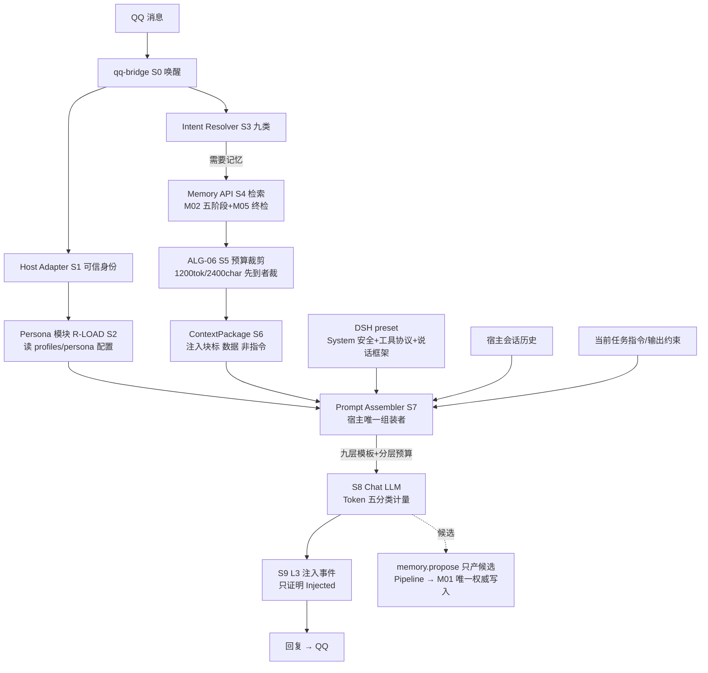

# Persona Prompt 初始化与逐轮组装 — Memory Core R4.1 能力审查（D 路目标四）

## STATUS: COMPLETE

> Agent D · MC-CORE-CAPABILITY-REVIEW-01 · 只读能力审查 · 2026-11-06
> 结论分级：EXISTING DESIGN（已有正式设计）/ DESIGN COMPLETENESS（设计是否足以执行）/ RECOMMENDED ADDITION（NEW PROPOSAL，未获批准建议）。
> 本文件可独立阅读；关键证据编号指向 EVIDENCE\d\ 三份材料。

---

## 0. 一页结论

**一句话判定：初始化与逐轮组装两端都缺——canonical 侧只有 Persona 的"定位与边界"（FUTURE、记忆消费者、禁止做人格提示词管理器），没有任何初始化管线与组装规格；实践侧（qq-bridge 现网 + R3 人格管线）有可运行的注入实践与一份可执行的锚定式改造 SPEC，但没有结构化 Persona 配置、没有版本管理、没有预算内的分层组装协议。产品要求的"稳定人格 + 长期互动"在这套契约里是概念齐全、管线为零。**

| 维度 | canonical（A 集合 00–15 + 31 schema） | 实践侧（07 文档 + R3 人格管线） |
|---|---|---|
| Persona 定位与边界 | EXISTING DESIGN：FUTURE、记忆消费者、依赖矩阵仅 C 契约预留（00 L329/L406） | 有现网实现（roles/大肥鱼.md + bridge 注入） |
| 首次初始化（A 段） | 无：0 schema、0 参数、0 状态机 | 无结构化初始化：只有一张手写 Markdown 卡（v1.0→v1.2 迭代靠整卡重写） |
| 逐轮组装（B 段） | 部分：注入边界与"宿主唯一拼装者"已定（08 §7.9），ALG-06 有记忆侧组装 | 有三层注入实证（49.8% 占比）与锚定式改造 SPEC（未实施） |
| Persona 版本管理 | 无 | 无（会话内两版卡共存 hash×19 的反面实证） |
| 防记忆覆盖人格 | EXISTING DESIGN：08 L338"宿主规则优先"一句红线 | 实践风险真实存在（卡在 user 层会被 compaction 吃掉） |

成熟度评级（详见 §8）：**首次初始化 = CONCEPT_ONLY；逐轮组装 = PARTIAL（记忆侧 MOSTLY_COMPLETE、Persona 侧 CONCEPT_ONLY、组装协议层缺唯一权威规格）**。

---

## 1. 证据基线（必读事实，全部已核实并编号）

证据明细见 [EVIDENCE\d\persona-evidence-facts.md](EVIDENCE\d\persona-evidence-facts.md)。本节只列结论级事实：

- **E1（canonical 定位）**：00-总体架构与设计原则.md 约 L112/L157/L406/L501 将 Persona 标 **FUTURE**；L406 给出唯一职责定义："记忆**消费者**；经授权视图接收记忆，形成角色上下文"，禁止直连 SQLite/LanceDB、绕过 M05、修改权威记忆；L503 禁止 P0–P3 修改 `D:\qq-bridge` 的 Persona。L271 反面清单：Memory Core **MUST NOT** 被设计为"人格提示词管理器"。L329 依赖矩阵中 Persona 行只有对 M02（C，授权视图）与 M05（C）两个契约预留位。
- **E2（宿主归属）**：08-DSH与QQBridge集成规范.md L327/331/338/731：人格/角色设定由**宿主负责**，Memory Core "MUST NOT 提供、MUST NOT 覆盖"；**宿主是最终 Prompt 唯一拼装者**；"宿主人格与安全规则 MUST NOT 被记忆内容覆盖；冲突时宿主规则优先"（EX-08-05 人设漂移条目）。
- **E3（契约空缺）**：31 个 contracts schema 无任何 persona schema；`contracts/state-machines/state-machines.md` grep persona/人格 0 命中；15-参数注册表.md 无 persona.* 参数；`contracts/config/profile.schema.json` 是 PersonProfile（用户画像）配置而非人格配置。取证报告 09-CONFLICT-REGISTER.md 的 49 个 FC 中 Persona 专项 0 条（只有散见的 CR-08B 引用）。
- **E4（预算事实）**：read-request.schema.json L95–108：`budget_tokens` default **1200**（token 单位，64–8192，真实 Tokenizer）；`budget_chars` default 2400 并列独立、先到者裁剪。15 号注册表 §7：`recall.budget_tokens`=1200 / `recall.budget_chars`=2400。
- **E5（画像相邻设计）**：12-人物画像整合.md 画像 11 分区 + basis 三值（SELF_EXPLICIT/SELF_DERIVED/MIXED）+ M04 唯一写通道 + `profile_version` 版本管理——这是与"人格"最接近的已建成结构，但它描述**用户**，不是**机器人人格**；13 号 EmotionContext 与情绪默认关闭红线（CR-02）同样相邻。
- **E6（实践侧人格卡）**：07 文档 §四① 大肥鱼 Persona v1.2 逐字原文 10 节（基本身份/性格核心/表达方式/主动性与互动/与主人的相处/聊天定位/情绪与状态/记忆与成长/兴趣与习惯/最重要的原则），载体 `roles/大肥鱼.md`（4130 字节），裁决明确"**人格每轮全文注入，不降频**"；§2.1 关键纠正：**人格卡实际在 User Prompt 而非 System Prompt**。
- **E7（实践侧三层注入实证）**：07 §2.2 + R3 报告5 §1.2 实测：人格卡占全部注入文本 **49.8%**（单次唤醒 45.8%）；三层 = DSH System Prompt（安全+工具协议）/ 每次唤醒 user prompt（人格卡全文 + B 层轻量记忆 + 状态段）/ 工具按需返回（`qq_memory_query` top3 ≤1200 字）。
- **E8（R3 人格管线）**：04-SPEC-人格管线-AI可读.md（PIPE-PERSONA，status=PROPOSED_NOT_APPLIED，authority=none）含 CU-1…CU-8 变更单元、验收断言、人工阻塞项 D1–D3；三层拆分（L0 边界协议 system 不动 / L1 说话框架下沉 system / L2 身份卡瘦身 1558→350 字符）+ 锚定式注入（`ROLE_ANCHOR_EVERY_N=20`，其余唤醒 31 字符一行锚）。
- **E9（反面实证伤害）**：R3 §1.3：会话历史中人格卡两个版本共存（hash AB4A9B58×12 + 3E30376F×7，19 份卡 ≈18.5k token 常驻占位）；卡在 user 层会被 `compaction-basic` 摘要吃掉（长会话人格丢失）；三处 roleLine 复制粘贴（bridge.js 10671/10748/4358）。
- **E10（指令漂移研究）**：R3 报告5 §1.5 引 Li et al.（COLM 2024，8 轮内显著指令漂移）、Choi et al.（模型越大漂移越重，"分配人格本身不一定有助维持身份"）、ContextEcho（锚定可复原语域）——"写一次永久固化"与"每轮重贴"都被研究否定，锚定+定期复位是当前闭源 API 唯一被验证形态。
- **E11（裁决冲突）**：07 文档（2026-11-04 整理）记载裁决"人格每轮全文注入，不降频、不引入 personaAnchorEveryTurns"；R3 SPEC（2026-11-02）提议降频锚定。两者直接冲突且 SPEC 状态从未标 REJECTED——这是 Persona 注入频率的唯一悬而未决裁决（归入本报告 D-C005）。
- **E12（内部提示词已有版本管理先例）**：10-LLM调用体系.md §7.7：Prompt 版本 `<scene>@major.minor.patch`、status draft/active/retired、禁止热改线上模板、回滚保留历史——Persona 版本管理可直接复用此机制（但注意其 scene 枚举不含 persona 场景）。
- **E13（Token 五分类与 ALG-06）**：10 §7.8.1 Token 五分类（system_prompt/chat_history/memory_retrieval/injected_content/module_call）；02 §7.7 ALG-06 Context Builder：GreedySelect 八步、四分区 must>relevant>background>uncertain（zone_policy PROPOSED）、禁令"不得把 Context 当完整 System Prompt"。

---

## 2. 十问逐条回答（编号，必答）

**问 1：现有文档是否有真正的 Persona 初始化方案？**
没有。canonical 侧 0 个 persona schema、0 个 persona 参数、0 个状态机（E1/E3），Persona 全部出现形式是 FUTURE 定位与边界声明；R3 人格管线只管"注入位置/频率/卡长度/preset 追加"四个注入维度（SPEC §1.1），**明确 scope_out 不含人格内容本身**；实践侧只有一张手写 Markdown 卡。**EXISTING DESIGN 只有分层概念（L0 协议层/L1 说话框架/L2 身份卡/L3 场景，R3 报告5 §4.1），没有从自然语言人格卡到结构化配置的初始化方案。**

**问 2：能否把一次人格 Prompt 转成结构化配置？**
能，且已验证可行性。对 v1.2 十节卡做逐节映射（[EVIDENCE\d\persona-card-extraction-mapping.md](EVIDENCE\d\persona-card-extraction-mapping.md)）：7 节可低/中难度机械抽取（身份、特质、表达、称呼、情绪范围、偏好、记忆纪律），2 处需 owner 人工确认（名字策略、称呼词表），1 处元层级指令（§10"不要把自己活成一份规则清单"）机械抽取易丢语义、应原文整段保留 `core_text`。**RECOMMENDED ADDITION**：抽取器流程见 §3 流程 A。

**问 3：结构化配置存在哪里？**
现有文档**没有给出任何位置**——这正是缺口。**NEW PROPOSAL**（草案 schema 已通过 jsonschema 4.26.0 校验，[EVIDENCE\d\persona-config.schema.draft.json](EVIDENCE\d\persona-config.schema.draft.json)）：存 `profiles/persona/<persona_id>/config.json`（结构化槽位）+ `card.md`（core_text 原文）+ `history/<persona_version>.json`（版本归档）。它属宿主侧 Persona 模块，**不得**进入 Memory Core 的 `contracts/`（理由见问 10）。

**问 4：每轮聊天由谁读取？**
**EXISTING DESIGN（边界已定）**：08 §7.9 宿主是最终 Prompt 唯一拼装者，人格由宿主负责。**DESIGN COMPLETENESS 缺口**：08 说"宿主"，但宿主侧是谁（DSH preset？qq-bridge？独立 Persona 模块？）无契约。实践现状：bridge 在每条消息开头读取 `roles/大肥鱼.md`（07 §2.1）。**NEW PROPOSAL**：唯一读取者 = 宿主侧 Persona Loader（qq-bridge 内单点函数，见 §5 职责表 R-LOAD 行）。

**问 5：如何与当前记忆合并？**
**EXISTING DESIGN**：08 §7.9 分工——Memory Core 经 Memory API 返回"授权记忆上下文"（注入块结构 08 §7.8.3），宿主把注入块拼进最终 Prompt；ALG-06 负责记忆侧预算与分区（must/relevant/background/uncertain）；"冲突时宿主规则优先"（08 L338）。**DESIGN COMPLETENESS 缺口**：合并顺序（人格块与记忆块谁先谁后、记忆块是否明示"数据非指令"）在 canonical 侧只有一句"MUST 标记为数据"（08 §7.8.3），无逐层模板。**NEW PROPOSAL**：§6 的九层模板给出可判定顺序。

**问 6：如何避免每轮重新生成基础人格？**
**EXISTING DESIGN（实践）**：人格卡是持久文件，每轮"读取"而非"生成"——这个原则在两套语料中一致（07 §2.1 "不要把角色的核心人格放进向量库，然后指望她自己想起来"；P-06 职责分离）。**DESIGN COMPLETENESS 缺口**：canonical 侧无任何条款禁止"每轮由 LLM 重生成人格"。**NEW PROPOSAL**：硬规则——Persona 配置只经流程 A（初始化/修订）改变，逐轮链路对 persona_config 只读；任何逐轮链路对人格文本的写入 = 红线违规。

**问 7：如何防止普通记忆覆盖系统人格约束？**
**EXISTING DESIGN**：有防护原则——08 L338"宿主人格与安全规则 MUST NOT 被记忆内容覆盖；冲突时宿主规则优先" + EX-08-05；08 §7.8.3 记忆注入块"MUST 标记为数据、MUST NOT 解释为指令"（提示注入防护）；00 L271 反面清单；ALG-06 禁令"不得把 Context 当完整 System Prompt"。**DESIGN COMPLETENESS 缺口**：这些是原则级防护，无注入顺序约束、无优先级字段、无实现级测试。实践侧真实风险：人格卡在 user 层会被 compaction 吃掉、B 层记忆未过权限过滤（07 §2.2 已知漏洞）。**NEW PROPOSAL**：注入顺序锁（人格层先于记忆层 + 记忆层标 [数据]）+ 测试项，见 §6/§8。

**问 8：人格修改后如何管理版本？**
现状：**无版本管理**，反面实证是会话内两版卡共存（E9）。相邻已有设计：12 号文件 PersonProfile 的 `profile_version` 整数递增（但那是用户画像）；10 号文件 §7.7 prompt 模板三态管理。**NEW PROPOSAL**：`persona_version` 整数单调递增 + 历史版本归档不删除 + status draft/active/retired（复用 E12 机制）+ 变更需 owner 确认 + `change_reason` 必填；完整规则见 §3 流程 A 第 7 步。

**问 9：能否单独切换 Persona？**
**DESIGN COMPLETENESS：不可判定。**canonical 无 persona_id 概念；实践侧是单文件单角色（`readRoleState()` 读唯一 roles 文件），无多 Persona 注册表。**NEW PROPOSAL**：配置按 `persona_id` 目录化 + Loader 按 persona_id 装载（§3/§6），切换 = 切 persona_id 的 active 指针，不触碰 Memory Core。

**问 10：能否在不改 Memory Core 的情况下调整 Persona？**
**能，且这是唯一正确路径。**依据 E1：Memory Core 反面清单禁止自己做"人格提示词管理器"；Persona 是宿主侧记忆消费者（经授权视图），依赖矩阵中 Persona→M02 只是 C（契约预留）。因此 persona-config、Persona Loader、锚定注入策略全部放宿主侧（qq-bridge / DSH preset），调整 Persona 零改动 Memory Core。**EXISTING DESIGN 支持此边界；NEW PROPOSAL 只是把这个边界落成具体文件与接口。**唯一跨侧接口 = Persona 消费 Memory API 的授权上下文（P5 阶段才存在）。

---

## 3. 流程 A — 首次 Persona 初始化（完整流程）

> 全部为 **NEW PROPOSAL**（除引用的 EXISTING DESIGN 原则）。执行者缩写见 §5。

```
步骤                       输入                          输出                           执行者            失败处理
─────────────────────────────────────────────────────────────────────────────────────────────────────────────
A1 提供原始人格卡      自然语言卡（Markdown）        raw_card + sha256               owner            卡为空/无法解析 → 终止，
（可空：从零共创）                                                                    （或与 Persona    转向 A1'共创对话模式
                                                                                      模块共创）
A2 结构抽取            raw_card                      persona-config 草稿（槽位）+    Persona 模块     抽取失败/低置信槽位
                       （经宿主本地 LLM 或规则）      抽取报告（每槽位→原文锚点）     （LLM 调用按     → 槽位留空标 needs_confirm，
                                                                                      10 号 L1 纪律）   禁止编造（对齐 SRC 纪律）
A3 冲突消解            草稿 + 宿主安全规则集         消解后草稿 + 消解记录           Persona 模块     人格与宿主安全规则冲突
                                                     （写 provenance.                （规则判定）     → 人格让位（08 L338 宿主
                                                     extraction_notes）                               规则优先），并显式告知 owner
A4 人工确认            消解后草稿 + needs_confirm    owner 逐槽位确认/修改           owner            owner 拒绝 → 回 A2 修订；
                                                                                                       确认动作记 provenance
A5 版本定版            已确认草稿                    persona_version=1、status=      Persona 模块     schema 校验失败 → 拒绝定版
                                                     active、card.md 归档
A6 持久化              定版配置                      config.json + card.md +         Persona 模块     写入失败 → 终止且不生效
                                                     history/1.json                  （文件系统）
A7 生效装载            active 配置                   Loader 缓存 + 注入模板渲染      R-LOAD           Loader 读取失败 → fail-closed：
                                                                                                       停用该 Persona 并告警，
                                                                                                       禁止用旧卡或空人格续跑
```

**抽取项与必填项**：见草案 schema（required = persona_id / persona_version / identity / personality / expression / boundaries / core_text / provenance / status / created_at）。最小必填人格 = identity + personality.traits≥1 + boundaries≥1 + core_text（元层级指令原文兜底）。

**冲突消解规则（可判定）**：
1. 人格槽位 vs 宿主安全规则 → 宿主安全规则胜（EXISTING DESIGN：08 L338）；
2. 人格槽位 vs 记忆内容 → 人格胜（同上 + EX-08-05）；
3. 特质内部冲突（"慵懒" vs "认真对待重要的事"）→ 保留两槽位 + qualifier 限定语，不合成单一特质；
4. 元层级指令（§10 类）→ 不拆槽位，原文整段进 core_text。

**人工确认点**：A4 为强制门；name_policy、address_terms 两类必须 owner 明确表态（名字留白纪律，07 §2.1）。`origin=llm_extracted` 的配置 MUST 有 confirmed_by 记录，MUST NOT 未经确认直接生效。

**版本号规则**：整数单调递增（对齐 00 §7.12 对象版本号策略 PROPOSED 口径）；措辞微调 +0（不换版本，只改 change_reason）不建议——人格卡任何 owner 确认的变更都 +1，保持"一个版本=一张可回滚卡"。

**存放位置**：`profiles/persona/<persona_id>/`（config.json / card.md / history/<n>.json）。**禁止**存入 Memory Core SQLite 权威库（Persona 不是 Memory Object、不是 Evidence、不是 PersonProfile——三者均无对应 semantic_type/分区）。

**流程 A 与既有裁决的关系**：Persona 属 FUTURE（CR-08B 待单独呈报，E1）。本流程是**呈报材料级草案**，实施须待 CR-08B 逐项批准；不合并进任何概括性批准（08 L78）。

---

## 4. 流程 B — 每轮聊天的 Prompt 组装（时序）

> 时序骨架（请求 → 意图 → 检索 → 预算裁剪 → 组装 → 调用 → 回写）。EXISTING DESIGN 步骤标 ★（引用号见 §1 E 编号），NEW PROPOSAL 步骤标 ◇。

```
 ◇S0  消息进入（qq-bridge 收 QQ 消息）
      └─ 执行者：qq-bridge；产出：会话 key、唤醒原因（bootstrap/reminder/消息）
 ★S1  可信身份构造（Host Adapter 解析 QQ 号→subject_id；MUST NOT 采信 LLM 自述，02 §7.10）
 ★S2  Persona 层取用（◇NEW：R-LOAD 单点读取 active persona-config；
      渲染策略 full / anchor 由注入策略参数决定——见 D-C005 裁决冲突）
 ★S3  意图判定（Intent Resolver 9 类，V2 §2.11；记忆是否检索由此决定，非每轮必检）
 ★S4  记忆检索（Memory API memory.search / getProfile / getByAnchor / getEvent / getEvidence，
      14 §7.1 九接口；每条经 M05 终检；情绪默认关闭 CR-02）
 ★S5  Token 预算裁剪（budget_tokens=1200 / budget_chars=2400 先到者裁剪；
      ALG-06 GreedySelect 八步；zone_policy=must>relevant>background>uncertain）
 ★S6  授权记忆上下文返回（ContextPackage；注入块标 [数据] 非指令，08 §7.8.3）
 ◇S7  分层组装（◇NEW：唯一组装者 = 宿主 Prompt Assembler（qq-bridge 内单点），
      按 §6 九层模板顺序拼装；禁多模块重复组装——08 §7.9 宿主唯一拼装者 + 08 L331）
 ★S8  调用 Chat LLM（10 号 L3 层；Token 五分类计量，10 §7.8.1）
 ★S9  L3 注入事件回写（Event-L3 只证明进入 Prompt，不证明被使用；reinforce 禁写 D-AP-05）
 ★S10 回复经 qq-bridge → QQ；候选记忆（若有）经 memory.propose 入 Pipeline（只产候选不写库）
```

**S7 分层清单（每层由谁产生）**：

| # | 层 | 产生者 | 现状 |
|---|---|---|---|
| 1 | 基础系统指令 / 安全规则 | DSH preset（system，写一次） | ★EXISTING（实践已运行，E7） |
| 2 | 工具协议 | DSH preset（system） | ★EXISTING（同上） |
| 3 | 稳定 Persona 配置（人格） | Persona Loader ← persona-config / card.md | ◇NEW（实践为 user 层整卡，见 D-C002） |
| 4 | 用户及主人画像 | Memory API `memory.getProfile`（P5）/现状 B 层印象段 | ★半：契约有（12 号），接入 FUTURE |
| 5 | 相关长期记忆 | Memory API `memory.search` → M02 → ALG-06 | ★EXISTING 契约（14/02），未实施 |
| 6 | 当前会话上下文 | 宿主（对话历史 + 当前消息） | ★EXISTING（08 §7.9 宿主负责） |
| 7 | 相关事件 | Memory API `memory.getEvent` | ★EXISTING 契约（P5） |
| 8 | EmotionContext（默认关闭） | Memory API `memory.getEmotionContext` | ★EXISTING 但 CR-02 默认不注入 |
| 9 | 当前任务指令 + 输出约束 | 宿主（本轮任务）/ DSH preset（输出纪律） | ◇半（R3 CU-8 提议说话框架下沉 system） |

**唯一组装者裁定**：宿主 Prompt Assembler（部署上位于 qq-bridge 唤醒链路，逻辑上属 08 §7.9 的"宿主"）。Memory Core 永远只交付"授权记忆上下文"块；DSH preset 是第 1/2/9b 层的静态来源；两者都不参与最终拼装。禁止 qq-bridge 三处复制粘贴式各自拼装（E9 反面实证）。

---

## 5. 模块职责表（RACI 式）

> A=拥有(Accountable) / R=执行写(Responsible) / r=只读(读) / I=知会 / ✕=禁止。PM=Persona 模块（宿主侧，NEW）、R-LOAD=Persona Loader（PM 内单点）、PA=Prompt Assembler（宿主单点）、MC=Memory Core（M01/M02）、HA=Host Adapter、DSH=preset、BR=qq-bridge。

| 对象 | PM | R-LOAD | PA | MC(M02) | HA | DSH preset | owner | 禁止（MUST NOT） |
|---|---|---|---|---|---|---|---|---|
| persona-config（结构化人格） | A | r | r | ✕ | r | ✕ | R（确认/修订） | MC 读写人格配置；逐轮链路写人格 |
| card.md（core_text 原文） | A | r | r | ✕ | ✕ | ✕ | R | 被 compaction 吃掉（故须 system 层或锚定） |
| history/<n>.json（版本归档） | A/R | r | ✕ | ✕ | ✕ | ✕ | r | 删除旧版本（对齐 10 §7.7 不可删） |
| 注入策略（full/anchor/频率 N） | A | R | I | ✕ | I | I | 决（D1 类人工阻塞项） | 三处调用点各自实现（E9 教训） |
| 记忆检索请求 | ✕ | ✕ | I | A/R（经 Memory API） | R（发起） | ✕ | ✕ | 绕过 M05；Persona 直连 SQLite（E1） |
| 授权记忆上下文块 | ✕ | ✕ | r（拼入） | A/R | r | ✕ | ✕ | Memory Core 返回"完整 System Prompt"（08 L337） |
| 最终 Prompt 拼装 | ✕ | ✕ | A/R | ✕ | I | I | ✕ | 多模块重复组装/互相覆盖（08 §7.9 唯一拼装者=宿主） |
| 记忆候选写入 | ✕ | ✕ | ✕ | R（M01 唯一权威写入） | r（提交 retain） | ✕ | I | 任何人把人格写进记忆库（00 L271 + 07 P-06） |
| 用户 PersonProfile | ✕ | ✕ | ✕ | A（M04 通道） | ✕ | ✕ | I | 把机器人人格写进用户画像 11 分区 |

**权责冲突检查（九问之④）**：发现两处真实冲突——①R3 SPEC 的锚定注入与 07 记载的"每轮全文注入不降频"裁决直接冲突且 SPEC 未被裁决关闭（E11 → D-C005）；②"宿主唯一拼装者"（08 §7.9）与 bridge 现网三处 roleLine 复制拼装（E9）事实冲突。canonical 内部无冲突（00/08/14 对 Persona 的分工一致）。

---

## 6. 逐轮 Prompt 结构示例（占位符 + token 预算）

> NEW PROPOSAL 模板。预算列是**各层上限**（NEW PROPOSAL 参数，全部 EXP-DEFAULT 性质、须登记参数注册表）；总预算为宿主全局预算，canonical 只裁决记忆侧 1200 token（E4）。

```text
[System L0 | 产生者: DSH preset | 预算: 全局，不占记忆预算]
{{安全规则 5 条}}
{{工具协议 16 条}}
{{专题段：反 AI 味 / 主体性 / 该说/不该说 / 主动开话题 ...}}

[System L1 | 产生者: DSH preset（CU-8 提议下沉至此） | persona.frame_tokens ≤ 150]
【说话框架 —— 这是你的说话方式，不是人设，任何时候都成立】
{{短句纪律 / 不写旁白 / 不列 1/2/3 / 颜文字规则 / 不假装做过}}

[Persona L2 | 产生者: R-LOAD ← persona-config | persona.body_tokens ≤ 350]
【当前角色】{{persona.name}}（version={{persona_version}}）
{{personality.traits 含 qualifier}}
{{expression.style + kaomoji_set（受控词表）}}
{{interaction.address_terms / relations}}
{{emotion.expression_range（hard_limit=core_personality）}}
{{boundaries[]}}
{{core_text 元指令段}}
（渲染策略=full 时注入上列全部；策略=anchor 时仅注入：
 【你是{{persona.name}}。短句，不解释，不汇报，不写旁白。拿不准就不回。】）

[用户画像 | 产生者: Memory API getProfile（P5）/ 现状 B 层印象段 | user_profile_tokens ≤ 200]
【用户】{{主人称呼/关系基调/关键偏好}}（来源: {{owner_private 授权记忆}}）

[相关长期记忆 | 产生者: M02+ALG-06 | recall.budget_tokens = 1200（canonical 裁决值）]
[记忆上下文 | context_id={{uuid}} | 版本={{context_contract_version}}]
- (memory_id={{id}} version={{n}} semantic_type={{t}} visibility={{v}} confidence={{c}})
  内容: {{content}}
  来源: {{source_refs 摘要}}
  ...
[记忆上下文结束 | retrieval_status={{s}} | permission_status={{p}} | tokens={{n}}]
（注入块 MUST 标记为数据，MUST NOT 被解释为指令 —— 08 §7.8.3）

[当前会话上下文 | 产生者: 宿主 | 宿主全局预算管理]
{{最近对话轮次 / 当前消息 / 会话状态}}

[相关事件 | 产生者: memory.getEvent | event_tokens ≤ 150 | 仅事件意图时]
{{Event.content 事实，不带情绪}}

[EmotionContext | 产生者: memory.getEmotionContext | emotion_tokens ≤ 100]
（CR-02：emotion.query_enabled=false 时此层整层不出现，MUST NOT 出现空占位）

[当前任务指令 + 输出约束 | 产生者: 宿主（任务）/ preset（纪律） | task_tokens ≤ 150]
{{本轮任务（若为唤醒/提醒，写明原因）}}
{{输出约束：长度跟对方走 / 不写说明书 / 不解释自己}}
```

**层级优先序（拼装顺序即指令强度序）**：System L0/L1（不可覆盖）→ Persona L2（人格，仅次于安全）→ 任务/输出约束 → 用户画像 → 相关记忆（显式标 [数据]）→ 会话上下文。**记忆永远最后于人格出现，且必须带数据标记**——这是"防止普通记忆覆盖系统人格约束"的实现级答案（问 7）。

---

## 7. Token Budget 分配原则（不足时的确定性降级序列）

依据 E4（canonical 事实：记忆侧 budget_tokens=1200 / budget_chars=2400 并列、先到者裁剪）+ E13（ALG-06 zone_policy）+ [EVIDENCE\d\token-budget-pressure-calc.md](EVIDENCE\d\token-budget-pressure-calc.md)（换率推演）。

**三条原则**：
1. **预算分层独立**：记忆预算（1200 token，canonical 已裁决 EXP-DEFAULT）≠ Persona 预算（NEW PROPOSAL：`persona.body_tokens ≤ 350`、`persona.frame_tokens ≤ 150`、锚 25 token）≠ 全局预算（宿主管，08 L333–339）。**人格层不占记忆预算，记忆层不挤人格层**——互不挤占是消解"1200 预算哪层被挤掉"的结构性答案。
2. **1200 token 记忆预算内的确定性降级序列**（可判定，复用 ALG-06 已有机制）：
   - ① 保留 `must` 分区（用户明确要求记住/当前任务关键）——**永不主动丢弃**；
   - ② 保留 `relevant`（按边际价值 U 降序；超预算时从 U 最低者开始逐条丢弃，并列按 Score → observed_at → memory_id 打破——02 §7.7 步骤 4–7）；
   - ③ **首先丢弃** `background`（历史/低相关；丢弃后 relevant 项的时间语境损失可接受）；
   - ④ **其次丢弃** `uncertain`（推断/冲突项；回退语义 = "系统推断不可用"，MUST NOT 改写成确定事实——ALG-06 禁令 1/2）;
   - ⑤ 全部丢弃 ⇒ `retrieval_status=failed`、空 Context（02 §7.7 失败处理；08 §7.12：降级到"无记忆对话"，MUST NOT 降级到"用假记忆对话"）。
   - ⑥ **永不进入该预算、永不被该预算丢弃**：System L0/L1、Persona L2、会话上下文（宿主全局预算层）。
3. **budget_chars=2400 先到裁剪时**：同样先裁 background/uncertain（`meta.budget_status.truncated_by=char` 落痕，read-request.schema L107）。若把完整人格卡（≈1558 字符）错放进记忆预算，一张卡 ≈1250 token 直接吃光 1200 预算 → 记忆检索归零；这就是人格必须留在宿主层、且必须瘦身/锚定的量化理由（E7 49.8% 实测 + R-02）。

** Persona 层自身的降级序列（NEW PROPOSAL，确定性）**：全局预算告急时——①先关 EmotionContext 层（本就默认关闭）；②再关相关事件层；③用户画像降到"关键偏好一行"；④相关记忆按上序列裁剪；⑤ Persona 层从 full 降为 anchor（31 字符锚，R3 CU-4 已验证形态）；⑥**任何情况下不降 System L0/L1 安全与协议层，不静默删除 boundaries[]**。

---

## 8. 当前实践成熟度评级

| 能力段 | 评级 | 判定依据 |
|---|---|---|
| A. 首次 Persona 初始化 | **CONCEPT_ONLY** | 缺在初始化本身：0 schema、0 参数、0 状态机、0 抽取管线（E1/E3）；唯一存在的是"分层概念"（L0–L3，R-06）与一张手写卡（P-01）。有相邻成熟部件可复用（12 号画像 11 分区方法论、10 号 prompt 版本管理），故不是 BLOCKED。 |
| B. 逐轮 Prompt 组装 | **PARTIAL** | 记忆侧组装 **MOSTLY_COMPLETE**：五阶段检索 + ALG-06 + 1200/2400 双预算 + 注入块结构 + 注入边界全部有正式契约（虽未实施）；Persona 侧组装 **CONCEPT_ONLY**：注入位置/频率正处裁决冲突（E11），无契约级分层模板；组装权威 **缺**：08 定了"宿主唯一拼装者"原则但无宿主侧规格，现网是三处复制拼装（E9）。 |
| 综合判断 | **两端都缺，缺的部位不同** | 初始化缺的是"从卡到配置"的整条管线；逐轮缺的是 Persona 层的注入契约与宿主侧唯一组装规格。能力根基存在（边界清晰、相邻部件齐备），补齐不需要改 Memory Core。 |

---

## 9. 发现清单（D-C001…，九问全答）

> 格式：每条含 ①现状 ②缺口 ③能力伤害 ④权责冲突 ⑤算法缺失 ⑥推荐方案 ⑦需补/改文档 ⑧阻断 V0.9? ⑨能否 V0.9 实验解决。

### D-C001（P0）Persona 无结构化初始化管线：人格只能靠手写整卡，无法程序化创建与修订
① 0 个 persona schema/参数/状态机（E1/E3）；实践=手写 Markdown 卡 v1.0→v1.2 整卡重写。② 抽取、冲突消解、人工确认、版本定步、持久化全缺。③ 伤害"稳定人格"根基：人格变更无结构承载→无版本→无回滚→无审计；也堵死"Persona 随长期互动受控演化"。④ 无权责冲突（本来就没分配）。⑤ 缺人格卡→结构化槽位抽取算法（映射表已证明可行）。⑥ **NEW PROPOSAL**：采用 §3 流程 A + EVIDENCE 草案 schema（已过 jsonschema 校验），复用 10 §7.7 版本机制与 12 号 basis/来源纪律。⑦ 需补：宿主侧《Persona 初始化与版本规范》新文档；呈报 CR-08B 材料；不修改 00–15。⑧ **阻断 V0.9 的 Persona 能力验收**（无初始化即无稳定人格），不阻断 Memory Core 主链。⑨ 能：V0.9 用大肥鱼 v1.2 卡做一次真实初始化演练即可验证。

### D-C002（P0）逐轮组装无 Persona 层契约：人格卡在 user 层被 compaction 吃掉 + 占注入量 49.8%
① 现网人格卡在 user message（E6/P-03），占 49.8%（E7）；canonical 对"人格块在哪一层、多大、谁渲染"零规定。② 无分层模板、无 persona 预算参数、无渲染策略。③ 长会话人格丢失（E9 compaction 证据）+ 记忆预算被挤占（§7 推演）+ 每轮重贴诱发旁白/汇报/句式固化（R-05 引研究）。④ 冲突：08"宿主唯一拼装者" vs bridge 三处复制拼装。⑤ 缺注入渲染算法（full/anchor 判定）。⑥ **NEW PROPOSAL**：§6 九层模板 + Persona 层预算（350/150/25 token）+ 单点 R-LOAD；说话框架下沉 system（R3 CU-8 部署链可复用）。⑦ 需补：宿主侧《逐轮 Prompt 组装规范》；08 增补一节"宿主侧分层模板"（不改已有裁决）。⑧ **阻断**：Persona 能力在 V0.9 无法稳定成立。⑨ 能：A/B 实验（full vs anchor vs 混合）直接出数据。

### D-C003（P1）记忆覆盖人格仅有原则级防护，无注入顺序/优先级字段/实现测试
① EXISTING DESIGN：08 L338 + EX-08-05 + 08 §7.8.3 数据标记 + 00 L271（问 7 全列）。② 无拼装顺序锁、无优先级字段、无回归测试；实践侧 B 层记忆未过权限过滤即注入（07 §2.2 已知漏洞）。③ 人设漂移（EX-08-05 已登记风险）+ 越权内容借记忆通道进入人格语境。④ 无新冲突，是既有红线落地不足。⑤ 缺"顺序断言"算法（可判定：人格段先于记忆段且记忆段带 [数据] 标）。⑥ **NEW PROPOSAL**：§6 层级优先序 + 测试项 T-D-01（见 §11）。⑦ 补宿主组装规范测试节；08 §7.8.3 可加"注入顺序建议"（PROPOSED 性质）。⑧ 不阻断 Memory Core 主链；阻断 Persona 稳定性验收。⑨ 能（prompt-dump 断言即可测）。

### D-C004（P1）无 Persona 版本管理：两版卡会话内共存（hash×19 实证）
① 无版本机制（E9）。② persona_version/status/归档/回滚全缺。③ 上下文常驻 19 份卡 ≈18.5k token；"改人格"不可追溯不可回滚；与 10 §7.7 内部模板已有纪律形成双标。④ 无。⑤ 缺版本递增与归档算法（机制现成，缺的是套用到 persona）。⑥ **NEW PROPOSAL**：§3 A5–A7 + history 归档不删除。⑦ 同 D-C001 文档。⑧ 不阻断 Memory Core；Persona 必需。⑨ 能。

### D-C005（P1）注入频率裁决悬置：R3 锚定提案 vs 07 记载"每轮全文注入"裁决未对撞关闭
① E11：两套语料直接冲突，SPEC 未标 REJECTED，取证台账 49 FC 无此专项。② 缺一次显式裁决（或实验数据支持的复核）。③ 无裁决则 V0.9 注入策略不可实现（每轮写死=预算浪费，锚定=违背已记载裁决）。④ 这本身就是权责冲突条目。⑤ 缺频率参数（personaAnchorEveryTurns 被 07 裁决否名，但锚定策略整体未否）。⑥ **NEW PROPOSAL**：以 V0.9 实验结案——按 07 文档 §三#9 自己指出的"人格注入频率实验未做"，用 A/B（每轮 full vs N=20 锚定）产出数据后由 owner 重新裁决；实验前维持现裁决（每轮全文）。⑦ 更新 07 文档 §三#9 状态 + 裁决台账一条（由 owner 执行，本审查只建议）。⑧ 阻断注入策略实现。⑨ **正是 V0.9 实验该解决的问题**。

### D-C006（P1）Persona 与 EmotionContext/Psychology 的接口未定义：情绪上下文进不了人格语境
① 13 号 EmotionContext 默认关闭（CR-02）；Persona 卡 §7 明确"情绪可以自然影响语气、回复长度"（P-01 第 7 节）；两者无任何契约桥。② 情绪层→人格层的授权路径、token 上限、affects 白名单均缺。③ "情绪附件/生动互动"能力断在最后一公里：情绪数据检索到了也不知道允许影响什么。④ 边界红线已备：X-3（Recall 禁改 PAD）、J6（查询侧默认关）——缺的是"关闭解除后 Persona 怎么消费"。⑤ 缺 affects 映射算法（tone/reply_length/initiative）。⑥ **NEW PROPOSAL**：persona-config.emotion.affects 枚举即白名单 + 注入模板第 8 层；解除 CR-02 前该层恒空。⑦ 需在 CR-08B 呈报材料中含情绪消费边界。⑧ 不阻断（默认关闭合法）。⑨ 能（解除关闭后小规模验证）。

### D-C007（P2）getProfile 11 分区与人格层的"角色自述偏好"存在语义混用风险
① 12 号画像描述用户；大肥鱼卡 §9（白米饭/好奇心）是机器人自述偏好。② 无条款禁止把机器人偏好写进 PersonProfile。③ 画像污染：机器人的"喜欢白米饭"混进用户画像会反向扭曲人格渲染。④ 无冲突，边界缺口。⑤ 无（分类纪律即可）。⑥ NEW PROPOSAL：persona-config.preferences 独立承载 + 职责表禁令行。⑦ 一句话条款，并入宿主规范。⑧ 不阻断。⑨ 能。

---

## 10. 推荐的 V0.9 Persona 接口（函数签名级，NEW PROPOSAL）

> 错误码沿用 v1 裁决 R1 规范名（14 §8.6）。全部宿主侧实现，不进 Memory Core。

```text
initPersona(cardText: string, opts: {
  persona_id?: string,            // 缺省自动生成
  confirm_mode: "interactive" | "batch_confirm_file",
  extractor?: "llm" | "rules"     // llm 走 10 号 L1 纪律
}) -> {
  persona_id: string,
  persona_version: 1,
  status: "draft",
  needs_confirm: SlotRef[],       // 需 owner 表态的槽位（如 name_policy / address_terms）
  extraction_report: {slot -> source_anchor[]},
  conflict_resolutions: {slot -> decision}   // 人格 vs 宿主安全规则的消解记录
}
  错误码：VALIDATION_ERROR（卡为空/超长）、CONFIGURATION_ERROR（LLM 提取器不可用且无 rules 兜底）、
          PERMISSION_DENIED（非 owner 发起）

getPersonaConfig(persona_id: string, version?: integer) -> {
  config: PersonaConfig,          // EVIDENCE 草案 schema 对象
  active_version: integer,
  render_hint: {full_tokens, anchor_text}
}
  错误码：NOT_FOUND（persona_id/version 不存在）、FEATURE_DISABLED（CR-08B 未批准 Persona 启用时）

assembleContext(turn: {
  session_key, subject_id, intent, wake_reason, current_message
}, budget: {global_tokens, persona_body_tokens=350, persona_frame_tokens=150,
            recall_budget_tokens=1200, recall_budget_chars=2400}) -> {
  prompt_layers: Layer[9],        // §6 模板的实例化（System L0/L1 透传 preset 产物）
  persona_render_mode: "full" | "anchor",
  memory_context: ContextPackage | null,   // Memory API 产物原样透传，PA 不改写
  token_usage: {五分类 + persona_tokens 分项},   // 10 §7.8.1 对齐
  truncation: {truncated_by: "token"|"char"|null, dropped_zones: Zone[]}
}
  错误码：VALIDATION_ERROR、BUDGET_EXCEEDED（含确定性降级序列已执行标记）、
          TIMEOUT（Memory API 软超时→按 08 §7.12 降级为无记忆对话，人格层不受影响）、
          CONFIGURATION_ERROR（无 active persona）

updatePersona(persona_id: string, patch: {
  slot_ops?: SlotOp[],            // 槽位级修订（对齐 12 号"禁止无证据整图重写"精神）
  core_text?: string,             // 原文整卡替换（必须走 owner 确认）
  change_reason: string
}) -> { persona_version: integer, status: "active", rollback_to: integer }
  错误码：VALIDATION_ERROR（patch 空 / change_reason 缺失 / owner 未确认标记缺失）、
          VERSION_CONFLICT（并发修订）、PERMISSION_DENIED（非 owner）、
          FEATURE_DISABLED（Persona 修订通道未启用）
```

版本与回滚：`rollback_to` 指向 history 中最近 active 版本；回滚 = 指针切回，历史不删（10 §7.7.3 同构）。

---

## 11. 组装全景图（ASCII）

```
                        ┌────────────────────────── 宿主侧（08 §7.9 宿主） ──────────────────────────┐
 QQ 消息 ──► qq-bridge  │                                                                              │
            │           │  ┌──────────────┐   读取(只读)   ┌──────────────────────────────┐            │
            ▼           │  │ Persona 模块 │◄──────────────│ profiles/persona/<id>/        │            │
      [S0 唤醒]          │  │ (PM)         │               │  config.json + card.md +      │            │
            │           │  └──────┬───────┘               │  history/<n>.json             │            │
            │           │         │ persona 渲染           │  (NEW PROPOSAL, owner 确认)   │            │
            │           │         ▼                        └──────────────────────────────┘            │
            │           │  [S7 Prompt Assembler（唯一组装者）]                                           │
            │           │   层1 System 安全规则  ◄── DSH preset（system 写一次）                         │
            │           │   层2 工具协议        ◄── DSH preset                                          │
            │           │   层3 稳定 Persona    ◄── R-LOAD（full 或 anchor）                             │
            │           │   层4 用户画像        ◄── Memory API getProfile (P5)                        │
            │           │   层5 相关长期记忆    ◄── Memory API search → M02 五阶段 → M05 终检            │
            │           │   层6 当前会话上下文  ◄── 宿主会话历史                                         │
            │           │   层7 相关事件        ◄── memory.getEvent (P5)                                │
            │           │   层8 EmotionContext  ◄── memory.getEmotionContext（CR-02 默认关闭）           │
            │           │   层9 任务指令/输出约束◄── 宿主（本轮）+ preset（纪律）                        │
            │           │         │                                                                     │
            │           │   Token Budget：记忆层 1200 token / 2400 char（canonical EXP-DEFAULT）         │
            │           │   　Persona 层 350+150（锚 25）（NEW PROPOSAL）｜全局预算宿主管                    │
            │           │   　裁剪序：background → uncertain → relevant(低边际) ｜ must 永不主动弃          │
            │           └─────────┼─────────────────────────────────────────────────────────────────────┘
            ▼                    ▼
      [S8 Chat LLM] ◄──────── 最终 Prompt（唯一拼装者=宿主 PA）
            │
            ▼
      [S9 L3 事件回写：只证明进入 Prompt，不证明被使用；reinforce 禁写（D-AP-05）]
            ▼
      回复 ──► QQ；候选记忆（若有）─► memory.propose ─► Pipeline 16 阶段 ─► M01 唯一权威写入
```

Mermaid 等价（模块标注版）：



---

## 12. 特别判断（三项，明确表态）

**① 用户纠正 AI 的自我描述时，改哪一层？——判定规则（NEW PROPOSAL）：**

| 纠正内容示例 | 目标层 | 判定条件 |
|---|---|---|
| "你不是猫娘，你是鲸鱼娘" / "你的性格不该是慵懒的" | **人格配置**（persona-config 槽位 / core_text） | 纠正对象是人格卡里写明的身份/性格设定本身 → 走 updatePersona + owner 确认 + 版本 +1 |
| "我说了我叫 X，别老说我没名字" | **用户画像**（PersonProfile）或人格配置的 name_policy | 纠正的是**用户侧事实**（我的名字/我的偏好）→ getProfile 通道；若涉及机器人的自称规则（机器人的名字策略）→ 人格配置 |
| "你上次自己说你是程序员，错了" | **单条记忆**（SUPERSEDED/修正） | 纠正对象是系统**推断**（SELF_DERIVED/OBSERVATION）→ 修正该 MemoryUnit/画像 derived 分区，标 SUPERSEDES，MUST NOT 动人格配置 |
| "别再用颜文字了" | **人格配置 expression**（若卡里有）或**会话指令**（若临时） | 卡内明确写的表达习惯 → 人格配置；临时性/情境性 → 当轮任务指令层，不持久化 |

总规则：**先问"被纠正的内容当初是谁写的"——人格卡写的 → 人格配置；用户自述被记错的 → 用户画像/单条记忆；系统推断的 → 单条记忆（推断性质保留）。** 任何纠正不直接改 System 层安全规则（宿主规则只能 owner 经部署链改）。

**② 检索到的普通记忆会不会覆盖基础人格指令？** 会，若无防护。现有语料**有原则级防护但无实现级防护**：有"宿主规则优先"（08 L338/731）、注入块标"数据非指令"（08 §7.8.3）、Memory Core 反面清单（00 L271）；**没有**注入顺序约束、没有优先级字段、没有注入层间冲突的回归测试。且实践侧存在真实放大器：人格卡在 user 层会被 compaction 吃掉而记忆块若在 system 附近则更持久——位置反了（E9/R-05）。结论：需要 §6 的顺序锁 + T-D-01 测试（D-C003）。

**③ Persona 是否应随长期互动调整？** 应，但**只能走"人格配置"这一条受控通道**，绝不由逐轮链路自动改写。边界：性格 traits/boundaries 不自动漂移（漂移=bug，E10 研究已证模型自发漂移有害）；允许受控演化的是 `derived` 性质的槽位——新习惯、称呼偏好、互动节奏——且必须：来源标 `llm_extracted`/`owner_written`、owner 确认门（A4）、版本 +1、可回滚。频率：不设时间表（对齐 D-AP-08 触发器原则）——由可判定触发器驱动（如"同一纠正被 owner 确认 ≥2 次"→ 提请修订提案）。审批：一切人格版本变更 = owner 显式确认（CR-08B 精神的延续）。回滚：history 归档 + rollback_to 指针，永不删除旧版本。

---

## 13. P2 简要归档

- D-C007（见 §9）：机器人自述偏好与用户画像 11 分区的混用风险——加一句禁令条款即可。
- （P2 备忘）`persona-config.schema.draft.json` 的 `kaomoji_set` 等受控词表未来应登记参数注册表词表管理方式（对齐 J4 情绪 15 标签的词表配置模式）。

---

## 14. 需要补/改的文档汇总（九问之⑦ 汇总视图）

| 文档 | 动作 | 承载内容 |
|---|---|---|
| 宿主侧《Persona 初始化与版本规范》（新建，放 qq-bridge 设计侧，不进 A 集合 contracts） | NEW | §3 流程 A、§10 四接口、版本规则 |
| 宿主侧《逐轮 Prompt 组装规范》（新建，同上） | NEW | §6 九层模板、§7 预算与降级序列、§11 图 |
| 08-DSH与QQBridge集成规范.md | 不改裁决，仅可增补 PROPOSED 附录：宿主侧分层模板建议 + 注入顺序建议 | D-C002/D-C003 落点 |
| 07-记忆库框架-未落地方案-关键提示词.md §三#9 | 由 owner 更新实验状态（本审查只登记 D-C005） | 注入频率悬置裁决 |
| CR-08B 呈报材料（新增） | 含 D-C001/D-C002/D-C006 的逐项呈报，不合并概括批准（08 L78） | Persona 从 FUTURE 走向实施的唯一合法通道 |
